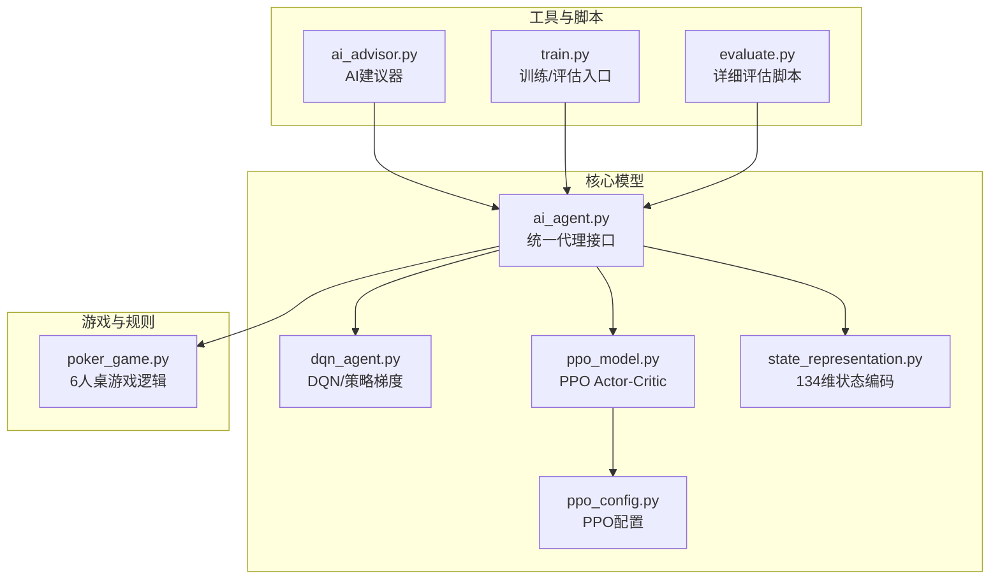
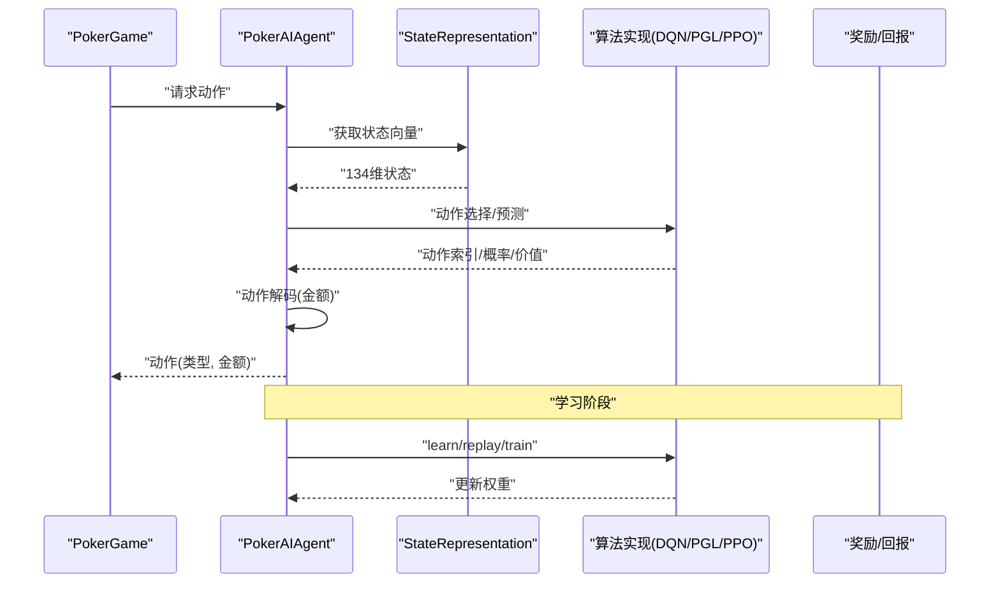
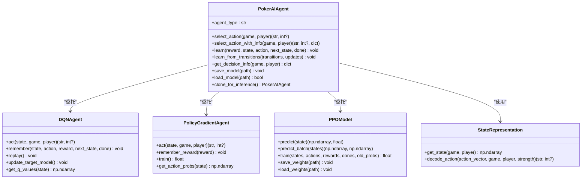
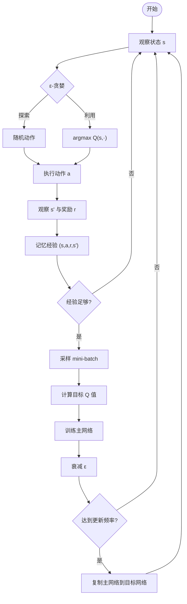
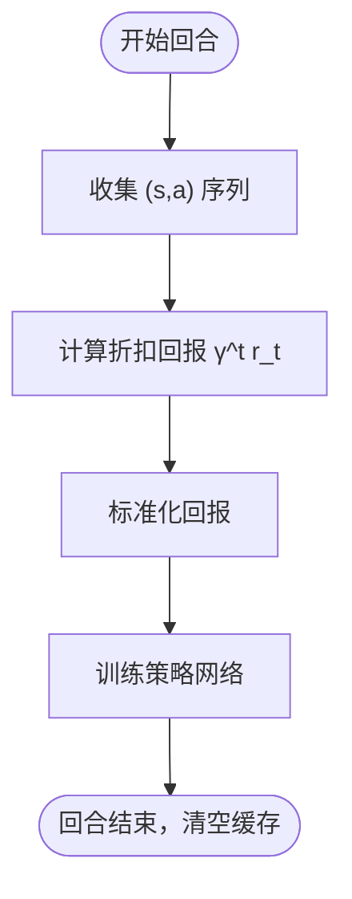
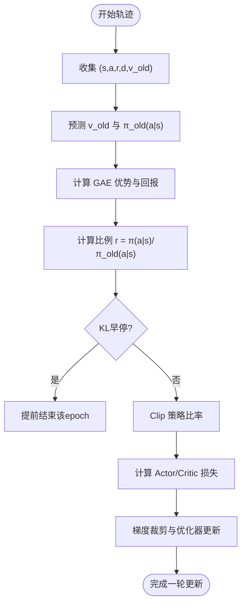
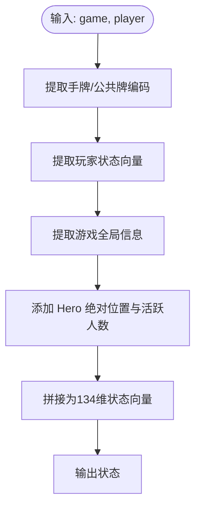
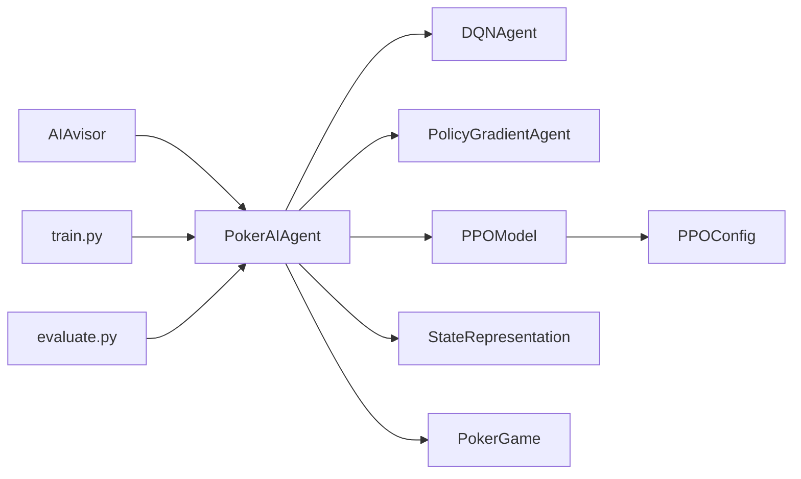

# AI代理系统

<cite>
**本文引用的文件**
- [README.md](file://README.md)
- [ai_agent.py](file://poker_ai/model/ai_agent.py)
- [dqn_agent.py](file://poker_ai/model/dqn_agent.py)
- [ppo_model.py](file://poker_ai/model/ppo_model.py)
- [state_representation.py](file://poker_ai/model/state_representation.py)
- [ppo_config.py](file://poker_ai/config/ppo_config.py)
- [poker_game.py](file://poker_ai/game/poker_game.py)
- [ai_advisor.py](file://poker_ai/advisor/ai_advisor.py)
- [train.py](file://train.py)
- [evaluate.py](file://evaluate.py)
</cite>

## 目录
1. [简介](#简介)
2. [项目结构](#项目结构)
3. [核心组件](#核心组件)
4. [架构总览](#架构总览)
5. [详细组件分析](#详细组件分析)
6. [依赖分析](#依赖分析)
7. [性能考量](#性能考量)
8. [故障排查指南](#故障排查指南)
9. [结论](#结论)
10. [附录](#附录)

## 简介
本项目是一个面向6人桌德州扑克的强化学习AI代理系统，提供统一的PokerAIAgent接口，支持DQN、策略梯度、PPO三种强化学习算法。系统围绕“状态表示-决策-学习”的闭环展开，结合134维状态向量与动作解码器，实现从游戏状态到动作选择再到经验学习的完整流程。同时提供AI建议器、训练与评估脚本，便于快速部署与调优。

## 项目结构
- 核心模块
  - model：统一代理接口与各算法实现
  - game：游戏状态与规则
  - reward：奖励与自对弈训练
  - advisor：AI建议器
  - config：PPO配置
  - utils：检查点工具
- 脚本
  - train.py：训练/评估/演示入口
  - evaluate.py：详细评估与报告

**图示来源**
- [ai_agent.py:55-116](file://poker_ai/model/ai_agent.py#L55-L116)
- [dqn_agent.py:21-62](file://poker_ai/model/dqn_agent.py#L21-L62)
- [ppo_model.py:20-93](file://poker_ai/model/ppo_model.py#L20-L93)
- [state_representation.py:9-46](file://poker_ai/model/state_representation.py#L9-L46)
- [ppo_config.py:18-97](file://poker_ai/config/ppo_config.py#L18-L97)
- [poker_game.py:155-200](file://poker_ai/game/poker_game.py#L155-L200)
- [ai_advisor.py:21-48](file://poker_ai/advisor/ai_advisor.py#L21-L48)
- [train.py:136-200](file://train.py#L136-L200)
- [evaluate.py:110-143](file://evaluate.py#L110-L143)

**章节来源**
- [README.md:46-76](file://README.md#L46-L76)
- [train.py:136-200](file://train.py#L136-L200)
- [evaluate.py:110-143](file://evaluate.py#L110-L143)

## 核心组件
- PokerAIAgent：统一代理接口，封装DQN、策略梯度、PPO三种算法，负责动作选择、学习、决策信息导出与模型保存/加载。
- DQNAgent：深度Q网络，使用经验回放与目标网络，适合离散动作空间。
- PolicyGradientAgent：策略梯度，使用神经网络输出动作概率，适合连续或离散动作空间。
- PPOModel：近端策略优化Actor-Critic，具备价值裁剪、自适应熵、KL早停、学习率调度等优化。
- StateRepresentation：状态编码器，将手牌、公共牌、玩家信息、游戏全局信息、位置与活跃人数等整合为134维向量。
- PPOConfig：集中管理PPO超参数，便于调参与复现。
- PokerGame：6人桌德州扑克游戏状态与规则。
- AIAvisor：AI建议器，基于训练好的模型提供决策建议与可视化数据。

**章节来源**
- [ai_agent.py:55-116](file://poker_ai/model/ai_agent.py#L55-L116)
- [dqn_agent.py:21-62](file://poker_ai/model/dqn_agent.py#L21-L62)
- [ppo_model.py:20-93](file://poker_ai/model/ppo_model.py#L20-L93)
- [state_representation.py:9-46](file://poker_ai/model/state_representation.py#L9-L46)
- [ppo_config.py:18-97](file://poker_ai/config/ppo_config.py#L18-L97)
- [poker_game.py:155-200](file://poker_ai/game/poker_game.py#L155-L200)
- [ai_advisor.py:21-48](file://poker_ai/advisor/ai_advisor.py#L21-L48)

## 架构总览
系统采用“状态表示-决策-学习-反馈”的闭环：
- 状态表示：将手牌、公共牌、玩家状态、游戏全局信息、位置与活跃人数等特征拼接为134维向量。
- 决策：根据算法输出动作概率或Q值，结合合法动作掩码与手牌强度，解码为具体动作与金额。
- 学习：DQN使用经验回放与目标网络；策略梯度在回合结束时训练；PPO使用轨迹级学习与批量更新。
- 反馈：通过奖励与下一状态更新模型权重，形成持续优化。

**图示来源**
- [ai_agent.py:117-156](file://poker_ai/model/ai_agent.py#L117-L156)
- [state_representation.py:137-158](file://poker_ai/model/state_representation.py#L137-L158)
- [dqn_agent.py:127-177](file://poker_ai/model/dqn_agent.py#L127-L177)
- [ppo_model.py:497-638](file://poker_ai/model/ppo_model.py#L497-L638)

## 详细组件分析

### 统一代理接口：PokerAIAgent
- 设计要点
  - 统一动作选择接口：select_action/select_action_with_info，兼容批量与单步。
  - 算法分发：根据agent_type选择DQN、策略梯度或PPO。
  - 合法动作掩码：根据当前下注、玩家筹码与规则生成5维掩码，确保动作合法性。
  - PPO轨迹缓冲：支持批量轨迹写入与阈值触发训练，减少频繁函数调用开销。
  - 决策信息：导出Q值、动作概率、状态价值等，便于分析与建议。
- 关键流程
  - 动作选择：DQN/PGL直接调用算法；PPO先预测概率，再按掩码采样，解码为动作与金额。
  - 学习：DQN经验元组；策略梯度回合结束训练；PPO轨迹级训练。
  - 权重管理：保存/加载、克隆推理副本、目标网络更新（DQN）。

**图示来源**
- [ai_agent.py:55-116](file://poker_ai/model/ai_agent.py#L55-L116)
- [dqn_agent.py:21-62](file://poker_ai/model/dqn_agent.py#L21-L62)
- [dqn_agent.py:216-261](file://poker_ai/model/dqn_agent.py#L216-L261)
- [ppo_model.py:20-93](file://poker_ai/model/ppo_model.py#L20-L93)
- [state_representation.py:137-158](file://poker_ai/model/state_representation.py#L137-L158)

**章节来源**
- [ai_agent.py:55-116](file://poker_ai/model/ai_agent.py#L55-L116)
- [ai_agent.py:117-156](file://poker_ai/model/ai_agent.py#L117-L156)
- [ai_agent.py:248-302](file://poker_ai/model/ai_agent.py#L248-L302)
- [ai_agent.py:303-420](file://poker_ai/model/ai_agent.py#L303-L420)
- [ai_agent.py:421-488](file://poker_ai/model/ai_agent.py#L421-L488)

### DQN：Q-learning机制
- 网络结构：输入134维状态，隐藏层512-256-64，输出5维Q值。
- 经验回放：固定容量队列，随机采样mini-batch进行训练。
- 目标网络：定期复制主网络权重，稳定目标Q值。
- 探索策略：ε-贪婪，随训练逐步衰减。
- 性能优化：预编译预测与训练函数，减少Python调度开销。

**图示来源**
- [dqn_agent.py:117-177](file://poker_ai/model/dqn_agent.py#L117-L177)

**章节来源**
- [dqn_agent.py:21-62](file://poker_ai/model/dqn_agent.py#L21-L62)
- [dqn_agent.py:117-177](file://poker_ai/model/dqn_agent.py#L117-L177)
- [dqn_agent.py:178-211](file://poker_ai/model/dqn_agent.py#L178-L211)

### 策略梯度：梯度估计
- 策略网络：输入134维状态，输出5维动作概率，使用softmax激活。
- 折扣回报：对回合内奖励进行折扣与标准化，作为策略梯度的基线。
- 训练时机：回合结束时使用累积折扣回报进行训练，清空缓存。

**图示来源**
- [dqn_agent.py:262-309](file://poker_ai/model/dqn_agent.py#L262-L309)

**章节来源**
- [dqn_agent.py:216-261](file://poker_ai/model/dqn_agent.py#L216-L261)
- [dqn_agent.py:262-309](file://poker_ai/model/dqn_agent.py#L262-L309)

### PPO：近端策略优化
- 网络结构：Actor（策略网络）与Critic（价值网络）分离，均采用256-256-128-64结构，带LayerNorm与残差连接。
- 优势估计：GAE（广义优势估计），向量化实现，支持裁剪与标准化。
- 更新策略：使用clip的策略比率，价值损失裁剪（基于旧价值），自适应熵正则，KL散度早停。
- 学习率调度：warmup + cosine衰减，混合精度适配，梯度累积。
- 轨迹缓冲：支持批量轨迹写入与阈值触发训练，减少函数调用开销。

**图示来源**
- [ppo_model.py:497-638](file://poker_ai/model/ppo_model.py#L497-L638)

**章节来源**
- [ppo_model.py:20-93](file://poker_ai/model/ppo_model.py#L20-L93)
- [ppo_model.py:276-321](file://poker_ai/model/ppo_model.py#L276-L321)
- [ppo_model.py:497-638](file://poker_ai/model/ppo_model.py#L497-L638)
- [ppo_config.py:18-97](file://poker_ai/config/ppo_config.py#L18-L97)

### 状态表示与动作解码
- 状态维度：134维，包含手牌one-hot、公共牌one-hot、6名玩家状态、游戏全局信息、Hero绝对位置one-hot、活跃人数。
- 动作解码：将动作向量（独热）解码为动作类型与金额，考虑当前下注、底池、玩家筹码与大小盲注。
- 合法性：根据当前下注与玩家筹码生成5维掩码，确保动作合法。

**图示来源**
- [state_representation.py:137-158](file://poker_ai/model/state_representation.py#L137-L158)

**章节来源**
- [state_representation.py:9-46](file://poker_ai/model/state_representation.py#L9-L46)
- [state_representation.py:137-158](file://poker_ai/model/state_representation.py#L137-L158)
- [state_representation.py:225-247](file://poker_ai/model/state_representation.py#L225-L247)

### AI建议器：决策分析与可视化
- 基础建议：手牌强度、期望价值、置信度、对手预测、底池赔率。
- 详细分析：动作分析（弃牌/跟注/不同加注）、胜率估计、风险评估、可视化数据。
- 可视化：手牌强度分布、动作期望价值与风险、胜率对比、底池与筹码演化。

**章节来源**
- [ai_advisor.py:191-342](file://poker_ai/advisor/ai_advisor.py#L191-L342)
- [ai_advisor.py:343-519](file://poker_ai/advisor/ai_advisor.py#L343-L519)
- [ai_advisor.py:520-620](file://poker_ai/advisor/ai_advisor.py#L520-L620)

## 依赖分析
- 组件耦合
  - PokerAIAgent依赖StateRepresentation与具体算法实现，耦合度低，便于扩展新算法。
  - PPOModel依赖PPOConfig，集中管理超参数，便于调参与复现。
  - DQNAgent与PolicyGradientAgent分别封装各自学习逻辑，互不影响。
- 外部依赖
  - TensorFlow/Keras：构建与训练神经网络。
  - NumPy：向量运算与状态表示。
  - Matplotlib/Seaborn：评估报告与可视化（可选）。

**图示来源**
- [ai_agent.py:55-116](file://poker_ai/model/ai_agent.py#L55-L116)
- [ppo_model.py:20-93](file://poker_ai/model/ppo_model.py#L20-L93)
- [ppo_config.py:18-97](file://poker_ai/config/ppo_config.py#L18-L97)
- [poker_game.py:155-200](file://poker_ai/game/poker_game.py#L155-L200)
- [ai_advisor.py:21-48](file://poker_ai/advisor/ai_advisor.py#L21-L48)
- [train.py:136-200](file://train.py#L136-L200)
- [evaluate.py:110-143](file://evaluate.py#L110-L143)

**章节来源**
- [ai_agent.py:55-116](file://poker_ai/model/ai_agent.py#L55-L116)
- [ppo_model.py:20-93](file://poker_ai/model/ppo_model.py#L20-L93)
- [ppo_config.py:18-97](file://poker_ai/config/ppo_config.py#L18-L97)
- [poker_game.py:155-200](file://poker_ai/game/poker_game.py#L155-L200)
- [ai_advisor.py:21-48](file://poker_ai/advisor/ai_advisor.py#L21-L48)
- [train.py:136-200](file://train.py#L136-L200)
- [evaluate.py:110-143](file://evaluate.py#L110-L143)

## 性能考量
- 状态表示
  - 使用one-hot编码与归一化特征，避免稀疏性与量纲差异，提升收敛稳定性。
  - 预计算索引映射与缓存，减少高频路径中的计算开销。
- 算法优化
  - DQN：预编译预测与训练函数，经验回放与目标网络更新频率调优。
  - PGL：回合结束训练，折扣回报标准化，减少方差。
  - PPO：GAE向量化实现、价值损失裁剪、自适应熵、KL早停、学习率warmup+cosine衰减、混合精度与梯度累积。
- 并行与吞吐
  - 训练脚本支持多worker并行采样与评估，RTX 4090D档位自动增大batch与并行度，提升GPU利用率。
- 硬件适配
  - 自动检测GPU并设置内存增长，支持XLA与混合精度，减少显存占用与提升速度。

**章节来源**
- [state_representation.py:47-65](file://poker_ai/model/state_representation.py#L47-L65)
- [dqn_agent.py:64-78](file://poker_ai/model/dqn_agent.py#L64-L78)
- [ppo_model.py:106-199](file://poker_ai/model/ppo_model.py#L106-L199)
- [train.py:55-135](file://train.py#L55-L135)

## 故障排查指南
- PPO更新错误
  - 现象：DNN库或图执行错误导致跳过更新。
  - 处理：尝试禁用XLA与ONEDNN后重跑，或检查GPU驱动与TensorFlow版本。
- 权重加载失败
  - DQN/PG：确保权重文件路径正确，支持.pkl与.h5后缀。
  - PPO：确保actor与critic权重文件同时存在。
- 探索参数设置
  - DQN：ε应在[0.01,1.0]范围内，最小值与衰减率亦应合理设置。
- 合法动作掩码
  - 若出现动作非法，检查当前下注、玩家筹码与大小盲注，确保掩码计算正确。

**章节来源**
- [ai_agent.py:321-332](file://poker_ai/model/ai_agent.py#L321-L332)
- [ai_agent.py:350-358](file://poker_ai/model/ai_agent.py#L350-L358)
- [dqn_agent.py:178-207](file://poker_ai/model/dqn_agent.py#L178-L207)
- [dqn_agent.py:313-323](file://poker_ai/model/dqn_agent.py#L313-L323)
- [ppo_model.py:640-659](file://poker_ai/model/ppo_model.py#L640-L659)
- [ai_agent.py:529-553](file://poker_ai/model/ai_agent.py#L529-L553)

## 结论
本系统通过统一的PokerAIAgent接口，将DQN、策略梯度与PPO三种算法无缝集成，配合134维状态表示与动作解码器，实现了从状态到动作再到学习的完整闭环。PPO在大规模并行与GPU利用率方面表现突出，适合长期训练；DQN与策略梯度在简单场景与快速验证方面具有优势。建议根据任务规模与资源选择合适算法，并结合本指南的参数调优与最佳实践进行部署。

## 附录

### 算法差异与适用场景
- DQN：适合离散动作空间，学习稳定但可能陷入局部最优；适合初学者快速上手与小规模实验。
- 策略梯度：适合策略网络直接输出动作概率，训练简单；适合回合制、奖励延迟明显的场景。
- PPO：策略梯度的高级版本，具备更强的稳定性与样本效率，适合大规模并行与长序列决策。

### 性能对比与建议
- PPO：在RTX 4090D上建议使用较大batch（如256）与较少更新轮次（如4），结合warmup与cosine衰减，提升吞吐与稳定性。
- DQN：关注经验回放容量、目标网络更新频率与ε衰减策略，避免过拟合与不稳定。
- 策略梯度：重视折扣回报的标准化与回合结束训练时机，减少方差与提升收敛速度。

### 状态表示与AI决策集成
- 状态维度：134维，涵盖手牌、公共牌、玩家状态、游戏全局信息、位置与活跃人数。
- 决策流程：状态编码→动作概率/Q值→合法掩码→动作解码→金额计算。
- 建议：在动作解码时结合手牌强度，避免强制弃牌，提升策略学习的多样性。

### 代码示例路径
- 创建与使用不同类型的AI代理
  - [示例：创建DQN代理:678-681](file://poker_ai/model/ai_agent.py#L678-L681)
  - [示例：创建PPO代理:680-681](file://poker_ai/model/ai_agent.py#L680-L681)
  - [示例：集成代理:683-684](file://poker_ai/model/ai_agent.py#L683-L684)
- 训练与评估入口
  - [训练脚本参数解析:136-200](file://train.py#L136-L200)
  - [评估脚本参数解析:110-143](file://evaluate.py#L110-L143)
- AI建议器使用
  - [建议器初始化与加载模型:24-58](file://poker_ai/advisor/ai_advisor.py#L24-L58)
  - [基础建议与详细分析:191-342](file://poker_ai/advisor/ai_advisor.py#L191-L342)