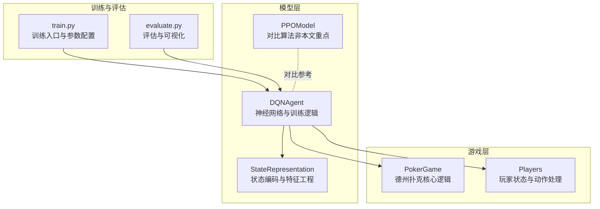
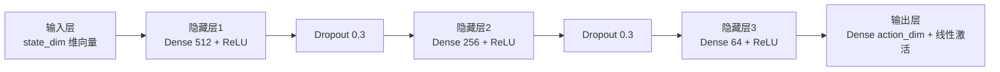
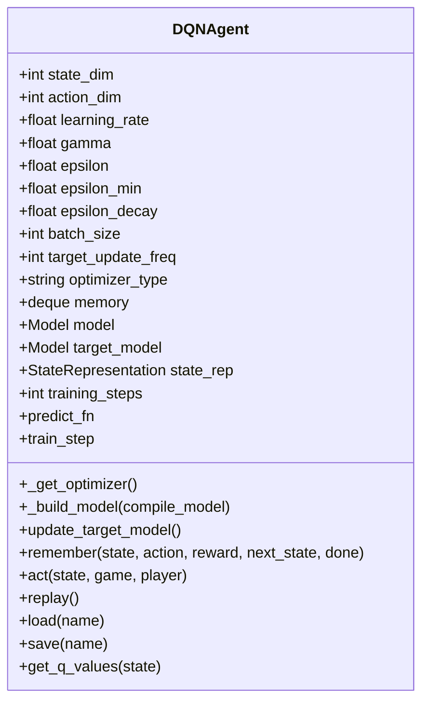
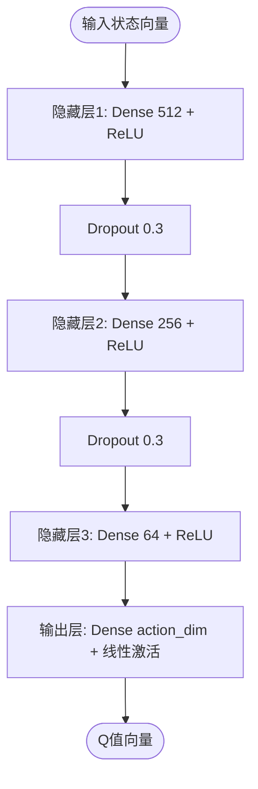
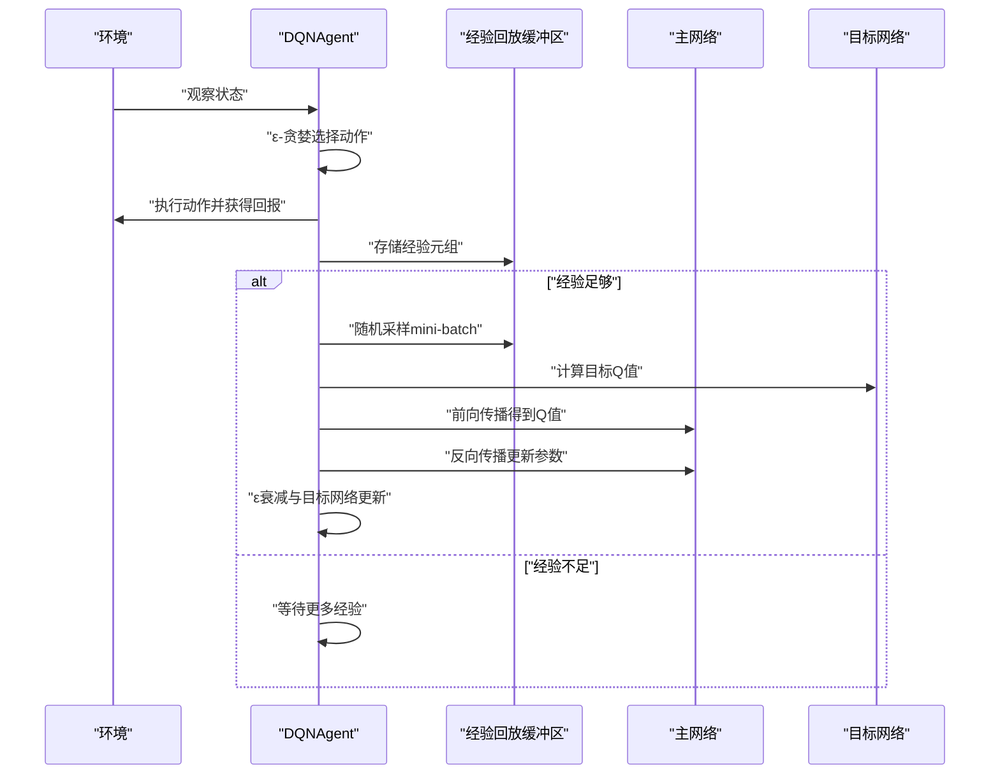
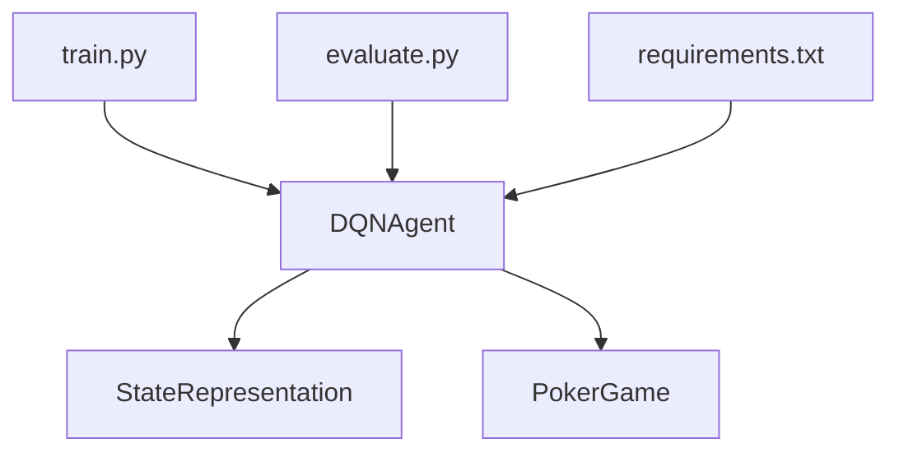

# DQN神经网络架构

<cite>
**本文引用的文件**
- [dqn_agent.py](file://poker_ai/model/dqn_agent.py)
- [ai_agent.py](file://poker_ai/model/ai_agent.py)
- [state_representation.py](file://poker_ai/model/state_representation.py)
- [poker_game.py](file://poker_ai/game/poker_game.py)
- [train.py](file://train.py)
- [evaluate.py](file://evaluate.py)
- [requirements.txt](file://requirements.txt)
</cite>

## 目录
1. [简介](#简介)
2. [项目结构](#项目结构)
3. [核心组件](#核心组件)
4. [架构总览](#架构总览)
5. [详细组件分析](#详细组件分析)
6. [依赖关系分析](#依赖关系分析)
7. [性能考量](#性能考量)
8. [故障排查指南](#故障排查指南)
9. [结论](#结论)
10. [附录](#附录)

## 简介
本文件针对德州扑克DQN智能体的神经网络架构进行深入技术解析，重点围绕DQNAgent类所构建的深度神经网络展开，涵盖输入层、隐藏层、输出层的设计原理与实现细节，解释512-256-64的网络层次结构、ReLU激活函数的作用、Dropout正则化机制、线性激活函数在Q值估计中的意义，以及不同优化器（Adam、Adamax、RMSprop、SGD）的选择依据与性能对比。同时提供网络架构图与参数统计，说明为何选择该特定的网络深度与宽度，并给出训练与评估流程的可视化展示。

## 项目结构
该项目采用模块化组织方式，DQN智能体位于poker_ai/model子目录中，状态表示与游戏逻辑分别位于state_representation.py与poker_game.py，训练与评估脚本位于根目录的train.py与evaluate.py。整体结构清晰，便于理解DQN智能体如何接收状态、执行动作并进行学习。

**图表来源**
- [dqn_agent.py:100-112](file://poker_ai/model/dqn_agent.py#L100-L112)
- [state_representation.py:137-158](file://poker_ai/model/state_representation.py#L137-L158)
- [poker_game.py:155-402](file://poker_ai/game/poker_game.py#L155-L402)
- [train.py:340-531](file://train.py#L340-L531)
- [evaluate.py:181-267](file://evaluate.py#L181-L267)

**章节来源**
- [dqn_agent.py:1-326](file://poker_ai/model/dqn_agent.py#L1-L326)
- [state_representation.py:1-247](file://poker_ai/model/state_representation.py#L1-L247)
- [poker_game.py:1-497](file://poker_ai/game/poker_game.py#L1-L497)
- [train.py:1-856](file://train.py#L1-L856)
- [evaluate.py:1-753](file://evaluate.py#L1-L753)

## 核心组件
- DQNAgent：负责构建深度神经网络、经验回放、ε-贪婪探索、目标网络更新与训练流程。
- StateRepresentation：将游戏状态转换为高维向量，包含手牌、公共牌、玩家信息、位置与活跃人数等特征。
- PokerGame：提供德州扑克的核心规则与状态管理，驱动DQN智能体的决策与学习。
- 训练与评估脚本：提供命令行参数解析、环境配置、自动调参与评估报告生成。

**章节来源**
- [dqn_agent.py:21-126](file://poker_ai/model/dqn_agent.py#L21-L126)
- [state_representation.py:9-46](file://poker_ai/model/state_representation.py#L9-L46)
- [poker_game.py:155-402](file://poker_ai/game/poker_game.py#L155-L402)
- [train.py:136-238](file://train.py#L136-L238)
- [evaluate.py:110-142](file://evaluate.py#L110-L142)

## 架构总览
DQN智能体的神经网络采用顺序模型（Sequential），输入层接收状态向量，随后通过三层全连接层（512-256-64），中间夹杂两层Dropout（0.3）进行正则化，输出层为线性激活，输出每个动作的Q值估计。网络通过tf.function进行预编译，加速推理与训练步骤；目标网络定期从主网络复制权重，稳定学习过程。

**图表来源**
- [dqn_agent.py:100-112](file://poker_ai/model/dqn_agent.py#L100-L112)

**章节来源**
- [dqn_agent.py:100-112](file://poker_ai/model/dqn_agent.py#L100-L112)

## 详细组件分析

### DQNAgent类与神经网络构建
- 网络结构：输入层接收state_dim维向量，随后三层全连接层（512-256-64），中间夹两层Dropout（0.3），输出层为线性激活，输出action_dim维Q值向量。
- 激活函数：隐藏层使用ReLU，输出层使用线性激活，保证Q值估计的连续性与无界特性。
- 正则化：Dropout比例0.3，降低过拟合风险，提升泛化能力。
- 目标网络：独立的目标网络用于计算目标Q值，定期从主网络复制权重，缓解时序相关性带来的不稳定。
- 预编译：使用tf.function对预测与训练步骤进行预编译，提升执行效率。

**图表来源**
- [dqn_agent.py:21-126](file://poker_ai/model/dqn_agent.py#L21-L126)

**章节来源**
- [dqn_agent.py:21-126](file://poker_ai/model/dqn_agent.py#L21-L126)

### 神经网络层次结构与设计原理
- 输入层：接收由StateRepresentation编码的完整状态向量，维度为state_dim。
- 隐藏层1（512）：较大的隐藏单元数，确保对复杂状态空间的充分表征能力，结合ReLU激活函数引入非线性。
- Dropout1（0.3）：随机失活30%的神经元，抑制过拟合，提升泛化性能。
- 隐藏层2（256）：进一步压缩特征，保留关键信息的同时减少参数量。
- Dropout2（0.3）：同上，维持正则化效果。
- 隐藏层3（64）：继续特征压缩，为最终输出层提供紧凑的表示。
- 输出层（action_dim）：线性激活，输出每个动作的Q值估计，便于后续ε-贪婪选择与TD目标计算。

**图表来源**
- [dqn_agent.py:100-112](file://poker_ai/model/dqn_agent.py#L100-L112)

**章节来源**
- [dqn_agent.py:100-112](file://poker_ai/model/dqn_agent.py#L100-L112)

### Dropout正则化与过拟合防护
- Dropout比例0.3，随机将30%的神经元输出置零，训练时降低神经元间的共适应性，提升模型鲁棒性。
- 在验证阶段（推理）不使用Dropout，确保预测一致性。
- 与BatchNormalization相比，Dropout在训练时引入噪声，有助于缓解过拟合，尤其适用于中小规模数据集。

**章节来源**
- [dqn_agent.py:100-112](file://poker_ai/model/dqn_agent.py#L100-L112)

### 输出层线性激活与Q值估计
- 输出层采用线性激活，允许Q值取任意实数值，符合Q-learning的Bellman目标要求。
- 线性输出便于使用均方误差（MSE）作为损失函数，优化目标为最小化TD误差。
- ε-贪婪策略基于Q值向量选择动作，高Q值对应更优动作。

**章节来源**
- [dqn_agent.py:88-98](file://poker_ai/model/dqn_agent.py#L88-L98)
- [dqn_agent.py:100-112](file://poker_ai/model/dqn_agent.py#L100-L112)

### 网络架构图与参数统计
- 网络深度：4层（输入层+3个隐藏层+输出层）。
- 网络宽度：512-256-64，逐层递减，形成金字塔式特征压缩。
- 参数量估算（以state_dim=100为例）：
  - 输入到第1隐藏层：100×512 + 512 = 51712
  - 第1隐藏层到第2隐藏层：512×256 + 256 = 131328
  - 第2隐藏层到第3隐藏层：256×64 + 64 = 16448
  - 第3隐藏层到输出层：64×action_dim + action_dim = 65×action_dim
  - 总参数量 ≈ 51712 + 131328 + 16448 + 65×action_dim
- 该结构在保证表达能力的同时控制了参数规模，适合德州扑克的高维状态空间。

**章节来源**
- [dqn_agent.py:100-112](file://poker_ai/model/dqn_agent.py#L100-L112)

### 优化器选择与性能对比
- Adam：自适应学习率，对稀疏梯度与非平稳目标表现良好，适合DQN的非线性函数逼近。
- Adamax：Adam的无穷范数变体，对梯度的极端值更稳健，适合波动较大的Q值更新。
- RMSprop：对梯度平方的指数移动平均进行自适应缩放，适合非凸优化，收敛稳定。
- SGD：经典优化器，收敛性好但需要精心调参，适合对优化器敏感度较低的场景。
- 在本项目中，优化器可通过命令行参数选择，默认Adam，亦可切换至其他选项。

**章节来源**
- [dqn_agent.py:79-86](file://poker_ai/model/dqn_agent.py#L79-L86)
- [train.py:174-174](file://train.py#L174-L174)

### 训练与推理流程
- 预编译：使用tf.function对预测与训练步骤进行预编译，减少Python调用开销。
- ε-贪婪探索：初始ε较高，随训练逐步衰减，平衡探索与利用。
- 经验回放：从记忆库中随机采样mini-batch，打破时序相关性，提升样本效率。
- 目标网络更新：定期将主网络权重复制到目标网络，稳定TD目标。

**图表来源**
- [dqn_agent.py:144-176](file://poker_ai/model/dqn_agent.py#L144-L176)
- [dqn_agent.py:117-118](file://poker_ai/model/dqn_agent.py#L117-L118)

**章节来源**
- [dqn_agent.py:117-176](file://poker_ai/model/dqn_agent.py#L117-L176)

### 状态表示与输入维度
- StateRepresentation将手牌、公共牌、玩家信息、游戏全局信息、Hero绝对位置与活跃人数等特征拼接为固定维度向量。
- total_state_dim由多个子维度累加而成，确保DQN能够充分感知当前局面的关键信息。
- 该状态向量作为DQNAgent的输入，驱动Q值估计与动作选择。

**章节来源**
- [state_representation.py:32-39](file://poker_ai/model/state_representation.py#L32-L39)
- [state_representation.py:137-158](file://poker_ai/model/state_representation.py#L137-L158)

## 依赖关系分析
- DQNAgent依赖StateRepresentation进行状态编码，依赖PokerGame进行动作合法性判断与回合推进。
- 训练脚本train.py负责参数解析、环境配置与训练流程调度，评估脚本evaluate.py负责模型加载与性能评估。
- requirements.txt声明TensorFlow为核心依赖，确保神经网络框架与优化器可用。

**图表来源**
- [dqn_agent.py:61-61](file://poker_ai/model/dqn_agent.py#L61-L61)
- [state_representation.py:137-158](file://poker_ai/model/state_representation.py#L137-L158)
- [poker_game.py:155-402](file://poker_ai/game/poker_game.py#L155-L402)
- [train.py:340-531](file://train.py#L340-L531)
- [evaluate.py:181-267](file://evaluate.py#L181-L267)
- [requirements.txt:1-7](file://requirements.txt#L1-L7)

**章节来源**
- [dqn_agent.py:1-326](file://poker_ai/model/dqn_agent.py#L1-L326)
- [state_representation.py:1-247](file://poker_ai/model/state_representation.py#L1-L247)
- [poker_game.py:1-497](file://poker_ai/game/poker_game.py#L1-L497)
- [train.py:1-856](file://train.py#L1-L856)
- [evaluate.py:1-753](file://evaluate.py#L1-L753)
- [requirements.txt:1-7](file://requirements.txt#L1-L7)

## 性能考量
- 预编译优化：通过tf.function对预测与训练步骤进行预编译，显著降低Python调用开销，提升吞吐。
- 混合精度：训练脚本支持混合精度（mixed_float16），在GPU上可提升速度与显存利用率。
- XLA JIT：可选启用XLA编译，进一步加速图执行。
- 线程并行：通过TensorFlow线程配置（intra/inter op threads）提升CPU侧并行度。
- 目标网络更新：target_update_freq控制目标网络权重同步频率，平衡稳定性与学习速度。

**章节来源**
- [dqn_agent.py:64-77](file://poker_ai/model/dqn_agent.py#L64-L77)
- [train.py:297-309](file://train.py#L297-L309)

## 故障排查指南
- 权重加载失败：检查权重文件路径与扩展名（.weights.h5），确保文件存在且可读。
- GPU不可用：确认TensorFlow已正确安装并检测到GPU，必要时切换到CPU模式。
- 显存不足：启用GPU按需增长（memory growth）或降低batch size。
- 优化器相关错误：如出现DNN库初始化失败，可尝试禁用oneDNN或调整XLA设置。

**章节来源**
- [dqn_agent.py:178-206](file://poker_ai/model/dqn_agent.py#L178-L206)
- [train.py:280-330](file://train.py#L280-L330)

## 结论
DQNAgent的神经网络架构通过合理的层次设计（512-256-64）、ReLU激活与Dropout正则化，在保证对德州扑克复杂状态空间充分建模的同时，有效控制了过拟合风险。线性输出层与MSE损失函数契合Q-learning目标，配合ε-贪婪探索与经验回放，实现了稳定的策略学习。优化器选择灵活，可根据任务特性切换Adam、Adamax、RMSprop或SGD。结合预编译、混合精度与XLA等优化手段，可在GPU上实现高效训练与推理。

## 附录
- 状态维度说明：total_state_dim由手牌、公共牌、玩家信息、游戏全局信息、Hero绝对位置与活跃人数等子维度组成，确保DQN能够感知关键游戏信息。
- 动作空间：动作维度为5，对应fold、call、raise x2、raise x4、all-in，decode_action将Q值向量解码为具体动作与金额。

**章节来源**
- [state_representation.py:32-39](file://poker_ai/model/state_representation.py#L32-L39)
- [state_representation.py:212-247](file://poker_ai/model/state_representation.py#L212-L247)