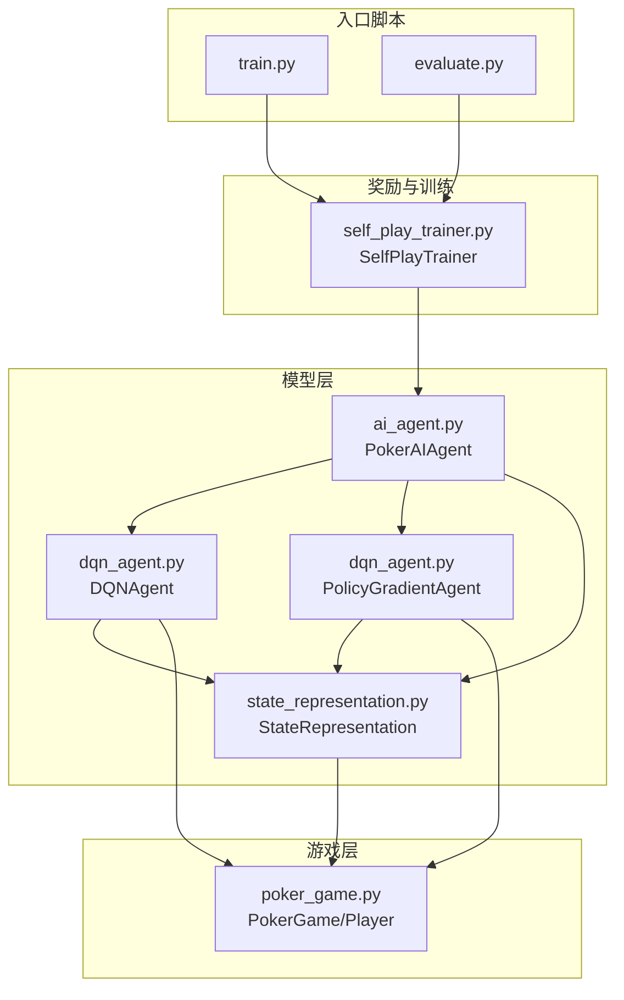
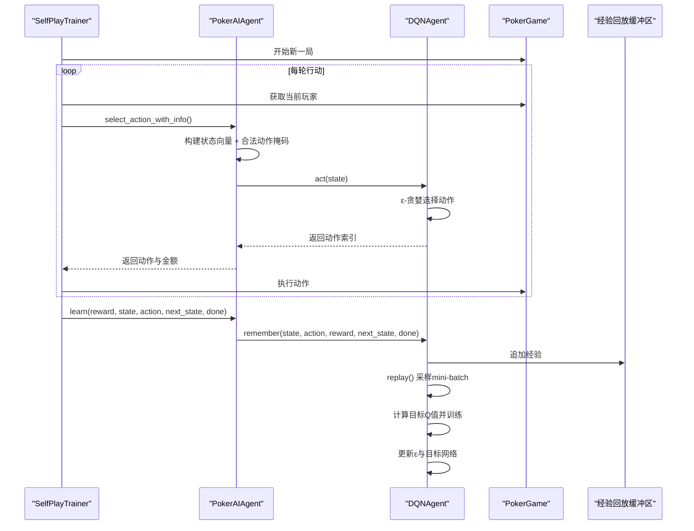
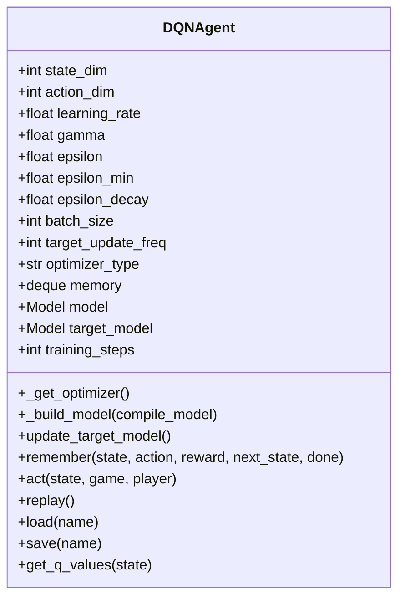
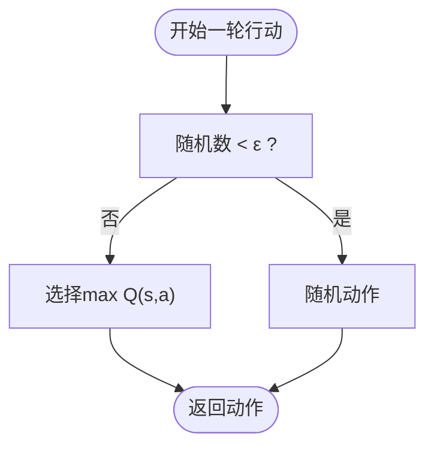
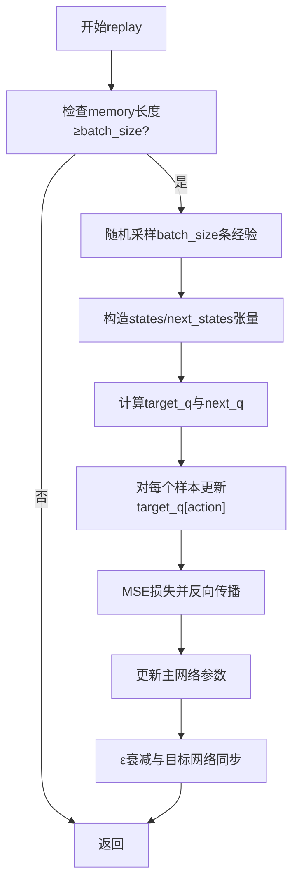
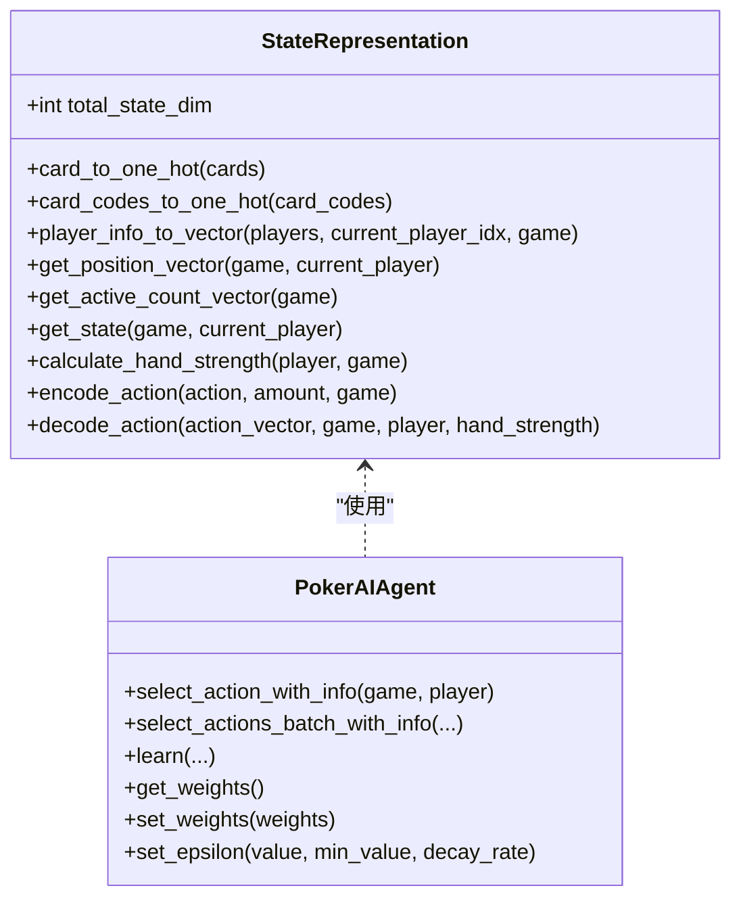
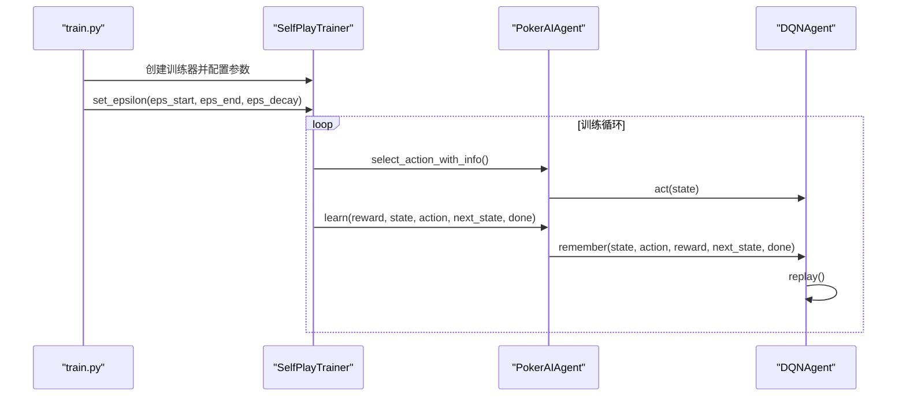
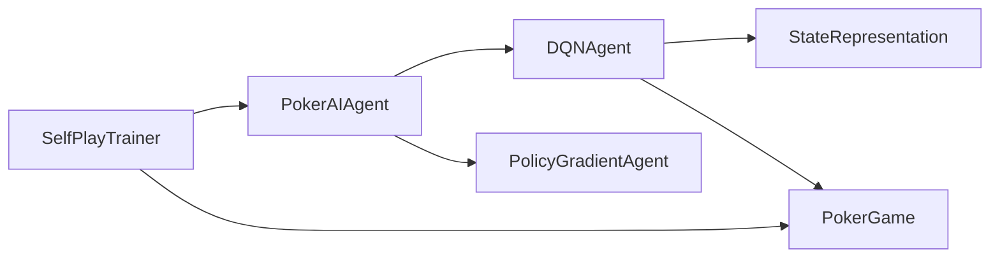

# DQN算法实现

<cite>
**本文引用的文件**
- [dqn_agent.py](file://poker_ai/model/dqn_agent.py)
- [ai_agent.py](file://poker_ai/model/ai_agent.py)
- [state_representation.py](file://poker_ai/model/state_representation.py)
- [poker_game.py](file://poker_ai/game/poker_game.py)
- [self_play_trainer.py](file://poker_ai/reward/self_play_trainer.py)
- [train.py](file://train.py)
- [evaluate.py](file://evaluate.py)
- [README.md](file://README.md)
</cite>

## 目录
1. [简介](#简介)
2. [项目结构](#项目结构)
3. [核心组件](#核心组件)
4. [架构概览](#架构概览)
5. [详细组件分析](#详细组件分析)
6. [依赖关系分析](#依赖关系分析)
7. [性能考量](#性能考量)
8. [故障排查指南](#故障排查指南)
9. [结论](#结论)
10. [附录](#附录)

## 简介
本技术文档围绕仓库中的DQN（Deep Q-Network）算法实现展开，系统阐述其核心原理与工程实现细节，包括Q-learning机制、经验回放（Experience Replay）、目标网络（Target Network）等关键技术概念；深入解析DQNAgent类的神经网络架构、损失函数与优化器配置；解释探索策略（ε-贪婪）的实现与参数调节；详述经验存储与采样机制；并结合德州扑克场景给出动作合法性约束与状态表示的特殊考虑，最后提供参数调优与性能优化建议。

## 项目结构
该项目采用模块化组织方式，围绕德州扑克AI训练与评估形成清晰分层：
- model层：封装AI代理接口与具体算法实现（DQN、策略梯度、PPO）
- game层：提供6人桌德州扑克游戏规则与状态管理
- reward层：自我对弈训练器与奖励计算
- 入口脚本：train.py（训练/评估/演示）、evaluate.py（详细评估）

**图表来源**
- [train.py:340-531](file://train.py#L340-L531)
- [evaluate.py:532-592](file://evaluate.py#L532-L592)
- [ai_agent.py:55-116](file://poker_ai/model/ai_agent.py#L55-L116)
- [dqn_agent.py:21-62](file://poker_ai/model/dqn_agent.py#L21-L62)
- [state_representation.py:9-46](file://poker_ai/model/state_representation.py#L9-L46)
- [poker_game.py:155-189](file://poker_ai/game/poker_game.py#L155-L189)
- [self_play_trainer.py:48-136](file://poker_ai/reward/self_play_trainer.py#L48-L136)

**章节来源**
- [README.md:46-76](file://README.md#L46-L76)

## 核心组件
- DQNAgent：实现DQN算法，包含神经网络、经验回放、目标网络、ε-贪婪探索策略与训练流程
- PokerAIAgent：统一代理接口，负责动作选择、合法动作掩码、训练接口适配
- StateRepresentation：6-Max专用状态编码器，提供完整的状态向量
- SelfPlayTrainer：自我对弈训练器，驱动DQN/PPO训练循环
- PokerGame：6人桌德州扑克游戏引擎，提供动作合法性与状态转换

**章节来源**
- [dqn_agent.py:21-62](file://poker_ai/model/dqn_agent.py#L21-L62)
- [ai_agent.py:55-116](file://poker_ai/model/ai_agent.py#L55-L116)
- [state_representation.py:9-46](file://poker_ai/model/state_representation.py#L9-L46)
- [self_play_trainer.py:48-136](file://poker_ai/reward/self_play_trainer.py#L48-L136)
- [poker_game.py:155-189](file://poker_ai/game/poker_game.py#L155-L189)

## 架构概览
DQN在德州扑克场景下的端到端流程如下：
- 游戏状态由StateRepresentation编码为固定维度向量
- PokerAIAgent根据当前状态与合法动作掩码选择动作
- SelfPlayTrainer驱动多局对弈，收集经验并调用learn接口
- DQNAgent在经验回放缓冲区中采样mini-batch，计算目标Q值，更新主网络并定期同步目标网络

**图表来源**
- [self_play_trainer.py:260-417](file://poker_ai/reward/self_play_trainer.py#L260-L417)
- [ai_agent.py:117-155](file://poker_ai/model/ai_agent.py#L117-L155)
- [dqn_agent.py:117-176](file://poker_ai/model/dqn_agent.py#L117-L176)
- [poker_game.py:299-350](file://poker_ai/game/poker_game.py#L299-L350)

## 详细组件分析

### DQNAgent类实现详解
- 神经网络架构
  - 输入层维度：state_dim（由StateRepresentation计算）
  - 隐藏层：三层全连接（512→256→64），激活函数ReLU，Dropout 0.3
  - 输出层：action_dim维线性输出（对应动作Q值）
  - 编译：使用指定优化器（Adam/RMSprop/SGD/Adamax）与MSE损失
- 经验回放
  - 使用collections.deque维护固定容量记忆（memory_size）
  - remember追加经验元组(state, action, reward, next_state, done)
  - replay采样batch_size条经验，构建目标Q值并训练
- 目标网络
  - target_model与model结构一致，参数定期同步（target_update_freq）
  - 训练时使用target_model预测下一状态Q值，稳定TD目标
- ε-贪婪探索
  - 初始ε=1.0，最小值ε_min=0.1，衰减率ε_decay=0.995
  - 每次replay后按ε衰减，训练步数达到更新频率时同步目标网络
- 预编译加速
  - predict_fn与train_step使用tf.function预编译，减少Python开销
- 权重加载/保存
  - 支持.h5权重文件加载与保存，兼容.pkl路径自动转换

**图表来源**
- [dqn_agent.py:21-62](file://poker_ai/model/dqn_agent.py#L21-L62)
- [dqn_agent.py:100-112](file://poker_ai/model/dqn_agent.py#L100-L112)
- [dqn_agent.py:117-176](file://poker_ai/model/dqn_agent.py#L117-L176)

**章节来源**
- [dqn_agent.py:21-62](file://poker_ai/model/dqn_agent.py#L21-L62)
- [dqn_agent.py:100-112](file://poker_ai/model/dqn_agent.py#L100-L112)
- [dqn_agent.py:117-176](file://poker_ai/model/dqn_agent.py#L117-L176)
- [dqn_agent.py:178-207](file://poker_ai/model/dqn_agent.py#L178-L207)

### 探索策略（ε-贪婪）实现
- 初始化：ε=1.0，最小值ε_min=0.1，衰减率ε_decay=0.995
- 选择机制：以ε概率随机动作，1-ε概率选择Q值最大动作
- 更新：每次replay后若ε>ε_min，则ε*=ε_decay
- 参数调节：可通过PokerAIAgent.set_epsilon统一设置（训练脚本中通过命令行参数传入）

**图表来源**
- [dqn_agent.py:127-143](file://poker_ai/model/dqn_agent.py#L127-L143)
- [ai_agent.py:529-552](file://poker_ai/model/ai_agent.py#L529-L552)
- [train.py:385-405](file://train.py#L385-L405)

**章节来源**
- [dqn_agent.py:127-143](file://poker_ai/model/dqn_agent.py#L127-L143)
- [ai_agent.py:529-552](file://poker_ai/model/ai_agent.py#L529-L552)
- [train.py:385-405](file://train.py#L385-L405)

### 经验存储与采样机制
- 存储：DQNAgent.remember将(state, action, reward, next_state, done)追加至deque
- 采样：replay从memory中随机采样batch_size条经验
- 目标计算：对非终止状态，目标Q为reward + γ * max Q(next_state, a)；对终止状态为目标即reward
- 训练：使用tf.GradientTape计算MSE损失并更新主网络参数
- 同步：训练步数达到target_update_freq时，将主网络权重复制到目标网络

**图表来源**
- [dqn_agent.py:144-176](file://poker_ai/model/dqn_agent.py#L144-L176)

**章节来源**
- [dqn_agent.py:144-176](file://poker_ai/model/dqn_agent.py#L144-L176)

### 状态表示与动作合法性约束（德州扑克场景）
- 状态表示（6-Max）
  - 自身手牌：52维one-hot
  - 公共牌：52维one-hot
  - 玩家信息：6人×3特征（栈额、下注、活跃），共18维
  - 游戏全局：轮次、底池、当前下注、大盲、小盲，共5维
  - 绝对位置：6维One-Hot（相对于庄家BTN→SB→BB→UTG→MP→CO）
  - 活跃人数：1维归一化
  - 总维度：134维
- 动作合法性掩码
  - 5维动作：fold、call、raise×2、raise×4、all-in
  - 根据当前玩家栈额、游戏状态与最小加注要求动态生成合法掩码
  - 保证在任何状态下至少允许fold/call，避免无动作可选

**图表来源**
- [state_representation.py:9-46](file://poker_ai/model/state_representation.py#L9-L46)
- [state_representation.py:137-158](file://poker_ai/model/state_representation.py#L137-L158)
- [state_representation.py:212-247](file://poker_ai/model/state_representation.py#L212-L247)
- [ai_agent.py:15-54](file://poker_ai/model/ai_agent.py#L15-L54)
- [ai_agent.py:125-155](file://poker_ai/model/ai_agent.py#L125-L155)

**章节来源**
- [state_representation.py:9-46](file://poker_ai/model/state_representation.py#L9-L46)
- [state_representation.py:137-158](file://poker_ai/model/state_representation.py#L137-L158)
- [state_representation.py:212-247](file://poker_ai/model/state_representation.py#L212-L247)
- [ai_agent.py:15-54](file://poker_ai/model/ai_agent.py#L15-L54)
- [ai_agent.py:125-155](file://poker_ai/model/ai_agent.py#L125-L155)

### 训练流程与代码示例
- 训练入口：train.py通过SelfPlayTrainer驱动训练循环
- 探索参数配置：命令行参数eps-start/eps-end/eps-decay传递给PokerAIAgent.set_epsilon
- DQN学习：PokerAIAgent.learn在DQN模式下调用DQNAgent.remember与replay
- 批量学习：learn_from_transitions支持批量经验，降低Python调度开销

**图表来源**
- [train.py:340-531](file://train.py#L340-L531)
- [train.py:385-405](file://train.py#L385-L405)
- [self_play_trainer.py:260-417](file://poker_ai/reward/self_play_trainer.py#L260-L417)
- [ai_agent.py:248-301](file://poker_ai/model/ai_agent.py#L248-L301)
- [dqn_agent.py:144-176](file://poker_ai/model/dqn_agent.py#L144-L176)

**章节来源**
- [train.py:340-531](file://train.py#L340-L531)
- [train.py:385-405](file://train.py#L385-L405)
- [self_play_trainer.py:260-417](file://poker_ai/reward/self_play_trainer.py#L260-L417)
- [ai_agent.py:248-301](file://poker_ai/model/ai_agent.py#L248-L301)
- [dqn_agent.py:144-176](file://poker_ai/model/dqn_agent.py#L144-L176)

## 依赖关系分析
- DQNAgent依赖StateRepresentation进行状态编码与动作解码
- PokerAIAgent作为统一接口，根据agent_type路由到不同算法实现
- SelfPlayTrainer协调多局对弈、奖励计算与学习接口调用
- PokerGame提供动作合法性与状态转换，确保训练过程符合德州扑克规则

**图表来源**
- [dqn_agent.py:61-62](file://poker_ai/model/dqn_agent.py#L61-L62)
- [ai_agent.py:90-112](file://poker_ai/model/ai_agent.py#L90-L112)
- [self_play_trainer.py:167-200](file://poker_ai/reward/self_play_trainer.py#L167-L200)
- [poker_game.py:155-189](file://poker_ai/game/poker_game.py#L155-L189)

**章节来源**
- [dqn_agent.py:61-62](file://poker_ai/model/dqn_agent.py#L61-L62)
- [ai_agent.py:90-112](file://poker_ai/model/ai_agent.py#L90-L112)
- [self_play_trainer.py:167-200](file://poker_ai/reward/self_play_trainer.py#L167-L200)
- [poker_game.py:155-189](file://poker_ai/game/poker_game.py#L155-L189)

## 性能考量
- 预编译加速：DQNAgent使用tf.function预编译预测与训练函数，显著降低Python层开销
- 批量学习：PokerAIAgent.learn_from_transitions支持批量经验，减少replay调用次数
- 目标网络同步：target_update_freq控制目标网络更新频率，平衡稳定性与收敛速度
- 状态编码优化：StateRepresentation采用one-hot与归一化特征，避免频繁对象创建
- 探索衰减：合理的ε衰减策略在训练早期充分探索，在后期偏向利用

[本节为通用性能指导，无需特定文件引用]

## 故障排查指南
- 模型加载失败：检查权重文件路径与扩展名（.weights.h5或.pkl自动转换）
- 探索参数未生效：确认通过PokerAIAgent.set_epsilon设置，或训练脚本中命令行参数正确传递
- 训练无进展：检查batch_size、memory_size、optimizer与learning_rate设置
- 动作非法：确认合法动作掩码生成逻辑与游戏状态一致性

**章节来源**
- [dqn_agent.py:178-207](file://poker_ai/model/dqn_agent.py#L178-L207)
- [ai_agent.py:529-552](file://poker_ai/model/ai_agent.py#L529-L552)
- [train.py:385-405](file://train.py#L385-L405)

## 结论
本实现将DQN算法与德州扑克场景紧密结合，通过6-Max专用状态表示、合法动作掩码与自我对弈训练器，构建了可扩展的强化学习框架。DQNAgent在工程层面实现了高效的神经网络、经验回放与目标网络同步，并通过预编译与批量学习优化训练性能。在德州扑克场景下，动作合法性约束与状态编码确保了策略学习的合理性与稳定性。

## 附录
- 参数调优建议
  - 学习率：从0.001开始，观察loss与收益曲线调整
  - batch_size：建议64-128，平衡收敛速度与内存占用
  - memory_size：建议1万以上，确保经验多样性
  - ε衰减：根据任务难度调整ε_decay，避免过早收敛
  - 目标网络更新频率：target_update_freq建议10-50，兼顾稳定性与适应性
- 性能优化策略
  - 使用tf.function预编译与混合精度（训练脚本中已默认启用）
  - 批量学习与并行采样（SelfPlayTrainer支持多worker）
  - 合理设置探索参数与奖励设计，提升样本效率

[本节为通用指导，无需特定文件引用]