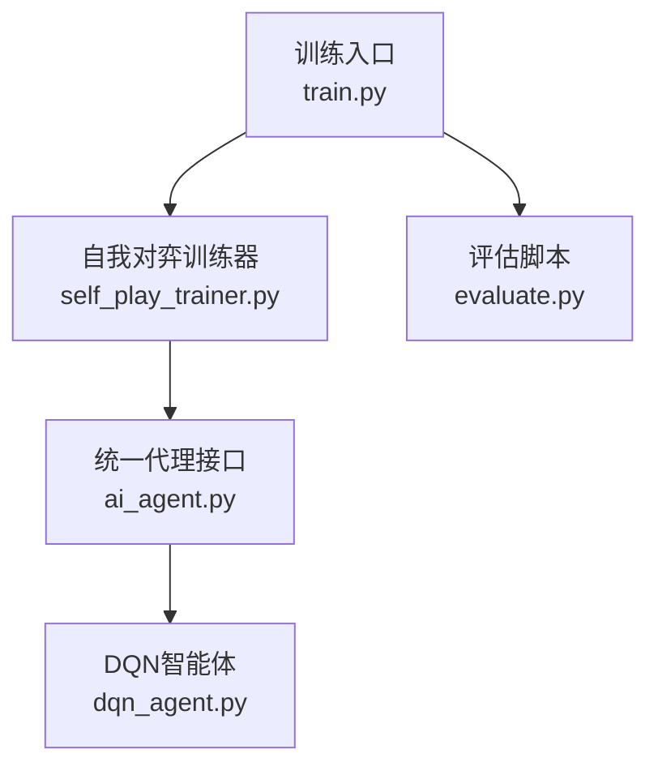
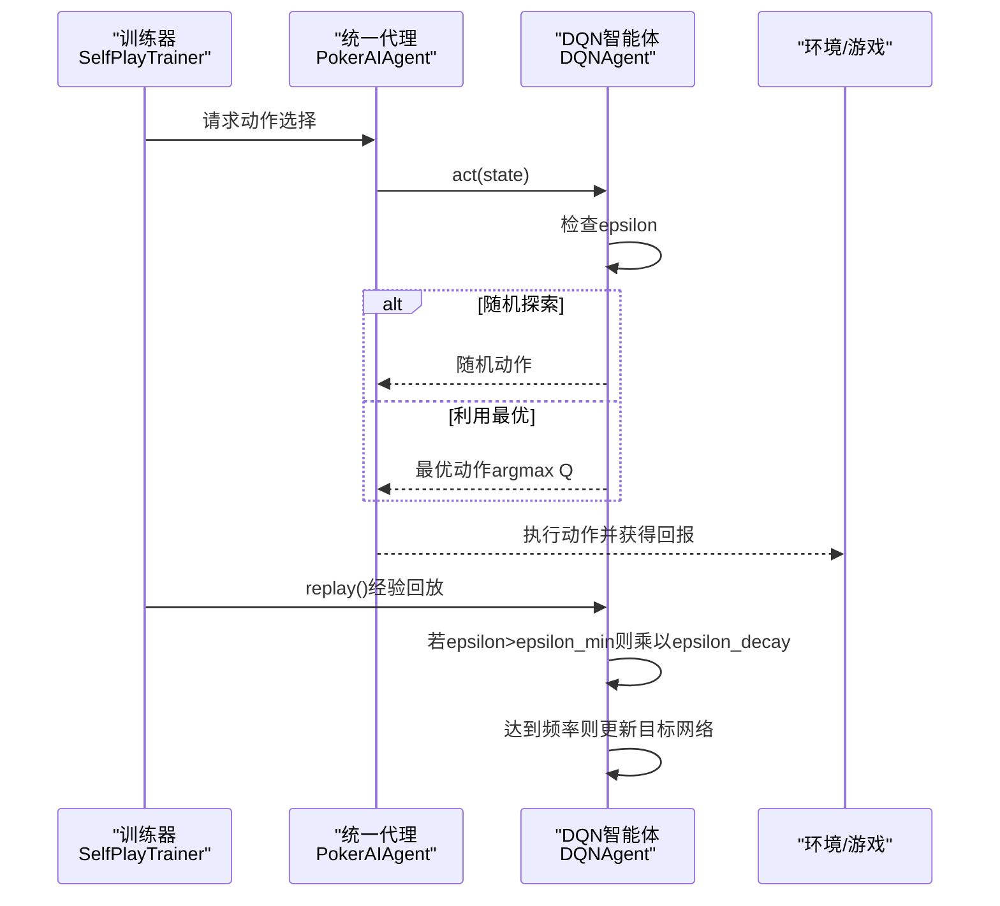
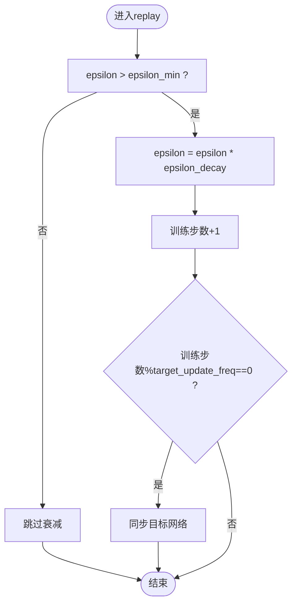
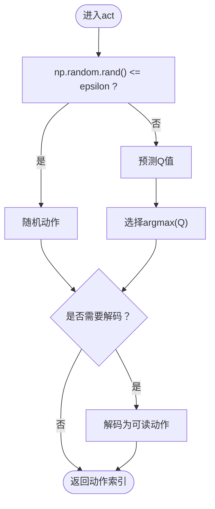
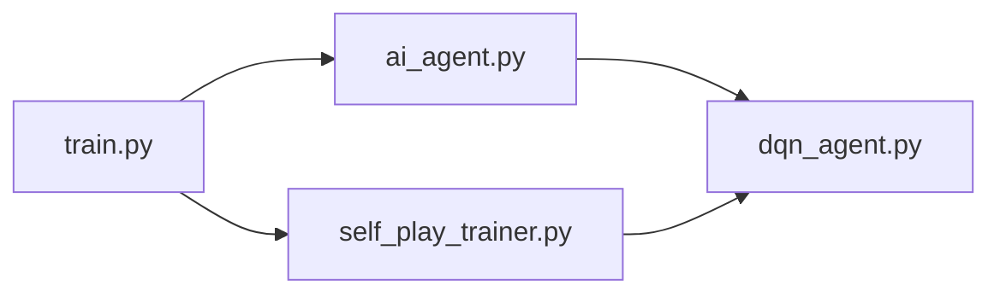

# 探索与利用策略

<cite>
**本文引用的文件**
- [dqn_agent.py](file://poker_ai/model/dqn_agent.py)
- [ai_agent.py](file://poker_ai/model/ai_agent.py)
- [train.py](file://train.py)
- [self_play_trainer.py](file://poker_ai/reward/self_play_trainer.py)
- [evaluate.py](file://evaluate.py)
- [README.md](file://README.md)
</cite>

## 目录
1. [简介](#简介)
2. [项目结构](#项目结构)
3. [核心组件](#核心组件)
4. [架构总览](#架构总览)
5. [详细组件分析](#详细组件分析)
6. [依赖关系分析](#依赖关系分析)
7. [性能考量](#性能考量)
8. [故障排查指南](#故障排查指南)
9. [结论](#结论)
10. [附录](#附录)

## 简介
本文件围绕DQN探索与利用策略展开，聚焦epsilon-greedy策略的实现与配置，解释epsilon值的初始化、衰减与最小值设定的原因，剖析act方法中的探索与利用决策流程，说明训练初期探索的重要性及随训练推进逐步减少探索的必要性，并给出epsilon随时间变化的数学公式与可视化思路。同时讨论不同epsilon参数设置对训练效果的影响，提供调试与监控方法，帮助读者在实践中高效调参与稳定训练。

## 项目结构
本项目采用模块化组织，与探索策略直接相关的核心文件如下：
- DQN智能体实现：poker_ai/model/dqn_agent.py
- 统一代理接口与epsilon参数设置：poker_ai/model/ai_agent.py
- 训练入口与探索参数注入：train.py
- 自我对弈训练器（负责训练循环与目标网络更新）：poker_ai/reward/self_play_trainer.py
- 评估与可视化：evaluate.py
- 项目说明与命令行参数参考：README.md

**图表来源**
- [train.py:340-531](file://train.py#L340-L531)
- [self_play_trainer.py:167-200](file://poker_ai/reward/self_play_trainer.py#L167-L200)
- [ai_agent.py:529-552](file://poker_ai/model/ai_agent.py#L529-L552)
- [dqn_agent.py:21-62](file://poker_ai/model/dqn_agent.py#L21-L62)

**章节来源**
- [README.md:46-75](file://README.md#L46-L75)

## 核心组件
- DQN智能体（DQNAgent）：负责构建神经网络、经验回放、目标网络更新、epsilon-greedy动作选择与epsilon衰减。
- 统一代理接口（PokerAIAgent）：封装不同模型类型（DQN/PPO/PG），提供统一的select_action接口，并支持设置epsilon及其衰减参数。
- 训练入口（train.py）：解析命令行参数，将探索参数注入训练器，驱动训练循环。
- 自我对弈训练器（SelfPlayTrainer）：管理训练流程、对手更新、检查点与评估周期，触发DQN的replay与目标网络更新。
- 评估脚本（evaluate.py）：提供详细评估与可视化，便于观察策略行为与收敛趋势。

**章节来源**
- [dqn_agent.py:21-62](file://poker_ai/model/dqn_agent.py#L21-L62)
- [ai_agent.py:529-552](file://poker_ai/model/ai_agent.py#L529-L552)
- [train.py:385-405](file://train.py#L385-L405)
- [self_play_trainer.py:167-200](file://poker_ai/reward/self_play_trainer.py#L167-L200)

## 架构总览
DQN探索策略贯穿训练与推理两个阶段：
- 训练阶段：智能体在经验回放缓冲区中收集交互数据，replay时根据当前epsilon决定是随机探索还是利用最优Q值动作；随后按规则衰减epsilon。
- 推理阶段：智能体在act中依据当前epsilon进行探索或利用，从而平衡“发现新动作”与“利用已知最优动作”。

**图表来源**
- [dqn_agent.py:127-143](file://poker_ai/model/dqn_agent.py#L127-L143)
- [dqn_agent.py:144-176](file://poker_ai/model/dqn_agent.py#L144-L176)
- [ai_agent.py:529-552](file://poker_ai/model/ai_agent.py#L529-L552)
- [self_play_trainer.py:167-200](file://poker_ai/reward/self_play_trainer.py#L167-L200)

## 详细组件分析

### epsilon-greedy策略实现与参数
- 初始化与边界约束：统一代理接口对epsilon、epsilon_min、epsilon_decay进行范围约束，保证数值合理性。
- 参数注入：训练入口通过命令行参数解析后，调用统一代理接口的set_epsilon方法，将eps_start、eps_end、eps_decay注入DQN智能体。
- 衰减规则：在replay阶段，若当前epsilon仍大于epsilon_min，则按epsilon_decay进行指数衰减。

**图表来源**
- [dqn_agent.py:171-176](file://poker_ai/model/dqn_agent.py#L171-L176)
- [ai_agent.py:529-552](file://poker_ai/model/ai_agent.py#L529-L552)
- [train.py:385-405](file://train.py#L385-L405)

**章节来源**
- [ai_agent.py:529-552](file://poker_ai/model/ai_agent.py#L529-L552)
- [dqn_agent.py:171-176](file://poker_ai/model/dqn_agent.py#L171-L176)
- [train.py:385-405](file://train.py#L385-L405)

### act方法中的探索与利用决策
- 随机探索：当随机数小于等于当前epsilon时，智能体随机选择动作，确保探索空间多样性。
- 利用最优：否则，通过预测得到Q值向量，选择Q值最大的动作，体现利用能力。
- 状态表示与动作解码：在某些场景下，智能体还会结合手牌强度与状态表示进行动作解码，返回可读的动作描述。

**图表来源**
- [dqn_agent.py:127-143](file://poker_ai/model/dqn_agent.py#L127-L143)

**章节来源**
- [dqn_agent.py:127-143](file://poker_ai/model/dqn_agent.py#L127-L143)

### 训练初期探索的重要性与逐步减少的必要性
- 训练初期：高epsilon促进充分探索，使智能体能够发现潜在的优质动作序列，避免陷入局部最优。
- 训练中后期：逐步降低epsilon，增强利用能力，提升策略稳定性与收敛速度，减少不必要的随机扰动。
- 目标网络更新：定期更新目标网络，缓解Q值分布漂移，配合epsilon衰减共同提升稳定性。

**章节来源**
- [dqn_agent.py:171-176](file://poker_ai/model/dqn_agent.py#L171-L176)
- [self_play_trainer.py:167-200](file://poker_ai/reward/self_play_trainer.py#L167-L200)

### epsilon随时间变化的数学公式与可视化
- 数学公式
  - 设初始探索率为ε₀，最小探索率为ε_min，衰减率为γ（即epsilon_decay），则第t步的探索率：
    ε(t) = max(ε_min, ε₀ · γ^t)
  - 该公式表明epsilon按指数方式单调递减，最终趋近于ε_min。
- 可视化建议
  - 横轴：训练步数（或手牌数）
  - 纵轴：epsilon值
  - 可叠加多组实验曲线，对比不同γ与ε_min的效果
  - 结合评估指标（如胜率、平均利润）绘制散点或折线，观察epsilon与性能的关系

**章节来源**
- [dqn_agent.py:171-176](file://poker_ai/model/dqn_agent.py#L171-L176)

### 不同epsilon参数设置对训练效果的影响
- ε₀（初始探索率）
  - 较高ε₀：初期探索充分，但可能导致收敛缓慢、波动较大
  - 较低ε₀：收敛较快，但可能过早陷入局部最优
- ε_min（最小探索率）
  - 较高ε_min：长期保留一定探索，有利于应对环境变化，但可能影响稳定性
  - 较低ε_min：更早趋于确定性策略，适合稳定环境下的精细优化
- γ（衰减率）
  - 较大γ（接近1）：衰减慢，长期保持较高探索
  - 较小γ：衰减快，早期快速收敛，但可能过早丢失探索

**章节来源**
- [ai_agent.py:529-552](file://poker_ai/model/ai_agent.py#L529-L552)
- [train.py:234-236](file://train.py#L234-L236)

### 探索策略的调试与监控方法
- 日志与指标
  - 训练日志中记录epsilon当前值、衰减步数、目标网络同步频率等关键信息
  - 评估脚本可输出动作分布、阶段利润、手牌强度分布等统计，辅助判断探索是否过度或不足
- 参数校准
  - 通过命令行参数eps_start、eps_end、eps_decay进行快速调参
  - 在训练入口中统一注入，确保训练器与智能体参数一致
- 可视化与报告
  - 使用评估脚本生成可视化图表，观察epsilon变化与性能指标的关联
  - 生成详细评估报告，包含动作分布、阶段利润、按手牌强度的胜率等

**章节来源**
- [train.py:385-405](file://train.py#L385-L405)
- [evaluate.py:586-704](file://evaluate.py#L586-L704)

## 依赖关系分析
- 统一代理接口（PokerAIAgent）依赖DQN智能体（DQNAgent）实现epsilon相关功能
- 训练入口（train.py）通过解析命令行参数，调用统一代理接口设置epsilon
- 自我对弈训练器（SelfPlayTrainer）在训练循环中触发replay与目标网络更新，间接影响epsilon衰减节奏

**图表来源**
- [train.py:385-405](file://train.py#L385-L405)
- [ai_agent.py:529-552](file://poker_ai/model/ai_agent.py#L529-L552)
- [dqn_agent.py:171-176](file://poker_ai/model/dqn_agent.py#L171-L176)
- [self_play_trainer.py:167-200](file://poker_ai/reward/self_play_trainer.py#L167-L200)

**章节来源**
- [train.py:385-405](file://train.py#L385-L405)
- [ai_agent.py:529-552](file://poker_ai/model/ai_agent.py#L529-L552)
- [dqn_agent.py:171-176](file://poker_ai/model/dqn_agent.py#L171-L176)
- [self_play_trainer.py:167-200](file://poker_ai/reward/self_play_trainer.py#L167-L200)

## 性能考量
- epsilon过高导致训练不稳定、收敛缓慢；过低则易陷入局部最优且难以跳出
- 合理的epsilon衰减策略应与目标网络更新频率相协调，避免在目标网络频繁更新时出现Q值漂移
- 在大规模训练中，建议结合评估周期与检查点保存，动态监控epsilon与性能指标的耦合关系

## 故障排查指南
- epsilon未按预期衰减
  - 检查是否在replay中满足epsilon>epsilon_min条件
  - 确认epsilon_decay是否被正确设置与传递
- 探索过度导致收益波动大
  - 适当提高epsilon_min或降低epsilon_decay
  - 观察评估脚本输出的动作分布与阶段利润，判断是否需要调整
- 训练停滞
  - 检查目标网络更新频率是否合适
  - 调整学习率与batch size，确保训练稳定性

**章节来源**
- [dqn_agent.py:171-176](file://poker_ai/model/dqn_agent.py#L171-L176)
- [ai_agent.py:529-552](file://poker_ai/model/ai_agent.py#L529-L552)
- [evaluate.py:586-704](file://evaluate.py#L586-L704)

## 结论
epsilon-greedy策略通过在训练初期充分探索、逐步减少探索的方式，在DQN框架中实现了高效的学习与稳定的收敛。通过统一代理接口与训练入口的参数注入，可以灵活配置epsilon的初始值、最小值与衰减率，并结合评估脚本与可视化手段进行监控与调优。合理的参数设置与监控策略是获得良好训练效果的关键。

## 附录
- 命令行参数参考（与探索策略相关）
  - --eps-start：ε-贪婪策略初始探索率
  - --eps-end：ε-贪婪策略最终探索率
  - --eps-decay：ε衰减速率
- 项目说明与常用命令参考见README.md

**章节来源**
- [train.py:234-236](file://train.py#L234-L236)
- [README.md:149-181](file://README.md#L149-L181)