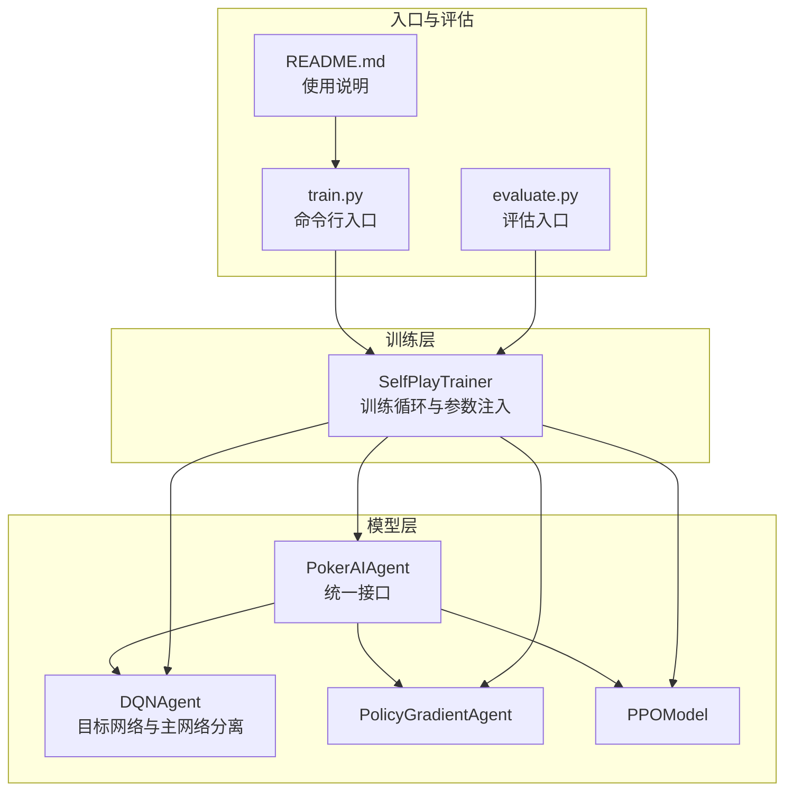
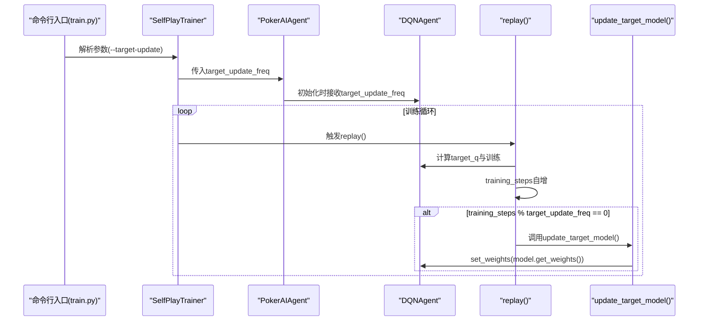
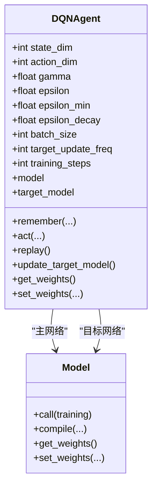
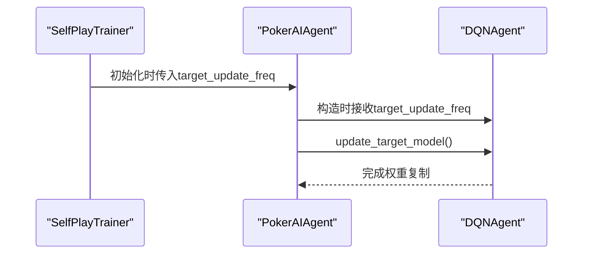
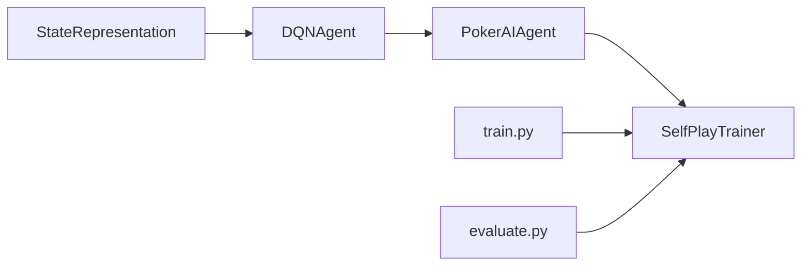

# 目标网络更新

<cite>
**本文引用的文件**
- [dqn_agent.py](file://poker_ai/model/dqn_agent.py)
- [ai_agent.py](file://poker_ai/model/ai_agent.py)
- [self_play_trainer.py](file://poker_ai/reward/self_play_trainer.py)
- [train.py](file://train.py)
- [evaluate.py](file://evaluate.py)
- [README.md](file://README.md)
</cite>

## 目录
1. [简介](#简介)
2. [项目结构](#项目结构)
3. [核心组件](#核心组件)
4. [架构总览](#架构总览)
5. [详细组件分析](#详细组件分析)
6. [依赖关系分析](#依赖关系分析)
7. [性能考量](#性能考量)
8. [故障排查指南](#故障排查指南)
9. [结论](#结论)
10. [附录](#附录)

## 简介
本文件围绕目标网络（Target Network）在DQN中的作用与实现展开，重点解释以下内容：
- 目标网络如何稳定Q值估计，缓解TD目标随主网络权重变化带来的非平稳性，从而提升训练稳定性；
- update_target_model 方法的实现细节与调用时机；
- 目标网络更新频率 target_update_freq 的设置原理、影响因素与最佳实践；
- 目标网络与主网络的区别（目标网络不参与训练，仅用于计算目标Q值）；
- 提供目标网络更新时机的代码示例路径与性能监控方法；
- 不同更新频率对训练效果的影响与建议。

## 项目结构
该项目为德州扑克AI训练框架，包含DQN、策略梯度与PPO三种模型。目标网络更新机制主要体现在DQN代理中，通过统一的AI代理接口传递参数并驱动训练器。



**图表来源**
- [dqn_agent.py:21-120](file://poker_ai/model/dqn_agent.py#L21-L120)
- [ai_agent.py:55-116](file://poker_ai/model/ai_agent.py#L55-L116)
- [self_play_trainer.py:48-136](file://poker_ai/reward/self_play_trainer.py#L48-L136)
- [train.py:136-238](file://train.py#L136-L238)
- [evaluate.py:110-142](file://evaluate.py#L110-L142)

**章节来源**
- [README.md:46-75](file://README.md#L46-L75)
- [train.py:136-238](file://train.py#L136-L238)
- [evaluate.py:110-142](file://evaluate.py#L110-L142)

## 核心组件
- DQNAgent：实现DQN主体逻辑，包含主网络与目标网络、经验回放、训练步与目标网络更新。
- PokerAIAgent：统一接口，根据 agent_type 选择 DQN/PPO/PG，并透传 target_update_freq 等参数。
- SelfPlayTrainer：训练器，负责创建代理、组织训练循环、定期评估与检查点管理，并将 target_update_freq 注入代理。
- train.py / evaluate.py：命令行入口，解析参数并将 target_update 传入训练器。

**章节来源**
- [dqn_agent.py:21-120](file://poker_ai/model/dqn_agent.py#L21-L120)
- [ai_agent.py:55-116](file://poker_ai/model/ai_agent.py#L55-L116)
- [self_play_trainer.py:48-136](file://poker_ai/reward/self_play_trainer.py#L48-L136)
- [train.py:136-238](file://train.py#L136-L238)
- [evaluate.py:110-142](file://evaluate.py#L110-L142)

## 架构总览
目标网络更新在DQN中的作用链路如下：
- 训练器在初始化时接收 target_update_freq，并将其传入 PokerAIAgent；
- PokerAIAgent 将该参数传给 DQNAgent；
- DQNAgent 在 replay() 中按 batch 训练后，依据训练步数与 target_update_freq 决定是否调用 update_target_model；
- update_target_model 将主网络权重复制到目标网络，使目标Q值稳定。



**图表来源**
- [train.py:173-173](file://train.py#L173-L173)
- [self_play_trainer.py:66-97](file://poker_ai/reward/self_play_trainer.py#L66-L97)
- [ai_agent.py:89-92](file://poker_ai/model/ai_agent.py#L89-L92)
- [dqn_agent.py:144-176](file://poker_ai/model/dqn_agent.py#L144-L176)
- [dqn_agent.py:114-115](file://poker_ai/model/dqn_agent.py#L114-L115)

## 详细组件分析

### DQNAgent：目标网络与训练流程
- 主网络与目标网络分离：构造两个独立的Keras模型，主网络参与训练，目标网络仅用于推理目标Q值。
- 目标网络初始化：在构造函数中构建主网络与目标网络，并立即执行一次权重复制。
- 目标网络更新：在 replay() 中，训练完成后按训练步数与 target_update_freq 判断是否复制权重。
- 目标Q值计算：使用目标网络对下一时刻状态进行前向，得到稳定的TD目标。



**图表来源**
- [dqn_agent.py:21-120](file://poker_ai/model/dqn_agent.py#L21-L120)
- [dqn_agent.py:100-112](file://poker_ai/model/dqn_agent.py#L100-L112)
- [dqn_agent.py:114-115](file://poker_ai/model/dqn_agent.py#L114-L115)

**章节来源**
- [dqn_agent.py:24-59](file://poker_ai/model/dqn_agent.py#L24-L59)
- [dqn_agent.py:114-115](file://poker_ai/model/dqn_agent.py#L114-L115)
- [dqn_agent.py:144-176](file://poker_ai/model/dqn_agent.py#L144-L176)

### PokerAIAgent：参数透传与目标网络更新触发
- 统一接口：根据 agent_type 创建 DQNAgent/PPOAgent/PolicyGradientAgent；
- 参数透传：将 target_update_freq 传入 DQNAgent；
- 目标网络更新：提供 update_target_model() 代理方法，内部委托给 DQNAgent.update_target_model()。



**图表来源**
- [ai_agent.py:55-116](file://poker_ai/model/ai_agent.py#L55-L116)
- [ai_agent.py:518-521](file://poker_ai/model/ai_agent.py#L518-L521)
- [dqn_agent.py:114-115](file://poker_ai/model/dqn_agent.py#L114-L115)

**章节来源**
- [ai_agent.py:55-116](file://poker_ai/model/ai_agent.py#L55-L116)
- [ai_agent.py:518-521](file://poker_ai/model/ai_agent.py#L518-L521)

### SelfPlayTrainer：参数注入与训练循环
- 参数注入：将 target_update_freq 作为训练器构造参数，随后传入 PokerAIAgent；
- 训练循环：在 replay() 中按 batch_size 采样经验，计算目标Q并训练，随后按频率更新目标网络。

```mermaid
flowchart TD
Start(["训练开始"]) --> Init["初始化代理与参数"]
Init --> Loop{"训练循环"}
Loop --> |replay()| TrainStep["采样经验并训练"]
TrainStep --> CheckFreq{"training_steps % target_update_freq == 0 ?"}
CheckFreq --> |是| Update["update_target_model()"]
CheckFreq --> |否| Next["继续训练"]
Update --> Next
Next --> Loop
Loop --> End(["训练结束"])
```

**图表来源**
- [self_play_trainer.py:48-136](file://poker_ai/reward/self_play_trainer.py#L48-L136)
- [dqn_agent.py:144-176](file://poker_ai/model/dqn_agent.py#L144-L176)

**章节来源**
- [self_play_trainer.py:48-136](file://poker_ai/reward/self_play_trainer.py#L48-L136)
- [dqn_agent.py:144-176](file://poker_ai/model/dqn_agent.py#L144-L176)

### 目标网络更新时机与代码示例
- 命令行参数：--target-update 控制 DQN 目标网络更新频率；
- 参数传递：train.py 与 evaluate.py 将 --target-update 传入 SelfPlayTrainer；
- 更新触发：DQNAgent.replay() 中按 training_steps % target_update_freq 判断；
- 更新实现：DQNAgent.update_target_model() 将主网络权重 set_weights 到目标网络。

参考路径（不展示具体代码内容）：
- [train.py 参数解析与传递:173-173](file://train.py#L173-L173)
- [evaluate.py 参数解析与传递:547-547](file://evaluate.py#L547-L547)
- [DQNAgent.replay() 更新判断:174-176](file://poker_ai/model/dqn_agent.py#L174-L176)
- [DQNAgent.update_target_model():114-115](file://poker_ai/model/dqn_agent.py#L114-L115)

**章节来源**
- [train.py:173-173](file://train.py#L173-L173)
- [evaluate.py:547-547](file://evaluate.py#L547-L547)
- [dqn_agent.py:114-115](file://poker_ai/model/dqn_agent.py#L114-L115)
- [dqn_agent.py:174-176](file://poker_ai/model/dqn_agent.py#L174-L176)

## 依赖关系分析
- DQNAgent 依赖 StateRepresentation 进行状态编码；
- PokerAIAgent 依赖 DQNAgent（当 agent_type=dqn）；
- SelfPlayTrainer 依赖 PokerAIAgent 与奖励计算器；
- train.py/evaluate.py 作为入口，负责参数解析与训练器创建。



**图表来源**
- [dqn_agent.py:61-61](file://poker_ai/model/dqn_agent.py#L61-L61)
- [ai_agent.py:73-88](file://poker_ai/model/ai_agent.py#L73-L88)
- [self_play_trainer.py:167-184](file://poker_ai/reward/self_play_trainer.py#L167-L184)
- [train.py:340-383](file://train.py#L340-L383)
- [evaluate.py:532-560](file://evaluate.py#L532-L560)

**章节来源**
- [dqn_agent.py:61-61](file://poker_ai/model/dqn_agent.py#L61-L61)
- [ai_agent.py:73-88](file://poker_ai/model/ai_agent.py#L73-L88)
- [self_play_trainer.py:167-184](file://poker_ai/reward/self_play_trainer.py#L167-L184)
- [train.py:340-383](file://train.py#L340-L383)
- [evaluate.py:532-560](file://evaluate.py#L532-L560)

## 性能考量
- 目标网络更新频率对稳定性与收敛速度的影响：
  - 更新频率过低：目标Q值滞后主网络，TD目标不稳定，可能导致训练震荡；
  - 更新频率过高：目标Q值频繁变化，TD目标波动增大，同样影响收敛；
  - 适中频率：在稳定性和收敛速度之间取得平衡。
- 训练步数与更新频率的关系：DQNAgent.replay() 中按 training_steps % target_update_freq 判断，确保更新频率与训练节奏一致。
- 性能监控建议：
  - 记录训练步数与目标网络更新事件，便于分析更新频率对损失与回报的影响；
  - 关注评估阶段的胜率、平均利润等指标，结合不同 target_update_freq 进行对比实验。

[本节为通用性能讨论，无需特定文件来源]

## 故障排查指南
- 目标网络未更新：
  - 检查是否在 replay() 中正确累加 training_steps；
  - 确认 target_update_freq 是否被正确传入并使用；
  - 参考路径：[DQNAgent.replay() 更新逻辑:174-176](file://poker_ai/model/dqn_agent.py#L174-L176)。
- 权重未复制：
  - 确认 update_target_model() 是否被调用；
  - 参考路径：[DQNAgent.update_target_model():114-115](file://poker_ai/model/dqn_agent.py#L114-L115)。
- 参数未生效：
  - 检查命令行参数 --target-update 是否被传入训练器；
  - 参考路径：[train.py 参数传递:368-369](file://train.py#L368-L369)、[evaluate.py 参数传递:547-547](file://evaluate.py#L547-L547)。

**章节来源**
- [dqn_agent.py:114-115](file://poker_ai/model/dqn_agent.py#L114-L115)
- [dqn_agent.py:174-176](file://poker_ai/model/dqn_agent.py#L174-L176)
- [train.py:368-369](file://train.py#L368-L369)
- [evaluate.py:547-547](file://evaluate.py#L547-L547)

## 结论
- 目标网络通过稳定TD目标显著提升DQN训练的稳定性；
- update_target_model() 将主网络权重复制到目标网络，是实现稳定性的关键；
- target_update_freq 的设置需在稳定性与收敛速度间权衡，建议通过对比实验确定；
- 通过命令行参数 --target-update 可灵活调整更新频率，配合训练器与统一代理接口实现参数透传。

[本节为总结性内容，无需特定文件来源]

## 附录

### 目标网络更新频率设置原理与影响因素
- 设置原理：
  - 通常取较小正值，如10或20，使目标网络在若干训练步后更新一次；
  - 更新频率过低会导致目标Q值滞后，过高则目标Q值频繁抖动。
- 影响因素：
  - 经验回放规模与采样频率；
  - 学习率与折扣因子；
  - 状态空间复杂度与动作多样性；
  - 训练稳定性与收敛速度的权衡。

[本节为概念性说明，无需特定文件来源]

### 不同更新频率对训练效果的影响与最佳实践
- 影响：
  - 较低频率（如10）：目标Q值更稳定，TD目标更平滑，适合初期训练；
  - 较高频率（如50）：目标Q值更接近主网络，TD目标变化更快，可能提升收敛速度但增加震荡风险。
- 最佳实践：
  - 以10为起点进行基准实验，逐步调整；
  - 结合评估指标（胜率、平均利润）与损失曲线综合判断；
  - 在大规模训练中，可考虑动态调整更新频率以适应不同阶段。

[本节为通用指导，无需特定文件来源]