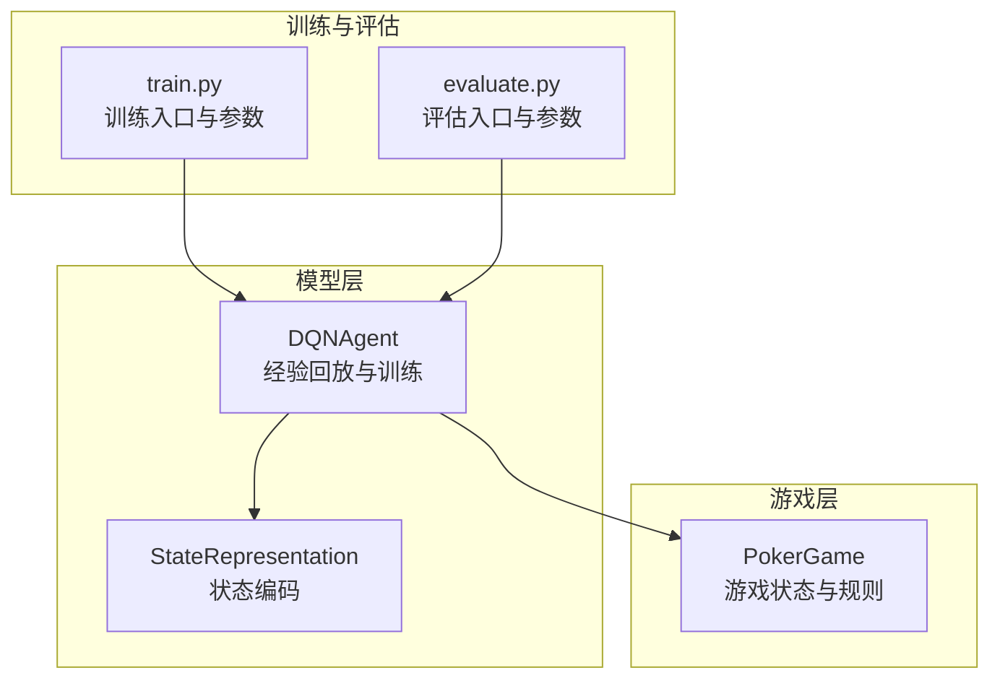
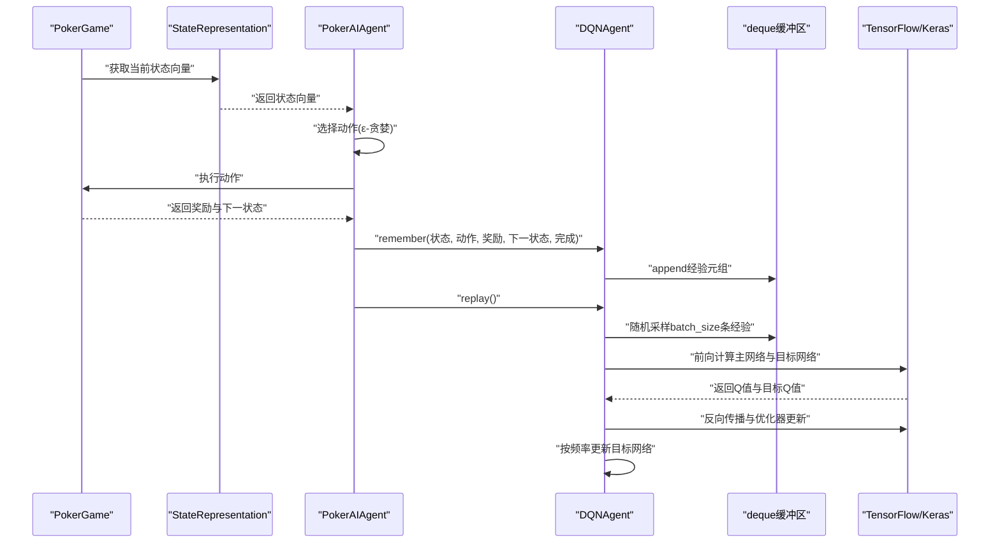
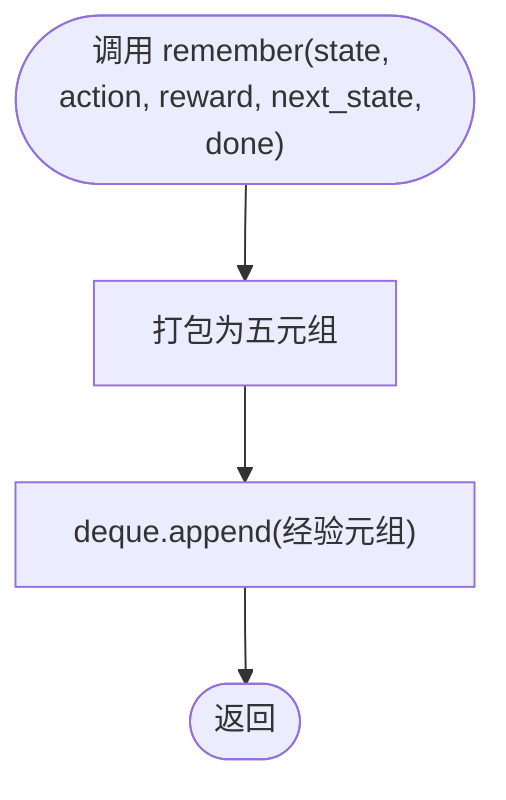
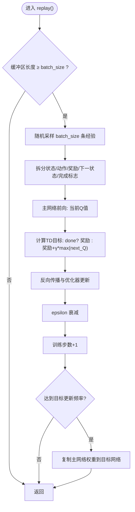
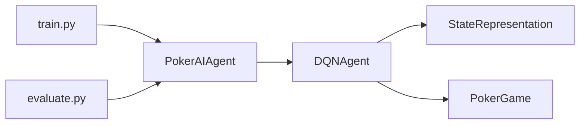

# 经验回放机制

<cite>
**本文引用的文件**
- [dqn_agent.py](file://poker_ai/model/dqn_agent.py)
- [ai_agent.py](file://poker_ai/model/ai_agent.py)
- [state_representation.py](file://poker_ai/model/state_representation.py)
- [poker_game.py](file://poker_ai/game/poker_game.py)
- [train.py](file://train.py)
- [evaluate.py](file://evaluate.py)
</cite>

## 目录
1. [简介](#简介)
2. [项目结构](#项目结构)
3. [核心组件](#核心组件)
4. [架构总览](#架构总览)
5. [详细组件分析](#详细组件分析)
6. [依赖关系分析](#依赖关系分析)
7. [性能考量](#性能考量)
8. [故障排查指南](#故障排查指南)
9. [结论](#结论)
10. [附录](#附录)

## 简介
本文件围绕德州扑克AI中的DQN经验回放机制展开，系统梳理deque缓冲区的实现、记忆存储与随机采样流程、训练批次构建、以及经验回放在打破数据相关性方面的关键作用。同时结合项目中的探索参数、目标网络更新频率、以及训练脚本中的相关配置，给出内存管理与性能优化策略，帮助读者在有限资源下稳定高效地训练模型。

## 项目结构
本项目采用模块化组织，DQN经验回放在模型层实现，状态表示与游戏规则分别位于独立模块，训练与评估脚本负责整体流程编排与参数注入。

**图表来源**
- [dqn_agent.py:1-326](file://poker_ai/model/dqn_agent.py#L1-L326)
- [state_representation.py:1-247](file://poker_ai/model/state_representation.py#L1-L247)
- [poker_game.py:1-497](file://poker_ai/game/poker_game.py#L1-L497)
- [train.py:1-856](file://train.py#L1-L856)
- [evaluate.py:1-753](file://evaluate.py#L1-L753)

**章节来源**
- [dqn_agent.py:1-326](file://poker_ai/model/dqn_agent.py#L1-L326)
- [state_representation.py:1-247](file://poker_ai/model/state_representation.py#L1-L247)
- [poker_game.py:1-497](file://poker_ai/game/poker_game.py#L1-L497)
- [train.py:1-856](file://train.py#L1-L856)
- [evaluate.py:1-753](file://evaluate.py#L1-L753)

## 核心组件
- 经验回放缓冲区：使用collections.deque实现，最大容量为10000，超出容量时自动覆盖最早元素，保证内存可控。
- 记忆接口：remember方法接收状态、动作、奖励、下一状态、完成标志，打包为五元组存入缓冲区。
- 采样与训练：replay方法在满足最小批次大小后，从缓冲区随机采样batch_size条经验，构建训练批次并更新主网络参数，同时按设定频率更新目标网络。
- 探索与收敛：epsilon控制ε-贪婪策略，随训练逐步衰减，避免后期过度探索。
- 目标网络：定期将主网络权重复制到目标网络，稳定TD目标，缓解过拟合与训练震荡。

**章节来源**
- [dqn_agent.py:48-49](file://poker_ai/model/dqn_agent.py#L48-L49)
- [dqn_agent.py:117-118](file://poker_ai/model/dqn_agent.py#L117-L118)
- [dqn_agent.py:144-176](file://poker_ai/model/dqn_agent.py#L144-L176)
- [ai_agent.py:254-257](file://poker_ai/model/ai_agent.py#L254-L257)
- [train.py:191-192](file://train.py#L191-L192)

## 架构总览
DQN经验回放在训练流程中的位置如下：游戏状态经状态表示模块编码为向量，AI代理根据策略选择动作并执行，得到奖励与下一状态后，将经验元组传递给DQN代理的记忆接口，随后在replay阶段进行随机采样与训练。

**图表来源**
- [ai_agent.py:254-257](file://poker_ai/model/ai_agent.py#L254-L257)
- [dqn_agent.py:117-118](file://poker_ai/model/dqn_agent.py#L117-L118)
- [dqn_agent.py:144-176](file://poker_ai/model/dqn_agent.py#L144-L176)
- [state_representation.py:137-158](file://poker_ai/model/state_representation.py#L137-L158)
- [poker_game.py:299-349](file://poker_ai/game/poker_game.py#L299-L349)

## 详细组件分析

### 经验回放缓冲区与最大容量限制
- 实现方式：使用collections.deque并设置maxlen=10000，超出容量时自动丢弃最旧元素，形成环形缓冲区。
- 内存管理：固定上限避免无限增长，适合在线强化学习场景；在GPU混合精度与XLA开启时，可进一步提升吞吐。
- 覆盖机制：当缓冲区满时，新经验覆盖最早经验，保证样本多样性与时效性。

**章节来源**
- [dqn_agent.py:48-49](file://poker_ai/model/dqn_agent.py#L48-L49)

### remember方法：经验存储流程
- 输入：状态向量、动作索引、奖励标量、下一状态向量、完成标志布尔值。
- 存储：将上述五元组追加到deque缓冲区，无需额外转换，便于后续采样。
- 与状态表示的关系：状态向量由StateRepresentation模块生成，确保维度与类型一致。

**图表来源**
- [dqn_agent.py:117-118](file://poker_ai/model/dqn_agent.py#L117-L118)
- [state_representation.py:137-158](file://poker_ai/model/state_representation.py#L137-L158)

**章节来源**
- [dqn_agent.py:117-118](file://poker_ai/model/dqn_agent.py#L117-L118)
- [state_representation.py:137-158](file://poker_ai/model/state_representation.py#L137-L158)

### replay方法：随机采样与训练批次构建
- 条件判断：只有当缓冲区长度≥batch_size时才进行回放，避免无效训练。
- 随机采样：从缓冲区中随机抽取batch_size条经验，打破时序相关性，提升样本效率。
- 批次构建：将采样得到的经验拆分为状态、动作、奖励、下一状态、完成标志五个数组，转换为张量输入模型。
- 目标计算：对主网络预测的当前Q值进行TD目标更新，若done为真则直接使用奖励，否则使用奖励+γ*max(Q(next_states))。
- 梯度更新：通过tf.GradientTape计算损失并应用优化器更新主网络参数。
- 探索衰减与目标网络更新：epsilon按设定衰减，训练步数达到阈值时复制主网络权重到目标网络。

**图表来源**
- [dqn_agent.py:144-176](file://poker_ai/model/dqn_agent.py#L144-L176)

**章节来源**
- [dqn_agent.py:144-176](file://poker_ai/model/dqn_agent.py#L144-L176)

### 经验回放在打破数据相关性与样本效率中的作用
- 打破相关性：经验回放在训练时随机采样，避免连续时序导致的自相关，提升样本利用效率。
- 提升稳定性：目标网络定期更新，提供稳定的TD目标，缓解过拟合与训练震荡。
- 样本效率：通过覆盖机制与随机采样，使模型在有限容量下持续获得多样化的经验，避免过时经验主导。

**章节来源**
- [dqn_agent.py:144-176](file://poker_ai/model/dqn_agent.py#L144-L176)

### 代码示例：经验存储与采样的完整流程
以下为经验存储与采样的完整调用链路，便于在训练脚本中定位与验证：

- 记忆接口调用：在learn中将经验元组传递给DQNAgent.remember，并立即触发replay。
- 训练脚本参数：训练脚本提供目标网络更新频率与每手牌回放次数等参数，影响训练稳定性与效率。

**章节来源**
- [ai_agent.py:254-257](file://poker_ai/model/ai_agent.py#L254-L257)
- [train.py:173](file://train.py#L173)
- [train.py:191-192](file://train.py#L191-L192)

## 依赖关系分析
- DQNAgent依赖StateRepresentation进行状态编码，依赖PokerGame进行动作执行与回报获取。
- PokerAIAgent封装DQNAgent，在learn中协调状态获取、动作选择与经验回放。
- 训练脚本通过参数注入目标网络更新频率、优化器类型、学习率等，间接影响经验回放的稳定性与收敛速度。

**图表来源**
- [dqn_agent.py:100-112](file://poker_ai/model/dqn_agent.py#L100-L112)
- [state_representation.py:137-158](file://poker_ai/model/state_representation.py#L137-L158)
- [poker_game.py:299-349](file://poker_ai/game/poker_game.py#L299-L349)
- [ai_agent.py:254-257](file://poker_ai/model/ai_agent.py#L254-L257)
- [train.py:350-383](file://train.py#L350-L383)

**章节来源**
- [dqn_agent.py:100-112](file://poker_ai/model/dqn_agent.py#L100-L112)
- [state_representation.py:137-158](file://poker_ai/model/state_representation.py#L137-L158)
- [poker_game.py:299-349](file://poker_ai/game/poker_game.py#L299-L349)
- [ai_agent.py:254-257](file://poker_ai/model/ai_agent.py#L254-L257)
- [train.py:350-383](file://train.py#L350-L383)

## 性能考量
- 缓冲区容量：10000的经验容量在大多数场景下足够稳定，配合随机采样与目标网络更新，可在有限内存下维持高效训练。
- 批次大小：batch_size默认64，可根据GPU显存与吞吐需求调整；更大的batch可提升样本利用效率，但需注意内存与收敛稳定性。
- 目标网络更新频率：target_update_freq默认10，适中平衡稳定性与学习速度；在训练初期可适当增大以稳定TD目标。
- 探索参数：epsilon_start、epsilon_end、epsilon_decay在训练脚本中可配置，影响早期探索与后期收敛速度。
- 设备与混合精度：训练脚本支持GPU、XLA与混合精度，可显著提升吞吐；在RTX 4090D等高显存设备上，可进一步增大batch与并行度。

**章节来源**
- [dqn_agent.py:32-46](file://poker_ai/model/dqn_agent.py#L32-L46)
- [train.py:173](file://train.py#L173)
- [train.py:191-192](file://train.py#L191-L192)
- [train.py:385-403](file://train.py#L385-L403)
- [train.py:297-302](file://train.py#L297-L302)

## 故障排查指南
- 缓冲区为空：当缓冲区长度小于batch_size时，replay不会执行。可通过增加采样频率或降低batch_size解决。
- 目标网络未更新：确认target_update_freq参数设置与训练步数计数，确保按频率复制主网络权重。
- 探索参数异常：若epsilon衰减过快或过慢，检查训练脚本中的epsilon_start、epsilon_end、epsilon_decay配置。
- GPU/混合精度问题：若出现初始化失败或性能异常，可尝试禁用XLA或关闭混合精度，或调整GPU内存增长策略。

**章节来源**
- [dqn_agent.py:144-176](file://poker_ai/model/dqn_agent.py#L144-L176)
- [train.py:385-403](file://train.py#L385-L403)
- [train.py:297-302](file://train.py#L297-L302)

## 结论
DQN经验回放在本项目中通过固定容量的deque缓冲区、随机采样与目标网络更新，有效解决了序列数据相关性问题，提升了样本利用效率与训练稳定性。结合训练脚本中的探索参数与设备配置，可在不同硬件条件下实现高效、稳定的强化学习训练。建议在实际部署中根据GPU显存与任务复杂度动态调整batch_size与目标网络更新频率，以获得最佳性能与收敛效果。

## 附录
- 关键参数参考
  - 经验回放缓冲区容量：10000
  - 批次大小：64（默认）
  - 目标网络更新频率：10（默认）
  - 探索参数：epsilon_start=1.0，epsilon_end=0.01，epsilon_decay=0.0001（默认）

**章节来源**
- [dqn_agent.py:32-46](file://poker_ai/model/dqn_agent.py#L32-L46)
- [train.py:191-192](file://train.py#L191-L192)
- [train.py:385-403](file://train.py#L385-L403)