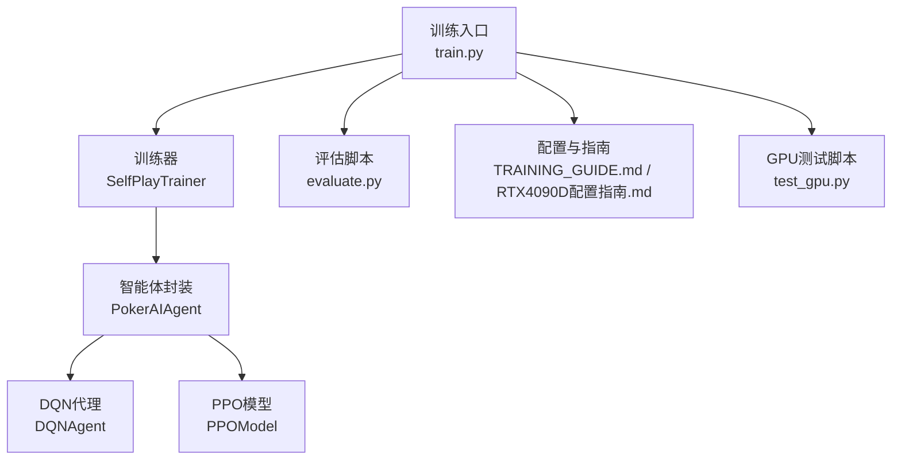
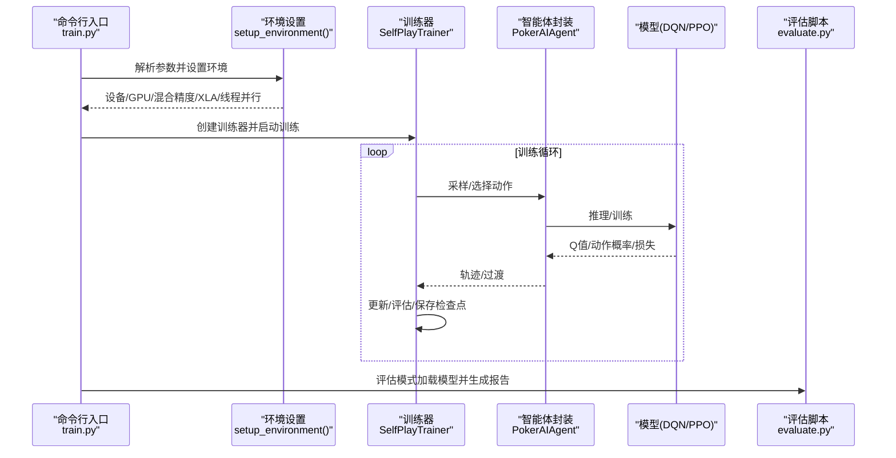
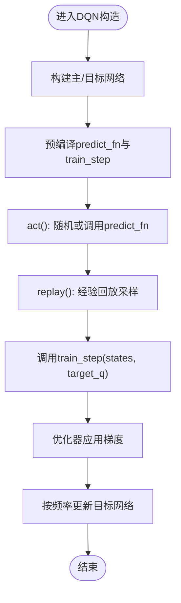
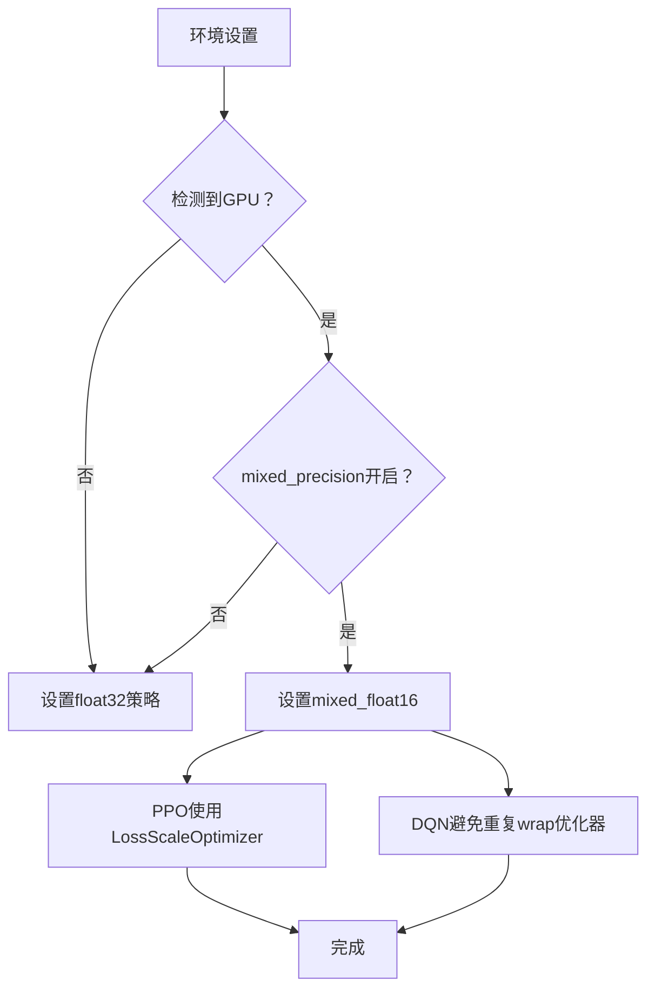
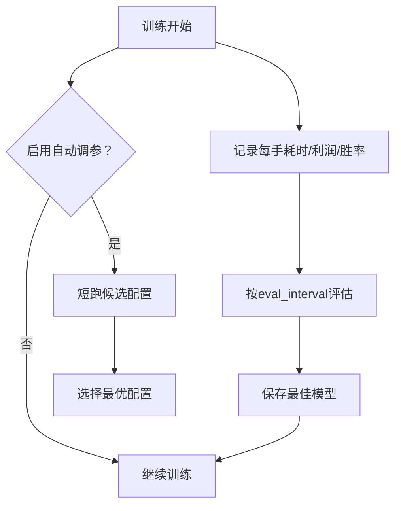
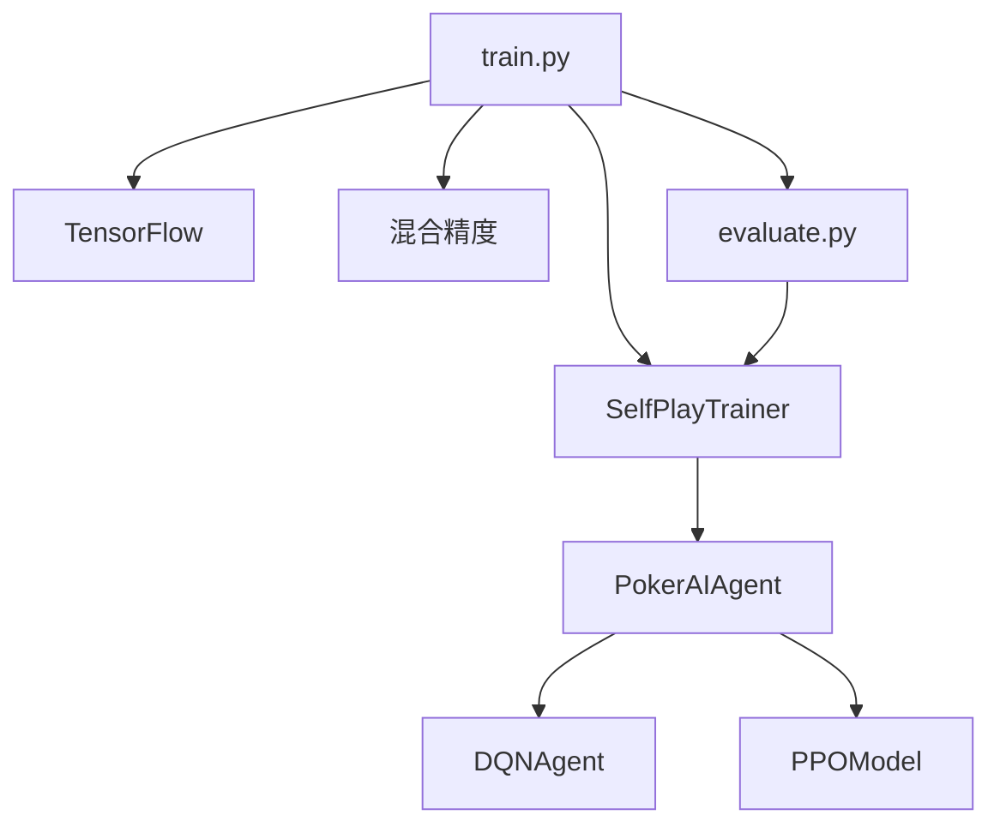

# 训练优化与性能

<cite>
**本文引用的文件**
- [train.py](file://train.py)
- [poker_ai/model/dqn_agent.py](file://poker_ai/model/dqn_agent.py)
- [poker_ai/model/ppo_model.py](file://poker_ai/model/ppo_model.py)
- [poker_ai/reward/self_play_trainer.py](file://poker_ai/reward/self_play_trainer.py)
- [evaluate.py](file://evaluate.py)
- [requirements.txt](file://requirements.txt)
- [TRAINING_GUIDE.md](file://TRAINING_GUIDE.md)
- [RTX4090D配置指南.md](file://RTX4090D配置指南.md)
- [test_gpu.py](file://test_gpu.py)
</cite>

## 目录
1. [简介](#简介)
2. [项目结构](#项目结构)
3. [核心组件](#核心组件)
4. [架构总览](#架构总览)
5. [详细组件分析](#详细组件分析)
6. [依赖分析](#依赖分析)
7. [性能考量](#性能考量)
8. [故障排查指南](#故障排查指南)
9. [结论](#结论)
10. [附录](#附录)

## 简介
本文件面向DQN训练优化与性能提升，围绕tf.function预编译、混合精度、优化器选择、损失函数、训练监控与调试、超参数调优以及GPU加速与内存优化等方面，结合仓库现有实现进行系统化梳理与实操建议。重点覆盖：
- DQN中predict_fn与train_step的tf.function预编译原理与性能优势
- 混合精度训练的启用、策略与注意事项
- 优化器（Adam、Adamax、RMSprop、SGD）在DQN中的适用场景与性能特点
- 均方误差（MSE）作为损失函数的选择原因与优化策略
- 训练过程中的性能监控指标与调试方法
- batch_size、学习率等超参数的调优建议与最佳实践
- GPU加速与内存优化的实用技巧

## 项目结构
本项目围绕德州扑克AI训练，包含训练入口、模型实现、训练器、评估脚本与配置文档。训练入口负责解析参数、设置环境（含混合精度、XLA、线程并行、GPU内存策略）、创建训练器并执行训练；模型层提供DQN与PPO两类智能体；训练器负责自我对弈、并行采样、轨迹收集与更新；评估脚本用于生成详细报告与可视化。

**图表来源**
- [train.py:136-238](file://train.py#L136-L238)
- [poker_ai/reward/self_play_trainer.py:48-166](file://poker_ai/reward/self_play_trainer.py#L48-L166)
- [poker_ai/model/dqn_agent.py:21-78](file://poker_ai/model/dqn_agent.py#L21-L78)
- [poker_ai/model/ppo_model.py:20-104](file://poker_ai/model/ppo_model.py#L20-L104)
- [evaluate.py:110-142](file://evaluate.py#L110-L142)

**章节来源**
- [train.py:136-238](file://train.py#L136-L238)
- [poker_ai/reward/self_play_trainer.py:48-166](file://poker_ai/reward/self_play_trainer.py#L48-L166)
- [poker_ai/model/dqn_agent.py:21-78](file://poker_ai/model/dqn_agent.py#L21-L78)
- [poker_ai/model/ppo_model.py:20-104](file://poker_ai/model/ppo_model.py#L20-L104)
- [evaluate.py:110-142](file://evaluate.py#L110-L142)

## 核心组件
- 训练入口与环境设置：解析参数、自动硬件档位、线程并行、混合精度、XLA、GPU内存策略、设备选择。
- 训练器：自我对弈、并行采样、轨迹收集、对手管理、评估与检查点。
- DQN代理：预编译推理与训练函数、经验回放、ε-贪婪探索、目标网络更新。
- PPO模型：策略网络与价值网络、PPO更新步、学习率调度、KL散度与价值裁剪、混合精度适配。
- 评估脚本：模型加载、详细统计、可视化与报告生成。

**章节来源**
- [train.py:240-335](file://train.py#L240-L335)
- [poker_ai/reward/self_play_trainer.py:48-166](file://poker_ai/reward/self_play_trainer.py#L48-L166)
- [poker_ai/model/dqn_agent.py:21-78](file://poker_ai/model/dqn_agent.py#L21-L78)
- [poker_ai/model/ppo_model.py:20-104](file://poker_ai/model/ppo_model.py#L20-L104)
- [evaluate.py:181-267](file://evaluate.py#L181-L267)

## 架构总览
训练流程从入口开始，依据硬件档位与参数设置环境，创建训练器并执行训练；训练器内部通过智能体封装调用DQN或PPO模型，进行并行采样与更新；训练过程中定期评估并保存检查点；评估脚本独立加载模型生成详细报告与图表。

**图表来源**
- [train.py:340-531](file://train.py#L340-L531)
- [poker_ai/reward/self_play_trainer.py:1503-1523](file://poker_ai/reward/self_play_trainer.py#L1503-L1523)
- [evaluate.py:706-753](file://evaluate.py#L706-L753)

## 详细组件分析

### tf.function预编译：DQN的predict_fn与train_step
- 预编译目的：消除Python调用开销，固定输入签名，降低图构建与retracing成本，提升推理与训练吞吐。
- DQN实现要点：
  - 预编译推理函数predict_fn：接收形状为(None, state_dim)的浮点张量，返回模型在training=False下的预测。
  - 预编译训练函数train_step：接收states与target_q张量，在GradientTape内计算MSE损失并应用优化器梯度。
  - 目标网络：仅用于目标Q计算，不参与训练，避免重复编译与不必要的编译。
- 性能优势：
  - 减少Python与TF图交互次数，显著降低单步延迟。
  - 在混合精度下，同一优化器不可重复wrap，目标网络不编译可避免潜在问题。

**图表来源**
- [poker_ai/model/dqn_agent.py:64-78](file://poker_ai/model/dqn_agent.py#L64-L78)
- [poker_ai/model/dqn_agent.py:144-177](file://poker_ai/model/dqn_agent.py#L144-L177)

**章节来源**
- [poker_ai/model/dqn_agent.py:64-78](file://poker_ai/model/dqn_agent.py#L64-L78)
- [poker_ai/model/dqn_agent.py:88-98](file://poker_ai/model/dqn_agent.py#L88-L98)
- [poker_ai/model/dqn_agent.py:144-177](file://poker_ai/model/dqn_agent.py#L144-L177)

### 混合精度训练：启用、策略与注意事项
- 启用方式：在setup_environment中根据参数设置全局混合精度策略为mixed_float16，否则使用float32。
- 注意事项：
  - 同一优化器不可重复wrap；目标网络不参与训练，避免重复编译。
  - PPO中使用LossScaleOptimizer适配混合精度，确保数值稳定。
  - DQN的MSE损失在混合精度下仍可稳定工作，但需关注梯度尺度与裁剪。
- 性能收益：在支持Tensor Core的GPU上（如RTX 4090D）可获得1.5-2x速度提升与30-40%显存节省。

**图表来源**
- [train.py:297-302](file://train.py#L297-L302)
- [poker_ai/model/dqn_agent.py:55-56](file://poker_ai/model/dqn_agent.py#L55-L56)
- [poker_ai/model/ppo_model.py:94-104](file://poker_ai/model/ppo_model.py#L94-L104)

**章节来源**
- [train.py:297-302](file://train.py#L297-L302)
- [poker_ai/model/dqn_agent.py:55-56](file://poker_ai/model/dqn_agent.py#L55-L56)
- [poker_ai/model/ppo_model.py:94-104](file://poker_ai/model/ppo_model.py#L94-L104)

### 优化器选择与配置：Adam、Adamax、RMSprop、SGD
- DQN中支持的优化器类型：Adam、Adamax、RMSprop、SGD，均通过字符串映射创建实例。
- 适用场景与特点（结合仓库实现与通用实践）：
  - Adam：自适应学习率、二阶矩估计，适合大多数强化学习任务，收敛稳定。
  - Adamax：Adam的无穷范数变体，对稀疏梯度更鲁棒，适合某些非平稳环境。
  - RMSprop：对梯度平方指数移动平均敏感，适合非平稳目标函数。
  - SGD：最基础优化器，配合动量与学习率调度可获得稳定性能。
- 在DQN中，优化器实例在构造时创建并用于训练步；目标网络不参与训练，避免重复编译。

**章节来源**
- [poker_ai/model/dqn_agent.py:79-86](file://poker_ai/model/dqn_agent.py#L79-L86)

### 损失函数：均方误差（MSE）的选择与优化
- DQN使用MSE作为损失函数，目标是使Q值逼近TD目标（即时奖励或折扣最大Q值）。
- 选择原因：
  - 简单直观，便于实现与调试。
  - 在连续动作空间或离散动作空间的Q学习中广泛使用。
- 优化策略：
  - 预编译train_step减少Python开销。
  - 混合精度下注意梯度尺度与裁剪，避免数值不稳定。
  - ε-贪婪探索与目标网络更新频率影响收敛稳定性。

**章节来源**
- [poker_ai/model/dqn_agent.py:94-98](file://poker_ai/model/dqn_agent.py#L94-L98)
- [poker_ai/model/dqn_agent.py:171-176](file://poker_ai/model/dqn_agent.py#L171-L176)

### 训练过程监控与调试
- 训练入口记录关键指标：每手耗时、评估平均利润、胜率、无效下注率等。
- 评估脚本生成详细统计与可视化：手牌强度分布、动作分布、各阶段利润、按手牌强度的胜率、累计利润曲线等。
- 自动调参：在PPO模式下，train.py支持自动短跑多组候选配置，按hands/s选择最优配置，帮助快速定位高吞吐参数组合。

**图表来源**
- [train.py:503-526](file://train.py#L503-L526)
- [poker_ai/reward/self_play_trainer.py:1503-1523](file://poker_ai/reward/self_play_trainer.py#L1503-L1523)
- [evaluate.py:523-584](file://evaluate.py#L523-L584)
- [train.py:408-481](file://train.py#L408-L481)

**章节来源**
- [train.py:503-526](file://train.py#L503-L526)
- [poker_ai/reward/self_play_trainer.py:1503-1523](file://poker_ai/reward/self_play_trainer.py#L1503-L1523)
- [evaluate.py:523-584](file://evaluate.py#L523-L584)
- [train.py:408-481](file://train.py#L408-L481)

### 超参数调优建议与最佳实践
- batch_size：
  - DQN：建议从64起调，结合显存与目标网络更新频率；过大可能导致更新不及时。
  - PPO：在RTX 4090D上可考虑256-1024，视显存与吞吐目标调整。
- 学习率：
  - DQN：典型范围0.001左右；过小收敛慢，过大易震荡。
  - PPO：建议从3e-4起，结合warmup与cosine衰减；过小收敛慢，过大导致KL漂移。
- ε-贪婪探索（DQN）：起始ε、最小ε与衰减率需与任务难度匹配，避免过早收敛或探索不足。
- 评估与检查点：合理设置评估间隔与检查点间隔，避免频繁评估拖慢吞吐。

**章节来源**
- [train.py:164-196](file://train.py#L164-L196)
- [poker_ai/reward/self_play_trainer.py:1503-1523](file://poker_ai/reward/self_play_trainer.py#L1503-L1523)

### GPU加速与内存优化
- GPU检测与设备选择：支持自动/显式选择CPU/GPU，未检测到GPU时回退CPU。
- 显存按需增长：避免一次性占用全部显存，便于多任务并行。
- XLA编译器：启用JIT编译，优化计算图与内存碎片。
- 线程并行：设置intra/inter op线程数，平衡CPU与GPU利用率。
- RTX 4090D优化：混合精度、XLA、大batch、高并行worker、累计步数等组合可达到1000-1500手/秒。

**章节来源**
- [train.py:277-309](file://train.py#L277-L309)
- [RTX4090D配置指南.md:14-38](file://RTX4090D配置指南.md#L14-L38)
- [test_gpu.py:14-80](file://test_gpu.py#L14-L80)

## 依赖分析
- 训练入口依赖TensorFlow与混合精度策略，负责环境初始化与训练器创建。
- 训练器依赖智能体封装、奖励计算器与检查点工具，负责并行采样与更新。
- DQN代理依赖状态表示与优化器，提供预编译函数与经验回放。
- PPO模型依赖配置与混合精度优化器，提供PPO更新步与学习率调度。
- 评估脚本依赖训练器与可视化库，负责详细统计与报告生成。

**图表来源**
- [train.py:258-309](file://train.py#L258-L309)
- [poker_ai/reward/self_play_trainer.py:167-213](file://poker_ai/reward/self_play_trainer.py#L167-L213)
- [poker_ai/model/dqn_agent.py:21-78](file://poker_ai/model/dqn_agent.py#L21-L78)
- [poker_ai/model/ppo_model.py:20-104](file://poker_ai/model/ppo_model.py#L20-L104)
- [evaluate.py:85-108](file://evaluate.py#L85-L108)

**章节来源**
- [train.py:258-309](file://train.py#L258-L309)
- [poker_ai/reward/self_play_trainer.py:167-213](file://poker_ai/reward/self_play_trainer.py#L167-L213)
- [poker_ai/model/dqn_agent.py:21-78](file://poker_ai/model/dqn_agent.py#L21-L78)
- [poker_ai/model/ppo_model.py:20-104](file://poker_ai/model/ppo_model.py#L20-L104)
- [evaluate.py:85-108](file://evaluate.py#L85-L108)

## 性能考量
- 预编译与图优化：tf.function显著降低Python调用开销，建议在构造时即预编译推理与训练函数。
- 混合精度：在支持Tensor Core的GPU上可获得1.5-2x加速与显存节省，需配合LossScaleOptimizer与梯度裁剪。
- 并行采样与批处理：合理设置train_workers、train_rollouts_per_worker与batch_size，平衡吞吐与显存。
- 评估频率：评估会带来额外开销，建议在训练早期降低评估频率，稳定后再提高。
- 学习率调度：PPO中warmup与cosine衰减可提升稳定性与收敛效率。

[本节为通用指导，无需特定文件引用]

## 故障排查指南
- GPU未检测到：检查驱动与TensorFlow版本，确认GPU可用性；必要时切换到CPU模式。
- 显存不足：降低batch_size、减少并行worker、启用显存按需增长。
- 训练不稳定：降低学习率、增大clip值、增加熵系数、启用KL早停。
- 评估指标异常：先用小样本验证流程，再逐步放大；关注评估间隔与评估局数。
- 自动调参：在PPO模式下使用自动调参功能，快速筛选高吞吐配置。

**章节来源**
- [train.py:280-289](file://train.py#L280-L289)
- [RTX4090D配置指南.md:177-221](file://RTX4090D配置指南.md#L177-L221)
- [TRAINING_GUIDE.md:156-173](file://TRAINING_GUIDE.md#L156-L173)
- [train.py:408-481](file://train.py#L408-L481)

## 结论
本项目在DQN与PPO两条路径上均实现了关键性能优化：通过tf.function预编译降低Python开销、通过混合精度与XLA提升吞吐、通过并行采样与合理的超参数配置实现高效率训练。结合自动调参与详尽的评估指标，可在RTX 4090D等高端GPU上实现1000+手/秒的训练吞吐，同时保持数值稳定性与收敛质量。

[本节为总结性内容，无需特定文件引用]

## 附录
- 快速GPU测试：使用test_gpu.py验证GPU可用性与混合精度性能。
- 训练指南：参考TRAINING_GUIDE.md进行小样本验证与参数组合探索。
- RTX 4090D配置：参考RTX4090D配置指南.md获取高性能训练方案与调优技巧。

**章节来源**
- [test_gpu.py:14-80](file://test_gpu.py#L14-L80)
- [TRAINING_GUIDE.md:11-45](file://TRAINING_GUIDE.md#L11-L45)
- [RTX4090D配置指南.md:14-38](file://RTX4090D配置指南.md#L14-L38)