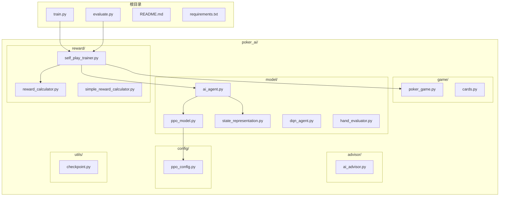
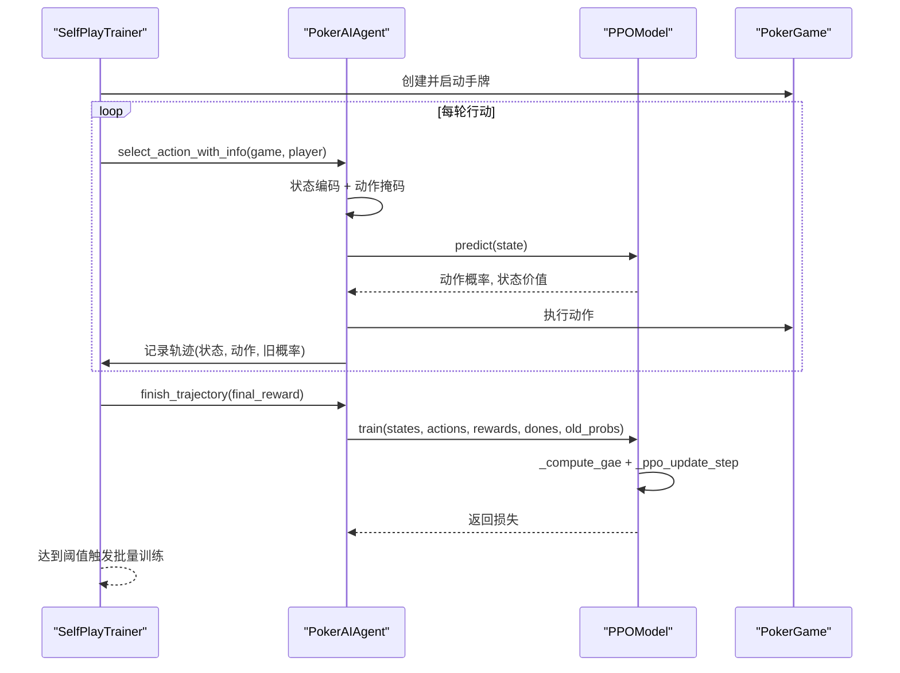
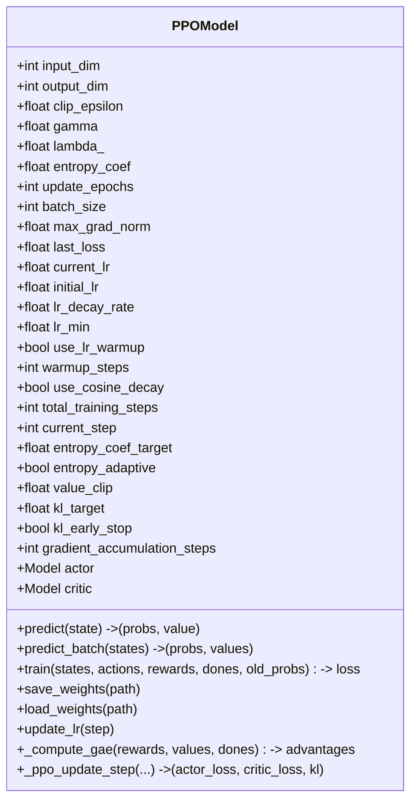
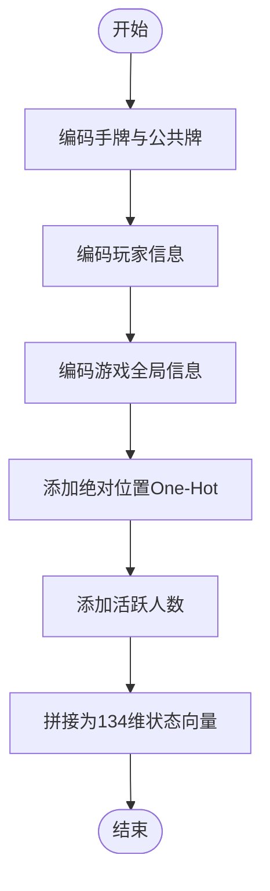
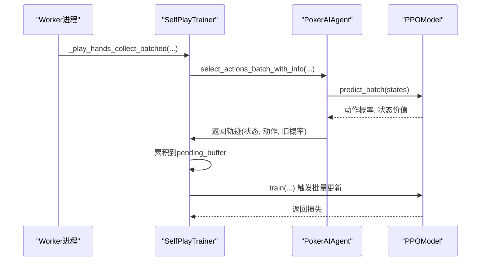
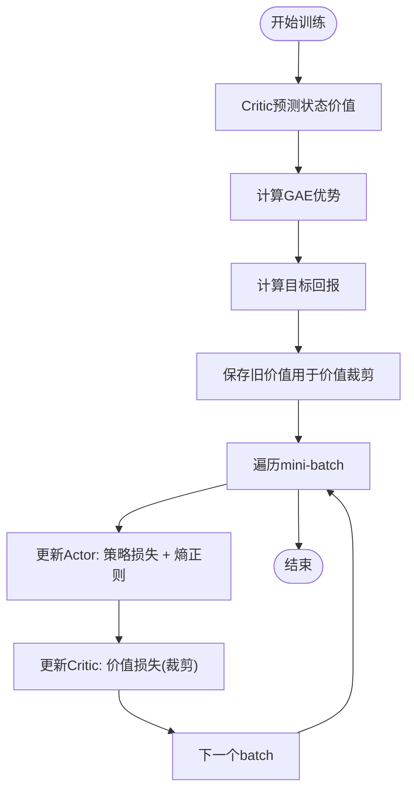
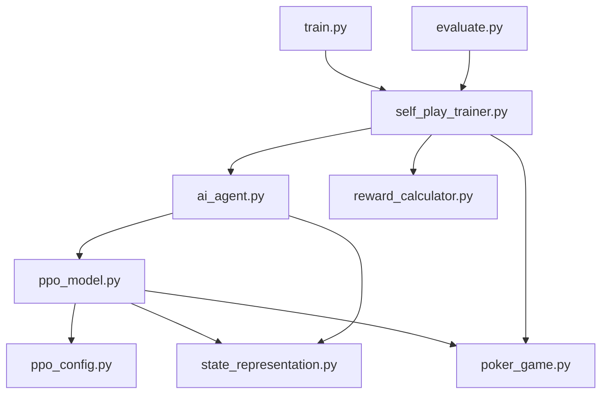

# PPO算法实现

<cite>
**本文引用的文件**
- [poker_ai/model/ppo_model.py](file://poker_ai/model/ppo_model.py)
- [poker_ai/config/ppo_config.py](file://poker_ai/config/ppo_config.py)
- [poker_ai/model/state_representation.py](file://poker_ai/model/state_representation.py)
- [poker_ai/model/ai_agent.py](file://poker_ai/model/ai_agent.py)
- [poker_ai/reward/self_play_trainer.py](file://poker_ai/reward/self_play_trainer.py)
- [train.py](file://train.py)
- [evaluate.py](file://evaluate.py)
- [test_ppo.py](file://test_ppo.py)
- [README.md](file://README.md)
- [requirements.txt](file://requirements.txt)
- [PPO优化总结.md](file://PPO优化总结.md)
- [PPO快速指南.md](file://PPO快速指南.md)
</cite>

## 目录
1. [简介](#简介)
2. [项目结构](#项目结构)
3. [核心组件](#核心组件)
4. [架构概览](#架构概览)
5. [详细组件分析](#详细组件分析)
6. [依赖关系分析](#依赖关系分析)
7. [性能考量](#性能考量)
8. [故障排除指南](#故障排除指南)
9. [结论](#结论)
10. [附录](#附录)

## 简介
本技术文档围绕德州扑克AI中的PPO（Proximal Policy Optimization）算法实现进行全面解析，涵盖理论基础、代码实现、训练流程、性能优化与调试策略。重点包括：
- PPO核心理论：重要性采样、裁剪目标函数、熵正则化、价值损失裁剪、学习率调度与KL散度早停
- PPOModel类实现细节：策略网络（Actor）与价值网络（Critic）联合训练、动作概率计算、状态价值估计
- 状态表示与动作合法性约束：6-Max专用状态向量、动作掩码、动作解码
- 轨迹收集与批量训练：并行采样、轨迹聚合、批量更新
- 德州扑克特殊考虑：动作合法性、状态表示优化、奖励设计
- 超参数调优与性能监控：学习率、裁剪参数、熵系数、批大小、更新轮次

## 项目结构
该项目采用模块化组织，围绕德州扑克游戏环境、AI代理、奖励计算与训练器展开。PPO实现位于model子模块，训练与评估脚本位于根目录。

**图表来源**
- [train.py:1-856](file://train.py#L1-L856)
- [evaluate.py:1-753](file://evaluate.py#L1-L753)
- [poker_ai/reward/self_play_trainer.py:1-1604](file://poker_ai/reward/self_play_trainer.py#L1-L1604)
- [poker_ai/model/ai_agent.py:1-703](file://poker_ai/model/ai_agent.py#L1-L703)
- [poker_ai/model/ppo_model.py:1-670](file://poker_ai/model/ppo_model.py#L1-L670)
- [poker_ai/model/state_representation.py:1-247](file://poker_ai/model/state_representation.py#L1-L247)
- [poker_ai/config/ppo_config.py:1-97](file://poker_ai/config/ppo_config.py#L1-L97)

**章节来源**
- [README.md:1-227](file://README.md#L1-L227)

## 核心组件
- PPOModel：策略网络（Actor）与价值网络（Critic）联合训练，实现PPO核心更新步骤、GAE计算、学习率调度、自适应熵系数与价值损失裁剪
- PokerAIAgent：统一代理接口，封装状态表示、动作合法性掩码、动作采样与解码、轨迹收集与批量训练
- StateRepresentation：6-Max专用状态向量构造，包含手牌、公共牌、玩家信息、游戏全局信息、绝对位置与活跃人数
- SelfPlayTrainer：自我对弈训练器，负责并行采样、轨迹聚合、批量训练触发与评估
- PPOConfig：集中管理PPO超参数，支持RTX 4090D优化配置

**章节来源**
- [poker_ai/model/ppo_model.py:20-670](file://poker_ai/model/ppo_model.py#L20-L670)
- [poker_ai/model/ai_agent.py:55-703](file://poker_ai/model/ai_agent.py#L55-L703)
- [poker_ai/model/state_representation.py:9-247](file://poker_ai/model/state_representation.py#L9-L247)
- [poker_ai/reward/self_play_trainer.py:48-1604](file://poker_ai/reward/self_play_trainer.py#L48-L1604)
- [poker_ai/config/ppo_config.py:18-97](file://poker_ai/config/ppo_config.py#L18-L97)

## 架构概览
PPO在德州扑克中的训练流程如下：SelfPlayTrainer并行采样多手牌，收集轨迹（状态、动作、旧概率、奖励），达到阈值后批量调用PPOModel.train进行更新；PPOModel内部通过tf.function编译的_update_step执行策略与价值网络的联合更新，使用GAE计算优势，结合重要性采样比率与裁剪目标，配合熵正则与价值损失裁剪，实现稳定高效的策略优化。

**图表来源**
- [poker_ai/reward/self_play_trainer.py:260-417](file://poker_ai/reward/self_play_trainer.py#L260-L417)
- [poker_ai/model/ai_agent.py:125-420](file://poker_ai/model/ai_agent.py#L125-L420)
- [poker_ai/model/ppo_model.py:497-638](file://poker_ai/model/ppo_model.py#L497-L638)

## 详细组件分析

### PPOModel类详解
PPOModel实现了PPO的核心算法与工程优化，包括：
- 网络架构：Actor与Critic均为256-256-128-64的深度网络，使用LayerNormalization与残差连接，提升训练稳定性与收敛速度
- 联合训练：_ppo_update_step中分别计算策略损失（重要性采样比率与裁剪目标）、熵正则损失与价值损失（价值裁剪），并使用global norm梯度裁剪
- GAE计算：向量化实现，包含数值稳定性、优势标准化与极端值裁剪
- 学习率调度：warmup线性增长 + cosine衰减，支持动态更新
- 自适应熵系数：根据当前策略熵与目标熵差距动态调整
- 梯度累积：支持梯度累积以提升有效batch size
- 混合精度：LossScaleOptimizer适配float16训练

**图表来源**
- [poker_ai/model/ppo_model.py:20-670](file://poker_ai/model/ppo_model.py#L20-L670)

**章节来源**
- [poker_ai/model/ppo_model.py:20-670](file://poker_ai/model/ppo_model.py#L20-L670)

### 状态表示与动作合法性
StateRepresentation将6-Max德州扑克的状态编码为134维向量，包含：
- 自身手牌与公共牌（one-hot，52维）
- 所有玩家信息（6人 × 3特征，18维）
- 游戏全局信息（轮次、底池、当前下注、大盲/小盲，5维）
- 绝对位置One-Hot（相对于庄家，6维）
- 活跃玩家数量（归一化，1维）

动作合法性掩码由_get_legal_action_mask生成，确保PPO在采样时仅考虑合法动作（fold/call/raise/all-in），并在概率分布上进行归一化。

**图表来源**
- [poker_ai/model/state_representation.py:137-158](file://poker_ai/model/state_representation.py#L137-L158)

**章节来源**
- [poker_ai/model/state_representation.py:9-247](file://poker_ai/model/state_representation.py#L9-L247)
- [poker_ai/model/ai_agent.py:15-54](file://poker_ai/model/ai_agent.py#L15-L54)

### 轨迹收集与批量训练
SelfPlayTrainer负责并行采样与轨迹聚合：
- 并行采样：_play_hands_collect_batched支持批量状态前向推理，减少Python/TensorFlow往返开销
- 轨迹记录：PokerAIAgent在select_action_with_info中记录状态、动作索引与旧概率，finish_trajectory写入最终奖励并触发批量训练
- 批量训练：当累计样本达到阈值（ppo_update_min_steps）时，调用PPOModel.train进行批量更新

**图表来源**
- [poker_ai/reward/self_play_trainer.py:587-800](file://poker_ai/reward/self_play_trainer.py#L587-L800)
- [poker_ai/model/ai_agent.py:157-214](file://poker_ai/model/ai_agent.py#L157-L214)
- [poker_ai/model/ai_agent.py:363-414](file://poker_ai/model/ai_agent.py#L363-L414)

**章节来源**
- [poker_ai/reward/self_play_trainer.py:48-1604](file://poker_ai/reward/self_play_trainer.py#L48-L1604)
- [poker_ai/model/ai_agent.py:157-420](file://poker_ai/model/ai_agent.py#L157-L420)

### PPO训练流程与关键方法
- predict：单步推理，返回动作概率与状态价值
- predict_batch：批量推理，用于并行采样
- train：核心训练入口，计算GAE、优势估计、调用_update_step进行策略与价值网络更新
- _compute_gae：向量化GAE计算，包含数值稳定性与优势标准化
- _ppo_update_step：tf.function编译的单步更新，实现重要性采样比率裁剪、熵正则、价值损失裁剪与global norm梯度裁剪

**图表来源**
- [poker_ai/model/ppo_model.py:497-638](file://poker_ai/model/ppo_model.py#L497-L638)
- [poker_ai/model/ppo_model.py:276-321](file://poker_ai/model/ppo_model.py#L276-L321)
- [poker_ai/model/ppo_model.py:106-198](file://poker_ai/model/ppo_model.py#L106-L198)

**章节来源**
- [poker_ai/model/ppo_model.py:106-638](file://poker_ai/model/ppo_model.py#L106-L638)

### 德州扑克特殊考虑
- 动作合法性约束：通过_get_legal_action_mask生成掩码，确保采样仅在合法动作上进行
- 状态表示优化：134维向量包含绝对位置与活跃人数，提升策略对位置与对手数量的感知
- 奖励设计：使用奖励计算器在回合结束时计算最终奖励，包含反塌缩惩罚与all-in不走运补偿
- 对手策略：随机DQN作为“鱼”，避免PPO策略体相互影响

**章节来源**
- [poker_ai/model/ai_agent.py:15-54](file://poker_ai/model/ai_agent.py#L15-L54)
- [poker_ai/model/state_representation.py:99-135](file://poker_ai/model/state_representation.py#L99-L135)
- [poker_ai/reward/self_play_trainer.py:360-404](file://poker_ai/reward/self_play_trainer.py#L360-L404)

## 依赖关系分析
PPO实现依赖关系清晰，模块间耦合度低，便于维护与扩展。

**图表来源**
- [poker_ai/model/ppo_model.py:1-11](file://poker_ai/model/ppo_model.py#L1-L11)
- [poker_ai/model/ai_agent.py:6-9](file://poker_ai/model/ai_agent.py#L6-L9)
- [poker_ai/reward/self_play_trainer.py:21-26](file://poker_ai/reward/self_play_trainer.py#L21-L26)
- [train.py:350-383](file://train.py#L350-L383)
- [evaluate.py:93-98](file://evaluate.py#L93-L98)

**章节来源**
- [poker_ai/model/ppo_model.py:1-11](file://poker_ai/model/ppo_model.py#L1-L11)
- [poker_ai/model/ai_agent.py:6-9](file://poker_ai/model/ai_agent.py#L6-L9)
- [poker_ai/reward/self_play_trainer.py:21-26](file://poker_ai/reward/self_play_trainer.py#L21-L26)
- [train.py:350-383](file://train.py#L350-L383)
- [evaluate.py:93-98](file://evaluate.py#L93-L98)

## 性能考量
- 网络容量与稳定性：256-256-128-64深度网络 + LayerNormalization + 残差连接，提升收敛速度与稳定性
- 学习率调度：warmup + cosine衰减，避免训练初期不稳定与后期震荡
- GAE与价值裁剪：向量化GAE与价值裁剪损失，提升训练稳定性
- 混合精度：LossScaleOptimizer适配float16，提升吞吐
- 并行采样：批量状态前向推理，减少Python/TensorFlow往返开销
- 梯度累积：提升有效batch size，缓解小显存限制

**章节来源**
- [PPO优化总结.md:1-276](file://PPO优化总结.md#L1-L276)
- [PPO快速指南.md:1-246](file://PPO快速指南.md#L1-L246)
- [poker_ai/model/ppo_model.py:200-274](file://poker_ai/model/ppo_model.py#L200-L274)
- [poker_ai/model/ppo_model.py:420-448](file://poker_ai/model/ppo_model.py#L420-L448)

## 故障排除指南
- 训练崩溃或DNN/Graph错误：PPO更新中捕获异常并给出提示，建议尝试关闭XLA或禁用oneDNN
- 策略塌缩（总是fold）：提高熵系数或检查动作掩码是否正确
- 学习率过高导致损失爆炸：降低学习率或增大价值裁剪阈值
- 显存不足：减小batch size或更新epochs
- 检查点加载失败：确认PPO权重文件存在（actor/critic/状态文件）

**章节来源**
- [poker_ai/model/ai_agent.py:314-332](file://poker_ai/model/ai_agent.py#L314-L332)
- [poker_ai/model/ppo_model.py:640-659](file://poker_ai/model/ppo_model.py#L640-L659)

## 结论
本实现将PPO算法与德州扑克环境深度融合，通过工程化优化（网络架构、学习率调度、GAE、价值裁剪、自适应熵、混合精度与并行采样）显著提升了训练效率与策略质量。PPOModel提供了完整的训练接口与监控指标，SelfPlayTrainer实现了高效的并行采样与批量训练，PokerAIAgent统一了动作选择与轨迹收集流程。建议在大规模训练中结合硬件优化档位与自动调参策略，持续监控关键指标以获得最佳性能。

## 附录

### 超参数调优指南
- 学习率：默认3e-4，warmup步数2000，cosine衰减
- 裁剪参数：clip_epsilon默认0.2
- 熵正则：默认0.02，支持自适应调节
- 批大小：默认256，RTX 4090D可提升至512/768
- 更新轮次：默认4，避免策略退化
- 价值裁剪：默认0.2，防止价值网络更新过快
- 梯度累积：按需开启以提升有效batch size

**章节来源**
- [poker_ai/config/ppo_config.py:18-97](file://poker_ai/config/ppo_config.py#L18-L97)
- [PPO快速指南.md:101-131](file://PPO快速指南.md#L101-L131)

### 性能监控策略
- 关键指标：学习率、Actor损失、Critic损失、总损失、KL散度、当前学习率、训练步数
- 训练效率：平均每手耗时
- 策略质量：评估胜率、平均利润、动作分布、阶段利润分布

**章节来源**
- [poker_ai/model/ppo_model.py:632-636](file://poker_ai/model/ppo_model.py#L632-L636)
- [train.py:521-526](file://train.py#L521-L526)

### 代码示例路径
- PPO训练入口：[train.py:340-531](file://train.py#L340-L531)
- PPO评估入口：[evaluate.py:532-592](file://evaluate.py#L532-L592)
- PPO模型初始化与测试：[test_ppo.py:1-41](file://test_ppo.py#L1-L41)
- PPO模型核心训练：[poker_ai/model/ppo_model.py:497-638](file://poker_ai/model/ppo_model.py#L497-L638)
- 状态表示与动作掩码：[poker_ai/model/state_representation.py:137-158](file://poker_ai/model/state_representation.py#L137-L158), [poker_ai/model/ai_agent.py:15-54](file://poker_ai/model/ai_agent.py#L15-L54)
- 并行采样与轨迹聚合：[poker_ai/reward/self_play_trainer.py:587-800](file://poker_ai/reward/self_play_trainer.py#L587-L800)