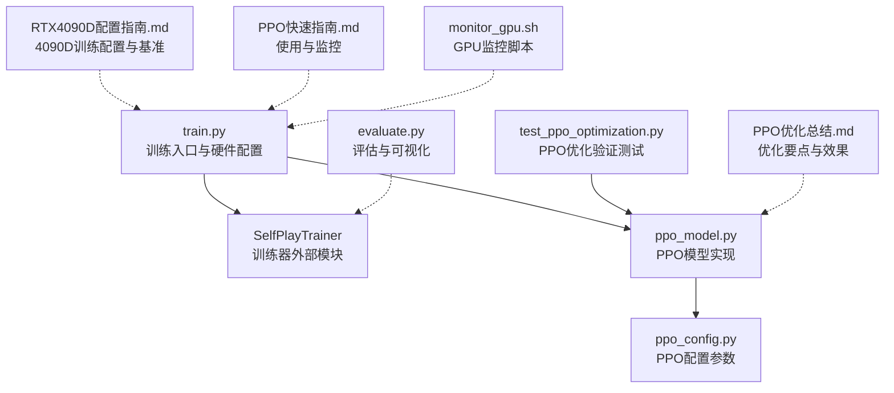
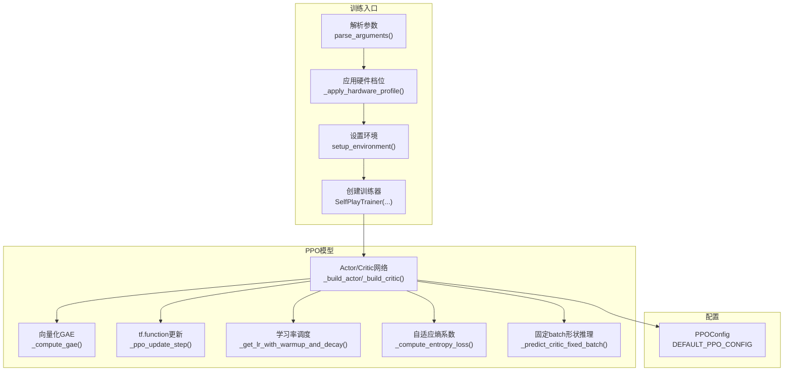
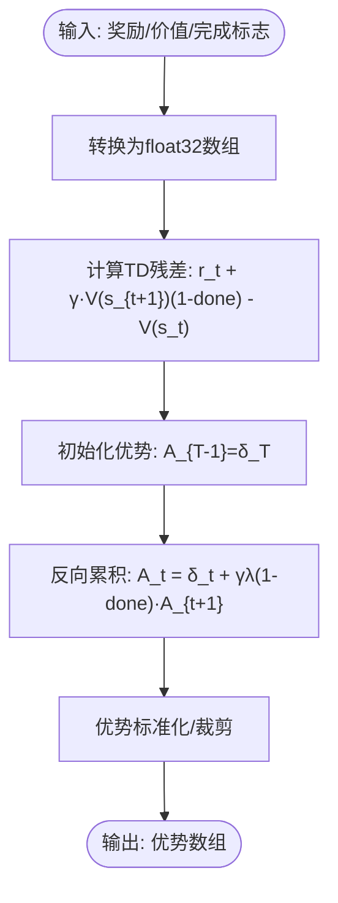
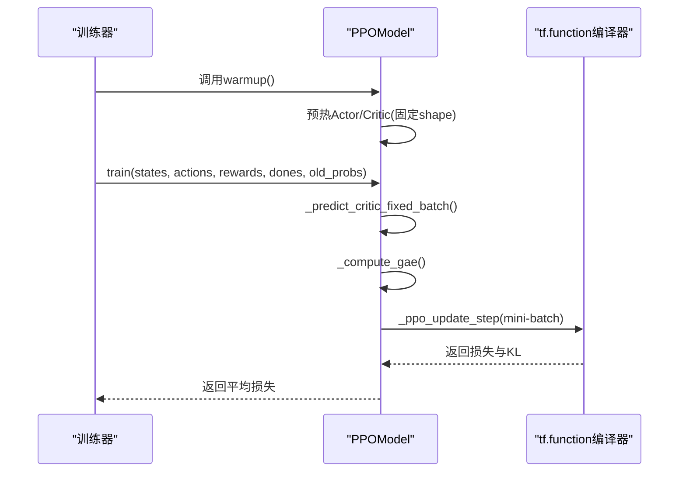
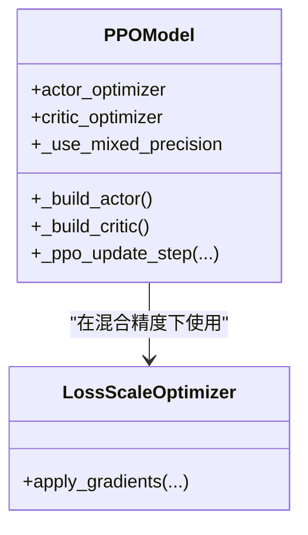
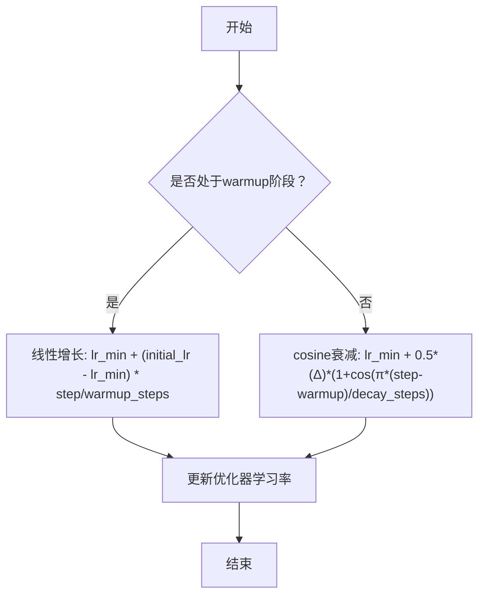
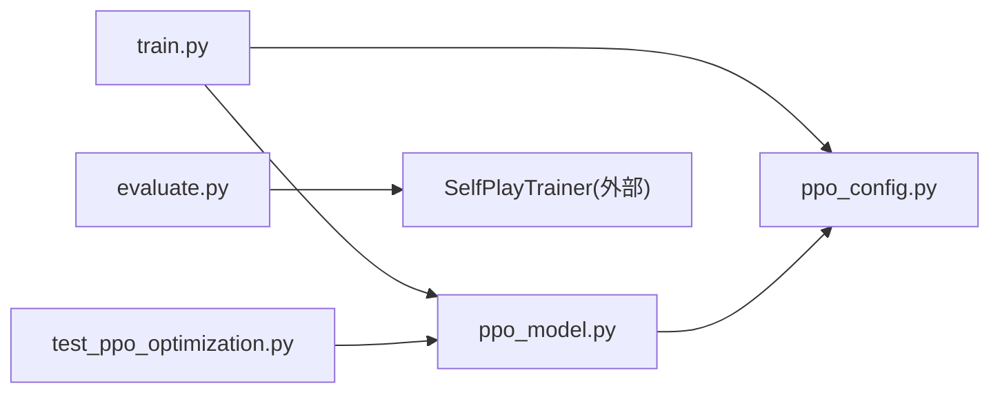

# 优化特性与性能

<cite>
**本文引用的文件**
- [train.py](file://train.py)
- [test_ppo_optimization.py](file://test_ppo_optimization.py)
- [ppo_model.py](file://poker_ai/model/ppo_model.py)
- [ppo_config.py](file://poker_ai/config/ppo_config.py)
- [RTX4090D配置指南.md](file://RTX4090D配置指南.md)
- [PPO优化总结.md](file://PPO优化总结.md)
- [PPO快速指南.md](file://PPO快速指南.md)
- [monitor_gpu.sh](file://monitor_gpu.sh)
- [evaluate.py](file://evaluate.py)
</cite>

## 目录
1. [简介](#简介)
2. [项目结构](#项目结构)
3. [核心组件](#核心组件)
4. [架构总览](#架构总览)
5. [详细组件分析](#详细组件分析)
6. [依赖关系分析](#依赖关系分析)
7. [性能考量](#性能考量)
8. [故障排除指南](#故障排除指南)
9. [结论](#结论)
10. [附录](#附录)

## 简介
本技术文档聚焦于PPO优化特性与性能优化，围绕RTX 4090D系列GPU的训练配置与实现细节展开，涵盖向量化GAE计算、tf.function编译优化、预热机制、混合精度训练与LossScaleOptimizer、梯度裁剪、学习率调度、自适应熵系数、以及内存与GPU资源优化策略（批处理大小、并行采样、数据预取）。文档还提供性能基准测试与优化前后对比、故障排除与常见问题解决方案，帮助读者在RTX 4090D上高效稳定地训练德州扑克AI的PPO模型。

## 项目结构
该项目采用模块化组织，训练入口、模型实现、配置与测试脚本分别位于不同层级，便于维护与扩展。与PPO优化相关的文件集中在 poker_ai/model 与 poker_ai/config 目录，训练入口与硬件配置在根目录。

图表来源
- [train.py:136-238](file://train.py#L136-L238)
- [ppo_model.py:20-105](file://poker_ai/model/ppo_model.py#L20-L105)
- [ppo_config.py:18-96](file://poker_ai/config/ppo_config.py#L18-L96)
- [RTX4090D配置指南.md:1-366](file://RTX4090D配置指南.md#L1-L366)
- [PPO优化总结.md:1-276](file://PPO优化总结.md#L1-L276)
- [PPO快速指南.md:1-246](file://PPO快速指南.md#L1-L246)
- [monitor_gpu.sh:1-83](file://monitor_gpu.sh#L1-L83)
- [evaluate.py:110-142](file://evaluate.py#L110-L142)

章节来源
- [train.py:136-238](file://train.py#L136-L238)
- [ppo_model.py:20-105](file://poker_ai/model/ppo_model.py#L20-L105)
- [ppo_config.py:18-96](file://poker_ai/config/ppo_config.py#L18-L96)
- [RTX4090D配置指南.md:1-366](file://RTX4090D配置指南.md#L1-L366)
- [PPO优化总结.md:1-276](file://PPO优化总结.md#L1-L276)
- [PPO快速指南.md:1-246](file://PPO快速指南.md#L1-L246)
- [monitor_gpu.sh:1-83](file://monitor_gpu.sh#L1-L83)
- [evaluate.py:110-142](file://evaluate.py#L110-L142)

## 核心组件
- 训练入口与硬件配置：负责解析命令行参数、应用硬件档位（RTX 4090D）、设置TensorFlow线程并行、混合精度与XLA、GPU显存增长等。
- PPO模型：包含Actor/Critic网络、向量化GAE计算、tf.function编译优化、LossScaleOptimizer混合精度适配、自适应学习率调度、自适应熵系数、KL散度早停、梯度裁剪等。
- 配置参数：集中管理PPO超参数，支持默认配置与自定义覆盖。
- 测试与评估：验证PPO优化实现与生成评估报告与可视化图表。

章节来源
- [train.py:240-337](file://train.py#L240-L337)
- [ppo_model.py:20-105](file://poker_ai/model/ppo_model.py#L20-L105)
- [ppo_config.py:18-96](file://poker_ai/config/ppo_config.py#L18-L96)
- [test_ppo_optimization.py:220-301](file://test_ppo_optimization.py#L220-L301)
- [evaluate.py:181-267](file://evaluate.py#L181-L267)

## 架构总览
下图展示训练入口、PPO模型与配置之间的交互关系，以及硬件优化配置如何影响训练行为。

图表来源
- [train.py:136-238](file://train.py#L136-L238)
- [train.py:55-97](file://train.py#L55-L97)
- [train.py:240-337](file://train.py#L240-L337)
- [ppo_model.py:200-274](file://poker_ai/model/ppo_model.py#L200-L274)
- [ppo_model.py:276-320](file://poker_ai/model/ppo_model.py#L276-L320)
- [ppo_model.py:106-198](file://poker_ai/model/ppo_model.py#L106-L198)
- [ppo_model.py:420-447](file://poker_ai/model/ppo_model.py#L420-L447)
- [ppo_model.py:449-470](file://poker_ai/model/ppo_model.py#L449-L470)
- [ppo_model.py:472-495](file://poker_ai/model/ppo_model.py#L472-L495)
- [ppo_config.py:18-96](file://poker_ai/config/ppo_config.py#L18-L96)

## 详细组件分析

### 向量化GAE计算（RTX 4090D优化）
- 实现要点
  - 使用NumPy向量化替代Python循环，显著提升GAE计算效率。
  - 改进边界条件处理与优势归一化，裁剪极端值防止梯度爆炸。
  - 与固定batch形状推理配合，避免不同形状触发retracing。
- 关键路径
  - [ppo_model.py:276-320](file://poker_ai/model/ppo_model.py#L276-L320)

图表来源
- [ppo_model.py:276-320](file://poker_ai/model/ppo_model.py#L276-L320)

章节来源
- [ppo_model.py:276-320](file://poker_ai/model/ppo_model.py#L276-L320)

### tf.function编译优化与预热机制
- 实现要点
  - 使用tf.function装饰器编译PPO更新步骤，降低Python调度开销。
  - 预热机制：在warmup阶段用固定shape调用Actor/Critic，减少首次retracing警告。
- 关键路径
  - [ppo_model.py:106-198](file://poker_ai/model/ppo_model.py#L106-L198)
  - [ppo_model.py:407-418](file://poker_ai/model/ppo_model.py#L407-L418)

图表来源
- [ppo_model.py:407-418](file://poker_ai/model/ppo_model.py#L407-L418)
- [ppo_model.py:497-638](file://poker_ai/model/ppo_model.py#L497-L638)
- [ppo_model.py:106-198](file://poker_ai/model/ppo_model.py#L106-L198)

章节来源
- [ppo_model.py:106-198](file://poker_ai/model/ppo_model.py#L106-L198)
- [ppo_model.py:407-418](file://poker_ai/model/ppo_model.py#L407-L418)
- [ppo_model.py:497-638](file://poker_ai/model/ppo_model.py#L497-L638)

### 混合精度训练与LossScaleOptimizer
- 实现要点
  - 自动检测混合精度策略，若启用则使用LossScaleOptimizer适配混合精度训练。
  - 在损失计算中统一转为float32，避免float16导致的数值问题。
- 关键路径
  - [ppo_model.py:94-104](file://poker_ai/model/ppo_model.py#L94-L104)
  - [ppo_model.py:127-133](file://poker_ai/model/ppo_model.py#L127-L133)
  - [ppo_model.py:167-172](file://poker_ai/model/ppo_model.py#L167-L172)

图表来源
- [ppo_model.py:94-104](file://poker_ai/model/ppo_model.py#L94-L104)
- [ppo_model.py:106-198](file://poker_ai/model/ppo_model.py#L106-L198)

章节来源
- [ppo_model.py:94-104](file://poker_ai/model/ppo_model.py#L94-L104)
- [ppo_model.py:127-133](file://poker_ai/model/ppo_model.py#L127-L133)
- [ppo_model.py:167-172](file://poker_ai/model/ppo_model.py#L167-L172)

### 学习率调度（Warmup + Cosine衰减）
- 实现要点
  - warmup阶段线性增长至初始学习率；随后cosine衰减至最小值。
  - 支持配置warmup步数、总训练步数、最小学习率等。
- 关键路径
  - [ppo_model.py:420-447](file://poker_ai/model/ppo_model.py#L420-L447)
  - [ppo_model.py:448](file://poker_ai/model/ppo_model.py#L448)
  - [ppo_config.py:41-45](file://poker_ai/config/ppo_config.py#L41-L45)

图表来源
- [ppo_model.py:420-447](file://poker_ai/model/ppo_model.py#L420-L447)
- [ppo_config.py:41-45](file://poker_ai/config/ppo_config.py#L41-L45)

章节来源
- [ppo_model.py:420-447](file://poker_ai/model/ppo_model.py#L420-L447)
- [ppo_model.py:448](file://poker_ai/model/ppo_model.py#L448)
- [ppo_config.py:41-45](file://poker_ai/config/ppo_config.py#L41-L45)

### 自适应熵系数与KL散度早停
- 实现要点
  - 根据当前策略熵与目标熵的差距动态调整熵系数，平衡探索与利用。
  - 训练过程中跟踪KL散度，超过阈值时提前终止该epoch，提升稳定性。
- 关键路径
  - [ppo_model.py:449-470](file://poker_ai/model/ppo_model.py#L449-L470)
  - [ppo_model.py:544-624](file://poker_ai/model/ppo_model.py#L544-L624)
  - [ppo_config.py:60-62](file://poker_ai/config/ppo_config.py#L60-L62)

章节来源
- [ppo_model.py:449-470](file://poker_ai/model/ppo_model.py#L449-L470)
- [ppo_model.py:544-624](file://poker_ai/model/ppo_model.py#L544-L624)
- [ppo_config.py:60-62](file://poker_ai/config/ppo_config.py#L60-L62)

### 梯度裁剪与价值损失裁剪
- 实现要点
  - 使用全局梯度裁剪（clip_by_global_norm）替代逐层裁剪，更稳健。
  - 价值损失裁剪基于旧价值，保守更新，防止价值网络更新过快。
- 关键路径
  - [ppo_model.py:155-156](file://poker_ai/model/ppo_model.py#L155-L156)
  - [ppo_model.py:187-188](file://poker_ai/model/ppo_model.py#L187-L188)
  - [ppo_model.py:174-184](file://poker_ai/model/ppo_model.py#L174-L184)

章节来源
- [ppo_model.py:155-156](file://poker_ai/model/ppo_model.py#L155-L156)
- [ppo_model.py:187-188](file://poker_ai/model/ppo_model.py#L187-L188)
- [ppo_model.py:174-184](file://poker_ai/model/ppo_model.py#L174-L184)

### 网络架构与正则化（LayerNorm、残差、Dropout）
- 实现要点
  - Actor/Critic均采用256-256-128-64容量，LayerNormalization与残差连接提升稳定性。
  - 策略网络移除Dropout，价值网络保留轻度Dropout防止过拟合。
- 关键路径
  - [ppo_model.py:200-274](file://poker_ai/model/ppo_model.py#L200-L274)

章节来源
- [ppo_model.py:200-274](file://poker_ai/model/ppo_model.py#L200-L274)

### 硬件配置与并行策略（RTX 4090D）
- 实现要点
  - 自动推断并行worker数量，最大化CPU/GPU利用率。
  - 默认启用混合精度、XLA、显存按需增长，提升吞吐与稳定性。
  - 提供多种配置方案与性能基准，指导批大小与并行度调优。
- 关键路径
  - [train.py:39-52](file://train.py#L39-L52)
  - [train.py:55-97](file://train.py#L55-L97)
  - [train.py:240-337](file://train.py#L240-L337)
  - [RTX4090D配置指南.md:14-204](file://RTX4090D配置指南.md#L14-L204)

章节来源
- [train.py:39-52](file://train.py#L39-L52)
- [train.py:55-97](file://train.py#L55-L97)
- [train.py:240-337](file://train.py#L240-L337)
- [RTX4090D配置指南.md:14-204](file://RTX4090D配置指南.md#L14-L204)

## 依赖关系分析
- 训练入口依赖PPO模型与配置，通过命令行参数与硬件档位控制训练行为。
- PPO模型内部依赖配置参数，实现学习率调度、GAE计算、更新步骤等。
- 评估脚本依赖训练器与模型加载，生成详细报告与可视化图表。

图表来源
- [train.py:136-238](file://train.py#L136-L238)
- [ppo_model.py:20-105](file://poker_ai/model/ppo_model.py#L20-L105)
- [ppo_config.py:18-96](file://poker_ai/config/ppo_config.py#L18-L96)
- [test_ppo_optimization.py:220-301](file://test_ppo_optimization.py#L220-L301)
- [evaluate.py:181-267](file://evaluate.py#L181-L267)

章节来源
- [train.py:136-238](file://train.py#L136-L238)
- [ppo_model.py:20-105](file://poker_ai/model/ppo_model.py#L20-L105)
- [ppo_config.py:18-96](file://poker_ai/config/ppo_config.py#L18-L96)
- [test_ppo_optimization.py:220-301](file://test_ppo_optimization.py#L220-L301)
- [evaluate.py:181-267](file://evaluate.py#L181-L267)

## 性能考量
- 批处理大小优化
  - RTX 4090D 24GB显存支持更大batch size，建议从512起步，逐步提升至1024/2048。
  - 通过固定batch形状推理与向量化GAE，减少retracing与循环开销。
- 并行采样与数据预取
  - 增加train_workers与eval_workers，提升CPU/GPU利用率。
  - 通过train_rollouts_per_worker与train_sync_every_batches平衡吞吐与延迟。
- 混合精度与XLA
  - 默认启用mixed_precision与enable_xla，显著提升吞吐与显存效率。
- 学习率与稳定性
  - warmup + cosine衰减平滑学习率，结合KL早停与价值损失裁剪，提升训练稳定性。
- 监控与基准
  - 参考RTX4090D配置指南中的基准表格，结合monitor_gpu.sh实时监控GPU利用率与温度。

章节来源
- [RTX4090D配置指南.md:158-204](file://RTX4090D配置指南.md#L158-L204)
- [monitor_gpu.sh:1-83](file://monitor_gpu.sh#L1-L83)
- [train.py:55-97](file://train.py#L55-L97)
- [ppo_model.py:420-447](file://poker_ai/model/ppo_model.py#L420-L447)
- [ppo_model.py:174-184](file://poker_ai/model/ppo_model.py#L174-L184)

## 故障排除指南
- 训练崩溃或损失爆炸
  - 降低学习率、增大value_clip、检查batch size与并行度。
  - 参考异常处理与建议：[PPO快速指南.md:146-159](file://PPO快速指南.md#L146-L159)
- 策略塌缩（总是fold）
  - 提高熵系数、检查自适应熵系数逻辑。
  - 参考自适应熵实现：[ppo_model.py:449-470](file://poker_ai/model/ppo_model.py#L449-L470)
- 训练停滞
  - 检查学习率是否过小、warmup是否生效、KL早停阈值是否过严。
  - 参考学习率调度与KL早停：[ppo_model.py:420-447](file://poker_ai/model/ppo_model.py#L420-L447), [ppo_model.py:603-611](file://poker_ai/model/ppo_model.py#L603-L611)
- 显存不足
  - 降低batch size、减少ppo_epochs、关闭不必要的并行worker。
  - 参考调优技巧：[RTX4090D配置指南.md:177-204](file://RTX4090D配置指南.md#L177-L204)
- GPU利用率低
  - 提高batch size、增加train_workers与rollouts、增大ppo_update_min_steps。
  - 参考调优技巧：[RTX4090D配置指南.md:190-204](file://RTX4090D配置指南.md#L190-L204)
- 监控与诊断
  - 使用monitor_gpu.sh观察GPU利用率、显存与温度。
  - 参考监控脚本：[monitor_gpu.sh:1-83](file://monitor_gpu.sh#L1-L83)

章节来源
- [PPO快速指南.md:146-159](file://PPO快速指南.md#L146-L159)
- [ppo_model.py:449-470](file://poker_ai/model/ppo_model.py#L449-L470)
- [ppo_model.py:420-447](file://poker_ai/model/ppo_model.py#L420-L447)
- [ppo_model.py:603-611](file://poker_ai/model/ppo_model.py#L603-L611)
- [RTX4090D配置指南.md:177-204](file://RTX4090D配置指南.md#L177-L204)
- [monitor_gpu.sh:1-83](file://monitor_gpu.sh#L1-L83)

## 结论
RTX 4090D为PPO训练提供了强大的硬件基础，结合向量化GAE、tf.function编译优化、预热机制、混合精度与LossScaleOptimizer、自适应学习率与熵系数、KL早停与价值损失裁剪等优化，可在保证稳定性的同时显著提升训练效率与策略质量。通过合理的批大小、并行度与硬件配置，可在24GB显存下实现更高吞吐与更快收敛。建议从标准配置开始，逐步调优以获得最佳性能与稳定性。

## 附录
- 性能基准与对比
  - 参考RTX4090D配置指南中的基准表格与对比分析：[RTX4090D配置指南.md:158-341](file://RTX4090D配置指南.md#L158-L341)
- 使用与监控
  - 快速开始与高级配置：[PPO快速指南.md:1-246](file://PPO快速指南.md#L1-L246)
  - GPU监控脚本：[monitor_gpu.sh:1-83](file://monitor_gpu.sh#L1-L83)
- 评估与可视化
  - 评估脚本与报告生成：[evaluate.py:1-753](file://evaluate.py#L1-L753)