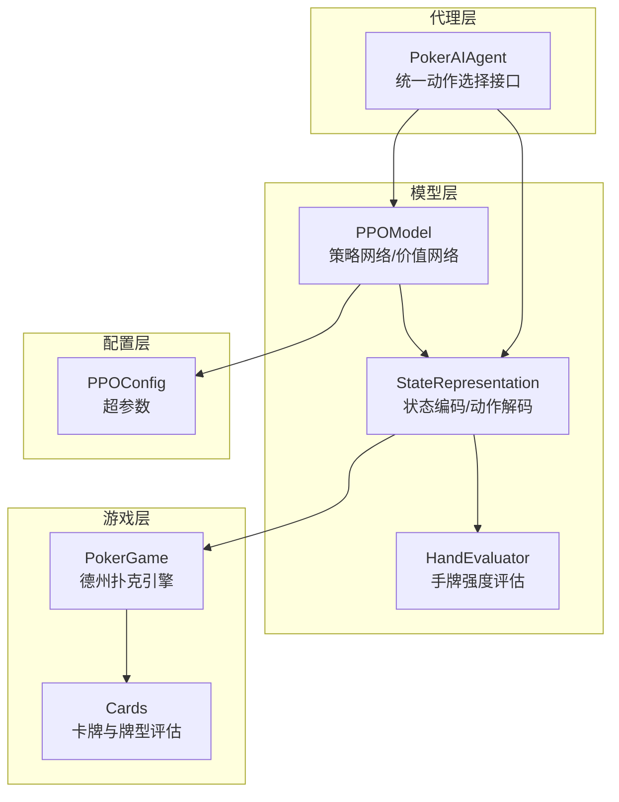
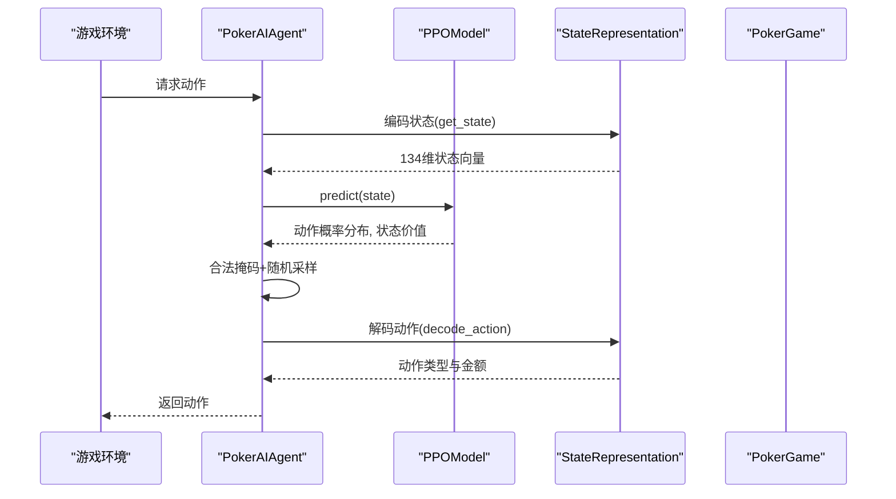
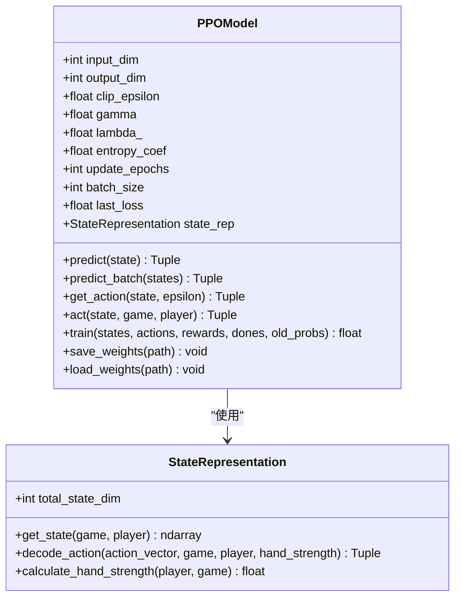
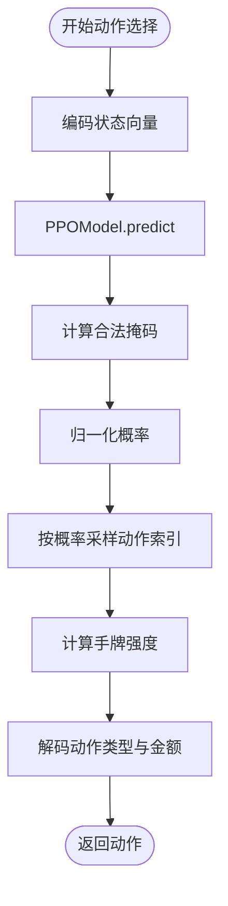
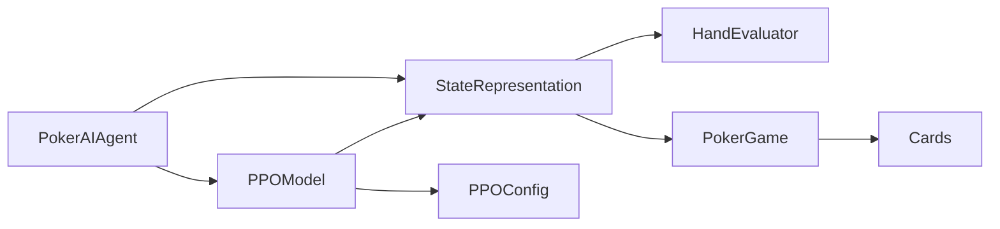

# 状态处理与预测

<cite>
**本文引用的文件**
- [ppo_model.py](file://poker_ai/model/ppo_model.py)
- [ai_agent.py](file://poker_ai/model/ai_agent.py)
- [state_representation.py](file://poker_ai/model/state_representation.py)
- [poker_game.py](file://poker_ai/game/poker_game.py)
- [cards.py](file://poker_ai/game/cards.py)
- [hand_evaluator.py](file://poker_ai/model/hand_evaluator.py)
- [ppo_config.py](file://poker_ai/config/ppo_config.py)
- [test_ppo.py](file://test_ppo.py)
</cite>

## 目录
1. [简介](#简介)
2. [项目结构](#项目结构)
3. [核心组件](#核心组件)
4. [架构总览](#架构总览)
5. [详细组件分析](#详细组件分析)
6. [依赖分析](#依赖分析)
7. [性能考量](#性能考量)
8. [故障排查指南](#故障排查指南)
9. [结论](#结论)
10. [附录](#附录)

## 简介
本技术文档聚焦于PPO状态处理与预测功能，围绕以下目标展开：
- 解释predict与predict_batch方法的实现原理，说明如何将134维状态向量转换为动作概率分布与状态价值
- 详细分析act方法与德州扑克游戏引擎的集成，包括动作解码与手牌强度计算
- 解释get_action方法的随机采样机制与epsilon参数的兼容性处理
- 阐述状态预处理的重要性，包括数据类型转换、形状调整等
- 提供状态向量的详细说明与预测结果的解读方法，包括动作概率的含义与状态价值的评估标准

## 项目结构
该项目采用模块化设计，围绕德州扑克AI训练与推理流程组织：
- 模型层：PPO模型、状态表示、手牌评估器
- 游戏层：德州扑克规则引擎、卡牌与牌型评估
- 配置层：PPO超参数配置
- 代理层：统一的AI代理接口，兼容DQN、策略梯度与PPO

图表来源
- [ai_agent.py:55-116](file://poker_ai/model/ai_agent.py#L55-L116)
- [ppo_model.py:20-93](file://poker_ai/model/ppo_model.py#L20-L93)
- [state_representation.py:9-46](file://poker_ai/model/state_representation.py#L9-L46)
- [hand_evaluator.py:8-12](file://poker_ai/model/hand_evaluator.py#L8-L12)
- [poker_game.py:155-194](file://poker_ai/game/poker_game.py#L155-L194)
- [cards.py:53-77](file://poker_ai/game/cards.py#L53-L77)
- [ppo_config.py:18-34](file://poker_ai/config/ppo_config.py#L18-L34)

章节来源
- [ai_agent.py:55-116](file://poker_ai/model/ai_agent.py#L55-L116)
- [ppo_model.py:20-93](file://poker_ai/model/ppo_model.py#L20-L93)
- [state_representation.py:9-46](file://poker_ai/model/state_representation.py#L9-L46)
- [poker_game.py:155-194](file://poker_ai/game/poker_game.py#L155-L194)
- [cards.py:53-77](file://poker_ai/game/cards.py#L53-L77)
- [ppo_config.py:18-34](file://poker_ai/config/ppo_config.py#L18-L34)

## 核心组件
- PPOModel：包含策略网络（Actor）与价值网络（Critic），提供predict、predict_batch、get_action、act等接口，支持GAE优势估计、自适应学习率、KL早停、价值损失裁剪等优化
- PokerAIAgent：统一的AI代理接口，负责状态编码、动作采样、动作解码与训练驱动
- StateRepresentation：将游戏状态转换为134维向量，提供动作编码/解码与手牌强度计算
- PokerGame：德州扑克引擎，维护玩家状态、公共牌、轮次与底池等
- HandEvaluator：高性能手牌评估与胜率估算
- PPOConfig：集中管理PPO超参数

章节来源
- [ppo_model.py:20-93](file://poker_ai/model/ppo_model.py#L20-L93)
- [ai_agent.py:55-116](file://poker_ai/model/ai_agent.py#L55-L116)
- [state_representation.py:9-46](file://poker_ai/model/state_representation.py#L9-L46)
- [poker_game.py:155-194](file://poker_ai/game/poker_game.py#L155-L194)
- [hand_evaluator.py:8-12](file://poker_ai/model/hand_evaluator.py#L8-L12)
- [ppo_config.py:18-34](file://poker_ai/config/ppo_config.py#L18-L34)

## 架构总览
PPO状态处理与预测的关键流程如下：
- 状态编码：StateRepresentation将当前玩家、公共牌、全局信息、位置与活跃人数等特征拼接为134维向量
- 前向推理：PPOModel的策略网络输出5维动作概率分布，价值网络输出状态价值
- 动作采样：PokerAIAgent对动作概率施加合法掩码后进行随机采样，得到动作索引
- 动作解码：将独热动作向量与手牌强度结合，解码为具体动作类型与金额
- 训练驱动：PokerAIAgent收集轨迹并在回合结束时调用PPOModel.train进行PPO更新

图表来源
- [ai_agent.py:117-155](file://poker_ai/model/ai_agent.py#L117-L155)
- [ppo_model.py:322-338](file://poker_ai/model/ppo_model.py#L322-L338)
- [state_representation.py:137-158](file://poker_ai/model/state_representation.py#L137-L158)
- [poker_game.py:299-349](file://poker_ai/game/poker_game.py#L299-L349)

## 详细组件分析

### PPOModel：预测与训练核心
- 网络结构
  - 策略网络（Actor）：256-256-128-64隐藏层，LayerNormalization与残差连接，输出5维softmax动作概率
  - 价值网络（Critic）：结构类似，输出线性状态价值
- 预测接口
  - predict：单样本预测，返回动作概率与状态价值
  - predict_batch：批量预测，返回动作概率矩阵与状态价值数组
  - get_action：从策略分布采样动作（兼容接口，epsilon参数保留）
  - act：与游戏引擎集成的动作选择接口，支持手牌强度计算与动作解码
- 训练接口
  - train：核心训练逻辑，包含GAE优势估计、价值损失裁剪、KL早停、自适应学习率与熵系数
  - _compute_gae：向量化GAE计算，显著提升性能
  - _ppo_update_step：单步更新，包含策略损失、熵损失与价值损失的梯度计算与裁剪
- 优化特性
  - 混合精度适配（LossScaleOptimizer）
  - tf.function预编译减少Python调度开销
  - 固定batch形状的critic调用避免retracing警告
  - 自适应学习率（warmup+cosine衰减）

图表来源
- [ppo_model.py:20-93](file://poker_ai/model/ppo_model.py#L20-L93)
- [state_representation.py:9-46](file://poker_ai/model/state_representation.py#L9-L46)

章节来源
- [ppo_model.py:20-93](file://poker_ai/model/ppo_model.py#L20-L93)
- [ppo_model.py:322-338](file://poker_ai/model/ppo_model.py#L322-L338)
- [ppo_model.py:497-638](file://poker_ai/model/ppo_model.py#L497-L638)
- [ppo_model.py:276-320](file://poker_ai/model/ppo_model.py#L276-L320)

### PokerAIAgent：动作选择与训练驱动
- 状态编码：统一通过StateRepresentation.get_state生成134维状态向量
- 动作选择
  - select_action/select_action_with_info：对动作概率施加合法掩码后采样
  - select_actions_batch_with_info：批量路径，单次前向推理多局状态
- 训练驱动
  - learn：兼容旧式单步learn，PPO通过缓冲区累积轨迹并在回合结束时批量训练
  - append_step/finish_trajectory：轨迹级接口，支持批量写入与阈值触发训练
  - append_trajectories_batch：批量轨迹写入，减少函数调用开销
- 决策信息：get_decision_info返回动作概率与状态价值，便于可视化与调试

图表来源
- [ai_agent.py:117-155](file://poker_ai/model/ai_agent.py#L117-L155)
- [ai_agent.py:157-214](file://poker_ai/model/ai_agent.py#L157-L214)
- [state_representation.py:225-247](file://poker_ai/model/state_representation.py#L225-L247)

章节来源
- [ai_agent.py:117-155](file://poker_ai/model/ai_agent.py#L117-L155)
- [ai_agent.py:157-214](file://poker_ai/model/ai_agent.py#L157-L214)
- [ai_agent.py:248-420](file://poker_ai/model/ai_agent.py#L248-L420)

### StateRepresentation：状态编码与动作解码
- 状态向量构成（134维）
  - 自身手牌：52维（one-hot）
  - 公共牌：52维（one-hot）
  - 玩家信息：6×3=18维（栈额、下注、活跃状态，相对Hero位置排列）
  - 全局信息：5维（轮次、底池、当前下注、大盲、小盲，归一化）
  - Hero绝对位置：6维（BTN/SB/BB/UTG/MP/CO）
  - 活跃人数：1维（归一化）
- 动作编码/解码
  - 动作向量：5维（fold, call, raise_x2, raise_x4, all-in）
  - decode_action：根据动作索引与当前上下文生成具体动作类型与金额
- 手牌强度
  - calculate_hand_strength：结合公共牌与对手数量估算胜率，用于动作解码与决策

章节来源
- [state_representation.py:13-39](file://poker_ai/model/state_representation.py#L13-L39)
- [state_representation.py:137-158](file://poker_ai/model/state_representation.py#L137-L158)
- [state_representation.py:225-247](file://poker_ai/model/state_representation.py#L225-L247)
- [state_representation.py:174-210](file://poker_ai/model/state_representation.py#L174-L210)

### PokerGame：德州扑克引擎
- 玩家属性：栈额、下注、活跃、全下、位置等，支持向量化状态
- 游戏流程：大小盲、发牌、翻牌前/翻牌/转牌/河牌、摊牌
- 动作处理：fold/call/raise的合法性校验与状态更新
- 状态导出：get_game_state提供外部访问

章节来源
- [poker_game.py:9-154](file://poker_ai/game/poker_game.py#L9-L154)
- [poker_game.py:155-473](file://poker_ai/game/poker_game.py#L155-L473)

### HandEvaluator：手牌强度评估
- 牌型评估：evaluate_hand返回牌型等级与强度序列
- 胜率估算：calculate_win_probability通过模拟估算胜率，支持少量模拟以平衡性能与准确性

章节来源
- [hand_evaluator.py:14-97](file://poker_ai/model/hand_evaluator.py#L14-L97)
- [hand_evaluator.py:123-187](file://poker_ai/model/hand_evaluator.py#L123-L187)

## 依赖分析
- 组件耦合
  - PokerAIAgent依赖StateRepresentation进行状态编码与动作解码
  - PPOModel依赖StateRepresentation进行状态预处理与手牌强度计算
  - StateRepresentation依赖HandEvaluator与PokerGame进行手牌强度与游戏状态计算
  - PokerGame依赖Cards进行卡牌与牌型评估
- 外部依赖
  - TensorFlow/Keras用于神经网络与优化器
  - NumPy用于向量化计算与数据处理
  - 配置层PPOConfig集中管理超参数

图表来源
- [ppo_model.py:8-10](file://poker_ai/model/ppo_model.py#L8-L10)
- [ai_agent.py:6-9](file://poker_ai/model/ai_agent.py#L6-L9)
- [state_representation.py:5-7](file://poker_ai/model/state_representation.py#L5-L7)
- [poker_game.py](file://poker_ai/game/poker_game.py#L7)
- [cards.py:6-9](file://poker_ai/game/cards.py#L6-L9)
- [ppo_config.py:14-16](file://poker_ai/config/ppo_config.py#L14-L16)

章节来源
- [ppo_model.py:8-10](file://poker_ai/model/ppo_model.py#L8-L10)
- [ai_agent.py:6-9](file://poker_ai/model/ai_agent.py#L6-L9)
- [state_representation.py:5-7](file://poker_ai/model/state_representation.py#L5-L7)
- [poker_game.py](file://poker_ai/game/poker_game.py#L7)
- [cards.py:6-9](file://poker_ai/game/cards.py#L6-L9)
- [ppo_config.py:14-16](file://poker_ai/config/ppo_config.py#L14-L16)

## 性能考量
- 向量化与批处理
  - GAE与critic预测采用固定batch形状，避免不同形状触发retracing
  - predict_batch一次性处理多局状态，减少多次前向推理开销
- 混合精度与优化器
  - LossScaleOptimizer适配混合精度，提升吞吐
  - tf.function预编译降低Python调度开销
- 学习率调度与早停
  - warmup+cosine衰减稳定初期训练
  - KL早停防止策略退化，提升收敛稳定性
- 数据类型与形状
  - 输入统一转换为float32，确保模型输出与损失计算精度
  - predict与predict_batch对输入形状进行规范化处理

[本节为通用性能讨论，无需列出具体文件来源]

## 故障排查指南
- DNN/图执行错误
  - PPO训练过程中可能出现DNN库或图执行错误，可通过日志警告跳过并提示禁用XLA/oneDNN选项
- 学习率与损失异常
  - 关注last_loss与last_kl指标，若KL过高可考虑降低clip_epsilon或增大熵系数
- 动作采样问题
  - 若合法掩码导致概率和接近0，系统会回退到均匀分布，检查游戏状态与掩码计算逻辑
- GPU内存与精度
  - 混合精度可能导致中间变量为float16，注意在损失计算中转换为float32

章节来源
- [ai_agent.py:321-331](file://poker_ai/model/ai_agent.py#L321-L331)
- [ai_agent.py:350-358](file://poker_ai/model/ai_agent.py#L350-L358)
- [ppo_model.py:128-133](file://poker_ai/model/ppo_model.py#L128-L133)
- [ppo_model.py:157-164](file://poker_ai/model/ppo_model.py#L157-L164)

## 结论
本系统通过模块化的状态表示与PPO预测接口，实现了从134维状态向量到动作概率与状态价值的高效转换。PokerAIAgent统一了动作选择与训练驱动，StateRepresentation提供了高性能的状态编码与动作解码能力，PokerGame与HandEvaluator保障了与德州扑克引擎的无缝集成。通过一系列优化（向量化GAE、固定batch形状、混合精度、KL早停等），系统在训练稳定性与推理效率方面均具备良好表现。

[本节为总结性内容，无需列出具体文件来源]

## 附录

### 状态向量详解（134维）
- 自身手牌：52维（one-hot）
- 公共牌：52维（one-hot）
- 玩家信息：18维（6人×3特征，相对Hero位置排列，归一化）
- 全局信息：5维（轮次、底池、当前下注、大盲、小盲，归一化）
- Hero绝对位置：6维（BTN/SB/BB/UTG/MP/CO）
- 活跃人数：1维（归一化）

章节来源
- [state_representation.py:13-39](file://poker_ai/model/state_representation.py#L13-L39)

### 动作概率与状态价值解读
- 动作概率：5维softmax输出，分别对应fold、call、raise_x2、raise_x4、all-in
- 合法掩码：根据当前轮次与玩家状态过滤不可行动作，确保采样的合法性
- 状态价值：价值网络输出的标量，反映当前状态下未来回报的期望

章节来源
- [ai_agent.py:130-152](file://poker_ai/model/ai_agent.py#L130-L152)
- [ai_agent.py:189-214](file://poker_ai/model/ai_agent.py#L189-L214)
- [ppo_model.py:322-338](file://poker_ai/model/ppo_model.py#L322-L338)

### 预测流程与测试验证
- 测试脚本展示了PPO代理的初始化、游戏环境创建与动作选择流程
- 建议在实际部署前进行多轮测试，确保状态编码与动作解码的一致性

章节来源
- [test_ppo.py:1-41](file://test_ppo.py#L1-L41)