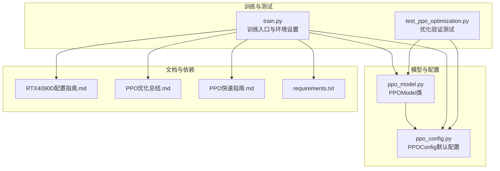
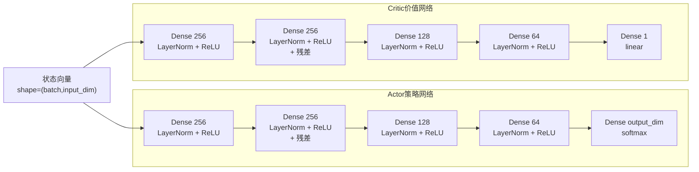
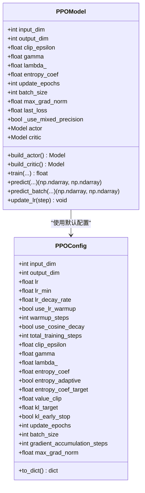
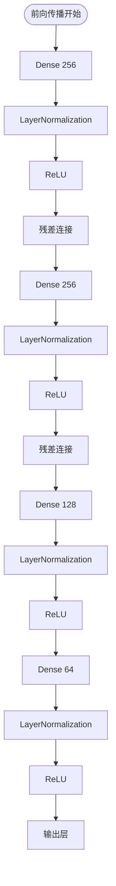
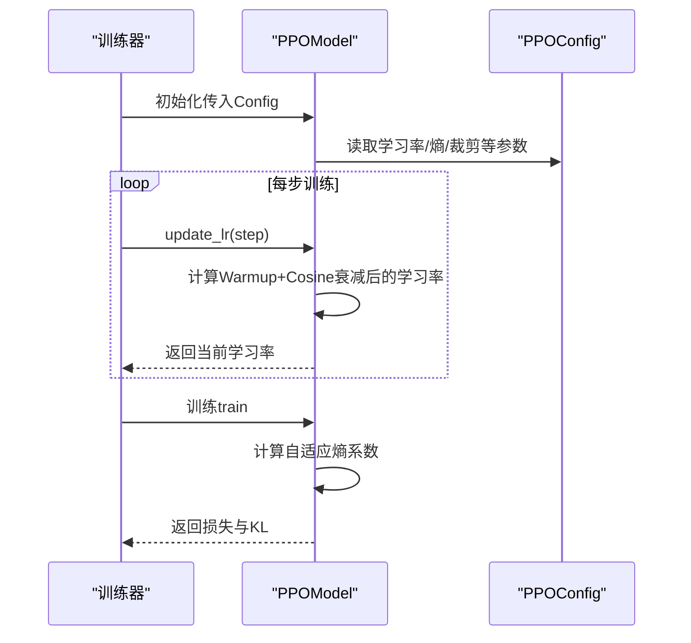
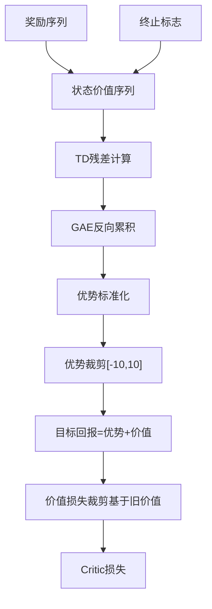
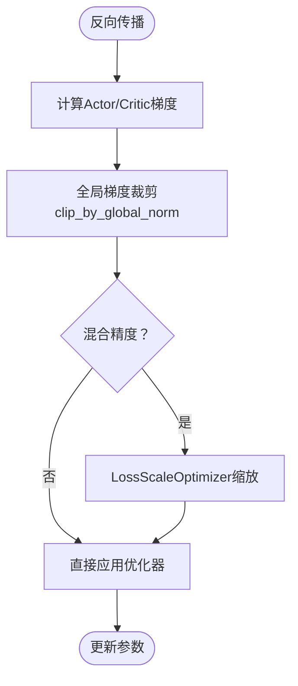
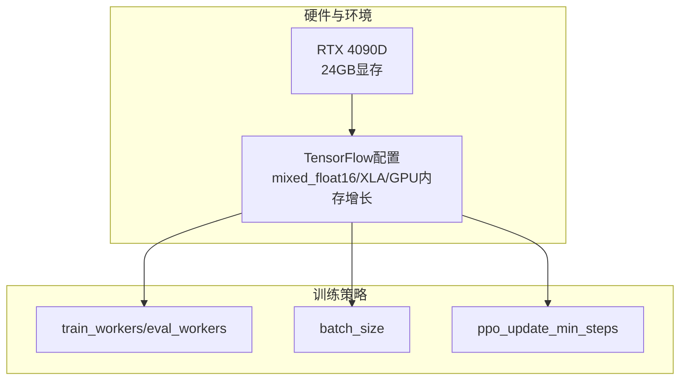
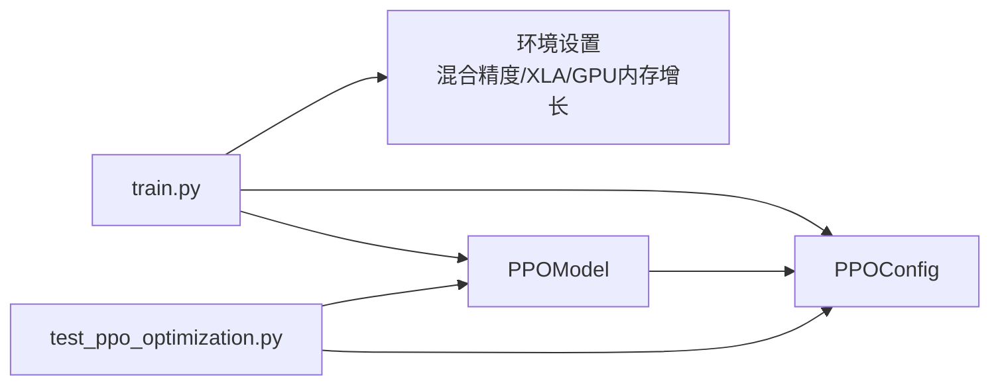

# 网络架构设计

<cite>
**本文引用的文件列表**
- [ppo_model.py](file://poker_ai/model/ppo_model.py)
- [ppo_config.py](file://poker_ai/config/ppo_config.py)
- [train.py](file://train.py)
- [test_ppo_optimization.py](file://test_ppo_optimization.py)
- [RTX4090D配置指南.md](file://RTX4090D配置指南.md)
- [PPO优化总结.md](file://PPO优化总结.md)
- [PPO快速指南.md](file://PPO快速指南.md)
- [requirements.txt](file://requirements.txt)
</cite>

## 目录
1. [简介](#简介)
2. [项目结构](#项目结构)
3. [核心组件](#核心组件)
4. [架构总览](#架构总览)
5. [详细组件分析](#详细组件分析)
6. [依赖关系分析](#依赖关系分析)
7. [性能考虑](#性能考虑)
8. [故障排查指南](#故障排查指南)
9. [结论](#结论)
10. [附录](#附录)

## 简介
本文件面向PPO网络架构设计，聚焦策略网络（Actor）与价值网络（Critic）的双网络架构，系统阐述256-256-128-64的增强网络容量设计原理，LayerNormalization与残差连接等优化技术的作用机制，以及策略网络输出softmax概率分布与价值网络线性激活的设计考量。同时，结合RTX 4090D的硬件特性，说明混合精度、LossScaleOptimizer、梯度累积等GPU优化策略如何提升训练稳定性与收敛速度，并提供网络结构图与参数配置示例，帮助读者快速理解与落地。

## 项目结构
围绕PPO网络架构的关键文件组织如下：
- poker_ai/model/ppo_model.py：PPO模型主体，包含Actor/Critic构建、训练更新、学习率调度、GAE计算、权重保存/加载等。
- poker_ai/config/ppo_config.py：集中管理PPO超参数，默认配置面向RTX 4090D优化。
- train.py：训练入口，负责环境设置（混合精度/XLA/GPU内存增长）、硬件档位应用（rtx4090d）、并行采样与批次策略。
- test_ppo_optimization.py：PPO优化验证测试脚本，覆盖网络架构、学习率调度、GAE、训练步骤、自适应熵系数与配置参数。
- RTX4090D配置指南.md：RTX 4090D硬件优化配置与性能基准，指导参数选择与调优。
- PPO优化总结.md / PPO快速指南.md：优化要点、使用方式与预期效果说明。
- requirements.txt：运行依赖（TensorFlow/Numpy等）。

**图表来源**
- [ppo_model.py:20-105](file://poker_ai/model/ppo_model.py#L20-L105)
- [ppo_config.py:18-97](file://poker_ai/config/ppo_config.py#L18-L97)
- [train.py:55-135](file://train.py#L55-L135)
- [test_ppo_optimization.py:22-254](file://test_ppo_optimization.py#L22-L254)
- [RTX4090D配置指南.md:1-366](file://RTX4090D配置指南.md#L1-L366)
- [PPO优化总结.md:1-276](file://PPO优化总结.md#L1-L276)
- [PPO快速指南.md:1-246](file://PPO快速指南.md#L1-L246)
- [requirements.txt:1-7](file://requirements.txt#L1-L7)

**章节来源**
- [ppo_model.py:1-670](file://poker_ai/model/ppo_model.py#L1-L670)
- [ppo_config.py:1-97](file://poker_ai/config/ppo_config.py#L1-L97)
- [train.py:1-856](file://train.py#L1-L856)
- [test_ppo_optimization.py:1-301](file://test_ppo_optimization.py#L1-L301)
- [RTX4090D配置指南.md:1-366](file://RTX4090D配置指南.md#L1-L366)
- [PPO优化总结.md:1-276](file://PPO优化总结.md#L1-L276)
- [PPO快速指南.md:1-246](file://PPO快速指南.md#L1-L246)
- [requirements.txt:1-7](file://requirements.txt#L1-L7)

## 核心组件
- PPOModel：封装Actor/Critic双网络、损失计算、更新流程、学习率调度、GAE计算、权重保存/加载等。
- PPOConfig：集中管理输入维度、输出维度、学习率、PPO超参数、熵正则、价值裁剪、KL早停、批次与更新轮次、梯度累积等。
- 训练入口train.py：应用硬件档位（rtx4090d）、设置混合精度/XLA/GPU内存增长、并行采样与批次策略，驱动SelfPlayTrainer训练。

**章节来源**
- [ppo_model.py:20-105](file://poker_ai/model/ppo_model.py#L20-L105)
- [ppo_config.py:18-97](file://poker_ai/config/ppo_config.py#L18-L97)
- [train.py:55-135](file://train.py#L55-L135)

## 架构总览
PPO双网络架构采用共享状态表示的Actor与Critic：
- Actor：输出离散动作的概率分布（softmax），用于策略采样与策略梯度更新。
- Critic：输出状态价值（线性激活），用于价值估计与价值损失裁剪。
- 优化技术：LayerNormalization、残差连接、自适应学习率（Warmup+Cosine衰减）、自适应熵系数、KL早停、向量化GAE、LossScaleOptimizer混合精度适配、梯度累积。

**图表来源**
- [ppo_model.py:200-274](file://poker_ai/model/ppo_model.py#L200-L274)

**章节来源**
- [ppo_model.py:200-274](file://poker_ai/model/ppo_model.py#L200-L274)

## 详细组件分析

### 策略网络（Actor）与价值网络（Critic）双网络设计
- Actor：采用256-256-128-64的增强容量，每层后添加LayerNormalization与ReLU，第二层引入残差连接，输出层使用softmax激活，得到动作概率分布。
- Critic：结构与Actor一致，但输出层使用线性激活，用于状态价值估计。
- 设计考量：
  - softmax输出：使策略网络输出合法概率分布，便于策略采样与策略梯度更新。
  - 线性激活：价值网络回归状态价值，线性输出更符合价值估计的连续性假设。
  - LayerNormalization：稳定深层网络训练，缓解内部协变量偏移，加速收敛。
  - 残差连接：缓解梯度消失，提升深层网络的梯度流动，增强表达能力。
  - Dropout策略：Actor移除Dropout以避免策略更新中的随机性干扰；Critic保留轻度Dropout以防止过拟合。

**图表来源**
- [ppo_model.py:33-105](file://poker_ai/model/ppo_model.py#L33-L105)
- [ppo_config.py:18-97](file://poker_ai/config/ppo_config.py#L18-L97)

**章节来源**
- [ppo_model.py:200-274](file://poker_ai/model/ppo_model.py#L200-L274)
- [ppo_config.py:18-97](file://poker_ai/config/ppo_config.py#L18-L97)

### LayerNormalization与残差连接的作用机制
- LayerNormalization（LayerNorm）：
  - 在每层Dense之后添加，对特征维度进行归一化，稳定激活分布，提升深层网络的训练稳定性与收敛速度。
  - 与ReLU配合，避免ReLU死亡单元带来的梯度问题。
- 残差连接：
  - 在第二层引入残差，将输入直接加到输出，缓解深层网络的梯度消失，提升梯度流动，增强模型表达能力。
  - 与LayerNorm结合，进一步提升训练稳定性与泛化能力。

**图表来源**
- [ppo_model.py:200-274](file://poker_ai/model/ppo_model.py#L200-L274)

**章节来源**
- [ppo_model.py:200-274](file://poker_ai/model/ppo_model.py#L200-L274)

### 策略网络输出softmax与价值网络线性激活的设计考量
- 策略网络（Actor）输出softmax：
  - 将最后一层的logits映射为概率分布，满足策略梯度的采样需求，便于计算重要性采样比率与策略损失。
- 价值网络（Critic）输出线性：
  - 回归状态价值，线性输出更贴合价值估计的连续性假设，避免概率分布对价值估计的约束。
- 与PPO损失函数的配合：
  - 策略损失通过重要性采样比率与裁剪项控制更新幅度，softmax输出保证策略的可解释性与稳定性。
  - 价值损失采用裁剪与非裁剪损失的最大值，结合线性输出，提升价值估计的稳健性。

**章节来源**
- [ppo_model.py:125-198](file://poker_ai/model/ppo_model.py#L125-L198)
- [ppo_model.py:200-274](file://poker_ai/model/ppo_model.py#L200-L274)

### 学习率调度与自适应熵正则
- 学习率调度（Warmup + Cosine衰减）：
  - Warmup阶段：前warmup_steps步线性从lr_min增长到initial_lr，避免训练初期不稳定。
  - Cosine衰减阶段：warmup后按余弦曲线衰减至lr_min，平滑衰减，利于后期精细调优。
- 自适应熵正则：
  - 根据当前策略熵与目标熵的差距动态调整熵系数，防止策略过早塌缩，平衡探索与利用。

**图表来源**
- [ppo_model.py:420-447](file://poker_ai/model/ppo_model.py#L420-L447)
- [ppo_model.py:449-470](file://poker_ai/model/ppo_model.py#L449-L470)
- [ppo_config.py:36-72](file://poker_ai/config/ppo_config.py#L36-L72)

**章节来源**
- [ppo_model.py:420-470](file://poker_ai/model/ppo_model.py#L420-L470)
- [ppo_config.py:36-72](file://poker_ai/config/ppo_config.py#L36-L72)

### GAE计算与价值损失裁剪
- GAE（广义优势估计）：
  - 向量化实现，使用反向累积法计算优势，优势标准化与裁剪（[-10,10]）提升稳定性。
- 价值损失裁剪（Value Clipping）：
  - 基于旧价值计算裁剪后的价值估计，取裁剪损失与原损失的最大值，保守更新，防止价值网络更新幅度过大。

**图表来源**
- [ppo_model.py:276-320](file://poker_ai/model/ppo_model.py#L276-L320)
- [ppo_model.py:174-184](file://poker_ai/model/ppo_model.py#L174-L184)

**章节来源**
- [ppo_model.py:276-320](file://poker_ai/model/ppo_model.py#L276-L320)
- [ppo_model.py:174-184](file://poker_ai/model/ppo_model.py#L174-L184)

### 梯度裁剪与LossScaleOptimizer混合精度适配
- 梯度裁剪：
  - 采用全局梯度裁剪（clip_by_global_norm），统一控制整体梯度幅度，提升训练稳定性。
- LossScaleOptimizer混合精度适配：
  - 在混合精度环境下，使用LossScaleOptimizer自动缩放损失，避免梯度下溢，提升数值稳定性与训练效率。

**图表来源**
- [ppo_model.py:154-164](file://poker_ai/model/ppo_model.py#L154-L164)
- [ppo_model.py:186-196](file://poker_ai/model/ppo_model.py#L186-L196)
- [ppo_model.py:94-104](file://poker_ai/model/ppo_model.py#L94-L104)

**章节来源**
- [ppo_model.py:154-196](file://poker_ai/model/ppo_model.py#L154-L196)
- [ppo_model.py:94-104](file://poker_ai/model/ppo_model.py#L94-L104)

### RTX 4090D优化特性与GPU策略
- 混合精度（mixed_float16）：
  - 默认启用，显著提升训练速度与降低显存占用，几乎不影响精度。
- XLA JIT编译：
  - 启用后优化计算图，减少内存碎片，性能提升10-20%。
- GPU内存按需分配：
  - 避免一次性占用全部显存，支持多任务并行。
- 并行采样与批次策略：
  - rtx4090d档位下，train_workers/eval_workers、train_rollouts_per_worker、train_sync_every_batches等参数自动优化，提升GPU利用率。
- 大批量训练：
  - 24GB显存支持更大batch size（如512/1024），结合ppo_update_min_steps提升吞吐。

**图表来源**
- [train.py:55-135](file://train.py#L55-L135)
- [train.py:297-309](file://train.py#L297-L309)
- [RTX4090D配置指南.md:106-156](file://RTX4090D配置指南.md#L106-L156)

**章节来源**
- [train.py:55-135](file://train.py#L55-L135)
- [train.py:297-309](file://train.py#L297-L309)
- [RTX4090D配置指南.md:106-156](file://RTX4090D配置指南.md#L106-L156)

### 网络结构图与参数配置示例
- 输入输出维度与激活函数选择：
  - 输入：状态向量，维度为input_dim（默认134）。
  - Actor输出：动作概率分布，维度为output_dim（默认5）。
  - Critic输出：状态价值，维度为1。
- 层配置示例（以Actor为例）：
  - Dense 256 + LayerNorm + ReLU
  - Dense 256 + LayerNorm + ReLU + 残差
  - Dense 128 + LayerNorm + ReLU
  - Dense 64 + LayerNorm + ReLU
  - Dense output_dim + softmax

**章节来源**
- [ppo_model.py:200-236](file://poker_ai/model/ppo_model.py#L200-L236)
- [ppo_config.py:33-34](file://poker_ai/config/ppo_config.py#L33-L34)

## 依赖关系分析
- PPOModel依赖PPOConfig提供超参数，训练入口train.py在rtx4090d档位下自动设置混合精度/XLA/GPU内存增长，并优化并行与批次策略。
- test_ppo_optimization.py验证网络架构、学习率调度、GAE、训练步骤、自适应熵系数与配置参数，确保优化生效。

**图表来源**
- [train.py:240-339](file://train.py#L240-L339)
- [ppo_model.py:33-105](file://poker_ai/model/ppo_model.py#L33-L105)
- [test_ppo_optimization.py:22-254](file://test_ppo_optimization.py#L22-L254)

**章节来源**
- [train.py:240-339](file://train.py#L240-L339)
- [ppo_model.py:33-105](file://poker_ai/model/ppo_model.py#L33-L105)
- [test_ppo_optimization.py:22-254](file://test_ppo_optimization.py#L22-L254)

## 性能考虑
- 训练稳定性：LayerNormalization、残差连接、全局梯度裁剪、价值损失裁剪、KL早停共同作用，显著降低训练崩溃风险。
- 收敛速度：Warmup+Cosine学习率调度、自适应熵系数、向量化GAE、LossScaleOptimizer混合精度适配，提升收敛速度与样本效率。
- GPU利用率：rtx4090d档位下，更大batch size与并行策略可充分利用24GB显存，提升吞吐。
- 资源占用：网络容量增加会提升显存使用，需根据显存与吞吐需求权衡batch size与更新轮次。

[本节为通用性能讨论，不直接分析具体文件]

## 故障排查指南
- 训练不稳定/损失爆炸：
  - 降低学习率、增大value_clip、检查学习率调度是否正确。
- 策略塌缩（总是选择同一动作）：
  - 提高熵系数、检查自适应熵系数逻辑、观察KL早停是否过早终止。
- 训练停滞：
  - 检查学习率是否过小、是否启用了Warmup/Cosine衰减、确认GAE与价值损失裁剪正常。
- 显存不足：
  - 降低batch size、减少ppo_epochs、关闭不必要的并行worker、启用GPU内存增长。

**章节来源**
- [ppo_model.py:420-470](file://poker_ai/model/ppo_model.py#L420-L470)
- [ppo_model.py:174-184](file://poker_ai/model/ppo_model.py#L174-L184)
- [RTX4090D配置指南.md:177-221](file://RTX4090D配置指南.md#L177-L221)

## 结论
本PPO双网络架构通过增强网络容量、LayerNormalization与残差连接、softmax输出与线性激活设计、自适应学习率与熵正则、价值损失裁剪与KL早停、向量化GAE与LossScaleOptimizer混合精度适配，以及RTX 4090D的硬件优化策略，实现了更稳定、更高效的训练体验。结合默认配置与硬件档位，可在保证精度的同时显著提升训练吞吐与收敛速度。

[本节为总结性内容，不直接分析具体文件]

## 附录
- 运行依赖：TensorFlow、Numpy、Matplotlib、Seaborn、Pickle-Mixin、Argparse、Dateutil。
- 快速开始：使用默认配置或自定义参数启动训练；运行测试脚本验证优化效果；查看日志监控关键指标。

**章节来源**
- [requirements.txt:1-7](file://requirements.txt#L1-L7)
- [PPO快速指南.md:18-71](file://PPO快速指南.md#L18-L71)
- [test_ppo_optimization.py:256-297](file://test_ppo_optimization.py#L256-L297)