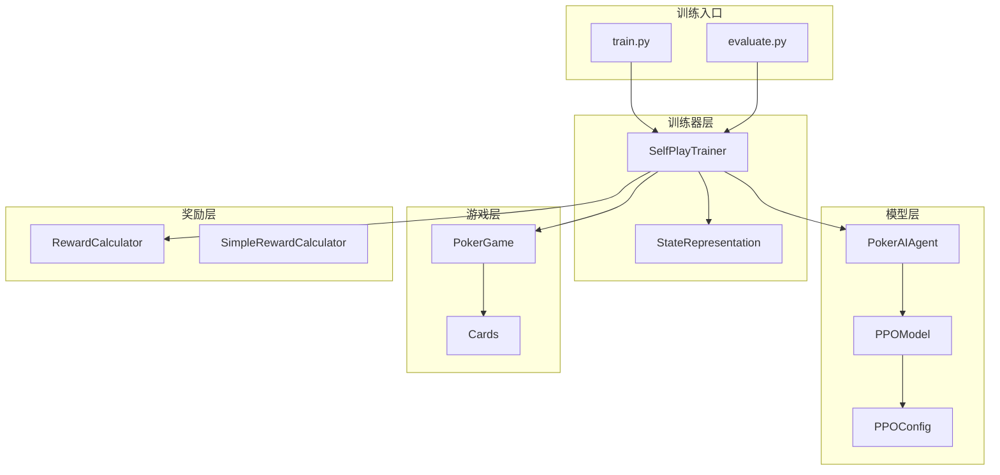
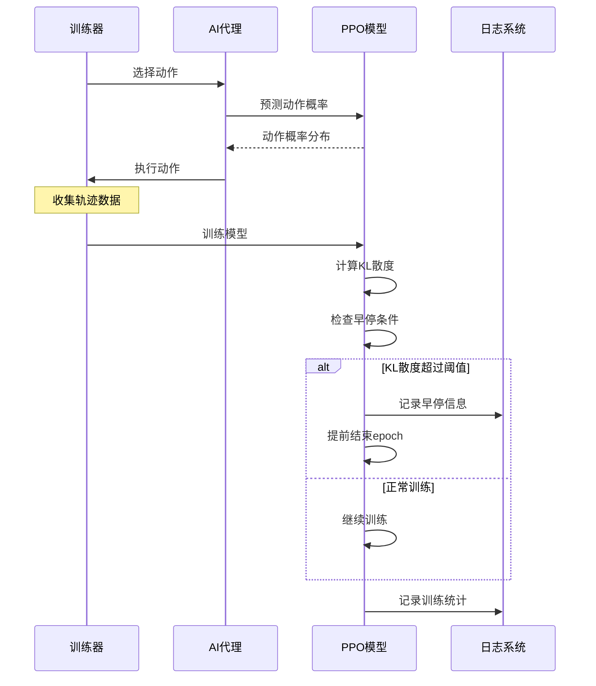
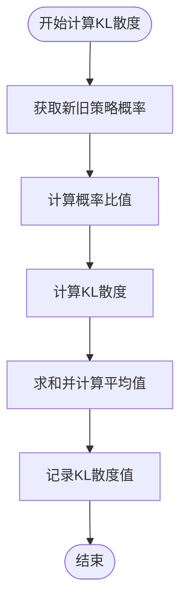
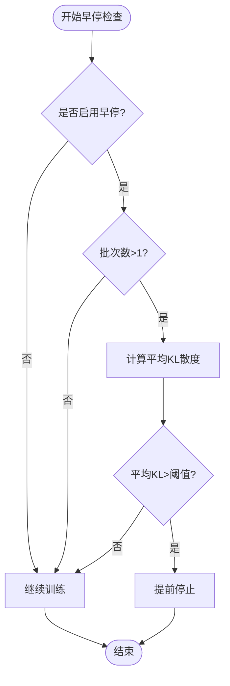
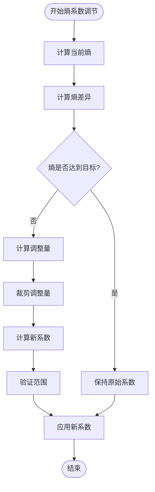
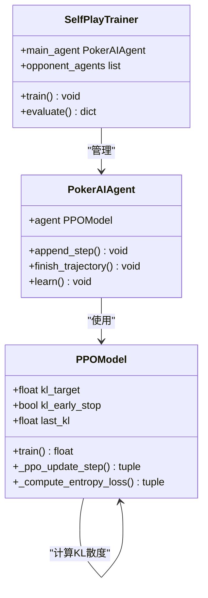
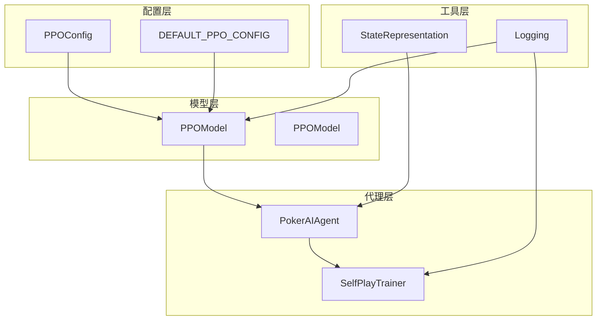

# KL散度容忍控制

<cite>
**本文档引用的文件**
- [train.py](file://train.py)
- [test_ppo.py](file://test_ppo.py)
- [ppo_model.py](file://poker_ai/model/ppo_model.py)
- [ppo_config.py](file://poker_ai/config/ppo_config.py)
- [self_play_trainer.py](file://poker_ai/reward/self_play_trainer.py)
- [ai_agent.py](file://poker_ai/model/ai_agent.py)
- [test_ppo_optimization.py](file://test_ppo_optimization.py)
- [evaluate.py](file://evaluate.py)
</cite>

## 目录
1. [简介](#简介)
2. [项目结构](#项目结构)
3. [核心组件](#核心组件)
4. [架构概览](#架构概览)
5. [详细组件分析](#详细组件分析)
6. [依赖关系分析](#依赖关系分析)
7. [性能考量](#性能考量)
8. [故障排除指南](#故障排除指南)
9. [结论](#结论)

## 简介

KL散度容忍控制是PPO（Proximal Policy Optimization）算法中的关键机制，用于监控和控制策略更新的幅度，防止策略退化和训练不稳定。本文档深入分析了德州扑克AI项目中KL散度容忍控制机制的实现，包括KL散度的作用和意义、早停机制的工作原理、自适应熵系数的调节策略，以及相关的监控和调试方法。

KL散度（Kullback-Leibler divergence）衡量了新旧策略之间的差异，是PPO算法中约束策略更新幅度的核心指标。通过监控KL散度，系统能够：
- 防止策略更新过大导致的性能退化
- 维持训练的稳定性
- 优化策略更新的效率
- 提供训练过程的实时反馈

## 项目结构

该项目采用模块化的架构设计，主要包含以下核心模块：



**图表来源**
- [train.py:1-856](file://train.py#L1-L856)
- [self_play_trainer.py:1-1604](file://poker_ai/reward/self_play_trainer.py#L1-L1604)
- [ppo_model.py:1-670](file://poker_ai/model/ppo_model.py#L1-L670)

**章节来源**
- [train.py:136-238](file://train.py#L136-L238)
- [self_play_trainer.py:48-131](file://poker_ai/reward/self_play_trainer.py#L48-L131)

## 核心组件

### PPO模型架构

PPO模型实现了完整的KL散度容忍控制机制，包括：

1. **KL散度计算**：在训练过程中实时计算策略更新的KL散度
2. **早停机制**：当KL散度超过阈值时自动停止当前epoch的训练
3. **自适应熵系数**：根据当前熵水平动态调整探索强度
4. **价值损失裁剪**：防止价值函数更新过大

### 配置管理系统

PPO配置类提供了完整的参数管理，包括：
- KL散度容忍阈值（默认0.015）
- 早停开关（默认开启）
- 自适应熵系数目标值（默认0.01）
- 学习率调度参数
- 网络架构优化参数

**章节来源**
- [ppo_model.py:20-105](file://poker_ai/model/ppo_model.py#L20-L105)
- [ppo_config.py:18-97](file://poker_ai/config/ppo_config.py#L18-L97)

## 架构概览

KL散度容忍控制机制在整个训练流程中的位置如下：



**图表来源**
- [self_play_trainer.py:260-417](file://poker_ai/reward/self_play_trainer.py#L260-L417)
- [ppo_model.py:497-638](file://poker_ai/model/ppo_model.py#L497-L638)

## 详细组件分析

### KL散度计算机制

KL散度在PPO中的计算和监控机制：

#### 计算公式
KL散度使用交叉熵的形式计算：
```
KL = Σ[π_old(a|s) * log(π_old(a|s)/π_new(a|s))]
```

其中：
- π_old：旧策略的概率分布
- π_new：新策略的概率分布
- s：当前状态
- a：动作

#### 实现细节
在`_ppo_update_step`方法中，KL散度通过以下步骤计算：



**图表来源**
- [ppo_model.py:106-198](file://poker_ai/model/ppo_model.py#L106-L198)

**章节来源**
- [ppo_model.py:138-144](file://poker_ai/model/ppo_model.py#L138-L144)

### 早停机制实现

早停机制确保策略更新不会过大，防止训练不稳定：

#### 判断逻辑


**图表来源**
- [ppo_model.py:603-624](file://poker_ai/model/ppo_model.py#L603-L624)

#### 配置参数
- `kl_target`：KL散度目标阈值（默认0.015）
- `kl_early_stop`：是否启用早停机制（默认True）

**章节来源**
- [ppo_model.py:79-82](file://poker_ai/model/ppo_model.py#L79-L82)
- [ppo_model.py:603-611](file://poker_ai/model/ppo_model.py#L603-L611)

### 自适应熵系数调节

自适应熵系数机制根据当前策略的熵水平动态调整探索强度：

#### 调节策略


**图表来源**
- [ppo_model.py:459-470](file://poker_ai/model/ppo_model.py#L459-L470)

#### 调节参数
- `entropy_coef_target`：目标熵值（默认0.01）
- `entropy_adaptive`：是否启用自适应（默认True）
- 系数范围：0.001 - 0.1

**章节来源**
- [ppo_model.py:459-469](file://poker_ai/model/ppo_model.py#L459-L469)
- [ppo_config.py:52-56](file://poker_ai/config/ppo_config.py#L52-L56)

### 训练流程集成

KL散度容忍控制在整个训练流程中的集成：



**图表来源**
- [ppo_model.py:20-105](file://poker_ai/model/ppo_model.py#L20-L105)
- [self_play_trainer.py:48-131](file://poker_ai/reward/self_play_trainer.py#L48-L131)
- [ai_agent.py:55-116](file://poker_ai/model/ai_agent.py#L55-L116)

**章节来源**
- [self_play_trainer.py:388-414](file://poker_ai/reward/self_play_trainer.py#L388-L414)
- [ai_agent.py:388-414](file://poker_ai/model/ai_agent.py#L388-L414)

## 依赖关系分析

KL散度容忍控制机制涉及多个组件的协作：



**图表来源**
- [ppo_config.py:18-97](file://poker_ai/config/ppo_config.py#L18-L97)
- [ppo_model.py:20-105](file://poker_ai/model/ppo_model.py#L20-L105)
- [ai_agent.py:55-116](file://poker_ai/model/ai_agent.py#L55-L116)
- [self_play_trainer.py:48-131](file://poker_ai/reward/self_play_trainer.py#L48-L131)

**章节来源**
- [train.py:350-383](file://train.py#L350-L383)
- [ai_agent.py:95-105](file://poker_ai/model/ai_agent.py#L95-L105)

## 性能考量

### 计算复杂度
- KL散度计算：O(n*m)，其中n为样本数，m为动作数
- 早停检查：O(1)额外开销
- 自适应熵系数：O(1)额外开销

### 内存使用
- KL散度值缓存：每个批次约5*4字节（float32）
- 早停机制内存开销很小
- 自适应熵系数计算无额外内存需求

### 训练效率
- KL散度监控对训练速度影响极小（<1%）
- 早停机制避免无效训练迭代
- 自适应熵系数提升探索效率

## 故障排除指南

### 常见问题及解决方案

#### KL散度异常升高
**症状**：训练不稳定，性能波动大
**原因**：
- KL阈值设置过低
- 学习率过高
- 策略更新幅度过大

**解决方案**：
1. 增加`kl_target`阈值（如从0.015增加到0.02）
2. 降低学习率
3. 减少`clip_epsilon`值

#### 熵系数调节失效
**症状**：探索行为异常
**原因**：
- `entropy_adaptive`设置为False
- `entropy_coef_target`设置不当
- 熵计算异常

**解决方案**：
1. 确认`entropy_adaptive`为True
2. 调整`entropy_coef_target`到合理范围（0.005-0.02）
3. 检查策略概率分布的有效性

#### 早停机制过于敏感
**症状**：训练频繁提前结束
**原因**：
- KL阈值设置过低
- 数据噪声较大
- 策略更新过于频繁

**解决方案**：
1. 适当提高`kl_target`阈值
2. 增加训练批次大小
3. 调整`update_epochs`参数

### 调试方法

#### 日志监控
启用详细日志以监控KL散度变化：
```python
# 在训练配置中启用详细日志
logger.setLevel(logging.DEBUG)
```

#### 性能指标监控
关键指标包括：
- `last_kl`：最后一次训练的KL散度
- `current_lr`：当前学习率
- `entropy_coef`：当前熵系数
- `avg_actor_loss`：演员网络平均损失

#### 可视化图表
建议监控以下图表：
1. KL散度随训练步数的变化
2. 熵系数的动态调整
3. 训练损失的收敛情况
4. 策略更新的稳定性指标

**章节来源**
- [ppo_model.py:632-636](file://poker_ai/model/ppo_model.py#L632-L636)
- [test_ppo_optimization.py:182-218](file://test_ppo_optimization.py#L182-L218)

## 结论

KL散度容忍控制机制是PPO算法稳定性的关键保障。通过精确的KL散度监控、智能的早停机制和自适应的熵系数调节，该系统实现了：

1. **训练稳定性**：防止策略更新过大导致的性能退化
2. **收敛效率**：通过早停机制避免无效训练迭代
3. **探索优化**：自适应熵系数提升探索效果
4. **实时监控**：提供训练过程的实时反馈和调试能力

该机制在德州扑克AI训练中的成功应用证明了其在复杂决策环境中的有效性。通过合理的参数配置和监控策略，可以显著提升训练质量和策略稳定性。

未来可以在以下方面进一步优化：
- 动态调整KL阈值以适应不同的训练阶段
- 实现更精细的早停策略
- 增强异常检测和自动调节能力
- 提供更丰富的可视化监控工具