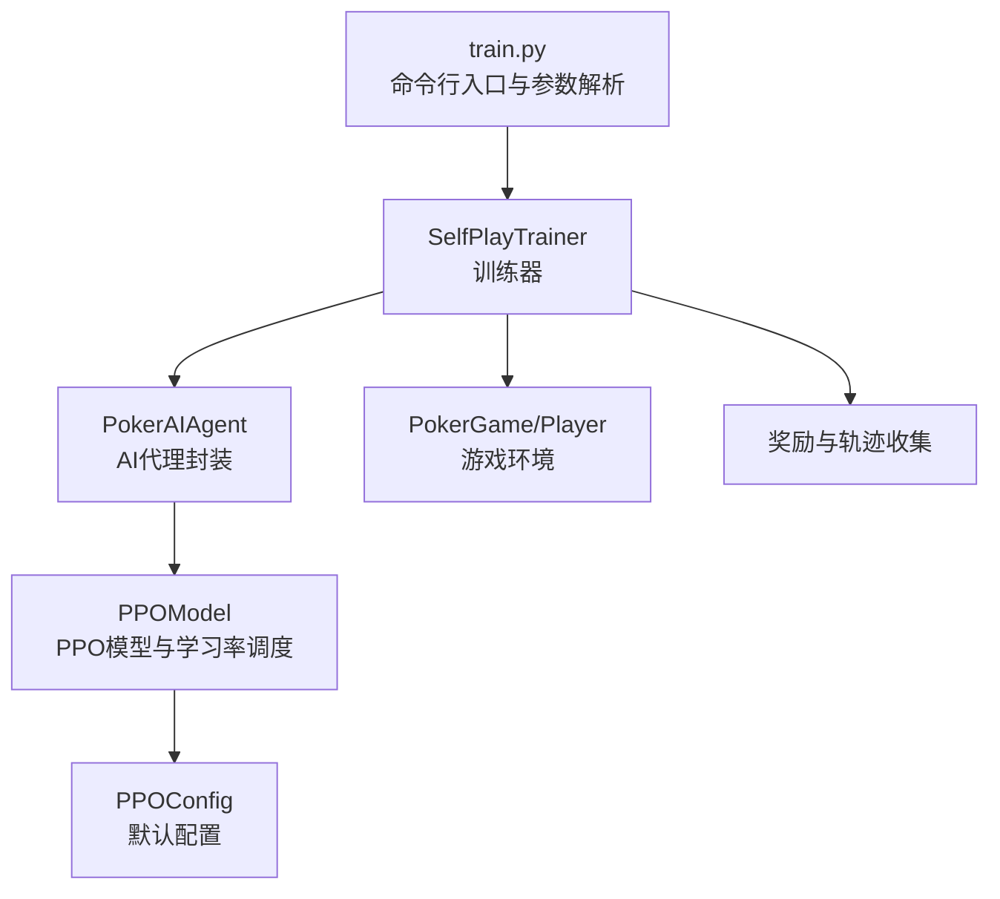
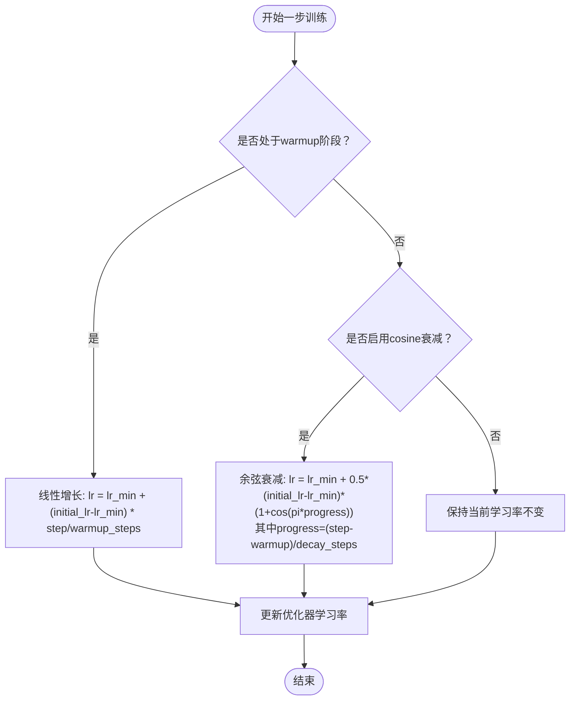
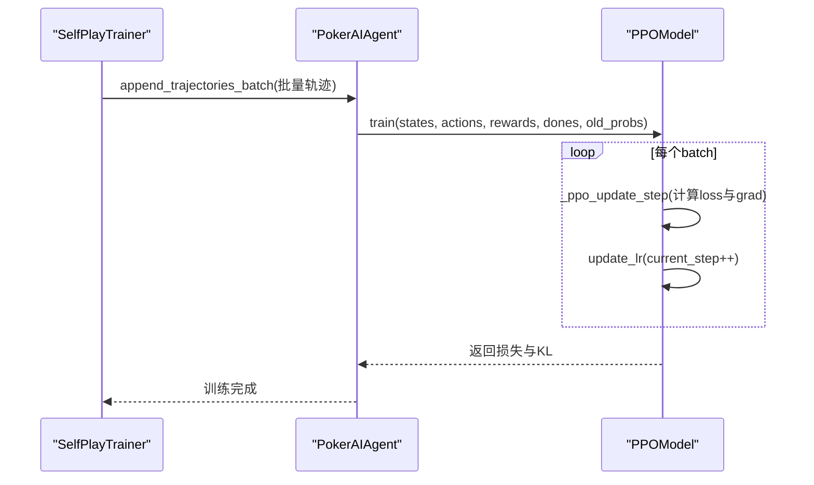
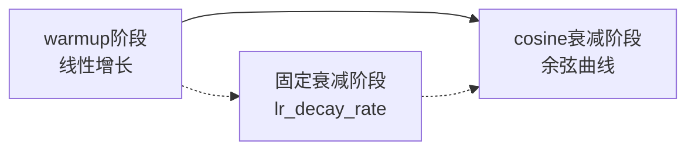
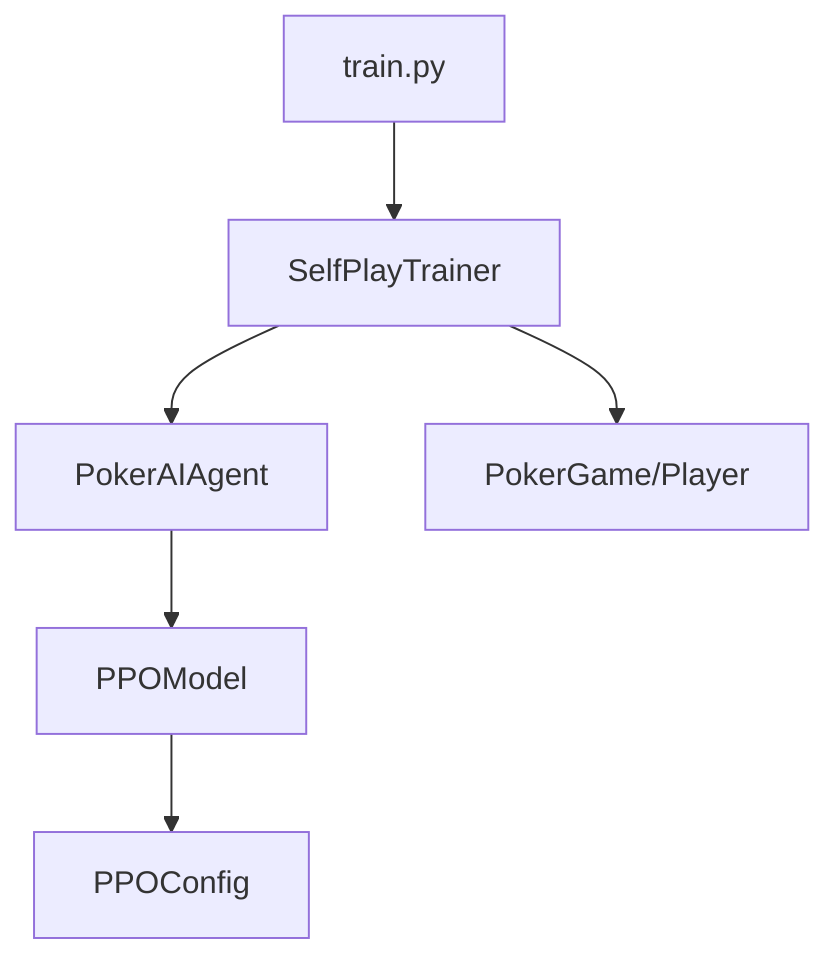

# 学习率调度机制

<cite>
**本文引用的文件**
- [train.py](file://train.py)
- [test_ppo.py](file://test_ppo.py)
- [ppo_model.py](file://poker_ai/model/ppo_model.py)
- [ppo_config.py](file://poker_ai/config/ppo_config.py)
- [self_play_trainer.py](file://poker_ai/reward/self_play_trainer.py)
- [ai_agent.py](file://poker_ai/model/ai_agent.py)
</cite>

## 目录
1. [简介](#简介)
2. [项目结构](#项目结构)
3. [核心组件](#核心组件)
4. [架构概览](#架构概览)
5. [详细组件分析](#详细组件分析)
6. [依赖关系分析](#依赖关系分析)
7. [性能考量](#性能考量)
8. [故障排查指南](#故障排查指南)
9. [结论](#结论)

## 简介
本文件针对德州扑克AI项目中的PPO学习率调度机制进行深入技术文档化，重点阐述以下内容：
- 自适应学习率调度的实现细节：包括warmup阶段的线性增长策略与cosine衰减的数学公式
- 学习率的动态调整逻辑：如何根据训练步数与配置参数实时更新
- 关键参数的作用与设置原则：如warmup_steps、total_training_steps、lr_min等
- 可视化图表与具体实现代码路径，帮助读者在训练过程中正确更新学习率
- 不同学习率策略对模型收敛与最终性能的影响分析

## 项目结构
该项目围绕德州扑克AI训练与评估展开，PPO学习率调度主要位于模型层与配置层，训练流程由训练脚本驱动并通过训练器协调。



**图表来源**
- [train.py:136-238](file://train.py#L136-L238)
- [self_play_trainer.py:48-136](file://poker_ai/reward/self_play_trainer.py#L48-L136)
- [ai_agent.py:55-115](file://poker_ai/model/ai_agent.py#L55-L115)
- [ppo_model.py:20-105](file://poker_ai/model/ppo_model.py#L20-L105)
- [ppo_config.py:18-97](file://poker_ai/config/ppo_config.py#L18-L97)

**章节来源**
- [train.py:136-238](file://train.py#L136-L238)
- [self_play_trainer.py:48-136](file://poker_ai/reward/self_play_trainer.py#L48-L136)
- [ai_agent.py:55-115](file://poker_ai/model/ai_agent.py#L55-L115)
- [ppo_model.py:20-105](file://poker_ai/model/ppo_model.py#L20-L105)
- [ppo_config.py:18-97](file://poker_ai/config/ppo_config.py#L18-L97)

## 核心组件
- PPOModel：包含学习率调度的核心逻辑，提供warmup与cosine衰减的实现，并在训练过程中动态更新优化器的学习率。
- PPOConfig：集中管理PPO超参数，包括学习率相关配置（如warmup_steps、total_training_steps、use_lr_warmup、use_cosine_decay等）。
- SelfPlayTrainer：训练器负责组织并行采样、轨迹收集与批量训练，PPO训练时会调用PPOModel的训练接口并在每个batch后更新学习率。
- PokerAIAgent：封装PPOModel，提供轨迹级训练接口（append_step、finish_trajectory、append_trajectories_batch），并在必要时触发PPOModel的训练与学习率更新。
- train.py：命令行入口，解析学习率等参数并创建训练器。

**章节来源**
- [ppo_model.py:420-448](file://poker_ai/model/ppo_model.py#L420-L448)
- [ppo_config.py:36-46](file://poker_ai/config/ppo_config.py#L36-L46)
- [self_play_trainer.py:1393-1551](file://poker_ai/reward/self_play_trainer.py#L1393-L1551)
- [ai_agent.py:388-414](file://poker_ai/model/ai_agent.py#L388-L414)
- [train.py:340-531](file://train.py#L340-L531)

## 架构概览
PPO学习率调度在训练流程中的位置如下：

```mermaid
sequenceDiagram
participant CLI as "命令行入口(train.py)"
participant Trainer as "SelfPlayTrainer"
participant Agent as "PokerAIAgent"
participant Model as "PPOModel"
participant Opt as "优化器(Adam)"
CLI->>Trainer : 创建训练器并传入学习率等参数
Trainer->>Agent : 初始化PPO代理
Agent->>Model : 构造PPOModel(lr=learning_rate,...)
Trainer->>Trainer : 并行采样与轨迹收集
Trainer->>Agent : append_trajectories_batch/finish_trajectory
Agent->>Model : train(states, actions, rewards, dones, old_probs)
Model->>Model : 计算GAE与优势
Model->>Model : _ppo_update_step(计算loss与grad)
Model->>Opt : update_lr(step) -> 更新学习率
Model-->>Agent : 返回损失与KL
Agent-->>Trainer : 训练完成
Trainer-->>CLI : 训练进度与评估
```

**图表来源**
- [train.py:340-531](file://train.py#L340-L531)
- [self_play_trainer.py:1393-1551](file://poker_ai/reward/self_play_trainer.py#L1393-L1551)
- [ai_agent.py:388-414](file://poker_ai/model/ai_agent.py#L388-L414)
- [ppo_model.py:497-638](file://poker_ai/model/ppo_model.py#L497-L638)

## 详细组件分析

### PPOModel学习率调度实现
PPOModel实现了完整的自适应学习率调度，包含warmup与cosine衰减两部分，并在训练过程中每步更新学习率。

- 关键属性与初始化
  - use_lr_warmup：是否启用warmup阶段
  - warmup_steps：warmup步数
  - use_cosine_decay：是否启用cosine衰减
  - total_training_steps：总训练步数（用于cosine衰减的分母）
  - lr_min：学习率下限
  - current_step：当前训练步数
  - current_lr：当前学习率

- 学习率计算逻辑
  - warmup阶段（step < warmup_steps）：线性从lr_min增长到initial_lr
  - cosine衰减阶段（step >= warmup_steps）：按cosine曲线从initial_lr衰减到lr_min
  - 通过update_lr(step)将新的学习率赋给优化器

- 训练过程中的更新
  - 在每次mini-batch训练完成后，current_step递增并调用update_lr(current_step)
  - 优化器的学习率随之更新，确保后续梯度更新使用新的学习率



**图表来源**
- [ppo_model.py:420-448](file://poker_ai/model/ppo_model.py#L420-L448)

**章节来源**
- [ppo_model.py:65-71](file://poker_ai/model/ppo_model.py#L65-L71)
- [ppo_model.py:420-448](file://poker_ai/model/ppo_model.py#L420-L448)
- [ppo_model.py:618-621](file://poker_ai/model/ppo_model.py#L618-L621)

### PPOConfig配置项与默认值
PPOConfig集中管理学习率相关的超参数，确保训练一致性与可复现性。

- 学习率相关配置
  - lr：初始学习率（默认3e-4）
  - lr_min：学习率下限（默认1e-6）
  - use_lr_warmup：启用warmup（默认True）
  - warmup_steps：warmup步数（默认2000）
  - use_cosine_decay：启用cosine衰减（默认True）
  - total_training_steps：总训练步数（默认200000）

- 其他影响学习率的因素
  - lr_decay_rate：原始固定衰减率（默认0.9999），在未启用warmup/cosine时使用
  - gradient_accumulation_steps：梯度累积步数，间接影响有效batch大小与学习率更新频率

**章节来源**
- [ppo_config.py:36-46](file://poker_ai/config/ppo_config.py#L36-L46)
- [ppo_config.py:68-72](file://poker_ai/config/ppo_config.py#L68-L72)

### SelfPlayTrainer与PokerAIAgent的协作
- SelfPlayTrainer负责并行采样与轨迹收集，PPO场景下通过PokerAIAgent的轨迹接口（append_step、finish_trajectory、append_trajectories_batch）批量提交轨迹。
- 在批量提交后，PokerAIAgent内部调用PPOModel.train，PPOModel在每个batch后更新学习率。
- 训练器还负责定期评估、保存检查点与对手更新，这些都会触发学习率的持续更新。



**图表来源**
- [self_play_trainer.py:1544-1551](file://poker_ai/reward/self_play_trainer.py#L1544-L1551)
- [ai_agent.py:388-414](file://poker_ai/model/ai_agent.py#L388-L414)
- [ppo_model.py:618-621](file://poker_ai/model/ppo_model.py#L618-L621)

**章节来源**
- [self_play_trainer.py:1544-1551](file://poker_ai/reward/self_play_trainer.py#L1544-L1551)
- [ai_agent.py:388-414](file://poker_ai/model/ai_agent.py#L388-L414)
- [ppo_model.py:618-621](file://poker_ai/model/ppo_model.py#L618-L621)

### 关键参数的作用与设置原则
- warmup_steps
  - 作用：在训练初期以较小学习率进行线性增长，稳定训练初期的梯度更新
  - 设置原则：通常设置为总训练步数的1%~5%，结合batch大小与模型复杂度调整
  - 默认值：2000步（来自PPOConfig）

- total_training_steps
  - 作用：cosine衰减的总步数，决定衰减曲线的形状
  - 设置原则：应覆盖预期的总训练步数，确保在训练结束时达到lr_min
  - 默认值：200000步（来自PPOConfig）

- lr_min
  - 作用：学习率的下限，避免学习率过低导致训练停滞
  - 设置原则：通常设置为初始学习率的1e-5~1e-3倍
  - 默认值：1e-6（来自PPOConfig）

- use_lr_warmup / use_cosine_decay
  - 作用：控制是否启用warmup与cosine衰减
  - 设置原则：建议同时启用以获得更稳定的训练过程
  - 默认值：均为True（来自PPOConfig）

- lr_decay_rate（原始固定衰减）
  - 作用：在未启用warmup/cosine时使用的固定衰减策略
  - 设置原则：谨慎使用，通常建议启用warmup/cosine以获得更好的稳定性
  - 默认值：0.9999（来自PPOConfig）

**章节来源**
- [ppo_config.py:36-46](file://poker_ai/config/ppo_config.py#L36-L46)
- [ppo_model.py:62-63](file://poker_ai/model/ppo_model.py#L62-L63)

### 学习率调度的可视化图表
- 线性warmup阶段
  - 从第1步到第warmup_steps步，学习率从lr_min线性增长到initial_lr
- Cosine衰减阶段
  - 从第warmup_steps+1步到第total_training_steps步，学习率按余弦曲线从initial_lr衰减到lr_min
- 固定衰减（未启用warmup/cosine时）
  - 每步乘以lr_decay_rate，逐步降低学习率



[本图为概念性示意，不直接映射到具体源文件]

## 依赖关系分析
- train.py通过命令行参数将学习率传递给SelfPlayTrainer，SelfPlayTrainer再传递给PokerAIAgent，最终由PPOModel使用。
- PPOModel依赖PPOConfig提供的默认配置，若训练脚本或训练器覆盖了配置，则以覆盖为准。
- SelfPlayTrainer在训练循环中调用PokerAIAgent的轨迹接口，PokerAIAgent内部调用PPOModel.train，从而触发学习率更新。



**图表来源**
- [train.py:340-531](file://train.py#L340-L531)
- [self_play_trainer.py:1393-1551](file://poker_ai/reward/self_play_trainer.py#L1393-L1551)
- [ai_agent.py:388-414](file://poker_ai/model/ai_agent.py#L388-L414)
- [ppo_model.py:497-638](file://poker_ai/model/ppo_model.py#L497-L638)

**章节来源**
- [train.py:340-531](file://train.py#L340-L531)
- [self_play_trainer.py:1393-1551](file://poker_ai/reward/self_play_trainer.py#L1393-L1551)
- [ai_agent.py:388-414](file://poker_ai/model/ai_agent.py#L388-L414)
- [ppo_model.py:497-638](file://poker_ai/model/ppo_model.py#L497-L638)

## 性能考量
- warmup阶段有助于稳定初期梯度，避免过大学习率导致的震荡
- cosine衰减在训练后期平滑降低学习率，有利于收敛到更优解
- 合理设置warmup_steps与total_training_steps可平衡训练稳定性与收敛速度
- 在大规模并行训练中，学习率更新频率较高，需关注优化器状态更新的开销

[本节为通用指导，不直接分析具体文件]

## 故障排查指南
- 学习率未按预期变化
  - 检查是否启用了warmup/cosine：确认use_lr_warmup与use_cosine_decay为True
  - 检查warmup_steps与total_training_steps设置是否合理
  - 确认PPOModel.update_lr在训练循环中被调用
- 训练不稳定或收敛缓慢
  - 适当增大warmup_steps或减小initial_lr
  - 调整cosine衰减的起止步数，观察效果
- 混合精度与XLA兼容性问题
  - 若遇到DNN/Graph错误，可尝试禁用XLA或oneDNN，参考训练器中的相关提示

**章节来源**
- [ppo_model.py:420-448](file://poker_ai/model/ppo_model.py#L420-L448)
- [self_play_trainer.py:1564-1571](file://poker_ai/reward/self_play_trainer.py#L1564-L1571)

## 结论
本项目的PPO学习率调度机制通过warmup线性增长与cosine衰减相结合的方式，提供了稳定且高效的训练策略。warmup阶段缓解了初期训练的不稳定性，cosine衰减在训练后期平滑降低学习率，有助于模型收敛到更优解。通过PPOConfig集中管理学习率相关参数，配合SelfPlayTrainer与PokerAIAgent的协作，实现了在大规模并行训练中的高效学习率更新。合理设置warmup_steps、total_training_steps与lr_min等参数，能够显著提升模型的收敛速度与最终性能。