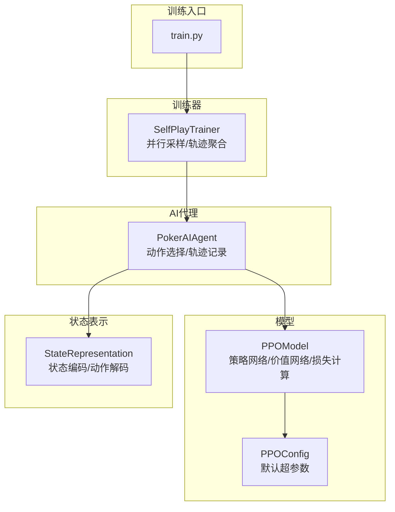
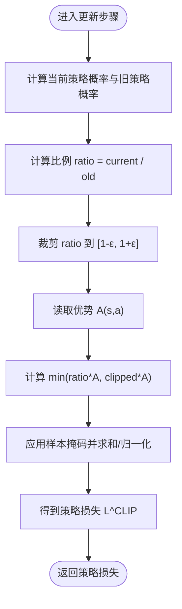
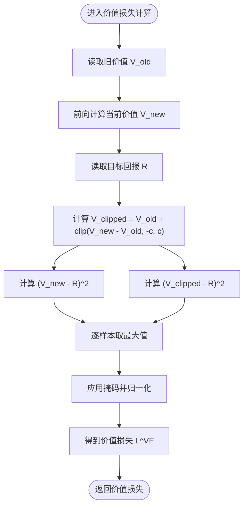
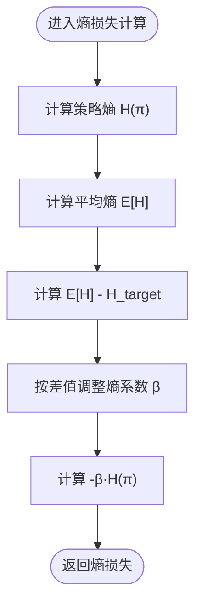
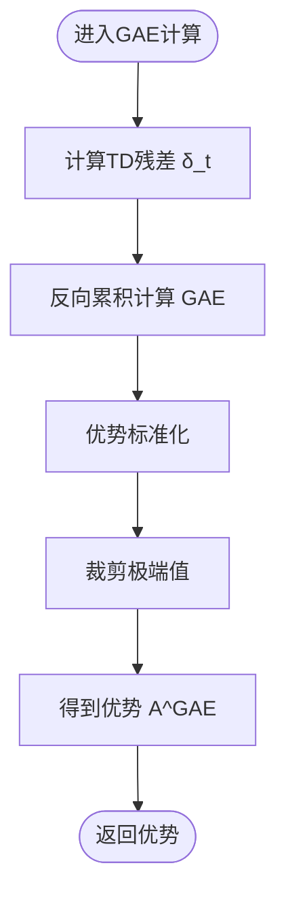
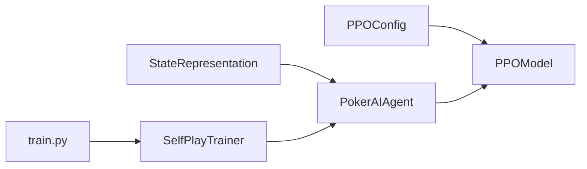

# 损失函数计算

<cite>
**本文引用的文件**
- [poker_ai/model/ppo_model.py](file://poker_ai/model/ppo_model.py)
- [poker_ai/config/ppo_config.py](file://poker_ai/config/ppo_config.py)
- [poker_ai/model/ai_agent.py](file://poker_ai/model/ai_agent.py)
- [poker_ai/reward/self_play_trainer.py](file://poker_ai/reward/self_play_trainer.py)
- [poker_ai/model/state_representation.py](file://poker_ai/model/state_representation.py)
- [train.py](file://train.py)
- [test_ppo.py](file://test_ppo.py)
</cite>

## 目录
1. [简介](#简介)
2. [项目结构](#项目结构)
3. [核心组件](#核心组件)
4. [架构总览](#架构总览)
5. [详细组件分析](#详细组件分析)
6. [依赖分析](#依赖分析)
7. [性能考量](#性能考量)
8. [故障排查指南](#故障排查指南)
9. [结论](#结论)
10. [附录](#附录)

## 简介
本技术文档围绕PPO（近端策略优化）损失函数的计算与实现展开，重点解释策略损失（policy loss）、价值损失（value loss）、熵正则化（entropy regularization）的数学原理与代码实现细节，涵盖重要性采样比率ratio的计算、裁剪机制、旧价值用于价值损失裁剪的原因、自适应熵系数、向量化计算与数值稳定性处理，以及不同损失项权重对训练效果的影响。文档同时给出与训练脚本、配置模块、AI代理与状态表示的关联，帮助读者从系统层面理解PPO在德州扑克AI中的落地实践。

## 项目结构
本仓库与PPO损失函数相关的核心文件组织如下：
- 模型与损失：poker_ai/model/ppo_model.py（PPOModel类及损失计算）
- 训练配置：poker_ai/config/ppo_config.py（默认PPO超参数）
- 训练入口：train.py（命令行参数与环境设置）
- AI代理：poker_ai/model/ai_agent.py（PPO代理封装与轨迹收集）
- 自我对弈训练器：poker_ai/reward/self_play_trainer.py（并行采样与轨迹聚合）
- 状态表示：poker_ai/model/state_representation.py（状态编码与动作解码）



图表来源
- [train.py:136-238](file://train.py#L136-L238)
- [poker_ai/reward/self_play_trainer.py:48-131](file://poker_ai/reward/self_play_trainer.py#L48-L131)
- [poker_ai/model/ai_agent.py:55-116](file://poker_ai/model/ai_agent.py#L55-L116)
- [poker_ai/model/ppo_model.py:20-105](file://poker_ai/model/ppo_model.py#L20-L105)
- [poker_ai/config/ppo_config.py:18-97](file://poker_ai/config/ppo_config.py#L18-L97)
- [poker_ai/model/state_representation.py:9-46](file://poker_ai/model/state_representation.py#L9-L46)

章节来源
- [train.py:136-238](file://train.py#L136-L238)
- [poker_ai/reward/self_play_trainer.py:48-131](file://poker_ai/reward/self_play_trainer.py#L48-L131)
- [poker_ai/model/ai_agent.py:55-116](file://poker_ai/model/ai_agent.py#L55-L116)
- [poker_ai/model/ppo_model.py:20-105](file://poker_ai/model/ppo_model.py#L20-L105)
- [poker_ai/config/ppo_config.py:18-97](file://poker_ai/config/ppo_config.py#L18-L97)
- [poker_ai/model/state_representation.py:9-46](file://poker_ai/model/state_representation.py#L9-L46)

## 核心组件
- PPOModel：包含策略网络（Actor）与价值网络（Critic），实现策略损失、价值损失、熵正则化、KL散度跟踪、学习率调度、梯度裁剪、混合精度适配与向量化GAE计算。
- PPOConfig：集中管理PPO超参数（如clip_epsilon、entropy_coef、value_clip、update_epochs、batch_size等）。
- PokerAIAgent：封装PPO代理，负责动作选择、轨迹记录、批量训练触发。
- SelfPlayTrainer：并行采样、轨迹聚合、奖励计算与对手管理。
- StateRepresentation：状态编码与动作解码，为PPO提供输入与动作空间。

章节来源
- [poker_ai/model/ppo_model.py:20-105](file://poker_ai/model/ppo_model.py#L20-L105)
- [poker_ai/config/ppo_config.py:18-97](file://poker_ai/config/ppo_config.py#L18-L97)
- [poker_ai/model/ai_agent.py:55-116](file://poker_ai/model/ai_agent.py#L55-L116)
- [poker_ai/reward/self_play_trainer.py:48-131](file://poker_ai/reward/self_play_trainer.py#L48-L131)
- [poker_ai/model/state_representation.py:9-46](file://poker_ai/model/state_representation.py#L9-L46)

## 架构总览
PPO在本项目中的训练流程如下：
- SelfPlayTrainer并行采样多手牌，收集状态序列、动作、旧动作概率与最终奖励。
- PokerAIAgent将每步的state、action、old_prob加入轨迹，回合结束时批量触发PPO训练。
- PPOModel计算GAE得到优势，构造目标回报，使用旧价值进行价值损失裁剪，计算策略损失与熵损失，反向传播更新网络。
- 训练脚本train.py负责参数解析、环境设置、自动调参与训练循环。

```mermaid
sequenceDiagram
participant Trainer as "SelfPlayTrainer"
participant Agent as "PokerAIAgent"
participant Model as "PPOModel"
participant Critic as "Critic网络"
participant Actor as "Actor网络"
Trainer->>Agent : "并行采样轨迹"
Agent->>Agent : "append_step(state, action, old_prob)"
Agent->>Agent : "finish_trajectory(final_reward)"
Agent->>Model : "train(states, actions, rewards, dones, old_action_probs)"
Model->>Model : "predict_batch(values)"
Model->>Model : "compute_gae(rewards, values, dones)"
Model->>Critic : "前向计算旧价值"
Model->>Critic : "计算价值损失基于旧价值裁剪"
Model->>Actor : "计算策略损失与熵损失"
Model-->>Agent : "返回损失与KL散度"
```

图表来源
- [poker_ai/reward/self_play_trainer.py:587-800](file://poker_ai/reward/self_play_trainer.py#L587-L800)
- [poker_ai/model/ai_agent.py:388-414](file://poker_ai/model/ai_agent.py#L388-L414)
- [poker_ai/model/ppo_model.py:497-638](file://poker_ai/model/ppo_model.py#L497-L638)

章节来源
- [poker_ai/reward/self_play_trainer.py:587-800](file://poker_ai/reward/self_play_trainer.py#L587-L800)
- [poker_ai/model/ai_agent.py:388-414](file://poker_ai/model/ai_agent.py#L388-L414)
- [poker_ai/model/ppo_model.py:497-638](file://poker_ai/model/ppo_model.py#L497-L638)

## 详细组件分析

### 策略损失（Policy Loss）与重要性采样比率ratio
- 比例计算：当前策略在所选动作上的概率与旧策略概率之比，用于衡量新旧策略之间的变化。
- 裁剪机制：将ratio限制在[1-ε, 1+ε]范围内，避免策略更新过大导致不稳定。
- 策略损失：使用裁剪后的优势估计与原始优势的最小值作为损失项，负号保证最小化损失等价于最大化目标。

数学公式
- 比例：$\text{ratio}_t = \frac{\pi_\theta(a_t|s_t)}{\pi_{\theta_{\text{old}}}(a_t|s_t)}$
- 裁剪：$\hat{r}_t = \text{clip}(\text{ratio}_t, 1-\varepsilon, 1+\varepsilon)$
- 策略损失：$L^{\text{CLIP}} = -\mathbb{E}_t[\min(r_t A^{\pi_{\theta_{\text{old}}}}_t, \hat{r}_t A^{\pi_{\theta_{\text{old}}}}_t)]$

代码要点
- 比例与裁剪：在更新步骤中计算ratio并裁剪，随后与优势相乘取最小值。
- 掩码与归一化：使用mask对有效样本加权，避免填充样本影响损失。
- 数值稳定性：分母加1e-8，log中同样加1e-8，避免log(0)与除零。



图表来源
- [poker_ai/model/ppo_model.py:106-198](file://poker_ai/model/ppo_model.py#L106-L198)

章节来源
- [poker_ai/model/ppo_model.py:106-198](file://poker_ai/model/ppo_model.py#L106-L198)

### 价值损失（Value Loss）与裁剪实现
- 价值损失：使用旧价值作为基准，对当前价值进行裁剪，避免价值函数过度更新。
- 裁剪公式：$V_{\text{new}}^{\text{clipped}}(s) = V_{\theta_{\text{old}}}(s) + \text{clip}(V_\theta(s) - V_{\theta_{\text{old}}}(s), -c, c)$
- 价值损失：取裁剪损失与未裁剪损失的最大值，保守更新。

数学公式
- 价值损失：$L^{\text{VF}} = \mathbb{E}_t[\max((V_\theta(s_t) - R_t)^2, (V_{\theta_{\text{old}}}(s_t) + \text{clip}(V_\theta(s_t) - V_{\theta_{\text{old}}}(s_t), -c, c) - R_t)^2)]$

代码要点
- 旧价值传递：在训练前计算并缓存旧价值，用于价值损失裁剪。
- 裁剪与最大值：先计算未裁剪与裁剪两路损失，取逐样本最大值。
- 归一化与掩码：与策略损失相同，使用mask与归一化避免填充样本影响。



图表来源
- [poker_ai/model/ppo_model.py:166-198](file://poker_ai/model/ppo_model.py#L166-L198)
- [poker_ai/model/ppo_model.py:528-529](file://poker_ai/model/ppo_model.py#L528-L529)

章节来源
- [poker_ai/model/ppo_model.py:166-198](file://poker_ai/model/ppo_model.py#L166-L198)
- [poker_ai/model/ppo_model.py:528-529](file://poker_ai/model/ppo_model.py#L528-L529)

### 熵正则化（Entropy Regularization）
- 目的：鼓励探索，防止策略过早塌缩为确定性动作。
- 计算：对策略分布的熵进行负号加权，作为策略损失的一部分。
- 自适应：根据当前熵与目标熵的差距动态调整熵系数，维持探索强度。

数学公式
- 熵：$H(\pi) = -\sum_a \pi(a|s)\log \pi(a|s)$
- 熵损失：$L^{\text{ENT}} = -\beta \cdot H(\pi)$
- 自适应熵系数：$\beta_{\text{adaptive}} = \beta \cdot (1 - k \cdot (\bar{H} - H_{\text{target}}))$

代码要点
- 熵计算：对策略分布逐样本计算熵，使用1e-8避免log(0)。
- 自适应：根据当前平均熵与目标熵的差值，线性调整熵系数，限制在合理范围。



图表来源
- [poker_ai/model/ppo_model.py:449-470](file://poker_ai/model/ppo_model.py#L449-L470)

章节来源
- [poker_ai/model/ppo_model.py:449-470](file://poker_ai/model/ppo_model.py#L449-L470)

### GAE（广义优势估计）与向量化实现
- GAE：结合TD残差与折扣因子，计算优势估计，提升稳定性与收敛速度。
- 向量化：使用NumPy向量化实现，避免Python循环，显著提升效率。
- 标准化与裁剪：对优势进行标准化与极端值裁剪，防止梯度爆炸。

数学公式
- TD残差：$\delta_t = r_t + \gamma V(s_{t+1}) - V(s_t)$
- GAE：$A_t^{\text{GAE}(\gamma,\lambda)} = \sum_{l=0}^\infty (\gamma \lambda)^l \delta_{t+l}$

代码要点
- 向量化实现：使用数组右移与广播计算TD残差，反向累积计算GAE。
- 标准化：计算均值与标准差，避免零方差。
- 裁剪：对优势进行上下限裁剪，稳定训练。



图表来源
- [poker_ai/model/ppo_model.py:276-320](file://poker_ai/model/ppo_model.py#L276-L320)

章节来源
- [poker_ai/model/ppo_model.py:276-320](file://poker_ai/model/ppo_model.py#L276-L320)

### 学习率调度与KL散度早停
- 学习率：采用warmup与cosine衰减相结合的策略，提升初期稳定性与长期收敛。
- KL散度早停：在每个epoch内监控平均KL，超过阈值提前停止，避免策略退化。

代码要点
- warmup：前warmup_steps步线性增长至初始学习率。
- cosine衰减：剩余步数按cosine曲线衰减至最小学习率。
- KL早停：当平均KL超过目标阈值时提前终止该epoch。

章节来源
- [poker_ai/model/ppo_model.py:420-447](file://poker_ai/model/ppo_model.py#L420-L447)
- [poker_ai/model/ppo_model.py:603-611](file://poker_ai/model/ppo_model.py#L603-L611)

### 梯度裁剪与混合精度
- 梯度裁剪：使用全局范数裁剪，防止梯度爆炸。
- 混合精度：在混合精度环境下，将模型输出与损失统一转为float32，LossScaleOptimizer适配训练。

章节来源
- [poker_ai/model/ppo_model.py:155-164](file://poker_ai/model/ppo_model.py#L155-L164)
- [poker_ai/model/ppo_model.py:186-196](file://poker_ai/model/ppo_model.py#L186-L196)
- [poker_ai/model/ppo_model.py:94-104](file://poker_ai/model/ppo_model.py#L94-L104)

## 依赖分析
- PPOModel依赖PPOConfig提供超参数，依赖StateRepresentation进行状态编码与动作解码。
- PokerAIAgent封装PPOModel，负责轨迹记录与批量训练触发。
- SelfPlayTrainer负责并行采样与轨迹聚合，将最终奖励注入轨迹，驱动PPO训练。
- train.py负责参数解析与环境设置，自动调参选择最优配置。



图表来源
- [poker_ai/config/ppo_config.py:18-97](file://poker_ai/config/ppo_config.py#L18-L97)
- [poker_ai/model/ppo_model.py:20-105](file://poker_ai/model/ppo_model.py#L20-L105)
- [poker_ai/model/state_representation.py:9-46](file://poker_ai/model/state_representation.py#L9-L46)
- [poker_ai/model/ai_agent.py:55-116](file://poker_ai/model/ai_agent.py#L55-L116)
- [poker_ai/reward/self_play_trainer.py:48-131](file://poker_ai/reward/self_play_trainer.py#L48-L131)
- [train.py:136-238](file://train.py#L136-L238)

章节来源
- [poker_ai/config/ppo_config.py:18-97](file://poker_ai/config/ppo_config.py#L18-L97)
- [poker_ai/model/ppo_model.py:20-105](file://poker_ai/model/ppo_model.py#L20-L105)
- [poker_ai/model/state_representation.py:9-46](file://poker_ai/model/state_representation.py#L9-L46)
- [poker_ai/model/ai_agent.py:55-116](file://poker_ai/model/ai_agent.py#L55-L116)
- [poker_ai/reward/self_play_trainer.py:48-131](file://poker_ai/reward/self_play_trainer.py#L48-L131)
- [train.py:136-238](file://train.py#L136-L238)

## 性能考量
- 向量化：GAE与损失计算均采用NumPy/TensorFlow向量化，避免Python循环，显著提升吞吐。
- 固定形状：critic预测采用固定batch形状，避免不同形状触发tf.function重编译。
- 混合精度：启用mixed_float16可提升GPU吞吐，LossScaleOptimizer适配数值稳定性。
- 并行采样：SelfPlayTrainer支持多worker并行采样，减少Python调度开销。
- 梯度累积：支持梯度累积以提升有效batch大小，缓解显存限制。

章节来源
- [poker_ai/model/ppo_model.py:276-320](file://poker_ai/model/ppo_model.py#L276-L320)
- [poker_ai/model/ppo_model.py:472-495](file://poker_ai/model/ppo_model.py#L472-L495)
- [poker_ai/reward/self_play_trainer.py:587-800](file://poker_ai/reward/self_play_trainer.py#L587-L800)
- [train.py:240-339](file://train.py#L240-L339)

## 故障排查指南
- DNN/Graph错误：当出现DNN library或graph execution错误时，可尝试关闭XLA或禁用oneDNN后重试。
- 学习率与KL：若KL过高或训练不稳定，检查warmup与cosine衰减设置，适当降低clip_epsilon或增大entropy_coef。
- 混合精度：若混合精度导致数值不稳定，可切换为float32或调整LossScale。
- 梯度爆炸：确认已启用全局范数裁剪，必要时减小学习率或clip_epsilon。

章节来源
- [poker_ai/model/ai_agent.py:321-331](file://poker_ai/model/ai_agent.py#L321-L331)
- [poker_ai/model/ppo_model.py:420-447](file://poker_ai/model/ppo_model.py#L420-L447)
- [train.py:240-339](file://train.py#L240-L339)

## 结论
本项目的PPO实现通过严格的数学公式与工程化优化，实现了稳定的策略损失、价值损失与熵正则化计算。重要性采样比率ratio与裁剪机制确保策略更新的稳定性；基于旧价值的价值损失裁剪避免了价值函数的过度更新；自适应熵系数维持探索强度；向量化与混合精度显著提升了训练效率。配合SelfPlayTrainer的并行采样与轨迹聚合，PPO在德州扑克AI训练中具备良好的可扩展性与鲁棒性。

## 附录
- 关键实现路径参考
  - 策略损失与裁剪：[poker_ai/model/ppo_model.py:106-198](file://poker_ai/model/ppo_model.py#L106-L198)
  - 价值损失与旧价值裁剪：[poker_ai/model/ppo_model.py:166-198](file://poker_ai/model/ppo_model.py#L166-L198)
  - 熵正则化与自适应：[poker_ai/model/ppo_model.py:449-470](file://poker_ai/model/ppo_model.py#L449-L470)
  - GAE向量化实现：[poker_ai/model/ppo_model.py:276-320](file://poker_ai/model/ppo_model.py#L276-L320)
  - 训练入口与参数解析：[train.py:136-238](file://train.py#L136-L238)
  - AI代理轨迹记录与批量训练：[poker_ai/model/ai_agent.py:388-414](file://poker_ai/model/ai_agent.py#L388-L414)
  - 自我对弈训练器并行采样：[poker_ai/reward/self_play_trainer.py:587-800](file://poker_ai/reward/self_play_trainer.py#L587-L800)
  - 状态表示与动作解码：[poker_ai/model/state_representation.py:212-247](file://poker_ai/model/state_representation.py#L212-L247)