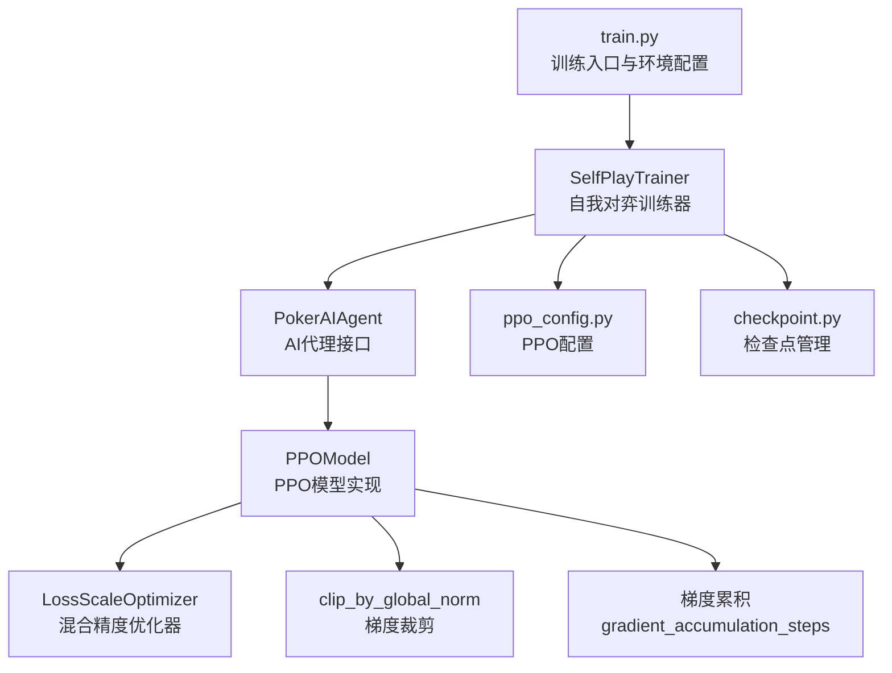
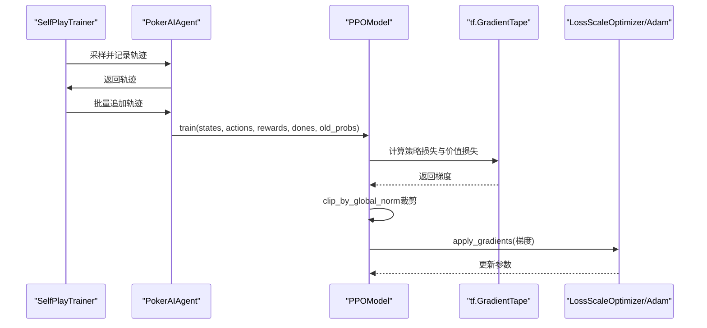
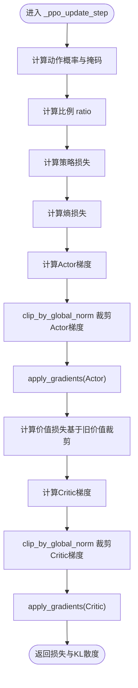
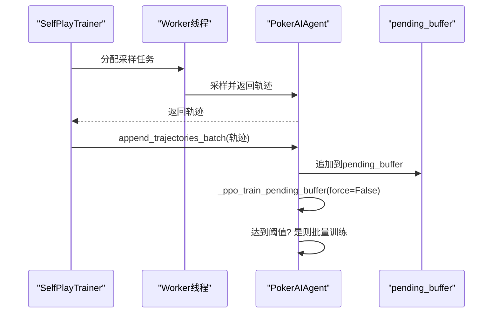
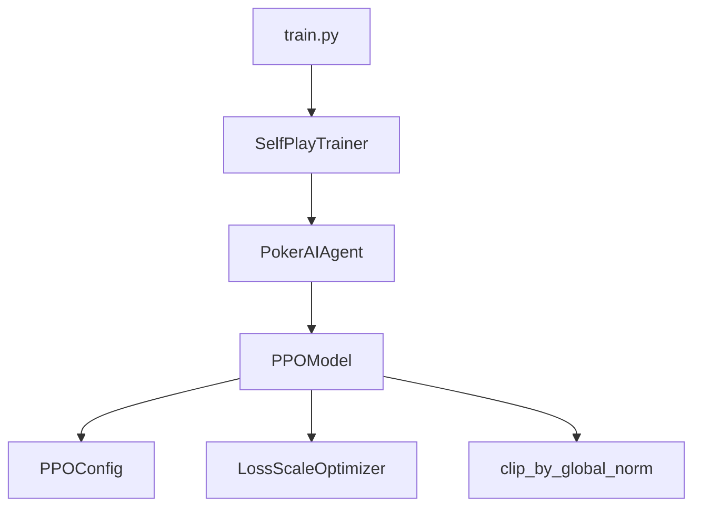

# 梯度处理机制

<cite>
**本文引用的文件**
- [train.py](file://train.py)
- [poker_ai/model/ppo_model.py](file://poker_ai/model/ppo_model.py)
- [poker_ai/config/ppo_config.py](file://poker_ai/config/ppo_config.py)
- [poker_ai/reward/self_play_trainer.py](file://poker_ai/reward/self_play_trainer.py)
- [poker_ai/model/ai_agent.py](file://poker_ai/model/ai_agent.py)
- [poker_ai/utils/checkpoint.py](file://poker_ai/utils/checkpoint.py)
</cite>

## 目录
1. [简介](#简介)
2. [项目结构](#项目结构)
3. [核心组件](#核心组件)
4. [架构概览](#架构概览)
5. [详细组件分析](#详细组件分析)
6. [依赖关系分析](#依赖关系分析)
7. [性能考量](#性能考量)
8. [故障排查指南](#故障排查指南)
9. [结论](#结论)

## 简介
本技术文档聚焦于PPO（近端策略优化）在德州扑克AI训练中的梯度处理机制，系统阐述以下内容：
- 梯度累积的实现原理与应用场景，以及如何通过梯度累积实现有效的大批次训练
- 改进的梯度裁剪方法，包括global norm裁剪的数学原理与实现细节
- 混合精度训练中LossScaleOptimizer的作用与使用方法
- 梯度处理的完整流程图与代码示例路径
- 梯度处理对训练稳定性与收敛速度的影响分析

## 项目结构
该项目围绕PPO训练与评估展开，关键模块如下：
- 训练入口与环境配置：train.py负责参数解析、环境初始化与训练器创建
- PPO模型实现：poker_ai/model/ppo_model.py提供策略网络、价值网络、损失计算、梯度裁剪与混合精度适配
- 训练配置：poker_ai/config/ppo_config.py集中管理PPO超参数
- 自我对弈训练器：poker_ai/reward/self_play_trainer.py负责并行采样、轨迹收集与批量训练
- AI代理接口：poker_ai/model/ai_agent.py封装PPO轨迹记录与批量训练触发
- 检查点管理：poker_ai/utils/checkpoint.py提供模型权重与状态的保存与加载

图表来源
- [train.py:136-531](file://train.py#L136-L531)
- [poker_ai/reward/self_play_trainer.py:48-166](file://poker_ai/reward/self_play_trainer.py#L48-L166)
- [poker_ai/model/ai_agent.py:55-116](file://poker_ai/model/ai_agent.py#L55-L116)
- [poker_ai/model/ppo_model.py:20-105](file://poker_ai/model/ppo_model.py#L20-L105)
- [poker_ai/config/ppo_config.py:18-97](file://poker_ai/config/ppo_config.py#L18-L97)
- [poker_ai/utils/checkpoint.py:17-104](file://poker_ai/utils/checkpoint.py#L17-L104)

章节来源
- [train.py:136-531](file://train.py#L136-L531)
- [poker_ai/reward/self_play_trainer.py:48-166](file://poker_ai/reward/self_play_trainer.py#L48-L166)
- [poker_ai/model/ai_agent.py:55-116](file://poker_ai/model/ai_agent.py#L55-L116)
- [poker_ai/model/ppo_model.py:20-105](file://poker_ai/model/ppo_model.py#L20-L105)
- [poker_ai/config/ppo_config.py:18-97](file://poker_ai/config/ppo_config.py#L18-L97)
- [poker_ai/utils/checkpoint.py:17-104](file://poker_ai/utils/checkpoint.py#L17-L104)

## 核心组件
- PPOModel：包含策略网络（Actor）、价值网络（Critic）、损失计算、梯度裁剪与混合精度适配
- SelfPlayTrainer：负责并行采样、轨迹收集、批量训练触发与检查点管理
- PokerAIAgent：封装PPO轨迹记录与批量训练触发，提供批量动作选择接口
- PPOConfig：集中管理PPO超参数，包括梯度累积步数、最大梯度范数等

章节来源
- [poker_ai/model/ppo_model.py:20-105](file://poker_ai/model/ppo_model.py#L20-L105)
- [poker_ai/reward/self_play_trainer.py:48-166](file://poker_ai/reward/self_play_trainer.py#L48-L166)
- [poker_ai/model/ai_agent.py:55-116](file://poker_ai/model/ai_agent.py#L55-L116)
- [poker_ai/config/ppo_config.py:18-97](file://poker_ai/config/ppo_config.py#L18-L97)

## 架构概览
PPO训练的梯度处理贯穿以下流程：
- 环境配置：train.py设置混合精度、XLA、线程并行等
- 采样与轨迹收集：SelfPlayTrainer并行采样，PokerAIAgent记录轨迹
- 批量训练触发：当累计样本达到阈值时，批量调用PPOModel.train
- 梯度计算与裁剪：PPOModel内部使用tf.GradientTape计算梯度，采用clip_by_global_norm进行裁剪
- 混合精度适配：LossScaleOptimizer在混合精度下自动缩放损失，防止数值下溢
- 梯度累积：通过gradient_accumulation_steps实现有效大批次训练

图表来源
- [poker_ai/reward/self_play_trainer.py:1544-1550](file://poker_ai/reward/self_play_trainer.py#L1544-L1550)
- [poker_ai/model/ai_agent.py:333-361](file://poker_ai/model/ai_agent.py#L333-L361)
- [poker_ai/model/ppo_model.py:106-198](file://poker_ai/model/ppo_model.py#L106-L198)

章节来源
- [poker_ai/reward/self_play_trainer.py:1544-1550](file://poker_ai/reward/self_play_trainer.py#L1544-L1550)
- [poker_ai/model/ai_agent.py:333-361](file://poker_ai/model/ai_agent.py#L333-L361)
- [poker_ai/model/ppo_model.py:106-198](file://poker_ai/model/ppo_model.py#L106-L198)

## 详细组件分析

### PPOModel：梯度处理核心实现
- 梯度累积
  - 通过gradient_accumulation_steps配置，PPOModel在训练时维护累积梯度与计数器
  - 当累积步数达到设定值时，执行一次参数更新，从而在有限显存下实现有效大批次训练
  - 关键实现路径：[poker_ai/model/ppo_model.py:84-88](file://poker_ai/model/ppo_model.py#L84-L88)，[poker_ai/model/ppo_model.py:538-542](file://poker_ai/model/ppo_model.py#L538-L542)

- 改进的梯度裁剪（clip_by_global_norm）
  - 在策略网络与价值网络的梯度计算后，统一使用clip_by_global_norm进行裁剪
  - 裁剪阈值由max_grad_norm配置，防止梯度爆炸，提升训练稳定性
  - 关键实现路径：[poker_ai/model/ppo_model.py:155-156](file://poker_ai/model/ppo_model.py#L155-L156)，[poker_ai/model/ppo_model.py:187-188](file://poker_ai/model/ppo_model.py#L187-L188)

- 混合精度适配（LossScaleOptimizer）
  - 检测当前混合精度策略，若为混合精度，则使用LossScaleOptimizer包装优化器
  - 在混合精度下，模型输出可能为float16，损失计算统一转换为float32，避免数值下溢
  - 关键实现路径：[poker_ai/model/ppo_model.py:97-104](file://poker_ai/model/ppo_model.py#L97-L104)，[poker_ai/model/ppo_model.py:127-129](file://poker_ai/model/ppo_model.py#L127-L129)

- 价值损失裁剪（基于旧价值）
  - 修复了基于当前价值自减的裁剪方式，改为基于旧价值的裁剪，提升价值估计稳定性
  - 关键实现路径：[poker_ai/model/ppo_model.py:174-184](file://poker_ai/model/ppo_model.py#L174-L184)

图表来源
- [poker_ai/model/ppo_model.py:106-198](file://poker_ai/model/ppo_model.py#L106-L198)

章节来源
- [poker_ai/model/ppo_model.py:84-88](file://poker_ai/model/ppo_model.py#L84-L88)
- [poker_ai/model/ppo_model.py:538-542](file://poker_ai/model/ppo_model.py#L538-L542)
- [poker_ai/model/ppo_model.py:155-156](file://poker_ai/model/ppo_model.py#L155-L156)
- [poker_ai/model/ppo_model.py:187-188](file://poker_ai/model/ppo_model.py#L187-L188)
- [poker_ai/model/ppo_model.py:97-104](file://poker_ai/model/ppo_model.py#L97-L104)
- [poker_ai/model/ppo_model.py:127-129](file://poker_ai/model/ppo_model.py#L127-L129)
- [poker_ai/model/ppo_model.py:174-184](file://poker_ai/model/ppo_model.py#L174-L184)

### SelfPlayTrainer：轨迹收集与批量训练触发
- 并行采样：通过ThreadPoolExecutor并行执行多局游戏，收集轨迹
- 批量训练触发：当累计样本达到ppo_update_min_steps阈值时，批量调用PokerAIAgent的批量训练接口
- 关键实现路径：[poker_ai/reward/self_play_trainer.py:1544-1550](file://poker_ai/reward/self_play_trainer.py#L1544-L1550)

图表来源
- [poker_ai/reward/self_play_trainer.py:1544-1550](file://poker_ai/reward/self_play_trainer.py#L1544-L1550)
- [poker_ai/model/ai_agent.py:363-386](file://poker_ai/model/ai_agent.py#L363-L386)

章节来源
- [poker_ai/reward/self_play_trainer.py:1544-1550](file://poker_ai/reward/self_play_trainer.py#L1544-L1550)
- [poker_ai/model/ai_agent.py:363-386](file://poker_ai/model/ai_agent.py#L363-L386)

### PokerAIAgent：轨迹记录与批量训练接口
- 轨迹记录：append_step记录每步的状态、动作与旧概率
- 批量训练触发：finish_trajectory在回合结束时将最终奖励写入轨迹，并触发批量训练
- 批量接口：append_trajectories_batch支持批量追加轨迹，减少函数调用开销
- 关键实现路径：[poker_ai/model/ai_agent.py:388-414](file://poker_ai/model/ai_agent.py#L388-L414)，[poker_ai/model/ai_agent.py:363-386](file://poker_ai/model/ai_agent.py#L363-L386)

章节来源
- [poker_ai/model/ai_agent.py:388-414](file://poker_ai/model/ai_agent.py#L388-L414)
- [poker_ai/model/ai_agent.py:363-386](file://poker_ai/model/ai_agent.py#L363-L386)

### PPOConfig：超参数配置
- 梯度累积步数：gradient_accumulation_steps
- 最大梯度范数：max_grad_norm
- 其他PPO相关超参数：clip_epsilon、batch_size、update_epochs等
- 关键实现路径：[poker_ai/config/ppo_config.py:68-72](file://poker_ai/config/ppo_config.py#L68-L72)，[poker_ai/config/ppo_config.py:68-72](file://poker_ai/config/ppo_config.py#L68-L72)

章节来源
- [poker_ai/config/ppo_config.py:68-72](file://poker_ai/config/ppo_config.py#L68-L72)
- [poker_ai/config/ppo_config.py:68-72](file://poker_ai/config/ppo_config.py#L68-L72)

## 依赖关系分析
- train.py依赖SelfPlayTrainer创建训练器，并设置混合精度与XLA
- SelfPlayTrainer依赖PokerAIAgent进行动作选择与轨迹记录
- PokerAIAgent依赖PPOModel进行训练
- PPOModel依赖LossScaleOptimizer与clip_by_global_norm进行梯度处理
- PPOModel依赖PPOConfig进行超参数配置

图表来源
- [train.py:350-383](file://train.py#L350-L383)
- [poker_ai/reward/self_play_trainer.py:167-200](file://poker_ai/reward/self_play_trainer.py#L167-L200)
- [poker_ai/model/ai_agent.py:95-105](file://poker_ai/model/ai_agent.py#L95-L105)
- [poker_ai/model/ppo_model.py:94-104](file://poker_ai/model/ppo_model.py#L94-L104)
- [poker_ai/config/ppo_config.py:68-72](file://poker_ai/config/ppo_config.py#L68-L72)

章节来源
- [train.py:350-383](file://train.py#L350-L383)
- [poker_ai/reward/self_play_trainer.py:167-200](file://poker_ai/reward/self_play_trainer.py#L167-L200)
- [poker_ai/model/ai_agent.py:95-105](file://poker_ai/model/ai_agent.py#L95-L105)
- [poker_ai/model/ppo_model.py:94-104](file://poker_ai/model/ppo_model.py#L94-L104)
- [poker_ai/config/ppo_config.py:68-72](file://poker_ai/config/ppo_config.py#L68-L72)

## 性能考量
- 梯度累积：通过增大gradient_accumulation_steps可在有限显存下模拟更大batch_size，提升训练吞吐
- 混合精度：启用mixed_float16可显著提升训练速度，LossScaleOptimizer自动处理数值稳定性
- 梯度裁剪：clip_by_global_norm限制梯度范数，防止梯度爆炸，提升收敛稳定性
- 并行采样：SelfPlayTrainer通过多线程并行采样，结合批量训练接口，减少Python调度开销

## 故障排查指南
- 混合精度相关错误：若遇到DNN library或graph execution错误，可尝试禁用XLA或oneDNN
  - 相关实现路径：[train.py:325-334](file://train.py#L325-L334)，[poker_ai/model/ai_agent.py:321-331](file://poker_ai/model/ai_agent.py#L321-L331)
- PPO更新失败：检查ppo_update_min_steps阈值与pending_buffer状态
  - 相关实现路径：[poker_ai/model/ai_agent.py:333-361](file://poker_ai/model/ai_agent.py#L333-L361)
- 检查点加载失败：确认权重文件存在且格式正确
  - 相关实现路径：[poker_ai/utils/checkpoint.py:58-104](file://poker_ai/utils/checkpoint.py#L58-L104)

章节来源
- [train.py:325-334](file://train.py#L325-L334)
- [poker_ai/model/ai_agent.py:321-331](file://poker_ai/model/ai_agent.py#L321-L331)
- [poker_ai/model/ai_agent.py:333-361](file://poker_ai/model/ai_agent.py#L333-L361)
- [poker_ai/utils/checkpoint.py:58-104](file://poker_ai/utils/checkpoint.py#L58-L104)

## 结论
本项目在PPO梯度处理方面实现了多项优化：
- 通过梯度累积在有限显存下实现有效大批次训练
- 采用clip_by_global_norm进行全局梯度裁剪，提升训练稳定性
- 在混合精度环境下使用LossScaleOptimizer，兼顾速度与数值稳定性
- 通过SelfPlayTrainer与PokerAIAgent的协作，实现高效的并行采样与批量训练

这些机制共同提升了训练效率与收敛稳定性，为德州扑克AI的高效训练提供了坚实基础。