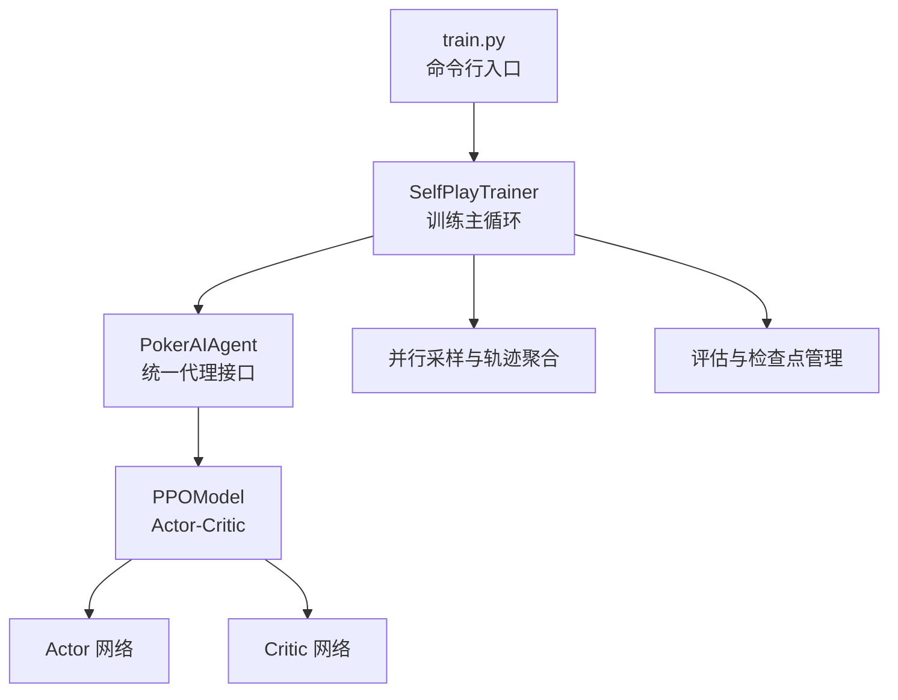
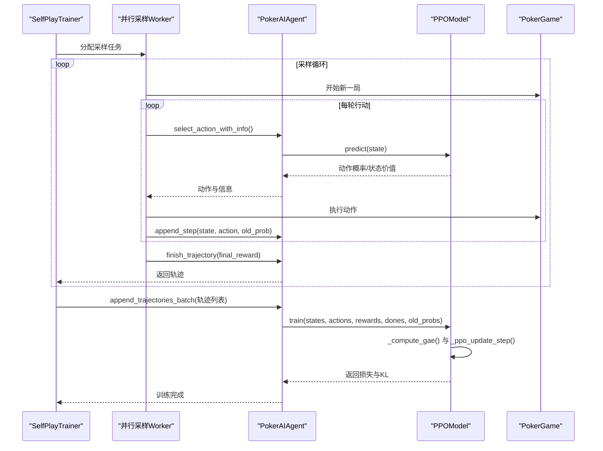
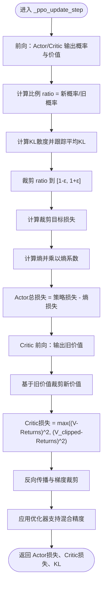
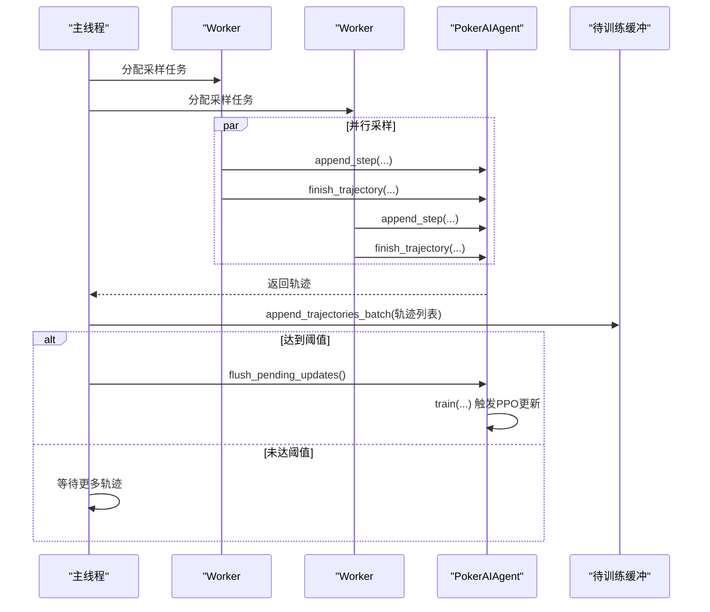
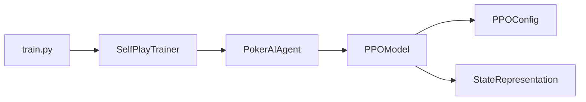

# 训练算法实现

<cite>
**本文引用的文件**
- [train.py](file://train.py)
- [poker_ai/model/ppo_model.py](file://poker_ai/model/ppo_model.py)
- [poker_ai/config/ppo_config.py](file://poker_ai/config/ppo_config.py)
- [poker_ai/reward/self_play_trainer.py](file://poker_ai/reward/self_play_trainer.py)
- [poker_ai/model/ai_agent.py](file://poker_ai/model/ai_agent.py)
- [PPO优化总结.md](file://PPO优化总结.md)
- [PPO快速指南.md](file://PPO快速指南.md)
- [README.md](file://README.md)
- [requirements.txt](file://requirements.txt)
</cite>

## 目录
1. [简介](#简介)
2. [项目结构](#项目结构)
3. [核心组件](#核心组件)
4. [架构总览](#架构总览)
5. [详细组件分析](#详细组件分析)
6. [依赖分析](#依赖分析)
7. [性能考量](#性能考量)
8. [故障排查指南](#故障排查指南)
9. [结论](#结论)
10. [附录](#附录)

## 简介
本文件面向PPO训练算法实现，系统化梳理其核心原理与工程实现，重点覆盖以下主题：
- PPO核心算法：重要性采样、裁剪目标函数、熵正则化
- _update_step方法的实现细节：策略损失与价值损失的计算过程
- KL散度早停机制：工作原理与阈值设定策略
- 自适应学习率调度：warmup与cosine衰减的数学公式
- 优化技术：梯度累积、混合精度训练、向量化GAE、价值损失裁剪
- 训练流程伪代码与实现示例：批次训练与单步更新

## 项目结构
该项目围绕德州扑克6-max环境，提供统一的训练与评估入口，PPO训练由SelfPlayTrainer驱动，PPOModel负责策略与价值网络的训练与推理。

**图表来源**
- [train.py:340-531](file://train.py#L340-L531)
- [poker_ai/reward/self_play_trainer.py:1393-1599](file://poker_ai/reward/self_play_trainer.py#L1393-L1599)
- [poker_ai/model/ai_agent.py:95-115](file://poker_ai/model/ai_agent.py#L95-L115)
- [poker_ai/model/ppo_model.py:200-274](file://poker_ai/model/ppo_model.py#L200-L274)

**章节来源**
- [README.md:46-75](file://README.md#L46-L75)
- [train.py:136-238](file://train.py#L136-L238)

## 核心组件
- PPOModel：实现Actor-Critic网络、_ppo_update_step单步更新、GAE计算、学习率调度、KL早停、自适应熵系数、价值损失裁剪、梯度累积与混合精度支持。
- SelfPlayTrainer：训练主循环，负责并行采样、轨迹收集、批量训练触发、评估与检查点管理。
- PokerAIAgent：统一代理接口，封装PPOModel，提供动作选择、轨迹记录与批量训练触发。
- PPOConfig：集中管理PPO超参数，支持默认配置与扩展参数。

**章节来源**
- [poker_ai/model/ppo_model.py:20-105](file://poker_ai/model/ppo_model.py#L20-L105)
- [poker_ai/reward/self_play_trainer.py:48-166](file://poker_ai/reward/self_play_trainer.py#L48-L166)
- [poker_ai/model/ai_agent.py:55-116](file://poker_ai/model/ai_agent.py#L55-L116)
- [poker_ai/config/ppo_config.py:18-96](file://poker_ai/config/ppo_config.py#L18-L96)

## 架构总览
PPO训练采用轨迹级学习范式：在每手牌内收集状态-动作-旧概率轨迹，达到阈值后批量训练一次。训练主循环通过并行worker采样，主线程聚合轨迹后统一触发PPO更新。

**图表来源**
- [poker_ai/reward/self_play_trainer.py:1429-1551](file://poker_ai/reward/self_play_trainer.py#L1429-L1551)
- [poker_ai/model/ai_agent.py:363-414](file://poker_ai/model/ai_agent.py#L363-L414)
- [poker_ai/model/ppo_model.py:512-638](file://poker_ai/model/ppo_model.py#L512-L638)

## 详细组件分析

### PPOModel：核心算法与实现
- 网络架构
  - Actor/Critic均采用256-256-128-64的深度结构，配合LayerNormalization与残差连接，提升稳定性与表达能力。
  - Critic保留轻度Dropout防止过拟合。
- 重要性采样与裁剪目标
  - 计算当前策略与旧策略的概率比ratio，裁剪到[1-ε, 1+ε]区间，形成裁剪后的优势估计，避免过大更新。
- 熵正则化
  - 计算策略熵并乘以熵系数，抑制策略过早塌缩，平衡探索与利用。
  - 支持自适应熵系数：根据当前熵与目标熵的差距动态调整。
- 价值损失裁剪
  - 基于旧价值进行裁剪：values_clipped = old_values + clip(V - old_values, -clip, clip)，取裁剪与非裁剪损失的最大值，保守更新。
- KL散度早停
  - 计算KL散度并跟踪平均KL，超过阈值时提前终止当前epoch，防止策略退化。
- 学习率调度
  - warmup阶段：前W步线性从lr_min增长到initial_lr。
  - cosine衰减：warmup后按cosine曲线衰减至lr_min。
  - 支持LossScaleOptimizer适配混合精度。
- 梯度累积与混合精度
  - 支持梯度累积以提升有效batch size。
  - 自动检测混合精度并使用LossScaleOptimizer。
- GAE向量化
  - 使用向量化NumPy实现GAE，显著提升计算效率与稳定性。

**图表来源**
- [poker_ai/model/ppo_model.py:106-198](file://poker_ai/model/ppo_model.py#L106-L198)
- [poker_ai/model/ppo_model.py:420-447](file://poker_ai/model/ppo_model.py#L420-L447)
- [poker_ai/model/ppo_model.py:449-470](file://poker_ai/model/ppo_model.py#L449-L470)
- [poker_ai/model/ppo_model.py:276-320](file://poker_ai/model/ppo_model.py#L276-L320)

**章节来源**
- [poker_ai/model/ppo_model.py:106-198](file://poker_ai/model/ppo_model.py#L106-L198)
- [poker_ai/model/ppo_model.py:276-320](file://poker_ai/model/ppo_model.py#L276-L320)
- [poker_ai/model/ppo_model.py:420-470](file://poker_ai/model/ppo_model.py#L420-L470)

### SelfPlayTrainer：训练流程与并行采样
- 并行采样：通过ThreadPoolExecutor并行执行多个采样任务，每个worker持有独立的agent副本，避免并发冲突。
- 轨迹聚合：主线程收集各worker返回的轨迹，批量写入PPO代理的待训练缓冲，达到阈值后一次性触发训练，减少函数调用开销。
- 评估与检查点：按配置周期性评估模型性能并保存检查点，支持“最佳模型”保存策略。
- 对手更新：定期将主代理权重同步给对手，维持动态对抗环境。

**图表来源**
- [poker_ai/reward/self_play_trainer.py:1429-1551](file://poker_ai/reward/self_play_trainer.py#L1429-L1551)
- [poker_ai/model/ai_agent.py:363-414](file://poker_ai/model/ai_agent.py#L363-L414)

**章节来源**
- [poker_ai/reward/self_play_trainer.py:1393-1599](file://poker_ai/reward/self_play_trainer.py#L1393-L1599)

### PokerAIAgent：动作选择与轨迹管理
- 动作选择：对PPO，先预测动作概率，再按合法掩码采样动作，同时返回动作索引、旧概率与状态价值，避免重复前向。
- 轨迹管理：提供append_step/finish_trajectory接口，将每步的状态、动作与旧概率写入缓冲；支持批量轨迹写入以减少调用次数。
- 批量推理：select_actions_batch_with_info对多局状态进行单次前向，显著降低Python/TensorFlow往返开销。

**章节来源**
- [poker_ai/model/ai_agent.py:125-214](file://poker_ai/model/ai_agent.py#L125-L214)
- [poker_ai/model/ai_agent.py:388-414](file://poker_ai/model/ai_agent.py#L388-L414)

### PPOConfig：超参数集中管理
- 默认配置针对RTX 4090D优化：更大batch_size、更少update_epochs、启用KL早停、学习率warmup与cosine衰减、自适应熵系数、价值损失裁剪、梯度累积等。
- 支持通过实例化自定义配置并传入训练流程。

**章节来源**
- [poker_ai/config/ppo_config.py:18-96](file://poker_ai/config/ppo_config.py#L18-L96)

## 依赖分析
- 外部依赖：TensorFlow（≥2.5）、NumPy、Matplotlib、Seaborn、pickle-mixin、argparse、python-dateutil。
- 内部模块耦合：
  - train.py依赖SelfPlayTrainer与参数解析，负责环境设置、自动调参与训练/评估/演示入口。
  - SelfPlayTrainer依赖PokerAIAgent与PPOModel（通过代理），负责并行采样、轨迹聚合与训练主循环。
  - PokerAIAgent封装PPOModel，提供统一接口与批量推理能力。
  - PPOModel内部依赖StateRepresentation与PPOConfig，实现网络、损失与学习率调度。

**图表来源**
- [train.py:340-531](file://train.py#L340-L531)
- [poker_ai/reward/self_play_trainer.py:167-213](file://poker_ai/reward/self_play_trainer.py#L167-L213)
- [poker_ai/model/ai_agent.py:95-115](file://poker_ai/model/ai_agent.py#L95-L115)
- [poker_ai/model/ppo_model.py:57-58](file://poker_ai/model/ppo_model.py#L57-L58)

**章节来源**
- [requirements.txt:1-7](file://requirements.txt#L1-L7)
- [train.py:240-339](file://train.py#L240-L339)

## 性能考量
- 训练效率
  - 向量化GAE与批量前向推理显著降低Python调度开销。
  - 梯度累积与更大batch size提升GPU利用率。
  - 并行采样与轨迹批量训练减少函数调用与阈值检查开销。
- 稳定性
  - LayerNormalization、残差连接、价值损失裁剪与KL早停提升训练稳定性。
  - 混合精度与LossScaleOptimizer在GPU上加速训练并保持数值稳定。
- 资源占用
  - 网络容量增加带来显存上升，可通过减小batch size或调整epochs缓解。
  - warmup与cosine衰减有助于避免训练初期不稳定与后期震荡。

[本节为通用性能讨论，无需特定文件引用]

## 故障排查指南
- 显存不足
  - 降低batch size或减少update_epochs；必要时减小网络容量。
- 训练崩溃或XLA/DNN错误
  - 尝试禁用XLA或oneDNN：在train.py中添加相应选项。
  - 检查日志中关于DNN/Graph错误的警告并按提示调整。
- 策略塌缩或探索不足
  - 提高熵系数或启用自适应熵系数；检查KL早停阈值是否过严。
- 训练停滞
  - 检查学习率是否过小；确认warmup与cosine衰减生效。
- 评估异常
  - 确认评估参数与模型类型匹配；使用train.py的eval模式进行PPO评估。

**章节来源**
- [poker_ai/model/ai_agent.py:314-331](file://poker_ai/model/ai_agent.py#L314-L331)
- [poker_ai/reward/self_play_trainer.py:1559-1571](file://poker_ai/reward/self_play_trainer.py#L1559-L1571)
- [PPO快速指南.md:146-159](file://PPO快速指南.md#L146-L159)

## 结论
本实现将PPO的关键优化点（重要性采样、裁剪目标、熵正则、KL早停、学习率调度、价值损失裁剪、混合精度、梯度累积、向量化GAE）系统化集成到德州扑克6-max训练框架中。通过SelfPlayTrainer的并行采样与轨迹批量训练，显著提升了训练效率与稳定性；通过PPOModel的工程化实现，确保了算法在实际部署中的可维护性与可扩展性。

[本节为总结性内容，无需特定文件引用]

## 附录

### 训练流程伪代码
- 输入：轨迹集合（states, actions, old_probs, rewards, dones）
- 步骤：
  1) 计算状态价值与GAE优势，得到returns = advantages + values
  2) 保存旧价值用于价值损失裁剪
  3) 初始化累计梯度与计数器
  4) 对每个epoch随机打乱索引
  5) 遍历mini-batch：
     - 前向：Actor输出动作概率，Critic输出价值
     - 计算ratio、KL散度、裁剪目标损失与熵损失
     - 计算Actor/Critic损失并进行梯度裁剪
     - 应用优化器（支持混合精度）
     - 更新学习率
     - 累计损失与KL
     - KL早停：若平均KL超过阈值则提前终止该epoch
  6) 记录平均损失与KL，返回总损失

**章节来源**
- [poker_ai/model/ppo_model.py:512-638](file://poker_ai/model/ppo_model.py#L512-L638)

### 关键实现示例路径
- PPO更新步骤：[_ppo_update_step:106-198](file://poker_ai/model/ppo_model.py#L106-L198)
- GAE计算：[_compute_gae:276-320](file://poker_ai/model/ppo_model.py#L276-L320)
- 学习率调度：[_get_lr_with_warmup_and_decay:420-447](file://poker_ai/model/ppo_model.py#L420-L447)
- 自适应熵系数：[_compute_entropy_loss:449-470](file://poker_ai/model/ppo_model.py#L449-L470)
- 训练入口：[train:497-638](file://poker_ai/model/ppo_model.py#L497-L638)
- 训练主循环：[train:1393-1599](file://poker_ai/reward/self_play_trainer.py#L1393-L1599)
- 代理接口：[PokerAIAgent:55-116](file://poker_ai/model/ai_agent.py#L55-L116)
- 默认配置：[PPOConfig:18-96](file://poker_ai/config/ppo_config.py#L18-L96)