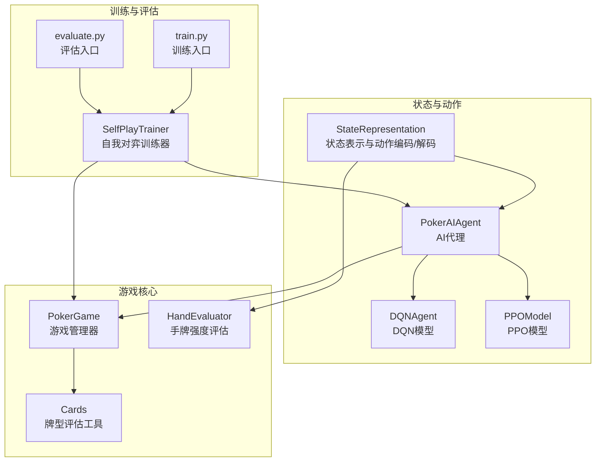
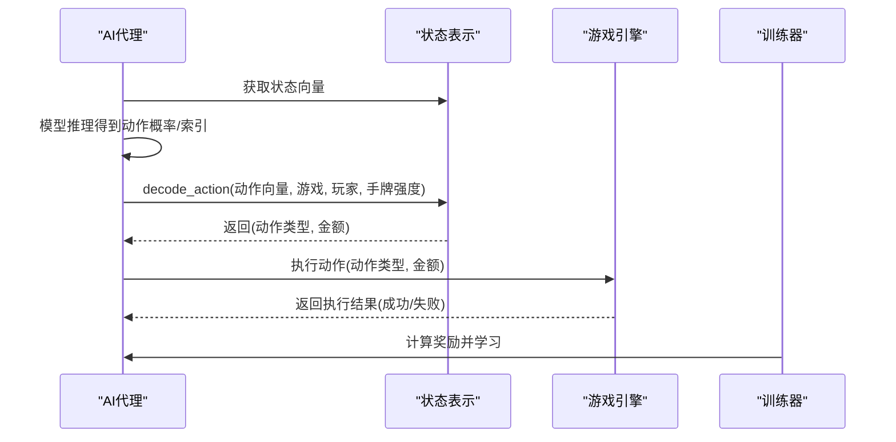
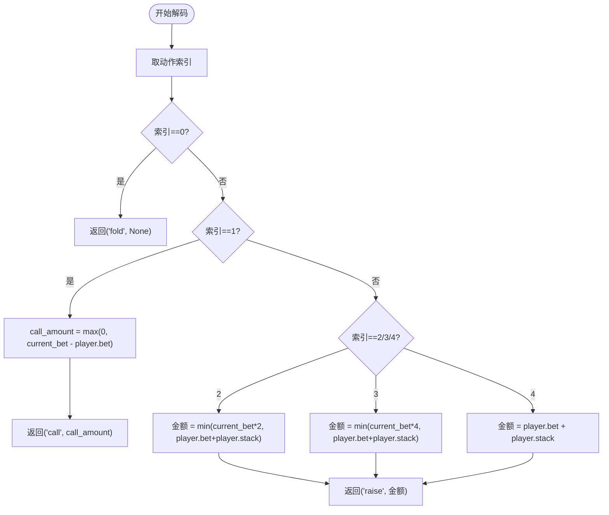
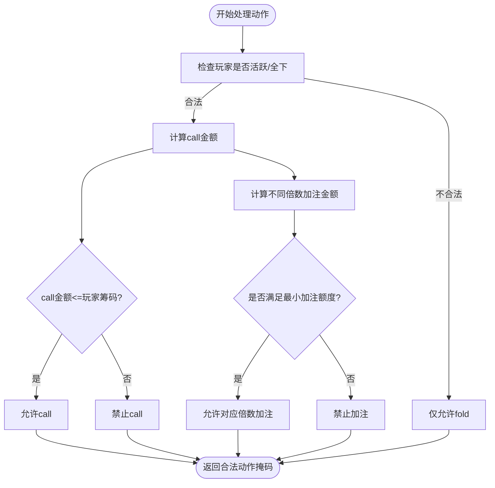
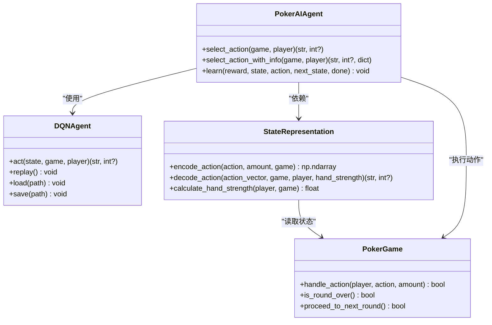
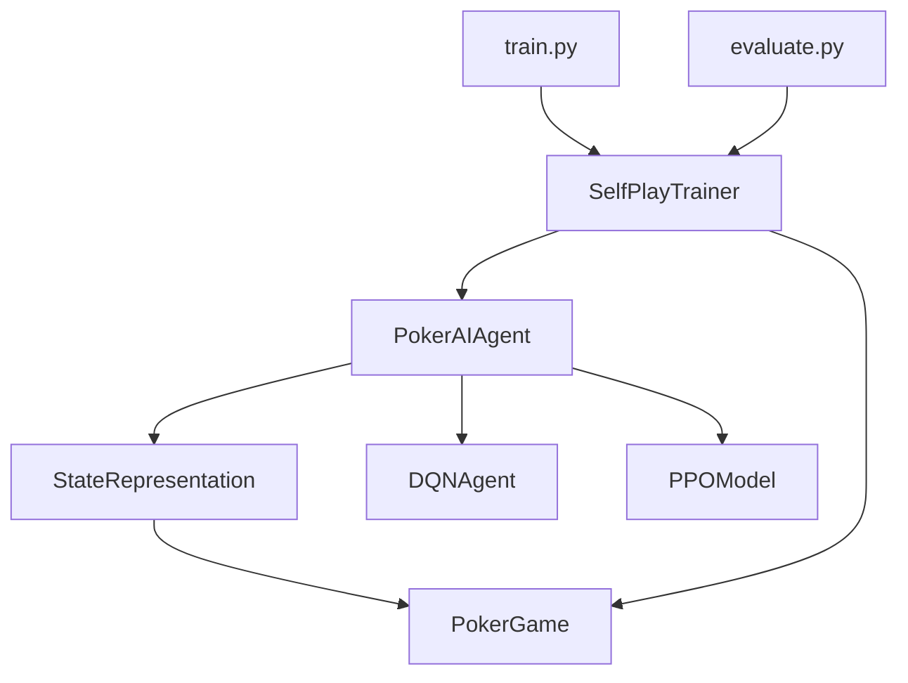

# 动作解码和金额确定

<cite>
**本文档引用的文件**
- [state_representation.py](file://poker_ai/model/state_representation.py)
- [poker_game.py](file://poker_ai/game/poker_game.py)
- [ai_agent.py](file://poker_ai/model/ai_agent.py)
- [dqn_agent.py](file://poker_ai/model/dqn_agent.py)
- [cards.py](file://poker_ai/game/cards.py)
- [hand_evaluator.py](file://poker_ai/model/hand_evaluator.py)
- [self_play_trainer.py](file://poker_ai/reward/self_play_trainer.py)
- [train.py](file://train.py)
- [evaluate.py](file://evaluate.py)
</cite>

## 目录
1. [简介](#简介)
2. [项目结构](#项目结构)
3. [核心组件](#核心组件)
4. [架构概览](#架构概览)
5. [详细组件分析](#详细组件分析)
6. [依赖关系分析](#依赖关系分析)
7. [性能考量](#性能考量)
8. [故障排查指南](#故障排查指南)
9. [结论](#结论)

## 简介
本技术文档聚焦于德州扑克AI系统中的动作解码与金额确定机制，系统性阐述如何将抽象的动作索引转换为具体的德州扑克动作（fold、call、raise、all-in），并详细解析金额计算规则。文档同时分析了状态表示层的向量编码、手牌强度评估在金额确定中的作用、合法动作掩码的构建、以及训练数据收集与模型评估中动作解码的重要性与一致性保障。

## 项目结构
该项目采用模块化设计，围绕“状态表示—动作选择—游戏执行—奖励计算—训练评估”闭环展开。关键模块包括：
- 状态表示与动作编码：将手牌、公共牌、玩家状态、游戏全局信息等映射为固定维度的向量，并对动作进行one-hot编码与解码。
- 游戏核心逻辑：负责发牌、轮次推进、动作处理、底池与筹码管理、摊牌判定等。
- AI代理与模型：封装DQN、策略梯度、PPO等不同模型的动作选择流程，统一对外提供select_action接口。
- 奖励与训练：提供奖励计算、自我对弈训练器、评估脚本，支撑训练数据收集与模型评估。

**图表来源**
- [state_representation.py:9-247](file://poker_ai/model/state_representation.py#L9-L247)
- [ai_agent.py:55-116](file://poker_ai/model/ai_agent.py#L55-L116)
- [dqn_agent.py:21-62](file://poker_ai/model/dqn_agent.py#L21-L62)
- [poker_game.py:155-497](file://poker_ai/game/poker_game.py#L155-L497)
- [cards.py:92-202](file://poker_ai/game/cards.py#L92-L202)
- [hand_evaluator.py:8-187](file://poker_ai/model/hand_evaluator.py#L8-L187)
- [self_play_trainer.py:48-166](file://poker_ai/reward/self_play_trainer.py#L48-L166)
- [train.py:340-531](file://train.py#L340-L531)
- [evaluate.py:181-267](file://evaluate.py#L181-L267)

**章节来源**
- [state_representation.py:9-247](file://poker_ai/model/state_representation.py#L9-L247)
- [poker_game.py:155-497](file://poker_ai/game/poker_game.py#L155-L497)
- [ai_agent.py:55-116](file://poker_ai/model/ai_agent.py#L55-L116)
- [dqn_agent.py:21-62](file://poker_ai/model/dqn_agent.py#L21-L62)
- [cards.py:92-202](file://poker_ai/game/cards.py#L92-L202)
- [hand_evaluator.py:8-187](file://poker_ai/model/hand_evaluator.py#L8-L187)
- [self_play_trainer.py:48-166](file://poker_ai/reward/self_play_trainer.py#L48-L166)
- [train.py:340-531](file://train.py#L340-L531)
- [evaluate.py:181-267](file://evaluate.py#L181-L267)

## 核心组件
- 状态表示与动作编码/解码
  - 将手牌、公共牌、玩家状态、游戏全局信息、英雄绝对位置、活跃人数等特征拼接为固定维度向量。
  - 动作向量采用5维one-hot编码：fold、call、raise×2、raise×4、all-in。
  - decode_action根据动作索引与游戏状态计算具体金额，确保合法性和一致性。
- 游戏执行引擎
  - 负责处理fold、call、raise等动作，维护底池、当前下注、玩家筹码、全下状态等。
  - 提供合法性校验，避免非法下注与超筹。
- AI代理与模型
  - PokerAIAgent统一对外接口，内部根据模型类型调用相应策略。
  - DQNAgent/PPOModel等模型输出动作概率或Q值，结合状态表示进行解码。
- 奖励与训练
  - SelfPlayTrainer驱动自我对弈，收集动作历史与轨迹，计算即时奖励与最终奖励。
  - 评估脚本用于模型性能验证与可视化分析。

**章节来源**
- [state_representation.py:212-247](file://poker_ai/model/state_representation.py#L212-L247)
- [poker_game.py:299-350](file://poker_ai/game/poker_game.py#L299-L350)
- [ai_agent.py:117-156](file://poker_ai/model/ai_agent.py#L117-L156)
- [dqn_agent.py:127-143](file://poker_ai/model/dqn_agent.py#L127-L143)
- [self_play_trainer.py:260-417](file://poker_ai/reward/self_play_trainer.py#L260-L417)

## 架构概览
动作解码与金额确定贯穿“状态表示—动作选择—游戏执行—奖励反馈”的闭环。状态表示层提供统一的向量空间，动作编码层将策略输出映射为离散动作，解码层将其转换为具体动作与金额，游戏执行层负责合法性校验与状态更新，奖励层提供即时与最终信号以指导学习。

**图表来源**
- [ai_agent.py:117-156](file://poker_ai/model/ai_agent.py#L117-L156)
- [state_representation.py:224-247](file://poker_ai/model/state_representation.py#L224-L247)
- [poker_game.py:299-350](file://poker_ai/game/poker_game.py#L299-L350)
- [self_play_trainer.py:360-404](file://poker_ai/reward/self_play_trainer.py#L360-L404)

## 详细组件分析

### 状态表示与动作编码/解码
- 动作向量编码
  - 5维one-hot：fold、call、raise×2、raise×4、all-in。
  - encode_action根据raise倍数区间映射到不同等级，便于策略输出与解码的一致性。
- 动作解码与金额计算
  - fold：直接返回fold，金额为None。
  - call：金额为max(0, current_bet - player.bet)，若超筹则全下。
  - raise：按倍数区间计算金额，分别对应current_bet×2、×4与全下。
  - all-in：金额为player.bet + player.stack，确保不超筹。
- 手牌强度评估
  - 计算手牌强度用于策略决策与奖励设计，decode_action接收hand_strength参数，便于策略一致性与合理性评估。

**图表来源**
- [state_representation.py:224-247](file://poker_ai/model/state_representation.py#L224-L247)

**章节来源**
- [state_representation.py:212-247](file://poker_ai/model/state_representation.py#L212-L247)

### 游戏执行与合法性校验
- 动作处理流程
  - fold：玩家状态置为非活跃，行动计数+1。
  - call：计算跟注金额，若超筹则全下；否则正常跟注。
  - raise：校验最小加注额度（至少为current_bet×2或big blind），且金额不超过玩家可用筹码；更新底池与当前下注。
- 合法性掩码
  - _get_legal_action_mask根据当前状态生成5维掩码，确保模型输出的动作在当前轮次内合法。
  - 掩码考虑玩家是否活跃/全下、call金额是否超筹、不同倍数加注是否满足最小额度与筹码约束。

**图表来源**
- [ai_agent.py:15-54](file://poker_ai/model/ai_agent.py#L15-L54)
- [poker_game.py:299-350](file://poker_ai/game/poker_game.py#L299-L350)

**章节来源**
- [ai_agent.py:15-54](file://poker_ai/model/ai_agent.py#L15-L54)
- [poker_game.py:299-350](file://poker_ai/game/poker_game.py#L299-L350)

### AI代理与模型集成
- PokerAIAgent统一接口
  - select_action/select_action_with_info：返回动作类型与金额，并提供训练所需信息（如PPO的动作概率、状态价值等）。
  - PPO路径：先预测动作概率，再应用合法性掩码，最后通过decode_action得到具体动作与金额。
  - 其他模型：DQN等直接使用状态表示的decode_action。
- DQN模型
  - act方法在ε-贪婪策略下选择动作索引，随后通过状态表示解码为具体动作与金额。

**图表来源**
- [ai_agent.py:55-116](file://poker_ai/model/ai_agent.py#L55-L116)
- [dqn_agent.py:21-62](file://poker_ai/model/dqn_agent.py#L21-L62)
- [state_representation.py:212-247](file://poker_ai/model/state_representation.py#L212-L247)
- [poker_game.py:155-497](file://poker_ai/game/poker_game.py#L155-L497)

**章节来源**
- [ai_agent.py:117-156](file://poker_ai/model/ai_agent.py#L117-L156)
- [dqn_agent.py:127-143](file://poker_ai/model/dqn_agent.py#L127-L143)

### 手牌强度评估与金额确定
- 手牌强度计算
  - 翻牌前：基于起手牌点数、花色、连牌等特征快速估算强度。
  - 翻牌后：使用蒙特卡洛模拟估算胜率，结合对手数量与公共牌动态评估。
- 金额确定中的作用
  - 解码时结合hand_strength，确保策略与手牌强度一致（例如弱牌不轻易大额加注）。
  - 奖励计算中也纳入手牌强度权重，强化理性决策。

**章节来源**
- [state_representation.py:174-211](file://poker_ai/model/state_representation.py#L174-L211)
- [hand_evaluator.py:123-187](file://poker_ai/model/hand_evaluator.py#L123-L187)

### 训练数据收集与模型评估中的动作解码
- 自我对弈训练
  - SelfPlayTrainer驱动多局对弈，记录动作历史与轨迹，计算即时奖励与最终奖励，确保动作解码的准确性与一致性。
- 评估脚本
  - 通过evaluate.py运行大量对局，统计动作分布、阶段利润、按手牌强度的胜率等指标，验证动作解码与金额确定策略的有效性。

**章节来源**
- [self_play_trainer.py:260-417](file://poker_ai/reward/self_play_trainer.py#L260-L417)
- [evaluate.py:181-267](file://evaluate.py#L181-L267)

## 依赖关系分析
- 模块耦合
  - StateRepresentation与PokerGame紧密耦合，前者依赖后者提供的当前下注、底池、玩家状态等信息进行解码。
  - PokerAIAgent依赖StateRepresentation进行状态编码与动作解码，同时依赖具体模型（DQN/PPO）进行策略选择。
- 外部依赖
  - TensorFlow/Keras用于模型训练与推理（DQN/PPO）。
  - NumPy用于向量运算与状态表示。

**图表来源**
- [state_representation.py:9-41](file://poker_ai/model/state_representation.py#L9-L41)
- [ai_agent.py:55-116](file://poker_ai/model/ai_agent.py#L55-L116)
- [dqn_agent.py:21-62](file://poker_ai/model/dqn_agent.py#L21-L62)
- [self_play_trainer.py:48-166](file://poker_ai/reward/self_play_trainer.py#L48-L166)
- [train.py:340-531](file://train.py#L340-L531)
- [evaluate.py:181-267](file://evaluate.py#L181-L267)

**章节来源**
- [state_representation.py:9-41](file://poker_ai/model/state_representation.py#L9-L41)
- [ai_agent.py:55-116](file://poker_ai/model/ai_agent.py#L55-L116)
- [dqn_agent.py:21-62](file://poker_ai/model/dqn_agent.py#L21-L62)
- [self_play_trainer.py:48-166](file://poker_ai/reward/self_play_trainer.py#L48-L166)
- [train.py:340-531](file://train.py#L340-L531)
- [evaluate.py:181-267](file://evaluate.py#L181-L267)

## 性能考量
- 向量化与缓存
  - StateRepresentation使用向量化one-hot编码与缓存（如翻牌前强度缓存），降低高频路径的计算开销。
- 合法性掩码
  - 在PPO路径中，先预测动作概率再应用合法性掩码，避免无效动作的训练浪费。
- 训练效率
  - SelfPlayTrainer支持并行采样与批量轨迹训练，提升PPO训练吞吐。

**章节来源**
- [state_representation.py:47-64](file://poker_ai/model/state_representation.py#L47-L64)
- [ai_agent.py:131-152](file://poker_ai/model/ai_agent.py#L131-L152)
- [self_play_trainer.py:587-800](file://poker_ai/reward/self_play_trainer.py#L587-L800)

## 故障排查指南
- 动作非法
  - 现象：模型输出的动作在当前状态下不可执行。
  - 排查：检查合法性掩码是否正确应用；确认最小加注额度与玩家筹码是否满足要求。
- 金额异常
  - 现象：跟注或加注金额与预期不符。
  - 排查：核对decode_action中的金额计算逻辑；检查current_bet与player.bet是否正确。
- 训练不稳定
  - 现象：模型在某些对局中表现异常。
  - 排查：检查奖励计算与轨迹记录是否一致；确认all-in不走运补偿与轨迹最终奖励的设置。

**章节来源**
- [ai_agent.py:15-54](file://poker_ai/model/ai_agent.py#L15-L54)
- [poker_game.py:327-347](file://poker_ai/game/poker_game.py#L327-L347)
- [self_play_trainer.py:360-404](file://poker_ai/reward/self_play_trainer.py#L360-L404)

## 结论
动作解码与金额确定是德州扑克AI系统的关键环节。通过统一的状态表示、严格的合法性校验、合理的金额计算规则以及完善的训练与评估流程，系统能够在训练数据收集与模型评估中确保动作解码的准确性与一致性。手牌强度评估在其中扮演重要角色，既影响策略决策，也影响奖励设计与训练效果。未来可在更多场景下引入更精细的策略与奖励机制，持续提升模型的泛化能力与稳定性。