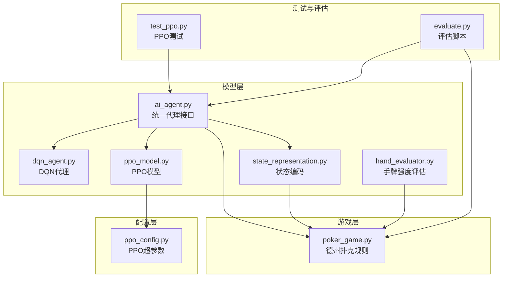
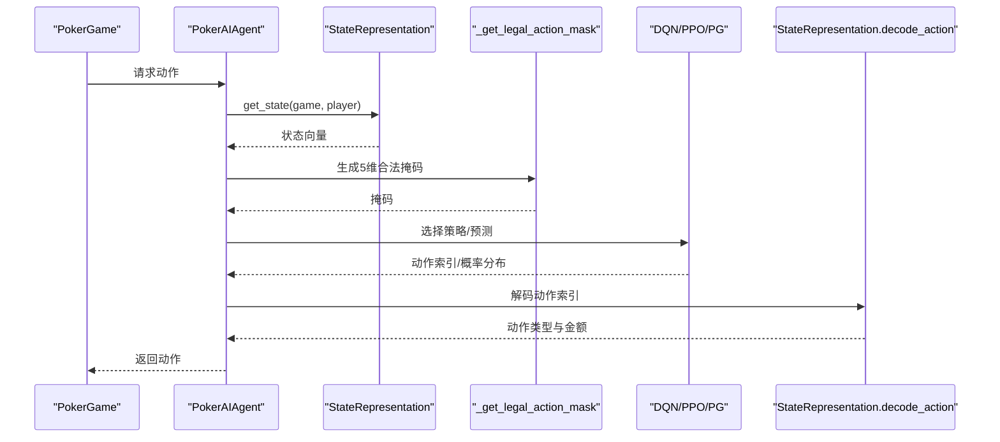
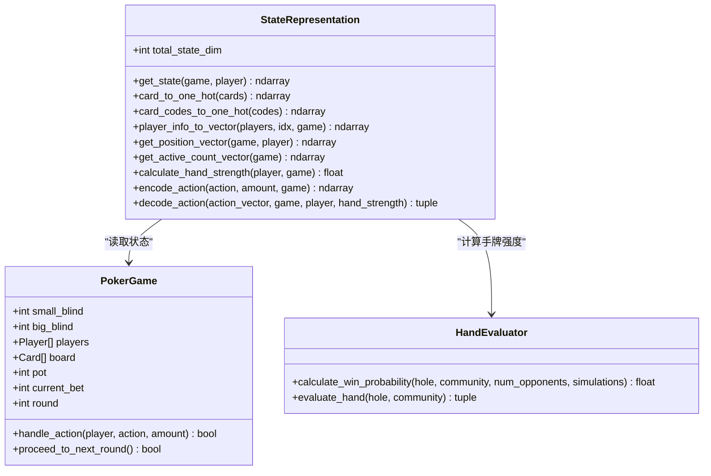
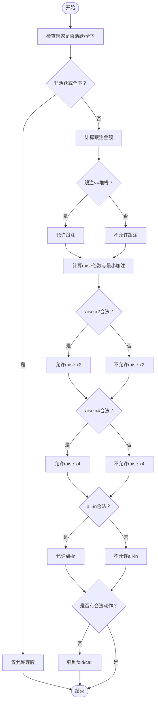
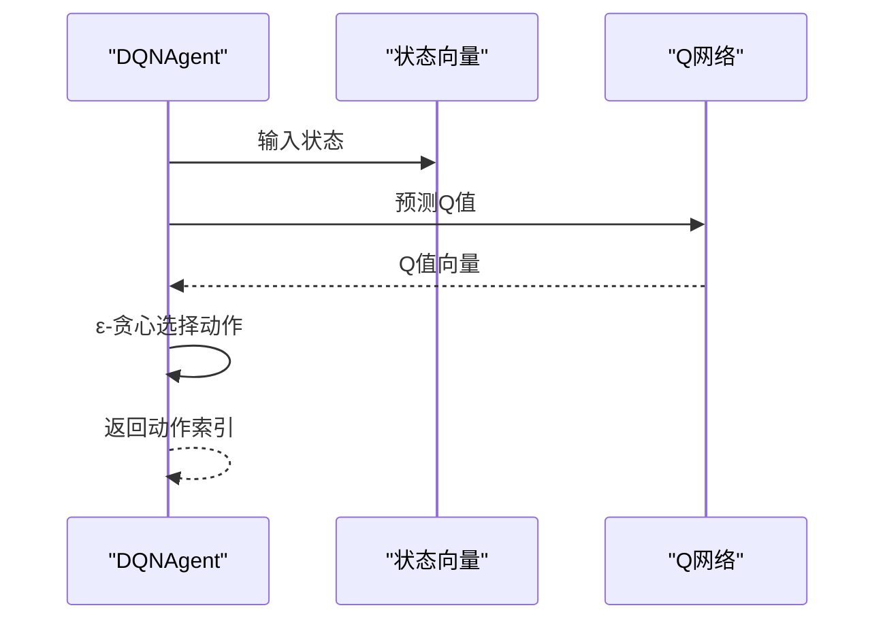
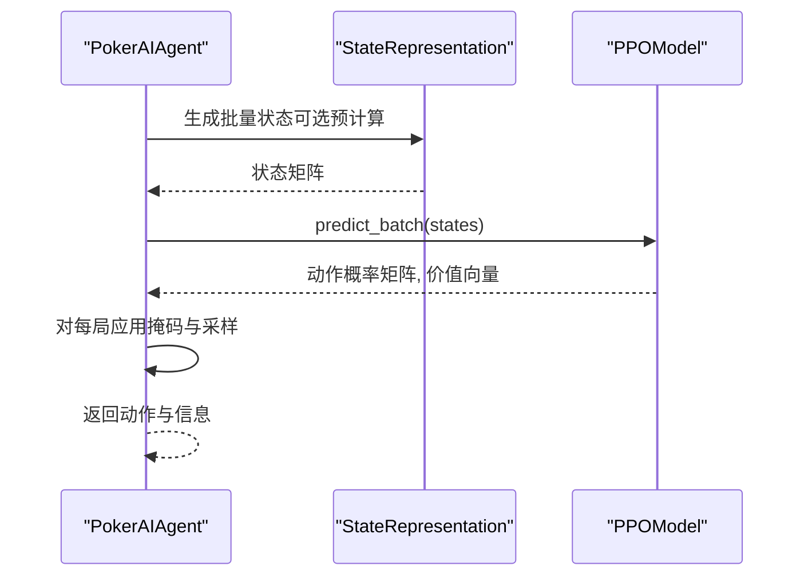
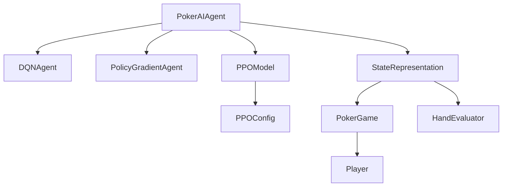

# 动作选择机制

<cite>
**本文引用的文件**
- [ai_agent.py](file://poker_ai/model/ai_agent.py)
- [dqn_agent.py](file://poker_ai/model/dqn_agent.py)
- [ppo_model.py](file://poker_ai/model/ppo_model.py)
- [state_representation.py](file://poker_ai/model/state_representation.py)
- [poker_game.py](file://poker_ai/game/poker_game.py)
- [hand_evaluator.py](file://poker_ai/model/hand_evaluator.py)
- [ppo_config.py](file://poker_ai/config/ppo_config.py)
- [test_ppo.py](file://test_ppo.py)
- [evaluate.py](file://evaluate.py)
</cite>

## 目录
1. [简介](#简介)
2. [项目结构](#项目结构)
3. [核心组件](#核心组件)
4. [架构总览](#架构总览)
5. [详细组件分析](#详细组件分析)
6. [依赖分析](#依赖分析)
7. [性能考量](#性能考量)
8. [故障排查指南](#故障排查指南)
9. [结论](#结论)
10. [附录](#附录)

## 简介
本文件围绕AI代理的动作选择机制展开，系统性阐述状态编码、合法动作过滤、概率分布计算、不同算法的策略差异、批量动作选择优化以及动作解码与金额确定流程。重点解析以下内容：
- 状态表示与编码：将6-max德州扑克的复杂状态压缩为固定维度向量
- 合法动作掩码：基于当前游戏状态与玩家筹码，生成5维动作合法性掩码
- 动作选择策略：DQN的ε-贪心、策略梯度的概率采样、PPO的策略分布采样
- 批量推理优化：PPO单次前向推理多局状态，显著提升推理效率
- 动作解码与金额确定：将抽象动作索引映射为具体动作类型与金额
- 调试与可视化：决策信息导出、动作分布统计与收益曲线

## 项目结构
该项目采用模块化设计，核心位于poker_ai/model与poker_ai/game目录：
- 模型层：ai_agent（统一代理接口）、dqn_agent（DQN）、ppo_model（PPO）、state_representation（状态编码）、hand_evaluator（手牌强度评估）
- 游戏层：poker_game（德州扑克规则与状态管理）
- 配置层：ppo_config（PPO超参数）
- 测试与评估：test_ppo.py、evaluate.py



**图表来源**
- [ai_agent.py:1-703](file://poker_ai/model/ai_agent.py#L1-L703)
- [dqn_agent.py:1-326](file://poker_ai/model/dqn_agent.py#L1-L326)
- [ppo_model.py:1-670](file://poker_ai/model/ppo_model.py#L1-L670)
- [state_representation.py:1-247](file://poker_ai/model/state_representation.py#L1-L247)
- [poker_game.py:1-497](file://poker_ai/game/poker_game.py#L1-L497)
- [hand_evaluator.py:1-187](file://poker_ai/model/hand_evaluator.py#L1-L187)
- [ppo_config.py:1-97](file://poker_ai/config/ppo_config.py#L1-L97)
- [test_ppo.py:1-41](file://test_ppo.py#L1-L41)
- [evaluate.py:1-753](file://evaluate.py#L1-L753)

**章节来源**
- [ai_agent.py:1-703](file://poker_ai/model/ai_agent.py#L1-L703)
- [poker_game.py:1-497](file://poker_ai/game/poker_game.py#L1-L497)

## 核心组件
- PokerAIAgent：统一代理接口，封装DQN、策略梯度、PPO三种算法的动作选择与学习流程，提供select_action、select_action_with_info、select_actions_batch_with_info等方法
- DQNAgent：基于深度Q网络，采用ε-贪心探索策略，结合目标网络与经验回放
- PPOModel：近端策略优化，包含策略网络（Actor）与价值网络（Critic），支持批量预测与向量化优势计算
- StateRepresentation：将手牌、公共牌、玩家状态、游戏全局信息、英雄绝对位置与活跃人数等特征编码为固定维度向量
- PokerGame：维护6-max德州扑克的完整状态，包括玩家堆栈、下注、底池、轮次、公共牌等
- HandEvaluator：高性能手牌强度评估，用于状态表示中的手牌强度特征

**章节来源**
- [ai_agent.py:55-116](file://poker_ai/model/ai_agent.py#L55-L116)
- [dqn_agent.py:21-62](file://poker_ai/model/dqn_agent.py#L21-L62)
- [ppo_model.py:20-93](file://poker_ai/model/ppo_model.py#L20-L93)
- [state_representation.py:9-46](file://poker_ai/model/state_representation.py#L9-L46)
- [poker_game.py:9-100](file://poker_ai/game/poker_game.py#L9-L100)
- [hand_evaluator.py:8-187](file://poker_ai/model/hand_evaluator.py#L8-L187)

## 架构总览
动作选择的整体流程如下：
- 输入：当前游戏状态与玩家信息
- 编码：StateRepresentation将状态转换为固定维度向量
- 合法性：_get_legal_action_mask根据当前轮次、底池、玩家堆栈生成5维动作掩码
- 分布：DQN输出Q值，策略梯度/PPO输出动作概率分布
- 采样：按策略采样动作索引，随后解码为具体动作与金额
- 记录：PPO场景下记录旧概率与状态价值，便于后续训练



**图表来源**
- [ai_agent.py:117-155](file://poker_ai/model/ai_agent.py#L117-L155)
- [ai_agent.py:157-214](file://poker_ai/model/ai_agent.py#L157-L214)
- [state_representation.py:137-158](file://poker_ai/model/state_representation.py#L137-L158)
- [state_representation.py:225-247](file://poker_ai/model/state_representation.py#L225-L247)
- [dqn_agent.py:127-143](file://poker_ai/model/dqn_agent.py#L127-L143)
- [ppo_model.py:340-373](file://poker_ai/model/ppo_model.py#L340-L373)

## 详细组件分析

### 状态编码与表示
- 状态维度构成：手牌（52维）、公共牌（52维）、6位玩家信息（每玩家Stack/Bet/Active，共18维）、游戏全局信息（Round/Pot/Bet/BB/SB，5维）、英雄绝对位置One-Hot（6维）、活跃人数（1维），总计134维
- 编码策略：使用one-hot向量表达卡牌，归一化玩家特征，绝对位置通过相对庄家位置计算，活跃人数归一化至[0,1]
- 手牌强度：通过HandEvaluator估算翻牌前/翻牌后胜率，作为强化学习特征



**图表来源**
- [state_representation.py:9-46](file://poker_ai/model/state_representation.py#L9-L46)
- [state_representation.py:137-158](file://poker_ai/model/state_representation.py#L137-L158)
- [poker_game.py:155-194](file://poker_ai/game/poker_game.py#L155-L194)
- [hand_evaluator.py:123-187](file://poker_ai/model/hand_evaluator.py#L123-L187)

**章节来源**
- [state_representation.py:12-46](file://poker_ai/model/state_representation.py#L12-L46)
- [state_representation.py:137-158](file://poker_ai/model/state_representation.py#L137-L158)
- [poker_game.py:155-194](file://poker_ai/game/poker_game.py#L155-L194)
- [hand_evaluator.py:123-187](file://poker_ai/model/hand_evaluator.py#L123-L187)

### 合法动作掩码：_get_legal_action_mask
- 动作空间：fold、call、raise x2、raise x4、all-in（5维）
- 掩码生成规则：
  - 若玩家非活跃或已全下，则仅允许弃牌
  - call：当跟注金额不超过玩家堆栈时有效
  - raise x2：要求raise2_total > current_bet且不低于最小加注且不超玩家堆栈
  - raise x4：要求raise4_total > current_bet且不低于最小加注且不超玩家堆栈
  - all-in：要求all_in_total > current_bet且不低于最小加注且玩家仍有筹码
  - 保底：若无合法动作，强制允许fold/call，确保代理可继续游戏
- 作用：在动作概率分布上乘以掩码，再归一化，确保仅从合法动作中采样



**图表来源**
- [ai_agent.py:15-54](file://poker_ai/model/ai_agent.py#L15-L54)

**章节来源**
- [ai_agent.py:15-54](file://poker_ai/model/ai_agent.py#L15-L54)

### 动作选择策略差异

#### DQN的ε-贪心探索
- 探索策略：以ε概率随机选择动作，否则选择Q值最大的动作
- 实现要点：使用预编译的推理函数加速，目标网络定期同步，经验回放提升稳定性
- 适用场景：需要稳定Q值估计与经验回放的场景



**图表来源**
- [dqn_agent.py:127-143](file://poker_ai/model/dqn_agent.py#L127-L143)

**章节来源**
- [dqn_agent.py:21-62](file://poker_ai/model/dqn_agent.py#L21-L62)
- [dqn_agent.py:127-143](file://poker_ai/model/dqn_agent.py#L127-L143)

#### 策略梯度的概率采样
- 策略网络输出动作概率分布，按概率采样动作
- 训练方式：回合结束后对折扣奖励进行标准化并训练策略网络
- 适用场景：策略网络直接输出动作概率，适合策略梯度方法

**章节来源**
- [dqn_agent.py:216-326](file://poker_ai/model/dqn_agent.py#L216-L326)

#### PPO的策略分布采样与批量优化
- 策略网络（Actor）输出动作概率分布，Critic输出状态价值
- 采样：从策略分布中采样动作索引
- 批量：单次前向推理同时得到多局状态的动作概率与价值，显著提升推理效率
- 训练：使用GAE优势估计、裁剪目标、自适应熵正则与KL早停，提升稳定性与收敛速度

```mermaid
sequenceDiagram
participant Agent as "PPOModel"
participant States as "批量状态"
participant Actor as "策略网络"
participant Critic as "价值网络"
Agent->>States : 输入批量状态
Agent->>Actor : 预测动作概率
Actor-->>Agent : 动作概率分布
Agent->>Critic : 预测状态价值
Critic-->>Agent : 状态价值
Agent->>Agent : 从分布采样动作索引
Agent-->>Agent : 返回动作与价值
```

**图表来源**
- [ppo_model.py:330-338](file://poker_ai/model/ppo_model.py#L330-L338)
- [ppo_model.py:340-373](file://poker_ai/model/ppo_model.py#L340-L373)

**章节来源**
- [ppo_model.py:20-93](file://poker_ai/model/ppo_model.py#L20-L93)
- [ppo_model.py:330-373](file://poker_ai/model/ppo_model.py#L330-L373)

### 批量动作选择优化
- 单次前向推理：PPOModel.predict_batch一次性处理多局状态，返回动作概率与状态价值
- 复用状态编码：PokerAIAgent.select_actions_batch_with_info支持传入预计算状态，避免重复编码
- 优势：减少Python调度开销，提升GPU利用率，适合并行环境



**图表来源**
- [ai_agent.py:157-214](file://poker_ai/model/ai_agent.py#L157-L214)
- [ppo_model.py:330-338](file://poker_ai/model/ppo_model.py#L330-L338)

**章节来源**
- [ai_agent.py:157-214](file://poker_ai/model/ai_agent.py#L157-L214)
- [ppo_model.py:330-338](file://poker_ai/model/ppo_model.py#L330-L338)

### 动作解码与金额确定
- 动作向量：独热编码的动作索引
- 解码规则：
  - 索引0：弃牌
  - 索引1：跟注，金额为max(0, current_bet - player.bet)
  - 索引2：raise x2，金额为min(current_bet*2, player.bet+player.stack)
  - 索引3：raise x4，金额为min(current_bet*4, player.bet+player.stack)
  - 索引4：all-in，金额为player.bet+player.stack
- 手牌强度：用于影响策略网络的输入特征，提升决策质量

**章节来源**
- [state_representation.py:225-247](file://poker_ai/model/state_representation.py#L225-L247)

### 决策信息与调试
- 决策信息导出：get_decision_info返回Q值、动作概率、状态价值、最可能动作等，便于分析与可视化
- PPO信息：select_action_with_info返回状态、动作索引、旧概率、动作概率分布、状态价值，便于训练与回放
- 评估脚本：evaluate.py演示如何在大规模对局中收集动作分布、阶段利润、手牌强度与胜率统计

**章节来源**
- [ai_agent.py:421-452](file://poker_ai/model/ai_agent.py#L421-L452)
- [ai_agent.py:125-155](file://poker_ai/model/ai_agent.py#L125-L155)
- [evaluate.py:269-482](file://evaluate.py#L269-L482)

## 依赖分析
- PokerAIAgent依赖StateRepresentation进行状态编码，依赖DQNAgent/PolicyGradientAgent/PPOModel进行动作选择
- PPOModel依赖PPOConfig提供超参数，依赖StateRepresentation进行手牌强度计算
- PokerGame提供完整游戏状态，供状态编码与动作合法性判断使用
- HandEvaluator为状态表示提供手牌强度特征



**图表来源**
- [ai_agent.py:55-116](file://poker_ai/model/ai_agent.py#L55-L116)
- [ppo_model.py:20-93](file://poker_ai/model/ppo_model.py#L20-L93)
- [state_representation.py:9-46](file://poker_ai/model/state_representation.py#L9-L46)
- [poker_game.py:9-100](file://poker_ai/game/poker_game.py#L9-L100)
- [hand_evaluator.py:8-187](file://poker_ai/model/hand_evaluator.py#L8-L187)

**章节来源**
- [ai_agent.py:55-116](file://poker_ai/model/ai_agent.py#L55-L116)
- [ppo_model.py:20-93](file://poker_ai/model/ppo_model.py#L20-L93)
- [state_representation.py:9-46](file://poker_ai/model/state_representation.py#L9-L46)
- [poker_game.py:9-100](file://poker_ai/game/poker_game.py#L9-L100)
- [hand_evaluator.py:8-187](file://poker_ai/model/hand_evaluator.py#L8-L187)

## 性能考量
- 预编译与向量化：DQN/PPO均使用tf.function预编译推理与训练函数，减少Python调度开销
- 批量推理：PPOModel.predict_batch一次性处理多局状态，显著提升吞吐
- GAE向量化：PPOModel._compute_gae使用向量化NumPy操作，避免Python循环
- 混合精度：PPOModel使用LossScaleOptimizer适配混合精度，提升GPU利用率
- 梯度裁剪与早停：KL散度早停与梯度裁剪提升训练稳定性，避免过拟合与梯度爆炸

[本节为通用性能讨论，无需列出具体文件来源]

## 故障排查指南
- PPO更新跳过：当出现DNN库或图执行错误时，日志会提示跳过本次更新，可尝试禁用XLA/OneDNN后重跑
- 掩码全零：若合法动作掩码求和为0，系统会回退到fold/call，检查游戏状态与玩家堆栈
- 学习率异常：PPO使用warmup与cosine衰减，若学习率过低可检查warmup_steps与total_training_steps配置
- 批量形状不一致：PPO在训练时对不足一整批的数据进行padding，确保固定形状以避免retracing警告

**章节来源**
- [ai_agent.py:321-331](file://poker_ai/model/ai_agent.py#L321-L331)
- [ai_agent.py:350-358](file://poker_ai/model/ai_agent.py#L350-L358)
- [ppo_model.py:420-448](file://poker_ai/model/ppo_model.py#L420-L448)
- [ppo_model.py:556-580](file://poker_ai/model/ppo_model.py#L556-L580)

## 结论
本动作选择机制通过统一的状态编码、严格的合法动作过滤、多样化的策略采样与高效的批量推理，实现了在6-max德州扑克中的稳定与高效决策。DQN、策略梯度与PPO在不同场景下各有优势：DQN强调Q值估计与经验回放，策略梯度强调直接策略优化，PPO强调策略稳定性与批量优化。配合完善的决策信息导出与评估脚本，可实现对代理行为的深入分析与持续改进。

[本节为总结性内容，无需列出具体文件来源]

## 附录

### 方法使用示例（路径参考）
- 单次动作选择：[ai_agent.py:117-124](file://poker_ai/model/ai_agent.py#L117-L124)
- 带信息的动作选择（PPO）：[ai_agent.py:125-155](file://poker_ai/model/ai_agent.py#L125-L155)
- 批量动作选择（PPO）：[ai_agent.py:157-214](file://poker_ai/model/ai_agent.py#L157-L214)
- DQN动作选择：[dqn_agent.py:127-143](file://poker_ai/model/dqn_agent.py#L127-L143)
- PPO动作选择：[ppo_model.py:340-373](file://poker_ai/model/ppo_model.py#L340-L373)
- PPO批量预测：[ppo_model.py:330-338](file://poker_ai/model/ppo_model.py#L330-L338)
- 状态编码：[state_representation.py:137-158](file://poker_ai/model/state_representation.py#L137-L158)
- 合法动作掩码：[ai_agent.py:15-54](file://poker_ai/model/ai_agent.py#L15-L54)
- 动作解码：[state_representation.py:225-247](file://poker_ai/model/state_representation.py#L225-L247)
- PPO配置：[ppo_config.py:18-97](file://poker_ai/config/ppo_config.py#L18-L97)
- PPO测试：[test_ppo.py:1-41](file://test_ppo.py#L1-L41)
- 评估脚本：[evaluate.py:181-482](file://evaluate.py#L181-L482)