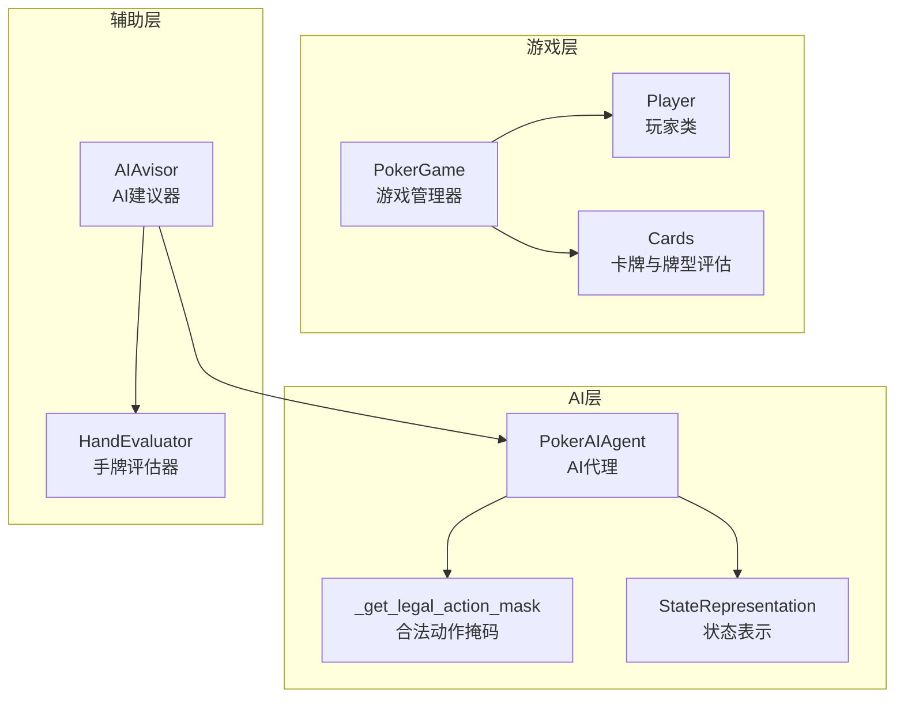
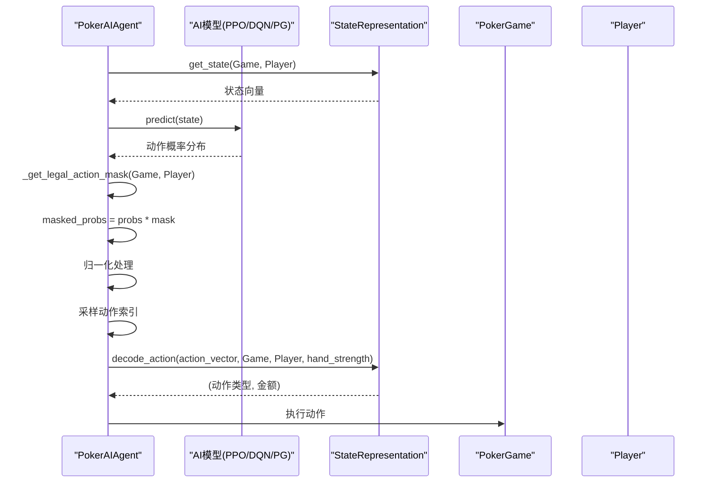
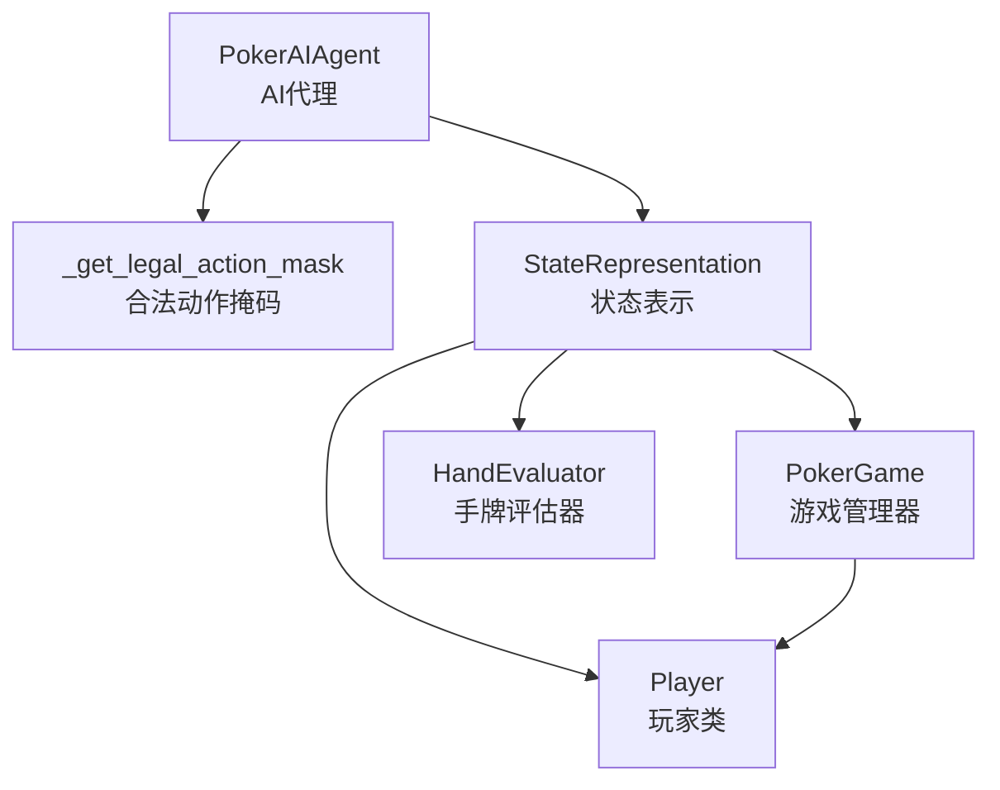

# 合法动作过滤机制

<cite>
**本文引用的文件**
- [poker_ai/model/ai_agent.py](file://poker_ai/model/ai_agent.py)
- [poker_ai/model/state_representation.py](file://poker_ai/model/state_representation.py)
- [poker_ai/game/poker_game.py](file://poker_ai/game/poker_game.py)
- [poker_ai/game/cards.py](file://poker_ai/game/cards.py)
- [poker_ai/model/hand_evaluator.py](file://poker_ai/model/hand_evaluator.py)
- [poker_ai/advisor/ai_advisor.py](file://poker_ai/advisor/ai_advisor.py)
</cite>

## 目录
1. [简介](#简介)
2. [项目结构](#项目结构)
3. [核心组件](#核心组件)
4. [架构概览](#架构概览)
5. [详细组件分析](#详细组件分析)
6. [依赖分析](#依赖分析)
7. [性能考量](#性能考量)
8. [故障排查指南](#故障排查指南)
9. [结论](#结论)
10. [附录](#附录)

## 简介
本技术文档围绕合法动作过滤机制展开，重点解析 `_get_legal_action_mask` 函数的实现原理与设计思想。该函数负责生成一个5维动作合法性掩码，分别对应弃牌(fold)、跟注(call)、加注x2、加注x4、全下(all-in)五种动作。文档将详细说明每种动作的合法性判断条件，包括玩家状态检查、筹码限制、最小加注额约束等，并解释如何根据当前游戏状态（底池大小、当前下注额、大盲注）动态计算动作可行性。同时提供具体代码示例路径，展示合法动作过滤过程中的边界情况处理与保底机制，并讨论动作掩码在不同算法中的应用场景及合理性保障策略。

## 项目结构
该项目采用模块化组织，核心围绕德州扑克游戏逻辑、AI代理、状态表示与辅助建议器展开。合法动作过滤位于AI代理模块中，与状态表示、游戏规则紧密耦合。

**图表来源**
- [poker_ai/model/ai_agent.py:15-53](file://poker_ai/model/ai_agent.py#L15-L53)
- [poker_ai/model/state_representation.py:137-158](file://poker_ai/model/state_representation.py#L137-L158)
- [poker_ai/game/poker_game.py:155-188](file://poker_ai/game/poker_game.py#L155-L188)
- [poker_ai/advisor/ai_advisor.py:21-47](file://poker_ai/advisor/ai_advisor.py#L21-L47)

**章节来源**
- [poker_ai/model/ai_agent.py:15-53](file://poker_ai/model/ai_agent.py#L15-L53)
- [poker_ai/model/state_representation.py:137-158](file://poker_ai/model/state_representation.py#L137-L158)
- [poker_ai/game/poker_game.py:155-188](file://poker_ai/game/poker_game.py#L155-L188)
- [poker_ai/advisor/ai_advisor.py:21-47](file://poker_ai/advisor/ai_advisor.py#L21-L47)

## 核心组件
- 合法动作掩码函数：`_get_legal_action_mask(game, player)`，返回长度为5的浮点数组，元素值为1.0表示合法，0.0表示非法。
- 状态表示：`StateRepresentation.get_state(game, player)`，为AI提供完整的状态向量，包括手牌、公共牌、玩家信息、游戏全局信息、位置信息与活跃人数等。
- 游戏规则：`PokerGame.handle_action(player, action, amount)`，负责处理玩家动作并维护游戏状态，包括加注合法性校验与最小加注额约束。
- 手牌评估：`HandEvaluator.calculate_win_probability(...)`，用于估算手牌胜率，辅助AI决策。

**章节来源**
- [poker_ai/model/ai_agent.py:15-53](file://poker_ai/model/ai_agent.py#L15-L53)
- [poker_ai/model/state_representation.py:137-158](file://poker_ai/model/state_representation.py#L137-L158)
- [poker_ai/game/poker_game.py:299-349](file://poker_ai/game/poker_game.py#L299-L349)
- [poker_ai/model/hand_evaluator.py:123-187](file://poker_ai/model/hand_evaluator.py#L123-L187)

## 架构概览
合法动作过滤在AI代理选择动作的流程中扮演关键角色。PPO等算法在前向推理得到动作概率后，通过合法动作掩码进行裁剪与归一化，确保仅在合法动作上进行采样。随后，状态表示模块将当前游戏状态编码为高维向量，供AI模型进行决策。

**图表来源**
- [poker_ai/model/ai_agent.py:125-243](file://poker_ai/model/ai_agent.py#L125-L243)
- [poker_ai/model/state_representation.py:225-247](file://poker_ai/model/state_representation.py#L225-L247)

## 详细组件分析

### 合法动作掩码函数 `_get_legal_action_mask`
该函数的核心目标是根据当前游戏状态与玩家状态，生成一个5维掩码，指示哪些动作是合法的。五维动作依次为：弃牌、跟注、加注x2、加注x4、全下。

- 输入参数
  - `game`: 当前游戏状态对象，包含底池、当前下注、大盲注、玩家信息等。
  - `player`: 当前行动玩家对象，包含筹码、下注、状态等。

- 设计要点
  - 玩家状态检查：若玩家非活跃或已全下，则仅允许弃牌。
  - 跟注合法性：基于当前需支付的跟注金额与玩家筹码比较，若不超过筹码则合法。
  - 加注合法性：计算目标总注额（x2、x4）、最小加注额与玩家剩余筹码，综合判断是否合法。
  - 全下合法性：要求目标总注额大于当前下注且不低于最小加注额，且玩家仍有筹码。
  - 保底机制：若所有动作均非法，强制至少允许弃牌与跟注，保证AI能继续游戏。

- 关键计算
  - 跟注金额：`max(0, game.current_bet - player.bet)`
  - 目标总注额：`current_bet = max(game.current_bet, game.big_blind)`，随后计算 `current_bet * 2`、`current_bet * 4` 与 `player.bet + player.stack`
  - 最小加注额：`max(game.current_bet * 2, game.big_blind)`
  - 合法性判断：目标总注额需大于当前下注，且不低于最小加注额，且所需追加筹码不超过玩家剩余筹码。

- 边界情况处理
  - 当前下注为0或等于大盲注时，通过 `max(game.current_bet, game.big_blind)` 确保最小加注额计算正确。
  - 若玩家筹码不足，加注与全下将被判定为非法。
  - 若所有动作非法，保底逻辑确保至少允许弃牌与跟注。

- 代码示例路径
  - 掩码生成与保底逻辑：[poker_ai/model/ai_agent.py:15-53](file://poker_ai/model/ai_agent.py#L15-L53)
  - PPO中掩码使用与归一化：[poker_ai/model/ai_agent.py:133-139](file://poker_ai/model/ai_agent.py#L133-L139)
  - 批量掩码使用：[poker_ai/model/ai_agent.py:194-200](file://poker_ai/model/ai_agent.py#L194-L200)

**章节来源**
- [poker_ai/model/ai_agent.py:15-53](file://poker_ai/model/ai_agent.py#L15-L53)
- [poker_ai/model/ai_agent.py:133-139](file://poker_ai/model/ai_agent.py#L133-L139)
- [poker_ai/model/ai_agent.py:194-200](file://poker_ai/model/ai_agent.py#L194-L200)

### 动作合法性判断条件详解
- 弃牌(fold)
  - 条件：玩家必须处于活跃状态且未全下。
  - 作用：结束本轮行动，保留筹码。
  - 在掩码中始终为合法（若玩家活跃且未全下）。

- 跟注(call)
  - 条件：需支付金额不超过玩家筹码。
  - 作用：匹配当前下注，维持在池中。
  - 计算：`call_amount = max(0, game.current_bet - player.bet)`，若 `call_amount <= player.stack` 则合法。

- 加注x2(raise x2)
  - 条件：目标总注额（当前下注×2）大于当前下注，且不低于最小加注额，且追加筹码不超过玩家剩余筹码。
  - 作用：扩大底池，施压对手。
  - 计算：`raise2_total = int(current_bet * 2)`，其中 `current_bet = max(game.current_bet, game.big_blind)`，要求 `raise2_total > game.current_bet` 且 `raise2_total >= min_raise_total` 且 `(raise2_total - player.bet) <= player.stack`。

- 加注x4(raise x4)
  - 条件：目标总注额（当前下注×4）大于当前下注，且不低于最小加注额，且追加筹码不超过玩家剩余筹码。
  - 作用：大幅加注，逼迫对手弃牌或全下。
  - 计算：`raise4_total = int(current_bet * 4)`，要求同上。

- 全下(all-in)
  - 条件：目标总注额（玩家当前下注+剩余筹码）大于当前下注，且不低于最小加注额，且玩家仍有筹码。
  - 作用：一次性投入所有筹码，决定胜负。
  - 计算：`all_in_total = int(player.bet + player.stack)`，要求 `all_in_total > game.current_bet` 且 `all_in_total >= min_raise_total` 且 `player.stack > 0`。

- 保底机制
  - 若掩码求和为0，强制至少允许弃牌与跟注，确保AI能继续游戏。
  - 保底逻辑在掩码生成末尾实现，避免出现无合法动作的情况。

- 代码示例路径
  - 跟注与加注合法性计算：[poker_ai/model/ai_agent.py:29-46](file://poker_ai/model/ai_agent.py#L29-L46)
  - 保底逻辑：[poker_ai/model/ai_agent.py:48-53](file://poker_ai/model/ai_agent.py#L48-L53)

**章节来源**
- [poker_ai/model/ai_agent.py:29-46](file://poker_ai/model/ai_agent.py#L29-L46)
- [poker_ai/model/ai_agent.py:48-53](file://poker_ai/model/ai_agent.py#L48-L53)

### 动作掩码在不同算法中的应用场景
- PPO算法
  - 在前向推理得到动作概率后，通过掩码裁剪非法动作，再进行归一化，最后进行采样。
  - 批量模式下，对一批状态同时生成掩码并进行裁剪，提升效率。
  - 代码示例路径：[poker_ai/model/ai_agent.py:133-139](file://poker_ai/model/ai_agent.py#L133-L139)、[poker_ai/model/ai_agent.py:194-200](file://poker_ai/model/ai_agent.py#L194-L200)

- DQN/策略梯度
  - 通过动作掩码确保采样动作的合法性，避免非法动作导致的训练不稳定。
  - 代码示例路径：[poker_ai/model/ai_agent.py:154-155](file://poker_ai/model/ai_agent.py#L154-L155)

- 算法合理性保障
  - 掩码裁剪与归一化确保概率分布仅在合法动作上分配，避免模型学习到非法策略。
  - 保底机制防止极端情况下无合法动作，维持训练连续性。

**章节来源**
- [poker_ai/model/ai_agent.py:133-139](file://poker_ai/model/ai_agent.py#L133-L139)
- [poker_ai/model/ai_agent.py:194-200](file://poker_ai/model/ai_agent.py#L194-L200)
- [poker_ai/model/ai_agent.py:154-155](file://poker_ai/model/ai_agent.py#L154-L155)

### 动作解码与金额确定
状态表示模块提供动作解码功能，将动作向量转换为具体动作类型与金额。该过程与掩码生成相互配合，确保AI选择的动作既合法又符合当前游戏状态。

- 动作解码逻辑
  - 弃牌：直接返回弃牌。
  - 跟注：金额为 `max(0, game.current_bet - player.bet)`。
  - 加注x2：金额为 `min(current_bet * 2, player.bet + player.stack)`。
  - 加注x4：金额为 `min(current_bet * 4, player.bet + player.stack)`。
  - 全下：金额为 `player.bet + player.stack`。

- 代码示例路径
  - 动作解码：[poker_ai/model/state_representation.py:225-247](file://poker_ai/model/state_representation.py#L225-L247)

**章节来源**
- [poker_ai/model/state_representation.py:225-247](file://poker_ai/model/state_representation.py#L225-L247)

### 与游戏规则的协同
合法动作掩码与游戏规则紧密协作，确保AI的行为符合德州扑克规则。例如，加注的最小额度由当前下注与大盲注共同决定，且追加筹码不得超过玩家剩余筹码。

- 游戏规则要点
  - 加注最小额度：`max(game.current_bet * 2, game.big_blind)`
  - 玩家筹码限制：追加筹码不能超过玩家剩余筹码。
  - 全下条件：玩家必须仍有筹码，且目标总注额大于当前下注。

- 代码示例路径
  - 加注合法性与最小加注额：[poker_ai/game/poker_game.py:327-347](file://poker_ai/game/poker_game.py#L327-L347)
  - 大盲注与当前下注的关系：[poker_ai/model/ai_agent.py:35-39](file://poker_ai/model/ai_agent.py#L35-L39)

**章节来源**
- [poker_ai/game/poker_game.py:327-347](file://poker_ai/game/poker_game.py#L327-L347)
- [poker_ai/model/ai_agent.py:35-39](file://poker_ai/model/ai_agent.py#L35-L39)

## 依赖分析
合法动作过滤机制涉及多个模块的协作，形成清晰的依赖关系。

**图表来源**
- [poker_ai/model/ai_agent.py:15-53](file://poker_ai/model/ai_agent.py#L15-L53)
- [poker_ai/model/state_representation.py:137-158](file://poker_ai/model/state_representation.py#L137-L158)
- [poker_ai/game/poker_game.py:155-188](file://poker_ai/game/poker_game.py#L155-L188)
- [poker_ai/model/hand_evaluator.py:123-187](file://poker_ai/model/hand_evaluator.py#L123-L187)

**章节来源**
- [poker_ai/model/ai_agent.py:15-53](file://poker_ai/model/ai_agent.py#L15-L53)
- [poker_ai/model/state_representation.py:137-158](file://poker_ai/model/state_representation.py#L137-L158)
- [poker_ai/game/poker_game.py:155-188](file://poker_ai/game/poker_game.py#L155-L188)
- [poker_ai/model/hand_evaluator.py:123-187](file://poker_ai/model/hand_evaluator.py#L123-L187)

## 性能考量
- 掩码生成为O(1)复杂度，仅涉及少量数值比较与计算，对实时性影响极小。
- PPO批量模式下，掩码与裁剪在向量化层面完成，避免Python循环开销。
- 状态表示模块采用one-hot编码与归一化，确保输入特征稳定，有利于模型收敛。

[本节为通用性能讨论，无需特定文件来源]

## 故障排查指南
- 症状：所有动作掩码均为0
  - 可能原因：玩家筹码不足、当前下注过高、最小加注额过大。
  - 处理：检查保底逻辑是否生效；确认玩家状态与筹码；调整最小加注额计算。
  - 代码参考：[poker_ai/model/ai_agent.py:48-53](file://poker_ai/model/ai_agent.py#L48-L53)

- 症状：PPO采样概率异常
  - 可能原因：掩码裁剪后概率和接近0，导致归一化数值不稳定。
  - 处理：检查掩码与概率乘积；确保归一化分母非零；必要时增加小常数避免数值问题。
  - 代码参考：[poker_ai/model/ai_agent.py:136-139](file://poker_ai/model/ai_agent.py#L136-L139)、[poker_ai/model/ai_agent.py:197-200](file://poker_ai/model/ai_agent.py#L197-L200)

- 症状：动作金额与预期不符
  - 可能原因：加注倍数计算或全下金额计算错误。
  - 处理：核对 `current_bet`、`big_blind` 与 `player.bet + player.stack` 的计算逻辑。
  - 代码参考：[poker_ai/model/ai_agent.py:35-39](file://poker_ai/model/ai_agent.py#L35-L39)、[poker_ai/model/state_representation.py:237-247](file://poker_ai/model/state_representation.py#L237-L247)

**章节来源**
- [poker_ai/model/ai_agent.py:48-53](file://poker_ai/model/ai_agent.py#L48-L53)
- [poker_ai/model/ai_agent.py:136-139](file://poker_ai/model/ai_agent.py#L136-L139)
- [poker_ai/model/ai_agent.py:197-200](file://poker_ai/model/ai_agent.py#L197-L200)
- [poker_ai/model/state_representation.py:237-247](file://poker_ai/model/state_representation.py#L237-L247)

## 结论
合法动作过滤机制通过 `_get_legal_action_mask` 函数实现了对五种动作的精确控制，结合玩家状态、筹码限制与最小加注额约束，确保AI在任意游戏状态下都能做出合理的动作选择。PPO等算法通过掩码裁剪与归一化，进一步提升了动作选择的合理性与稳定性。保底机制的存在避免了极端情况下的无动作可用，保证了训练与对局的连续性。该机制在不同算法中的广泛应用，为构建稳健的德州扑克AI提供了坚实基础。

[本节为总结性内容，无需特定文件来源]

## 附录
- 相关文件路径
  - 合法动作掩码函数：[poker_ai/model/ai_agent.py:15-53](file://poker_ai/model/ai_agent.py#L15-L53)
  - PPO掩码使用与归一化：[poker_ai/model/ai_agent.py:133-139](file://poker_ai/model/ai_agent.py#L133-L139)、[poker_ai/model/ai_agent.py:194-200](file://poker_ai/model/ai_agent.py#L194-L200)
  - 动作解码与金额确定：[poker_ai/model/state_representation.py:225-247](file://poker_ai/model/state_representation.py#L225-L247)
  - 游戏规则与加注合法性：[poker_ai/game/poker_game.py:327-347](file://poker_ai/game/poker_game.py#L327-L347)
  - 手牌评估与胜率估算：[poker_ai/model/hand_evaluator.py:123-187](file://poker_ai/model/hand_evaluator.py#L123-L187)

[本节为补充信息，无需特定文件来源]