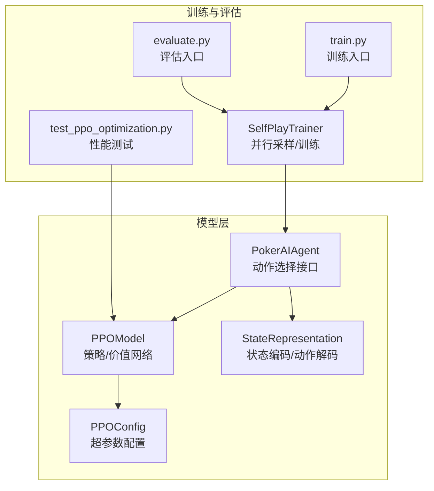
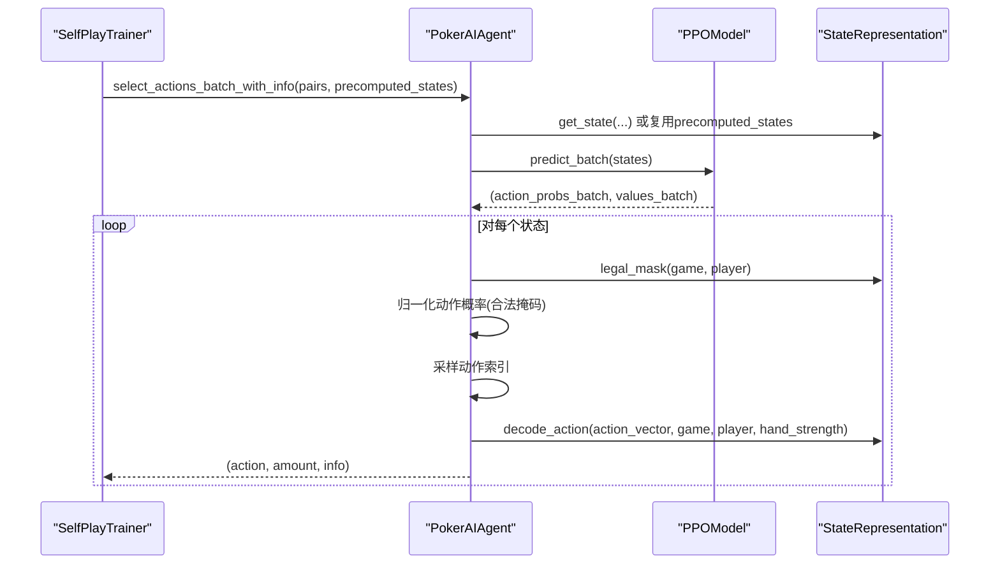
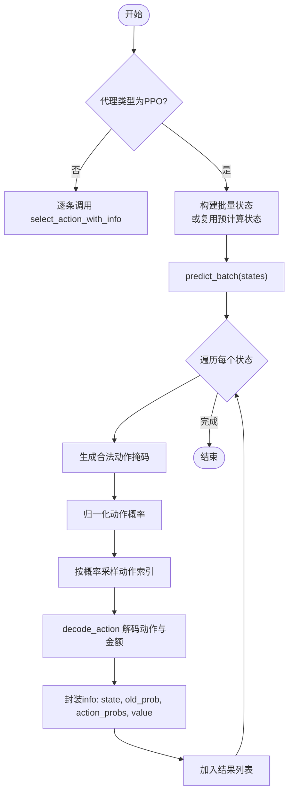
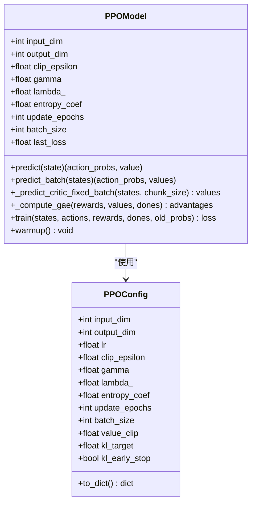
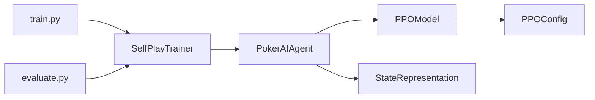

# 批量动作选择优化

<cite>
**本文引用的文件**
- [ppo_model.py](file://poker_ai/model/ppo_model.py)
- [ai_agent.py](file://poker_ai/model/ai_agent.py)
- [state_representation.py](file://poker_ai/model/state_representation.py)
- [ppo_config.py](file://poker_ai/config/ppo_config.py)
- [self_play_trainer.py](file://poker_ai/reward/self_play_trainer.py)
- [test_ppo_optimization.py](file://test_ppo_optimization.py)
- [train.py](file://train.py)
- [evaluate.py](file://evaluate.py)
</cite>

## 目录
1. [简介](#简介)
2. [项目结构](#项目结构)
3. [核心组件](#核心组件)
4. [架构概览](#架构概览)
5. [详细组件分析](#详细组件分析)
6. [依赖关系分析](#依赖关系分析)
7. [性能考量](#性能考量)
8. [故障排查指南](#故障排查指南)
9. [结论](#结论)
10. [附录](#附录)

## 简介
本文件围绕批量动作选择优化机制展开，重点解释 `select_actions_batch_with_info` 方法的实现原理，深入分析 PPO 算法的批量预测优化机制，阐述如何通过单次前向推理同时处理多个游戏状态，显著提升推理效率。文档还涵盖批量状态预计算、批量概率分布计算、批量动作采样的完整流程，提供具体的使用示例与性能测试建议，并讨论批量处理在并行采样中的应用及内存与计算效率的平衡策略。

## 项目结构
该项目采用模块化设计，核心围绕德州扑克AI训练与评估展开，主要涉及以下模块：
- 模型层：PPO模型、状态表示、动作解码、配置管理
- 训练与评估：自我对弈训练器、评估脚本、训练脚本
- 工具与测试：性能测试脚本、GPU/混合精度配置

**图表来源**
- [ppo_model.py:20-106](file://poker_ai/model/ppo_model.py#L20-L106)
- [ai_agent.py:55-116](file://poker_ai/model/ai_agent.py#L55-L116)
- [state_representation.py:9-46](file://poker_ai/model/state_representation.py#L9-L46)
- [ppo_config.py:18-72](file://poker_ai/config/ppo_config.py#L18-L72)
- [self_play_trainer.py:48-131](file://poker_ai/reward/self_play_trainer.py#L48-L131)
- [train.py:136-238](file://train.py#L136-L238)
- [evaluate.py:110-142](file://evaluate.py#L110-L142)

**章节来源**
- [ppo_model.py:1-106](file://poker_ai/model/ppo_model.py#L1-L106)
- [ai_agent.py:55-116](file://poker_ai/model/ai_agent.py#L55-L116)
- [state_representation.py:9-46](file://poker_ai/model/state_representation.py#L9-L46)
- [ppo_config.py:18-72](file://poker_ai/config/ppo_config.py#L18-L72)
- [self_play_trainer.py:48-131](file://poker_ai/reward/self_play_trainer.py#L48-L131)
- [train.py:136-238](file://train.py#L136-L238)
- [evaluate.py:110-142](file://evaluate.py#L110-L142)

## 核心组件
- PPOModel：包含策略网络（Actor）与价值网络（Critic），提供批量预测接口 `predict_batch`，支持固定形状批处理以避免图重编译。
- PokerAIAgent：统一动作选择接口，实现 `select_actions_batch_with_info`，在PPO场景下通过单次前向推理处理多局状态，避免重复前向调用。
- StateRepresentation：负责状态编码、合法动作掩码生成、动作解码与手牌强度计算，支撑批量动作选择的合法性约束与结果解码。
- PPOConfig：集中管理PPO超参数，如批大小、学习率调度、KL早停、价值损失裁剪等，支撑批量训练与推理的稳定性与效率。
- SelfPlayTrainer：并行采样与训练控制器，协调多worker批量执行与权重同步，支撑大规模批量动作选择的训练闭环。

**章节来源**
- [ppo_model.py:20-106](file://poker_ai/model/ppo_model.py#L20-L106)
- [ai_agent.py:55-116](file://poker_ai/model/ai_agent.py#L55-L116)
- [state_representation.py:9-46](file://poker_ai/model/state_representation.py#L9-L46)
- [ppo_config.py:18-72](file://poker_ai/config/ppo_config.py#L18-L72)
- [self_play_trainer.py:48-131](file://poker_ai/reward/self_play_trainer.py#L48-L131)

## 架构概览
批量动作选择优化的核心在于“单次前向推理 + 批量动作采样”。整体流程如下：
- 输入：多对 (game, player) 对或预计算的状态矩阵
- 预处理：PokerAIAgent根据输入生成状态向量（或复用预计算状态）
- 批量前向：PPOModel的 `predict_batch` 对批量状态进行一次前向推理，得到批量动作概率与状态价值
- 合法性过滤：对每个状态应用合法动作掩码，归一化得到可执行动作的概率分布
- 动作采样：按概率分布采样动作，解码为具体动作与金额
- 结果封装：返回动作、金额与训练所需信息（状态、旧概率、状态价值）

**图表来源**
- [ai_agent.py:157-214](file://poker_ai/model/ai_agent.py#L157-L214)
- [ppo_model.py:330-338](file://poker_ai/model/ppo_model.py#L330-L338)
- [state_representation.py:137-158](file://poker_ai/model/state_representation.py#L137-L158)

**章节来源**
- [ai_agent.py:157-214](file://poker_ai/model/ai_agent.py#L157-L214)
- [ppo_model.py:330-338](file://poker_ai/model/ppo_model.py#L330-L338)
- [state_representation.py:137-158](file://poker_ai/model/state_representation.py#L137-L158)

## 详细组件分析

### select_actions_batch_with_info 方法详解
该方法是批量动作选择的核心，其优化要点包括：
- 单次前向推理：当代理类型为PPO时，先批量生成状态，再调用 `predict_batch` 一次性获得所有状态的动作概率与价值，避免多次前向调用带来的Python调度开销。
- 合法性掩码：对每个状态应用合法动作掩码，确保采样仅在合法动作上进行，提升策略合理性。
- 归一化与采样：将合法动作概率归一化后进行随机采样，得到动作索引；随后解码为具体动作与金额。
- 信息封装：返回动作、金额与训练所需信息（状态、旧概率、动作概率分布、状态价值），便于后续PPO训练。

**图表来源**
- [ai_agent.py:157-214](file://poker_ai/model/ai_agent.py#L157-L214)

**章节来源**
- [ai_agent.py:157-214](file://poker_ai/model/ai_agent.py#L157-L214)

### PPOModel 批量预测与优化
PPOModel 提供了高效的批量预测接口与多项优化：
- predict_batch：对批量状态进行前向推理，返回批量动作概率与状态价值，支持单维输入自动扩展。
- _predict_critic_fixed_batch：固定批形状的Critic调用，避免不同形状触发图重编译，提升稳定性与吞吐。
- _compute_gae：向量化GAE计算，替代Python循环，显著提升优势估计速度与稳定性。
- _ppo_update_step：编译后的更新步骤，使用混合精度与梯度裁剪，提升训练效率与数值稳定性。
- warmup：预编译图，减少训练时的retracing警告，提升首次推理性能。

**图表来源**
- [ppo_model.py:20-106](file://poker_ai/model/ppo_model.py#L20-L106)
- [ppo_model.py:330-338](file://poker_ai/model/ppo_model.py#L330-L338)
- [ppo_model.py:472-495](file://poker_ai/model/ppo_model.py#L472-L495)
- [ppo_model.py:276-320](file://poker_ai/model/ppo_model.py#L276-L320)
- [ppo_model.py:106-198](file://poker_ai/model/ppo_model.py#L106-L198)
- [ppo_model.py:407-418](file://poker_ai/model/ppo_model.py#L407-L418)
- [ppo_config.py:18-72](file://poker_ai/config/ppo_config.py#L18-L72)

**章节来源**
- [ppo_model.py:330-338](file://poker_ai/model/ppo_model.py#L330-L338)
- [ppo_model.py:472-495](file://poker_ai/model/ppo_model.py#L472-L495)
- [ppo_model.py:276-320](file://poker_ai/model/ppo_model.py#L276-L320)
- [ppo_model.py:106-198](file://poker_ai/model/ppo_model.py#L106-L198)
- [ppo_model.py:407-418](file://poker_ai/model/ppo_model.py#L407-L418)
- [ppo_config.py:18-72](file://poker_ai/config/ppo_config.py#L18-L72)

### 状态表示与动作解码
StateRepresentation 提供了高性能的状态编码与动作解码能力：
- get_state：将游戏状态转换为固定维度的向量，包含手牌、公共牌、玩家信息、全局信息、绝对位置与活跃人数等特征。
- calculate_hand_strength：快速估算手牌强度，支持翻牌前与翻牌后的不同策略。
- decode_action：将动作向量解码为具体动作与金额，支持不同加注比例的离散化。

这些能力为批量动作选择提供了稳定的输入与输出基础。

**章节来源**
- [state_representation.py:137-158](file://poker_ai/model/state_representation.py#L137-L158)
- [state_representation.py:174-210](file://poker_ai/model/state_representation.py#L174-L210)
- [state_representation.py:225-247](file://poker_ai/model/state_representation.py#L225-L247)

### 训练与并行采样
SelfPlayTrainer 负责大规模并行采样与训练，其关键点包括：
- worker 分配：根据CPU核心数与预留核心自动确定训练/评估worker数量，降低调度开销。
- 批次规划：将剩余手数按worker数量与每worker手数进行分配，支持权重同步周期控制。
- 批量轨迹：支持批量写入多条轨迹，减少函数调用开销，提升吞吐。

**章节来源**
- [self_play_trainer.py:28-46](file://poker_ai/reward/self_play_trainer.py#L28-L46)
- [self_play_trainer.py:111-126](file://poker_ai/reward/self_play_trainer.py#L111-L126)
- [self_play_trainer.py:1433-1455](file://poker_ai/reward/self_play_trainer.py#L1433-L1455)

## 依赖关系分析
- PokerAIAgent 依赖 PPOModel 与 StateRepresentation，前者提供动作选择接口，后者提供状态编码与动作解码。
- PPOModel 依赖 PPOConfig 进行超参数初始化，依赖 StateRepresentation 进行状态维度与动作维度的约束。
- SelfPlayTrainer 依赖 PokerAIAgent 进行动作选择，依赖 RewardCalculator 进行奖励计算。
- 训练脚本与评估脚本分别通过 SelfPlayTrainer 驱动训练与评估流程。

**图表来源**
- [ai_agent.py:55-116](file://poker_ai/model/ai_agent.py#L55-L116)
- [ppo_model.py:20-106](file://poker_ai/model/ppo_model.py#L20-L106)
- [ppo_config.py:18-72](file://poker_ai/config/ppo_config.py#L18-L72)
- [self_play_trainer.py:48-131](file://poker_ai/reward/self_play_trainer.py#L48-L131)
- [train.py:136-238](file://train.py#L136-L238)
- [evaluate.py:110-142](file://evaluate.py#L110-L142)

**章节来源**
- [ai_agent.py:55-116](file://poker_ai/model/ai_agent.py#L55-L116)
- [ppo_model.py:20-106](file://poker_ai/model/ppo_model.py#L20-L106)
- [ppo_config.py:18-72](file://poker_ai/config/ppo_config.py#L18-L72)
- [self_play_trainer.py:48-131](file://poker_ai/reward/self_play_trainer.py#L48-L131)
- [train.py:136-238](file://train.py#L136-L238)
- [evaluate.py:110-142](file://evaluate.py#L110-L142)

## 性能考量
- 批量推理吞吐：通过 `predict_batch` 单次前向推理处理多状态，显著降低Python调度开销与图重编译成本。
- 固定批形状：`_predict_critic_fixed_batch` 通过填充至固定批大小避免形状变化导致的图重编译，提升稳定性与吞吐。
- 向量化优势：`_compute_gae` 使用向量化NumPy操作替代Python循环，加速优势估计。
- 混合精度与XLA：训练脚本支持混合精度与XLA JIT，进一步提升GPU利用率与吞吐。
- 内存优化：在批量处理中，合理设置批大小与worker数量，避免内存峰值过高；对不足整批的数据进行填充，保证形状一致性。
- 并行采样：通过 SelfPlayTrainer 的worker分配与批次规划，减少调度开销，提升整体吞吐。

**章节来源**
- [ppo_model.py:472-495](file://poker_ai/model/ppo_model.py#L472-L495)
- [ppo_model.py:276-320](file://poker_ai/model/ppo_model.py#L276-L320)
- [train.py:240-335](file://train.py#L240-L335)
- [self_play_trainer.py:111-126](file://poker_ai/reward/self_play_trainer.py#L111-L126)

## 故障排查指南
- 图重编译警告：可通过 `warmup` 预编译图，减少训练时的retracing警告。
- GPU初始化错误：在评估脚本中设置GPU内存增长，避免一次性占用全部显存；必要时禁用 oneDNN 以规避初始化失败。
- 批大小与内存：若出现内存不足，适当降低批大小或worker数量；对不足整批的数据进行填充，保证形状一致。
- PPO更新异常：若遇到DNN/Graph错误，可尝试禁用XLA与oneDNN后重跑，或检查输入数据的形状与数值范围。

**章节来源**
- [ppo_model.py:407-418](file://poker_ai/model/ppo_model.py#L407-L418)
- [evaluate.py:31-51](file://evaluate.py#L31-L51)
- [train.py:199-206](file://train.py#L199-L206)

## 结论
批量动作选择优化通过单次前向推理与批量动作采样，显著提升了推理效率与吞吐。结合固定批形状、向量化优势计算、混合精度与XLA等优化手段，PPO在大规模并行采样与训练中具备良好的性能表现。合理设置批大小与worker数量，可在内存使用与计算效率之间取得良好平衡。

## 附录

### 使用示例与最佳实践
- 参数传递
  - 传入 `game_player_pairs`：包含多对 `(game, player)` 的列表
  - 可选 `precomputed_states`：若已预先编码状态，可直接传入批量状态矩阵以避免重复编码
- 结果处理
  - 返回值为 `(action, amount, info)` 列表，其中 `info` 包含状态、旧概率、动作概率分布与状态价值
  - 在PPO训练中，可直接使用 `info['old_prob']` 与 `info['state']` 进行策略更新
- 内存优化
  - 对不足整批的数据进行填充，保证形状一致性
  - 合理设置批大小与worker数量，避免内存峰值过高
  - 使用 `warmup` 预编译图，减少训练时的retracing警告

**章节来源**
- [ai_agent.py:157-214](file://poker_ai/model/ai_agent.py#L157-L214)
- [ppo_model.py:407-418](file://poker_ai/model/ppo_model.py#L407-L418)

### 性能测试与验证
- 网络架构与批量推理：验证 `predict` 与 `predict_batch` 的输出形状与数值范围
- 学习率调度：验证Warmup与Cosine衰减在不同步数下的学习率变化
- GAE计算：验证向量化GAE计算的数值稳定性与范围
- 训练步骤：验证PPO训练步骤在不同批大小与更新轮次下的损失收敛
- 自适应熵系数：验证不同熵值下的自适应系数变化
- 配置参数：验证PPOConfig的默认与自定义参数

**章节来源**
- [test_ppo_optimization.py:22-62](file://test_ppo_optimization.py#L22-L62)
- [test_ppo_optimization.py:64-99](file://test_ppo_optimization.py#L64-L99)
- [test_ppo_optimization.py:101-138](file://test_ppo_optimization.py#L101-L138)
- [test_ppo_optimization.py:140-180](file://test_ppo_optimization.py#L140-L180)
- [test_ppo_optimization.py:182-218](file://test_ppo_optimization.py#L182-L218)
- [test_ppo_optimization.py:220-254](file://test_ppo_optimization.py#L220-L254)