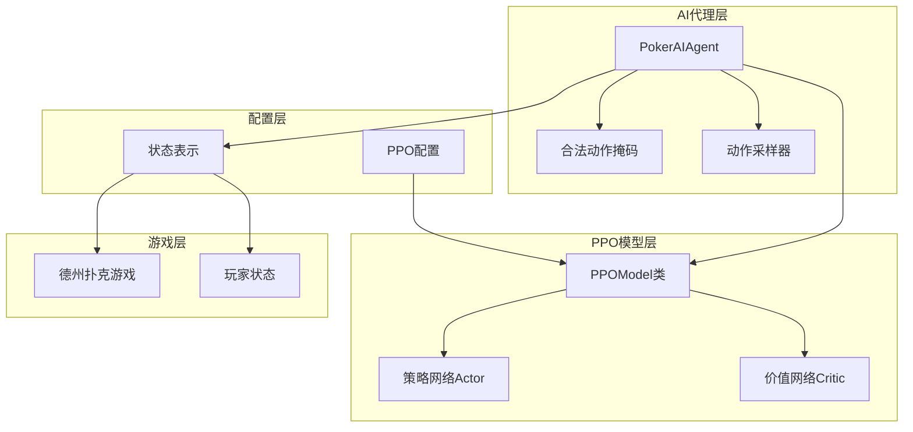
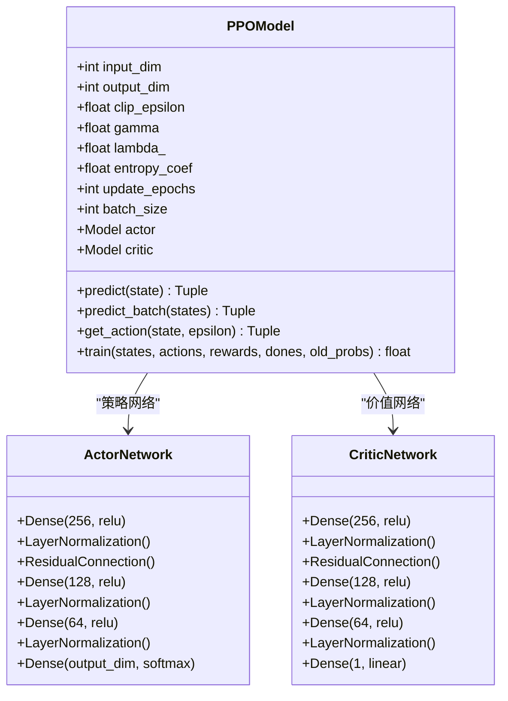
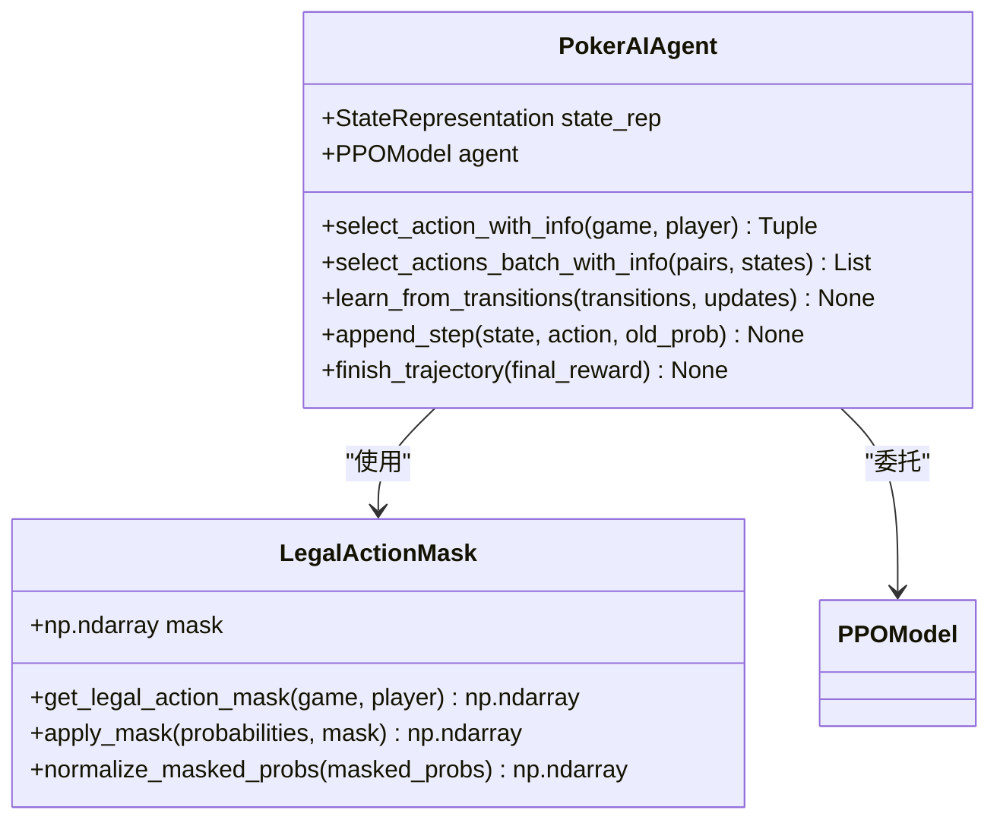
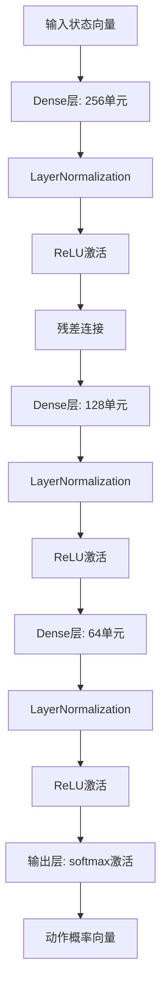
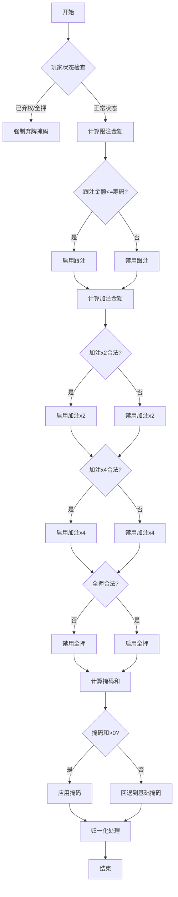
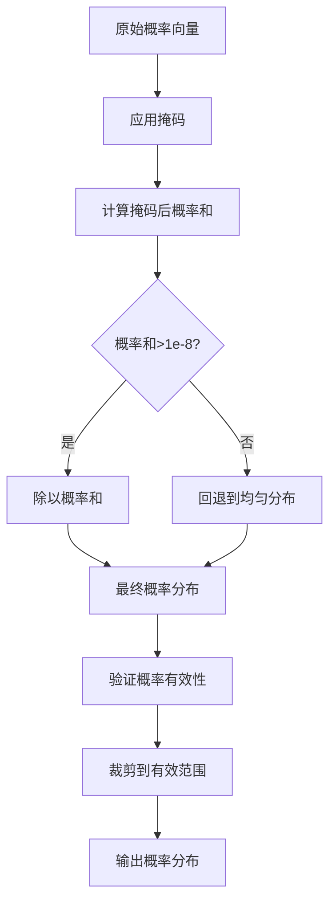
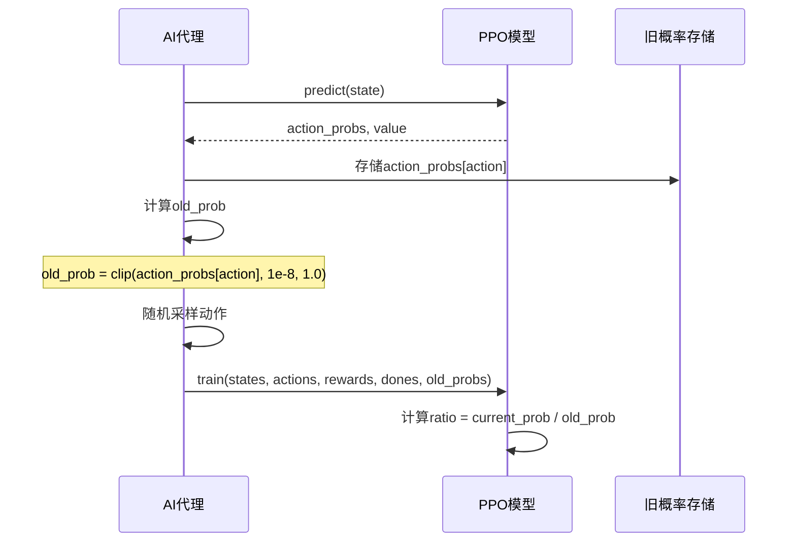
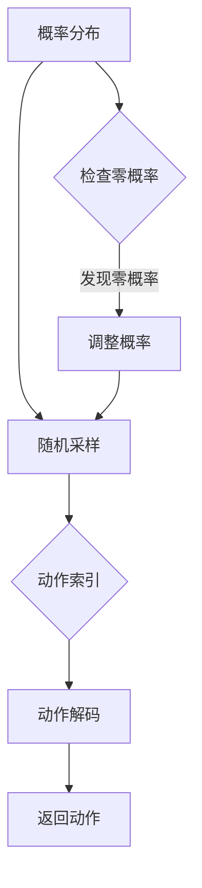
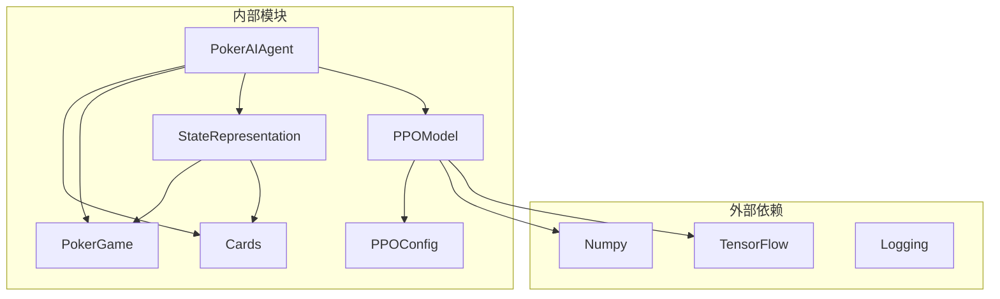

# PPO概率分布计算

<cite>
**本文档引用的文件**
- [ppo_model.py](file://poker_ai/model/ppo_model.py)
- [ai_agent.py](file://poker_ai/model/ai_agent.py)
- [ppo_config.py](file://poker_ai/config/ppo_config.py)
- [state_representation.py](file://poker_ai/model/state_representation.py)
- [test_ppo.py](file://test_ppo.py)
</cite>

## 目录
1. [简介](#简介)
2. [项目结构](#项目结构)
3. [核心组件](#核心组件)
4. [架构概览](#架构概览)
5. [详细组件分析](#详细组件分析)
6. [依赖关系分析](#依赖关系分析)
7. [性能考虑](#性能考虑)
8. [故障排除指南](#故障排除指南)
9. [结论](#结论)

## 简介

本文档深入分析了PPO（近端策略优化）算法在德州扑克AI中的概率分布计算机制。重点解释了策略网络输出的概率向量、合法动作掩码的应用、概率归一化的处理步骤，以及PPO特有的old_prob计算、概率裁剪机制和数值稳定性处理。文档提供了完整的代码示例展示单步预测和批量预测的不同实现方式，并讨论了随机采样过程和概率分布质量对决策效果的影响。

## 项目结构

该项目采用模块化设计，主要包含以下关键组件：



**图表来源**
- [ppo_model.py:20-105](file://poker_ai/model/ppo_model.py#L20-L105)
- [ai_agent.py:55-115](file://poker_ai/model/ai_agent.py#L55-L115)
- [ppo_config.py:18-97](file://poker_ai/config/ppo_config.py#L18-L97)

**章节来源**
- [ppo_model.py:1-670](file://poker_ai/model/ppo_model.py#L1-L670)
- [ai_agent.py:1-703](file://poker_ai/model/ai_agent.py#L1-L703)
- [ppo_config.py:1-97](file://poker_ai/config/ppo_config.py#L1-L97)

## 核心组件

### PPO模型架构

PPO模型包含两个主要神经网络组件：

1. **策略网络（Actor）**：输出动作概率分布
2. **价值网络（Critic）**：估计状态价值



**图表来源**
- [ppo_model.py:200-274](file://poker_ai/model/ppo_model.py#L200-L274)

### AI代理组件

AI代理负责将游戏状态转换为合法动作，并处理概率分布计算：



**图表来源**
- [ai_agent.py:55-246](file://poker_ai/model/ai_agent.py#L55-L246)

**章节来源**
- [ppo_model.py:20-405](file://poker_ai/model/ppo_model.py#L20-L405)
- [ai_agent.py:55-246](file://poker_ai/model/ai_agent.py#L55-L246)

## 架构概览

PPO概率分布计算的整体流程如下：

```mermaid
sequenceDiagram
participant Game as 游戏环境
participant Agent as AI代理
participant PPO as PPO模型
participant Actor as 策略网络
participant Mask as 掩码系统
Game->>Agent : 获取当前状态
Agent->>PPO : predict(state)
PPO->>Actor : 前向推理
Actor-->>PPO : 原始概率向量
PPO->>Mask : 应用合法动作掩码
Mask->>Mask : 归一化处理
Mask-->>PPO : 最终概率分布
PPO-->>Agent : 动作概率和状态价值
Agent->>Agent : 随机采样动作
Agent-->>Game : 返回动作决策
```

**图表来源**
- [ai_agent.py:125-152](file://poker_ai/model/ai_agent.py#L125-L152)
- [ppo_model.py:322-338](file://poker_ai/model/ppo_model.py#L322-L338)

## 详细组件分析

### 策略网络输出的概率向量

策略网络使用softmax激活函数输出动作概率分布：



**图表来源**
- [ppo_model.py:200-236](file://poker_ai/model/ppo_model.py#L200-L236)

策略网络的输出是一个长度为5的概率向量，对应以下动作：
- 索引0: 弃牌(Fold)
- 索引1: 跟注(Call)
- 索引2: 加注(raise x2)
- 索引3: 加注(raise x4)
- 索引4: 全押(All-in)

**章节来源**
- [ppo_model.py:200-236](file://poker_ai/model/ppo_model.py#L200-L236)

### 合法动作掩码的应用

合法动作掩码系统确保AI只能选择合法的动作：



**图表来源**
- [ai_agent.py:15-53](file://poker_ai/model/ai_agent.py#L15-L53)

掩码应用的关键步骤：

1. **基础掩码**：弃牌始终可用，跟注在满足条件时可用
2. **加注掩码**：基于当前底池和最小加注要求计算
3. **全押掩码**：当玩家还有筹码时可用
4. **回退机制**：如果所有动作都被禁用，至少启用弃牌和跟注

**章节来源**
- [ai_agent.py:15-53](file://poker_ai/model/ai_agent.py#L15-L53)

### 概率归一化处理

归一化过程确保概率分布的有效性：



**图表来源**
- [ai_agent.py:134-139](file://poker_ai/model/ai_agent.py#L134-L139)

归一化的数学原理：
- **掩码后求和**：`prob_sum = Σ(masked_probs)`
- **标准归一化**：`normalized_probs = masked_probs / prob_sum`
- **数值稳定性**：使用`1e-8`作为最小值防止除零错误

**章节来源**
- [ai_agent.py:134-139](file://poker_ai/model/ai_agent.py#L134-L139)

### PPO特有的old_prob计算

old_prob（旧概率）是PPO算法的核心概念，用于计算概率比率：



**图表来源**
- [ai_agent.py:145-151](file://poker_ai/model/ai_agent.py#L145-L151)
- [ai_agent.py:268-274](file://poker_ai/model/ai_agent.py#L268-L274)

old_prob的计算特点：
- **裁剪范围**：确保概率在`[1e-8, 1.0]`范围内
- **数值稳定性**：防止概率为零导致的数值问题
- **历史记录**：存储上一轮的策略输出

**章节来源**
- [ai_agent.py:145-151](file://poker_ai/model/ai_agent.py#L145-L151)
- [ai_agent.py:268-274](file://poker_ai/model/ai_agent.py#L268-L274)

### 概率裁剪机制

PPO的概率裁剪机制防止策略更新过大：

```mermaid
flowchart TD
Ratio[ratio = current_prob / old_prob] --> CheckRatio{ratio在[1-ε, 1+ε]?}
CheckRatio --> |是| UseRatio[使用ratio]
CheckRatio --> |否| ClipRatio[裁剪到边界值]
UseRatio --> ComputeLoss[计算策略损失]
ClipRatio --> ComputeLoss
ComputeLoss --> AddEntropy[添加熵正则]
AddEntropy --> Update[更新策略网络]
```

**图表来源**
- [ppo_model.py:145-152](file://poker_ai/model/ppo_model.py#L145-L152)

裁剪参数的含义：
- **clip_epsilon = 0.2**：允许策略变化±20%
- **数值稳定性**：分母添加`1e-8`防止除零
- **边界处理**：确保比率在有效范围内

**章节来源**
- [ppo_model.py:145-152](file://poker_ai/model/ppo_model.py#L145-L152)

### 数值稳定性处理

系统实现了多层数值稳定性保护：

1. **概率计算稳定性**：
   - 对数计算使用`log(probs + 1e-8)`
   - 概率和使用`sum + 1e-8`
   - 比率计算使用`old_probs + 1e-8`

2. **梯度稳定性**：
   - 使用`clip_by_global_norm`进行梯度裁剪
   - 最大梯度范数为`max_grad_norm = 0.5`

3. **优势估计稳定性**：
   - 优势值裁剪到`[-10, 10]`范围
   - 标准化时使用`1e-8`防止除零

**章节来源**
- [ppo_model.py:139-156](file://poker_ai/model/ppo_model.py#L139-L156)
- [ppo_model.py:317-318](file://poker_ai/model/ppo_model.py#L317-L318)

### 单步预测实现

单步预测用于实时决策：

```mermaid
sequenceDiagram
participant Env as 游戏环境
participant Agent as AI代理
participant PPO as PPO模型
participant Actor as 策略网络
Env->>Agent : 请求动作
Agent->>PPO : predict(state)
PPO->>Actor : 前向推理
Actor-->>PPO : action_probs
PPO-->>Agent : action_probs, value
Agent->>Agent : 应用掩码和归一化
Agent->>Agent : 随机采样
Agent-->>Env : 返回动作
```

**图表来源**
- [ppo_model.py:322-338](file://poker_ai/model/ppo_model.py#L322-L338)
- [ai_agent.py:340-364](file://poker_ai/model/ai_agent.py#L340-L364)

**章节来源**
- [ppo_model.py:322-338](file://poker_ai/model/ppo_model.py#L322-L338)
- [ai_agent.py:340-364](file://poker_ai/model/ai_agent.py#L340-L364)

### 批量预测实现

批量预测用于并行环境推理：

```mermaid
sequenceDiagram
participant Env as 环境集合
participant Agent as AI代理
participant PPO as PPO模型
participant Actor as 策略网络
Env->>Agent : 批量状态请求
Agent->>PPO : predict_batch(states)
PPO->>Actor : 批量前向推理
Actor-->>PPO : action_probs_batch
PPO-->>Agent : action_probs_batch, values_batch
Agent->>Agent : 批量应用掩码和归一化
Agent->>Agent : 批量随机采样
Agent-->>Env : 返回批量动作
```

**图表来源**
- [ppo_model.py:330-338](file://poker_ai/model/ppo_model.py#L330-L338)
- [ai_agent.py:189-213](file://poker_ai/model/ai_agent.py#L189-L213)

**章节来源**
- [ppo_model.py:330-338](file://poker_ai/model/ppo_model.py#L330-L338)
- [ai_agent.py:189-213](file://poker_ai/model/ai_agent.py#L189-L213)

### 随机采样过程

随机采样确保探索和利用的平衡：



**图表来源**
- [ai_agent.py:140-140](file://poker_ai/model/ai_agent.py#L140-L140)
- [ai_agent.py:201-201](file://poker_ai/model/ai_agent.py#L201-L201)

采样过程的特点：
- **概率加权**：根据动作概率进行加权采样
- **边界处理**：处理概率为零的边界情况
- **效率优化**：使用NumPy的`random.choice`进行高效采样

**章节来源**
- [ai_agent.py:140-140](file://poker_ai/model/ai_agent.py#L140-L140)
- [ai_agent.py:201-201](file://poker_ai/model/ai_agent.py#L201-L201)

## 依赖关系分析



**图表来源**
- [ppo_model.py:1-10](file://poker_ai/model/ppo_model.py#L1-L10)
- [ai_agent.py:1-12](file://poker_ai/model/ai_agent.py#L1-L12)

**章节来源**
- [ppo_model.py:1-10](file://poker_ai/model/ppo_model.py#L1-L10)
- [ai_agent.py:1-12](file://poker_ai/model/ai_agent.py#L1-L12)

## 性能考虑

### 训练优化特性

1. **混合精度训练**：使用`LossScaleOptimizer`提高训练速度
2. **向量化GAE计算**：使用NumPy向量化替代Python循环
3. **梯度累积**：支持梯度累积以提高内存效率
4. **学习率调度**：实现warmup和cosine衰减

### 推理优化特性

1. **预编译优化**：使用`tf.function`减少Python调用开销
2. **形状固定**：避免不同batch形状触发retracing
3. **批量处理**：支持批量预测提高吞吐量

## 故障排除指南

### 常见问题及解决方案

1. **概率和不等于1**
   - 检查掩码应用是否正确
   - 验证归一化步骤
   - 确认数值稳定性常数设置

2. **采样概率异常**
   - 检查old_prob存储是否正确
   - 验证概率裁剪参数设置
   - 确认随机种子设置

3. **训练不稳定**
   - 调整学习率参数
   - 检查梯度裁剪设置
   - 验证KL散度早停机制

**章节来源**
- [ppo_model.py:139-156](file://poker_ai/model/ppo_model.py#L139-L156)
- [ai_agent.py:324-331](file://poker_ai/model/ai_agent.py#L324-L331)

## 结论

PPO概率分布计算机制通过策略网络输出的概率向量、合法动作掩码应用和概率归一化处理，实现了德州扑克AI的智能决策。系统的设计充分考虑了数值稳定性、训练效率和推理性能，为复杂的扑克决策提供了可靠的概率基础。通过old_prob计算和概率裁剪机制，系统能够在保持策略稳定性的同时实现有效的学习更新。