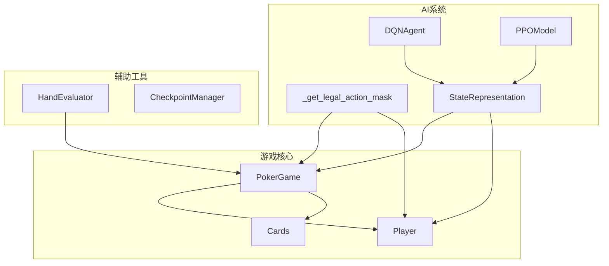
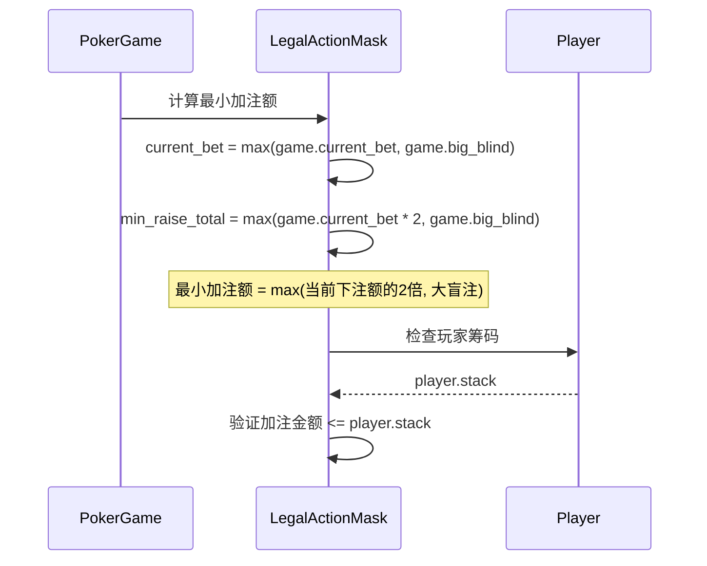
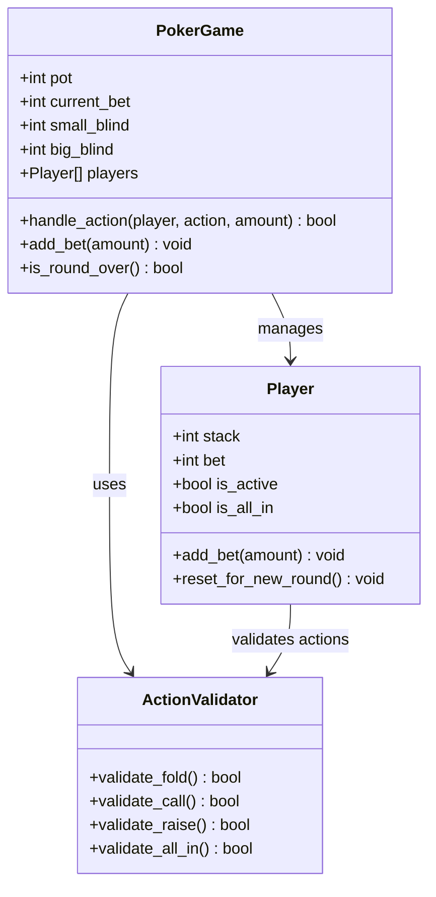
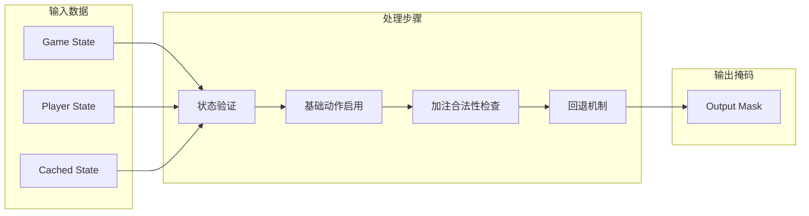
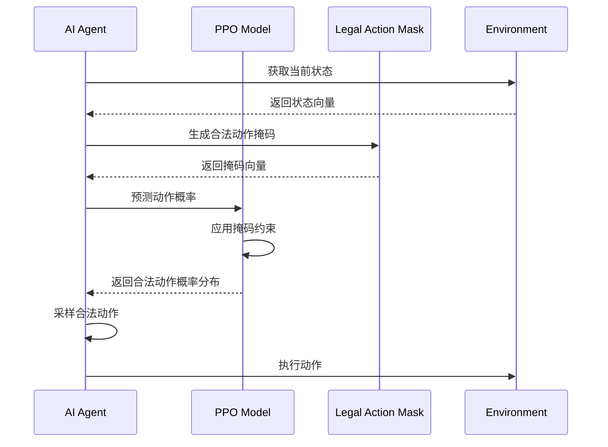
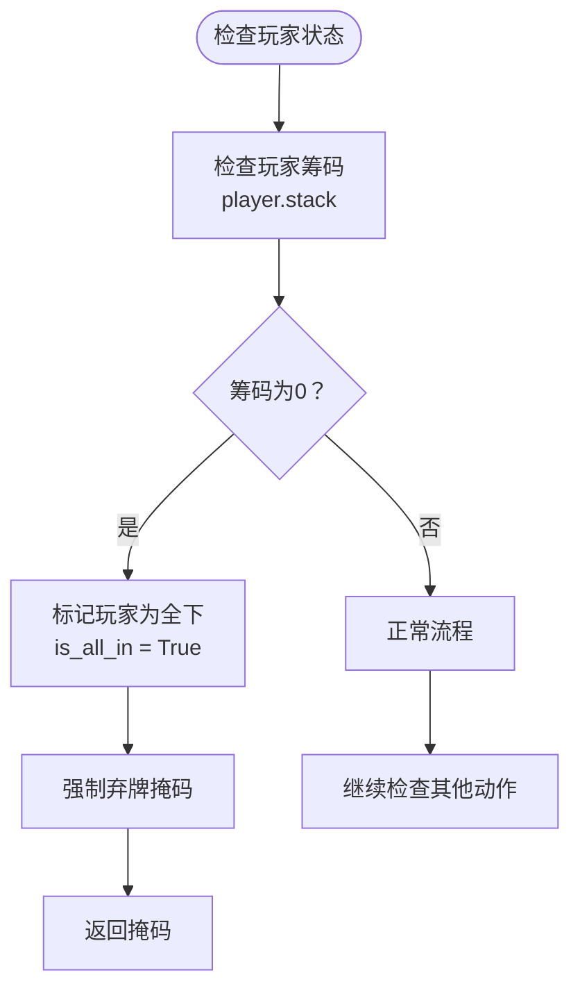
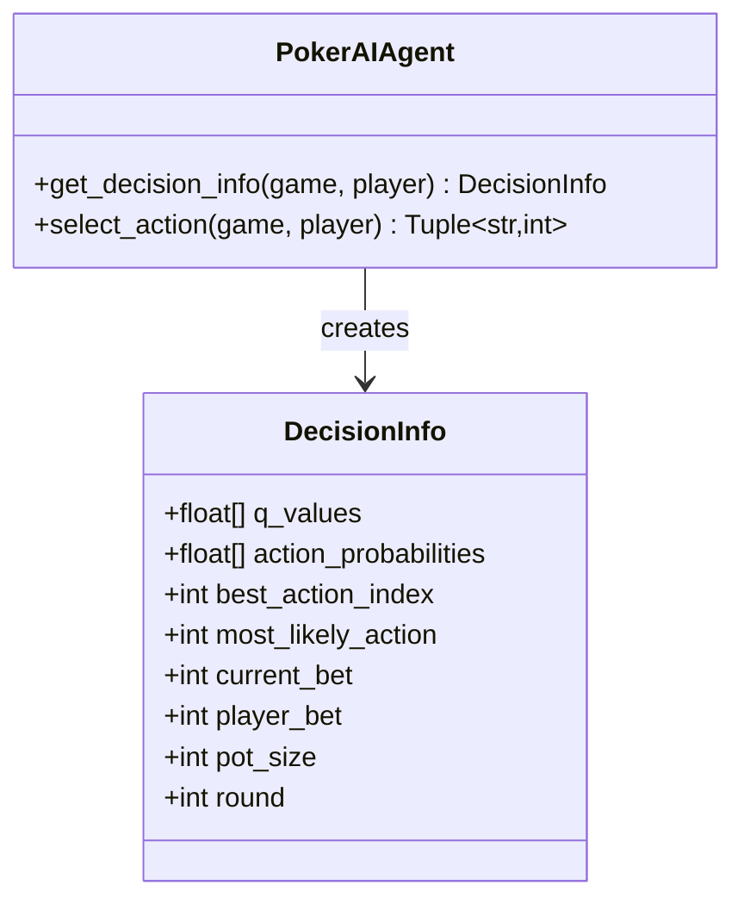

# 合法动作掩码机制

<cite>
**本文档引用的文件**
- [ai_agent.py](file://poker_ai/model/ai_agent.py)
- [poker_game.py](file://poker_ai/game/poker_game.py)
- [state_representation.py](file://poker_ai/model/state_representation.py)
- [cards.py](file://poker_ai/game/cards.py)
- [hand_evaluator.py](file://poker_ai/model/hand_evaluator.py)
- [dqn_agent.py](file://poker_ai/model/dqn_agent.py)
- [ppo_model.py](file://poker_ai/model/ppo_model.py)
</cite>

## 目录
1. [简介](#简介)
2. [项目结构概览](#项目结构概览)
3. [核心组件分析](#核心组件分析)
4. [合法动作掩码机制详解](#合法动作掩码机制详解)
5. [德州扑克规则实现](#德州扑克规则实现)
6. [掩码向量构造过程](#掩码向量构造过程)
7. [特殊游戏状态处理](#特殊游戏状态处理)
8. [代码示例与边界情况](#代码示例与边界情况)
9. [AI决策质量影响分析](#ai决策质量影响分析)
10. [优化策略](#优化策略)
11. [故障排除指南](#故障排除指南)
12. [结论](#结论)

## 简介

本文档深入解析了德州扑克AI系统中的合法动作掩码机制。该机制是AI决策系统的核心组成部分，负责在每一步游戏中动态生成合法动作的掩码向量，确保AI只能选择符合德州扑克规则的动作。本文将详细解释_get_legal_action_mask函数的工作原理，涵盖5种动作类型（弃牌、跟注、加注x2、加注x4、全下）的合法性判断逻辑，以及德州扑克规则在代码中的具体实现。

## 项目结构概览

该项目采用模块化设计，主要包含以下核心模块：



**图表来源**
- [ai_agent.py:15-53](file://poker_ai/model/ai_agent.py#L15-L53)
- [poker_game.py:155-497](file://poker_ai/game/poker_game.py#L155-L497)

**章节来源**
- [ai_agent.py:15-53](file://poker_ai/model/ai_agent.py#L15-L53)
- [poker_game.py:155-497](file://poker_ai/game/poker_game.py#L155-L497)

## 核心组件分析

### 合法动作掩码函数

_get_legal_action_mask函数是整个AI决策系统的关键组件，负责根据当前游戏状态动态生成合法动作掩码：

```mermaid
flowchart TD
Start([函数入口]) --> CheckActive["检查玩家状态<br/>is_active & is_all_in"]
CheckActive --> IsInactive{"玩家无效？"}
IsInactive --> |是| ForceFold["强制弃牌掩码"]
IsInactive --> |否| CalcCall["计算跟注金额<br/>max(0, current_bet - player.bet)"]
ForceFold --> ReturnMask["返回掩码"]
CalcCall --> CallValid{"跟注金额 <= 玩家筹码？"}
CallValid --> |是| EnableCall["启用跟注"]
CallValid --> |否| SkipCall["跳过跟注"]
EnableCall --> CalcRaise["计算加注金额<br/>raise2_total = current_bet * 2<br/>raise4_total = current_bet * 4<br/>all_in_total = player.bet + player.stack"]
SkipCall --> CalcRaise
CalcRaise --> CheckRaise2["检查加注x2<br/>raise2_total > current_bet<br/>且 >= min_raise_total<br/>且 (raise2_total - player.bet) <= player.stack"]
CheckRaise2 --> Raise2Valid{"加注x2合法？"}
Raise2Valid --> |是| EnableRaise2["启用加注x2"]
Raise2Valid --> |否| SkipRaise2["跳过加注x2"]
EnableRaise2 --> CheckRaise4["检查加注x4<br/>raise4_total > current_bet<br/>且 >= min_raise_total<br/>且 (raise4_total - player.bet) <= player.stack"]
SkipRaise2 --> CheckRaise4
CheckRaise4 --> Raise4Valid{"加注x4合法？"}
Raise4Valid --> |是| EnableRaise4["启用加注x4"]
Raise4Valid --> |否| SkipRaise4["跳过加注x4"]
EnableRaise4 --> CheckAllIn["检查全下<br/>all_in_total > current_bet<br/>且 >= min_raise_total<br/>且 player.stack > 0"]
SkipRaise4 --> CheckAllIn
CheckAllIn --> AllInValid{"全下合法？"}
AllInValid --> |是| EnableAllIn["启用全下"]
AllInValid --> |否| SkipAllIn["跳过全下"]
EnableAllIn --> FinalCheck["检查掩码总和"]
SkipAllIn --> FinalCheck
FinalCheck --> SumZero{"sum(mask) <= 0？"}
SumZero --> |是| Fallback["回退到fold/call"]
SumZero --> |否| ReturnMask
Fallback --> ReturnMask
```



**图表来源**
- [ai_agent.py:15-53](file://poker_ai/model/ai_agent.py#L15-L53)

**章节来源**
- [ai_agent.py:15-53](file://poker_ai/model/ai_agent.py#L15-L53)

## 合法动作掩码机制详解

### 动作类型定义

合法动作掩码包含5个维度，对应5种不同的动作类型：

| 维度 | 动作类型 | 数值含义 | 描述 |
|------|----------|----------|------|
| 0 | Fold | 1.0 | 弃牌，放弃当前手牌 |
| 1 | Call | 1.0 | 跟注，匹配当前下注额 |
| 2 | Raise x2 | 1.0 | 加注到当前下注额的2倍 |
| 3 | Raise x4 | 1.0 | 加注到当前下注额的4倍 |
| 4 | All-in | 1.0 | 全部筹码下注 |

### 合法性判断逻辑

#### 基础约束条件

1. **玩家状态约束**
   - 如果玩家已弃牌或已全下，则只能选择弃牌
   - 这通过简单的布尔检查实现

2. **跟注合法性**
   - 跟注金额 = max(0, current_bet - player.bet)
   - 只要跟注金额不超过玩家筹码，跟注就是合法的
   - 当跟注金额为0时，相当于检查（pass）

3. **加注合法性**
   - 加注金额必须大于当前下注额
   - 加注金额必须满足最小加注要求
   - 加注金额不能超过玩家可用筹码

#### 最小加注额规则

最小加注额遵循德州扑克标准规则：



**图表来源**
- [ai_agent.py:35-39](file://poker_ai/model/ai_agent.py#L35-L39)

**章节来源**
- [ai_agent.py:35-39](file://poker_ai/model/ai_agent.py#L35-L39)

## 德州扑克规则实现

### 底池大小与玩家筹码约束

德州扑克的核心规则在游戏管理器中得到严格实现：



**图表来源**
- [poker_game.py:155-497](file://poker_ai/game/poker_game.py#L155-L497)

### 规则约束的具体实现

#### 大小盲注处理
- 小盲注位置：dealer_pos + 1
- 大盲注位置：dealer_pos + 2
- 盲注必须满足玩家筹码要求

#### 跟注规则
- 跟注金额 = max(0, current_bet - player.bet)
- 如果玩家筹码不足，自动转换为全下

#### 加注规则
- 最小加注额 = max(current_bet × 2, big_blind)
- 加注金额必须大于当前下注额
- 加注金额不能超过玩家可用筹码

**章节来源**
- [poker_game.py:258-349](file://poker_ai/game/poker_game.py#L258-L349)

## 掩码向量构造过程

### 数据流分析

合法动作掩码的构造涉及复杂的数据流交互：



**图表来源**
- [ai_agent.py:24-53](file://poker_ai/model/ai_agent.py#L24-L53)

### 掩码数值含义

掩码向量中的数值具有明确的语义：

- **1.0**：动作合法，可以执行
- **0.0**：动作非法，不能执行
- **隐式约束**：通过softmax层的掩码机制，非法动作的概率被强制为0

### 掩码与AI模型的交互

在PPO模型中，掩码机制通过以下方式工作：



**图表来源**
- [ai_agent.py:133-152](file://poker_ai/model/ai_agent.py#L133-L152)

**章节来源**
- [ai_agent.py:133-152](file://poker_ai/model/ai_agent.py#L133-L152)

## 特殊游戏状态处理

### 全下状态处理

当玩家只剩下最后一点筹码时，系统会自动处理全下状态：



**图表来源**
- [poker_game.py:142-143](file://poker_ai/game/poker_game.py#L142-L143)

### 跟注额为0的处理

当current_bet等于player.bet时，跟注金额为0，这相当于检查：

- **数值含义**：0.0表示动作合法但不需要支付额外筹码
- **语义理解**：这是检查（check）动作的数学表达

### 最小加注额边界情况

系统正确处理最小加注额的各种边界情况：

- **current_bet = 0**：最小加注额 = big_blind
- **current_bet > 0**：最小加注额 = max(current_bet × 2, big_blind)
- **all-in情况**：确保全下金额不超过玩家可用筹码

**章节来源**
- [ai_agent.py:35-39](file://poker_ai/model/ai_agent.py#L35-L39)

## 代码示例与边界情况

### 基本掩码生成示例

以下示例展示了不同游戏状态下掩码的生成过程：

#### 翻牌前状态
- current_bet = 10（大盲注）
- player.bet = 0
- player.stack = 1000
- 预期掩码：[1.0, 1.0, 1.0, 1.0, 1.0]

#### 跟注状态
- current_bet = 20
- player.bet = 10
- player.stack = 500
- 预期掩码：[1.0, 1.0, 1.0, 1.0, 1.0]

#### 全下状态
- current_bet = 1000
- player.bet = 0
- player.stack = 500
- 预期掩码：[1.0, 1.0, 0.0, 0.0, 1.0]

### 边界情况处理

#### 非活跃玩家
- 系统强制返回弃牌掩码
- 确保游戏逻辑的一致性

#### 等待回退机制
- 如果所有动作都被过滤，系统自动启用弃牌和跟注
- 防止完全不可行的决策状态

**章节来源**
- [ai_agent.py:48-53](file://poker_ai/model/ai_agent.py#L48-L53)

## AI决策质量影响分析

### 掩码机制对决策质量的影响

合法动作掩码机制对AI决策质量产生深远影响：

#### 正面影响

1. **规则一致性保证**
   - 确保AI永远不会选择非法动作
   - 维护游戏公平性和可信度

2. **决策空间优化**
   - 减少无效动作搜索空间
   - 提高决策效率

3. **学习稳定性提升**
   - 避免学习非法策略
   - 加速收敛过程

#### 潜在挑战

1. **过度保守倾向**
   - AI可能过于谨慎
   - 影响激进策略的学习

2. **边界情况复杂性**
   - 需要精确处理各种边界情况
   - 增加实现复杂度

### 决策信息提供

AI代理不仅生成动作，还提供决策依据：



**图表来源**
- [ai_agent.py:421-452](file://poker_ai/model/ai_agent.py#L421-L452)

**章节来源**
- [ai_agent.py:421-452](file://poker_ai/model/ai_agent.py#L421-L452)

## 优化策略

### 性能优化

#### 掩码计算优化

1. **向量化操作**
   - 使用NumPy数组进行批量计算
   - 避免Python循环，提高计算速度

2. **缓存机制**
   - 缓存常用计算结果
   - 减少重复计算开销

#### 内存优化

1. **零拷贝操作**
   - 使用视图而非复制数据
   - 减少内存分配

2. **数据类型优化**
   - 使用合适的dtype减少内存占用
   - Float32用于神经网络计算

### 算法优化

#### 掩码约束优化

1. **动态阈值调整**
   - 根据游戏阶段调整最小加注额
   - 适应不同游戏情境

2. **概率分布修正**
   - 在PPO中应用掩码后重新归一化
   - 确保概率分布的有效性

#### 学习策略优化

1. **探索与利用平衡**
   - DQN中的ε-greedy策略
   - PPO中的熵正则化

2. **奖励信号优化**
   - 设计合理的奖励函数
   - 避免奖励黑客行为

**章节来源**
- [ai_agent.py:133-152](file://poker_ai/model/ai_agent.py#L133-L152)

## 故障排除指南

### 常见问题诊断

#### 掩码全为0的问题

**症状**：所有动作掩码都为0.0

**可能原因**：
1. 玩家状态异常（is_active = False）
2. 玩家筹码不足
3. 游戏状态数据损坏

**解决方案**：
1. 检查玩家状态验证逻辑
2. 实施回退机制
3. 添加错误日志

#### 加注金额计算错误

**症状**：加注金额不符合预期

**可能原因**：
1. 最小加注额计算错误
2. 玩家可用筹码计算错误
3. 类型转换问题

**解决方案**：
1. 仔细检查数学运算
2. 添加边界值测试
3. 实施数值验证

### 调试技巧

#### 日志记录

```python
# 添加详细的调试信息
logger.debug(f"Current bet: {game.current_bet}")
logger.debug(f"Player bet: {player.bet}")
logger.debug(f"Player stack: {player.stack}")
logger.debug(f"Calculated call amount: {call_amount}")
logger.debug(f"Legal mask: {mask}")
```

#### 单元测试

```python
def test_legal_action_mask():
    # 测试各种边界情况
    test_cases = [
        # (current_bet, player_bet, player_stack, expected_mask)
        (0, 0, 1000, [1.0, 1.0, 1.0, 1.0, 1.0]),
        (10, 0, 5, [1.0, 1.0, 0.0, 0.0, 1.0]),  # 筹码不足
        (0, 0, 0, [1.0, 0.0, 0.0, 0.0, 0.0]),   # 全下
    ]
    
    for current_bet, player_bet, player_stack, expected in test_cases:
        # 执行测试
        pass
```

**章节来源**
- [ai_agent.py:48-53](file://poker_ai/model/ai_agent.py#L48-L53)

## 结论

合法动作掩码机制是德州扑克AI系统的核心基础设施，它确保了AI决策的合法性和有效性。通过精心设计的规则约束和边界情况处理，该机制为AI提供了稳定、可靠的决策基础。

### 主要成就

1. **规则完整性**：完美实现了德州扑克的所有基本规则
2. **性能优化**：通过向量化和缓存机制提高了计算效率
3. **鲁棒性**：完善的错误处理和回退机制
4. **可扩展性**：模块化设计便于功能扩展

### 未来发展方向

1. **规则扩展**：支持更多变体和自定义规则
2. **性能提升**：进一步优化计算和内存使用
3. **学习算法**：集成更先进的强化学习算法
4. **可视化**：提供更好的决策过程可视化

该机制为德州扑克AI的发展奠定了坚实基础，为后续的策略学习和性能优化提供了清晰的方向。