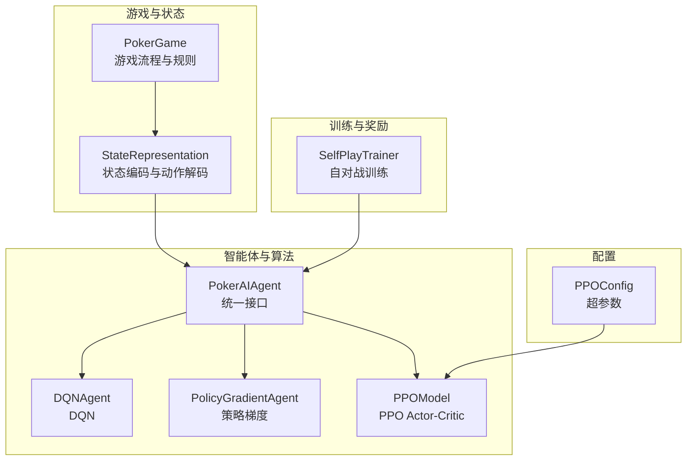
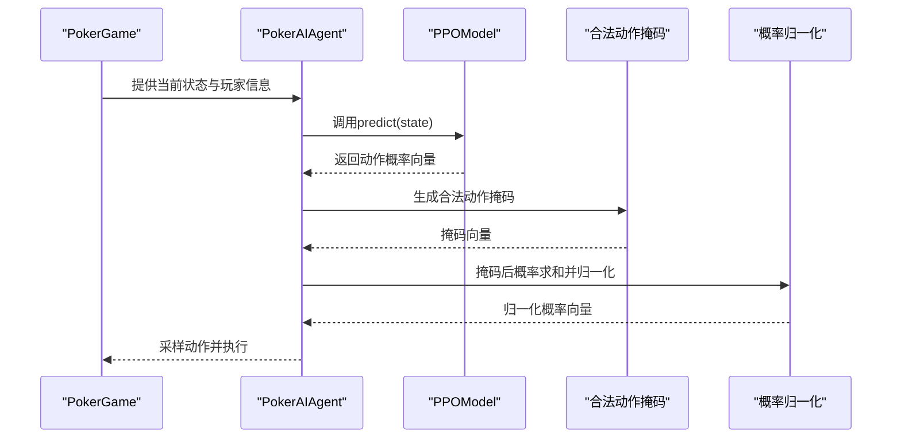
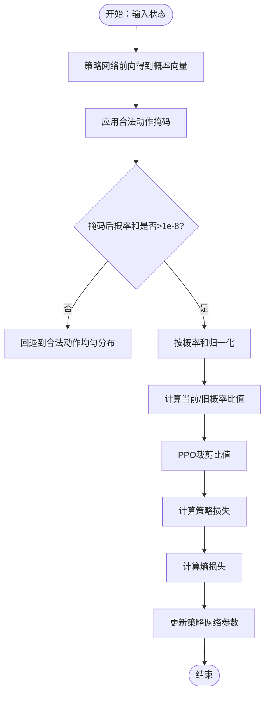
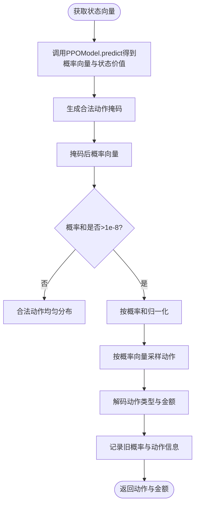
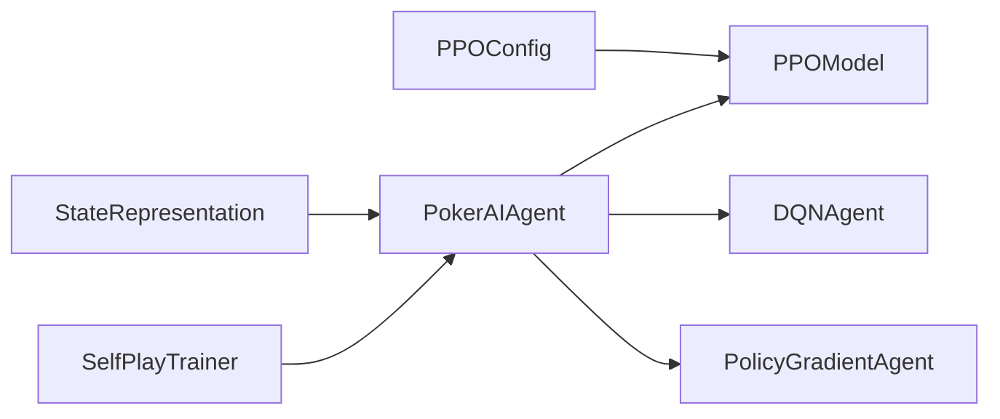

# 概率分布计算

<cite>
**本文引用的文件**
- [poker_ai/model/ppo_model.py](file://poker_ai/model/ppo_model.py)
- [poker_ai/model/ai_agent.py](file://poker_ai/model/ai_agent.py)
- [poker_ai/model/dqn_agent.py](file://poker_ai/model/dqn_agent.py)
- [poker_ai/config/ppo_config.py](file://poker_ai/config/ppo_config.py)
- [poker_ai/game/poker_game.py](file://poker_ai/game/poker_game.py)
- [poker_ai/model/state_representation.py](file://poker_ai/model/state_representation.py)
- [poker_ai/reward/self_play_trainer.py](file://poker_ai/reward/self_play_trainer.py)
- [README.md](file://README.md)
</cite>

## 目录
1. [简介](#简介)
2. [项目结构](#项目结构)
3. [核心组件](#核心组件)
4. [架构总览](#架构总览)
5. [详细组件分析](#详细组件分析)
6. [依赖分析](#依赖分析)
7. [性能考量](#性能考量)
8. [故障排查指南](#故障排查指南)
9. [结论](#结论)
10. [附录](#附录)

## 简介
本文件围绕概率分布计算机制展开，重点阐述在PPO算法中动作概率分布的计算流程，包括策略网络输出的概率向量、合法动作掩码的应用、概率归一化的处理方式，以及数值稳定性与边界情况的处理策略。同时对比DQN、策略梯度、PPO在概率计算上的差异与特点，并给出可定位到具体源码片段的参考路径，帮助读者快速定位实现细节与优化点。

## 项目结构
该项目采用模块化组织，围绕德州扑克AI训练与评估形成闭环：
- 游戏与状态：poker_game.py、state_representation.py
- 智能体与算法：ai_agent.py（统一接口）、dqn_agent.py（DQN/PG）、ppo_model.py（PPO）
- 训练与奖励：self_play_trainer.py
- 配置：ppo_config.py
- 文档与入口：README.md

图示来源
- [poker_ai/game/poker_game.py](file://poker_ai/game/poker_game.py)
- [poker_ai/model/state_representation.py](file://poker_ai/model/state_representation.py)
- [poker_ai/model/ai_agent.py](file://poker_ai/model/ai_agent.py)
- [poker_ai/model/dqn_agent.py](file://poker_ai/model/dqn_agent.py)
- [poker_ai/model/ppo_model.py](file://poker_ai/model/ppo_model.py)
- [poker_ai/reward/self_play_trainer.py](file://poker_ai/reward/self_play_trainer.py)
- [poker_ai/config/ppo_config.py](file://poker_ai/config/ppo_config.py)

章节来源
- [README.md](file://README.md)
- [poker_ai/game/poker_game.py](file://poker_ai/game/poker_game.py)
- [poker_ai/model/state_representation.py](file://poker_ai/model/state_representation.py)
- [poker_ai/model/ai_agent.py](file://poker_ai/model/ai_agent.py)
- [poker_ai/model/dqn_agent.py](file://poker_ai/model/dqn_agent.py)
- [poker_ai/model/ppo_model.py](file://poker_ai/model/ppo_model.py)
- [poker_ai/reward/self_play_trainer.py](file://poker_ai/reward/self_play_trainer.py)
- [poker_ai/config/ppo_config.py](file://poker_ai/config/ppo_config.py)

## 核心组件
- 策略网络输出的概率向量：PPO模型的Actor网络输出长度为动作数的softmax概率分布。
- 合法动作掩码：根据当前游戏状态与玩家信息生成合法动作掩码，屏蔽非法动作。
- 归一化与数值稳定性：在掩码后进行概率归一化，并在计算中广泛使用极小常数避免除零与log(0)。
- 边界情况处理：当掩码后概率和接近零时，回退到合法动作均匀分布。
- PPO更新中的概率比值与熵正则：在损失函数中体现策略更新与探索平衡。

章节来源
- [poker_ai/model/ppo_model.py](file://poker_ai/model/ppo_model.py)
- [poker_ai/model/ai_agent.py](file://poker_ai/model/ai_agent.py)

## 架构总览
PPO概率分布计算在两条路径中实现：
- 在PokerAIAgent中，对策略网络输出的概率向量应用合法动作掩码并归一化，随后采样动作。
- 在PPOModel中，通过tf.function封装的更新步骤，计算当前概率与旧概率的比值、KL散度、熵损失等，用于策略更新。

图示来源
- [poker_ai/model/ai_agent.py](file://poker_ai/model/ai_agent.py)
- [poker_ai/model/ppo_model.py](file://poker_ai/model/ppo_model.py)
- [poker_ai/game/poker_game.py](file://poker_ai/game/poker_game.py)

## 详细组件分析

### PPO概率分布计算与更新流程
- 策略网络输出：Actor网络输出动作维度的softmax概率向量。
- 掩码与归一化：对非法动作置零，若掩码后概率和小于阈值，则回退到合法动作均匀分布。
- 比值与裁剪：计算当前概率与旧概率的比值，并在PPO损失中裁剪。
- 熵正则：在损失中加入熵项，抑制策略过早塌缩。
- 梯度裁剪与混合精度：使用全局范数裁剪与LossScaleOptimizer适配混合精度。

图示来源
- [poker_ai/model/ppo_model.py](file://poker_ai/model/ppo_model.py)

章节来源
- [poker_ai/model/ppo_model.py](file://poker_ai/model/ppo_model.py)

### PokerAIAgent中的概率分布计算
- 状态编码：通过StateRepresentation获取当前状态向量。
- 合法动作掩码：根据当前轮次、底池、玩家筹码等生成长度为动作数的掩码。
- 掩码后概率归一化：若归一化和过小，回退到合法动作均匀分布。
- 动作采样：基于归一化概率向量进行随机采样。
- 信息记录：记录旧概率与动作概率向量，供PPO轨迹学习使用。

图示来源
- [poker_ai/model/ai_agent.py](file://poker_ai/model/ai_agent.py)
- [poker_ai/model/state_representation.py](file://poker_ai/model/state_representation.py)

章节来源
- [poker_ai/model/ai_agent.py](file://poker_ai/model/ai_agent.py)
- [poker_ai/model/state_representation.py](file://poker_ai/model/state_representation.py)

### 合法动作掩码的数学与实现要点
- 掩码生成：根据玩家是否在玩、是否全下、当前底池、最小加注额、玩家筹码等条件生成长度为动作数的掩码。
- 掩码后概率和判零：若掩码后概率和小于阈值，回退到合法动作均匀分布，避免采样失败。
- 与状态表示的耦合：StateRepresentation负责将游戏状态编码为向量，PokerAIAgent负责在此基础上生成掩码并进行概率归一化。

章节来源
- [poker_ai/model/ai_agent.py](file://poker_ai/model/ai_agent.py)
- [poker_ai/model/state_representation.py](file://poker_ai/model/state_representation.py)
- [poker_ai/game/poker_game.py](file://poker_ai/game/poker_game.py)

### 数值稳定性与边界情况处理
- 极小常数：在除法、对数、分母等处广泛使用极小常数以避免数值问题。
- 归一化阈值：当掩码后概率和过小时回退到合法动作均匀分布。
- 混合精度：在混合精度环境下，将模型输出转换为float32进行损失计算。
- 梯度裁剪：使用全局范数裁剪防止梯度爆炸。

章节来源
- [poker_ai/model/ppo_model.py](file://poker_ai/model/ppo_model.py)
- [poker_ai/model/ai_agent.py](file://poker_ai/model/ai_agent.py)

### 不同算法在概率计算上的差异与特点
- DQN：通过Q网络输出各动作的Q值，采样时结合ε-贪婪策略，不直接输出概率分布。
- 策略梯度：策略网络输出动作概率分布，采样时直接按概率分布进行随机采样。
- PPO：策略网络输出动作概率分布，采样时按分布采样；训练时使用重要性采样比值与裁剪，结合熵正则与KL散度监控。

章节来源
- [poker_ai/model/dqn_agent.py](file://poker_ai/model/dqn_agent.py)
- [poker_ai/model/ai_agent.py](file://poker_ai/model/ai_agent.py)
- [poker_ai/model/ppo_model.py](file://poker_ai/model/ppo_model.py)

### 代码示例路径（概率分布计算完整流程）
以下为可定位到具体实现的参考路径（不直接展示代码内容）：
- PPO策略网络输出与更新步骤
  - [策略网络构建与softmax输出:200-236](file://poker_ai/model/ppo_model.py#L200-L236)
  - [PPO更新步骤（含比值、裁剪、熵正则、KL散度）:106-198](file://poker_ai/model/ppo_model.py#L106-L198)
- PokerAIAgent中的概率分布计算
  - [合法动作掩码生成:15-53](file://poker_ai/model/ai_agent.py#L15-L53)
  - [单局动作选择与掩码后归一化:125-152](file://poker_ai/model/ai_agent.py#L125-L152)
  - [批量动作选择与掩码后归一化:157-214](file://poker_ai/model/ai_agent.py#L157-L214)
  - [单状态版本动作选择与掩码后归一化:216-246](file://poker_ai/model/ai_agent.py#L216-L246)
- 数值稳定性与边界处理
  - [PPO更新中的极小常数与归一化:135-151](file://poker_ai/model/ppo_model.py#L135-L151)
  - [PPO GAE标准化中的极小常数:310-318](file://poker_ai/model/ppo_model.py#L310-L318)
  - [PokerAIAgent中的掩码后概率和判零与回退:135-139](file://poker_ai/model/ai_agent.py#L135-L139)
- PPO配置与超参数
  - [PPO超参数定义与默认值:18-96](file://poker_ai/config/ppo_config.py#L18-L96)

章节来源
- [poker_ai/model/ppo_model.py](file://poker_ai/model/ppo_model.py)
- [poker_ai/model/ai_agent.py](file://poker_ai/model/ai_agent.py)
- [poker_ai/config/ppo_config.py](file://poker_ai/config/ppo_config.py)

## 依赖分析
- PokerAIAgent依赖StateRepresentation进行状态编码与动作解码，并根据PPOModel或DQN/PG代理进行动作选择。
- PPOModel依赖StateRepresentation提供的状态维度与PPOConfig中的超参数。
- SelfPlayTrainer在自对战过程中调用PokerAIAgent进行动作选择，并在动作非法时记录fold概率。

图示来源
- [poker_ai/model/state_representation.py](file://poker_ai/model/state_representation.py)
- [poker_ai/model/ai_agent.py](file://poker_ai/model/ai_agent.py)
- [poker_ai/model/ppo_model.py](file://poker_ai/model/ppo_model.py)
- [poker_ai/config/ppo_config.py](file://poker_ai/config/ppo_config.py)
- [poker_ai/reward/self_play_trainer.py](file://poker_ai/reward/self_play_trainer.py)

章节来源
- [poker_ai/model/state_representation.py](file://poker_ai/model/state_representation.py)
- [poker_ai/model/ai_agent.py](file://poker_ai/model/ai_agent.py)
- [poker_ai/model/ppo_model.py](file://poker_ai/model/ppo_model.py)
- [poker_ai/config/ppo_config.py](file://poker_ai/config/ppo_config.py)
- [poker_ai/reward/self_play_trainer.py](file://poker_ai/reward/self_play_trainer.py)

## 性能考量
- 向量化与批处理：PPOModel在训练时使用固定批形状与向量化操作，减少形状变化带来的图重编译。
- tf.function与混合精度：通过tf.function减少Python调度开销，LossScaleOptimizer适配混合精度以提升吞吐。
- GAE向量化：优势估计使用向量化实现，显著提升计算效率。
- 梯度累积：支持梯度累积以提升GPU利用率与稳定性。

章节来源
- [poker_ai/model/ppo_model.py](file://poker_ai/model/ppo_model.py)

## 故障排查指南
- PPO更新跳过：当出现DNN/Graph错误时，训练会记录警告并跳过该批次，可尝试禁用XLA与OneDNN后重试。
- 掩码后概率和过小：若掩码后概率和小于阈值，系统会回退到合法动作均匀分布，确保采样不会失败。
- 学习率与早停：PPO支持warmup与cosine衰减，以及KL散度早停，避免策略退化。

章节来源
- [poker_ai/model/ai_agent.py](file://poker_ai/model/ai_agent.py)
- [poker_ai/model/ppo_model.py](file://poker_ai/model/ppo_model.py)

## 结论
本项目在PPO框架下实现了稳健的概率分布计算与更新机制，通过合法动作掩码与数值稳定的归一化策略，确保在复杂德州扑克环境中仍能进行可靠的策略采样与学习。相比DQN与策略梯度，PPO在策略更新时引入了比值裁剪与熵正则，提升了训练稳定性与探索能力。通过配置化与向量化优化，系统在大规模自对战场景中具备良好的性能表现。

## 附录
- PPO超参数与默认值参考：[PPOConfig:18-96](file://poker_ai/config/ppo_config.py#L18-L96)
- 自对战训练流程参考：[SelfPlayTrainer:310-509](file://poker_ai/reward/self_play_trainer.py#L310-L509)
- 游戏规则与状态参考：[PokerGame:155-497](file://poker_ai/game/poker_game.py#L155-L497)