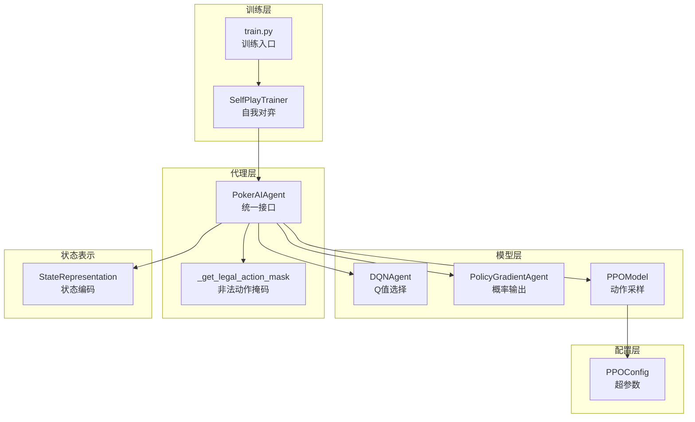
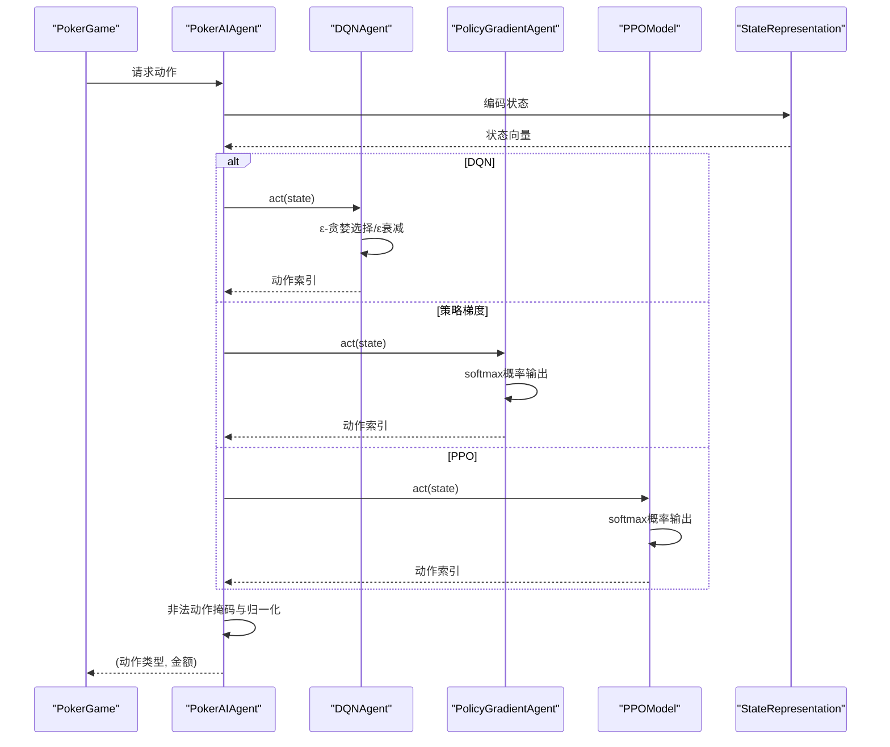
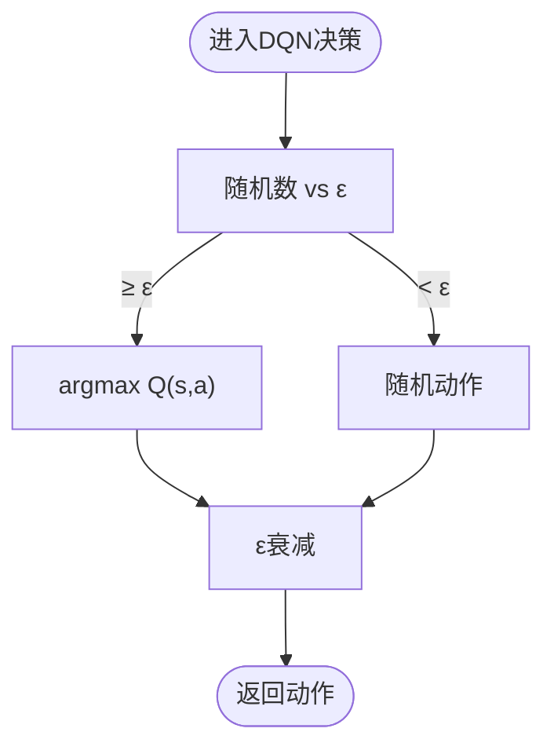
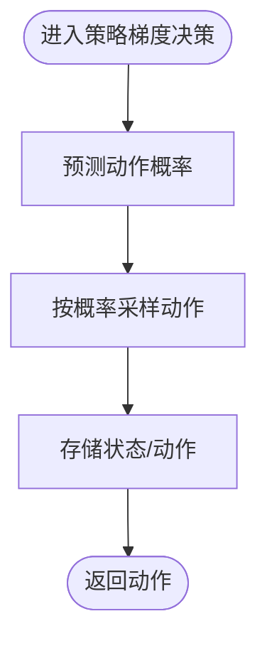
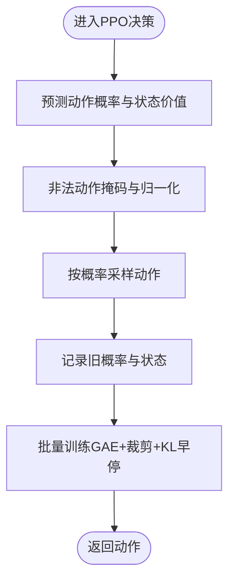
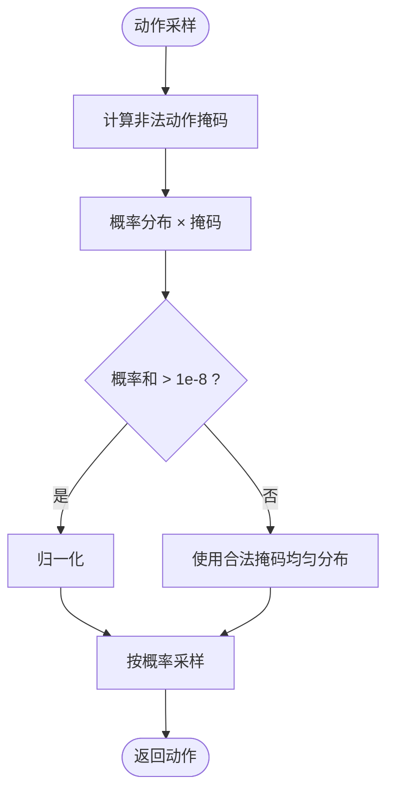
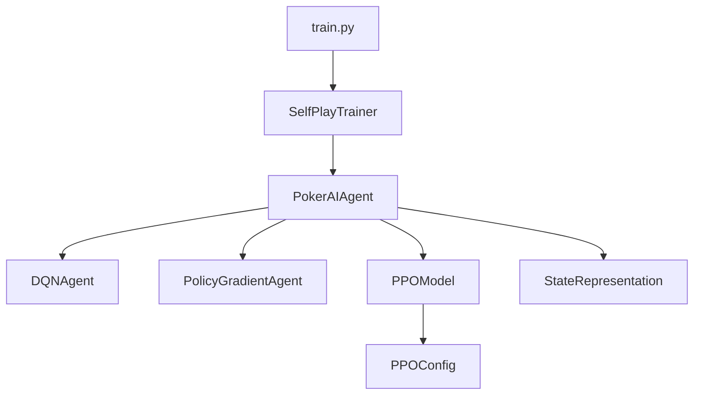

# 算法对比分析

<cite>
**本文引用的文件**
- [dqn_agent.py](file://poker_ai/model/dqn_agent.py)
- [ppo_model.py](file://poker_ai/model/ppo_model.py)
- [ai_agent.py](file://poker_ai/model/ai_agent.py)
- [ppo_config.py](file://poker_ai/config/ppo_config.py)
- [state_representation.py](file://poker_ai/model/state_representation.py)
- [self_play_trainer.py](file://poker_ai/reward/self_play_trainer.py)
- [train.py](file://train.py)
</cite>

## 目录
1. [简介](#简介)
2. [项目结构](#项目结构)
3. [核心组件](#核心组件)
4. [架构概览](#架构概览)
5. [详细组件分析](#详细组件分析)
6. [依赖分析](#依赖分析)
7. [性能考量](#性能考量)
8. [故障排除指南](#故障排除指南)
9. [结论](#结论)
10. [附录](#附录)

## 简介
本技术文档聚焦于三种强化学习算法在德州扑克AI中的概率分布计算与决策机制对比：深度Q网络（DQN）、策略梯度（Policy Gradient）与近端策略优化（PPO）。通过对代码库的深入分析，我们将系统阐述三者在以下方面的差异与特点：
- 概率分布计算方式：DQN的Q值选择、策略梯度的概率输出、PPO的动作采样过程
- 非法动作处理策略：概率归一化与掩码应用的差异
- 数值稳定性与性能优化：包括混合精度、梯度裁剪、学习率调度等
- 适用场景与选择标准：基于算法特性与训练效率的实践建议

## 项目结构
该项目围绕德州扑克游戏框架构建，包含状态表示、智能体代理、训练器与配置模块。核心文件组织如下：
- 模型层：DQN与策略梯度代理、PPO模型
- 代理层：统一的PokerAIAgent接口，负责动作选择与训练协调
- 配置层：PPO超参数配置
- 训练层：自我对弈训练器与训练脚本
- 状态表示：将游戏状态编码为神经网络输入

图表来源
- [ai_agent.py:15-53](file://poker_ai/model/ai_agent.py#L15-L53)
- [dqn_agent.py:21-120](file://poker_ai/model/dqn_agent.py#L21-L120)
- [ppo_model.py:20-110](file://poker_ai/model/ppo_model.py#L20-L110)
- [ppo_config.py:18-96](file://poker_ai/config/ppo_config.py#L18-L96)
- [self_play_trainer.py:48-166](file://poker_ai/reward/self_play_trainer.py#L48-L166)
- [train.py:136-238](file://train.py#L136-L238)
- [state_representation.py:9-46](file://poker_ai/model/state_representation.py#L9-L46)

章节来源
- [ai_agent.py:15-53](file://poker_ai/model/ai_agent.py#L15-L53)
- [dqn_agent.py:21-120](file://poker_ai/model/dqn_agent.py#L21-L120)
- [ppo_model.py:20-110](file://poker_ai/model/ppo_model.py#L20-L110)
- [ppo_config.py:18-96](file://poker_ai/config/ppo_config.py#L18-L96)
- [self_play_trainer.py:48-166](file://poker_ai/reward/self_play_trainer.py#L48-L166)
- [train.py:136-238](file://train.py#L136-L238)
- [state_representation.py:9-46](file://poker_ai/model/state_representation.py#L9-L46)

## 核心组件
本节概述三种算法的核心实现要点与差异：
- DQN：通过Q网络输出动作的Q值，使用ε-贪婪策略在探索与利用之间平衡。动作选择基于argmax Q(s,a)。
- 策略梯度：策略网络输出动作概率分布（softmax），动作按概率采样，通过蒙特卡洛回报进行训练。
- PPO：双网络（Actor/Critic）输出动作概率分布，使用重要性采样比率与裁剪机制进行策略更新，具备KL散度早停与自适应熵正则。

章节来源
- [dqn_agent.py:127-176](file://poker_ai/model/dqn_agent.py#L127-L176)
- [dqn_agent.py:216-326](file://poker_ai/model/dqn_agent.py#L216-L326)
- [ppo_model.py:200-274](file://poker_ai/model/ppo_model.py#L200-L274)
- [ppo_model.py:497-638](file://poker_ai/model/ppo_model.py#L497-L638)

## 架构概览
下图展示了三种算法在统一代理接口下的决策流程与训练交互：

图表来源
- [ai_agent.py:117-155](file://poker_ai/model/ai_agent.py#L117-L155)
- [dqn_agent.py:127-143](file://poker_ai/model/dqn_agent.py#L127-L143)
- [dqn_agent.py:262-278](file://poker_ai/model/dqn_agent.py#L262-L278)
- [ppo_model.py:347-372](file://poker_ai/model/ppo_model.py#L347-L372)
- [state_representation.py:137-158](file://poker_ai/model/state_representation.py#L137-L158)

## 详细组件分析

### DQN：Q值选择与ε-贪婪探索
- 决策机制：DQN通过Q网络输出每个动作的Q值，动作选择遵循ε-贪婪策略。当随机数小于ε时随机选择动作，否则选择argmax Q(s,a)。
- 训练流程：经验回放（经验池）采样mini-batch，目标Q值为即时奖励或折扣最大下一时刻Q值，使用均方误差损失进行更新。
- ε衰减：每步更新ε，逐步降低探索程度，最终收敛到确定性策略。
- 数值稳定性：使用tf.function预编译推理与训练函数，减少Python调度开销；损失函数为MSE，无需显式归一化。

图表来源
- [dqn_agent.py:127-176](file://poker_ai/model/dqn_agent.py#L127-L176)

章节来源
- [dqn_agent.py:21-120](file://poker_ai/model/dqn_agent.py#L21-L120)
- [dqn_agent.py:127-176](file://poker_ai/model/dqn_agent.py#L127-L176)
- [dqn_agent.py:144-176](file://poker_ai/model/dqn_agent.py#L144-L176)

### 策略梯度：概率输出与蒙特卡洛回报
- 决策机制：策略网络输出动作概率分布（softmax），动作按概率采样。该策略为随机策略，适合策略梯度的REINFORCE风格更新。
- 训练流程：收集回合内的状态、动作与回报，使用折扣回报进行训练；可对回报进行标准化以提升稳定性。
- 数值稳定性：softmax输出概率分布，采样时使用numpy的choice函数；损失函数为交叉熵，训练时对回报进行折扣与标准化。

图表来源
- [dqn_agent.py:262-326](file://poker_ai/model/dqn_agent.py#L262-L326)

章节来源
- [dqn_agent.py:216-326](file://poker_ai/model/dqn_agent.py#L216-L326)

### PPO：动作采样与重要性采样比率
- 决策机制：PPO同样输出动作概率分布（softmax），动作按概率采样。与策略梯度不同，PPO在训练时使用重要性采样比率与裁剪机制，限制策略更新幅度。
- 训练流程：计算GAE优势估计，使用重要性采样比率与裁剪后的目标函数进行策略更新；同时更新价值网络，使用裁剪的价值损失；具备KL散度早停与自适应熵正则。
- 数值稳定性：大量使用1e-8常数进行数值稳定；对优势进行标准化；使用clip_by_global_norm进行梯度裁剪；混合精度环境下统一转换为float32进行损失计算。

图表来源
- [ppo_model.py:276-320](file://poker_ai/model/ppo_model.py#L276-L320)
- [ppo_model.py:497-638](file://poker_ai/model/ppo_model.py#L497-L638)

章节来源
- [ppo_model.py:106-198](file://poker_ai/model/ppo_model.py#L106-L198)
- [ppo_model.py:276-320](file://poker_ai/model/ppo_model.py#L276-L320)
- [ppo_model.py:497-638](file://poker_ai/model/ppo_model.py#L497-L638)

### 非法动作处理策略对比
三种算法在处理非法动作时采用不同的策略：
- DQN：不直接处理非法动作掩码，动作选择基于Q值排序，非法动作通常在状态编码或动作解码阶段被规避。
- 策略梯度：不直接处理非法动作掩码，动作按概率分布采样。
- PPO：在动作采样前应用非法动作掩码，对合法动作的概率进行归一化，若归一化后概率和过小，则使用合法掩码的均匀分布作为后备。

图表来源
- [ai_agent.py:15-53](file://poker_ai/model/ai_agent.py#L15-L53)
- [ai_agent.py:125-152](file://poker_ai/model/ai_agent.py#L125-L152)
- [ai_agent.py:157-214](file://poker_ai/model/ai_agent.py#L157-L214)

章节来源
- [ai_agent.py:15-53](file://poker_ai/model/ai_agent.py#L15-L53)
- [ai_agent.py:125-152](file://poker_ai/model/ai_agent.py#L125-L152)
- [ai_agent.py:157-214](file://poker_ai/model/ai_agent.py#L157-L214)

### 数值稳定性与性能优化
- 数值稳定性：三种算法广泛使用1e-8常数进行log与除法的数值稳定；PPO在重要性采样比率、KL散度与熵损失中均采用稳定的对数形式；混合精度环境下统一转换为float32进行损失计算。
- 性能优化：PPO大量使用tf.function进行预编译，减少Python调度开销；使用clip_by_global_norm进行梯度裁剪；具备学习率warmup与cosine衰减；支持梯度累积与批内padding以固定形状；GAE向量化实现提升优势计算效率。
- 训练效率：PPO配置默认batch_size较大（如256），并行worker较多，适合大规模GPU资源；DQN与策略梯度在较小batch下也能稳定训练。

章节来源
- [ppo_model.py:106-198](file://poker_ai/model/ppo_model.py#L106-L198)
- [ppo_model.py:276-320](file://poker_ai/model/ppo_model.py#L276-L320)
- [ppo_model.py:472-566](file://poker_ai/model/ppo_model.py#L472-L566)
- [train.py:55-135](file://train.py#L55-L135)

## 依赖分析
- PokerAIAgent依赖StateRepresentation进行状态编码与动作解码，同时根据算法类型委托到DQNAgent、PolicyGradientAgent或PPOModel。
- PPOModel依赖PPOConfig进行超参数配置，训练器SelfPlayTrainer负责并行采样与批量训练。
- 训练脚本train.py根据硬件档位自动调整并行参数与batch size，以最大化GPU利用率。

图表来源
- [ai_agent.py:55-115](file://poker_ai/model/ai_agent.py#L55-L115)
- [ppo_model.py:33-93](file://poker_ai/model/ppo_model.py#L33-L93)
- [ppo_config.py:18-96](file://poker_ai/config/ppo_config.py#L18-L96)
- [self_play_trainer.py:48-166](file://poker_ai/reward/self_play_trainer.py#L48-L166)
- [train.py:136-238](file://train.py#L136-L238)

章节来源
- [ai_agent.py:55-115](file://poker_ai/model/ai_agent.py#L55-L115)
- [ppo_model.py:33-93](file://poker_ai/model/ppo_model.py#L33-L93)
- [ppo_config.py:18-96](file://poker_ai/config/ppo_config.py#L18-L96)
- [self_play_trainer.py:48-166](file://poker_ai/reward/self_play_trainer.py#L48-L166)
- [train.py:136-238](file://train.py#L136-L238)

## 性能考量
- GPU与混合精度：PPO默认启用混合精度与XLA JIT，显著提升训练速度；train.py根据硬件档位自动设置并行参数与batch size。
- 并行采样：SelfPlayTrainer支持多worker并行采样，减少环境交互延迟；PPO通过更大的batch与轨迹累计提升GPU利用率。
- 梯度裁剪与学习率调度：PPO使用clip_by_global_norm与warmup+cosine衰减，提升训练稳定性与收敛速度。
- 状态表示：StateRepresentation将手牌、公共牌、玩家状态、位置信息与活跃人数等特征拼接为高维向量，为算法提供丰富的决策依据。

章节来源
- [train.py:55-135](file://train.py#L55-L135)
- [self_play_trainer.py:1393-1404](file://poker_ai/reward/self_play_trainer.py#L1393-L1404)
- [ppo_model.py:106-198](file://poker_ai/model/ppo_model.py#L106-L198)
- [state_representation.py:137-158](file://poker_ai/model/state_representation.py#L137-L158)

## 故障排除指南
- PPO更新跳过：当出现DNN/Graph相关错误时，训练器会记录警告并跳过该批次更新，建议尝试禁用XLA或oneDNN以缓解问题。
- 权重加载失败：DQN与策略梯度的权重文件路径格式要求严格，需确保扩展名为.h5；PPO权重需同时存在actor与critic权重文件。
- 探索参数设置：DQN的ε、ε_min与ε_decay可通过代理接口设置，注意范围约束与日志输出。

章节来源
- [ai_agent.py:321-331](file://poker_ai/model/ai_agent.py#L321-L331)
- [dqn_agent.py:178-206](file://poker_ai/model/dqn_agent.py#L178-L206)
- [dqn_agent.py:523-552](file://poker_ai/model/dqn_agent.py#L523-L552)

## 结论
- DQN适用于需要明确Q值估计与ε-贪婪探索的场景，训练稳定但策略可能过早收敛。
- 策略梯度适合随机策略学习，实现简单，但在高方差回报下需要回报标准化与较长的回合长度。
- PPO在稳定性与样本效率方面表现优异，具备裁剪、KL早停与自适应熵正则等先进机制，适合大规模GPU资源与复杂状态空间的训练任务。
- 在德州扑克场景中，PPO通常能获得更好的泛化能力与训练稳定性，尤其在6-Max环境中结合强大的状态表示与并行采样策略。

## 附录
- 适用场景与选择标准
  - 选择PPO：追求高样本效率与策略稳定性，具备充足GPU资源与大规模并行采样能力。
  - 选择DQN：需要明确的Q值估计与确定性策略，或在资源受限环境下进行快速原型验证。
  - 选择策略梯度：简单快速的策略学习，适合教学与小规模实验。
- 代码示例路径
  - DQN动作选择：[dqn_agent.py:127-143](file://poker_ai/model/dqn_agent.py#L127-L143)
  - 策略梯度动作选择：[dqn_agent.py:262-278](file://poker_ai/model/dqn_agent.py#L262-L278)
  - PPO动作选择与掩码归一化：[ai_agent.py:125-152](file://poker_ai/model/ai_agent.py#L125-L152)
  - PPO训练流程（GAE、裁剪、KL早停）：[ppo_model.py:497-638](file://poker_ai/model/ppo_model.py#L497-L638)
  - 状态编码与动作解码：[state_representation.py:137-158](file://poker_ai/model/state_representation.py#L137-L158)