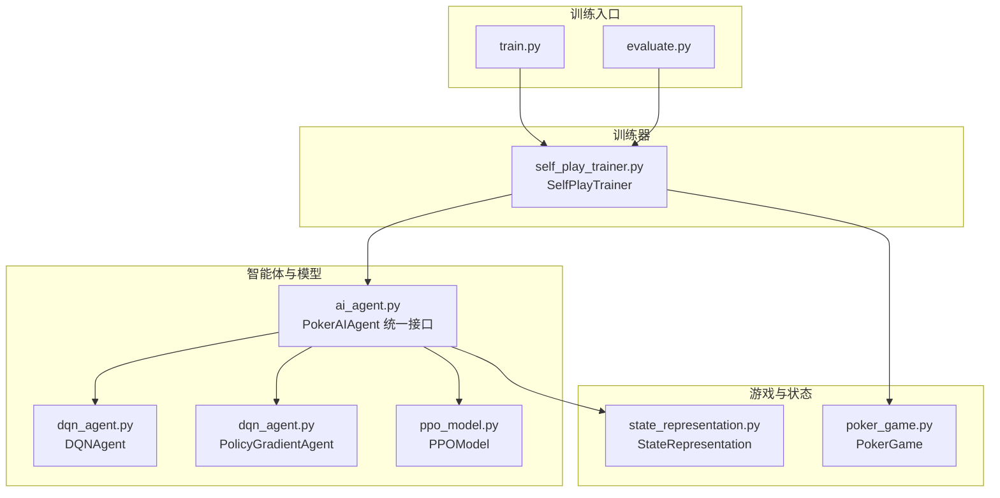
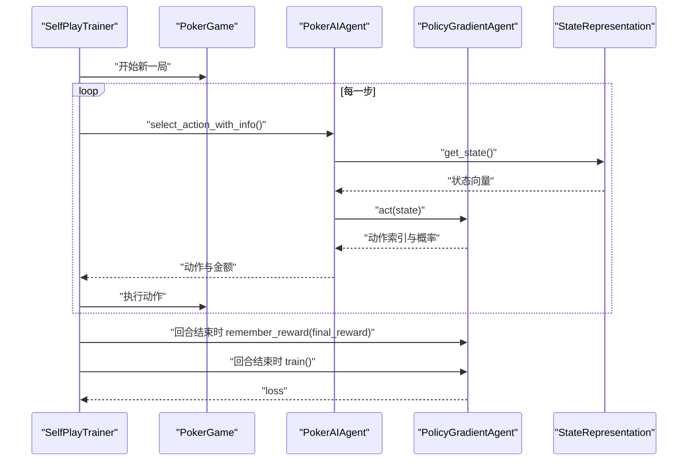
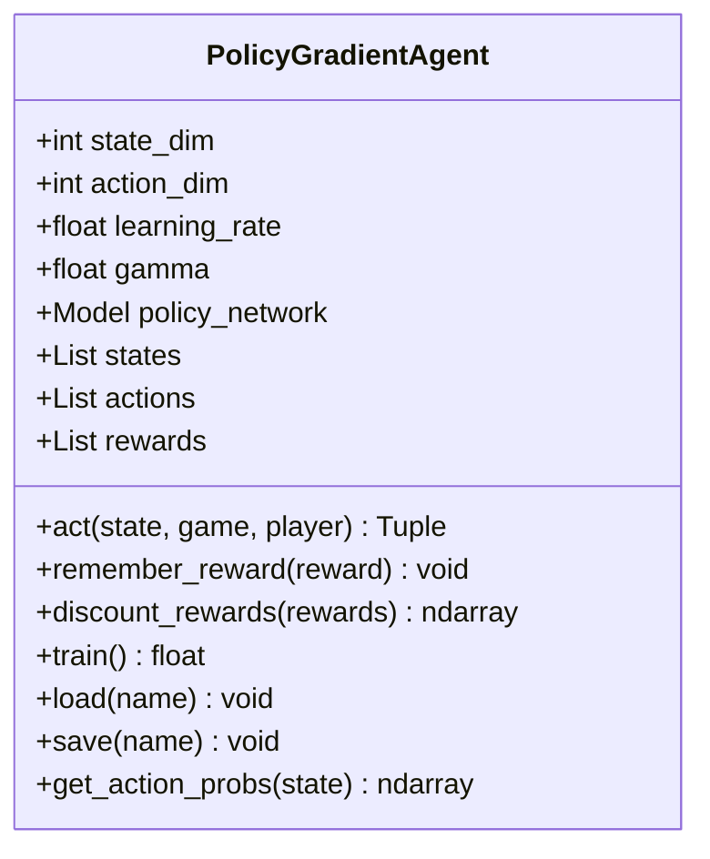
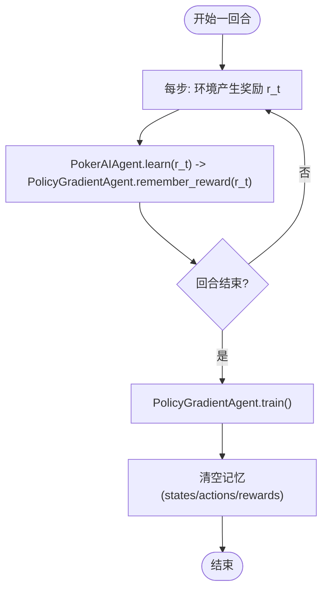
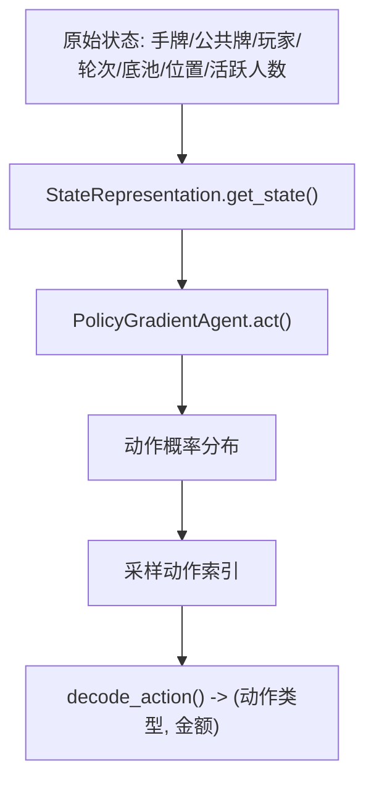
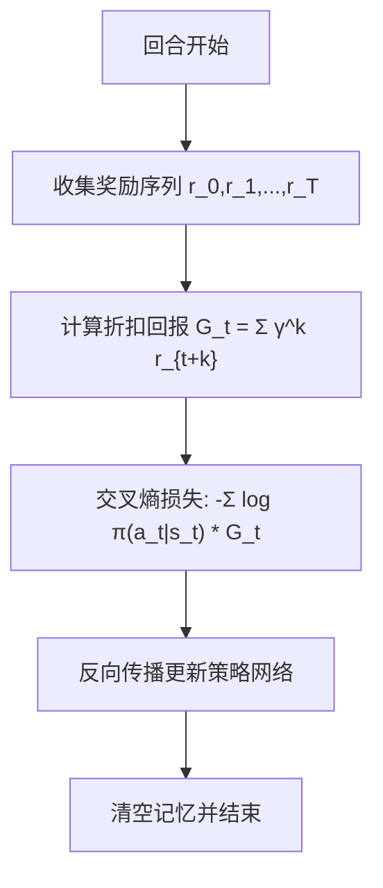
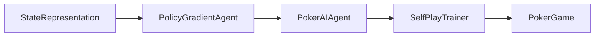

# 策略梯度算法

<cite>
**本文引用的文件**
- [ai_agent.py](file://poker_ai/model/ai_agent.py)
- [dqn_agent.py](file://poker_ai/model/dqn_agent.py)
- [ppo_model.py](file://poker_ai/model/ppo_model.py)
- [self_play_trainer.py](file://poker_ai/reward/self_play_trainer.py)
- [state_representation.py](file://poker_ai/model/state_representation.py)
- [train.py](file://train.py)
- [evaluate.py](file://evaluate.py)
- [README.md](file://README.md)
</cite>

## 目录
1. [简介](#简介)
2. [项目结构](#项目结构)
3. [核心组件](#核心组件)
4. [架构总览](#架构总览)
5. [详细组件分析](#详细组件分析)
6. [依赖关系分析](#依赖关系分析)
7. [性能考量](#性能考量)
8. [故障排查指南](#故障排查指南)
9. [结论](#结论)
10. [附录](#附录)

## 简介
本技术文档围绕策略梯度（Policy Gradient）在德州扑克AI中的实现展开，重点解释REINFORCE算法、策略网络参数化、梯度估计、损失设计、训练时机与信用分配问题，并结合代码库中的PolicyGradientAgent类与训练框架，给出可操作的参数设置建议与调试技巧。同时讨论策略梯度在德州扑克中的优势与局限，如对探索的要求、收敛性与稳定性问题。

## 项目结构
该项目采用模块化组织，围绕“游戏环境—状态表示—智能体—训练器—奖励与评估”的链路构建。策略梯度相关的核心实现位于模型层，训练与评估通过独立脚本驱动。

**图表来源**
- [train.py:1-856](file://train.py#L1-L856)
- [evaluate.py:1-753](file://evaluate.py#L1-L753)
- [ai_agent.py:55-116](file://poker_ai/model/ai_agent.py#L55-L116)
- [dqn_agent.py:216-326](file://poker_ai/model/dqn_agent.py#L216-L326)
- [ppo_model.py:20-105](file://poker_ai/model/ppo_model.py#L20-L105)
- [self_play_trainer.py:48-136](file://poker_ai/reward/self_play_trainer.py#L48-L136)
- [state_representation.py:9-46](file://poker_ai/model/state_representation.py#L9-L46)

**章节来源**
- [README.md:46-75](file://README.md#L46-L75)
- [train.py:136-238](file://train.py#L136-L238)
- [evaluate.py:110-142](file://evaluate.py#L110-L142)

## 核心组件
- PokerAIAgent：统一代理接口，支持DQN、策略梯度、PPO三种算法类型，负责动作选择、学习接口与决策信息输出。
- PolicyGradientAgent：策略梯度智能体，使用神经网络直接参数化策略π(a|s)，通过REINFORCE估计梯度。
- SelfPlayTrainer：自我对弈训练器，封装并行采样、奖励计算、轨迹收集与训练触发逻辑。
- StateRepresentation：状态编码器，将6-max德州扑克的复杂状态压缩为高维向量，供策略网络输入。
- PPOModel：Actor-Critic近端策略优化实现，作为对比与扩展。

**章节来源**
- [ai_agent.py:55-116](file://poker_ai/model/ai_agent.py#L55-L116)
- [dqn_agent.py:216-326](file://poker_ai/model/dqn_agent.py#L216-L326)
- [self_play_trainer.py:48-136](file://poker_ai/reward/self_play_trainer.py#L48-L136)
- [state_representation.py:9-46](file://poker_ai/model/state_representation.py#L9-L46)
- [ppo_model.py:20-105](file://poker_ai/model/ppo_model.py#L20-L105)

## 架构总览
策略梯度在本项目中的工作流如下：
- 环境：SelfPlayTrainer驱动6-max对局，实时产生状态与动作序列。
- 状态表示：StateRepresentation将手牌、公共牌、玩家状态、轮次、底池、位置等信息编码为统一向量。
- 策略网络：PolicyGradientAgent基于状态向量输出动作概率分布，采样动作并记录轨迹。
- 奖励与训练：回合结束时，SelfPlayTrainer计算最终奖励，PokerAIAgent将奖励传递给策略梯度代理，后者在回合结束时进行一次批量训练，使用折扣回报作为目标标签。

**图表来源**
- [self_play_trainer.py:260-417](file://poker_ai/reward/self_play_trainer.py#L260-L417)
- [ai_agent.py:248-263](file://poker_ai/model/ai_agent.py#L248-L263)
- [dqn_agent.py:262-308](file://poker_ai/model/dqn_agent.py#L262-L308)
- [state_representation.py:137-158](file://poker_ai/model/state_representation.py#L137-L158)

## 详细组件分析

### PolicyGradientAgent 类详解
- 策略网络结构：输入为状态向量，隐藏层采用ReLU激活，输出为5维动作概率（softmax），对应fold/call/raise x2/raise x4/all-in。
- 动作采样：使用tf.function预编译推理，加速单步动作选择。
- 记忆与训练：
  - remember_reward：累积回合内即时奖励。
  - train：对当前回合的（状态，动作，折扣回报）进行一次训练，清空记忆。
- 损失函数：使用categorical_crossentropy，将动作标签设为one-hot，标签强度为折扣回报，从而将策略梯度转化为交叉熵最小化问题。

**图表来源**
- [dqn_agent.py:216-326](file://poker_ai/model/dqn_agent.py#L216-L326)

**章节来源**
- [dqn_agent.py:216-326](file://poker_ai/model/dqn_agent.py#L216-L326)

### PokerAIAgent 与训练时机
- 统一接口：根据agent_type选择DQN、策略梯度或PPO。
- 策略梯度学习：learn(reward, ...)在PG分支中仅调用remember_reward，真正的训练在done=True时触发，即回合结束时。
- 决策信息：get_decision_info在PG分支返回动作概率与最可能动作，便于调试与可视化。

**图表来源**
- [ai_agent.py:248-263](file://poker_ai/model/ai_agent.py#L248-L263)
- [dqn_agent.py:291-308](file://poker_ai/model/dqn_agent.py#L291-L308)

**章节来源**
- [ai_agent.py:248-263](file://poker_ai/model/ai_agent.py#L248-L263)
- [dqn_agent.py:291-308](file://poker_ai/model/dqn_agent.py#L291-L308)

### 状态表示与动作解码
- 状态维度：手牌、公共牌、所有玩家状态、轮次、底池、位置、活跃人数等，合计134维。
- 动作解码：将动作概率向量解码为动作类型与金额，遵循德州扑克规则（最小加注、合法掩码等）。

**图表来源**
- [state_representation.py:137-158](file://poker_ai/model/state_representation.py#L137-L158)
- [state_representation.py:225-247](file://poker_ai/model/state_representation.py#L225-L247)
- [dqn_agent.py:262-278](file://poker_ai/model/dqn_agent.py#L262-L278)

**章节来源**
- [state_representation.py:137-158](file://poker_ai/model/state_representation.py#L137-L158)
- [state_representation.py:225-247](file://poker_ai/model/state_representation.py#L225-L247)
- [dqn_agent.py:262-278](file://poker_ai/model/dqn_agent.py#L262-L278)

### 训练流程与信用分配
- REINFORCE估计：对回合内每个时间步，使用从该步开始的累积折扣回报作为动作的“回报”，作为策略梯度的基线。
- 优势函数：本实现未显式使用优势函数，而是直接以折扣回报作为标签强度，这等价于使用回报作为优势估计。
- 信用分配：由于在回合结束时才训练，策略梯度能够将最终结果（赢/输、利润）回溯到此前每一步动作，缓解信用分配难题。

**图表来源**
- [dqn_agent.py:280-289](file://poker_ai/model/dqn_agent.py#L280-L289)
- [dqn_agent.py:291-308](file://poker_ai/model/dqn_agent.py#L291-L308)

**章节来源**
- [dqn_agent.py:280-289](file://poker_ai/model/dqn_agent.py#L280-L289)
- [dqn_agent.py:291-308](file://poker_ai/model/dqn_agent.py#L291-L308)

### 代码示例：策略梯度学习过程
以下为策略梯度学习过程的代码路径示例（不包含具体代码内容）：
- 记忆奖励：[dqn_agent.py:310-311](file://poker_ai/model/dqn_agent.py#L310-L311)
- 回合结束训练：[dqn_agent.py:291-308](file://poker_ai/model/dqn_agent.py#L291-L308)
- 代理接口转发：[ai_agent.py:248-263](file://poker_ai/model/ai_agent.py#L248-L263)
- 自我对弈中最终奖励与训练触发：[self_play_trainer.py:368-403](file://poker_ai/reward/self_play_trainer.py#L368-L403)

**章节来源**
- [dqn_agent.py:291-311](file://poker_ai/model/dqn_agent.py#L291-L311)
- [ai_agent.py:248-263](file://poker_ai/model/ai_agent.py#L248-L263)
- [self_play_trainer.py:368-403](file://poker_ai/reward/self_play_trainer.py#L368-L403)

## 依赖关系分析
- PokerAIAgent依赖StateRepresentation进行状态编码，并根据agent_type委托到不同智能体实现。
- PolicyGradientAgent内部依赖Keras Sequential模型与Adam优化器，使用categorical_crossentropy作为损失。
- SelfPlayTrainer负责并行采样与奖励计算，将最终奖励传递给PokerAIAgent，进而触发策略梯度训练。

**图表来源**
- [ai_agent.py:73-116](file://poker_ai/model/ai_agent.py#L73-L116)
- [dqn_agent.py:246-260](file://poker_ai/model/dqn_agent.py#L246-L260)
- [self_play_trainer.py:214-224](file://poker_ai/reward/self_play_trainer.py#L214-L224)

**章节来源**
- [ai_agent.py:73-116](file://poker_ai/model/ai_agent.py#L73-L116)
- [dqn_agent.py:246-260](file://poker_ai/model/dqn_agent.py#L246-L260)
- [self_play_trainer.py:214-224](file://poker_ai/reward/self_play_trainer.py#L214-L224)

## 性能考量
- 预编译与加速：PolicyGradientAgent与DQNAgent均使用tf.function预编译推理，减少Python调用开销。
- 批量训练：策略梯度在回合结束时进行一次训练，避免频繁小批量更新带来的开销。
- 状态维度：134维状态向量经多层神经网络压缩到动作概率，需关注模型深度与正则化以避免过拟合。
- 探索与稳定性：策略梯度对探索要求较高，可通过奖励塑形（如“轻量反塌缩”惩罚）与熵正则（PPO）缓解策略塌缩。

[本节为通用指导，无需代码来源]

## 故障排查指南
- 训练不收敛或表现不佳
  - 检查学习率是否过高或过低：策略梯度对学习率敏感。
  - 检查奖励塑形：确认最终奖励计算与回合结束时的训练触发逻辑。
  - 参考路径：[self_play_trainer.py:368-403](file://poker_ai/reward/self_play_trainer.py#L368-L403)
- 模型保存/加载失败
  - 确认文件扩展名与路径格式，PG使用“.weights.h5”后缀。
  - 参考路径：[dqn_agent.py:313-322](file://poker_ai/model/dqn_agent.py#L313-L322)
- 探索不足导致策略塌缩
  - 可参考PPO的熵正则与KL早停机制，或在奖励中加入轻量塑形惩罚。
  - 参考路径：[ppo_model.py:449-470](file://poker_ai/model/ppo_model.py#L449-L470)

**章节来源**
- [self_play_trainer.py:368-403](file://poker_ai/reward/self_play_trainer.py#L368-L403)
- [dqn_agent.py:313-322](file://poker_ai/model/dqn_agent.py#L313-L322)
- [ppo_model.py:449-470](file://poker_ai/model/ppo_model.py#L449-L470)

## 结论
策略梯度在德州扑克中的优势在于直接学习策略π(a|s)，避免价值函数估计误差的传播；通过回合结束时的批量训练与折扣回报作为标签，能较好地处理信用分配问题。然而，策略梯度对探索与超参数较为敏感，需配合奖励塑形与适当的正则化策略（如熵正则）以提升稳定性与收敛性。本项目提供了清晰的接口与高效的实现，便于进一步扩展与调试。

[本节为总结，无需代码来源]

## 附录

### 参数设置建议
- 学习率：建议从0.001起步，观察loss与收益变化后微调。
- 折扣因子γ：0.95左右通常能平衡短期与长期回报。
- 状态维度：134维，注意正则化与Dropout的使用（策略梯度网络中可谨慎使用）。
- 探索策略：策略梯度本身不使用ε-贪婪，可通过奖励塑形与熵正则维持探索。

[本节为通用指导，无需代码来源]

### 调试技巧
- 使用get_decision_info查看动作概率与最可能动作，定位策略异常。
- 在回合结束时打印最终奖励与loss，确认训练触发。
- 对比不同模型类型（DQN vs PG vs PPO）以评估策略梯度的收益与稳定性。

**章节来源**
- [ai_agent.py:421-452](file://poker_ai/model/ai_agent.py#L421-L452)
- [dqn_agent.py:291-308](file://poker_ai/model/dqn_agent.py#L291-L308)