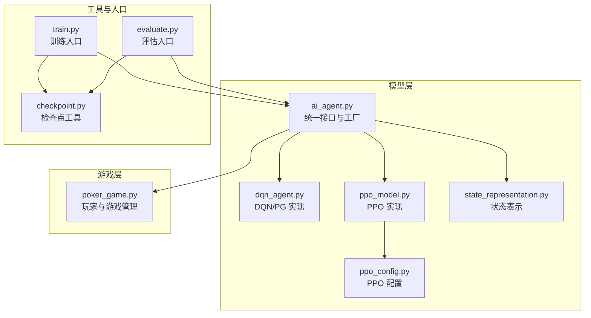
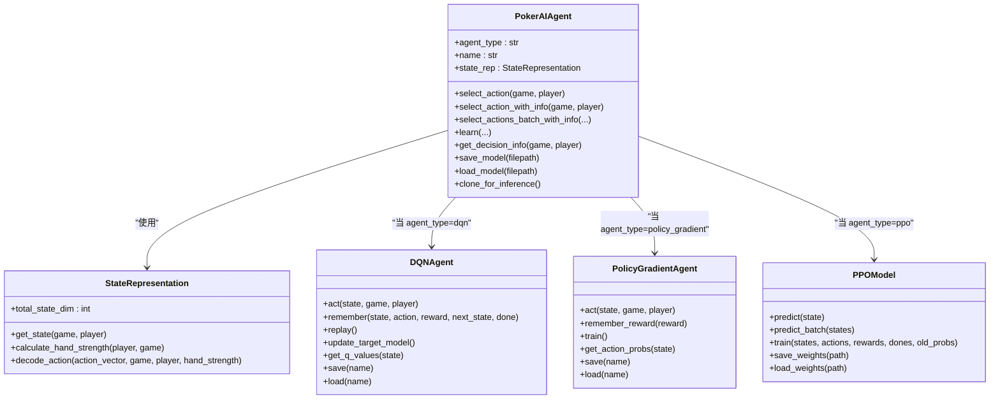
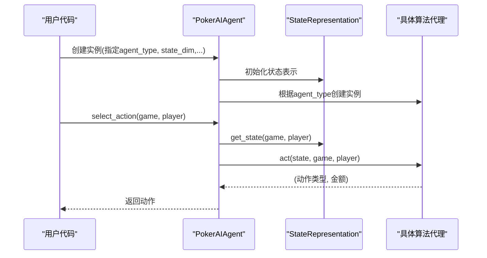
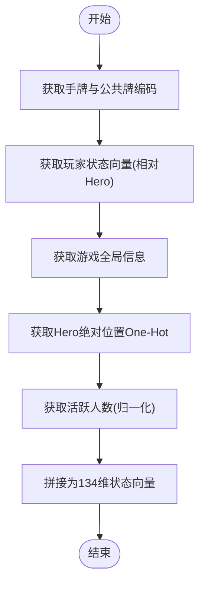
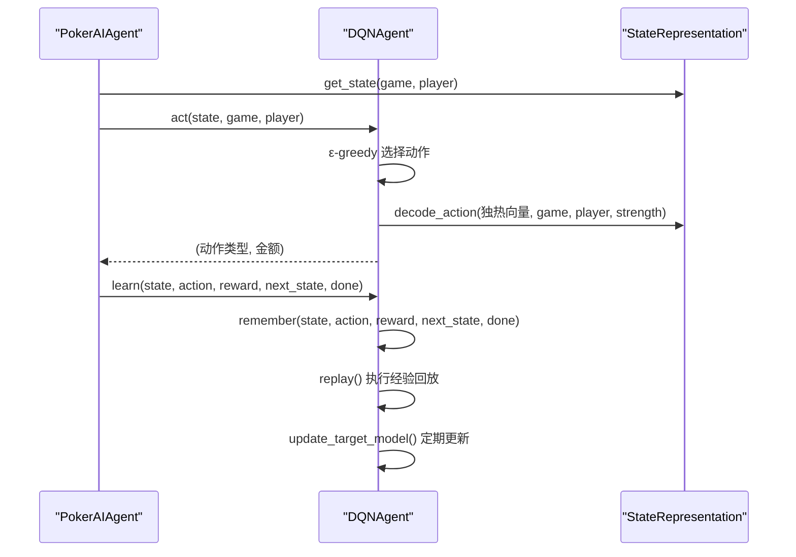
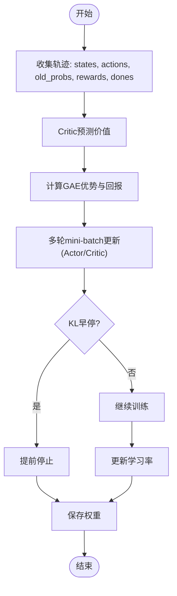
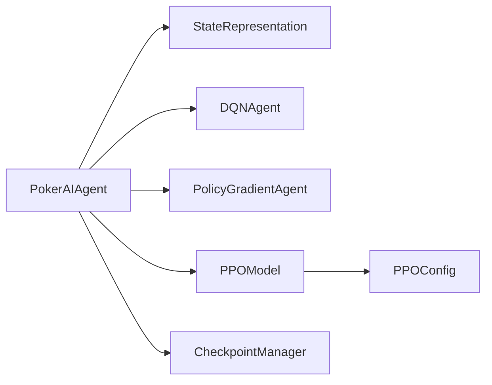

# 统一接口设计

<cite>
**本文引用的文件**
- [ai_agent.py](file://poker_ai/model/ai_agent.py)
- [dqn_agent.py](file://poker_ai/model/dqn_agent.py)
- [ppo_model.py](file://poker_ai/model/ppo_model.py)
- [state_representation.py](file://poker_ai/model/state_representation.py)
- [ppo_config.py](file://poker_ai/config/ppo_config.py)
- [poker_game.py](file://poker_ai/game/poker_game.py)
- [checkpoint.py](file://poker_ai/utils/checkpoint.py)
- [train.py](file://train.py)
- [evaluate.py](file://evaluate.py)
</cite>

## 目录
1. [简介](#简介)
2. [项目结构](#项目结构)
3. [核心组件](#核心组件)
4. [架构总览](#架构总览)
5. [详细组件分析](#详细组件分析)
6. [依赖分析](#依赖分析)
7. [性能考量](#性能考量)
8. [故障排查指南](#故障排查指南)
9. [结论](#结论)
10. [附录](#附录)

## 简介
本技术文档围绕统一的 PokerAIAgent 接口设计展开，系统阐述其如何通过统一抽象支持 DQN、策略梯度、PPO 三类强化学习算法。文档重点包括：
- 统一接口设计理念与工厂模式实现
- 关键构造参数（agent_type、state_dim、target_update_freq 等）的作用与配置方法
- 状态表示与 AI 决策的集成机制（StateRepresentation 与 134 维状态向量）
- 推理克隆（clone_for_inference）、模型保存/加载与检查点管理
- 扩展性与兼容性设计（EnsembleAgent、批量动作选择、轨迹级学习）

## 项目结构
仓库采用按领域分层的组织方式：模型层（ai_agent、dqn_agent、ppo_model、state_representation、hand_evaluator）、游戏层（cards、poker_game）、奖励与自博弈（reward、self_play_trainer）、工具（utils/checkpoint）、入口脚本（train.py、evaluate.py）等。

**图示来源**
- [ai_agent.py:55-116](file://poker_ai/model/ai_agent.py#L55-L116)
- [dqn_agent.py:21-62](file://poker_ai/model/dqn_agent.py#L21-L62)
- [ppo_model.py:20-58](file://poker_ai/model/ppo_model.py#L20-L58)
- [state_representation.py:9-46](file://poker_ai/model/state_representation.py#L9-L46)
- [ppo_config.py:18-34](file://poker_ai/config/ppo_config.py#L18-L34)
- [poker_game.py:9-26](file://poker_ai/game/poker_game.py#L9-L26)
- [checkpoint.py:17-56](file://poker_ai/utils/checkpoint.py#L17-L56)
- [train.py:136-200](file://train.py#L136-L200)
- [evaluate.py:110-142](file://evaluate.py#L110-L142)

**章节来源**
- [ai_agent.py:55-116](file://poker_ai/model/ai_agent.py#L55-L116)
- [state_representation.py:12-46](file://poker_ai/model/state_representation.py#L12-L46)
- [ppo_config.py:33-34](file://poker_ai/config/ppo_config.py#L33-L34)

## 核心组件
- PokerAIAgent：统一接口，内部持有具体算法代理（DQN、策略梯度、PPO），负责状态编码、动作选择、学习与推理克隆。
- DQNAgent/PolicyGradientAgent：DQN 与策略梯度算法实现，提供动作选择、经验回放与训练。
- PPOModel：PPO 算法实现，包含 Actor/Critic 双网络、GAE 优势估计、自适应熵正则、KL 早停等。
- StateRepresentation：将游戏状态编码为 134 维向量，包含手牌、公共牌、玩家信息、位置与活跃人数等特征。
- PPOConfig：集中管理 PPO 超参数，确保默认值与硬件优化档位一致。
- PokerGame/Player：游戏与玩家数据结构，为状态表示与动作合法性提供输入。
- CheckpointManager：检查点保存/加载工具，兼容多种模型保存格式。

**章节来源**
- [ai_agent.py:55-116](file://poker_ai/model/ai_agent.py#L55-L116)
- [dqn_agent.py:21-62](file://poker_ai/model/dqn_agent.py#L21-L62)
- [ppo_model.py:20-58](file://poker_ai/model/ppo_model.py#L20-L58)
- [state_representation.py:9-46](file://poker_ai/model/state_representation.py#L9-L46)
- [ppo_config.py:18-34](file://poker_ai/config/ppo_config.py#L18-L34)
- [poker_game.py:9-26](file://poker_ai/game/poker_game.py#L9-L26)
- [checkpoint.py:17-56](file://poker_ai/utils/checkpoint.py#L17-L56)

## 架构总览
统一接口通过工厂模式在构造时根据 agent_type 动态创建具体代理实例，屏蔽算法差异，对外暴露一致的 select_action、learn、get_decision_info、save/load 等方法。状态表示层将复杂的游戏状态转换为固定维度的向量，供各算法统一消费。

**图示来源**
- [ai_agent.py:55-116](file://poker_ai/model/ai_agent.py#L55-L116)
- [dqn_agent.py:21-62](file://poker_ai/model/dqn_agent.py#L21-L62)
- [dqn_agent.py:127-176](file://poker_ai/model/dqn_agent.py#L127-L176)
- [dqn_agent.py:216-326](file://poker_ai/model/dqn_agent.py#L216-L326)
- [ppo_model.py:20-58](file://poker_ai/model/ppo_model.py#L20-L58)
- [state_representation.py:9-46](file://poker_ai/model/state_representation.py#L9-L46)

## 详细组件分析

### 工厂模式与统一接口
- 构造函数参数
  - agent_type：选择算法类型（'dqn'、'policy_gradient'、'ppo'）
  - state_dim：状态维度，若为 None 则自动使用 StateRepresentation.total_state_dim
  - target_update_freq：DQN 目标网络更新频率（仅 DQN 有效）
  - learning_rate、optimizer：学习率与优化器（DQN/PG/PPO 可用）
  - ppo_*：PPO 专属参数（clip_epsilon、update_epochs、entropy_coef、batch_size、update_min_steps）
- 工厂逻辑：根据 agent_type 分支创建对应代理实例，封装到 PokerAIAgent 内部，外部仅感知统一接口。
- 推理克隆：clone_for_inference 保留初始化参数与权重，便于并行采样与推理。

**图示来源**
- [ai_agent.py:58-116](file://poker_ai/model/ai_agent.py#L58-L116)
- [ai_agent.py:117-155](file://poker_ai/model/ai_agent.py#L117-L155)
- [state_representation.py:137-158](file://poker_ai/model/state_representation.py#L137-L158)

**章节来源**
- [ai_agent.py:58-116](file://poker_ai/model/ai_agent.py#L58-L116)
- [ai_agent.py:489-516](file://poker_ai/model/ai_agent.py#L489-L516)

### 状态表示与134维状态向量
- 维度构成（合计134维）：
  - 玩家手牌：52维（13种点数 × 4种花色）
  - 公共牌：52维
  - 玩家信息：6人 × 3特征（栈额、下注、是否活跃）= 18维
  - 游戏全局信息：轮次、底池、当前下注、大盲、小盲 = 5维
  - Hero绝对位置 One-Hot：6维（BTN/SB/BB/UTG/MP/CO）
  - 活跃玩家数量：1维（归一化）
- 编码与解码：
  - get_state：拼接上述特征得到固定长度向量
  - calculate_hand_strength：估算手牌强度，用于动作解码时的金额决策
  - decode_action：将独热动作向量解码为动作类型与金额

**图示来源**
- [state_representation.py:137-158](file://poker_ai/model/state_representation.py#L137-L158)
- [state_representation.py:66-97](file://poker_ai/model/state_representation.py#L66-L97)
- [state_representation.py:160-169](file://poker_ai/model/state_representation.py#L160-L169)
- [state_representation.py:99-124](file://poker_ai/model/state_representation.py#L99-L124)
- [state_representation.py:126-135](file://poker_ai/model/state_representation.py#L126-L135)

**章节来源**
- [state_representation.py:12-46](file://poker_ai/model/state_representation.py#L12-L46)
- [state_representation.py:137-158](file://poker_ai/model/state_representation.py#L137-L158)
- [state_representation.py:225-247](file://poker_ai/model/state_representation.py#L225-L247)

### DQN 代理
- 主要能力：ε-greedy 动作选择、经验回放、目标网络更新、Q 值预测
- 关键参数：state_dim、action_dim、learning_rate、gamma、epsilon、epsilon_min、epsilon_decay、memory_size、batch_size、target_update_freq、optimizer
- 学习流程：记忆经验 → 抽样 mini-batch → 计算目标 Q → 训练 → ε衰减 → 定期更新目标网络

**图示来源**
- [ai_agent.py:117-155](file://poker_ai/model/ai_agent.py#L117-L155)
- [dqn_agent.py:127-176](file://poker_ai/model/dqn_agent.py#L127-L176)

**章节来源**
- [dqn_agent.py:24-62](file://poker_ai/model/dqn_agent.py#L24-L62)
- [dqn_agent.py:127-176](file://poker_ai/model/dqn_agent.py#L127-L176)

### 策略梯度代理
- 主要能力：动作概率预测、折扣奖励、策略梯度训练
- 关键参数：state_dim、action_dim、learning_rate、gamma
- 学习流程：记录状态与动作 → 回合结束时计算折扣奖励 → 训练策略网络 → 清空缓存

**章节来源**
- [dqn_agent.py:219-326](file://poker_ai/model/dqn_agent.py#L219-L326)

### PPO 代理
- 主要能力：Actor/Critic 双网络、GAE 优势估计、PPO 更新、自适应熵正则、KL 早停、学习率调度
- 关键参数：input_dim（应与 state_dim 一致）、clip_epsilon、gamma、lambda_、entropy_coef、update_epochs、batch_size、lr 等
- 学习流程：收集轨迹（状态、动作、旧概率、奖励、完成标志）→ 计算价值与优势 → 多轮 mini-batch 更新 → 自适应调节熵系数与学习率

**图示来源**
- [ppo_model.py:497-638](file://poker_ai/model/ppo_model.py#L497-L638)

**章节来源**
- [ppo_model.py:33-58](file://poker_ai/model/ppo_model.py#L33-L58)
- [ppo_model.py:497-638](file://poker_ai/model/ppo_model.py#L497-L638)
- [ppo_config.py:33-66](file://poker_ai/config/ppo_config.py#L33-L66)

### 推理克隆与批量动作选择
- clone_for_inference：复制初始化参数与权重，设置 DQN 探索参数，便于并行 worker 使用。
- select_actions_batch_with_info：PPO 支持批量前向推理，避免重复状态编码；其他算法退化为逐条调用，保持兼容。
- append_step/finish_trajectory/flush_pending_updates：PPO 轨迹级学习接口，支持批量写入与阈值触发训练。

**章节来源**
- [ai_agent.py:489-516](file://poker_ai/model/ai_agent.py#L489-L516)
- [ai_agent.py:157-214](file://poker_ai/model/ai_agent.py#L157-L214)
- [ai_agent.py:388-420](file://poker_ai/model/ai_agent.py#L388-L420)

### 模型保存/加载与检查点管理
- PokerAIAgent.save_model/load_model：委托底层代理保存/加载。
- CheckpointManager：统一保存权重、元数据，支持 .weights/.pkl/.h5 等多种格式。
- 兼容性接口：save/load 方法别名，便于与 CheckpointManager 对接。

**章节来源**
- [ai_agent.py:454-476](file://poker_ai/model/ai_agent.py#L454-L476)
- [checkpoint.py:17-56](file://poker_ai/utils/checkpoint.py#L17-L56)

### 扩展性与兼容性设计
- EnsembleAgent：集成多个 AI 代理，通过投票机制选择动作，便于对比与融合策略。
- get_decision_info：为不同算法提供决策依据（Q 值、动作概率、状态价值等）。
- 入口脚本：train.py/evaluate.py 提供命令行参数解析与硬件优化档位，支持自动并行 worker 数与 PPO 批次策略。

**章节来源**
- [ai_agent.py:555-658](file://poker_ai/model/ai_agent.py#L555-L658)
- [train.py:136-200](file://train.py#L136-L200)
- [evaluate.py:110-142](file://evaluate.py#L110-L142)

## 依赖分析
- 组件耦合
  - PokerAIAgent 与 StateRepresentation 强耦合（状态编码），与具体算法弱耦合（通过工厂）
  - PPOModel 依赖 PPOConfig，提供默认超参数与硬件优化
  - CheckpointManager 与各算法保存接口解耦，统一保存/加载
- 外部依赖
  - TensorFlow/Keras：DQN/PG/PPO 的神经网络实现与优化器
  - NumPy：向量运算与批处理
  - 日志系统：统一记录训练/推理与错误信息

**图示来源**
- [ai_agent.py:55-116](file://poker_ai/model/ai_agent.py#L55-L116)
- [ppo_model.py:20-58](file://poker_ai/model/ppo_model.py#L20-L58)
- [ppo_config.py:18-34](file://poker_ai/config/ppo_config.py#L18-L34)
- [checkpoint.py:17-56](file://poker_ai/utils/checkpoint.py#L17-L56)

**章节来源**
- [ai_agent.py:55-116](file://poker_ai/model/ai_agent.py#L55-L116)
- [ppo_model.py:20-58](file://poker_ai/model/ppo_model.py#L20-L58)

## 性能考量
- 预编译与混合精度：DQN/PG/PPO 使用 tf.function 预编译推理/训练函数，PPO 支持 LossScaleOptimizer 与混合精度，提升 GPU 利用率。
- 向量化与批处理：PPO 的 GAE 与 Critic 预测采用固定形状批处理，避免 retracing 警告；批量动作选择减少 Python 调度开销。
- 学习率调度与早停：PPO 支持 warmup + cosine 衰减、KL 散度早停与自适应熵系数，提升稳定性与收敛效率。
- 硬件优化档位：train.py 内置 rtx4090d/rtx3090_112cpu 档位，自动设置并行 worker、batch_size、XLA、混合精度等参数。

**章节来源**
- [dqn_agent.py:64-77](file://poker_ai/model/dqn_agent.py#L64-L77)
- [dqn_agent.py:178-207](file://poker_ai/model/dqn_agent.py#L178-L207)
- [ppo_model.py:106-198](file://poker_ai/model/ppo_model.py#L106-L198)
- [ppo_model.py:420-448](file://poker_ai/model/ppo_model.py#L420-L448)
- [train.py:55-97](file://train.py#L55-L97)

## 故障排查指南
- PPO 训练报错（DNN/Graph 错误）：统一捕获并记录警告，建议尝试禁用 XLA/OneDNN 后重跑。
- 权重文件不存在或格式不匹配：检查路径与后缀（.weights.h5/.actor.weights.h5/.critic.weights.h5），使用 CheckpointManager 统一保存/加载。
- 探索参数异常：DQN 的 epsilon/epsilon_min/epsilon_decay 会被裁剪到合理范围并记录日志。
- 动作合法性：内部通过合法掩码确保动作选择符合规则，若出现异常可检查 _get_legal_action_mask 的逻辑。

**章节来源**
- [ai_agent.py:321-331](file://poker_ai/model/ai_agent.py#L321-L331)
- [ai_agent.py:523-552](file://poker_ai/model/ai_agent.py#L523-L552)
- [checkpoint.py:58-104](file://poker_ai/utils/checkpoint.py#L58-L104)

## 结论
PokerAIAgent 通过统一接口与工厂模式，成功屏蔽了 DQN、策略梯度、PPO 的算法差异，实现了状态表示与决策流程的高度一致性。配合 134 维状态向量、轨迹级学习、推理克隆与检查点管理，既保证了扩展性与兼容性，又兼顾了性能与稳定性。在实际部署中，建议结合硬件档位自动优化参数，并通过 EnsembleAgent 与 get_decision_info 辅助策略分析与对比。

## 附录

### 构造函数参数详解与配置方法
- agent_type：'dqn'、'policy_gradient'、'ppo'
- state_dim：若为 None，则使用 StateRepresentation.total_state_dim（134）
- target_update_freq：DQN 目标网络更新频率（仅 DQN 有效）
- learning_rate、optimizer：学习率与优化器（DQN/PG/PPO 可用）
- ppo_*：PPO 专属参数（clip_epsilon、update_epochs、entropy_coef、batch_size、update_min_steps）

**章节来源**
- [ai_agent.py:58-88](file://poker_ai/model/ai_agent.py#L58-L88)
- [state_representation.py:32-39](file://poker_ai/model/state_representation.py#L32-L39)
- [ppo_config.py:33-66](file://poker_ai/config/ppo_config.py#L33-L66)

### 工厂模式实现与动态创建
- 根据 agent_type 分支创建对应代理实例，封装到 PokerAIAgent 内部，外部仅感知统一接口。

**章节来源**
- [ai_agent.py:90-112](file://poker_ai/model/ai_agent.py#L90-L112)

### 状态表示与 AI 决策集成机制
- StateRepresentation 将游戏状态编码为 134 维向量，PokerAIAgent 在动作选择前调用 get_state，随后将状态传递给具体算法代理。

**章节来源**
- [state_representation.py:137-158](file://poker_ai/model/state_representation.py#L137-L158)
- [ai_agent.py:130-155](file://poker_ai/model/ai_agent.py#L130-L155)

### 推理克隆与模型管理
- clone_for_inference：复制初始化参数与权重，设置 DQN 探索参数，便于并行采样。
- save/load：统一保存/加载接口，兼容 CheckpointManager。

**章节来源**
- [ai_agent.py:489-516](file://poker_ai/model/ai_agent.py#L489-L516)
- [ai_agent.py:454-476](file://poker_ai/model/ai_agent.py#L454-L476)
- [checkpoint.py:17-56](file://poker_ai/utils/checkpoint.py#L17-L56)

### 具体使用示例（路径参考）
- 创建 DQN 代理：[ai_agent.py:678-678](file://poker_ai/model/ai_agent.py#L678-L678)
- 创建 PPO 代理：[ai_agent.py:681-681](file://poker_ai/model/ai_agent.py#L681-L681)
- 创建集成代理：[ai_agent.py:684-684](file://poker_ai/model/ai_agent.py#L684-L684)
- 训练入口参数：[train.py:136-200](file://train.py#L136-L200)
- 评估入口参数：[evaluate.py:110-142](file://evaluate.py#L110-L142)