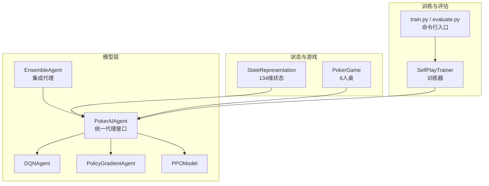
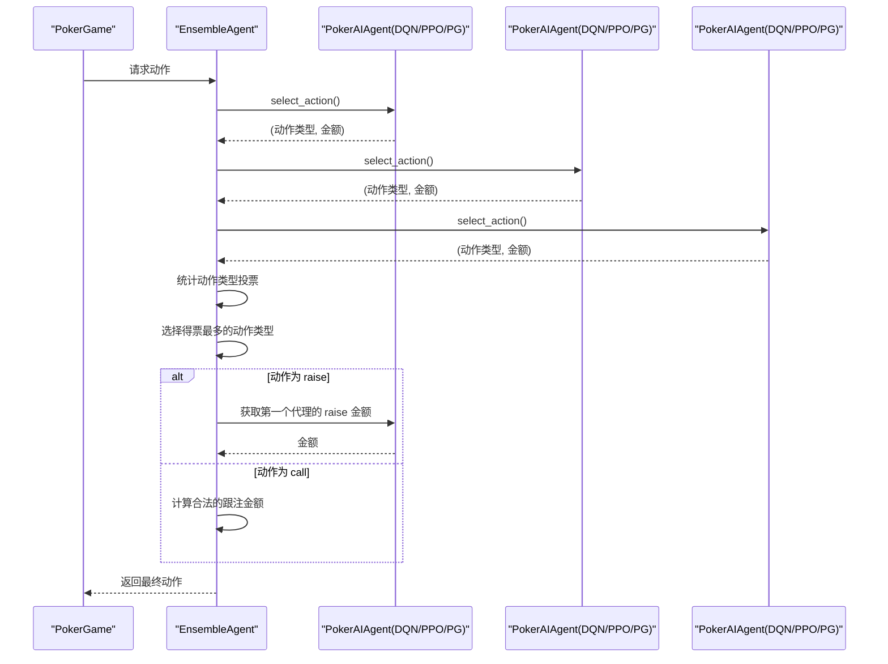
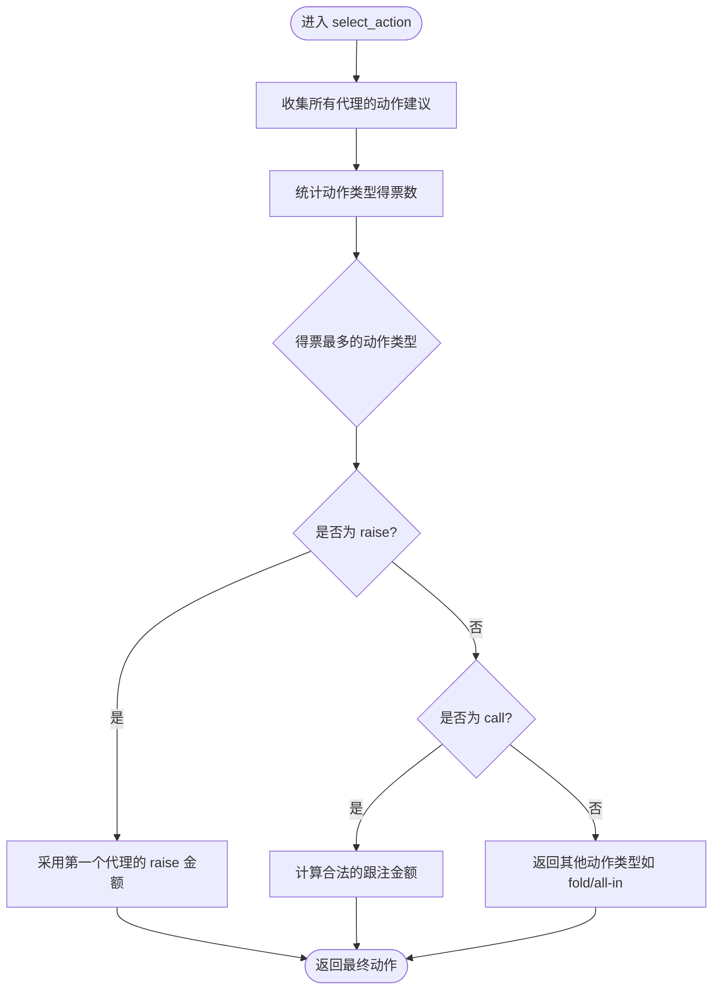
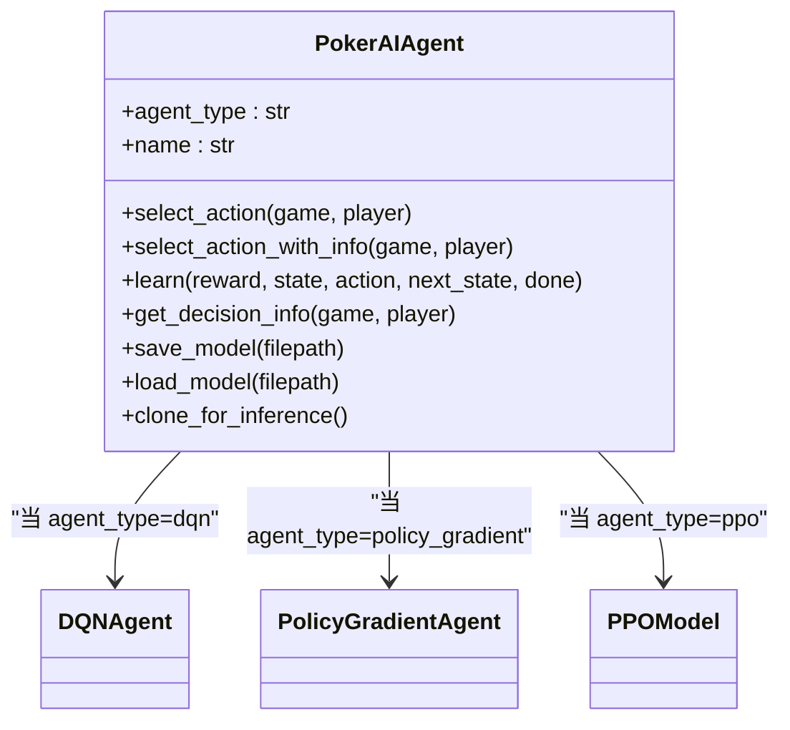
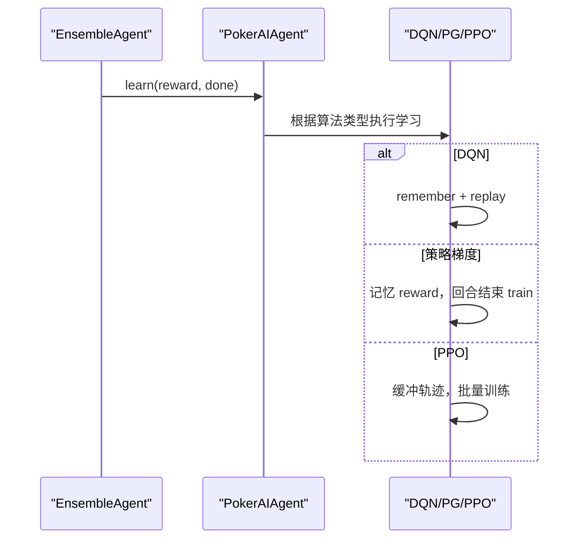
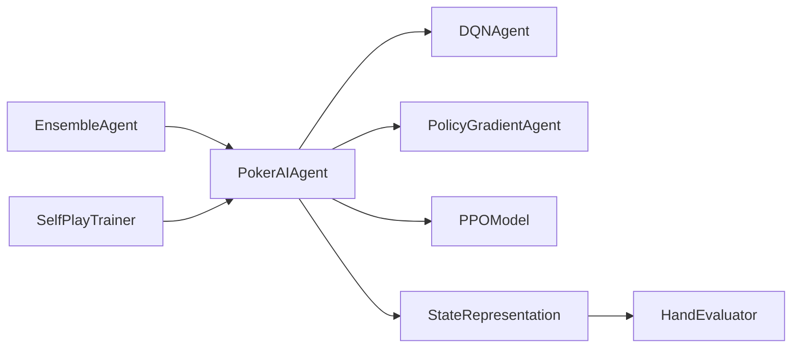

# 集成代理系统

<cite>
**本文引用的文件**
- [ai_agent.py](file://poker_ai/model/ai_agent.py)
- [dqn_agent.py](file://poker_ai/model/dqn_agent.py)
- [ppo_model.py](file://poker_ai/model/ppo_model.py)
- [state_representation.py](file://poker_ai/model/state_representation.py)
- [hand_evaluator.py](file://poker_ai/model/hand_evaluator.py)
- [poker_game.py](file://poker_ai/game/poker_game.py)
- [self_play_trainer.py](file://poker_ai/reward/self_play_trainer.py)
- [train.py](file://train.py)
- [evaluate.py](file://evaluate.py)
- [README.md](file://README.md)
</cite>

## 目录
1. [简介](#简介)
2. [项目结构](#项目结构)
3. [核心组件](#核心组件)
4. [架构总览](#架构总览)
5. [详细组件分析](#详细组件分析)
6. [依赖关系分析](#依赖关系分析)
7. [性能考量](#性能考量)
8. [故障排查指南](#故障排查指南)
9. [结论](#结论)
10. [附录](#附录)

## 简介
本文件面向“集成代理系统”，聚焦于 EnsembleAgent 的设计理念与投票机制，解释如何通过多个单一算法（DQN、策略梯度、PPO）的组合提升决策质量。文档涵盖：
- 投票策略的实现：动作类型统计、得票最多的动作选择、特殊情况处理（如 raise 金额、call 金额）。
- 集成代理初始化：如何根据 agent_types 列表创建不同类型的 AI 代理实例。
- learn 方法实现：如何同步更新所有集成的代理。
- 使用示例：select_action、get_decision_info、save_models 等方法的应用。
- 优势与局限性：决策准确性提升与计算成本增加的权衡。
- 优化建议与性能评估方法。

## 项目结构
该项目围绕德州扑克 6-Max 自我对弈训练展开，核心模块如下：
- 模型层：统一代理接口 PokerAIAgent，以及 DQN、策略梯度、PPO 三种算法实现。
- 状态表示：StateRepresentation 提供 134 维状态向量，包含玩家手牌、公共牌、玩家信息、全局信息、Hero 绝对位置、活跃人数等。
- 游戏逻辑：PokerGame 提供 6 人桌的完整流程与结算。
- 训练器：SelfPlayTrainer 负责并行采样、奖励计算、检查点与评估。
- 训练与评估脚本：train.py、evaluate.py 提供命令行入口与自动化流程。

**图表来源**
- [ai_agent.py:555-658](file://poker_ai/model/ai_agent.py#L555-L658)
- [dqn_agent.py:21-326](file://poker_ai/model/dqn_agent.py#L21-L326)
- [ppo_model.py:20-670](file://poker_ai/model/ppo_model.py#L20-L670)
- [state_representation.py:9-200](file://poker_ai/model/state_representation.py#L9-L200)
- [poker_game.py:155-200](file://poker_ai/game/poker_game.py#L155-L200)
- [self_play_trainer.py:48-200](file://poker_ai/reward/self_play_trainer.py#L48-L200)
- [train.py:136-238](file://train.py#L136-L238)
- [evaluate.py:110-142](file://evaluate.py#L110-L142)

**章节来源**
- [README.md:46-75](file://README.md#L46-L75)
- [ai_agent.py:555-658](file://poker_ai/model/ai_agent.py#L555-L658)
- [state_representation.py:12-46](file://poker_ai/model/state_representation.py#L12-L46)
- [poker_game.py:155-200](file://poker_ai/game/poker_game.py#L155-L200)
- [self_play_trainer.py:48-200](file://poker_ai/reward/self_play_trainer.py#L48-L200)
- [train.py:136-238](file://train.py#L136-L238)
- [evaluate.py:110-142](file://evaluate.py#L110-L142)

## 核心组件
- EnsembleAgent：集成多个 PokerAIAgent 的决策模型，采用“动作类型投票”的集成策略。
- PokerAIAgent：统一代理接口，内部根据 agent_type 选择 DQN、策略梯度或 PPO 实现，并提供 select_action、learn、get_decision_info、save/load 等方法。
- DQNAgent：深度 Q 网络，支持 ε-贪婪探索、经验回放与目标网络更新。
- PolicyGradientAgent：策略梯度，使用折扣奖励进行训练。
- PPOModel：Actor-Critic 近端策略优化，支持 GAE 优势估计、价值裁剪、自适应熵正则、学习率调度等。
- StateRepresentation：将游戏状态编码为 134 维向量，包含 Hero 绝对位置与活跃人数等关键特征。
- PokerGame：6 人桌德州扑克游戏流程与结算。
- SelfPlayTrainer：训练器，负责并行采样、奖励计算、对手更新与检查点管理。

**章节来源**
- [ai_agent.py:555-658](file://poker_ai/model/ai_agent.py#L555-L658)
- [dqn_agent.py:21-326](file://poker_ai/model/dqn_agent.py#L21-L326)
- [ppo_model.py:20-670](file://poker_ai/model/ppo_model.py#L20-L670)
- [state_representation.py:9-200](file://poker_ai/model/state_representation.py#L9-L200)
- [poker_game.py:155-200](file://poker_ai/game/poker_game.py#L155-L200)
- [self_play_trainer.py:48-200](file://poker_ai/reward/self_play_trainer.py#L48-L200)

## 架构总览
EnsembleAgent 的核心思想是“多数决定”。在每一步决策中：
- 所有子代理对同一状态给出动作建议（动作类型，如 fold/call/raise 等）。
- 统计各动作类型的得票数，选择得票最多的动作类型。
- 若该动作类型为 raise，则采用第一个代理的 raise 金额；若为 call，则使用当前合法的跟注金额。

**图表来源**
- [ai_agent.py:572-601](file://poker_ai/model/ai_agent.py#L572-L601)
- [ai_agent.py:117-155](file://poker_ai/model/ai_agent.py#L117-L155)
- [ai_agent.py:248-277](file://poker_ai/model/ai_agent.py#L248-L277)

## 详细组件分析

### EnsembleAgent 设计与投票机制
- 初始化：根据 agent_types 列表创建多个 PokerAIAgent 实例，共享 StateRepresentation。
- 动作选择：
  - 收集所有代理的动作建议，仅统计动作类型（如 fold/call/raise）。
  - 使用字典统计各动作类型的出现次数，选择得票最多的动作类型。
  - 特殊处理：
    - 若为 raise：采用第一个代理的 raise 金额，确保一致性。
    - 若为 call：根据当前底池与当前下注计算合法的跟注金额。
- 学习：对每个子代理调用 learn，实现同步更新。
- 决策信息：聚合各代理的决策信息，并统计动作投票分布。
- 模型持久化：提供 save_models/load_models，分别保存/加载每个子代理的权重。

**图表来源**
- [ai_agent.py:572-601](file://poker_ai/model/ai_agent.py#L572-L601)

**章节来源**
- [ai_agent.py:555-658](file://poker_ai/model/ai_agent.py#L555-L658)

### PokerAIAgent 初始化与代理类型
- 支持的 agent_type：'dqn'、'policy_gradient'、'ppo'。
- 初始化流程：
  - 创建 StateRepresentation，计算 state_dim。
  - 根据 agent_type 选择对应实现：
    - DQN：DQNAgent，支持 target_update_freq、optimizer 等。
    - 策略梯度：PolicyGradientAgent。
    - PPO：PPOModel，支持 clip_epsilon、update_epochs、entropy_coef、batch_size、update_min_steps 等。
  - 保存初始化参数，便于克隆推理副本。
- 克隆推理：clone_for_inference 用于并行采样，避免训练状态污染。

**图表来源**
- [ai_agent.py:58-116](file://poker_ai/model/ai_agent.py#L58-L116)
- [dqn_agent.py:21-126](file://poker_ai/model/dqn_agent.py#L21-L126)
- [ppo_model.py:33-105](file://poker_ai/model/ppo_model.py#L33-L105)

**章节来源**
- [ai_agent.py:58-116](file://poker_ai/model/ai_agent.py#L58-L116)
- [dqn_agent.py:21-126](file://poker_ai/model/dqn_agent.py#L21-L126)
- [ppo_model.py:33-105](file://poker_ai/model/ppo_model.py#L33-L105)

### learn 方法实现（同步更新）
- DQN：需要完整的经验元组（state, action, reward, next_state, done），内部调用 remember + replay。
- 策略梯度：仅记忆 reward，回合结束时 train。
- PPO：支持轨迹级学习（append_step + finish_trajectory），也可兼容单步 learn（内部缓冲并批量训练）。
- EnsembleAgent：对每个子代理调用 learn，实现同步更新。

**图表来源**
- [ai_agent.py:248-301](file://poker_ai/model/ai_agent.py#L248-L301)
- [dqn_agent.py:117-176](file://poker_ai/model/dqn_agent.py#L117-L176)
- [ppo_model.py:497-638](file://poker_ai/model/ppo_model.py#L497-L638)

**章节来源**
- [ai_agent.py:248-301](file://poker_ai/model/ai_agent.py#L248-L301)
- [dqn_agent.py:117-176](file://poker_ai/model/dqn_agent.py#L117-L176)
- [ppo_model.py:497-638](file://poker_ai/model/ppo_model.py#L497-L638)

### get_decision_info 与 save_models
- get_decision_info：返回各代理的决策依据（如 Q 值、动作概率、状态价值等），并统计集成投票分布。
- save_models/load_models：按 base_path 保存/加载每个子代理的权重文件。

**章节来源**
- [ai_agent.py:611-658](file://poker_ai/model/ai_agent.py#L611-L658)

### 使用示例（方法应用）
以下示例展示如何使用集成代理：
- select_action：获取集成代理的动作建议。
- get_decision_info：获取集成决策信息（包含各代理的决策依据与投票统计）。
- save_models：保存所有子代理的模型权重。
- load_models：加载所有子代理的模型权重。

注意：示例路径引用不包含具体代码内容，仅提供定位。

**章节来源**
- [ai_agent.py:572-658](file://poker_ai/model/ai_agent.py#L572-L658)
- [ai_agent.py:611-658](file://poker_ai/model/ai_agent.py#L611-L658)

## 依赖关系分析
- EnsembleAgent 依赖 PokerAIAgent，后者根据 agent_type 依赖 DQNAgent、PolicyGradientAgent 或 PPOModel。
- PokerAIAgent 依赖 StateRepresentation 生成状态向量，并在动作解码时使用手牌强度。
- StateRepresentation 依赖 HandEvaluator 计算手牌强度。
- SelfPlayTrainer 在训练过程中创建主代理与对手代理，支持集成模式（use_ensemble）。

**图表来源**
- [ai_agent.py:555-658](file://poker_ai/model/ai_agent.py#L555-L658)
- [dqn_agent.py:21-326](file://poker_ai/model/dqn_agent.py#L21-L326)
- [ppo_model.py:20-670](file://poker_ai/model/ppo_model.py#L20-L670)
- [state_representation.py:9-200](file://poker_ai/model/state_representation.py#L9-L200)
- [hand_evaluator.py:8-187](file://poker_ai/model/hand_evaluator.py#L8-L187)
- [self_play_trainer.py:167-200](file://poker_ai/reward/self_play_trainer.py#L167-L200)

**章节来源**
- [ai_agent.py:555-658](file://poker_ai/model/ai_agent.py#L555-L658)
- [state_representation.py:9-200](file://poker_ai/model/state_representation.py#L9-L200)
- [hand_evaluator.py:8-187](file://poker_ai/model/hand_evaluator.py#L8-L187)
- [self_play_trainer.py:167-200](file://poker_ai/reward/self_play_trainer.py#L167-L200)

## 性能考量
- 计算复杂度：EnsembleAgent 在每步决策中需要调用 N 个子代理的 select_action，整体为 O(N) 的动作选择开销。
- 决策一致性：对于 raise 动作，采用首个代理的金额，避免多代理金额不一致带来的不确定性。
- PPO 的批量训练：PPO 支持轨迹级批量训练，可通过 ppo_update_min_steps 控制累积步数，提升 GPU 利用率。
- 探索与稳定性：DQN 的 ε-贪婪与目标网络更新有助于稳定性；PPO 的 clip 与熵正则抑制过早塌缩。
- 线程与并行：SelfPlayTrainer 支持训练与评估并行 worker 数配置，结合 TensorFlow 线程参数可提升吞吐。

[本节为通用性能讨论，无需列出具体文件来源]

## 故障排查指南
- PPO 训练报错（DNN/Graph 错误）：PPOModel 在训练时捕获特定错误并记录警告，可尝试禁用 oneDNN 或调整 XLA 设置。
- 模型加载失败：PokerAIAgent 的 load_model 返回布尔值，需检查文件路径与格式。
- 硬件配置：train.py 提供硬件档位（如 rtx4090d）自动参数优化，可减少手动调参成本。
- 评估与演示：evaluate.py 与 train.py 的 --mode demo 提供快速验证路径。

**章节来源**
- [ai_agent.py:321-331](file://poker_ai/model/ai_agent.py#L321-L331)
- [ai_agent.py:454-462](file://poker_ai/model/ai_agent.py#L454-L462)
- [train.py:55-135](file://train.py#L55-L135)
- [evaluate.py:590-704](file://evaluate.py#L590-L704)

## 结论
EnsembleAgent 通过“动作类型投票”的方式整合多个单一算法的决策，能够在多数情况下提升决策质量。其优势在于：
- 多算法互补：不同算法在不同场景下的表现差异得到平衡。
- 决策一致性：对 raise 金额采用首个代理的建议，避免冲突。
- 易于扩展：通过 agent_types 列表即可灵活组合不同算法。

局限性包括：
- 计算成本：每步需要 N 次动作选择，推理与训练成本随代理数量线性增长。
- 一致性风险：若多个代理对同一状态给出相反动作类型，可能影响短期收益。
- 超参数敏感：不同算法的超参数需分别调优，集成后整体优化更复杂。

建议：
- 在资源允许的前提下，优先使用 PPO 作为子代理，结合轨迹级批量训练提升吞吐。
- 通过 get_decision_info 观察各代理的决策依据，识别潜在分歧并针对性优化。
- 使用 SelfPlayTrainer 的评估与检查点机制，持续监控性能变化。

[本节为总结性内容，无需列出具体文件来源]

## 附录
- 命令行训练与评估：参考 train.py 与 evaluate.py 的参数说明与示例。
- 6-Max 约束：SelfPlayTrainer 与 PokerGame 要求 num_players=6，状态表示为 6-Max 专用。

**章节来源**
- [README.md:184-210](file://README.md#L184-L210)
- [train.py:136-238](file://train.py#L136-L238)
- [evaluate.py:110-142](file://evaluate.py#L110-L142)
- [self_play_trainer.py:81-84](file://poker_ai/reward/self_play_trainer.py#L81-L84)
- [poker_game.py:157-164](file://poker_ai/game/poker_game.py#L157-L164)