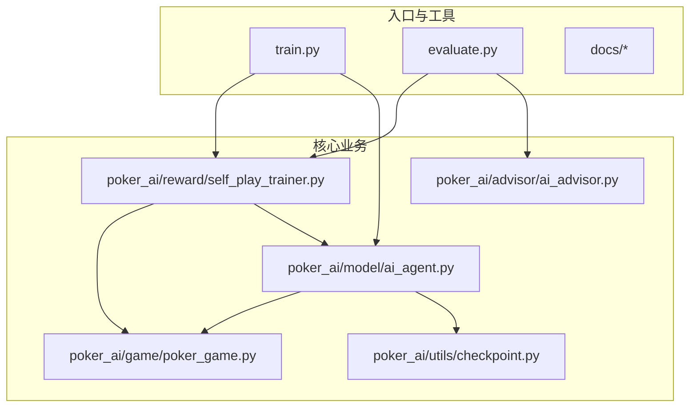
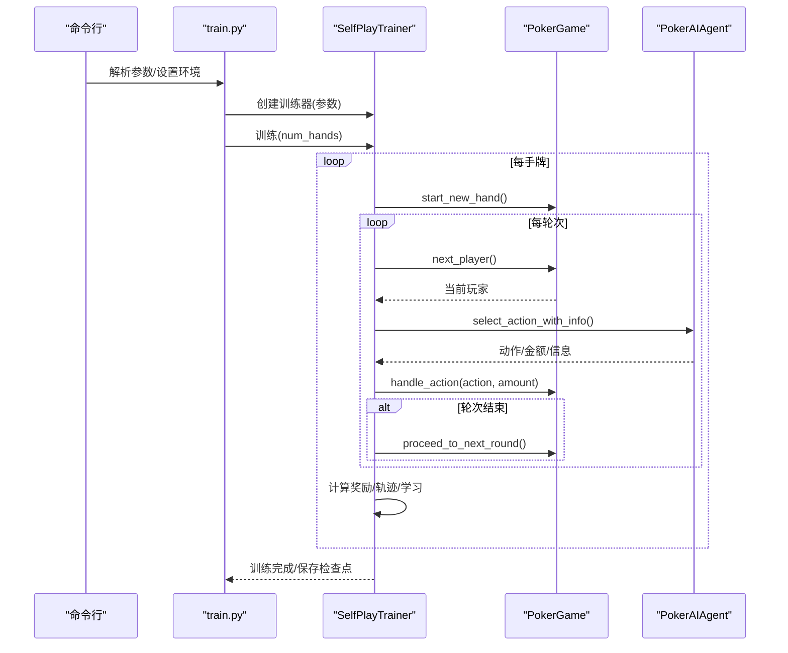
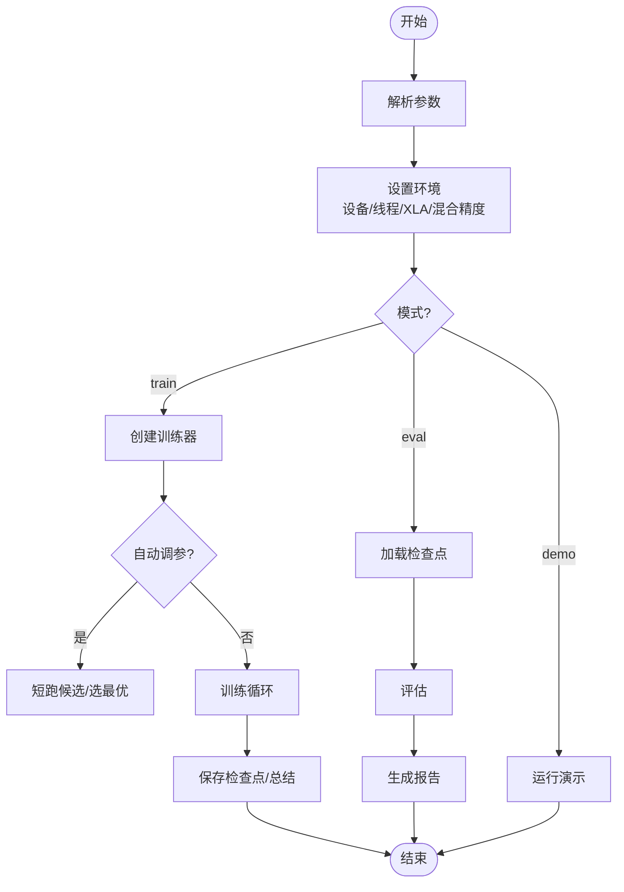
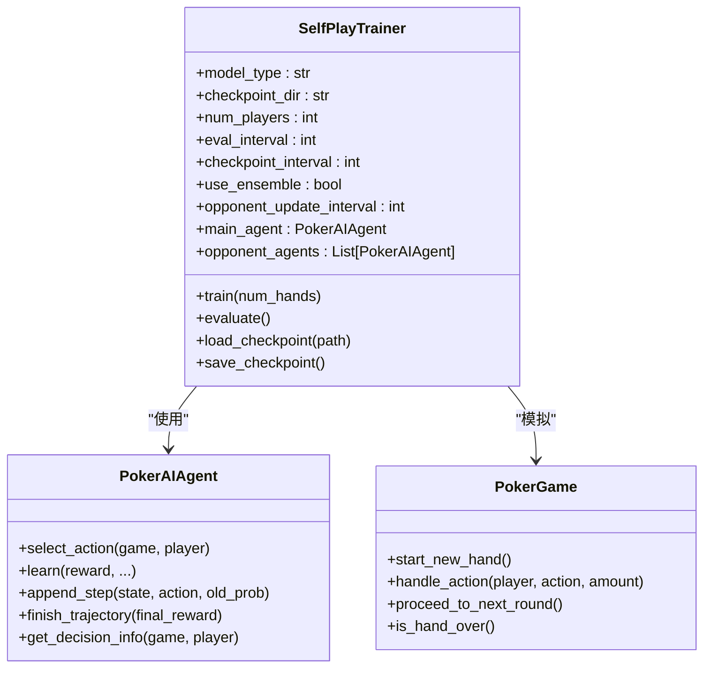
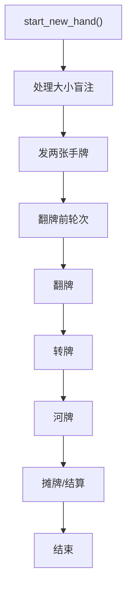
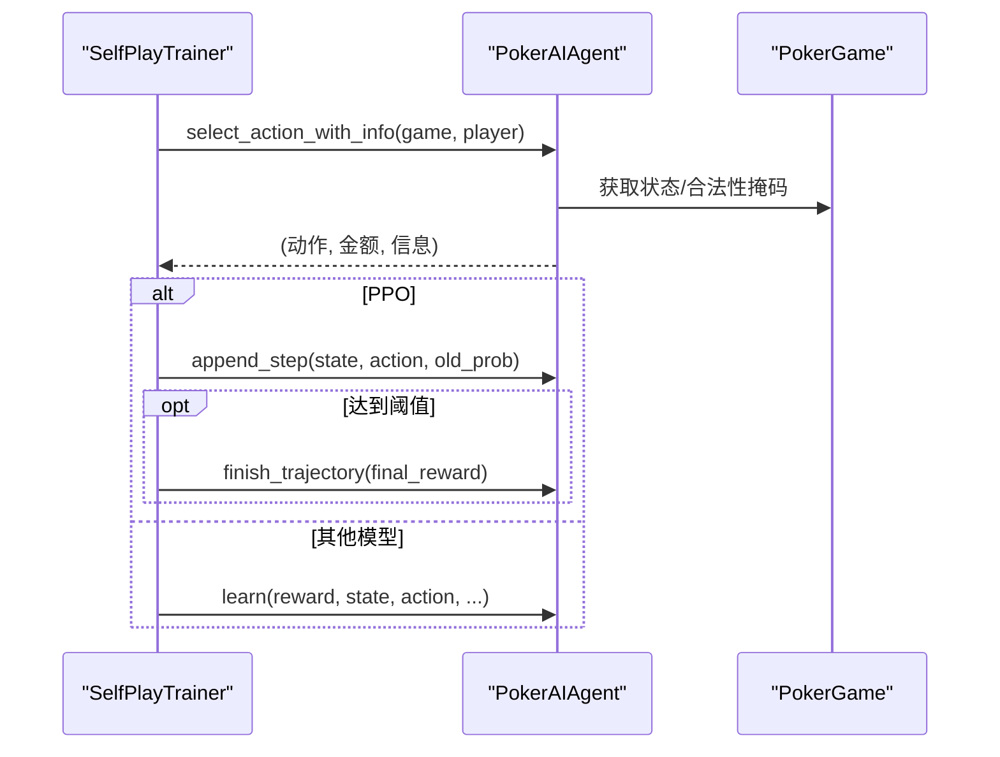
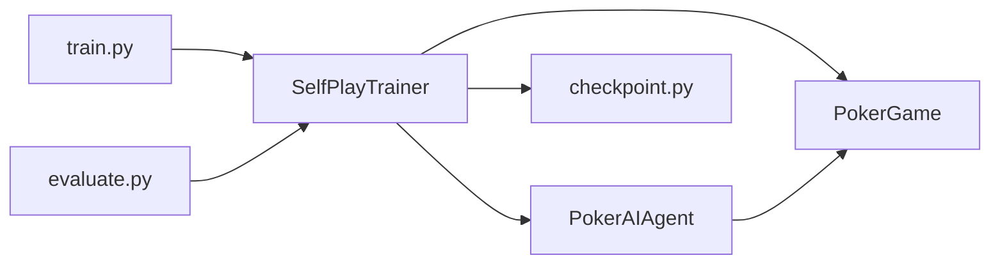

# 代码贡献规范

<cite>
**本文引用的文件**
- [README.md](file://README.md)
- [TRAINING_GUIDE.md](file://TRAINING_GUIDE.md)
- [requirements.txt](file://requirements.txt)
- [train.py](file://train.py)
- [evaluate.py](file://evaluate.py)
- [poker_ai/model/ai_agent.py](file://poker_ai/model/ai_agent.py)
- [poker_ai/game/poker_game.py](file://poker_ai/game/poker_game.py)
- [poker_ai/reward/self_play_trainer.py](file://poker_ai/reward/self_play_trainer.py)
- [test_ppo.py](file://test_ppo.py)
- [test_gpu.py](file://test_gpu.py)
- [test_fix.py](file://test_fix.py)
- [RTX4090D配置指南.md](file://RTX4090D配置指南.md)
</cite>

## 目录
1. [简介](#简介)
2. [项目结构](#项目结构)
3. [核心组件](#核心组件)
4. [架构总览](#架构总览)
5. [详细组件分析](#详细组件分析)
6. [依赖关系分析](#依赖关系分析)
7. [性能考量](#性能考量)
8. [故障排查指南](#故障排查指南)
9. [结论](#结论)
10. [附录](#附录)

## 简介
本规范面向参与“6-Max德州扑克AI”项目的开发者，旨在统一代码风格、提交规范、分支管理策略、代码审查清单与质量保障流程，确保团队协作高效、可维护性强、可扩展性好。项目以Python为主，结合强化学习训练与评估流程，具备清晰的模块化结构与完善的命令行接口。

## 项目结构
项目采用按功能域分层的组织方式，核心模块如下：
- poker_ai/model：智能体与模型（PPO/DQN/PG）、状态表示、手牌评估
- poker_ai/game：游戏规则与状态（6人桌、发牌、下注、结算）
- poker_ai/reward：自我对弈训练器、奖励计算、自对弈流程
- poker_ai/utils：检查点工具
- poker_ai/advisor：AI建议器
- train.py/evaluate.py：训练与评估入口脚本
- docs/：使用与训练指南
- tests：单元测试与快速验证脚本

**图示来源**
- [train.py:1-856](file://train.py#L1-L856)
- [evaluate.py:1-753](file://evaluate.py#L1-L753)
- [poker_ai/reward/self_play_trainer.py:1-800](file://poker_ai/reward/self_play_trainer.py#L1-L800)
- [poker_ai/game/poker_game.py:1-497](file://poker_ai/game/poker_game.py#L1-L497)
- [poker_ai/model/ai_agent.py:1-703](file://poker_ai/model/ai_agent.py#L1-L703)

**章节来源**
- [README.md:46-75](file://README.md#L46-L75)
- [train.py:136-238](file://train.py#L136-L238)
- [evaluate.py:110-142](file://evaluate.py#L110-L142)

## 核心组件
- 训练入口 train.py：提供训练/评估/演示三种模式，支持硬件档位、自动调参、并行worker、设备与混合精度配置等高级选项。
- 评估入口 evaluate.py：提供详细评估与可视化报告生成能力，支持对手类型、输出目录、图表生成等。
- 自我对弈训练器 SelfPlayTrainer：封装6-Max自我对弈流程，负责并行采样、轨迹收集、奖励计算、对手更新与检查点管理。
- 游戏引擎 PokerGame：实现6人桌德州扑克完整规则，包括发牌、下注、轮次推进、摊牌结算。
- 智能体 PokerAIAgent：统一代理接口，支持DQN、Policy Gradient、PPO，提供动作选择、学习、决策信息导出、克隆推理等。
- 奖励与状态：奖励计算器、状态表示、手牌评估器等辅助模块。

**章节来源**
- [train.py:340-531](file://train.py#L340-L531)
- [evaluate.py:181-267](file://evaluate.py#L181-L267)
- [poker_ai/reward/self_play_trainer.py:48-225](file://poker_ai/reward/self_play_trainer.py#L48-L225)
- [poker_ai/game/poker_game.py:155-474](file://poker_ai/game/poker_game.py#L155-L474)
- [poker_ai/model/ai_agent.py:55-116](file://poker_ai/model/ai_agent.py#L55-L116)

## 架构总览
训练/评估流程围绕入口脚本与训练器展开，训练器协调游戏引擎与智能体，通过奖励计算与状态表示完成自我对弈与策略优化。

**图示来源**
- [train.py:340-531](file://train.py#L340-L531)
- [poker_ai/reward/self_play_trainer.py:260-417](file://poker_ai/reward/self_play_trainer.py#L260-L417)
- [poker_ai/game/poker_game.py:299-402](file://poker_ai/game/poker_game.py#L299-L402)
- [poker_ai/model/ai_agent.py:117-155](file://poker_ai/model/ai_agent.py#L117-L155)

## 详细组件分析

### 训练入口 train.py
- 职责：解析参数、设置环境（设备/线程/XLA/混合精度）、创建训练器、执行训练/评估/演示、保存训练总结。
- 关键特性：
  - 硬件档位：自动/RTX3090_112CPU/RTX4090D，按档位调整并行与批大小。
  - 自动调参：短跑候选组合，按吞吐选择最优配置（PPO）。
  - 并行：训练/评估worker自动推断，减少调度开销。
  - 设备与精度：GPU/CPU切换、混合精度、XLA、显存增长。
- 日志：文件+控制台双通道，支持详细日志开关。

**图示来源**
- [train.py:136-238](file://train.py#L136-L238)
- [train.py:240-339](file://train.py#L240-L339)
- [train.py:340-531](file://train.py#L340-L531)
- [train.py:532-591](file://train.py#L532-L591)
- [train.py:593-707](file://train.py#L593-L707)

**章节来源**
- [train.py:136-238](file://train.py#L136-L238)
- [train.py:240-339](file://train.py#L240-L339)
- [train.py:340-531](file://train.py#L340-L531)
- [train.py:532-591](file://train.py#L532-L591)
- [train.py:593-707](file://train.py#L593-L707)

### 自我对弈训练器 SelfPlayTrainer
- 职责：6-Max自我对弈主控制器，负责并行采样、轨迹收集、奖励计算、对手管理、检查点加载/保存、性能统计。
- 关键特性：
  - 强制6人桌约束，num_players必须为6。
  - 并行采样：支持PPO批量推理，降低Python/TensorFlow往返开销。
  - 奖励与轨迹：支持复杂奖励与all-in不走运补偿，轨迹级学习。
  - 对手策略：常规对手+“鱼”（随机/固定）策略，定期更新。
- 并行策略：根据CPU核数自动推断train_workers/eval_workers，按模型类型与硬件档位优化rollouts_per_worker与同步批次。

**图示来源**
- [poker_ai/reward/self_play_trainer.py:48-225](file://poker_ai/reward/self_play_trainer.py#L48-L225)
- [poker_ai/model/ai_agent.py:55-116](file://poker_ai/model/ai_agent.py#L55-L116)
- [poker_ai/game/poker_game.py:155-474](file://poker_ai/game/poker_game.py#L155-L474)

**章节来源**
- [poker_ai/reward/self_play_trainer.py:48-225](file://poker_ai/reward/self_play_trainer.py#L48-L225)
- [poker_ai/reward/self_play_trainer.py:260-417](file://poker_ai/reward/self_play_trainer.py#L260-L417)
- [poker_ai/reward/self_play_trainer.py:587-800](file://poker_ai/reward/self_play_trainer.py#L587-L800)

### 游戏引擎 PokerGame
- 职责：实现6人桌德州扑克完整规则，包括发牌、盲注、下注、轮次推进、摊牌结算。
- 关键特性：
  - 严格6人约束，否则抛出异常。
  - 翻牌前/翻牌/转牌/河牌四轮推进。
  - 摊牌时比较7张牌最佳5张，支持并列赢家。
  - 提供get_game_state便于AI决策。

**图示来源**
- [poker_ai/game/poker_game.py:227-402](file://poker_ai/game/poker_game.py#L227-L402)

**章节来源**
- [poker_ai/game/poker_game.py:155-474](file://poker_ai/game/poker_game.py#L155-L474)

### 智能体 PokerAIAgent
- 职责：统一代理接口，支持DQN、Policy Gradient、PPO；提供动作选择、学习、轨迹管理、决策信息导出、克隆推理等。
- 关键特性：
  - PPO轨迹级学习：append_step/finish_trajectory，支持批量轨迹写入与阈值触发训练。
  - 决策信息：返回Q值/动作概率/状态价值等，便于建议器与分析。
  - 克隆推理：clone_for_inference用于并行采样，避免训练状态污染。

**图示来源**
- [poker_ai/model/ai_agent.py:117-155](file://poker_ai/model/ai_agent.py#L117-L155)
- [poker_ai/model/ai_agent.py:388-420](file://poker_ai/model/ai_agent.py#L388-L420)
- [poker_ai/model/ai_agent.py:421-476](file://poker_ai/model/ai_agent.py#L421-L476)

**章节来源**
- [poker_ai/model/ai_agent.py:55-116](file://poker_ai/model/ai_agent.py#L55-L116)
- [poker_ai/model/ai_agent.py:248-302](file://poker_ai/model/ai_agent.py#L248-L302)
- [poker_ai/model/ai_agent.py:363-420](file://poker_ai/model/ai_agent.py#L363-L420)

### 评估入口 evaluate.py
- 职责：加载模型、创建对手、运行评估、生成详细统计与可视化图表。
- 关键特性：
  - 支持不同对手类型（random/fixed/previous）。
  - 生成手牌强度分布、动作分布、阶段利润、按强度胜率等统计。
  - 可选生成图表并输出报告文本。

**章节来源**
- [evaluate.py:181-267](file://evaluate.py#L181-L267)
- [evaluate.py:269-482](file://evaluate.py#L269-L482)
- [evaluate.py:586-704](file://evaluate.py#L586-L704)

## 依赖关系分析
- 运行时依赖：TensorFlow、NumPy、Matplotlib、Seaborn、pickle-mixin、argparse、python-dateutil。
- 模块间耦合：
  - train.py/evaluate.py 依赖 SelfPlayTrainer 与 PokerAIAgent。
  - SelfPlayTrainer 依赖 PokerGame、PokerAIAgent、奖励计算器与检查点工具。
  - PokerAIAgent 依赖状态表示与模型实现。

**图示来源**
- [train.py:350-383](file://train.py#L350-L383)
- [evaluate.py:93-98](file://evaluate.py#L93-L98)
- [poker_ai/reward/self_play_trainer.py:21-25](file://poker_ai/reward/self_play_trainer.py#L21-L25)
- [poker_ai/model/ai_agent.py:3-9](file://poker_ai/model/ai_agent.py#L3-L9)

**章节来源**
- [requirements.txt:1-7](file://requirements.txt#L1-L7)
- [train.py:350-383](file://train.py#L350-L383)
- [evaluate.py:93-98](file://evaluate.py#L93-L98)

## 性能考量
- 硬件与并行：
  - 自动推断train_workers/eval_workers，按CPU核数与保留核心数计算。
  - RTX4090D档位：增大batch_size、train_workers、rollouts_per_worker与更新阈值，提升吞吐。
- 混合精度与XLA：
  - 默认启用混合精度与XLA，显著提升GPU利用率与吞吐。
- PPO轨迹优化：
  - 批量轨迹写入与阈值触发训练，减少频繁训练调用开销。
- 训练节奏：
  - 先小样本（500-1000手）验证流程，再逐步扩大至1万+手。

**章节来源**
- [train.py:39-52](file://train.py#L39-L52)
- [train.py:64-97](file://train.py#L64-L97)
- [train.py:240-339](file://train.py#L240-L339)
- [poker_ai/reward/self_play_trainer.py:111-126](file://poker_ai/reward/self_play_trainer.py#L111-L126)
- [RTX4090D配置指南.md:14-38](file://RTX4090D配置指南.md#L14-L38)
- [TRAINING_GUIDE.md:176-181](file://TRAINING_GUIDE.md#L176-L181)

## 故障排查指南
- GPU相关：
  - 使用 test_gpu.py 快速验证GPU是否被TensorFlow识别、显存增长是否生效、混合精度是否可用。
- 模型加载：
  - evaluate.py 中对模型路径进行检查与日志记录，若加载失败，检查路径与文件权限。
- 训练稳定性：
  - 使用 test_ppo.py 验证PPO代理初始化与动作选择是否正常。
  - test_fix.py 提供修复方案验证思路（奖励权重调整、动作限制等）。
- 日志与输出：
  - train.py/evaluate.py 输出详细日志到文件与控制台，关注ERROR/Exception、每手耗时、评估指标（avg_profit/win_rate/raise_rate等）。

**章节来源**
- [test_gpu.py:14-91](file://test_gpu.py#L14-L91)
- [evaluate.py:200-241](file://evaluate.py#L200-L241)
- [test_ppo.py:15-41](file://test_ppo.py#L15-L41)
- [test_fix.py:28-62](file://test_fix.py#L28-L62)
- [README.md:194-202](file://README.md#L194-L202)

## 结论
本规范以项目现有代码为依据，明确了代码风格、提交与分支管理、代码审查与质量保障流程。建议团队在日常开发中遵循统一的命名、缩进、注释与模块边界，严格执行PR流程与审查清单，确保训练稳定性与可复现性。

## 附录

### 代码风格与命名约定（基于现有代码）
- 文件与模块命名：使用下划线分隔，如 train.py、poker_game.py、self_play_trainer.py。
- 类名：采用驼峰命名，如 PokerGame、PokerAIAgent、SelfPlayTrainer。
- 函数与方法：使用下划线分隔，如 start_new_hand、select_action_with_info。
- 常量：使用全大写与下划线，如 MAX_ROUNDS、BIG_BLIND。
- 变量：使用小写与下划线，如 train_workers、ppo_clip_epsilon。
- 缩进：统一使用4空格缩进。
- 注释与文档字符串：英文为主，必要处加中文说明；函数/类需提供清晰文档字符串。

**章节来源**
- [poker_ai/game/poker_game.py:9-154](file://poker_ai/game/poker_game.py#L9-L154)
- [poker_ai/model/ai_agent.py:55-116](file://poker_ai/model/ai_agent.py#L55-L116)
- [poker_ai/reward/self_play_trainer.py:48-80](file://poker_ai/reward/self_play_trainer.py#L48-L80)

### 提交规范与分支管理策略
- 提交信息格式（建议）：
  - 类型: 摘要（简述变更）
  - 正文: 详细说明动机、影响范围、风险与注意事项
  - 附注: 关联Issue/PR链接
- 分支命名策略（建议）：
  - feature/xxx：新增功能
  - fix/xxx：缺陷修复
  - refactor/xxx：重构
  - docs/xxx：文档更新
  - hotfix/xxx：紧急修复
- PR流程（建议）：
  - 从feature分支创建PR，至少一名审查者批准
  - 通过CI与本地测试，合并前清理不必要的提交
  - 合并后删除分支，保持分支整洁

[本节为通用流程建议，不直接分析具体文件，故不附“章节来源”]

### 代码审查清单与质量保证
- 代码质量
  - 通过flake8/pylint（建议）检查语法与风格一致性
  - 单元测试覆盖率：核心模块（训练器、游戏引擎、智能体）不低于80%
  - 性能回归：PPO训练吞吐稳定，GPU利用率≥80%
- 文档与注释
  - 新增模块/函数需提供文档字符串
  - 复杂算法需附注释说明关键步骤
- 变更影响
  - 涉及训练参数/奖励/规则的变更需提供评估报告
  - 6-Max约束变更需明确兼容性与迁移成本

[本节为通用质量保障建议，不直接分析具体文件，故不附“章节来源”]

### 开发示例与代码模板（路径指引）
- 快速验证PPO模型初始化与动作选择
  - 参考：[test_ppo.py:15-41](file://test_ppo.py#L15-L41)
- GPU可用性与混合精度测试
  - 参考：[test_gpu.py:14-91](file://test_gpu.py#L14-L91)
- 自我对弈训练（PPO）
  - 参考：[train.py:340-531](file://train.py#L340-L531)
- 详细评估与可视化
  - 参考：[evaluate.py:181-267](file://evaluate.py#L181-L267)
- 6-Max游戏规则与状态
  - 参考：[poker_ai/game/poker_game.py:155-474](file://poker_ai/game/poker_game.py#L155-L474)
- 统一智能体接口与轨迹学习
  - 参考：[poker_ai/model/ai_agent.py:55-116](file://poker_ai/model/ai_agent.py#L55-L116)