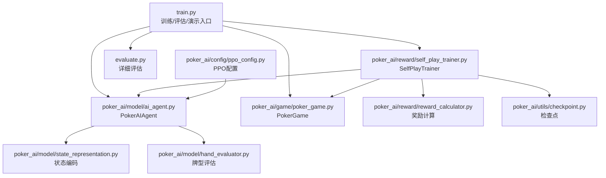
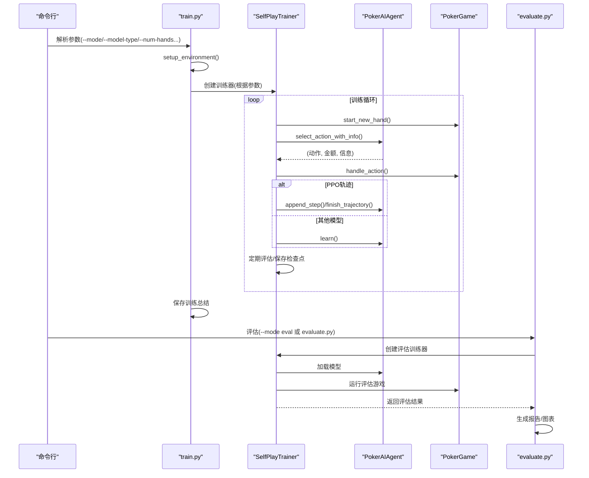
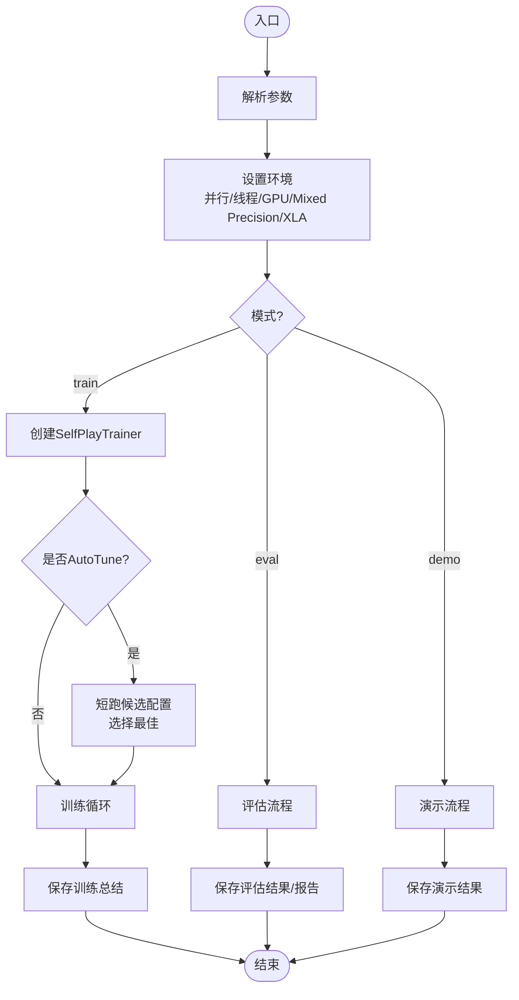
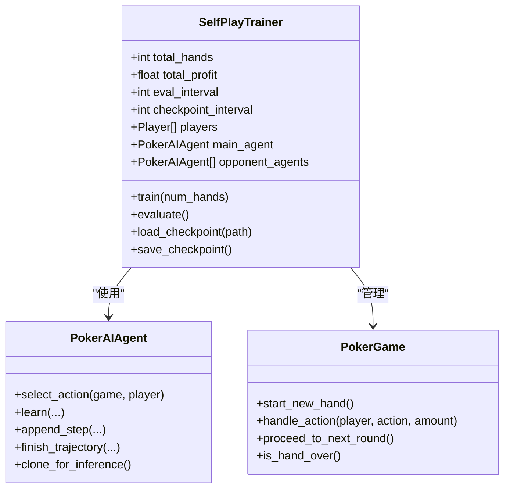
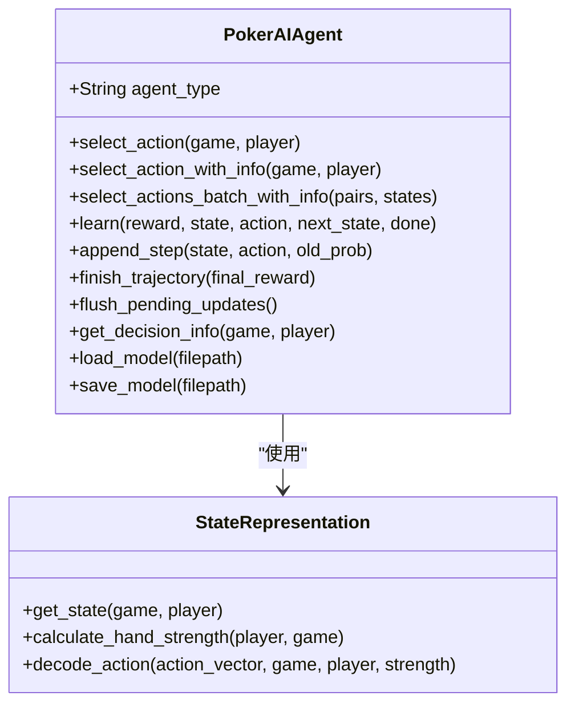
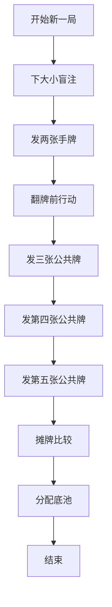
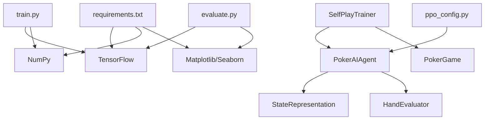

# 开发指南

<cite>
**本文引用的文件**
- [README.md](file://README.md)
- [TRAINING_GUIDE.md](file://TRAINING_GUIDE.md)
- [requirements.txt](file://requirements.txt)
- [train.py](file://train.py)
- [evaluate.py](file://evaluate.py)
- [poker_ai/model/ai_agent.py](file://poker_ai/model/ai_agent.py)
- [poker_ai/reward/self_play_trainer.py](file://poker_ai/reward/self_play_trainer.py)
- [poker_ai/game/poker_game.py](file://poker_ai/game/poker_game.py)
- [poker_ai/config/ppo_config.py](file://poker_ai/config/ppo_config.py)
- [docs/quickstart.md](file://docs/quickstart.md)
- [docs/如何看训练结果.md](file://docs/如何看训练结果.md)
- [RTX4090D配置指南.md](file://RTX4090D配置指南.md)
- [PPO快速指南.md](file://PPO快速指南.md)
- [test_ppo.py](file://test_ppo.py)
- [test_gpu.py](file://test_gpu.py)
</cite>

## 目录
1. [简介](#简介)
2. [项目结构](#项目结构)
3. [核心组件](#核心组件)
4. [架构总览](#架构总览)
5. [详细组件分析](#详细组件分析)
6. [依赖关系分析](#依赖关系分析)
7. [性能考量](#性能考量)
8. [故障排除指南](#故障排除指南)
9. [结论](#结论)
10. [附录](#附录)

## 简介
本开发指南面向项目贡献者与维护者，提供从开发环境搭建、代码贡献规范、测试策略、调试与性能分析、扩展开发到质量保障的全流程指导。项目基于强化学习的6人桌德州扑克AI，支持PPO、DQN与策略梯度等多种模型，具备自我对弈训练、评估与演示能力。

## 项目结构
项目采用按领域分层的组织方式，核心模块包括：
- 训练与评估入口：train.py、evaluate.py
- 游戏引擎：poker_ai/game/poker_game.py
- 模型与代理：poker_ai/model/ai_agent.py、ppo_model.py（间接被PokerAIAgent封装）、state_representation.py、hand_evaluator.py
- 自我对弈训练器：poker_ai/reward/self_play_trainer.py
- 配置与工具：poker_ai/config/ppo_config.py、utils/checkpoint.py
- 文档与示例：docs/quickstart.md、docs/如何看训练结果.md、RTX4090D配置指南.md、PPO快速指南.md、test_ppo.py、test_gpu.py

**图表来源**
- [train.py:1-856](file://train.py#L1-L856)
- [evaluate.py:1-753](file://evaluate.py#L1-L753)
- [poker_ai/model/ai_agent.py:1-703](file://poker_ai/model/ai_agent.py#L1-L703)
- [poker_ai/reward/self_play_trainer.py:1-800](file://poker_ai/reward/self_play_trainer.py#L1-L800)
- [poker_ai/game/poker_game.py:1-497](file://poker_ai/game/poker_game.py#L1-L497)
- [poker_ai/config/ppo_config.py:1-97](file://poker_ai/config/ppo_config.py#L1-L97)

**章节来源**
- [README.md:46-75](file://README.md#L46-L75)
- [docs/quickstart.md:1-47](file://docs/quickstart.md#L1-L47)

## 核心组件
- 训练入口与参数解析：负责解析命令行参数、设置环境、创建训练器、执行训练/评估/演示，并保存训练总结与评估报告。
- 自我对弈训练器：封装6人桌游戏流程、并行采样、奖励计算、检查点管理与评估周期控制。
- AI代理接口：统一封装DQN、策略梯度与PPO三种模型，提供动作选择、学习与推理克隆等能力。
- 游戏引擎：实现6人桌德州扑克规则、发牌、轮次推进、摊牌结算与状态查询。
- 评估脚本：提供更详细的评估与可视化，生成报告与图表。
- PPO配置：集中管理PPO超参数，便于调参与复现。

**章节来源**
- [train.py:136-238](file://train.py#L136-L238)
- [poker_ai/reward/self_play_trainer.py:48-166](file://poker_ai/reward/self_play_trainer.py#L48-L166)
- [poker_ai/model/ai_agent.py:55-116](file://poker_ai/model/ai_agent.py#L55-L116)
- [poker_ai/game/poker_game.py:155-497](file://poker_ai/game/poker_game.py#L155-L497)
- [evaluate.py:110-142](file://evaluate.py#L110-L142)
- [poker_ai/config/ppo_config.py:18-97](file://poker_ai/config/ppo_config.py#L18-L97)

## 架构总览
训练与评估的整体流程如下：

**图表来源**
- [train.py:340-531](file://train.py#L340-L531)
- [poker_ai/reward/self_play_trainer.py:260-417](file://poker_ai/reward/self_play_trainer.py#L260-L417)
- [poker_ai/model/ai_agent.py:117-156](file://poker_ai/model/ai_agent.py#L117-L156)
- [poker_ai/game/poker_game.py:299-402](file://poker_ai/game/poker_game.py#L299-L402)
- [evaluate.py:706-753](file://evaluate.py#L706-L753)

## 详细组件分析

### 训练入口与环境配置（train.py）
- 参数解析：涵盖模式选择、模型类型、训练参数、评估参数、演示参数、并行与硬件优化等。
- 环境设置：自动推断并行worker数、设置TensorFlow线程与GPU/Mixed Precision/XLA等。
- 训练流程：创建SelfPlayTrainer，支持自动调参（AutoTune），加载检查点，训练与保存总结。
- 评估与演示：分别调用评估与演示流程，生成报告与结果文件。

**图表来源**
- [train.py:136-238](file://train.py#L136-L238)
- [train.py:240-339](file://train.py#L240-L339)
- [train.py:340-531](file://train.py#L340-L531)
- [train.py:532-708](file://train.py#L532-L708)
- [train.py:709-808](file://train.py#L709-L808)

**章节来源**
- [train.py:136-238](file://train.py#L136-L238)
- [train.py:240-339](file://train.py#L240-L339)
- [train.py:340-531](file://train.py#L340-L531)
- [train.py:532-708](file://train.py#L532-L708)
- [train.py:709-808](file://train.py#L709-L808)

### 自我对弈训练器（SelfPlayTrainer）
- 6-Max专用：强制num_players=6，确保状态维度与游戏逻辑一致。
- 并行采样：支持训练与评估worker数自动推断与批量采样，降低Python调度开销。
- 奖励与轨迹：支持奖励计算、轨迹级学习（PPO）、all-in不走运补偿、无效下注惩罚等。
- 检查点：保存/加载模型与训练状态，支持从最近检查点继续训练。

**图表来源**
- [poker_ai/reward/self_play_trainer.py:48-166](file://poker_ai/reward/self_play_trainer.py#L48-L166)
- [poker_ai/model/ai_agent.py:55-116](file://poker_ai/model/ai_agent.py#L55-L116)
- [poker_ai/game/poker_game.py:155-497](file://poker_ai/game/poker_game.py#L155-L497)

**章节来源**
- [poker_ai/reward/self_play_trainer.py:48-166](file://poker_ai/reward/self_play_trainer.py#L48-L166)
- [poker_ai/reward/self_play_trainer.py:260-417](file://poker_ai/reward/self_play_trainer.py#L260-L417)
- [poker_ai/reward/self_play_trainer.py:587-800](file://poker_ai/reward/self_play_trainer.py#L587-L800)

### AI代理接口（PokerAIAgent）
- 统一接口：支持DQN、策略梯度、PPO三种模型，提供动作选择、批量动作、轨迹学习、推理克隆等。
- 合法动作掩码：根据当前游戏状态生成动作掩码，确保动作合法性。
- PPO轨迹缓冲：支持append_step与finish_trajectory，按阈值批量训练，减少频繁调用开销。

**图表来源**
- [poker_ai/model/ai_agent.py:55-116](file://poker_ai/model/ai_agent.py#L55-L116)
- [poker_ai/model/ai_agent.py:117-214](file://poker_ai/model/ai_agent.py#L117-L214)
- [poker_ai/model/ai_agent.py:248-420](file://poker_ai/model/ai_agent.py#L248-L420)

**章节来源**
- [poker_ai/model/ai_agent.py:55-116](file://poker_ai/model/ai_agent.py#L55-L116)
- [poker_ai/model/ai_agent.py:117-214](file://poker_ai/model/ai_agent.py#L117-L214)
- [poker_ai/model/ai_agent.py:248-420](file://poker_ai/model/ai_agent.py#L248-L420)

### 游戏引擎（PokerGame）
- 6人桌规则：实现大小盲注、发牌、轮次推进、摊牌结算与胜负判定。
- 状态管理：通过共享数组与玩家对象属性管理筹码、下注、位置等状态。
- 动作处理：校验动作合法性，处理fold/call/raise，维护当前轮次与底池。

**图表来源**
- [poker_ai/game/poker_game.py:227-402](file://poker_ai/game/poker_game.py#L227-L402)

**章节来源**
- [poker_ai/game/poker_game.py:155-497](file://poker_ai/game/poker_game.py#L155-L497)

### 评估脚本（evaluate.py）
- 详细评估：支持生成动作分布、阶段利润、手牌强度胜率等统计与可视化图表。
- 模型加载：支持从checkpoints目录加载模型，兼容DQN/PG评估。
- 报告生成：输出JSON结果与文本报告，便于对比不同模型或阶段。

**章节来源**
- [evaluate.py:110-142](file://evaluate.py#L110-L142)
- [evaluate.py:181-267](file://evaluate.py#L181-L267)
- [evaluate.py:523-584](file://evaluate.py#L523-L584)
- [evaluate.py:586-704](file://evaluate.py#L586-L704)

### PPO配置（ppo_config.py）
- 集中管理PPO超参数：学习率、clip、更新轮次、batch size、熵系数、价值损失裁剪、KL早停等。
- 适配RTX 4090D优化：更大batch、更少epochs、学习率warmup与cosine衰减、自适应熵系数等。

**章节来源**
- [poker_ai/config/ppo_config.py:18-97](file://poker_ai/config/ppo_config.py#L18-L97)

## 依赖关系分析
- 依赖声明：requirements.txt声明了TensorFlow、NumPy、Matplotlib、Seaborn、pickle-mixin、argparse、dateutil等。
- 运行时依赖：train.py在setup_environment中检测并配置GPU、线程与混合精度；evaluate.py同样进行GPU内存限制设置。
- 模块间耦合：train.py依赖SelfPlayTrainer；SelfPlayTrainer依赖PokerAIAgent与PokerGame；PokerAIAgent依赖StateRepresentation与HandEvaluator；PPO配置通过参数注入到训练器与代理。

**图表来源**
- [requirements.txt:1-7](file://requirements.txt#L1-L7)
- [train.py:240-339](file://train.py#L240-L339)
- [evaluate.py:31-52](file://evaluate.py#L31-L52)
- [poker_ai/model/ai_agent.py:1-12](file://poker_ai/model/ai_agent.py#L1-L12)
- [poker_ai/config/ppo_config.py:18-97](file://poker_ai/config/ppo_config.py#L18-L97)

**章节来源**
- [requirements.txt:1-7](file://requirements.txt#L1-L7)
- [train.py:240-339](file://train.py#L240-L339)
- [evaluate.py:31-52](file://evaluate.py#L31-L52)

## 性能考量
- 硬件优化档位：train.py内置针对RTX 4090D与RTX 3090_112CPU的硬件优化配置，自动设置并行worker、batch size、XLA、混合精度与显存增长。
- AutoTune：PPO专用的短跑候选配置选择，按手/秒挑选最优配置，显著提升吞吐。
- 并行采样：SelfPlayTrainer支持训练与评估worker数自动推断与批量采样，降低调度开销。
- GPU监控：RTX4090D配置指南提供实时监控与性能基准，便于调优。

**章节来源**
- [train.py:55-135](file://train.py#L55-L135)
- [train.py:408-482](file://train.py#L408-L482)
- [poker_ai/reward/self_play_trainer.py:28-46](file://poker_ai/reward/self_play_trainer.py#L28-L46)
- [RTX4090D配置指南.md:104-221](file://RTX4090D配置指南.md#L104-L221)

## 故障排除指南
- GPU不可用：使用test_gpu.py快速检测GPU、启用显存增长与混合精度，验证矩阵乘法是否加速。
- 训练异常：查看logs目录下的日志文件，关注ERROR/Exception、平均每手耗时、评估指标（avg_profit/win_rate/raise_rate/invalid_bet_rate）。
- 模型加载失败：evaluate.py与train.py均提供模型路径检查与错误日志，确认路径与文件存在性。
- 评估指标异常：根据docs/如何看训练结果.md的指标解读，结合多次评估与增大num_eval_games观察趋势。

**章节来源**
- [test_gpu.py:14-91](file://test_gpu.py#L14-L91)
- [README.md:194-202](file://README.md#L194-L202)
- [evaluate.py:200-240](file://evaluate.py#L200-L240)
- [docs/如何看训练结果.md:30-106](file://docs/如何看训练结果.md#L30-L106)

## 结论
本指南提供了从开发环境到训练评估、从测试策略到调试与性能优化的完整路径。遵循本文的规范与流程，可高效开展模型训练、评估与扩展开发，并通过AutoTune与硬件优化档位获得更佳的训练吞吐与稳定性。

## 附录

### A. 开发环境搭建与工具配置
- 安装依赖：pip install -r requirements.txt
- 快速开始：参考docs/quickstart.md与README.md的快速开始章节
- GPU测试：运行test_gpu.py验证GPU与混合精度
- PPO优化：参考PPO快速指南与RTX4090D配置指南

**章节来源**
- [requirements.txt:1-7](file://requirements.txt#L1-L7)
- [docs/quickstart.md:1-47](file://docs/quickstart.md#L1-L47)
- [README.md:12-47](file://README.md#L12-L47)
- [test_gpu.py:14-91](file://test_gpu.py#L14-L91)
- [PPO快速指南.md:18-71](file://PPO快速指南.md#L18-L71)
- [RTX4090D配置指南.md:14-103](file://RTX4090D配置指南.md#L14-L103)

### B. 代码贡献规范与开发流程
- 分支管理：建议基于主分支创建功能分支，合并前进行代码审查
- 提交规范：使用清晰的提交信息描述变更目的与影响
- 代码风格：遵循项目现有命名与缩进风格，保持模块职责单一
- 测试要求：新增功能需配套单元/集成测试，PPO相关可参考test_ppo.py

**章节来源**
- [test_ppo.py:1-41](file://test_ppo.py#L1-L41)

### C. 测试策略与用例编写
- 单元测试：针对PokerAIAgent动作选择、轨迹学习、状态编码等关键路径
- 集成测试：通过SelfPlayTrainer运行小规模手牌，验证训练流程与奖励逻辑
- 性能测试：使用AutoTune与RTX4090D配置进行吞吐对比，记录手/秒与显存占用
- 评估测试：evaluate.py生成详细报告与图表，辅助策略健康度判断

**章节来源**
- [train.py:408-482](file://train.py#L408-L482)
- [poker_ai/reward/self_play_trainer.py:260-417](file://poker_ai/reward/self_play_trainer.py#L260-L417)
- [evaluate.py:523-704](file://evaluate.py#L523-L704)
- [RTX4090D配置指南.md:158-221](file://RTX4090D配置指南.md#L158-L221)

### D. 调试技巧与工具使用
- 日志分析：关注训练日志中的ERROR、平均每手耗时、评估指标与“新最佳模型”提示
- 性能分析：使用RTX4090D配置指南中的nvidia-smi监控GPU利用率与温度
- 内存泄漏检测：通过evaluate.py设置GPU内存增长，避免一次性占用全部显存

**章节来源**
- [docs/如何看训练结果.md:3-18](file://docs/如何看训练结果.md#L3-L18)
- [RTX4090D配置指南.md:223-238](file://RTX4090D配置指南.md#L223-L238)
- [evaluate.py:31-52](file://evaluate.py#L31-L52)

### E. 扩展开发最佳实践
- 新算法集成：在poker_ai/model/ai_agent.py中新增代理类，实现统一接口与动作选择方法
- 模块扩展：在poker_ai/reward/中新增奖励计算或训练器逻辑，保持与SelfPlayTrainer的解耦
- API设计：遵循train.py与evaluate.py的参数约定，确保命令行一致性与可配置性

**章节来源**
- [poker_ai/model/ai_agent.py:55-116](file://poker_ai/model/ai_agent.py#L55-L116)
- [poker_ai/reward/self_play_trainer.py:48-166](file://poker_ai/reward/self_play_trainer.py#L48-L166)
- [train.py:136-238](file://train.py#L136-L238)
- [evaluate.py:110-142](file://evaluate.py#L110-L142)

### F. 代码审查流程与质量保证
- 代码审查：提交PR前进行自检，确保通过单元/集成测试与性能回归
- 质量指标：关注avg_profit、win_rate、策略健康度（bluff_rate/invalid_bet_rate）与训练稳定性
- 文档更新：变更涉及用户可见参数或流程时，同步更新README与docs

**章节来源**
- [docs/如何看训练结果.md:30-106](file://docs/如何看训练结果.md#L30-L106)
- [README.md:194-202](file://README.md#L194-L202)