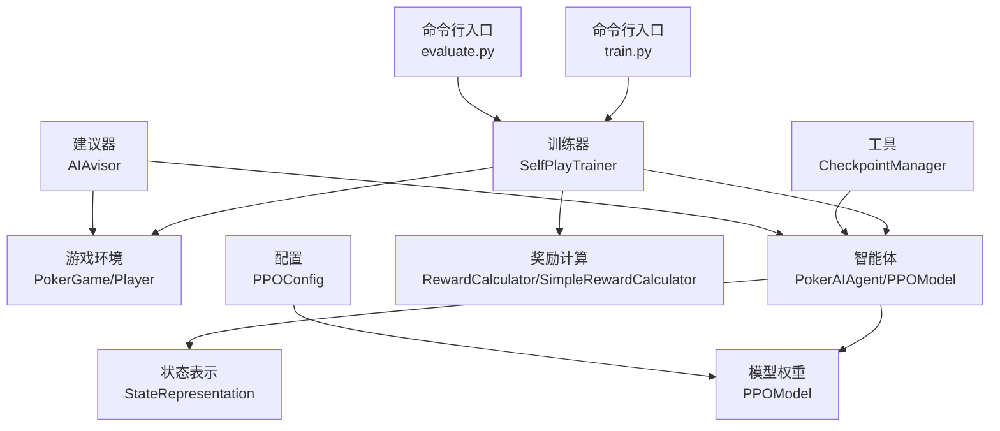
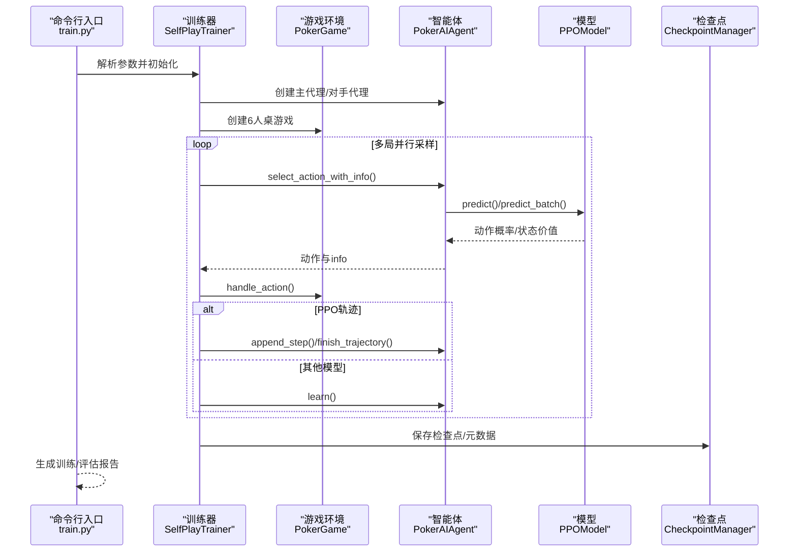
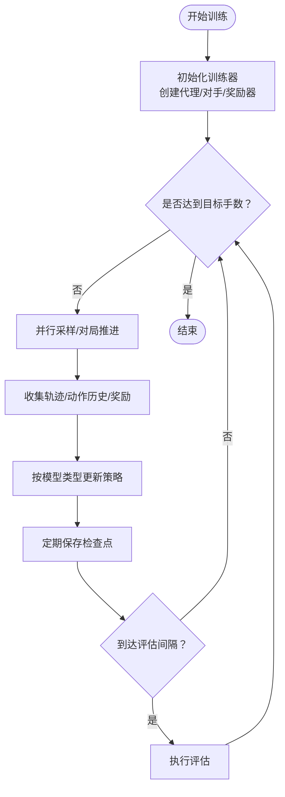
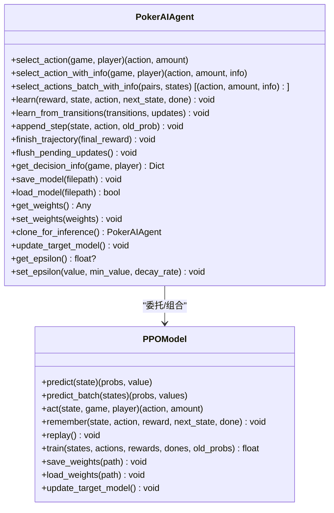
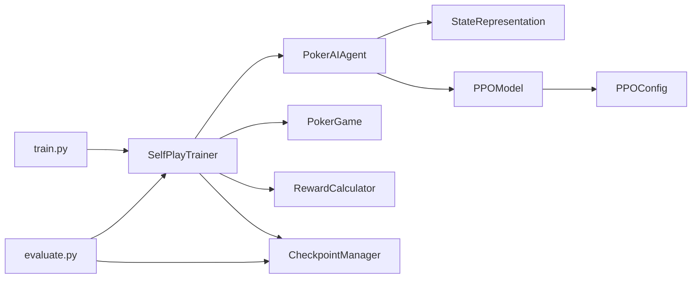

# API设计规范

<cite>
**本文引用的文件**   
- [README.md](file://README.md)
- [train.py](file://train.py)
- [evaluate.py](file://evaluate.py)
- [test_ppo.py](file://test_ppo.py)
- [poker_ai/model/ppo_model.py](file://poker_ai/model/ppo_model.py)
- [poker_ai/model/ai_agent.py](file://poker_ai/model/ai_agent.py)
- [poker_ai/game/poker_game.py](file://poker_ai/game/poker_game.py)
- [poker_ai/reward/self_play_trainer.py](file://poker_ai/reward/self_play_trainer.py)
- [poker_ai/advisor/ai_advisor.py](file://poker_ai/advisor/ai_advisor.py)
- [poker_ai/utils/checkpoint.py](file://poker_ai/utils/checkpoint.py)
- [poker_ai/config/ppo_config.py](file://poker_ai/config/ppo_config.py)
- [requirements.txt](file://requirements.txt)
</cite>

## 目录
1. [简介](#简介)
2. [项目结构](#项目结构)
3. [核心组件](#核心组件)
4. [架构总览](#架构总览)
5. [详细组件分析](#详细组件分析)
6. [依赖关系分析](#依赖关系分析)
7. [性能考量](#性能考量)
8. [故障排查指南](#故障排查指南)
9. [结论](#结论)
10. [附录](#附录)

## 简介
本文件旨在为本项目提供一套统一、可扩展、可维护的API设计规范，涵盖命名约定、参数校验、错误处理、返回值规范、接口设计原则（单一职责、开闭原则、里氏替换）、版本管理策略（向后兼容、废弃策略、迁移指南）、API文档生成与测试覆盖、性能监控最佳实践，以及常见陷阱与解决方案。  
本项目围绕“6-Max德州扑克AI”展开，提供训练、评估、演示与建议等功能，核心API包括命令行入口、训练器、智能体、游戏环境、奖励与检查点工具等。

## 项目结构
项目采用分层与功能域结合的组织方式：
- 入口与CLI：train.py、evaluate.py
- 游戏域：poker_ai/game/*（PokerGame、Player、Cards等）
- 模型域：poker_ai/model/*（AI Agent、PPO Model、State Representation、Hand Evaluator等）
- 奖励与训练：poker_ai/reward/*（SelfPlayTrainer、Reward Calculator等）
- 工具与配置：poker_ai/utils/*、poker_ai/config/*
- 辅助与演示：poker_ai/advisor/*（AIAvisor）

**图示来源**
- [train.py:136-238](file://train.py#L136-L238)
- [evaluate.py:110-142](file://evaluate.py#L110-L142)
- [poker_ai/reward/self_play_trainer.py:48-166](file://poker_ai/reward/self_play_trainer.py#L48-L166)
- [poker_ai/model/ai_agent.py:55-116](file://poker_ai/model/ai_agent.py#L55-L116)
- [poker_ai/model/ppo_model.py:20-105](file://poker_ai/model/ppo_model.py#L20-L105)
- [poker_ai/game/poker_game.py:155-194](file://poker_ai/game/poker_game.py#L155-L194)
- [poker_ai/advisor/ai_advisor.py:21-48](file://poker_ai/advisor/ai_advisor.py#L21-L48)
- [poker_ai/utils/checkpoint.py:17-56](file://poker_ai/utils/checkpoint.py#L17-L56)
- [poker_ai/config/ppo_config.py:18-96](file://poker_ai/config/ppo_config.py#L18-L96)

**章节来源**
- [README.md:46-75](file://README.md#L46-L75)
- [requirements.txt:1-7](file://requirements.txt#L1-L7)

## 核心组件
- 命令行入口与参数解析
  - train.py：提供训练、评估、演示模式，解析大量训练/评估/硬件/模型参数，封装环境设置、自动调参、日志与结果落盘。
  - evaluate.py：提供详细评估与可视化，解析模型路径、对手类型、输出目录等参数，封装评估流程与报告生成。
- 训练器 SelfPlayTrainer
  - 负责多玩家对局推进、并行采样、奖励计算、检查点管理、对手轮换与策略更新。
- 智能体 PokerAIAgent
  - 统一接口，支持DQN、Policy Gradient、PPO三种策略；提供动作选择、批量推理、轨迹缓存与训练接口。
- PPOModel
  - PPO Actor-Critic实现，含GAE、价值裁剪、自适应熵、KL早停、混合精度优化、梯度累积等。
- 游戏环境 PokerGame/Player
  - 6人桌德州扑克规则实现，含下注、轮次推进、摊牌结算、状态导出。
- 建议器 AIAvisor
  - 基于已训练模型给出建议，包含手牌强度、期望价值、置信度、风险评估与可视化数据。
- 工具与配置
  - CheckpointManager：通用检查点保存/加载与元数据管理。
  - PPOConfig：集中管理PPO超参数。

**章节来源**
- [train.py:136-238](file://train.py#L136-L238)
- [train.py:240-339](file://train.py#L240-L339)
- [train.py:340-531](file://train.py#L340-L531)
- [train.py:532-592](file://train.py#L532-L592)
- [train.py:593-707](file://train.py#L593-L707)
- [evaluate.py:110-142](file://evaluate.py#L110-L142)
- [evaluate.py:144-157](file://evaluate.py#L144-L157)
- [evaluate.py:181-267](file://evaluate.py#L181-L267)
- [poker_ai/reward/self_play_trainer.py:48-166](file://poker_ai/reward/self_play_trainer.py#L48-L166)
- [poker_ai/model/ai_agent.py:55-116](file://poker_ai/model/ai_agent.py#L55-L116)
- [poker_ai/model/ppo_model.py:20-105](file://poker_ai/model/ppo_model.py#L20-L105)
- [poker_ai/game/poker_game.py:155-194](file://poker_ai/game/poker_game.py#L155-L194)
- [poker_ai/advisor/ai_advisor.py:21-48](file://poker_ai/advisor/ai_advisor.py#L21-L48)
- [poker_ai/utils/checkpoint.py:17-56](file://poker_ai/utils/checkpoint.py#L17-L56)
- [poker_ai/config/ppo_config.py:18-96](file://poker_ai/config/ppo_config.py#L18-L96)

## 架构总览
以下序列图展示了典型训练流程中各组件交互：

**图示来源**
- [train.py:340-531](file://train.py#L340-L531)
- [poker_ai/reward/self_play_trainer.py:260-417](file://poker_ai/reward/self_play_trainer.py#L260-L417)
- [poker_ai/model/ai_agent.py:117-155](file://poker_ai/model/ai_agent.py#L117-L155)
- [poker_ai/model/ppo_model.py:322-338](file://poker_ai/model/ppo_model.py#L322-L338)
- [poker_ai/utils/checkpoint.py:17-56](file://poker_ai/utils/checkpoint.py#L17-L56)

## 详细组件分析

### 命令行入口与参数规范
- 命名约定
  - 参数使用下划线命名（如 --model-type、--checkpoint-dir），与Python变量风格一致。
  - 选项值使用中划线分隔（如 --hardware-profile rtx4090d）。
- 参数校验
  - 使用choices限定枚举值（如 --mode、--model-type、--device），避免非法输入。
  - 对数值参数设置默认值与合理范围提示（如 --num-hands、--learning-rate）。
- 错误处理
  - 对缺失依赖（如TensorFlow）进行捕获并记录警告/错误。
  - 对路径不存在、权限不足等情况进行日志提示与优雅降级。
- 返回值与副作用
  - 返回退出码（0成功，非0失败），日志输出到文件与控制台。
  - 评估/训练完成后生成JSON报告与文本报告文件。

**章节来源**
- [train.py:136-238](file://train.py#L136-L238)
- [train.py:240-339](file://train.py#L240-L339)
- [train.py:340-531](file://train.py#L340-L531)
- [train.py:532-592](file://train.py#L532-L592)
- [train.py:593-707](file://train.py#L593-L707)
- [evaluate.py:110-142](file://evaluate.py#L110-L142)
- [evaluate.py:144-157](file://evaluate.py#L144-L157)
- [evaluate.py:181-267](file://evaluate.py#L181-L267)

### 训练器 SelfPlayTrainer
- 单一职责
  - 负责对局推进、奖励计算、轨迹收集、并行采样、检查点与评估调度。
- 开闭原则
  - 通过构造函数注入不同模型类型与对手策略，支持新增算法无需修改现有逻辑。
- 里氏替换
  - PokerAIAgent对DQN/PPO/PG提供统一接口，训练器可透明替换。
- 关键流程
  - _create_agents：按配置创建主代理与多个对手代理，末尾加入“鱼”玩家。
  - _play_hand/_play_hand_collect：推进一局，记录轨迹与动作历史，计算最终奖励。
  - _play_hands_collect_batched：PPO并行采样，批量推理减少往返开销。
- 并行与性能
  - 通过train_workers/eval_workers控制并行度，train_rollouts_per_worker与train_sync_every_batches优化PPO训练吞吐。
- 检查点与评估
  - 定期保存检查点，支持评估间隔与最终评估开关。

**图示来源**
- [poker_ai/reward/self_play_trainer.py:48-166](file://poker_ai/reward/self_play_trainer.py#L48-L166)
- [poker_ai/reward/self_play_trainer.py:260-417](file://poker_ai/reward/self_play_trainer.py#L260-L417)
- [poker_ai/reward/self_play_trainer.py:587-800](file://poker_ai/reward/self_play_trainer.py#L587-L800)

**章节来源**
- [poker_ai/reward/self_play_trainer.py:48-166](file://poker_ai/reward/self_play_trainer.py#L48-L166)
- [poker_ai/reward/self_play_trainer.py:260-417](file://poker_ai/reward/self_play_trainer.py#L260-L417)
- [poker_ai/reward/self_play_trainer.py:587-800](file://poker_ai/reward/self_play_trainer.py#L587-L800)

### 智能体 PokerAIAgent
- 统一接口
  - select_action/select_action_with_info/select_actions_batch_with_info：统一动作选择接口，兼容PPO批量推理。
- PPO轨迹管理
  - append_step/finish_trajectory/flush_pending_updates：PPO轨迹缓存与批量训练触发。
- 权重与克隆
  - save/load/get_weights/set_weights：权重持久化与克隆（clone_for_inference）。
- 探索参数（DQN）
  - set_epsilon/get_epsilon/update_target_model：DQN专属探索与目标网络更新。

**图示来源**
- [poker_ai/model/ai_agent.py:55-116](file://poker_ai/model/ai_agent.py#L55-L116)
- [poker_ai/model/ai_agent.py:117-155](file://poker_ai/model/ai_agent.py#L117-L155)
- [poker_ai/model/ai_agent.py:248-301](file://poker_ai/model/ai_agent.py#L248-L301)
- [poker_ai/model/ai_agent.py:388-420](file://poker_ai/model/ai_agent.py#L388-L420)
- [poker_ai/model/ai_agent.py:454-476](file://poker_ai/model/ai_agent.py#L454-L476)
- [poker_ai/model/ai_agent.py:489-516](file://poker_ai/model/ai_agent.py#L489-L516)
- [poker_ai/model/ai_agent.py:529-553](file://poker_ai/model/ai_agent.py#L529-L553)
- [poker_ai/model/ppo_model.py:20-105](file://poker_ai/model/ppo_model.py#L20-L105)
- [poker_ai/model/ppo_model.py:497-638](file://poker_ai/model/ppo_model.py#L497-L638)

**章节来源**
- [poker_ai/model/ai_agent.py:55-116](file://poker_ai/model/ai_agent.py#L55-L116)
- [poker_ai/model/ai_agent.py:117-155](file://poker_ai/model/ai_agent.py#L117-L155)
- [poker_ai/model/ai_agent.py:248-301](file://poker_ai/model/ai_agent.py#L248-L301)
- [poker_ai/model/ai_agent.py:388-420](file://poker_ai/model/ai_agent.py#L388-L420)
- [poker_ai/model/ai_agent.py:454-476](file://poker_ai/model/ai_agent.py#L454-L476)
- [poker_ai/model/ai_agent.py:489-516](file://poker_ai/model/ai_agent.py#L489-L516)
- [poker_ai/model/ai_agent.py:529-553](file://poker_ai/model/ai_agent.py#L529-L553)
- [poker_ai/model/ppo_model.py:20-105](file://poker_ai/model/ppo_model.py#L20-L105)
- [poker_ai/model/ppo_model.py:497-638](file://poker_ai/model/ppo_model.py#L497-L638)

### PPOModel
- 核心能力
  - GAE优势估计、价值裁剪、自适应熵、KL早停、学习率调度、混合精度、梯度累积。
  - predict/predict_batch、train、save_weights/load_weights。
- 性能优化
  - tf.function编译、固定batch形状预测、向量化GAE、梯度裁剪、warmup+cosine衰减。
- 兼容性
  - 提供act接口兼容DQN接口，便于统一训练器调用。

**章节来源**
- [poker_ai/model/ppo_model.py:20-105](file://poker_ai/model/ppo_model.py#L20-L105)
- [poker_ai/model/ppo_model.py:276-320](file://poker_ai/model/ppo_model.py#L276-L320)
- [poker_ai/model/ppo_model.py:322-338](file://poker_ai/model/ppo_model.py#L322-L338)
- [poker_ai/model/ppo_model.py:347-373](file://poker_ai/model/ppo_model.py#L347-L373)
- [poker_ai/model/ppo_model.py:497-638](file://poker_ai/model/ppo_model.py#L497-L638)
- [poker_ai/model/ppo_model.py:640-670](file://poker_ai/model/ppo_model.py#L640-L670)

### 游戏环境 PokerGame/Player
- 设计要点
  - Player属性通过表状态共享（_table_state）实现多玩家共享内存视图，减少拷贝。
  - PokerGame严格遵循6-Max规则，含盲注、发牌、轮次推进、摊牌结算。
- 接口一致性
  - handle_action返回布尔值表示是否成功，便于训练器统一处理非法动作。

**章节来源**
- [poker_ai/game/poker_game.py:9-154](file://poker_ai/game/poker_game.py#L9-L154)
- [poker_ai/game/poker_game.py:155-194](file://poker_ai/game/poker_game.py#L155-L194)
- [poker_ai/game/poker_game.py:299-350](file://poker_ai/game/poker_game.py#L299-L350)
- [poker_ai/game/poker_game.py:376-402](file://poker_ai/game/poker_game.py#L376-L402)
- [poker_ai/game/poker_game.py:404-447](file://poker_ai/game/poker_game.py#L404-L447)
- [poker_ai/game/poker_game.py:458-473](file://poker_ai/game/poker_game.py#L458-L473)

### 建议器 AIAvisor
- 能力边界
  - 基于已训练模型给出建议，包含手牌强度、期望价值、置信度、风险评估与可视化数据。
- 数据落盘
  - save_advice_to_file支持将建议序列化到JSON文件，便于离线分析。

**章节来源**
- [poker_ai/advisor/ai_advisor.py:21-48](file://poker_ai/advisor/ai_advisor.py#L21-L48)
- [poker_ai/advisor/ai_advisor.py:191-234](file://poker_ai/advisor/ai_advisor.py#L191-L234)
- [poker_ai/advisor/ai_advisor.py:307-341](file://poker_ai/advisor/ai_advisor.py#L307-L341)
- [poker_ai/advisor/ai_advisor.py:571-619](file://poker_ai/advisor/ai_advisor.py#L571-L619)

### 工具与配置
- CheckpointManager
  - 统一保存/加载逻辑，支持权重文件、pickle模型与元数据JSON。
- PPOConfig
  - 集中管理PPO超参数，便于复现与调参。

**章节来源**
- [poker_ai/utils/checkpoint.py:17-56](file://poker_ai/utils/checkpoint.py#L17-L56)
- [poker_ai/utils/checkpoint.py:58-104](file://poker_ai/utils/checkpoint.py#L58-L104)
- [poker_ai/utils/checkpoint.py:106-139](file://poker_ai/utils/checkpoint.py#L106-L139)
- [poker_ai/config/ppo_config.py:18-96](file://poker_ai/config/ppo_config.py#L18-L96)

## 依赖关系分析
- 外部依赖
  - TensorFlow/Keras（深度学习）、NumPy（数组）、Matplotlib/Seaborn（可视化）、argparse/dateutil（CLI与时间）。
- 内部耦合
  - SelfPlayTrainer依赖PokerAIAgent、PokerGame、RewardCalculator、CheckpointManager。
  - PokerAIAgent依赖StateRepresentation与具体模型（DQN/PG/PPO）。
  - PPOModel依赖StateRepresentation与PPOConfig。

**图示来源**
- [train.py:136-238](file://train.py#L136-L238)
- [evaluate.py:110-142](file://evaluate.py#L110-L142)
- [poker_ai/reward/self_play_trainer.py:48-166](file://poker_ai/reward/self_play_trainer.py#L48-L166)
- [poker_ai/model/ai_agent.py:55-116](file://poker_ai/model/ai_agent.py#L55-L116)
- [poker_ai/model/ppo_model.py:20-105](file://poker_ai/model/ppo_model.py#L20-L105)
- [poker_ai/config/ppo_config.py:18-96](file://poker_ai/config/ppo_config.py#L18-L96)
- [poker_ai/utils/checkpoint.py:17-56](file://poker_ai/utils/checkpoint.py#L17-L56)

**章节来源**
- [requirements.txt:1-7](file://requirements.txt#L1-L7)

## 性能考量
- 并行与吞吐
  - train_workers/eval_workers按CPU核数自动推断，PPO默认更大批次与更少更新轮次以提升GPU利用率。
- 训练稳定性
  - PPO使用KL早停、价值损失裁剪、自适应熵、warmup+cosine衰减、梯度裁剪。
- I/O与日志
  - 日志同时写入文件与控制台，评估/训练结果落盘为JSON与文本报告，便于追踪与可视化。
- 硬件优化
  - 自动检测GPU并启用混合精度、XLA、显存按需增长，支持不同硬件档位的默认参数。

**章节来源**
- [train.py:39-52](file://train.py#L39-L52)
- [train.py:55-135](file://train.py#L55-L135)
- [train.py:240-339](file://train.py#L240-L339)
- [poker_ai/model/ppo_model.py:420-448](file://poker_ai/model/ppo_model.py#L420-L448)
- [poker_ai/model/ppo_model.py:497-638](file://poker_ai/model/ppo_model.py#L497-L638)

## 故障排查指南
- 缺少依赖
  - 未安装TensorFlow导致导入失败，日志记录警告并提示安装。
- 模型加载失败
  - CheckpointManager对多种权重格式与pickle模型进行兼容加载，失败时记录错误并返回False。
- 训练异常
  - PPO训练中遇到DNN/Graph错误时记录警告并跳过该批次，避免整体崩溃。
- 参数错误
  - CLI参数choices限制与默认值可减少非法输入；对路径、数值范围进行日志提示。

**章节来源**
- [train.py:331-334](file://train.py#L331-L334)
- [poker_ai/utils/checkpoint.py:58-104](file://poker_ai/utils/checkpoint.py#L58-L104)
- [poker_ai/model/ai_agent.py:321-331](file://poker_ai/model/ai_agent.py#L321-L331)
- [train.py:136-238](file://train.py#L136-L238)

## 结论
本项目在API设计上体现了清晰的分层与职责分离，命令行入口统一参数解析与流程编排，训练器与智能体通过统一接口实现可插拔扩展，PPO模型在性能与稳定性上做了多项工程优化。建议在后续迭代中进一步完善：
- 统一返回值与异常类型，增强契约明确性；
- 引入参数Schema校验与单元测试覆盖；
- 增强API文档生成与自动化测试流水线；
- 明确版本管理策略与废弃流程。

## 附录

### API设计原则与实践对照
- 单一职责
  - SelfPlayTrainer专注对局推进与策略更新；PokerAIAgent专注动作选择与轨迹管理；PPOModel专注策略/价值学习。
- 开闭原则
  - 通过构造函数注入不同模型类型与对手策略，新增算法无需修改既有代码。
- 里氏替换
  - PokerAIAgent对DQN/PPO/PG提供统一接口，训练器可透明替换。

**章节来源**
- [poker_ai/reward/self_play_trainer.py:48-166](file://poker_ai/reward/self_play_trainer.py#L48-L166)
- [poker_ai/model/ai_agent.py:55-116](file://poker_ai/model/ai_agent.py#L55-L116)
- [poker_ai/model/ppo_model.py:20-105](file://poker_ai/model/ppo_model.py#L20-L105)

### 版本管理策略（建议）
- 向后兼容
  - 保持CLI参数与模型接口稳定，新增参数提供默认值；对模型权重采用“base路径”策略（如 actor/critic 分离）。
- 废弃策略
  - 对过时参数与接口标注deprecated，提供迁移指引与过渡期支持。
- 迁移指南
  - 模型加载时支持多种权重格式与元数据回退；检查点保存包含时间戳与版本信息，便于回滚。

**章节来源**
- [poker_ai/model/ppo_model.py:13-17](file://poker_ai/model/ppo_model.py#L13-L17)
- [poker_ai/utils/checkpoint.py:17-56](file://poker_ai/utils/checkpoint.py#L17-L56)

### API文档生成与测试覆盖（建议）
- 文档生成
  - 基于类型注解与docstring生成OpenAPI/Swagger或Markdown API文档。
- 测试覆盖
  - 单元测试覆盖关键函数（参数校验、轨迹管理、奖励计算）；集成测试覆盖训练/评估流程；性能测试覆盖并行与吞吐。
- 性能监控
  - 记录hands/s、平均耗时、损失与KL散度等指标，支持可视化与报警。

**章节来源**
- [train.py:709-731](file://train.py#L709-L731)
- [train.py:732-753](file://train.py#L732-L753)
- [evaluate.py:523-584](file://evaluate.py#L523-L584)
- [evaluate.py:586-704](file://evaluate.py#L586-L704)

### 常见API设计陷阱与解决方案
- 陷阱：参数校验缺失导致运行时异常
  - 解决：在入口处使用choices与类型转换，对路径与数值范围进行日志提示。
- 陷阱：接口不一致导致调用方混乱
  - 解决：统一返回值与异常类型；为不同模型提供统一接口（如PokerAIAgent）。
- 陷阱：错误处理不一致
  - 解决：集中化日志与异常捕获，区分warning/error，提供可恢复与不可恢复错误的区分。
- 陷阱：性能瓶颈未暴露
  - 解决：引入性能指标与可视化，定期回归测试，针对热点路径（如PPO训练、批量推理）进行优化。

**章节来源**
- [train.py:136-238](file://train.py#L136-L238)
- [train.py:331-334](file://train.py#L331-L334)
- [poker_ai/model/ai_agent.py:321-331](file://poker_ai/model/ai_agent.py#L321-L331)
- [poker_ai/model/ppo_model.py:497-638](file://poker_ai/model/ppo_model.py#L497-L638)