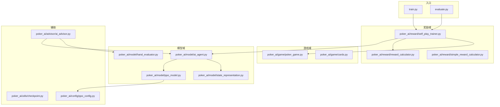
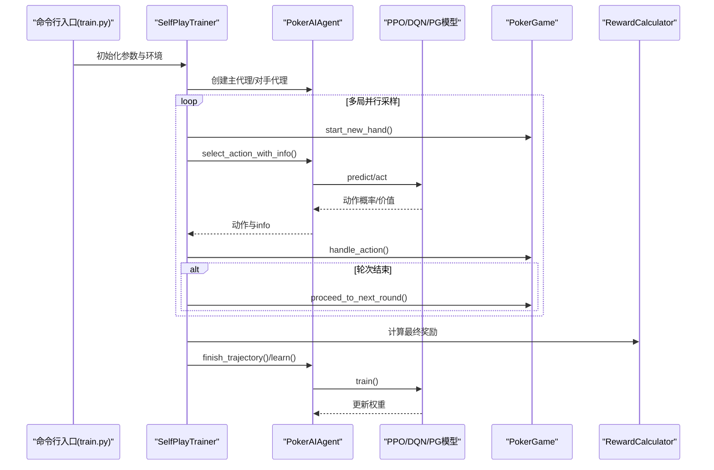
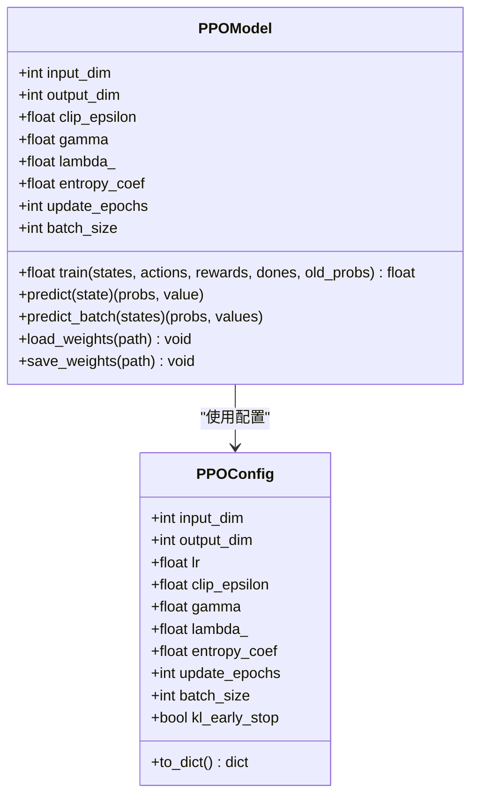
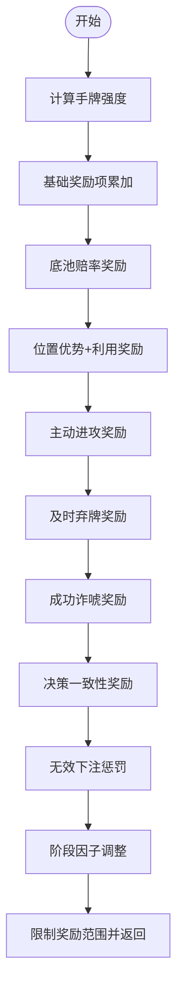
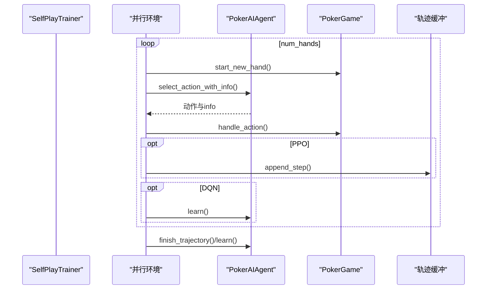
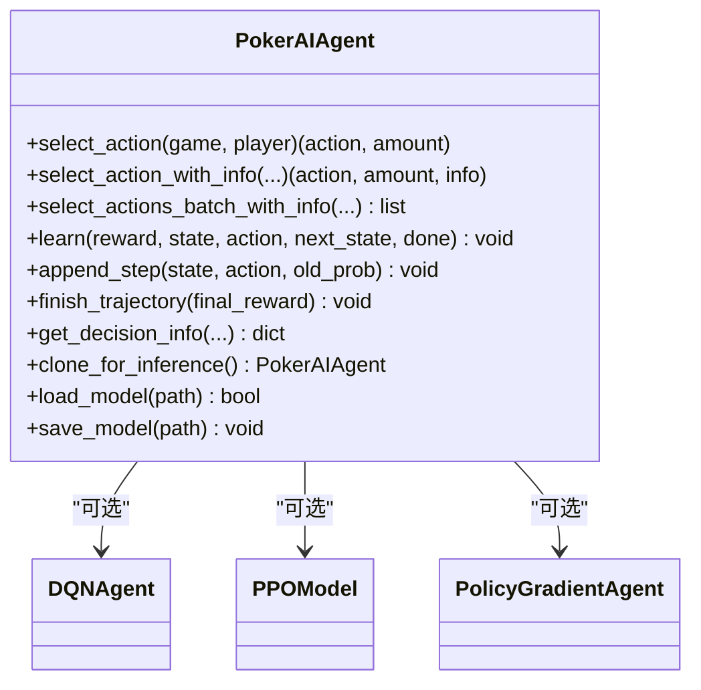
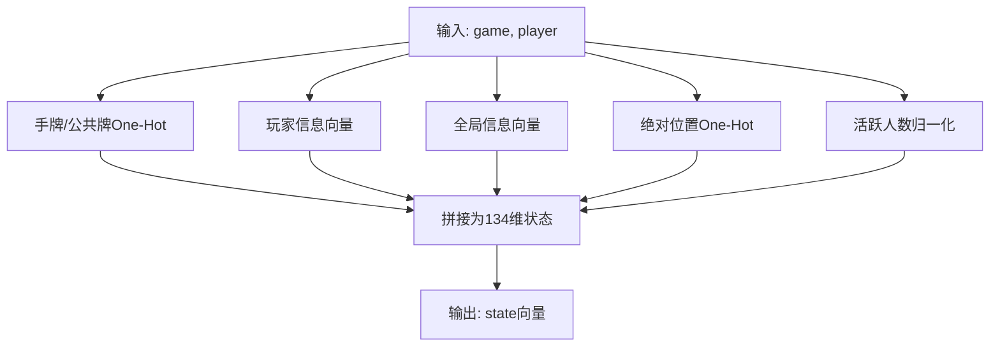
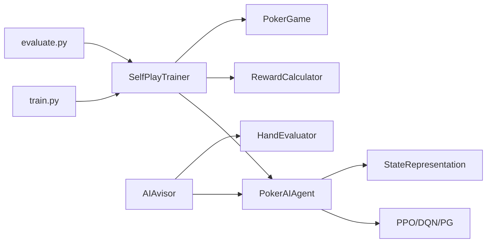

# 扩展开发

<cite>
**本文引用的文件**
- [README.md](file://README.md)
- [train.py](file://train.py)
- [evaluate.py](file://evaluate.py)
- [poker_ai/model/ppo_model.py](file://poker_ai/model/ppo_model.py)
- [poker_ai/reward/reward_calculator.py](file://poker_ai/reward/reward_calculator.py)
- [poker_ai/game/poker_game.py](file://poker_ai/game/poker_game.py)
- [poker_ai/model/ai_agent.py](file://poker_ai/model/ai_agent.py)
- [poker_ai/reward/self_play_trainer.py](file://poker_ai/reward/self_play_trainer.py)
- [poker_ai/advisor/ai_advisor.py](file://poker_ai/advisor/ai_advisor.py)
- [poker_ai/model/state_representation.py](file://poker_ai/model/state_representation.py)
- [poker_ai/config/ppo_config.py](file://poker_ai/config/ppo_config.py)
</cite>

## 目录
1. [简介](#简介)
2. [项目结构](#项目结构)
3. [核心组件](#核心组件)
4. [架构总览](#架构总览)
5. [详细组件分析](#详细组件分析)
6. [依赖关系分析](#依赖关系分析)
7. [性能考量](#性能考量)
8. [故障排查指南](#故障排查指南)
9. [结论](#结论)
10. [附录](#附录)

## 简介
本指南面向希望在现有强化学习德州扑克AI框架基础上进行扩展开发的工程师与研究者。文档围绕以下目标展开：
- 新算法集成方法：接口设计、兼容性、性能评估
- 模块扩展设计原则：插件架构、接口抽象、依赖注入
- API设计规范：REST风格、参数校验、错误处理、版本管理
- 具体扩展示例：新增AI算法、奖励函数、游戏规则
- 扩展点识别与架构适配
- 向后兼容性与版本升级策略
- 扩展测试与验证方法

## 项目结构
该项目采用按领域分层的组织方式，核心模块包括：
- 训练与评估入口：train.py、evaluate.py
- 游戏域：poker_ai/game（牌、玩家、游戏流程）
- 模型域：poker_ai/model（代理、PPO、状态表示、手牌评估）
- 奖励域：poker_ai/reward（奖励计算、自我对弈训练器）
- 辅助工具：poker_ai/advisor（AI建议器）、poker_ai/utils（检查点）、poker_ai/config（PPO配置）

**图表来源**
- [train.py:1-856](file://train.py#L1-L856)
- [evaluate.py:1-753](file://evaluate.py#L1-L753)
- [poker_ai/reward/self_play_trainer.py:1-800](file://poker_ai/reward/self_play_trainer.py#L1-L800)
- [poker_ai/model/ai_agent.py:1-703](file://poker_ai/model/ai_agent.py#L1-L703)
- [poker_ai/model/ppo_model.py:1-670](file://poker_ai/model/ppo_model.py#L1-L670)
- [poker_ai/model/state_representation.py:1-247](file://poker_ai/model/state_representation.py#L1-L247)
- [poker_ai/reward/reward_calculator.py:1-587](file://poker_ai/reward/reward_calculator.py#L1-L587)
- [poker_ai/game/poker_game.py:1-497](file://poker_ai/game/poker_game.py#L1-L497)
- [poker_ai/advisor/ai_advisor.py:1-629](file://poker_ai/advisor/ai_advisor.py#L1-L629)
- [poker_ai/config/ppo_config.py:1-97](file://poker_ai/config/ppo_config.py#L1-L97)

**章节来源**
- [README.md:46-75](file://README.md#L46-L75)

## 核心组件
- 训练入口与参数解析：负责模式选择、硬件档位、并行度、设备与混合精度、优化器、PPO专用参数、游戏配置、评估与检查点间隔等。
- 自我对弈训练器：封装6-max对战流程、并行采样、轨迹收集、对手替换、奖励计算、检查点与评估。
- AI代理接口：统一封装DQN/PPO/PG等算法，提供动作选择、批量推理、轨迹记录、权重保存/加载、克隆推理副本。
- PPO模型：Actor-Critic、GAE优势估计、价值损失裁剪、自适应熵、KL早停、学习率调度、混合精度优化。
- 奖励计算：手牌强度、位置优势、底池赔率、诈唬判定、决策一致性、无效下注惩罚、阶段因子、自适应权重调整。
- 游戏引擎：6人德州扑克规则、盲注、发牌、轮次推进、摊牌结算、状态查询。
- 状态表示：134维状态向量（手牌、公共牌、玩家信息、全局信息、绝对位置、活跃人数）。
- 建议器：基于训练模型给出建议、期望价值、置信度、风险评估。

**章节来源**
- [train.py:136-238](file://train.py#L136-L238)
- [train.py:240-339](file://train.py#L240-L339)
- [poker_ai/reward/self_play_trainer.py:48-166](file://poker_ai/reward/self_play_trainer.py#L48-L166)
- [poker_ai/model/ai_agent.py:55-116](file://poker_ai/model/ai_agent.py#L55-L116)
- [poker_ai/model/ppo_model.py:20-105](file://poker_ai/model/ppo_model.py#L20-L105)
- [poker_ai/reward/reward_calculator.py:9-42](file://poker_ai/reward/reward_calculator.py#L9-L42)
- [poker_ai/game/poker_game.py:155-194](file://poker_ai/game/poker_game.py#L155-L194)
- [poker_ai/model/state_representation.py:9-46](file://poker_ai/model/state_representation.py#L9-L46)
- [poker_ai/advisor/ai_advisor.py:21-48](file://poker_ai/advisor/ai_advisor.py#L21-L48)

## 架构总览
整体采用“入口-训练器-代理-模型-奖励-游戏”的流水线式架构。入口负责参数与环境初始化；训练器协调并行采样与学习；代理统一动作选择与学习接口；模型承载策略/价值网络；奖励器提供即时与最终奖励；游戏引擎提供规则与状态。

**图表来源**
- [train.py:340-531](file://train.py#L340-L531)
- [poker_ai/reward/self_play_trainer.py:260-417](file://poker_ai/reward/self_play_trainer.py#L260-L417)
- [poker_ai/model/ai_agent.py:117-156](file://poker_ai/model/ai_agent.py#L117-L156)
- [poker_ai/reward/reward_calculator.py:303-391](file://poker_ai/reward/reward_calculator.py#L303-L391)
- [poker_ai/game/poker_game.py:299-402](file://poker_ai/game/poker_game.py#L299-L402)

## 详细组件分析

### 组件A：PPO模型与训练接口
- 设计要点
  - Actor-Critic双网络，支持tf.function预编译与混合精度
  - GAE向量化实现，优势估计与裁剪，价值损失裁剪
  - 自适应熵系数、KL散度早停、学习率warmup+余弦衰减
  - 梯度累积、固定batch形状推理以避免retracing警告
- 扩展建议
  - 新算法可继承统一接口（如PPOModel），实现predict/predict_batch/train/load/save
  - 通过PPOConfig集中管理超参数，便于实验与复现
  - 在训练流程中替换agent即可无缝接入新算法

**图表来源**
- [poker_ai/model/ppo_model.py:20-105](file://poker_ai/model/ppo_model.py#L20-L105)
- [poker_ai/config/ppo_config.py:18-96](file://poker_ai/config/ppo_config.py#L18-L96)

**章节来源**
- [poker_ai/model/ppo_model.py:497-638](file://poker_ai/model/ppo_model.py#L497-L638)
- [poker_ai/config/ppo_config.py:18-96](file://poker_ai/config/ppo_config.py#L18-L96)

### 组件B：奖励计算与自适应调整
- 设计要点
  - 综合手牌强度、位置优势、底池赔率、决策一致性、无效下注惩罚、阶段因子
  - AdaptiveRewardCalculator动态调整权重，基于利润、诈唬率、无效下注率
- 扩展建议
  - 新奖励项通过RewardCalculator接口扩展，保持权重平衡与范围限制
  - 自适应逻辑可复用到新奖励器，形成“奖励器+自适应器”的组合模式

**图表来源**
- [poker_ai/reward/reward_calculator.py:303-391](file://poker_ai/reward/reward_calculator.py#L303-L391)

**章节来源**
- [poker_ai/reward/reward_calculator.py:394-536](file://poker_ai/reward/reward_calculator.py#L394-L536)

### 组件C：自我对弈训练器与并行采样
- 设计要点
  - 6-Max专用，强制num_players=6
  - 并行采样、轨迹收集、对手替换、all-in不走运补偿
  - PPO轨迹批量训练，DQN批量记忆与回放
- 扩展建议
  - 新算法通过PokerAIAgent接口无缝接入
  - 扩展对手策略（如随机/固定/历史版本），支持多对手混合

**图表来源**
- [poker_ai/reward/self_play_trainer.py:587-800](file://poker_ai/reward/self_play_trainer.py#L587-L800)
- [poker_ai/model/ai_agent.py:388-420](file://poker_ai/model/ai_agent.py#L388-L420)

**章节来源**
- [poker_ai/reward/self_play_trainer.py:167-225](file://poker_ai/reward/self_play_trainer.py#L167-L225)
- [poker_ai/reward/self_play_trainer.py:260-417](file://poker_ai/reward/self_play_trainer.py#L260-L417)

### 组件D：AI代理接口与插件化
- 设计要点
  - PokerAIAgent统一接口，支持DQN/PPO/PG
  - 批量动作选择、轨迹记录、权重克隆、目标网络更新
- 扩展建议
  - 新算法实现act/predict/predict_batch/train/load/save接口
  - 通过构造函数参数注入，实现依赖注入与配置化

**图表来源**
- [poker_ai/model/ai_agent.py:55-116](file://poker_ai/model/ai_agent.py#L55-L116)
- [poker_ai/model/ai_agent.py:489-516](file://poker_ai/model/ai_agent.py#L489-L516)

**章节来源**
- [poker_ai/model/ai_agent.py:117-214](file://poker_ai/model/ai_agent.py#L117-L214)
- [poker_ai/model/ai_agent.py:363-420](file://poker_ai/model/ai_agent.py#L363-L420)

### 组件E：状态表示与动作解码
- 设计要点
  - 134维状态向量：手牌one-hot、公共牌one-hot、玩家信息、全局信息、绝对位置、活跃人数
  - 动作向量：fold/call/raise小/raise中/全下
- 扩展建议
  - 新特征通过StateRepresentation扩展维度与归一化
  - 动作空间扩展需同步修改动作解码与合法性掩码

**图表来源**
- [poker_ai/model/state_representation.py:137-158](file://poker_ai/model/state_representation.py#L137-L158)

**章节来源**
- [poker_ai/model/state_representation.py:126-158](file://poker_ai/model/state_representation.py#L126-L158)

### 组件F：建议器与演示
- 设计要点
  - 基于训练模型给出建议、期望价值、置信度、风险评估
  - 支持基础建议与详细分析（动作分析、胜率估计、可视化数据）
- 扩展建议
  - 新算法可直接复用建议器接口，无需改动UI层

**章节来源**
- [poker_ai/advisor/ai_advisor.py:191-341](file://poker_ai/advisor/ai_advisor.py#L191-L341)

## 依赖关系分析
- 入口依赖训练器与评估器；训练器依赖代理、奖励器与游戏引擎；代理依赖模型与状态表示；奖励器依赖游戏与手牌评估；建议器依赖代理与手牌评估。
- 关键耦合点
  - SelfPlayTrainer与PokerAIAgent强耦合（动作选择与轨迹记录）
  - PokerAIAgent与PPOModel/DQN/PG弱耦合（通过统一接口）
  - StateRepresentation与HandEvaluator被广泛复用

**图表来源**
- [train.py:340-531](file://train.py#L340-L531)
- [evaluate.py:181-267](file://evaluate.py#L181-L267)
- [poker_ai/reward/self_play_trainer.py:167-225](file://poker_ai/reward/self_play_trainer.py#L167-L225)
- [poker_ai/model/ai_agent.py:55-116](file://poker_ai/model/ai_agent.py#L55-L116)
- [poker_ai/advisor/ai_advisor.py:21-48](file://poker_ai/advisor/ai_advisor.py#L21-L48)

**章节来源**
- [train.py:340-531](file://train.py#L340-L531)
- [evaluate.py:181-267](file://evaluate.py#L181-L267)

## 性能考量
- 并行与批处理
  - 训练与评估worker数自动推断，PPO默认更大的batch与更少更新轮次
  - PPO使用固定batch形状推理与tf.function预编译，减少retracing
- 硬件优化
  - 自动检测GPU/设置混合精度、XLA、显存增长
  - 线程并行配置（intra/inter op threads）与CPU亲和
- 训练稳定性
  - PPO：clip、价值损失裁剪、KL早停、自适应熵、学习率warmup+余弦衰减
  - 奖励：阶段因子、无效下注惩罚、自适应权重调整

**章节来源**
- [train.py:39-52](file://train.py#L39-L52)
- [train.py:55-97](file://train.py#L55-L97)
- [train.py:240-339](file://train.py#L240-L339)
- [poker_ai/model/ppo_model.py:106-198](file://poker_ai/model/ppo_model.py#L106-L198)
- [poker_ai/reward/reward_calculator.py:420-536](file://poker_ai/reward/reward_calculator.py#L420-L536)

## 故障排查指南
- 训练异常
  - 检查日志中的ERROR/Exception，定位具体阶段（环境设置、模型加载、训练循环）
  - GPU相关：XLA、oneDNN、显存增长设置；必要时禁用XLA或oneDNN
- 评估异常
  - 模型路径与格式（PPO三件套、DQN/PG权重文件）
  - 评估脚本对模型类型限制（DQN/PG），PPO正式评估建议使用train.py --mode eval
- 性能异常
  - 平均每手耗时异常升高：检查并行worker数、batch size、线程并行配置
  - 训练不稳定：降低学习率、增大batch、启用KL早停、自适应熵

**章节来源**
- [train.py:28-37](file://train.py#L28-L37)
- [train.py:532-591](file://train.py#L532-L591)
- [evaluate.py:110-142](file://evaluate.py#L110-L142)
- [README.md:184-191](file://README.md#L184-L191)

## 结论
本项目通过清晰的模块划分与统一接口，提供了良好的扩展性。新算法集成只需遵循统一的代理接口与状态表示，即可无缝接入训练与评估流程。奖励器与训练器的解耦设计使得策略优化与奖励工程可独立演进。建议在扩展时严格遵循接口契约、保持向后兼容、完善测试与评估流程。

## 附录

### 扩展开发最佳实践清单
- 接口设计
  - 新算法实现统一动作选择与学习接口，确保与PokerAIAgent兼容
  - 状态表示扩展需保持维度与归一化一致
- 兼容性
  - 保持检查点文件命名与加载逻辑（PPO三件套、DQN/PG权重）
  - 遵循6-Max约束或明确标注扩展规则
- 性能评估
  - 使用训练器内置评估与自定义评估脚本对比
  - 关注每手耗时、胜率、利润、诈唬率等关键指标
- API设计规范（概念性）
  - 参数校验：必填/可选、默认值、取值范围
  - 错误处理：统一异常类型、错误码、日志记录
  - 版本管理：语义化版本、兼容性矩阵、迁移指南
- 具体扩展示例（概念性）
  - 新AI算法：实现act/predict/predict_batch/train/load/save，注册到PokerAIAgent
  - 新奖励函数：在RewardCalculator中扩展，保持权重平衡与范围限制
  - 新游戏规则：在PokerGame中扩展，确保状态表示与动作解码同步更新
- 扩展点识别
  - 训练器：对手策略、奖励器、并行采样策略
  - 代理：算法实现、轨迹管理、权重克隆
  - 状态表示：特征维度、归一化策略
- 向后兼容与版本升级
  - 保持参数与检查点命名兼容，提供迁移脚本
  - 渐进式发布，标注废弃参数与新参数
- 扩展测试与验证
  - 单元测试：接口契约、状态表示、动作解码
  - 集成测试：小样本训练、评估对比、性能回归
  - A/B测试：新算法与基线对比，统计显著性检验