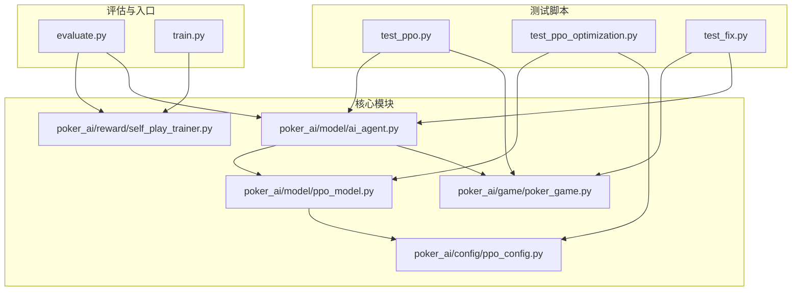
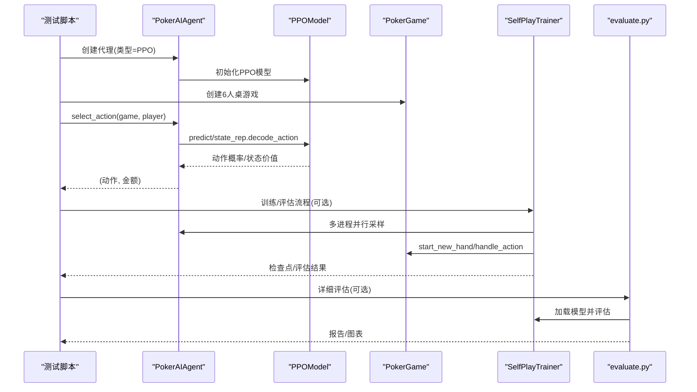
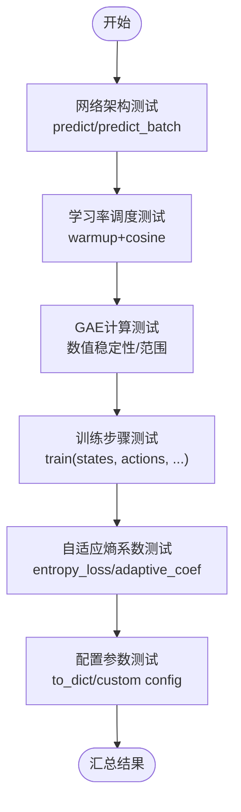
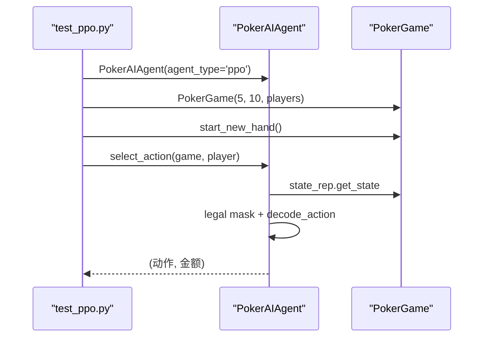
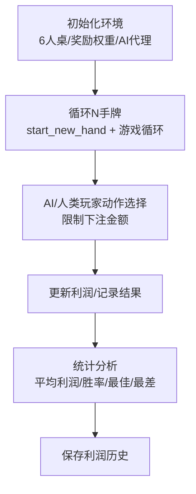
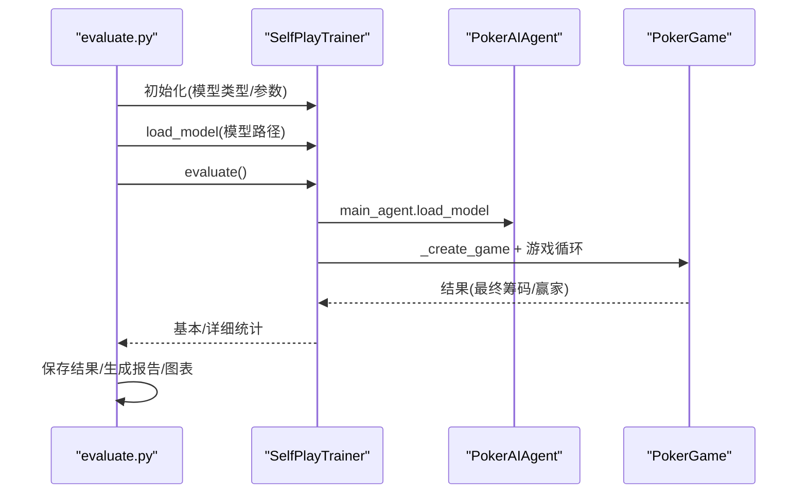
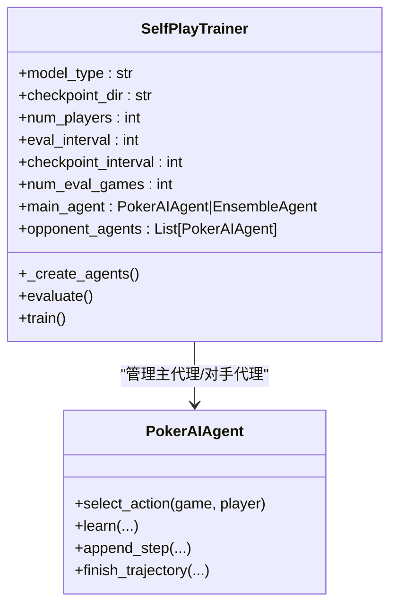
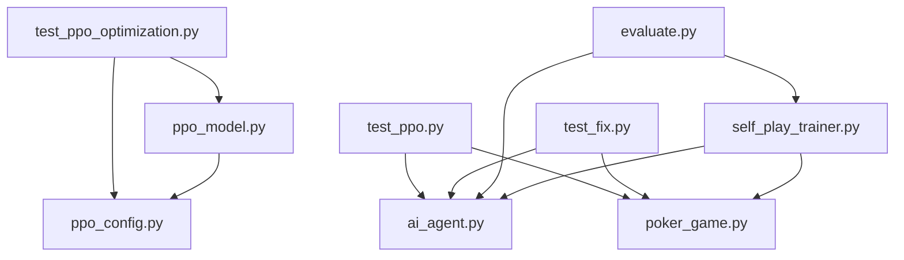

# 扩展测试验证

<cite>
**本文引用的文件**
- [README.md](file://README.md)
- [requirements.txt](file://requirements.txt)
- [test_ppo.py](file://test_ppo.py)
- [test_ppo_optimization.py](file://test_ppo_optimization.py)
- [test_fix.py](file://test_fix.py)
- [evaluate.py](file://evaluate.py)
- [train.py](file://train.py)
- [poker_ai/model/ppo_model.py](file://poker_ai/model/ppo_model.py)
- [poker_ai/model/ai_agent.py](file://poker_ai/model/ai_agent.py)
- [poker_ai/game/poker_game.py](file://poker_ai/game/poker_game.py)
- [poker_ai/config/ppo_config.py](file://poker_ai/config/ppo_config.py)
- [poker_ai/reward/self_play_trainer.py](file://poker_ai/reward/self_play_trainer.py)
- [PPO优化总结.md](file://PPO优化总结.md)
- [PPO快速指南.md](file://PPO快速指南.md)
</cite>

## 目录
1. [简介](#简介)
2. [项目结构](#项目结构)
3. [核心组件](#核心组件)
4. [架构总览](#架构总览)
5. [详细组件分析](#详细组件分析)
6. [依赖分析](#依赖分析)
7. [性能考量](#性能考量)
8. [故障排查指南](#故障排查指南)
9. [结论](#结论)
10. [附录](#附录)

## 简介
本指南面向扩展测试验证，围绕基于强化学习的6人德州扑克AI项目，系统阐述测试策略与验证方法，覆盖单元测试、集成测试、性能测试与回归测试等多层次测试体系。文档重点解释测试用例设计原则（边界条件、异常处理、并发安全）、测试示例（新算法与模块的测试思路）、自动化测试与持续集成策略（覆盖率、性能基线、内存泄漏检测），以及测试数据准备、模拟环境搭建与测试结果分析等关键技术点。

## 项目结构
该项目采用模块化组织，核心模块包括：
- 游戏引擎：poker_ai/game/poker_game.py（6人桌规则、动作处理、摊牌结算）
- 模型与代理：poker_ai/model/ppo_model.py、poker_ai/model/ai_agent.py（PPO模型与统一代理接口）
- 训练与评估：poker_ai/reward/self_play_trainer.py（自我对弈训练器）、evaluate.py（详细评估脚本）
- 配置：poker_ai/config/ppo_config.py（PPO超参数配置）
- 测试脚本：test_ppo.py、test_ppo_optimization.py、test_fix.py（PPO功能与修复验证）
- 入口脚本：train.py（训练/评估/演示入口）

**图表来源**
- [test_ppo.py:1-41](file://test_ppo.py#L1-L41)
- [test_ppo_optimization.py:1-301](file://test_ppo_optimization.py#L1-L301)
- [test_fix.py:1-283](file://test_fix.py#L1-L283)
- [evaluate.py:1-753](file://evaluate.py#L1-L753)
- [train.py](file://train.py)
- [poker_ai/model/ai_agent.py:1-703](file://poker_ai/model/ai_agent.py#L1-L703)
- [poker_ai/model/ppo_model.py:1-670](file://poker_ai/model/ppo_model.py#L1-L670)
- [poker_ai/game/poker_game.py:1-497](file://poker_ai/game/poker_game.py#L1-L497)
- [poker_ai/config/ppo_config.py:1-97](file://poker_ai/config/ppo_config.py#L1-L97)
- [poker_ai/reward/self_play_trainer.py:1-200](file://poker_ai/reward/self_play_trainer.py#L1-L200)

**章节来源**
- [README.md:46-75](file://README.md#L46-L75)
- [requirements.txt:1-7](file://requirements.txt#L1-L7)

## 核心组件
- PPO模型（PPOModel）：包含策略网络（Actor）、价值网络（Critic）、学习率调度、GAE计算、价值损失裁剪、自适应熵系数、KL散度早停、梯度累积等优化特性，支持批量推理与训练。
- 统一代理接口（PokerAIAgent）：封装DQN、策略梯度与PPO三种代理，提供动作选择、批量动作选择、轨迹记录与训练接口，支持集成代理EnsembleAgent。
- 游戏引擎（PokerGame）：6人桌德州扑克规则实现，负责发牌、下注、轮次推进、摊牌结算与状态查询。
- 自我对弈训练器（SelfPlayTrainer）：管理多进程/线程并行训练、对手轮换、检查点、评估与性能统计。
- 评估脚本（evaluate.py）：对训练模型进行详细评估，生成统计报告与可视化图表。
- 测试脚本：test_ppo.py（PPO初始化与动作选择）、test_ppo_optimization.py（PPO优化验证）、test_fix.py（修复方案验证）。

**章节来源**
- [poker_ai/model/ppo_model.py:20-670](file://poker_ai/model/ppo_model.py#L20-L670)
- [poker_ai/model/ai_agent.py:55-703](file://poker_ai/model/ai_agent.py#L55-L703)
- [poker_ai/game/poker_game.py:155-497](file://poker_ai/game/poker_game.py#L155-L497)
- [poker_ai/reward/self_play_trainer.py:48-200](file://poker_ai/reward/self_play_trainer.py#L48-L200)
- [evaluate.py:110-753](file://evaluate.py#L110-L753)
- [test_ppo.py:1-41](file://test_ppo.py#L1-L41)
- [test_ppo_optimization.py:1-301](file://test_ppo_optimization.py#L1-L301)
- [test_fix.py:1-283](file://test_fix.py#L1-L283)

## 架构总览
下图展示了测试验证在系统中的位置与交互关系：测试脚本驱动代理与游戏引擎，PPO模型与配置协同工作，训练器与评估脚本提供性能与稳定性验证。

**图表来源**
- [test_ppo.py:13-34](file://test_ppo.py#L13-L34)
- [poker_ai/model/ai_agent.py:117-155](file://poker_ai/model/ai_agent.py#L117-L155)
- [poker_ai/model/ppo_model.py:322-373](file://poker_ai/model/ppo_model.py#L322-L373)
- [poker_ai/game/poker_game.py:227-402](file://poker_ai/game/poker_game.py#L227-L402)
- [poker_ai/reward/self_play_trainer.py:167-200](file://poker_ai/reward/self_play_trainer.py#L167-L200)
- [evaluate.py:181-267](file://evaluate.py#L181-L267)

## 详细组件分析

### PPO模型测试（test_ppo_optimization.py）
该脚本验证PPO优化的六大关键点：网络架构、学习率调度、GAE计算、训练步骤、自适应熵系数与配置参数。测试覆盖：
- 前向传播与批量推理
- 学习率warmup与cosine衰减
- GAE数值稳定性与范围约束
- PPO训练步骤与损失记录
- 自适应熵系数与KL早停
- 配置参数的加载与导出

**图表来源**
- [test_ppo_optimization.py:22-254](file://test_ppo_optimization.py#L22-L254)

**章节来源**
- [test_ppo_optimization.py:1-301](file://test_ppo_optimization.py#L1-L301)
- [poker_ai/model/ppo_model.py:106-638](file://poker_ai/model/ppo_model.py#L106-L638)
- [poker_ai/config/ppo_config.py:18-97](file://poker_ai/config/ppo_config.py#L18-L97)

### PPO代理与游戏引擎集成测试（test_ppo.py）
该脚本验证PPO代理在真实游戏环境中的可用性：创建PPO代理、构造6人桌游戏、执行一轮手牌动作选择，确保代理与游戏引擎的接口兼容与稳定性。

**图表来源**
- [test_ppo.py:15-34](file://test_ppo.py#L15-L34)
- [poker_ai/model/ai_agent.py:117-155](file://poker_ai/model/ai_agent.py#L117-L155)
- [poker_ai/game/poker_game.py:227-256](file://poker_ai/game/poker_game.py#L227-L256)

**章节来源**
- [test_ppo.py:1-41](file://test_ppo.py#L1-L41)

### 修复方案验证测试（test_fix.py）
该脚本用于验证修复AI累计利润为负问题的方案，通过构造多人对战场景，调整奖励权重，限制AI下注金额，记录利润与胜率，分析修复效果。

**图表来源**
- [test_fix.py:28-208](file://test_fix.py#L28-L208)

**章节来源**
- [test_fix.py:1-283](file://test_fix.py#L1-L283)

### 评估脚本（evaluate.py）
评估脚本提供模型的详细评估能力：加载模型、创建对手、运行多局游戏、收集统计信息（动作分布、阶段利润、手牌强度胜率、位置胜率）、生成报告与图表。支持GPU内存限制配置与中文字体设置。

**图表来源**
- [evaluate.py:181-267](file://evaluate.py#L181-L267)
- [evaluate.py:269-482](file://evaluate.py#L269-L482)
- [evaluate.py:523-704](file://evaluate.py#L523-L704)

**章节来源**
- [evaluate.py:1-753](file://evaluate.py#L1-L753)

### 自我对弈训练器（SelfPlayTrainer）
训练器负责多进程并行采样、对手轮换、检查点管理、评估与性能统计。其初始化严格校验6人桌约束，确保状态维度与动作空间一致性。

**图表来源**
- [poker_ai/reward/self_play_trainer.py:48-200](file://poker_ai/reward/self_play_trainer.py#L48-L200)
- [poker_ai/model/ai_agent.py:55-420](file://poker_ai/model/ai_agent.py#L55-L420)

**章节来源**
- [poker_ai/reward/self_play_trainer.py:1-200](file://poker_ai/reward/self_play_trainer.py#L1-L200)

## 依赖分析
- 依赖关系：测试脚本依赖代理与游戏引擎；评估脚本依赖训练器与代理；训练器依赖代理与奖励计算器；PPO模型依赖配置与状态表示。
- 外部依赖：TensorFlow、NumPy、Matplotlib、Seaborn、argparse、dateutil等。
- 关键耦合点：PokerAIAgent与PPOModel的接口一致性；SelfPlayTrainer与PokerGame的6人桌约束；evaluate.py与训练器的模型加载接口。

**图表来源**
- [test_ppo.py:11-31](file://test_ppo.py#L11-L31)
- [test_ppo_optimization.py:29-74](file://test_ppo_optimization.py#L29-L74)
- [test_fix.py:14-54](file://test_fix.py#L14-L54)
- [evaluate.py:93-98](file://evaluate.py#L93-L98)
- [poker_ai/model/ai_agent.py:8-9](file://poker_ai/model/ai_agent.py#L8-L9)
- [poker_ai/model/ppo_model.py:10](file://poker_ai/model/ppo_model.py#L10)
- [poker_ai/config/ppo_config.py:14](file://poker_ai/config/ppo_config.py#L14)
- [poker_ai/reward/self_play_trainer.py:21-25](file://poker_ai/reward/self_play_trainer.py#L21-L25)

**章节来源**
- [requirements.txt:1-7](file://requirements.txt#L1-L7)

## 性能考量
- 训练效率：PPO优化包含学习率warmup/cosine衰减、GAE向量化、价值损失裁剪、自适应熵系数、KL早停、梯度累积等，预期提升收敛速度与稳定性。
- 推理性能：PPOModel支持predict_batch与固定batch形状的critic调用，减少tf.function重追踪。
- 评估性能：evaluate.py支持GPU内存增长与中文字体设置，避免一次性占用全部显存；生成图表时使用seaborn与matplotlib。
- 并发与资源：SelfPlayTrainer支持多worker并行采样，自动推断可用CPU核数并预留核心，避免过度占用。

**章节来源**
- [PPO优化总结.md:14-122](file://PPO优化总结.md#L14-L122)
- [PPO快速指南.md:101-132](file://PPO快速指南.md#L101-L132)
- [poker_ai/model/ppo_model.py:472-495](file://poker_ai/model/ppo_model.py#L472-L495)
- [evaluate.py:31-51](file://evaluate.py#L31-L51)
- [poker_ai/reward/self_play_trainer.py:28-46](file://poker_ai/reward/self_play_trainer.py#L28-L46)

## 故障排查指南
- 模型加载失败：evaluate.py在加载模型时会打印详细错误信息与当前工作目录、checkpoints目录内容，便于定位路径问题。
- 训练崩溃：PPOModel在训练步骤中捕获DNN/Graph错误并给出提示，建议尝试禁用XLA/oneDNN重跑。
- 游戏循环异常：test_fix.py对可能的死循环设置最大迭代次数并记录详细状态，便于定位问题。
- 依赖缺失：requirements.txt列出TensorFlow、NumPy、Matplotlib、Seaborn等依赖，安装后重试。

**章节来源**
- [evaluate.py:225-240](file://evaluate.py#L225-L240)
- [poker_ai/model/ai_agent.py:321-331](file://poker_ai/model/ai_agent.py#L321-L331)
- [test_fix.py:94-103](file://test_fix.py#L94-L103)
- [requirements.txt:1-7](file://requirements.txt#L1-L7)

## 结论
本指南提供了针对德州扑克AI项目的扩展测试验证体系：以PPO优化为核心，结合单元测试（PPO模型与代理）、集成测试（游戏引擎与训练器）、评估测试（详细评估与可视化）与修复验证（累计利润修复），形成从功能到性能、从稳定性到可解释性的多层次测试闭环。建议在CI中集成上述测试脚本，设定覆盖率与性能基线，持续监控训练日志与评估指标，确保扩展开发的质量与稳定性。

## 附录

### 测试策略与用例设计原则
- 边界条件测试：PPO模型的数值稳定性（GAE裁剪、熵损失、KL早停）、动作掩码的合法性、6人桌约束。
- 异常情况处理：模型加载失败、训练崩溃、游戏死循环、非法下注。
- 并发安全性验证：多线程/多进程并行采样、共享状态访问、检查点一致性。
- 回归测试：PPO优化前后行为一致性、评估指标稳定性、修复方案有效性。

### 自动化测试与持续集成建议
- 单元测试：test_ppo_optimization.py（PPO优化验证）、test_ppo.py（PPO功能验证）。
- 集成测试：evaluate.py（详细评估）、test_fix.py（修复验证）。
- 覆盖率要求：建议对关键模块（PPOModel、PokerAIAgent、PokerGame）达到中等以上覆盖率。
- 性能基线：记录训练速度、损失曲线、胜率变化趋势，设定阈值预警。
- 内存泄漏检测：在GPU环境下运行长时评估，监控显存占用与峰值。

### 测试数据准备与模拟环境
- 测试数据：使用固定随机种子与小规模手数验证（如500手），确保可重复性。
- 模拟环境：使用evaluate.py的--generate-plots选项生成图表，辅助分析策略与收益。
- 结果分析：统计平均利润、胜率、动作分布、阶段利润箱线图、手牌强度胜率条形图与累计利润曲线。