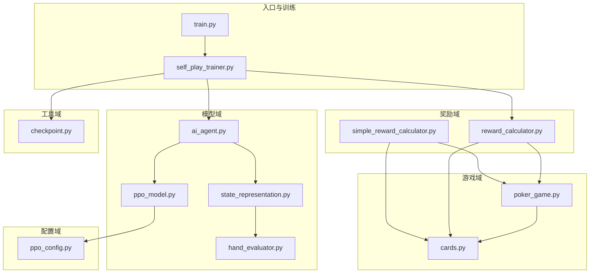
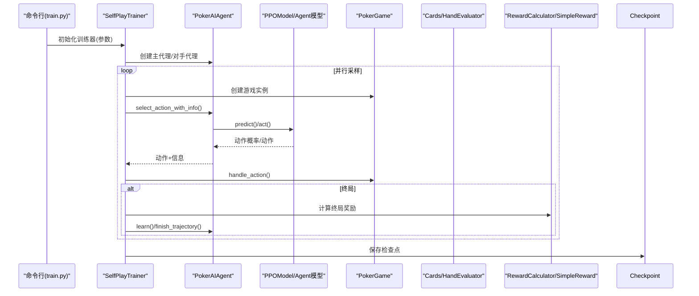
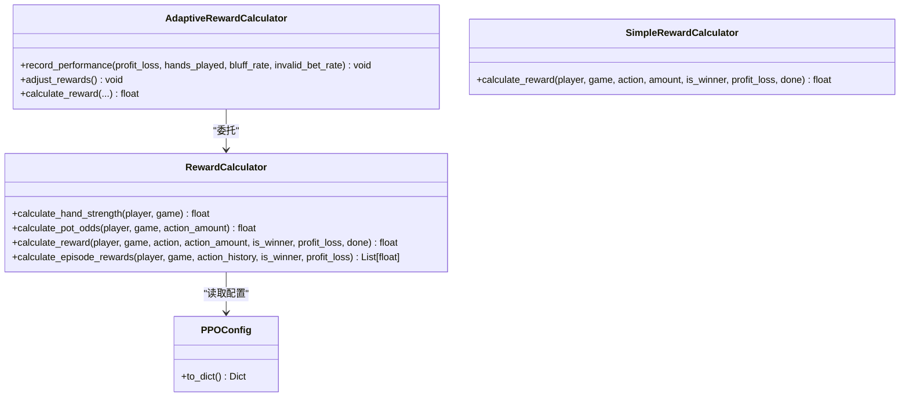
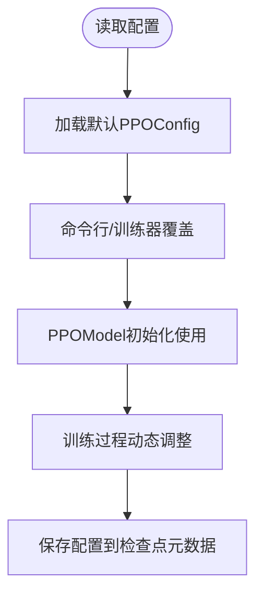
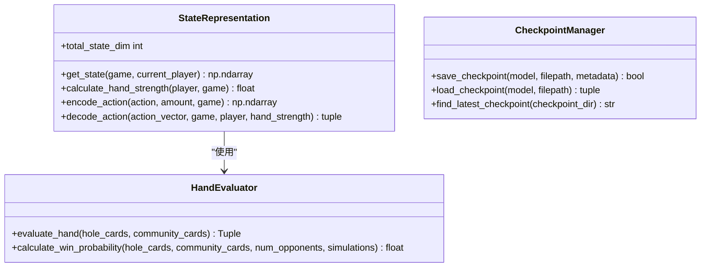
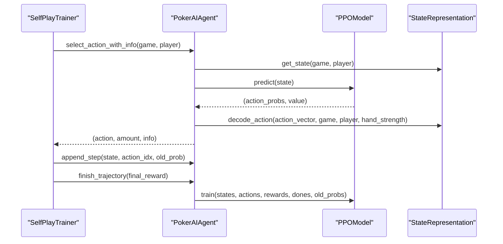
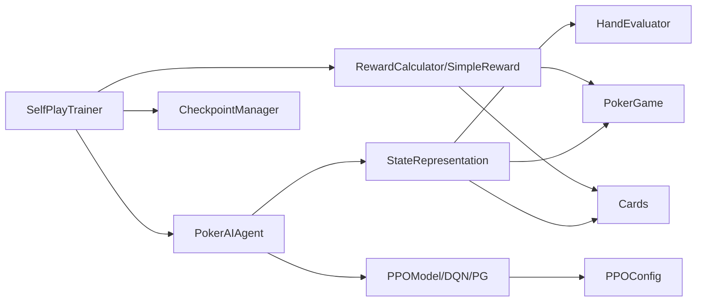

# 模块扩展开发

<cite>
**本文档引用的文件**
- [README.md](file://README.md)
- [train.py](file://train.py)
- [poker_ai/reward/self_play_trainer.py](file://poker_ai/reward/self_play_trainer.py)
- [poker_ai/reward/reward_calculator.py](file://poker_ai/reward/reward_calculator.py)
- [poker_ai/reward/simple_reward_calculator.py](file://poker_ai/reward/simple_reward_calculator.py)
- [poker_ai/config/ppo_config.py](file://poker_ai/config/ppo_config.py)
- [poker_ai/model/ppo_model.py](file://poker_ai/model/ppo_model.py)
- [poker_ai/model/ai_agent.py](file://poker_ai/model/ai_agent.py)
- [poker_ai/model/state_representation.py](file://poker_ai/model/state_representation.py)
- [poker_ai/model/hand_evaluator.py](file://poker_ai/model/hand_evaluator.py)
- [poker_ai/game/poker_game.py](file://poker_ai/game/poker_game.py)
- [poker_ai/game/cards.py](file://poker_ai/game/cards.py)
- [poker_ai/utils/checkpoint.py](file://poker_ai/utils/checkpoint.py)
</cite>

## 目录
1. [简介](#简介)
2. [项目结构](#项目结构)
3. [核心组件](#核心组件)
4. [架构概览](#架构概览)
5. [详细组件分析](#详细组件分析)
6. [依赖关系分析](#依赖关系分析)
7. [性能考量](#性能考量)
8. [故障排查指南](#故障排查指南)
9. [结论](#结论)
10. [附录](#附录)

## 简介
本指南面向希望扩展德州扑克AI项目的开发者，围绕奖励系统、配置管理、工具函数等现有模块，系统讲解如何进行模块扩展开发。内容涵盖接口抽象设计、依赖注入模式、插件架构实现、模块间依赖关系与解耦策略（事件驱动通信、回调机制、观察者模式）、扩展示例（新增奖励函数、自定义配置参数、实用工具函数）、模块测试策略（单元测试、集成测试、性能测试）以及向后兼容性与版本管理策略。

## 项目结构
项目采用按功能域划分的层次化组织方式，核心模块包括：
- 游戏域：poker_game（游戏规则与状态）、cards（牌与牌型评估）
- 模型域：ai_agent（代理接口）、ppo_model（PPO模型）、state_representation（状态表示）、hand_evaluator（手牌评估）
- 奖励域：reward_calculator（奖励计算）、simple_reward_calculator（简化奖励）、self_play_trainer（自我对弈训练器）
- 配置域：ppo_config（PPO配置）
- 工具域：checkpoint（检查点工具）

**图表来源**
- [train.py:136-238](file://train.py#L136-L238)
- [poker_ai/reward/self_play_trainer.py:48-166](file://poker_ai/reward/self_play_trainer.py#L48-L166)
- [poker_ai/model/ai_agent.py:55-116](file://poker_ai/model/ai_agent.py#L55-L116)
- [poker_ai/model/ppo_model.py:20-46](file://poker_ai/model/ppo_model.py#L20-L46)
- [poker_ai/model/state_representation.py:9-46](file://poker_ai/model/state_representation.py#L9-L46)
- [poker_ai/model/hand_evaluator.py:8-12](file://poker_ai/model/hand_evaluator.py#L8-L12)
- [poker_ai/game/poker_game.py:155-194](file://poker_ai/game/poker_game.py#L155-L194)
- [poker_ai/game/cards.py:53-77](file://poker_ai/game/cards.py#L53-L77)
- [poker_ai/reward/reward_calculator.py:9-42](file://poker_ai/reward/reward_calculator.py#L9-L42)
- [poker_ai/reward/simple_reward_calculator.py:5-11](file://poker_ai/reward/simple_reward_calculator.py#L5-L11)
- [poker_ai/config/ppo_config.py:18-97](file://poker_ai/config/ppo_config.py#L18-L97)
- [poker_ai/utils/checkpoint.py:17-57](file://poker_ai/utils/checkpoint.py#L17-L57)

**章节来源**
- [README.md:46-75](file://README.md#L46-L75)
- [train.py:136-238](file://train.py#L136-L238)

## 核心组件
- 自我对弈训练器（SelfPlayTrainer）：负责并行采样、奖励计算、对手管理与检查点保存，是训练流程的核心协调者。
- AI代理（PokerAIAgent）：统一的代理接口，封装DQN、策略梯度与PPO三种模型，提供动作选择、学习与推理能力。
- PPO模型（PPOModel）：基于Actor-Critic的策略优化器，支持GAE优势估计、价值损失裁剪、自适应熵正则等高级特性。
- 奖励计算器（RewardCalculator/AdaptiveRewardCalculator）：提供精细化奖励计算，包含手牌强度、位置优势、底池赔率、决策一致性等多维因子。
- 简化奖励计算器（SimpleRewardCalculator）：仅在终局给出基于盈亏的奖励，适合端到端学习。
- 状态表示（StateRepresentation）：将6-max德州扑克的复杂状态压缩为固定维度向量，支持批量推理与高性能特征工程。
- 手牌评估器（HandEvaluator）：高性能手牌强度评估与胜率估算，支撑奖励计算与决策信息。
- 配置管理（PPOConfig）：集中管理PPO超参数，支持字典序列化与默认实例化。
- 检查点工具（CheckpointManager）：统一的模型权重与元数据保存/加载接口。

**章节来源**
- [poker_ai/reward/self_play_trainer.py:48-166](file://poker_ai/reward/self_play_trainer.py#L48-L166)
- [poker_ai/model/ai_agent.py:55-116](file://poker_ai/model/ai_agent.py#L55-L116)
- [poker_ai/model/ppo_model.py:20-93](file://poker_ai/model/ppo_model.py#L20-L93)
- [poker_ai/reward/reward_calculator.py:9-42](file://poker_ai/reward/reward_calculator.py#L9-L42)
- [poker_ai/reward/simple_reward_calculator.py:5-11](file://poker_ai/reward/simple_reward_calculator.py#L5-L11)
- [poker_ai/model/state_representation.py:9-46](file://poker_ai/model/state_representation.py#L9-L46)
- [poker_ai/model/hand_evaluator.py:8-12](file://poker_ai/model/hand_evaluator.py#L8-L12)
- [poker_ai/config/ppo_config.py:18-97](file://poker_ai/config/ppo_config.py#L18-L97)
- [poker_ai/utils/checkpoint.py:17-57](file://poker_ai/utils/checkpoint.py#L17-L57)

## 架构概览
系统采用“训练器协调 + 代理统一接口 + 模型/奖励/状态解耦”的架构。训练器通过并行worker收集轨迹，奖励器提供即时与终局奖励，代理负责决策与学习，状态表示与手牌评估提供底层特征与评估能力。

**图表来源**
- [train.py:340-531](file://train.py#L340-L531)
- [poker_ai/reward/self_play_trainer.py:260-417](file://poker_ai/reward/self_play_trainer.py#L260-L417)
- [poker_ai/model/ai_agent.py:117-155](file://poker_ai/model/ai_agent.py#L117-L155)
- [poker_ai/model/ppo_model.py:322-390](file://poker_ai/model/ppo_model.py#L322-L390)
- [poker_ai/game/poker_game.py:299-350](file://poker_ai/game/poker_game.py#L299-L350)
- [poker_ai/reward/reward_calculator.py:303-391](file://poker_ai/reward/reward_calculator.py#L303-L391)

## 详细组件分析

### 奖励系统扩展
- 设计要点
  - 接口抽象：统一奖励计算接口，支持即时奖励与终局奖励分离。
  - 插件化：通过继承或组合方式接入新奖励函数，不影响现有逻辑。
  - 自适应：结合AdaptiveRewardCalculator的权重动态调整机制，实现策略自适应。
- 关键实现
  - 奖励权重与阶段因子：通过配置化参数控制各因子权重与阶段性调整。
  - 蒙特卡洛胜率估算：使用缓存与并行优化，降低计算开销。
  - 决策一致性与位置利用：通过线程本地存储与状态记录，避免多worker冲突。
- 扩展示例
  - 新增奖励函数：在RewardCalculator中添加新方法，按需在calculate_reward中聚合。
  - 自定义权重：通过PPOConfig或运行时参数覆盖默认权重。
  - 简化奖励：使用SimpleRewardCalculator仅在终局给出基于盈亏的奖励。

**图表来源**
- [poker_ai/reward/reward_calculator.py:9-42](file://poker_ai/reward/reward_calculator.py#L9-L42)
- [poker_ai/reward/reward_calculator.py:394-551](file://poker_ai/reward/reward_calculator.py#L394-L551)
- [poker_ai/reward/simple_reward_calculator.py:5-31](file://poker_ai/reward/simple_reward_calculator.py#L5-L31)
- [poker_ai/config/ppo_config.py:74-92](file://poker_ai/config/ppo_config.py#L74-L92)

**章节来源**
- [poker_ai/reward/reward_calculator.py:9-42](file://poker_ai/reward/reward_calculator.py#L9-L42)
- [poker_ai/reward/reward_calculator.py:303-391](file://poker_ai/reward/reward_calculator.py#L303-L391)
- [poker_ai/reward/simple_reward_calculator.py:13-31](file://poker_ai/reward/simple_reward_calculator.py#L13-L31)
- [poker_ai/config/ppo_config.py:18-97](file://poker_ai/config/ppo_config.py#L18-L97)

### 配置管理系统扩展
- 设计要点
  - 集中式配置：PPOConfig集中管理超参数，支持to_dict导出与默认实例化。
  - 运行时覆盖：通过命令行参数或训练器构造函数覆盖默认配置。
  - 可观测性：配置变更影响训练行为，需在日志中记录关键参数。
- 扩展示例
  - 新增超参数：在PPOConfig中添加字段，并在PPOModel中读取使用。
  - 参数校验：在构造函数中加入参数范围检查与默认值处理。
  - 导出与导入：通过to_dict与构造函数参数映射实现配置持久化。

**图表来源**
- [poker_ai/config/ppo_config.py:18-97](file://poker_ai/config/ppo_config.py#L18-L97)
- [poker_ai/model/ppo_model.py:33-56](file://poker_ai/model/ppo_model.py#L33-L56)
- [train.py:350-383](file://train.py#L350-L383)

**章节来源**
- [poker_ai/config/ppo_config.py:18-97](file://poker_ai/config/ppo_config.py#L18-L97)
- [poker_ai/model/ppo_model.py:33-56](file://poker_ai/model/ppo_model.py#L33-L56)
- [train.py:350-383](file://train.py#L350-L383)

### 工具函数扩展
- 设计要点
  - 统一接口：工具函数遵循约定式命名与参数签名，便于替换与测试。
  - 错误处理：对异常输入进行防御性编程，返回安全默认值或抛出明确异常。
  - 性能优化：对高频路径进行缓存与向量化处理，减少Python层开销。
- 扩展示例
  - 新增状态特征：在StateRepresentation中添加新维度，并在total_state_dim中累加。
  - 新增评估指标：在HandEvaluator中添加新评估逻辑，并在奖励系统中复用。
  - 检查点扩展：在CheckpointManager中支持新格式或元数据字段。

**图表来源**
- [poker_ai/model/state_representation.py:137-158](file://poker_ai/model/state_representation.py#L137-L158)
- [poker_ai/model/state_representation.py:174-211](file://poker_ai/model/state_representation.py#L174-L211)
- [poker_ai/model/state_representation.py:225-247](file://poker_ai/model/state_representation.py#L225-L247)
- [poker_ai/model/hand_evaluator.py:123-187](file://poker_ai/model/hand_evaluator.py#L123-L187)
- [poker_ai/utils/checkpoint.py:17-57](file://poker_ai/utils/checkpoint.py#L17-L57)

**章节来源**
- [poker_ai/model/state_representation.py:137-158](file://poker_ai/model/state_representation.py#L137-L158)
- [poker_ai/model/state_representation.py:174-211](file://poker_ai/model/state_representation.py#L174-L211)
- [poker_ai/model/state_representation.py:225-247](file://poker_ai/model/state_representation.py#L225-L247)
- [poker_ai/model/hand_evaluator.py:123-187](file://poker_ai/model/hand_evaluator.py#L123-L187)
- [poker_ai/utils/checkpoint.py:17-57](file://poker_ai/utils/checkpoint.py#L17-L57)

### 代理与模型扩展
- 设计要点
  - 统一接口：PokerAIAgent提供select_action/select_action_with_info/learn等通用接口。
  - 模型解耦：PPOModel独立于代理，通过接口暴露predict/predict_batch/train等方法。
  - 并行优化：PPO支持批量推理与轨迹累积，减少Python/TensorFlow往返开销。
- 扩展示例
  - 新增模型类型：在PokerAIAgent中添加分支，实例化新模型并传入state_dim等参数。
  - PPO参数扩展：在PPOModel中新增超参数，并在训练循环中使用。
  - 批量接口：在PokerAIAgent中实现select_actions_batch_with_info，复用到SelfPlayTrainer。

**图表来源**
- [poker_ai/model/ai_agent.py:117-155](file://poker_ai/model/ai_agent.py#L117-L155)
- [poker_ai/model/ai_agent.py:157-214](file://poker_ai/model/ai_agent.py#L157-L214)
- [poker_ai/model/ai_agent.py:388-420](file://poker_ai/model/ai_agent.py#L388-L420)
- [poker_ai/model/ppo_model.py:322-390](file://poker_ai/model/ppo_model.py#L322-L390)
- [poker_ai/model/ppo_model.py:497-638](file://poker_ai/model/ppo_model.py#L497-L638)

**章节来源**
- [poker_ai/model/ai_agent.py:117-155](file://poker_ai/model/ai_agent.py#L117-L155)
- [poker_ai/model/ai_agent.py:157-214](file://poker_ai/model/ai_agent.py#L157-L214)
- [poker_ai/model/ai_agent.py:388-420](file://poker_ai/model/ai_agent.py#L388-L420)
- [poker_ai/model/ppo_model.py:322-390](file://poker_ai/model/ppo_model.py#L322-L390)
- [poker_ai/model/ppo_model.py:497-638](file://poker_ai/model/ppo_model.py#L497-L638)

### 事件驱动与回调机制
- 设计要点
  - 训练器作为事件源：在采样、结算、评估、检查点保存等节点触发事件。
  - 回调注册：通过函数参数或装饰器注册回调，实现日志、可视化、监控等功能。
  - 观察者模式：将统计指标（胜率、EV、策略指标）作为观察目标，订阅训练器事件。
- 实践建议
  - 在SelfPlayTrainer中预留钩子（如on_hand_start/on_hand_end/on_checkpoint）。
  - 将统计与日志分离，避免阻塞训练主循环。
  - 使用异步队列处理耗时任务（如生成报告、上传指标）。

[本节为概念性内容，无需具体文件分析]

## 依赖关系分析
模块间的依赖关系清晰，遵循“低耦合、高内聚”的原则：
- SelfPlayTrainer依赖PokerAIAgent、RewardCalculator、CheckpointManager。
- PokerAIAgent依赖StateRepresentation与具体模型实现。
- PPOModel依赖PPOConfig与StateRepresentation。
- RewardCalculator依赖Game与Cards模块。
- StateRepresentation依赖HandEvaluator与Game/Cards。

**图表来源**
- [poker_ai/reward/self_play_trainer.py:135-141](file://poker_ai/reward/self_play_trainer.py#L135-L141)
- [poker_ai/model/ai_agent.py:73-115](file://poker_ai/model/ai_agent.py#L73-L115)
- [poker_ai/model/ppo_model.py:46-56](file://poker_ai/model/ppo_model.py#L46-L56)
- [poker_ai/reward/reward_calculator.py:6-8](file://poker_ai/reward/reward_calculator.py#L6-L8)
- [poker_ai/model/state_representation.py:41-45](file://poker_ai/model/state_representation.py#L41-L45)

**章节来源**
- [poker_ai/reward/self_play_trainer.py:135-141](file://poker_ai/reward/self_play_trainer.py#L135-L141)
- [poker_ai/model/ai_agent.py:73-115](file://poker_ai/model/ai_agent.py#L73-L115)
- [poker_ai/model/ppo_model.py:46-56](file://poker_ai/model/ppo_model.py#L46-L56)
- [poker_ai/reward/reward_calculator.py:6-8](file://poker_ai/reward/reward_calculator.py#L6-L8)
- [poker_ai/model/state_representation.py:41-45](file://poker_ai/model/state_representation.py#L41-L45)

## 性能考量
- 并行采样与批量推理：PPO支持批量动作选择与轨迹累积，显著降低Python层开销。
- GAE与价值损失裁剪：提升训练稳定性与收敛速度。
- 混合精度与XLA：在GPU上启用混合精度与XLA JIT，提升吞吐量。
- 缓存与向量化：手牌强度估算与状态表示采用缓存与向量化，减少重复计算。
- 线程本地存储：奖励系统使用线程本地存储避免多worker冲突。

[本节提供一般性指导，无需具体文件分析]

## 故障排查指南
- 检查点加载失败：确认文件路径与格式，检查元数据时间戳与权重文件是否存在。
- 训练崩溃（DNN/Graph错误）：在PPO训练中捕获特定错误并提示使用禁用XLA/oneDNN选项。
- 硬件配置问题：在train.py中设置线程并行、GPU内存增长与混合精度策略。
- 参数不匹配：确保PPOConfig与PPOModel参数一致，避免维度不匹配。

**章节来源**
- [poker_ai/utils/checkpoint.py:58-104](file://poker_ai/utils/checkpoint.py#L58-L104)
- [poker_ai/model/ai_agent.py:321-331](file://poker_ai/model/ai_agent.py#L321-L331)
- [train.py:240-335](file://train.py#L240-L335)

## 结论
通过接口抽象、依赖注入与插件化架构，项目实现了奖励系统、配置管理与工具函数的可扩展性。遵循低耦合、高内聚的设计原则，配合并行采样、批量推理与性能优化技术，能够在保证稳定性的同时快速迭代新功能。建议在扩展时严格遵循向后兼容性与版本管理策略，确保配置与接口的平滑演进。

## 附录
- 快速开始与命令行参数参考见README与train.py参数定义。
- 评估与演示流程可通过train.py --mode eval/demo与evaluate.py实现。

**章节来源**
- [README.md:12-227](file://README.md#L12-L227)
- [train.py:136-238](file://train.py#L136-L238)