# 算法集成开发

<cite>
**本文档引用的文件**
- [README.md](file://README.md)
- [train.py](file://train.py)
- [evaluate.py](file://evaluate.py)
- [ai_agent.py](file://poker_ai/model/ai_agent.py)
- [dqn_agent.py](file://poker_ai/model/dqn_agent.py)
- [ppo_model.py](file://poker_ai/model/ppo_model.py)
- [state_representation.py](file://poker_ai/model/state_representation.py)
- [poker_game.py](file://poker_ai/game/poker_game.py)
- [self_play_trainer.py](file://poker_ai/reward/self_play_trainer.py)
- [ppo_config.py](file://poker_ai/config/ppo_config.py)
- [requirements.txt](file://requirements.txt)
</cite>

## 目录
1. [简介](#简介)
2. [项目结构](#项目结构)
3. [核心组件](#核心组件)
4. [架构概览](#架构概览)
5. [详细组件分析](#详细组件分析)
6. [依赖分析](#依赖分析)
7. [性能考虑](#性能考虑)
8. [故障排除指南](#故障排除指南)
9. [结论](#结论)
10. [附录](#附录)

## 简介

本指南面向希望为PokerAIAgent项目添加新强化学习算法的开发者。项目基于TensorFlow 2.x实现了6人桌德州扑克AI，支持DQN、策略梯度和PPO三种算法。本文档详细说明了如何在统一接口中集成新算法，包括算法类设计、接口实现、状态表示集成等关键步骤。

## 项目结构

项目采用模块化设计，主要包含以下核心模块：

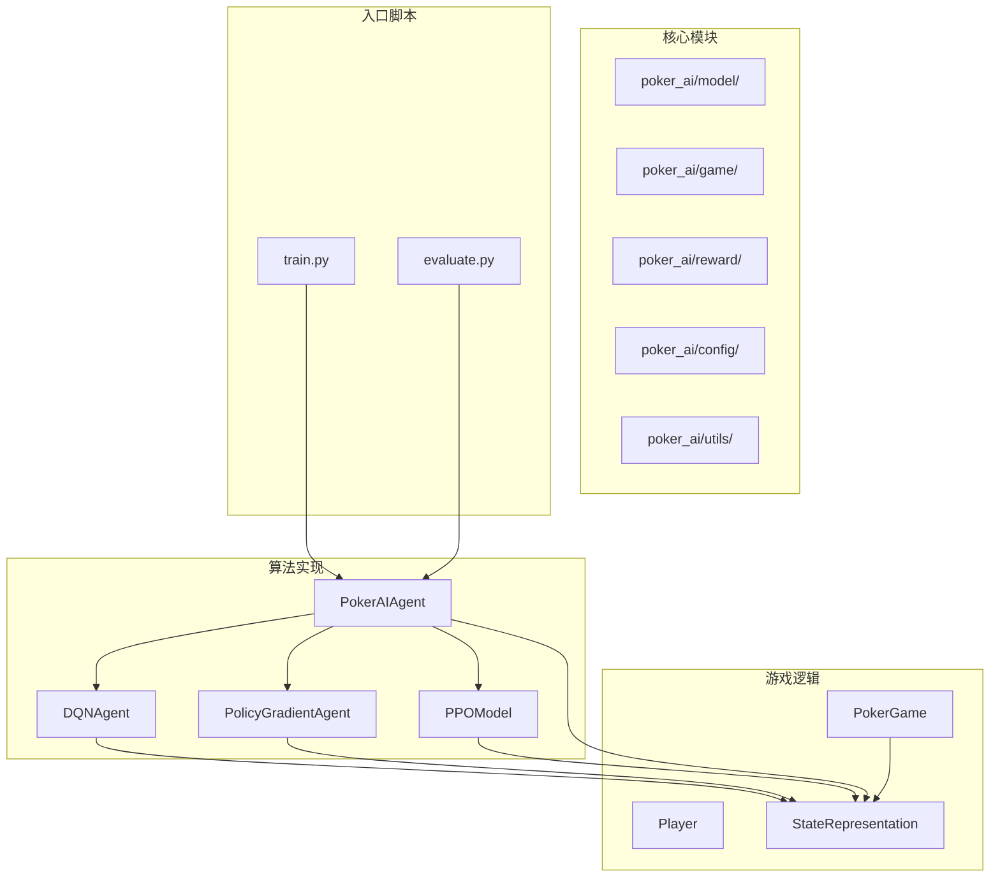

**图表来源**
- [ai_agent.py:55-116](file://poker_ai/model/ai_agent.py#L55-L116)
- [dqn_agent.py:21-62](file://poker_ai/model/dqn_agent.py#L21-L62)
- [ppo_model.py:20-58](file://poker_ai/model/ppo_model.py#L20-L58)
- [state_representation.py:9-42](file://poker_ai/model/state_representation.py#L9-L42)

**章节来源**
- [README.md:46-75](file://README.md#L46-L75)
- [requirements.txt:1-7](file://requirements.txt#L1-L7)

## 核心组件

### PokerAIAgent统一接口

PokerAIAgent是整个系统的统一接口，负责算法工厂模式的实现和算法间的兼容性处理：

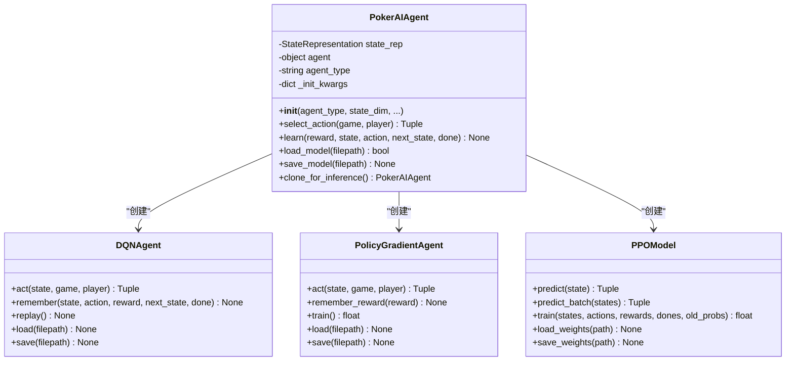

**图表来源**
- [ai_agent.py:55-116](file://poker_ai/model/ai_agent.py#L55-L116)
- [dqn_agent.py:21-62](file://poker_ai/model/dqn_agent.py#L21-L62)
- [ppo_model.py:20-58](file://poker_ai/model/ppo_model.py#L20-L58)

### 状态表示系统

StateRepresentation负责将德州扑克游戏状态转换为神经网络可处理的向量：

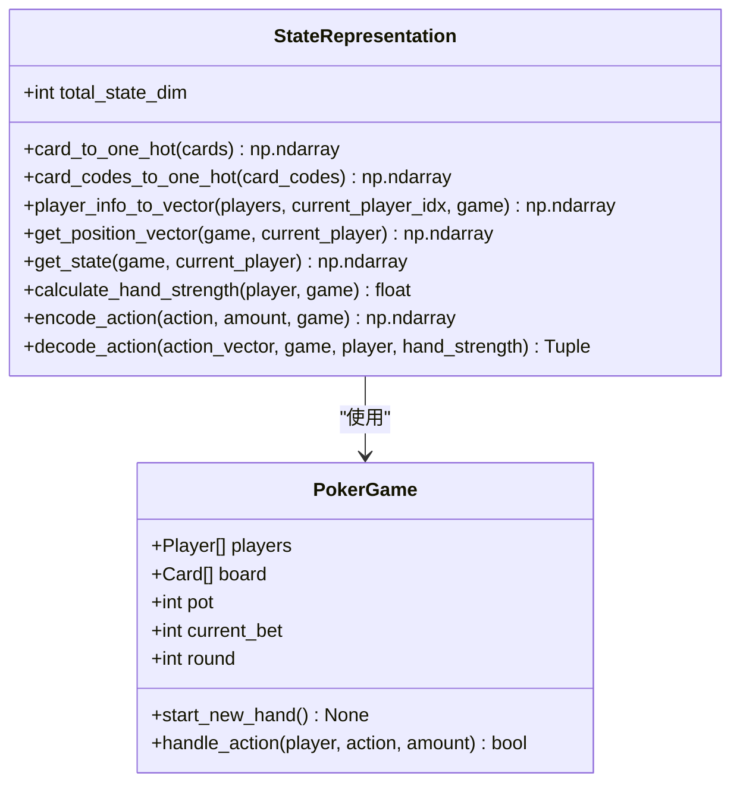

**图表来源**
- [state_representation.py:9-42](file://poker_ai/model/state_representation.py#L9-L42)
- [poker_game.py:155-194](file://poker_ai/game/poker_game.py#L155-L194)

**章节来源**
- [ai_agent.py:13-116](file://poker_ai/model/ai_agent.py#L13-L116)
- [state_representation.py:12-42](file://poker_ai/model/state_representation.py#L12-L42)

## 架构概览

系统采用分层架构设计，确保算法间的高度兼容性和可扩展性：

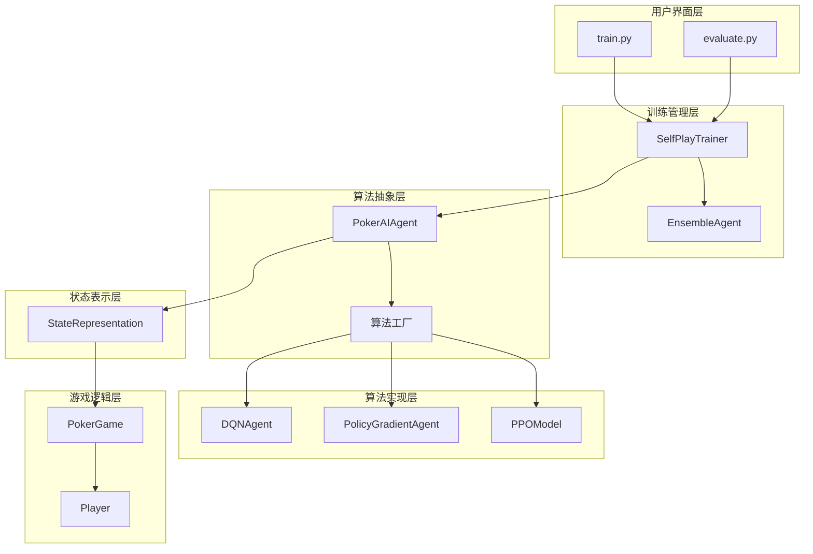

**图表来源**
- [train.py:350-383](file://train.py#L350-L383)
- [self_play_trainer.py:48-80](file://poker_ai/reward/self_play_trainer.py#L48-L80)
- [ai_agent.py:55-116](file://poker_ai/model/ai_agent.py#L55-L116)

## 详细组件分析

### 算法工厂模式实现

算法工厂模式通过PokerAIAgent的构造函数实现，支持动态算法选择和实例化：

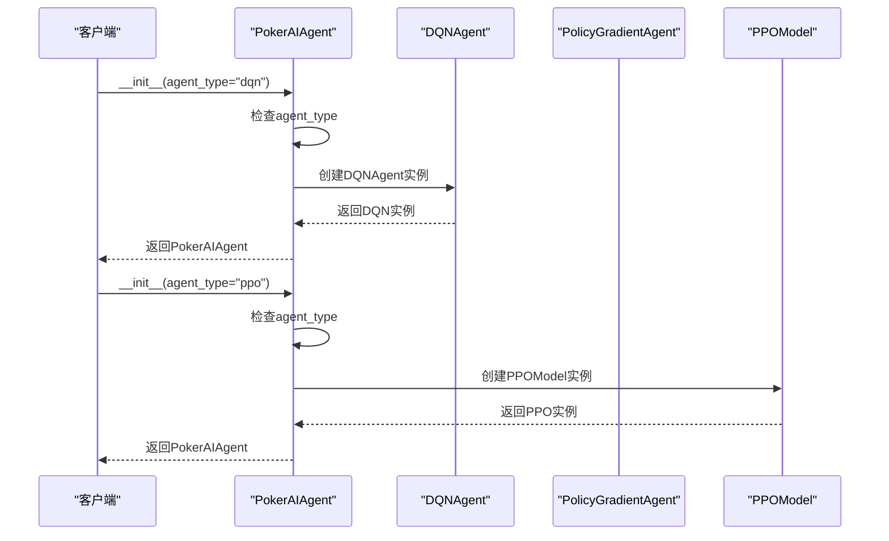

**图表来源**
- [ai_agent.py:90-112](file://poker_ai/model/ai_agent.py#L90-L112)

#### 算法类型判断流程

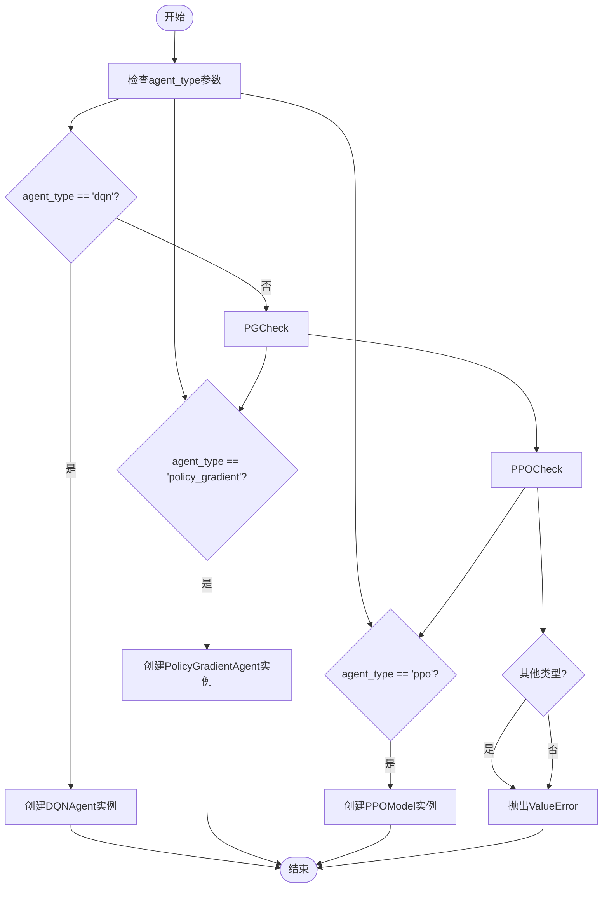

**图表来源**
- [ai_agent.py:90-112](file://poker_ai/model/ai_agent.py#L90-L112)

**章节来源**
- [ai_agent.py:58-116](file://poker_ai/model/ai_agent.py#L58-L116)

### 状态表示集成

状态表示系统为所有算法提供统一的输入格式，确保算法间的一致性：

#### 状态特征分解

| 特征类别 | 维度 | 描述 | 用途 |
|---------|------|------|------|
| 手牌编码 | 52维 | 二值编码玩家手牌 | 动作选择的基础信息 |
| 公共牌编码 | 52维 | 二值编码公共牌 | 评估手牌强度 |
| 玩家信息 | 18维 | 6个玩家×3特征 | 了解对手状态 |
| 游戏信息 | 5维 | 轮次、底池、下注额等 | 环境状态描述 |
| 位置信息 | 6维 | 绝对位置One-Hot | 策略位置敏感性 |
| 活跃计数 | 1维 | 归一化活跃玩家数 | 策略调整因子 |

#### 状态预处理流程

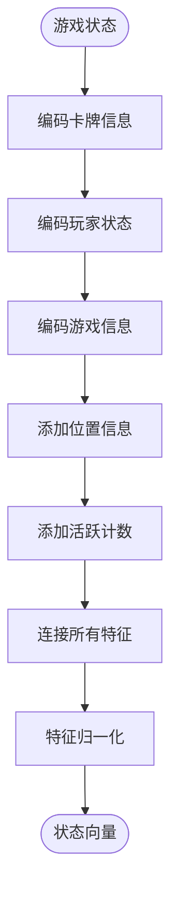

**图表来源**
- [state_representation.py:137-158](file://poker_ai/model/state_representation.py#L137-L158)

**章节来源**
- [state_representation.py:32-158](file://poker_ai/model/state_representation.py#L32-L158)

### 动作选择机制

不同算法采用不同的动作选择策略：

#### DQN算法动作选择

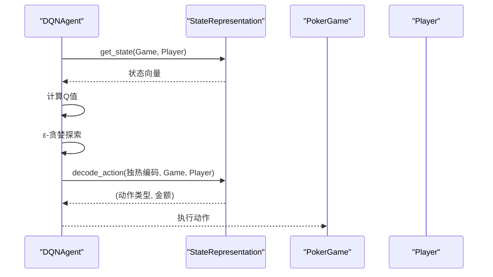

**图表来源**
- [dqn_agent.py:127-142](file://poker_ai/model/dqn_agent.py#L127-L142)

#### PPO算法动作选择

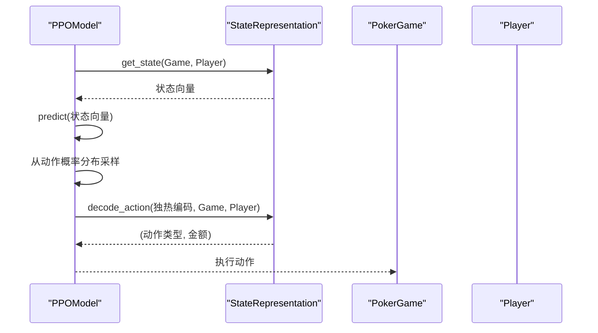

**图表来源**
- [ppo_model.py:347-372](file://poker_ai/model/ppo_model.py#L347-L372)

**章节来源**
- [dqn_agent.py:127-142](file://poker_ai/model/dqn_agent.py#L127-L142)
- [ppo_model.py:322-372](file://poker_ai/model/ppo_model.py#L322-L372)

### 学习机制差异

#### DQN的Q-learning机制

DQN采用值函数逼近和经验回放机制：

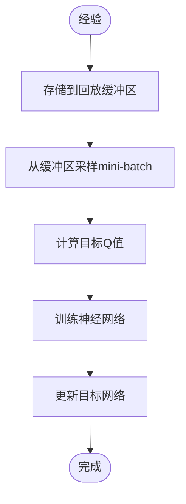

**图表来源**
- [dqn_agent.py:144-176](file://poker_ai/model/dqn_agent.py#L144-L176)

#### PPO的策略梯度机制

PPO采用策略优化和优势估计：

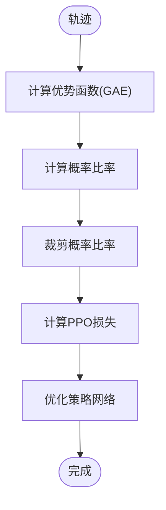

**图表来源**
- [ppo_model.py:497-638](file://poker_ai/model/ppo_model.py#L497-L638)

**章节来源**
- [dqn_agent.py:144-176](file://poker_ai/model/dqn_agent.py#L144-L176)
- [ppo_model.py:497-638](file://poker_ai/model/ppo_model.py#L497-L638)

## 依赖分析

### 外部依赖

项目依赖关系清晰，主要依赖包括：

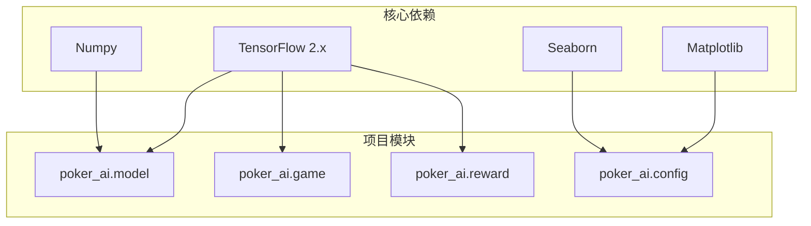

**图表来源**
- [requirements.txt:1-7](file://requirements.txt#L1-L7)

### 内部模块依赖

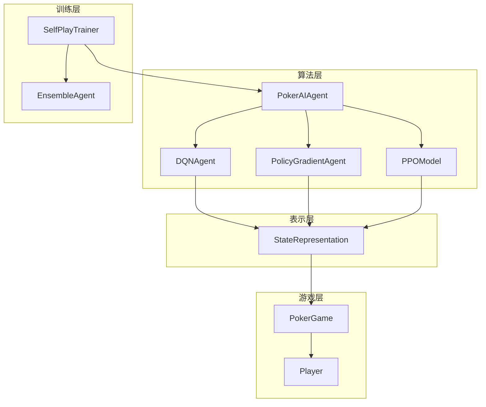

**图表来源**
- [ai_agent.py:1-13](file://poker_ai/model/ai_agent.py#L1-L13)
- [self_play_trainer.py:21-26](file://poker_ai/reward/self_play_trainer.py#L21-L26)

**章节来源**
- [requirements.txt:1-7](file://requirements.txt#L1-L7)
- [ai_agent.py:1-13](file://poker_ai/model/ai_agent.py#L1-L13)

## 性能考虑

### 训练效率优化

项目针对不同硬件平台进行了专门优化：

#### RTX 4090D优化特性

| 优化项目 | 参数设置 | 效果 |
|---------|---------|------|
| 批次大小 | 256 | 提升GPU利用率 |
| 更新轮次 | 4 | 减少策略退化风险 |
| 学习率调度 | Warmup+Cosine | 稳定初期训练 |
| 熵正则 | 自适应 | 鼓励探索 |
| 价值损失裁剪 | 0.2 | 防止过拟合 |

#### 并行训练优化

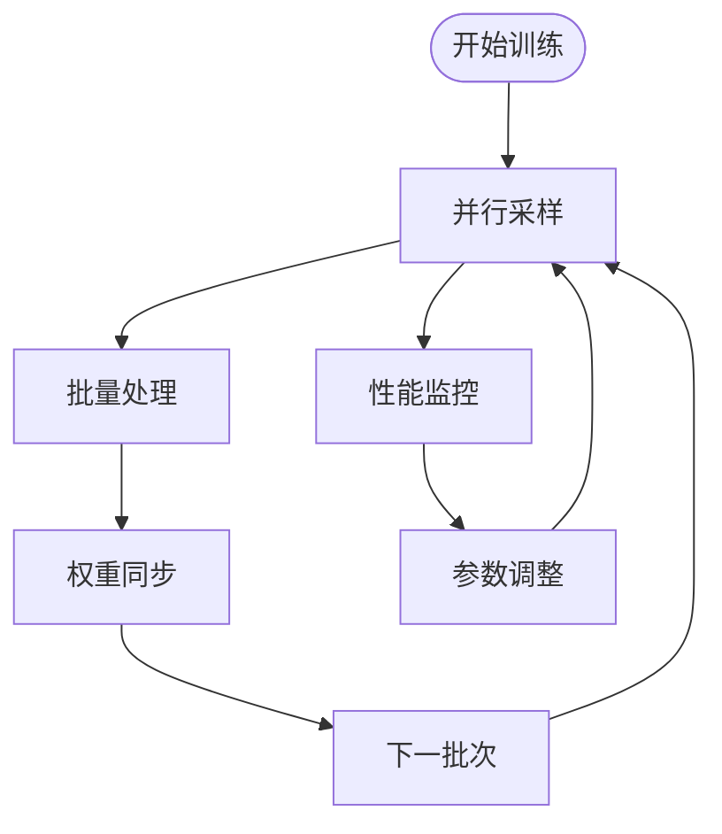

**图表来源**
- [self_play_trainer.py:587-799](file://poker_ai/reward/self_play_trainer.py#L587-L799)

**章节来源**
- [ppo_config.py:18-97](file://poker_ai/config/ppo_config.py#L18-L97)
- [self_play_trainer.py:587-799](file://poker_ai/reward/self_play_trainer.py#L587-L799)

## 故障排除指南

### 常见问题及解决方案

#### 模型加载失败

**问题症状**：`ValueError: 不支持的代理类型`

**解决方案**：
1. 检查agent_type参数是否正确
2. 确认算法模块已正确导入
3. 验证模型文件格式

#### 训练不稳定

**问题症状**：损失值波动大或训练停滞

**解决方案**：
1. 调整学习率参数
2. 检查批次大小设置
3. 验证数据预处理一致性

#### 内存不足

**问题症状**：GPU内存溢出

**解决方案**：
1. 减小批次大小
2. 启用GPU内存增长
3. 优化网络架构

**章节来源**
- [ai_agent.py:111-112](file://poker_ai/model/ai_agent.py#L111-L112)
- [train.py:297-334](file://train.py#L297-L334)

## 结论

PokerAIAgent项目通过统一的算法接口和工厂模式设计，成功实现了多种强化学习算法的无缝集成。该架构具有以下优势：

1. **高度可扩展性**：新的算法只需实现统一接口即可集成
2. **强兼容性**：所有算法共享相同的状态表示和动作空间
3. **灵活配置**：支持动态参数调整和硬件优化
4. **性能优化**：针对现代GPU进行了专门优化

对于新算法的集成，开发者应重点关注状态表示的兼容性、动作空间的一致性，以及学习机制的正确实现。

## 附录

### 算法集成步骤清单

1. **实现算法类**
   - 继承统一接口规范
   - 实现动作选择方法
   - 实现学习更新方法

2. **状态表示集成**
   - 确保状态维度兼容
   - 实现状态预处理
   - 验证动作编码解码

3. **工厂模式注册**
   - 在PokerAIAgent中注册新算法
   - 实现参数传递逻辑
   - 测试算法实例化

4. **性能测试**
   - 验证训练稳定性
   - 检查内存使用情况
   - 评估训练效率

5. **文档完善**
   - 添加算法说明文档
   - 提供使用示例
   - 记录参数配置

**章节来源**
- [ai_agent.py:90-116](file://poker_ai/model/ai_agent.py#L90-L116)
- [state_representation.py:137-158](file://poker_ai/model/state_representation.py#L137-L158)