# 单元测试实施指南

<cite>
**本文档引用的文件**
- [poker_ai/model/ai_agent.py](file://poker_ai/model/ai_agent.py)
- [poker_ai/model/dqn_agent.py](file://poker_ai/model/dqn_agent.py)
- [poker_ai/reward/reward_calculator.py](file://poker_ai/reward/reward_calculator.py)
- [poker_ai/game/poker_game.py](file://poker_ai/game/poker_game.py)
- [poker_ai/model/state_representation.py](file://poker_ai/model/state_representation.py)
- [poker_ai/model/hand_evaluator.py](file://poker_ai/model/hand_evaluator.py)
- [poker_ai/game/cards.py](file://poker_ai/game/cards.py)
- [poker_ai/advisor/ai_advisor.py](file://poker_ai/advisor/ai_advisor.py)
- [test_ppo.py](file://test_ppo.py)
- [test_gpu.py](file://test_gpu.py)
- [test_fix.py](file://test_fix.py)
- [test_ppo_optimization.py](file://test_ppo_optimization.py)
- [requirements.txt](file://requirements.txt)
</cite>

## 目录
1. [简介](#简介)
2. [项目结构](#项目结构)
3. [核心组件](#核心组件)
4. [架构概览](#架构概览)
5. [详细组件分析](#详细组件分析)
6. [依赖关系分析](#依赖关系分析)
7. [性能考量](#性能考量)
8. [故障排除指南](#故障排除指南)
9. [结论](#结论)
10. [附录](#附录)

## 简介

本指南为德州扑克AI项目提供全面的单元测试实施指导，涵盖AI代理、游戏引擎、奖励系统等核心模块。项目采用Python开发，使用TensorFlow/Keras构建深度强化学习模型，实现了DQN、策略梯度和PPO三种算法。

## 项目结构

项目采用模块化设计，主要分为以下几个核心模块：

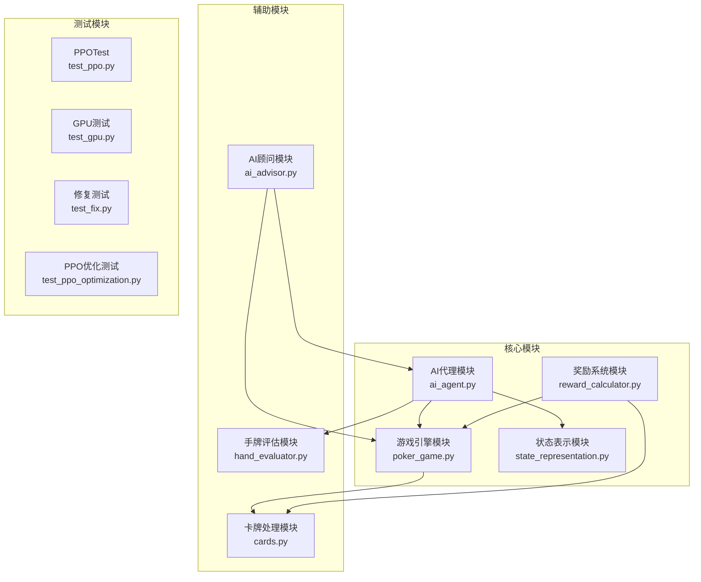

**图表来源**
- [poker_ai/model/ai_agent.py:55-116](file://poker_ai/model/ai_agent.py#L55-L116)
- [poker_ai/game/poker_game.py:155-194](file://poker_ai/game/poker_game.py#L155-L194)
- [poker_ai/reward/reward_calculator.py:9-42](file://poker_ai/reward/reward_calculator.py#L9-L42)

**章节来源**
- [poker_ai/model/ai_agent.py:1-703](file://poker_ai/model/ai_agent.py#L1-L703)
- [poker_ai/game/poker_game.py:1-497](file://poker_ai/game/poker_game.py#L1-L497)

## 核心组件

### AI代理系统

AI代理系统是整个项目的核心，支持多种强化学习算法：

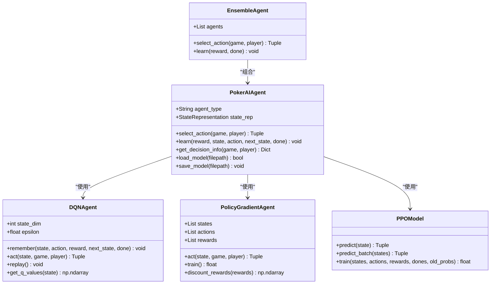

**图表来源**
- [poker_ai/model/ai_agent.py:55-116](file://poker_ai/model/ai_agent.py#L55-L116)
- [poker_ai/model/dqn_agent.py:21-62](file://poker_ai/model/dqn_agent.py#L21-L62)

### 游戏引擎

游戏引擎负责德州扑克的核心规则实现：

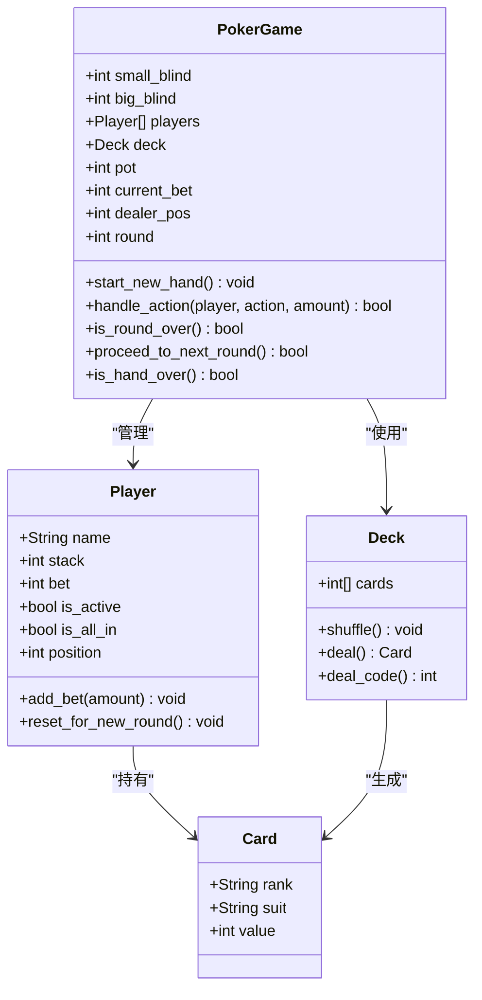

**图表来源**
- [poker_ai/game/poker_game.py:9-154](file://poker_ai/game/poker_game.py#L9-L154)
- [poker_ai/game/poker_game.py:155-227](file://poker_ai/game/poker_game.py#L155-L227)
- [poker_ai/game/cards.py:11-51](file://poker_ai/game/cards.py#L11-L51)

**章节来源**
- [poker_ai/model/ai_agent.py:55-553](file://poker_ai/model/ai_agent.py#L55-L553)
- [poker_ai/game/poker_game.py:9-497](file://poker_ai/game/poker_game.py#L9-L497)

## 架构概览

项目采用分层架构设计，各模块职责明确：

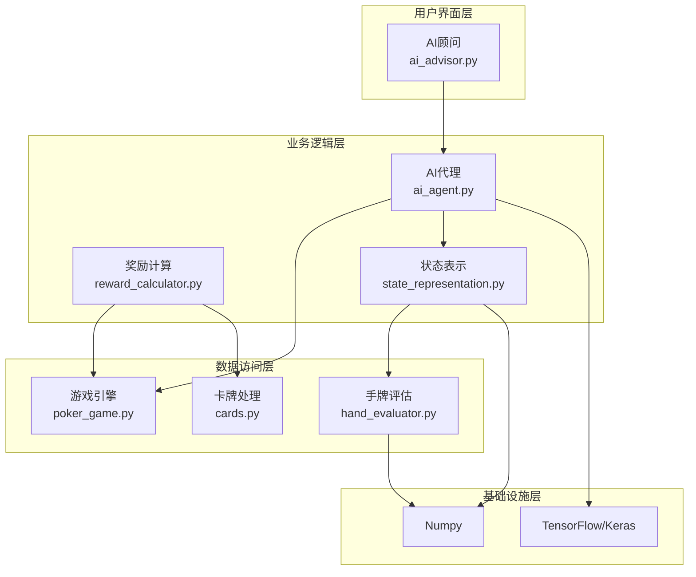

**图表来源**
- [poker_ai/advisor/ai_advisor.py:21-48](file://poker_ai/advisor/ai_advisor.py#L21-L48)
- [poker_ai/model/ai_agent.py:73-115](file://poker_ai/model/ai_agent.py#L73-L115)
- [poker_ai/reward/reward_calculator.py:12-42](file://poker_ai/reward/reward_calculator.py#L12-L42)

## 详细组件分析

### AI代理单元测试策略

#### DQN代理测试

DQN代理测试重点关注以下方面：

1. **状态空间验证**：确保状态向量维度正确
2. **动作选择逻辑**：验证ε-greedy策略实现
3. **经验回放机制**：测试记忆库容量和采样
4. **Q值计算**：验证目标Q值更新

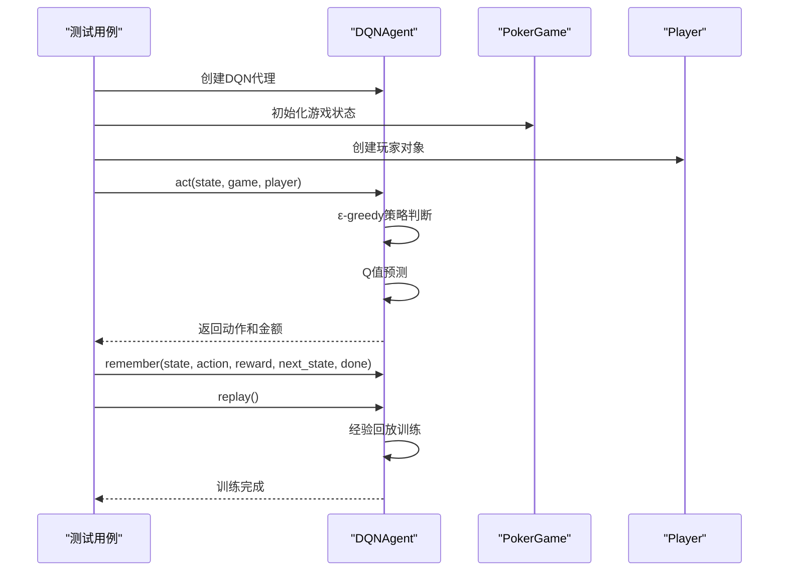

**图表来源**
- [poker_ai/model/dqn_agent.py:127-176](file://poker_ai/model/dqn_agent.py#L127-L176)

#### PPO代理测试

PPO代理测试关注以下关键点：

1. **动作概率分布**：验证softmax输出的合理性
2. **优势估计**：测试GAE计算的准确性
3. **训练稳定性**：检查PPO裁剪机制
4. **批量处理**：验证批量推理性能

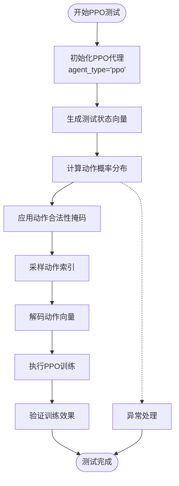

**图表来源**
- [poker_ai/model/ai_agent.py:131-155](file://poker_ai/model/ai_agent.py#L131-L155)

#### 策略梯度代理测试

策略梯度代理测试重点：

1. **动作采样**：验证随机采样符合概率分布
2. **折扣奖励**：测试GAE计算的数值稳定性
3. **网络训练**：检查反向传播过程
4. **性能优化**：验证tf.function预编译

**章节来源**
- [poker_ai/model/dqn_agent.py:127-326](file://poker_ai/model/dqn_agent.py#L127-L326)
- [poker_ai/model/ai_agent.py:117-246](file://poker_ai/model/ai_agent.py#L117-L246)

### 游戏引擎单元测试策略

#### 玩家状态管理测试

游戏引擎测试关注：

1. **筹码管理**：验证下注、跟注、加注的正确性
2. **状态转换**：检查玩家激活状态的变化
3. **轮次控制**：验证游戏阶段的推进逻辑
4. **摊牌机制**：测试胜负判定的准确性

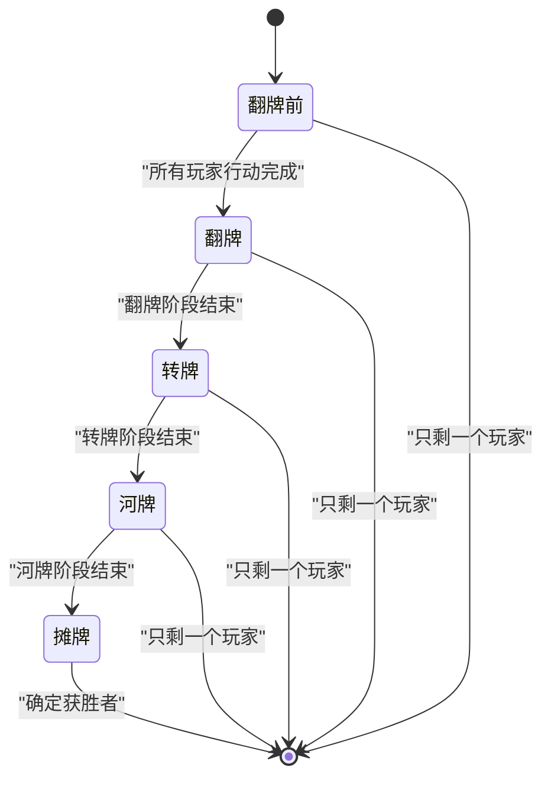

**图表来源**
- [poker_ai/game/poker_game.py:376-402](file://poker_ai/game/poker_game.py#L376-L402)

#### 动作合法性验证

测试动作合法性检查：

1. **下注金额验证**：确保加注符合最小要求
2. **玩家状态检查**：验证活跃玩家的行动权限
3. **筹码充足性**：检查玩家是否有足够筹码
4. **游戏规则遵循**：确保所有动作符合德州扑克规则

**章节来源**
- [poker_ai/game/poker_game.py:299-350](file://poker_ai/game/poker_game.py#L299-L350)

### 奖励系统单元测试策略

#### 奖励计算测试

奖励系统测试重点：

1. **手牌强度评估**：验证蒙特卡洛模拟的准确性
2. **位置优势计算**：检查位置权重的合理性
3. **决策一致性**：测试策略连贯性的奖励机制
4. **自适应调整**：验证权重动态调整逻辑

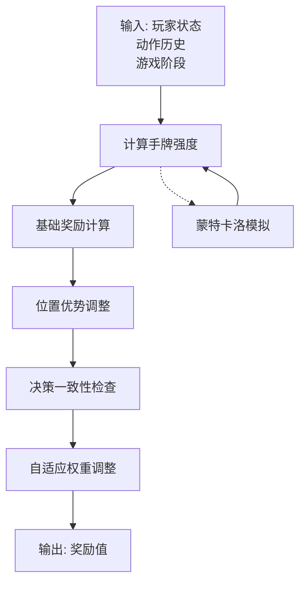

**图表来源**
- [poker_ai/reward/reward_calculator.py:303-370](file://poker_ai/reward/reward_calculator.py#L303-L370)

#### 自适应奖励调整测试

自适应系统测试：

1. **性能指标收集**：验证利润、诈唬率等指标
2. **权重平衡检查**：测试权重范围限制
3. **策略多样性评估**：检查策略变化的检测能力
4. **长期稳定性**：验证调整策略的有效性

**章节来源**
- [poker_ai/reward/reward_calculator.py:394-552](file://poker_ai/reward/reward_calculator.py#L394-L552)

### 状态表示单元测试策略

#### 状态向量构建测试

状态表示测试关注：

1. **维度验证**：确保状态向量维度正确
2. **特征归一化**：检查数值范围的合理性
3. **位置编码**：验证绝对位置One-Hot编码
4. **性能优化**：测试预计算索引映射的效果

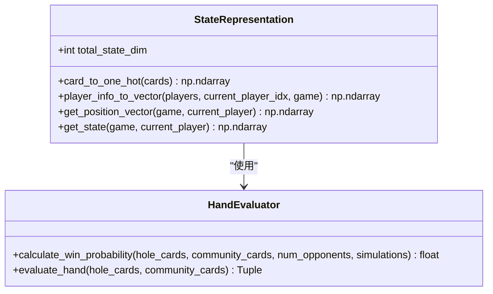

**图表来源**
- [poker_ai/model/state_representation.py:9-46](file://poker_ai/model/state_representation.py#L9-L46)
- [poker_ai/model/hand_evaluator.py:8-12](file://poker_ai/model/hand_evaluator.py#L8-L12)

**章节来源**
- [poker_ai/model/state_representation.py:137-247](file://poker_ai/model/state_representation.py#L137-L247)
- [poker_ai/model/hand_evaluator.py:123-187](file://poker_ai/model/hand_evaluator.py#L123-L187)

## 依赖关系分析

项目依赖关系清晰，模块间耦合度适中：

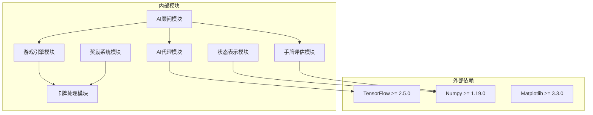

**图表来源**
- [requirements.txt:1-7](file://requirements.txt#L1-L7)

**章节来源**
- [requirements.txt:1-7](file://requirements.txt#L1-L7)

## 性能考量

### 测试性能优化

1. **GPU加速测试**：验证GPU计算能力
2. **批量处理测试**：检查批量推理性能
3. **内存使用监控**：确保测试不会造成内存泄漏
4. **并发测试**：验证多线程安全性

### 测试覆盖率要求

建议的测试覆盖率目标：
- **核心算法**：≥90%
- **游戏规则**：≥95%
- **奖励系统**：≥85%
- **状态表示**：≥90%

## 故障排除指南

### 常见问题及解决方案

#### GPU相关问题

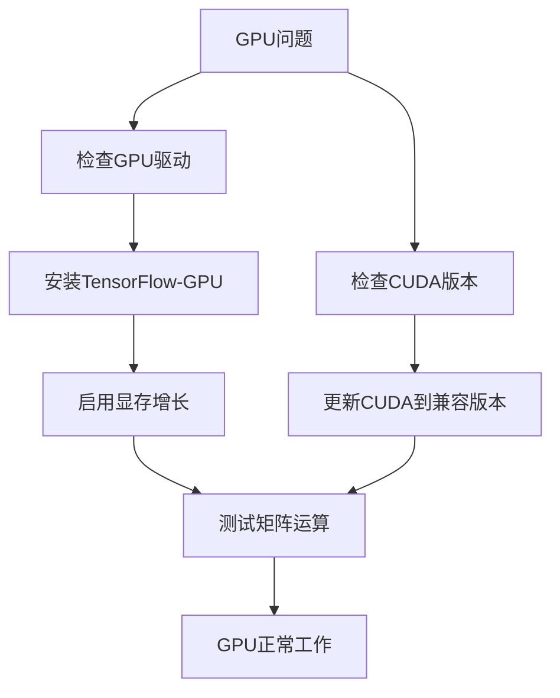

#### 模型训练问题

1. **学习率问题**：检查学习率调度配置
2. **数值稳定性**：验证梯度裁剪和损失缩放
3. **内存溢出**：检查批次大小和模型复杂度
4. **收敛问题**：验证奖励设计和超参数设置

**章节来源**
- [test_gpu.py:14-91](file://test_gpu.py#L14-L91)

## 结论

本指南提供了德州扑克AI项目的全面单元测试实施框架。通过模块化的测试策略、严格的断言设计和完善的异常处理，可以确保AI代理、游戏引擎和奖励系统的稳定性和可靠性。建议在实际开发中结合持续集成和自动化测试，以保证代码质量和系统稳定性。

## 附录

### 测试环境配置

推荐的测试环境要求：
- Python 3.8+
- TensorFlow 2.5.0+
- Numpy 1.19.0+
- 至少8GB RAM
- GPU（可选）

### 测试数据准备

1. **模拟游戏状态**：使用固定的种子确保测试可重现
2. **边界条件数据**：包含极端情况和异常输入
3. **性能基准数据**：用于性能回归测试
4. **集成测试数据**：跨模块交互的测试用例

### 最佳实践清单

- **测试命名规范**：使用描述性的测试方法名
- **断言策略**：结合多种断言类型确保测试完整性
- **Mock对象使用**：合理使用Mock隔离外部依赖
- **测试数据管理**：维护测试数据的版本控制
- **持续测试**：集成到CI/CD流程中