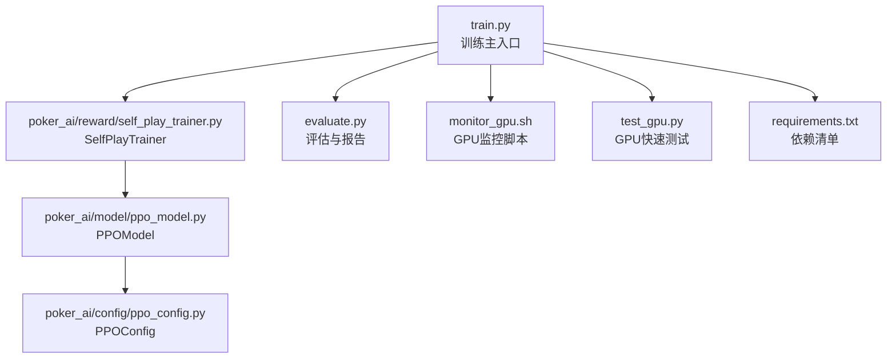
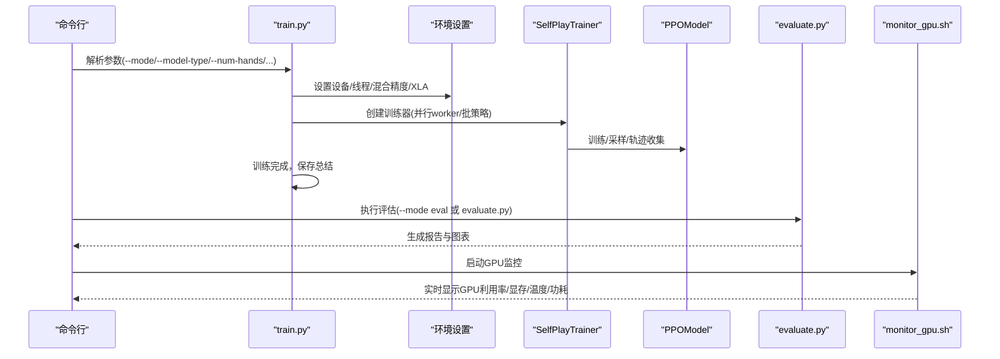
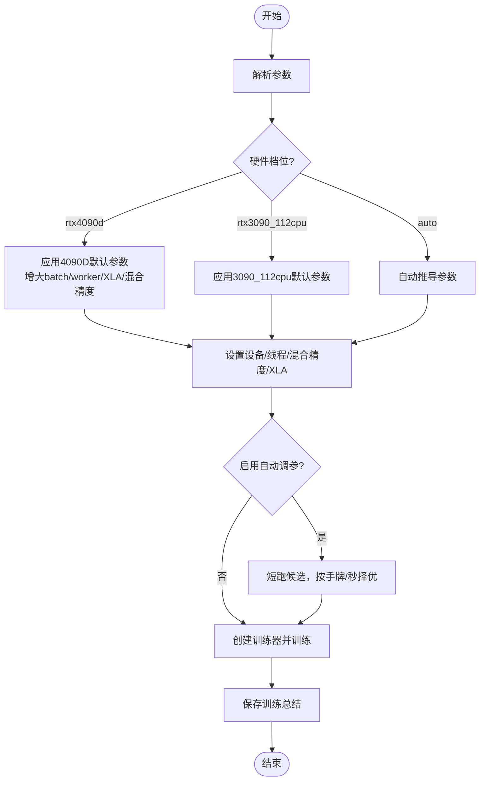
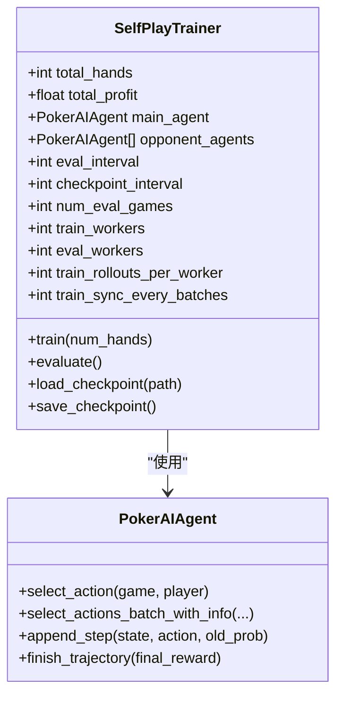
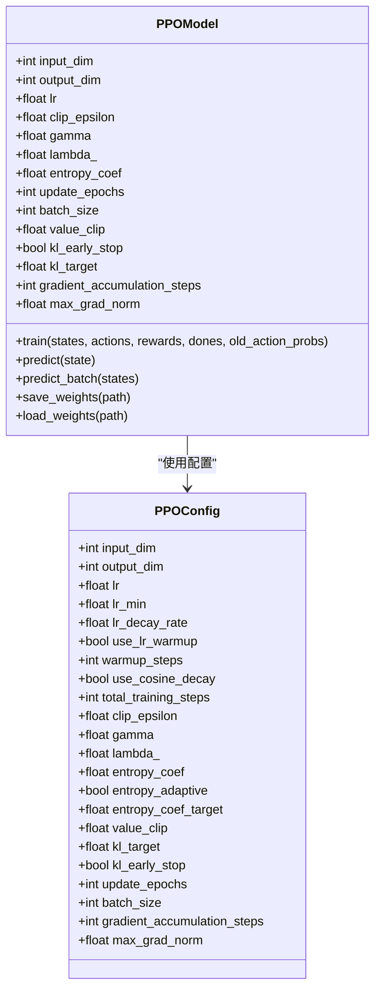
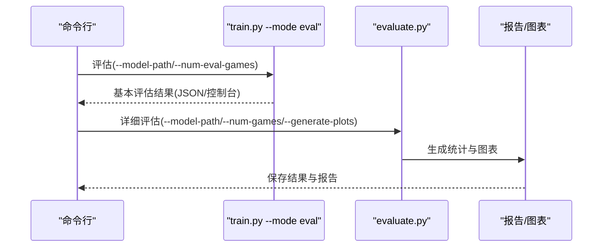
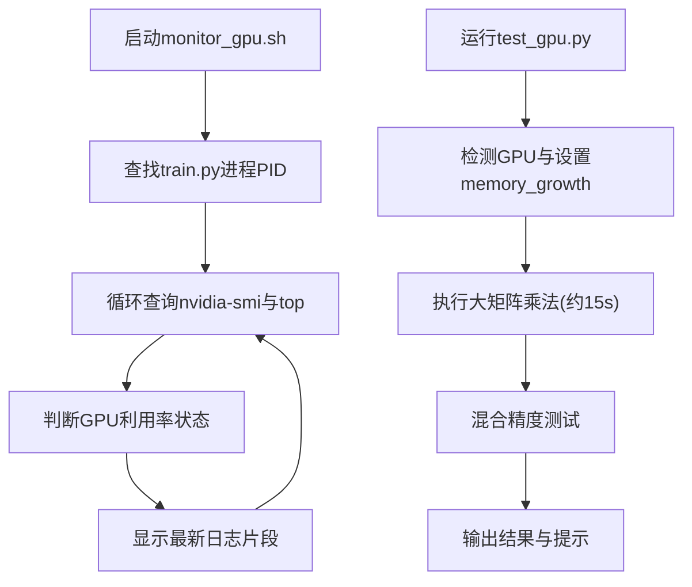
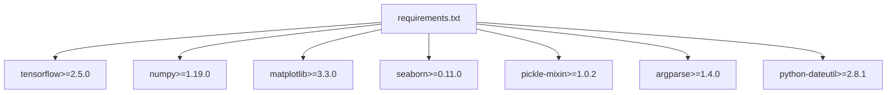
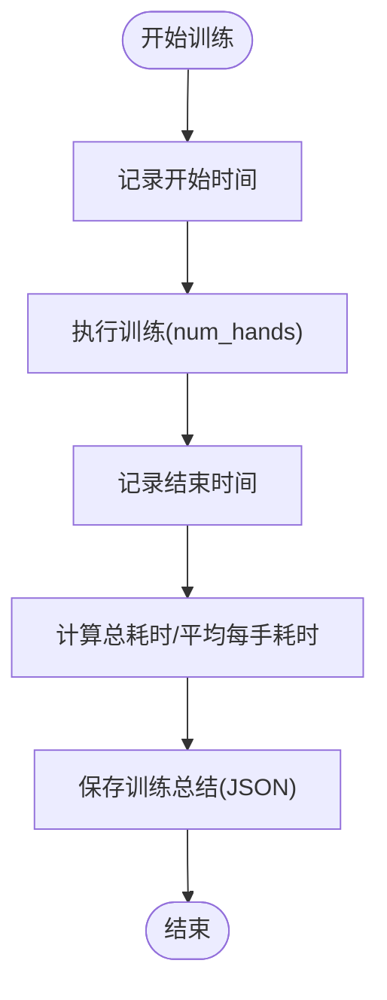

# 性能测试

<cite>
**本文引用的文件**
- [train.py](file://train.py)
- [evaluate.py](file://evaluate.py)
- [monitor_gpu.sh](file://monitor_gpu.sh)
- [test_gpu.py](file://test_gpu.py)
- [poker_ai/reward/self_play_trainer.py](file://poker_ai/reward/self_play_trainer.py)
- [poker_ai/model/ppo_model.py](file://poker_ai/model/ppo_model.py)
- [poker_ai/config/ppo_config.py](file://poker_ai/config/ppo_config.py)
- [requirements.txt](file://requirements.txt)
- [README.md](file://README.md)
- [TRAINING_GUIDE.md](file://TRAINING_GUIDE.md)
- [RTX4090D配置指南.md](file://RTX4090D配置指南.md)
</cite>

## 目录
1. [简介](#简介)
2. [项目结构](#项目结构)
3. [核心组件](#核心组件)
4. [架构总览](#架构总览)
5. [详细组件分析](#详细组件分析)
6. [依赖分析](#依赖分析)
7. [性能考虑](#性能考虑)
8. [故障排查指南](#故障排查指南)
9. [结论](#结论)
10. [附录](#附录)

## 简介
本指南面向该项目的性能测试与基准评估，围绕训练速度、内存使用、GPU利用率、负载测试与自动调参等主题，提供可落地的测试设计与执行方法。文档结合项目现有脚本与训练器实现，给出压力测试、负载测试、基准测试与瓶颈定位的完整流程，并针对不同硬件配置（如RTX 4090D）提出优化建议与监控要点。

## 项目结构
项目采用模块化组织，训练主入口位于 train.py，评估与可视化在 evaluate.py，GPU监控通过 monitor_gpu.sh，PPO训练器与模型分别在 poker_ai/reward/self_play_trainer.py 与 poker_ai/model/ppo_model.py，PPO超参数集中在 poker_ai/config/ppo_config.py。依赖通过 requirements.txt 管理。

**图表来源**
- [train.py](file://train.py)
- [poker_ai/reward/self_play_trainer.py](file://poker_ai/reward/self_play_trainer.py)
- [poker_ai/model/ppo_model.py](file://poker_ai/model/ppo_model.py)
- [poker_ai/config/ppo_config.py](file://poker_ai/config/ppo_config.py)
- [evaluate.py](file://evaluate.py)
- [monitor_gpu.sh](file://monitor_gpu.sh)
- [test_gpu.py](file://test_gpu.py)
- [requirements.txt](file://requirements.txt)

**章节来源**
- [README.md](file://README.md)
- [requirements.txt](file://requirements.txt)

## 核心组件
- 训练主入口与参数解析：负责模式选择、硬件档位、自动调参、设备与混合精度设置、并行worker与批策略等。
- 自我对弈训练器：封装6-max对局、并行采样、轨迹收集、评估与检查点保存。
- PPO模型与配置：包含网络结构、学习率调度、KL早停、价值裁剪、梯度累积等优化。
- 评估脚本：生成详细报告与可视化图表，支持基本与详细两种评估。
- GPU监控与快速测试：提供nvidia-smi实时监控与混合精度测试。

**章节来源**
- [train.py](file://train.py)
- [poker_ai/reward/self_play_trainer.py](file://poker_ai/reward/self_play_trainer.py)
- [poker_ai/model/ppo_model.py](file://poker_ai/model/ppo_model.py)
- [poker_ai/config/ppo_config.py](file://poker_ai/config/ppo_config.py)
- [evaluate.py](file://evaluate.py)
- [monitor_gpu.sh](file://monitor_gpu.sh)
- [test_gpu.py](file://test_gpu.py)

## 架构总览
训练流程从命令行参数解析开始，设置环境（设备、线程、混合精度、XLA），创建训练器，执行训练或评估，并输出训练总结与评估报告。GPU监控脚本与快速测试脚本贯穿整个测试周期，辅助验证硬件与观测性能。

**图表来源**
- [train.py](file://train.py)
- [poker_ai/reward/self_play_trainer.py](file://poker_ai/reward/self_play_trainer.py)
- [poker_ai/model/ppo_model.py](file://poker_ai/model/ppo_model.py)
- [evaluate.py](file://evaluate.py)
- [monitor_gpu.sh](file://monitor_gpu.sh)

## 详细组件分析

### 训练主入口与性能参数
- 硬件档位：支持 auto、rtx3090_112cpu、rtx4090d，自动推导并行worker、批大小、XLA与混合精度等。
- 自动调参：针对PPO短跑多组候选，按手牌/秒选择最优配置，避免吞掉训练预算。
- 设备与混合精度：自动检测GPU，设置显存按需增长、混合精度、XLA JIT。
- 并行策略：train_workers/eval_workers、rollouts_per_worker、sync_every_batches等影响吞吐与CPU/GPU利用率。

**图表来源**
- [train.py](file://train.py)

**章节来源**
- [train.py](file://train.py)

### 自我对弈训练器与并行采样
- 6-max专用：num_players必须为6。
- 并行采样：支持多worker并行采样，PPO使用批量推理减少往返开销。
- 轨迹收集：支持PPO轨迹与DQN经验回放两种学习范式。
- 策略指标：统计诈唬、加注、无效下注等，用于训练稳定性与策略分析。

**图表来源**
- [poker_ai/reward/self_play_trainer.py](file://poker_ai/reward/self_play_trainer.py)

**章节来源**
- [poker_ai/reward/self_play_trainer.py](file://poker_ai/reward/self_play_trainer.py)

### PPO模型与配置
- 网络结构：Actor/Critic双网络，增强层（256-256-128-64），LayerNorm与残差连接。
- 学习率调度：warmup + cosine衰减，支持自适应熵系数。
- 价值损失裁剪：基于旧价值的裁剪，提升稳定性。
- KL早停：平均KL超过阈值提前终止epoch，避免策略退化。
- 梯度累积：支持梯度累积以提升有效batch size。

**图表来源**
- [poker_ai/model/ppo_model.py](file://poker_ai/model/ppo_model.py)
- [poker_ai/config/ppo_config.py](file://poker_ai/config/ppo_config.py)

**章节来源**
- [poker_ai/model/ppo_model.py](file://poker_ai/model/ppo_model.py)
- [poker_ai/config/ppo_config.py](file://poker_ai/config/ppo_config.py)

### 评估与可视化
- 基本评估：通过train.py --mode eval快速评估，输出平均利润、胜率等。
- 详细评估：evaluate.py生成详细统计与图表，包含手牌强度分布、动作分布、阶段利润、按手牌强度胜率、累计利润曲线等。
- 报告生成：将结果保存为JSON与文本报告，便于对比与归档。

**图表来源**
- [train.py](file://train.py)
- [evaluate.py](file://evaluate.py)

**章节来源**
- [train.py](file://train.py)
- [evaluate.py](file://evaluate.py)

### GPU监控与快速测试
- monitor_gpu.sh：持续监控GPU利用率、显存、温度、功耗，同时显示训练进程CPU/Mem与最新日志。
- test_gpu.py：快速验证GPU是否可用，执行大矩阵乘法与混合精度测试，指导训练前硬件验证。

**图表来源**
- [monitor_gpu.sh](file://monitor_gpu.sh)
- [test_gpu.py](file://test_gpu.py)

**章节来源**
- [monitor_gpu.sh](file://monitor_gpu.sh)
- [test_gpu.py](file://test_gpu.py)

## 依赖分析
- TensorFlow：训练与推理的核心依赖，要求2.5+。
- NumPy、Matplotlib、Seaborn：评估与可视化。
- Pickle、Argparse、Dateutil：通用工具与参数解析。

**图表来源**
- [requirements.txt](file://requirements.txt)

**章节来源**
- [requirements.txt](file://requirements.txt)

## 性能考虑

### 训练速度测试
- 方法：记录训练开始/结束时间，计算总耗时与平均每手耗时；在train.py中已有保存训练总结与日志记录。
- 关键参数：batch_size、train_workers、train_rollouts_per_worker、train_sync_every_batches、ppo_update_min_steps、eval_interval、num_eval_games。
- 自动调参：通过--auto-tune短跑候选，按手牌/秒择优，避免吞掉预算。

**图表来源**
- [train.py](file://train.py)

**章节来源**
- [train.py](file://train.py)

### 内存使用监控
- 显存按需分配：train.py中设置GPU memory growth，避免一次性占用全部显存。
- monitor_gpu.sh显示显存使用MB，结合评估脚本的GPU内存限制设置，避免显存溢出。
- 建议：在大规模batch或长轨迹时，适当降低batch或增加eval_interval以缓解显存压力。

**章节来源**
- [train.py](file://train.py)
- [evaluate.py](file://evaluate.py)
- [monitor_gpu.sh](file://monitor_gpu.sh)

### GPU利用率分析
- monitor_gpu.sh持续显示GPU利用率%，温度、功耗，便于判断是否卡顿或初始化阶段。
- test_gpu.py通过大矩阵乘法与混合精度测试，验证GPU是否正常工作。
- RTX 4090D优化：混合精度、XLA、增大batch与worker、显存按需分配等显著提升利用率。

**章节来源**
- [monitor_gpu.sh](file://monitor_gpu.sh)
- [test_gpu.py](file://test_gpu.py)
- [RTX4090D配置指南.md](file://RTX4090D配置指南.md)

### 负载测试策略
- 小规模验证：先用500~1000手验证流程与指标，再逐步放大至5万+手。
- 不同规模任务：快速验证（1k手）、标准配置（5k~10k手）、高性能（10k+手）。
- 并行与批策略：根据CPU核心数与GPU显存，调整train_workers、rollouts_per_worker、batch_size与sync频率。

**章节来源**
- [TRAINING_GUIDE.md](file://TRAINING_GUIDE.md)
- [RTX4090D配置指南.md](file://RTX4090D配置指南.md)

### 性能基准测试
- 基准指标：手牌/秒、显存占用、收敛手数、温度与功耗。
- 基准配置：参考RTX 4090D配置指南的标准/高性能/极致配置，记录不同batch与worker下的表现。
- 对比维度：不同batch、不同workers、不同eval_interval、是否启用XLA与混合精度。

**章节来源**
- [RTX4090D配置指南.md](file://RTX4090D配置指南.md)

### 性能测试工具使用指南
- GPU监控脚本：启动后每2秒刷新一次，显示GPU利用率、显存、温度、功耗与训练进程状态。
- 快速GPU测试：运行test_gpu.py，观察nvidia-smi利用率上升，验证混合精度与矩阵运算。
- 评估脚本：evaluate.py生成详细报告与图表，便于性能对比与策略分析。

**章节来源**
- [monitor_gpu.sh](file://monitor_gpu.sh)
- [test_gpu.py](file://test_gpu.py)
- [evaluate.py](file://evaluate.py)

### 瓶颈识别与优化建议
- CPU瓶颈：worker过多导致调度开销大，适当降低train_workers或增大rollouts_per_worker。
- GPU瓶颈：batch过小或显存不足，增大batch与worker，启用XLA与混合精度。
- I/O瓶颈：评估过于频繁，提高eval_interval与checkpoint_interval。
- 策略不稳定：KL早停、价值裁剪、自适应熵系数、学习率warmup与cosine衰减有助于稳定。

**章节来源**
- [poker_ai/reward/self_play_trainer.py](file://poker_ai/reward/self_play_trainer.py)
- [poker_ai/model/ppo_model.py](file://poker_ai/model/ppo_model.py)

### 不同硬件配置下的性能表现与优化
- RTX 4090D：24GB显存、Ada架构、第4代Tensor Core，支持更大batch与更高利用率；建议启用混合精度与XLA。
- RTX 3090：显存与带宽较新卡略低，可通过降低batch或减少评估频率来平衡性能。
- CPU资源：根据CPU核心数自动推导worker，避免过度并行导致上下文切换开销。

**章节来源**
- [RTX4090D配置指南.md](file://RTX4090D配置指南.md)
- [train.py](file://train.py)

## 故障排查指南
- GPU未被识别：检查驱动版本与TensorFlow版本，运行test_gpu.py验证GPU可用性。
- 显存不足：降低batch_size、减少workers、启用memory_growth、减少eval_interval。
- 训练卡顿：查看monitor_gpu.sh显示的GPU利用率，确认是否在数据准备阶段；检查train_workers与rollouts_per_worker设置。
- 评估异常：确认模型路径正确，evaluate.py支持dqn/policy_gradient；PPO正式评估建议用train.py --mode eval。

**章节来源**
- [test_gpu.py](file://test_gpu.py)
- [monitor_gpu.sh](file://monitor_gpu.sh)
- [evaluate.py](file://evaluate.py)
- [README.md](file://README.md)

## 结论
本指南提供了基于项目现有脚本与训练器的性能测试实施方法，涵盖训练速度、内存、GPU利用率、负载测试与基准评估，并结合RTX 4090D优化建议与监控工具，帮助用户在不同硬件配置下获得稳定且高效的训练体验。建议以小样本验证为基础，逐步扩大规模，并通过自动调参与可视化报告持续优化参数与策略。

## 附录
- 常用命令参考
  - 快速GPU测试：python test_gpu.py
  - 启动GPU监控：./monitor_gpu.sh
  - 训练（PPO）：python train.py --mode train --model-type ppo --num-hands 50000
  - 评估（PPO）：python train.py --mode eval --model-type ppo --model-path ./checkpoints/agent_ppo_1000 --num-eval-games 500
  - 详细评估：python evaluate.py --model-path ./checkpoints/agent_dqn_1000.weights.h5 --model-type dqn --num-games 200 --generate-plots

**章节来源**
- [README.md](file://README.md)
- [TRAINING_GUIDE.md](file://TRAINING_GUIDE.md)
- [RTX4090D配置指南.md](file://RTX4090D配置指南.md)