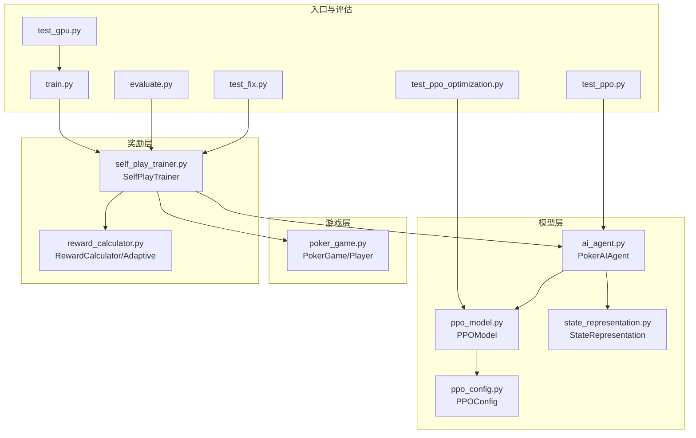
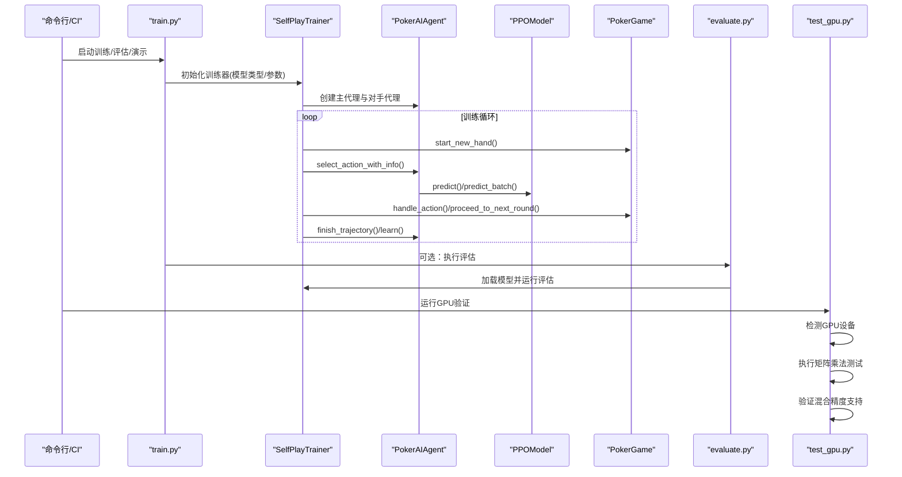
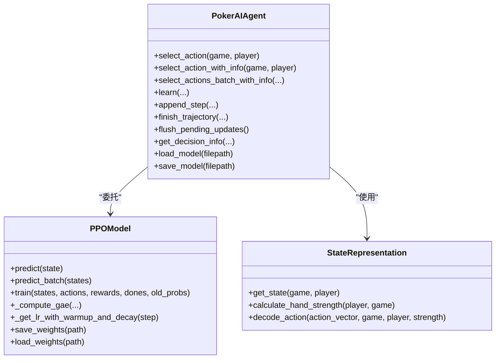
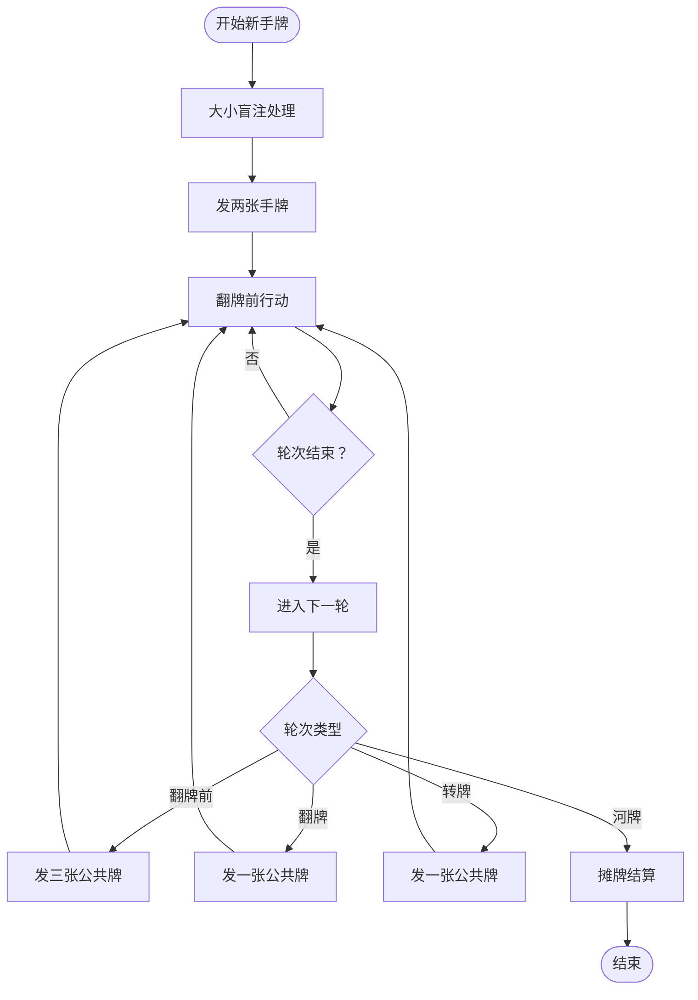
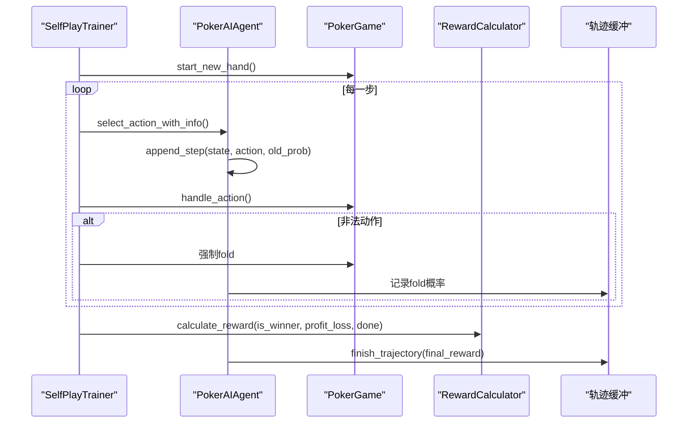
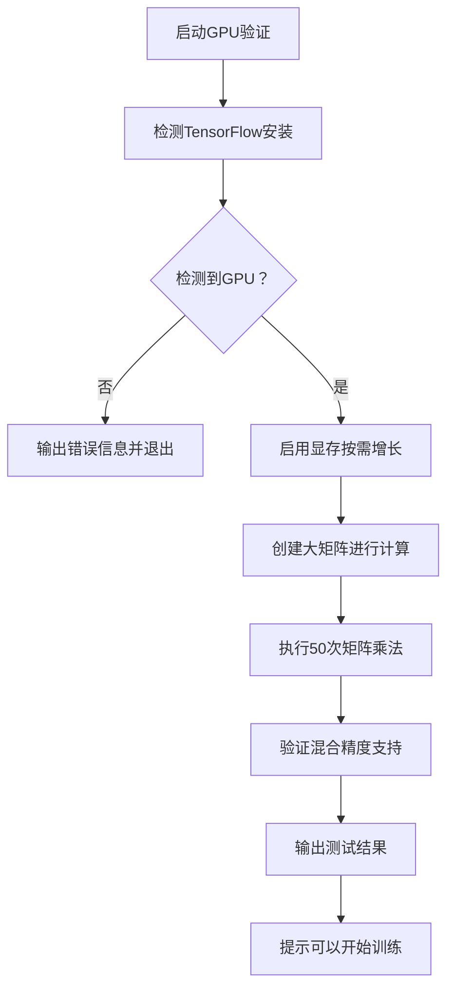
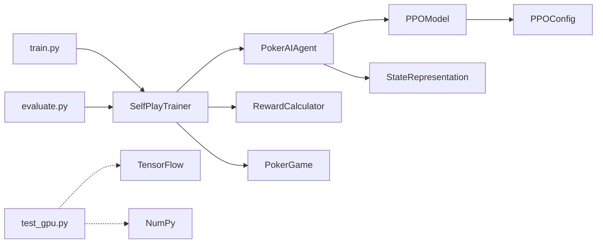

# 测试策略

<cite>
**本文引用的文件**
- [README.md](file://README.md)
- [requirements.txt](file://requirements.txt)
- [train.py](file://train.py)
- [evaluate.py](file://evaluate.py)
- [test_gpu.py](file://test_gpu.py)
- [test_ppo.py](file://test_ppo.py)
- [test_ppo_optimization.py](file://test_ppo_optimization.py)
- [test_fix.py](file://test_fix.py)
- [monitor_gpu.sh](file://monitor_gpu.sh)
- [poker_ai/model/ai_agent.py](file://poker_ai/model/ai_agent.py)
- [poker_ai/model/ppo_model.py](file://poker_ai/model/ppo_model.py)
- [poker_ai/model/state_representation.py](file://poker_ai/model/state_representation.py)
- [poker_ai/game/poker_game.py](file://poker_ai/game/poker_game.py)
- [poker_ai/reward/self_play_trainer.py](file://poker_ai/reward/self_play_trainer.py)
- [poker_ai/reward/reward_calculator.py](file://poker_ai/reward/reward_calculator.py)
- [poker_ai/config/ppo_config.py](file://poker_ai/config/ppo_config.py)
</cite>

## 目录
1. [简介](#简介)
2. [项目结构](#项目结构)
3. [核心组件](#核心组件)
4. [架构总览](#架构总览)
5. [详细组件分析](#详细组件分析)
6. [GPU验证测试](#gpu验证测试)
7. [依赖关系分析](#依赖关系分析)
8. [性能考量](#性能考量)
9. [故障排查指南](#故障排查指南)
10. [结论](#结论)
11. [附录](#附录)

## 简介
本测试策略文档面向基于强化学习的德州扑克AI项目，围绕单元测试、集成测试、性能测试与测试自动化展开，覆盖AI代理、游戏引擎、奖励系统等核心模块。文档同时提供测试用例设计原则、Mock对象使用、断言策略、测试数据准备与环境搭建、测试覆盖率与质量度量方法，以及CI/CD集成建议。**新增的GPU验证测试功能**为用户提供了一个快速验证GPU设置正确性的工具，包括TensorFlow设备检测、矩阵乘法性能测试和混合精度能力验证。

## 项目结构
项目采用模块化分层组织，核心模块包括：
- 模型层：AI代理、PPO模型、状态表示、手牌评估
- 游戏层：扑克游戏、卡牌与比较逻辑
- 奖励层：奖励计算、自适应奖励、自我对弈训练器
- 工具与配置：检查点、PPO配置、GPU内存设置
- 入口与评估：训练入口、评估脚本、测试脚本
- **GPU验证：快速GPU设置验证脚本**

**图示来源**
- [train.py:1-856](file://train.py#L1-L856)
- [evaluate.py:1-753](file://evaluate.py#L1-L753)
- [test_gpu.py:1-91](file://test_gpu.py#L1-L91)
- [test_ppo.py:1-41](file://test_ppo.py#L1-L41)
- [test_ppo_optimization.py:1-301](file://test_ppo_optimization.py#L1-L301)
- [test_fix.py:1-283](file://test_fix.py#L1-L283)
- [poker_ai/model/ai_agent.py:1-703](file://poker_ai/model/ai_agent.py#L1-L703)
- [poker_ai/model/ppo_model.py:1-670](file://poker_ai/model/ppo_model.py#L1-L670)
- [poker_ai/model/state_representation.py:1-247](file://poker_ai/model/state_representation.py#L1-L247)
- [poker_ai/game/poker_game.py:1-497](file://poker_ai/game/poker_game.py#L1-L497)
- [poker_ai/reward/self_play_trainer.py:1-1604](file://poker_ai/reward/self_play_trainer.py#L1-L1604)
- [poker_ai/reward/reward_calculator.py:1-587](file://poker_ai/reward/reward_calculator.py#L1-L587)
- [poker_ai/config/ppo_config.py:1-97](file://poker_ai/config/ppo_config.py#L1-L97)

**章节来源**
- [README.md:1-227](file://README.md#L1-L227)
- [requirements.txt:1-7](file://requirements.txt#L1-L7)

## 核心组件
- AI代理与动作选择：统一接口封装DQN、策略梯度、PPO，支持批量动作选择与轨迹学习。
- PPO模型：Actor-Critic、GAE优势估计、自适应熵系数、学习率调度、价值损失裁剪、KL早停。
- 游戏引擎：6人桌德州扑克规则、玩家状态、公共牌、下注与轮次推进、摊牌结算。
- 奖励系统：精细化奖励权重、底池赔率、位置优势、决策一致性、无效下注惩罚、自适应调整。
- 自我对弈训练器：并行采样、轨迹收集、对手更新、评估与检查点管理。
- 状态表示：134维状态向量，包含手牌、公共牌、玩家信息、游戏全局信息、位置与活跃人数。
- **GPU验证工具：快速检测GPU设备、执行矩阵运算、验证混合精度支持。**

**章节来源**
- [poker_ai/model/ai_agent.py:1-703](file://poker_ai/model/ai_agent.py#L1-L703)
- [poker_ai/model/ppo_model.py:1-670](file://poker_ai/model/ppo_model.py#L1-L670)
- [poker_ai/model/state_representation.py:1-247](file://poker_ai/model/state_representation.py#L1-L247)
- [poker_ai/game/poker_game.py:1-497](file://poker_ai/game/poker_game.py#L1-L497)
- [poker_ai/reward/self_play_trainer.py:1-1604](file://poker_ai/reward/self_play_trainer.py#L1-L1604)
- [poker_ai/reward/reward_calculator.py:1-587](file://poker_ai/reward/reward_calculator.py#L1-L587)

## 架构总览
训练与评估流程通过入口脚本驱动，训练器负责并行采样与学习，评估脚本提供独立的性能报告与可视化。**GPU验证测试作为独立的诊断工具，可在训练前快速确认GPU环境配置正确性。**

**图示来源**
- [train.py:340-800](file://train.py#L340-L800)
- [poker_ai/reward/self_play_trainer.py:260-800](file://poker_ai/reward/self_play_trainer.py#L260-L800)
- [poker_ai/model/ai_agent.py:117-476](file://poker_ai/model/ai_agent.py#L117-L476)
- [poker_ai/model/ppo_model.py:497-638](file://poker_ai/model/ppo_model.py#L497-L638)
- [poker_ai/game/poker_game.py:227-457](file://poker_ai/game/poker_game.py#L227-L457)
- [evaluate.py:181-753](file://evaluate.py#L181-L753)
- [test_gpu.py:14-91](file://test_gpu.py#L14-L91)

## 详细组件分析

### AI代理与PPO模型测试策略
- 单元测试要点
  - PPO模型初始化与前向推理：验证输入/输出形状、预测与批量预测一致性。
  - 学习率调度：验证warmup与cosine衰减在边界步数的行为。
  - GAE计算：验证优势估计的数值稳定性与范围裁剪。
  - 训练步骤：验证损失收敛、KL早停、价值损失裁剪。
  - 自适应熵系数：验证随策略熵动态调整。
  - 配置参数：验证默认配置与自定义配置的字段一致性。
- 断言策略
  - 形状断言：确保张量维度符合预期。
  - 数值断言：均值/方差/范围断言，NaN/Inf检查。
  - 收敛断言：损失下降、KL在阈值内。
- Mock对象
  - 使用占位数组模拟状态、动作、奖励序列，避免真实模型加载。
  - 使用unittest.mock.patch替换TensorFlow/Keras行为，隔离GPU/CPU差异。
- 测试用例示例（路径）
  - [PPO模型初始化与动作选择:1-41](file://test_ppo.py#L1-L41)
  - [PPO优化验证测试:1-301](file://test_ppo_optimization.py#L1-L301)

**图示来源**
- [poker_ai/model/ai_agent.py:55-517](file://poker_ai/model/ai_agent.py#L55-L517)
- [poker_ai/model/ppo_model.py:20-670](file://poker_ai/model/ppo_model.py#L20-L670)
- [poker_ai/model/state_representation.py:9-247](file://poker_ai/model/state_representation.py#L9-L247)

**章节来源**
- [test_ppo.py:1-41](file://test_ppo.py#L1-L41)
- [test_ppo_optimization.py:1-301](file://test_ppo_optimization.py#L1-L301)
- [poker_ai/model/ai_agent.py:1-703](file://poker_ai/model/ai_agent.py#L1-L703)
- [poker_ai/model/ppo_model.py:1-670](file://poker_ai/model/ppo_model.py#L1-L670)
- [poker_ai/model/state_representation.py:1-247](file://poker_ai/model/state_representation.py#L1-L247)

### 游戏引擎测试策略
- 单元测试要点
  - 翻牌前/翻牌/转牌/河牌流程：验证轮次推进、公共牌发放、摊牌结算。
  - 下注与弃牌：验证下注金额合法性、全下处理、行动计数。
  - 玩家状态：验证栈额、下注额、活跃状态、全下状态。
- 断言策略
  - 状态不变量：底池、当前下注、活跃玩家数。
  - 边界条件：全下、最小/最大加注、弃牌后不可行动。
- 测试用例示例（路径）
  - [6人桌游戏流程与结算:155-457](file://poker_ai/game/poker_game.py#L155-L457)

**图示来源**
- [poker_ai/game/poker_game.py:227-457](file://poker_ai/game/poker_game.py#L227-L457)

**章节来源**
- [poker_ai/game/poker_game.py:1-497](file://poker_ai/game/poker_game.py#L1-L497)

### 奖励系统与自我对弈训练测试策略
- 单元测试要点
  - 奖励计算：验证手牌强度、底池赔率、位置优势、决策一致性、无效下注惩罚。
  - 自适应奖励：验证权重动态调整、策略指标（诈唬率、无效下注率）影响。
  - 自我对弈：验证轨迹收集、对手更新、all-in不走运补偿。
- 断言策略
  - 奖励范围：[-2.0, 2.0]内。
  - 指标统计：诈唬率、无效下注率、收益变化。
- 测试用例示例（路径）
  - [奖励计算与自适应调整:1-587](file://poker_ai/reward/reward_calculator.py#L1-L587)
  - [自我对弈训练与轨迹学习:1-1604](file://poker_ai/reward/self_play_trainer.py#L1-L1604)

**图示来源**
- [poker_ai/reward/self_play_trainer.py:260-417](file://poker_ai/reward/self_play_trainer.py#L260-L417)
- [poker_ai/reward/reward_calculator.py:303-391](file://poker_ai/reward/reward_calculator.py#L303-L391)
- [poker_ai/model/ai_agent.py:388-420](file://poker_ai/model/ai_agent.py#L388-L420)

**章节来源**
- [poker_ai/reward/reward_calculator.py:1-587](file://poker_ai/reward/reward_calculator.py#L1-L587)
- [poker_ai/reward/self_play_trainer.py:1-1604](file://poker_ai/reward/self_play_trainer.py#L1-L1604)
- [poker_ai/model/ai_agent.py:1-703](file://poker_ai/model/ai_agent.py#L1-L703)

### 端到端测试与评估
- 端到端测试要点
  - 训练入口：验证模式切换（train/eval/demo）、参数解析、设备与混合精度设置。
  - 评估入口：验证模型加载、对手类型、评估报告生成、可视化图表。
  - 修复验证：通过多人对战与利润统计验证修复有效性。
- 断言策略
  - 日志与异常：无ERROR/Exception，评估完成标志。
  - 结果指标：平均利润、胜率、总利润、获胜次数。
- 测试用例示例（路径）
  - [训练入口与评估:136-800](file://train.py#L136-L800)
  - [评估脚本与可视化:110-753](file://evaluate.py#L110-L753)
  - [修复验证测试:1-283](file://test_fix.py#L1-L283)

**章节来源**
- [train.py:1-856](file://train.py#L1-L856)
- [evaluate.py:1-753](file://evaluate.py#L1-L753)
- [test_fix.py:1-283](file://test_fix.py#L1-L283)

## GPU验证测试

### 测试目标与范围
GPU验证测试脚本提供了快速的GPU环境验证功能，主要包含以下验证内容：
- **设备检测**：确认TensorFlow能够识别到GPU设备
- **计算能力测试**：通过大规模矩阵乘法验证GPU计算性能
- **混合精度支持**：验证float16混合精度训练能力
- **显存管理**：启用GPU显存按需增长模式

### 测试流程与验证步骤

**图示来源**
- [test_gpu.py:14-91](file://test_gpu.py#L14-L91)

### 测试用例设计原则
- **快速验证**：整个测试在15-20秒内完成，适合CI/CD流水线集成
- **独立性**：不依赖训练数据或模型权重，仅验证环境配置
- **容错性**：捕获ImportError和通用异常，提供清晰的错误信息
- **实用性**：测试结果直接指导后续训练操作

### 断言策略
- **设备检测**：验证`len(gpus) > 0`且GPU名称格式正确
- **计算性能**：验证50次矩阵乘法的总耗时在合理范围内
- **混合精度**：验证float16计算的正确性和性能提升
- **异常处理**：验证缺失依赖时的友好错误提示

### 测试自动化集成
GPU验证测试可以作为训练前的预检步骤，在CI/CD流水线中自动执行：
- 在Docker镜像构建完成后运行
- 在训练任务开始前执行
- 作为部署验证的一部分

**章节来源**
- [test_gpu.py:1-91](file://test_gpu.py#L1-L91)

## 依赖关系分析
- 外部依赖
  - TensorFlow 2.x：模型训练与推理、混合精度、XLA。
  - NumPy、Matplotlib、Seaborn：数值计算与可视化。
- 内部模块耦合
  - SelfPlayTrainer 依赖 PokerAIAgent、PPOModel、StateRepresentation、RewardCalculator、PokerGame。
  - PokerAIAgent 依赖 PPOModel 与 StateRepresentation，提供统一动作接口。
  - PPOModel 依赖 PPOConfig 与 StateRepresentation，提供预测与训练能力。
  - **GPU验证脚本独立运行，不依赖训练模块，仅依赖TensorFlow和NumPy。**

**图示来源**
- [train.py:340-560](file://train.py#L340-L560)
- [evaluate.py:181-267](file://evaluate.py#L181-L267)
- [poker_ai/reward/self_play_trainer.py:48-224](file://poker_ai/reward/self_play_trainer.py#L48-L224)
- [poker_ai/model/ai_agent.py:55-116](file://poker_ai/model/ai_agent.py#L55-L116)
- [poker_ai/model/ppo_model.py:33-93](file://poker_ai/model/ppo_model.py#L33-L93)
- [poker_ai/config/ppo_config.py:18-97](file://poker_ai/config/ppo_config.py#L18-L97)
- [test_gpu.py:14-91](file://test_gpu.py#L14-L91)

**章节来源**
- [requirements.txt:1-7](file://requirements.txt#L1-L7)
- [poker_ai/model/ai_agent.py:1-703](file://poker_ai/model/ai_agent.py#L1-L703)
- [poker_ai/model/ppo_model.py:1-670](file://poker_ai/model/ppo_model.py#L1-L670)
- [poker_ai/reward/self_play_trainer.py:1-1604](file://poker_ai/reward/self_play_trainer.py#L1-L1604)

## 性能考量
- 训练性能
  - 并行采样与批处理：通过 SelfPlayTrainer 的 worker 数与批大小控制吞吐。
  - 混合精度与XLA：在GPU上启用混合精度与XLA以提升速度。
  - 学习率调度与KL早停：避免过拟合与策略退化，提升收敛稳定性。
- 评估性能
  - 评估脚本支持可视化图表生成与详细报告，便于性能分析。
- 内存与资源
  - GPU内存增长设置，避免一次性占用过多显存。
  - 线程并行配置与CPU线程数设置，平衡吞吐与延迟。
- **GPU验证性能**
  - 快速设备检测：几乎无性能开销
  - 大规模矩阵计算：约15-20秒完成50次10000x10000矩阵乘法
  - 混合精度验证：额外约15-20秒完成相同计算量

**章节来源**
- [train.py:240-339](file://train.py#L240-L339)
- [evaluate.py:31-52](file://evaluate.py#L31-L52)
- [test_gpu.py:35-76](file://test_gpu.py#L35-L76)

## 故障排查指南
- 常见问题
  - TensorFlow未安装或版本不兼容：导入时报错，需安装满足要求的版本。
  - GPU不可用：切换到CPU模式或检查驱动与CUDA版本。
  - 模型加载失败：检查检查点路径与文件完整性。
  - 训练异常：查看日志中的ERROR/Exception，定位具体模块。
  - **GPU验证失败**：检查CUDA驱动、cuDNN版本、GPU权限设置。
- 排查步骤
  - 启用详细日志：在入口脚本中开启详细日志级别。
  - 验证环境：确认依赖安装与版本匹配。
  - 小规模测试：先运行小手数验证流程，再扩大规模。
  - 检查配置：核对PPO配置、训练参数与硬件配置。
  - **GPU专用排查**：运行`test_gpu.py`验证设备检测和计算能力。

**章节来源**
- [README.md:14-22](file://README.md#L14-L22)
- [train.py:240-339](file://train.py#L240-L339)
- [evaluate.py:31-52](file://evaluate.py#L31-L52)
- [test_gpu.py:84-90](file://test_gpu.py#L84-L90)

## 结论
本测试策略文档提供了覆盖单元测试、集成测试、性能测试与测试自动化的完整方案。**新增的GPU验证测试功能**为用户提供了快速的GPU环境验证工具，能够在训练前确认GPU设置正确性，包括设备检测、计算性能验证和混合精度支持。通过明确的测试用例设计原则、Mock对象使用与断言策略，结合测试数据准备与环境搭建，能够有效保障AI代理、游戏引擎与奖励系统的稳定性与性能。建议在CI/CD流水线中集成上述测试脚本，配合覆盖率与质量度量工具，持续提升代码质量与模型可靠性。

## 附录
- 测试自动化与CI/CD建议
  - 使用pytest/nose等测试框架组织测试用例，支持并行执行。
  - 在CI中分别执行单元测试、集成测试与端到端测试，分阶段产出报告。
  - 使用覆盖率工具（如coverage.py）统计测试覆盖率，设定阈值。
  - 将评估脚本纳入CI，定期生成性能报告与可视化图表。
  - **将GPU验证测试作为CI流水线的前置步骤，确保GPU环境正确性。**
- 测试数据准备
  - 使用固定随机种子确保测试可重复。
  - 准备典型牌面与极端场景（全下、摊牌、位置变化）。
  - **GPU测试使用随机矩阵，无需特殊准备。**
- 质量度量
  - 关键指标：平均利润、胜率、总利润、获胜次数、评估耗时。
  - 覆盖率：函数/分支/行覆盖率，重点覆盖核心模块（PPO训练、奖励计算、游戏流程）。
  - **GPU验证指标：设备检测成功率、矩阵计算耗时、混合精度性能提升。**
- **监控与诊断工具**
  - 使用`monitor_gpu.sh`脚本实时监控GPU利用率和训练状态。
  - 在训练过程中观察GPU利用率，确保GPU被有效利用。
  - **GPU验证测试提供离线诊断能力，可在无训练时验证环境。**