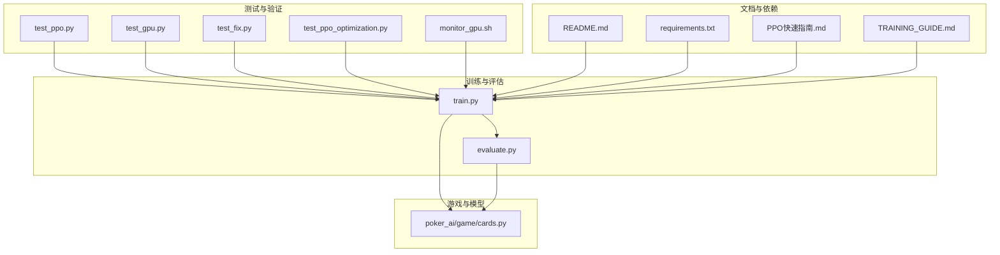
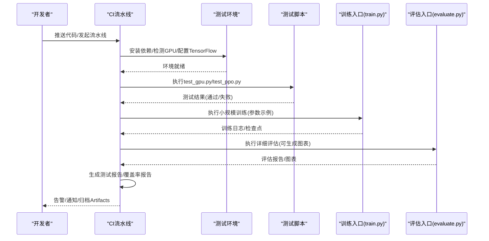
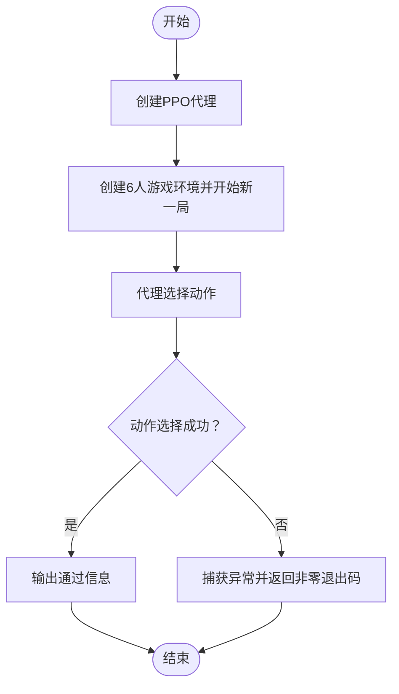
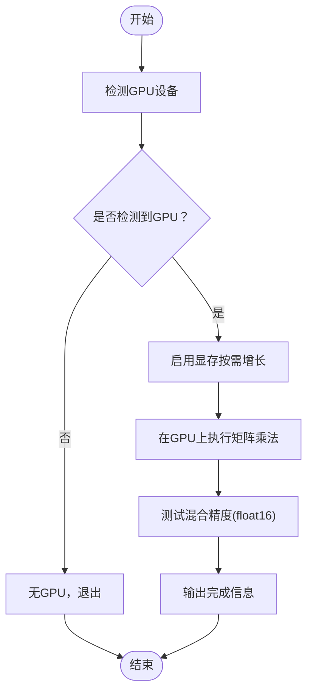
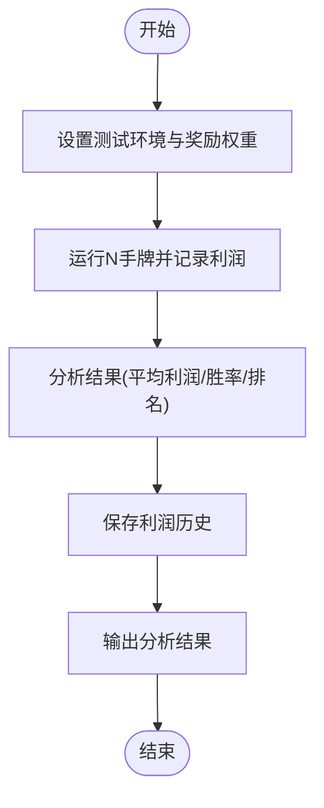
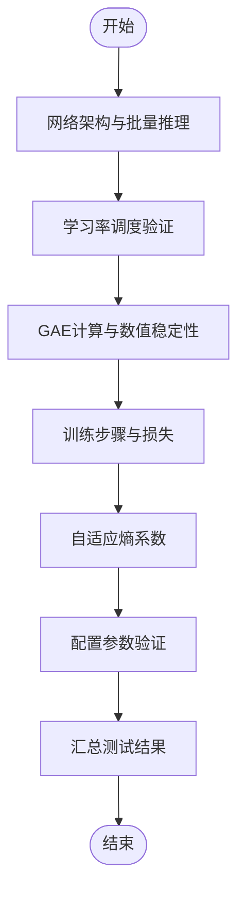
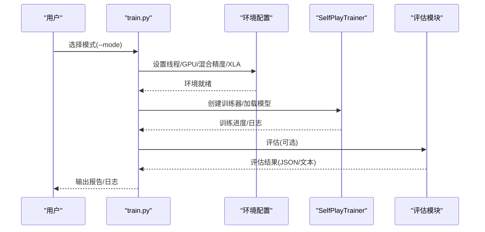
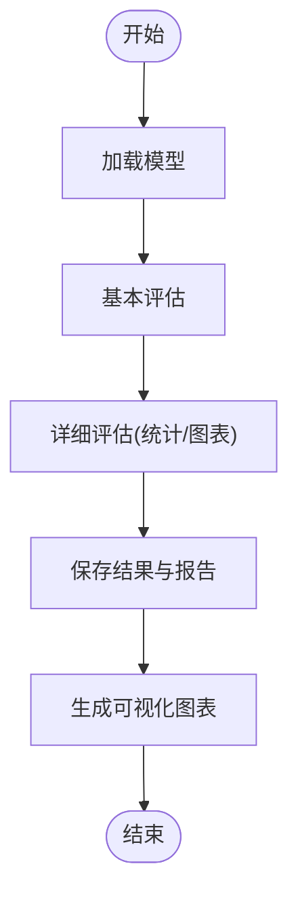
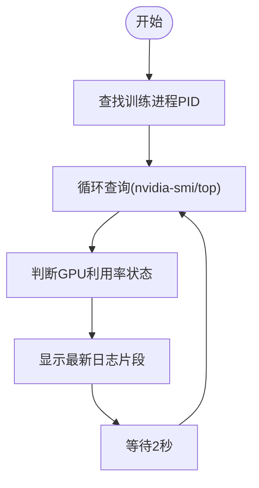
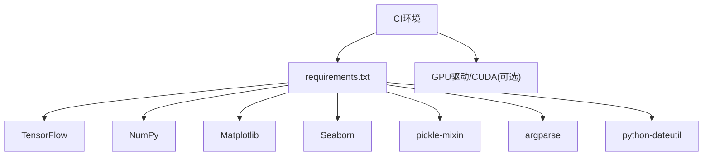

# 测试自动化

<cite>
**本文引用的文件**
- [README.md](file://README.md)
- [requirements.txt](file://requirements.txt)
- [train.py](file://train.py)
- [evaluate.py](file://evaluate.py)
- [monitor_gpu.sh](file://monitor_gpu.sh)
- [test_ppo.py](file://test_ppo.py)
- [test_gpu.py](file://test_gpu.py)
- [test_fix.py](file://test_fix.py)
- [test_ppo_optimization.py](file://test_ppo_optimization.py)
- [cards.py](file://poker_ai/game/cards.py)
- [PPO快速指南.md](file://PPO快速指南.md)
- [TRAINING_GUIDE.md](file://TRAINING_GUIDE.md)
</cite>

## 目录
1. [简介](#简介)
2. [项目结构](#项目结构)
3. [核心组件](#核心组件)
4. [架构总览](#架构总览)
5. [详细组件分析](#详细组件分析)
6. [依赖分析](#依赖分析)
7. [性能考量](#性能考量)
8. [故障排查指南](#故障排查指南)
9. [结论](#结论)
10. [附录](#附录)

## 简介
本文件面向该项目的测试自动化与持续集成（CI/CD）实践，结合现有测试脚本与训练/评估工具，系统阐述测试自动化的配置与实施方法，包括：
- CI/CD流水线设置建议与自动化测试执行
- 测试报告生成与结果归档
- 测试环境的自动化搭建与管理策略
- 自动化测试脚本示例与复杂测试流程编排
- 测试数据的自动化准备与清理机制
- 测试结果的自动化分析与告警机制
- 测试覆盖率的自动化监控与报告生成

## 项目结构
项目围绕训练、评估与演示三大模式展开，测试相关脚本位于根目录，训练/评估入口分别为 train.py 与 evaluate.py，配套文档与GPU监控脚本完善了测试与验证链路。

**图表来源**
- [train.py](file://train.py)
- [evaluate.py](file://evaluate.py)
- [test_ppo.py](file://test_ppo.py)
- [test_gpu.py](file://test_gpu.py)
- [test_fix.py](file://test_fix.py)
- [test_ppo_optimization.py](file://test_ppo_optimization.py)
- [monitor_gpu.sh](file://monitor_gpu.sh)
- [cards.py](file://poker_ai/game/cards.py)
- [README.md](file://README.md)
- [requirements.txt](file://requirements.txt)
- [PPO快速指南.md](file://PPO快速指南.md)
- [TRAINING_GUIDE.md](file://TRAINING_GUIDE.md)

**章节来源**
- [README.md](file://README.md)
- [requirements.txt](file://requirements.txt)
- [train.py](file://train.py)
- [evaluate.py](file://evaluate.py)
- [monitor_gpu.sh](file://monitor_gpu.sh)
- [test_ppo.py](file://test_ppo.py)
- [test_gpu.py](file://test_gpu.py)
- [test_fix.py](file://test_fix.py)
- [test_ppo_optimization.py](file://test_ppo_optimization.py)
- [cards.py](file://poker_ai/game/cards.py)
- [PPO快速指南.md](file://PPO快速指南.md)
- [TRAINING_GUIDE.md](file://TRAINING_GUIDE.md)

## 核心组件
- 测试脚本层
  - PPO模型与流程测试：test_ppo.py
  - GPU可用性与性能测试：test_gpu.py
  - 修复方案回归测试：test_fix.py
  - PPO优化验证测试：test_ppo_optimization.py
- 训练与评估入口
  - 训练/评估/演示统一入口：train.py
  - 详细评估与可视化：evaluate.py
- 环境与监控
  - GPU监控脚本：monitor_gpu.sh
- 游戏与模型基础
  - 牌与牌型评估：cards.py
- 文档与依赖
  - 项目说明与命令示例：README.md
  - 依赖声明：requirements.txt
  - PPO优化与训练指南：PPO快速指南.md、TRAINING_GUIDE.md

**章节来源**
- [test_ppo.py](file://test_ppo.py)
- [test_gpu.py](file://test_gpu.py)
- [test_fix.py](file://test_fix.py)
- [test_ppo_optimization.py](file://test_ppo_optimization.py)
- [train.py](file://train.py)
- [evaluate.py](file://evaluate.py)
- [monitor_gpu.sh](file://monitor_gpu.sh)
- [cards.py](file://poker_ai/game/cards.py)
- [README.md](file://README.md)
- [requirements.txt](file://requirements.txt)
- [PPO快速指南.md](file://PPO快速指南.md)
- [TRAINING_GUIDE.md](file://TRAINING_GUIDE.md)

## 架构总览
测试自动化与CI/CD的总体思路：
- 环境准备：安装依赖、检测GPU、设置TensorFlow运行参数
- 测试执行：按优先级执行单元/流程/回归/优化测试
- 结果采集：日志、评估报告、可视化图表、训练摘要
- 告警与归档：根据阈值触发告警，归档Artifacts

**图表来源**
- [test_gpu.py](file://test_gpu.py)
- [test_ppo.py](file://test_ppo.py)
- [train.py](file://train.py)
- [evaluate.py](file://evaluate.py)
- [README.md](file://README.md)
- [requirements.txt](file://requirements.txt)

## 详细组件分析

### 测试脚本：PPO模型与流程测试（test_ppo.py）
- 目标：验证PPO代理创建、游戏环境构建、动作选择流程
- 关键步骤
  - 创建PPO代理
  - 构建6人德州扑克环境并开始新一局
  - 调用代理select_action进行动作选择
  - 成功则输出通过，失败捕获异常并返回非零退出码
- 适用场景：快速验证PPO模型与游戏交互链路

**图表来源**
- [test_ppo.py](file://test_ppo.py)

**章节来源**
- [test_ppo.py](file://test_ppo.py)

### 测试脚本：GPU可用性与性能测试（test_gpu.py）
- 目标：检测GPU、启用显存按需增长、执行矩阵乘法、验证混合精度
- 关键步骤
  - 检测GPU设备并打印数量与名称
  - 启用显存按需增长
  - 在GPU设备上执行大矩阵乘法若干次
  - 验证混合精度（float16）性能
- 适用场景：CI环境GPU可用性与性能基线验证

**图表来源**
- [test_gpu.py](file://test_gpu.py)

**章节来源**
- [test_gpu.py](file://test_gpu.py)

### 测试脚本：修复方案回归测试（test_fix.py）
- 目标：验证修复措施对AI累计利润为负问题的有效性
- 关键步骤
  - 设置测试环境：创建人类玩家与多个AI玩家、初始化奖励权重
  - 运行指定数量手牌，记录每手利润与累计利润
  - 分析AI平均利润、标准差、胜率、最盈利/最亏损玩家
  - 保存利润历史到文件
- 适用场景：回归测试，确保修复不会退化

**图表来源**
- [test_fix.py](file://test_fix.py)

**章节来源**
- [test_fix.py](file://test_fix.py)

### 测试脚本：PPO优化验证测试（test_ppo_optimization.py）
- 目标：验证PPO优化实现（学习率调度、GAE计算、训练步骤、自适应熵系数、配置参数）
- 关键步骤
  - 网络架构与批量推理
  - 学习率调度（warmup+cosine）
  - GAE数值稳定性
  - 训练步骤与损失
  - 自适应熵系数
  - 配置参数有效性
- 适用场景：PPO优化回归测试

**图表来源**
- [test_ppo_optimization.py](file://test_ppo_optimization.py)

**章节来源**
- [test_ppo_optimization.py](file://test_ppo_optimization.py)

### 训练入口：统一训练/评估/演示（train.py）
- 目标：提供命令行接口，支持训练、评估、演示三种模式
- 关键能力
  - 硬件档位自动参数优化（如RTX4090D）
  - TensorFlow线程与GPU参数配置
  - 自动调参（AutoTune）以选择吞吐最优配置
  - 评估与报告生成（JSON与文本）
  - 演示模式的人机交互与AI建议
- 适用场景：端到端训练与评估自动化

**图表来源**
- [train.py](file://train.py)

**章节来源**
- [train.py](file://train.py)

### 评估入口：详细评估与可视化（evaluate.py）
- 目标：生成详细评估报告与可视化图表
- 关键能力
  - 基本评估与详细统计（动作分布、阶段利润、手牌强度胜率、位置胜率）
  - 可视化图表（手牌强度分布、动作分布、阶段利润箱线图、胜率条形图、累计利润曲线）
  - 结果与报告文件保存
- 适用场景：CI产出详细评估报告与图表归档

**图表来源**
- [evaluate.py](file://evaluate.py)

**章节来源**
- [evaluate.py](file://evaluate.py)

### 环境监控：GPU状态与训练进度（monitor_gpu.sh）
- 目标：实时监控GPU利用率、显存、温度、功耗以及训练进程状态
- 关键能力
  - 检测训练进程PID
  - 持续查询nvidia-smi指标
  - 显示最新训练日志片段
- 适用场景：CI中GPU资源健康监控与异常告警

**图表来源**
- [monitor_gpu.sh](file://monitor_gpu.sh)

**章节来源**
- [monitor_gpu.sh](file://monitor_gpu.sh)

### 游戏与模型基础：牌与牌型评估（cards.py）
- 目标：提供牌与牌型评估的基础能力，支撑测试与训练
- 关键能力
  - 牌类定义与编码
  - 牌堆操作（洗牌、发牌）
  - 牌型等级常量
- 适用场景：测试脚本与训练中状态表示与比较

**章节来源**
- [cards.py](file://poker_ai/game/cards.py)

## 依赖分析
- Python依赖：TensorFlow、NumPy、Matplotlib、Seaborn、pickle-mixin、argparse、python-dateutil
- 运行时依赖：GPU驱动与CUDA（用于GPU测试与训练）

**图表来源**
- [requirements.txt](file://requirements.txt)

**章节来源**
- [requirements.txt](file://requirements.txt)

## 性能考量
- GPU利用率与吞吐：通过monitor_gpu.sh与train.py中的AutoTune策略，结合硬件档位参数，提升训练吞吐
- 混合精度与XLA：在train.py中可启用混合精度与XLA以提升性能
- 批大小与更新步数：通过PPO相关参数调整，平衡显存与吞吐
- 日志与报告：训练与评估均输出结构化日志与报告，便于性能趋势分析

**章节来源**
- [monitor_gpu.sh](file://monitor_gpu.sh)
- [train.py](file://train.py)
- [evaluate.py](file://evaluate.py)
- [PPO快速指南.md](file://PPO快速指南.md)
- [TRAINING_GUIDE.md](file://TRAINING_GUIDE.md)

## 故障排查指南
- GPU相关
  - 无GPU：test_gpu.py会检测并提示，需检查驱动与CUDA安装
  - GPU利用率低：monitor_gpu.sh可辅助定位是否卡住或初始化阶段
- 训练相关
  - 损失异常：检查学习率、批大小、更新步数等参数
  - 评估指标异常：先小样本验证，再逐步放大
- 评估与报告
  - 评估失败：检查模型路径与文件存在性，evaluate.py包含详细错误日志与路径检查
- 日志与告警
  - 通过日志中的错误/异常、平均每手耗时、评估指标（平均利润、胜率）判断训练状态
  - 可在CI中基于阈值触发告警

**章节来源**
- [test_gpu.py](file://test_gpu.py)
- [monitor_gpu.sh](file://monitor_gpu.sh)
- [evaluate.py](file://evaluate.py)
- [README.md](file://README.md)
- [TRAINING_GUIDE.md](file://TRAINING_GUIDE.md)

## 结论
本项目已具备完善的测试脚本与训练/评估工具，能够支撑测试自动化与CI/CD落地。建议在CI中按顺序执行GPU可用性测试、PPO流程测试、小规模训练与评估，并生成报告与图表归档。通过阈值告警与日志分析，可实现对训练质量的自动化监控。

## 附录

### CI/CD流水线建议（概念性）
- 触发条件：推送/合并请求
- 步骤建议
  - 环境准备：安装依赖、检测GPU、设置TensorFlow参数
  - 单元测试：执行test_gpu.py与test_ppo.py
  - 回归测试：执行test_fix.py
  - 优化测试：执行test_ppo_optimization.py
  - 小规模训练：使用train.py执行短跑训练
  - 详细评估：使用evaluate.py生成报告与图表
  - 结果归档：日志、报告、图表、训练摘要
  - 告警：基于阈值与错误日志触发

[本节为概念性说明，不直接分析具体文件，故无“章节来源”]

### 测试数据自动化准备与清理
- 准备
  - 通过test_fix.py与test_ppo_optimization.py中的随机数据生成与游戏环境初始化，实现测试数据自动生成
- 清理
  - 通过train.py/evaluate.py的输出目录（logs、checkpoints、评估输出目录）清理历史产物，或在CI中定期清理

**章节来源**
- [test_fix.py](file://test_fix.py)
- [test_ppo_optimization.py](file://test_ppo_optimization.py)
- [train.py](file://train.py)
- [evaluate.py](file://evaluate.py)

### 测试结果自动化分析与告警
- 分析维度
  - 通过日志中的“平均每手耗时”、“评估平均利润/胜率/行为指标”进行趋势分析
- 告警策略
  - 损失异常、GPU利用率长期为0、评估指标异常等阈值触发告警
- 报告生成
  - train.py与evaluate.py分别输出JSON与文本报告，便于CI解析与归档

**章节来源**
- [train.py](file://train.py)
- [evaluate.py](file://evaluate.py)
- [README.md](file://README.md)
- [TRAINING_GUIDE.md](file://TRAINING_GUIDE.md)

### 测试覆盖率自动化监控与报告
- 建议
  - 在Python测试中引入覆盖率工具（如coverage.py），在CI中生成覆盖率报告并与阈值联动
  - 对关键模块（如PPO模型、奖励计算、游戏引擎）设定覆盖率基线
- 当前现状
  - 仓库未包含覆盖率配置与报告，可在CI中新增覆盖率步骤

[本节为通用建议，不直接分析具体文件，故无“章节来源”]