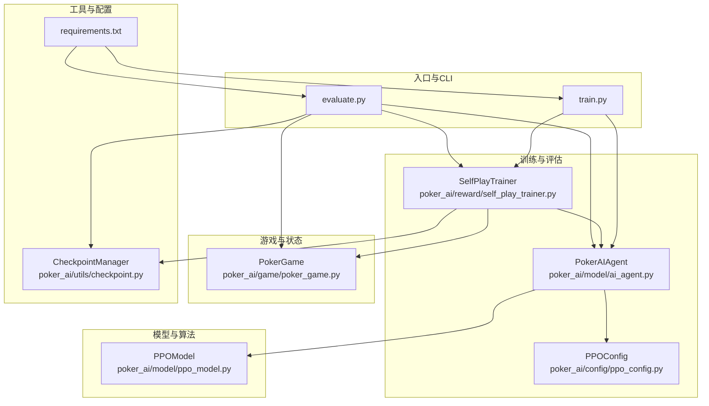
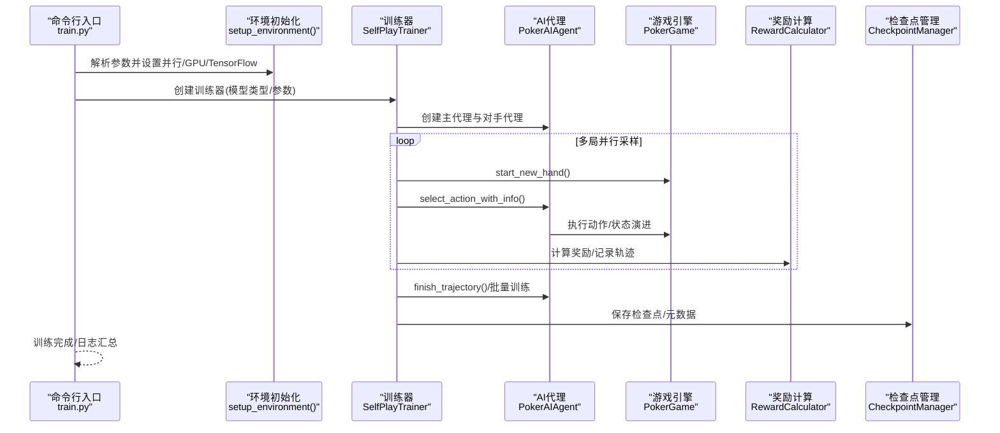
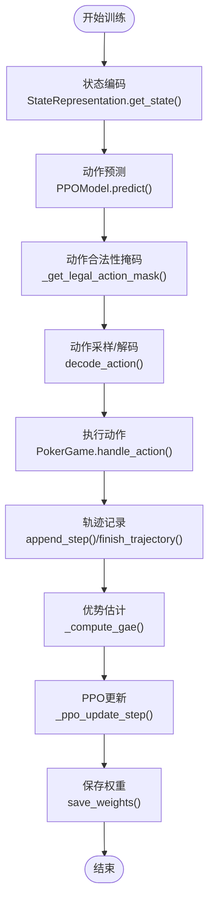
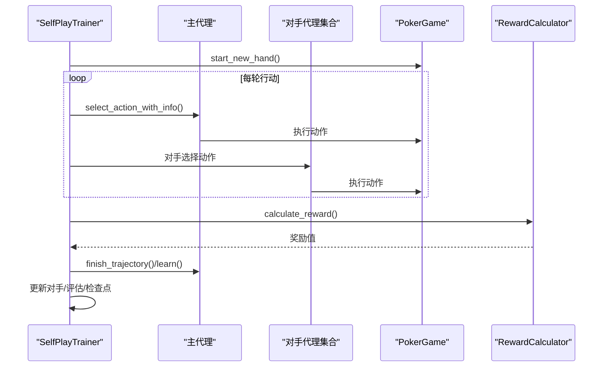
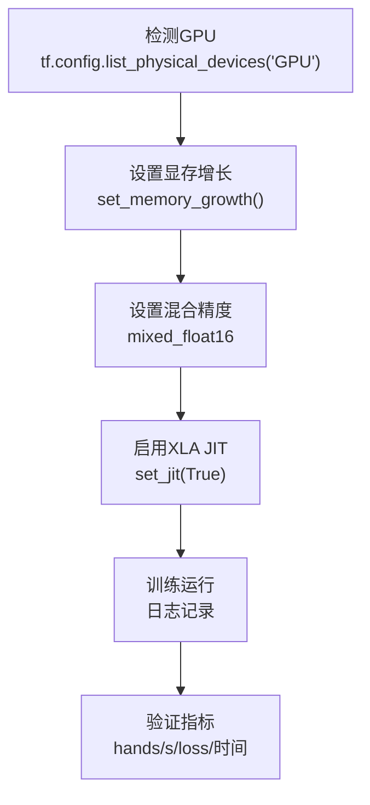
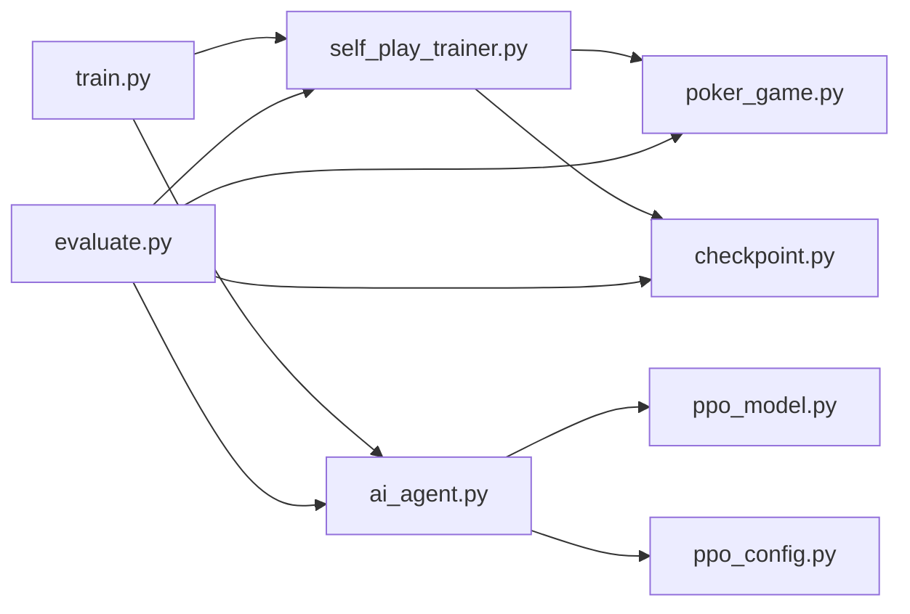

# 集成测试

<cite>
**本文引用的文件**
- [train.py](file://train.py)
- [test_ppo.py](file://test_ppo.py)
- [test_gpu.py](file://test_gpu.py)
- [evaluate.py](file://evaluate.py)
- [poker_ai/model/ppo_model.py](file://poker_ai/model/ppo_model.py)
- [poker_ai/reward/self_play_trainer.py](file://poker_ai/reward/self_play_trainer.py)
- [poker_ai/model/ai_agent.py](file://poker_ai/model/ai_agent.py)
- [poker_ai/config/ppo_config.py](file://poker_ai/config/ppo_config.py)
- [poker_ai/utils/checkpoint.py](file://poker_ai/utils/checkpoint.py)
- [poker_ai/game/poker_game.py](file://poker_ai/game/poker_game.py)
- [requirements.txt](file://requirements.txt)
- [README.md](file://README.md)
</cite>

## 目录
1. [简介](#简介)
2. [项目结构](#项目结构)
3. [核心组件](#核心组件)
4. [架构总览](#架构总览)
5. [详细组件分析](#详细组件分析)
6. [依赖关系分析](#依赖关系分析)
7. [性能考量](#性能考量)
8. [故障排查指南](#故障排查指南)
9. [结论](#结论)
10. [附录](#附录)

## 简介
本文件面向项目集成测试，聚焦以下目标：
- 模块间交互测试：AI代理与游戏引擎的交互、奖励系统的集成验证
- 端到端测试设计与执行：完整训练流程、GPU加速与混合精度验证
- 测试数据流与状态传播验证：从状态表示到动作选择再到奖励回传的闭环
- 具体用例：PPO算法完整训练过程、GPU资源管理与内存使用验证
- 测试环境配置与依赖管理策略

## 项目结构
项目采用分层组织：命令行入口负责参数解析与环境初始化，训练器封装自我对弈与奖励计算，AI代理抽象不同算法（DQN/PPO等），游戏引擎提供6人桌德州扑克规则与状态演进，配置与工具模块提供超参与检查点管理。

**图表来源**
- [train.py:136-238](file://train.py#L136-L238)
- [evaluate.py:110-142](file://evaluate.py#L110-L142)
- [poker_ai/reward/self_play_trainer.py:48-166](file://poker_ai/reward/self_play_trainer.py#L48-L166)
- [poker_ai/model/ai_agent.py:55-116](file://poker_ai/model/ai_agent.py#L55-L116)
- [poker_ai/model/ppo_model.py:20-105](file://poker_ai/model/ppo_model.py#L20-L105)
- [poker_ai/game/poker_game.py:155-200](file://poker_ai/game/poker_game.py#L155-L200)
- [poker_ai/utils/checkpoint.py:17-104](file://poker_ai/utils/checkpoint.py#L17-L104)
- [requirements.txt:1-7](file://requirements.txt#L1-L7)

**章节来源**
- [README.md:46-75](file://README.md#L46-L75)
- [requirements.txt:1-7](file://requirements.txt#L1-L7)

## 核心组件
- 训练入口与环境初始化：解析参数、设置并行与GPU/TensorFlow策略、创建训练器与评估器
- 自我对弈训练器：封装6人桌游戏、并行采样、轨迹收集、奖励计算与对手更新
- AI代理：统一接口，兼容DQN/PPO/PG，提供动作选择、批量推理、轨迹记录与训练触发
- PPO模型：Actor-Critic、GAE优势估计、价值裁剪、自适应熵、学习率调度、KL早停
- 游戏引擎：6人桌规则、状态表征、行动执行、结算派奖
- 检查点管理：权重与元数据保存/加载、最新检查点查找

**章节来源**
- [train.py:240-339](file://train.py#L240-L339)
- [poker_ai/reward/self_play_trainer.py:48-166](file://poker_ai/reward/self_play_trainer.py#L48-L166)
- [poker_ai/model/ai_agent.py:55-116](file://poker_ai/model/ai_agent.py#L55-L116)
- [poker_ai/model/ppo_model.py:20-105](file://poker_ai/model/ppo_model.py#L20-L105)
- [poker_ai/game/poker_game.py:155-200](file://poker_ai/game/poker_game.py#L155-L200)
- [poker_ai/utils/checkpoint.py:17-104](file://poker_ai/utils/checkpoint.py#L17-L104)

## 架构总览
集成测试关注“端到端”闭环：从命令行参数到环境配置，再到训练器与代理协作、游戏引擎状态演进、奖励计算与轨迹训练，最终落盘检查点与日志输出。

**图表来源**
- [train.py:340-531](file://train.py#L340-L531)
- [poker_ai/reward/self_play_trainer.py:260-417](file://poker_ai/reward/self_play_trainer.py#L260-L417)
- [poker_ai/model/ai_agent.py:125-155](file://poker_ai/model/ai_agent.py#L125-L155)
- [poker_ai/utils/checkpoint.py:17-56](file://poker_ai/utils/checkpoint.py#L17-L56)

## 详细组件分析

### PPO模型与训练流程集成测试
目标：验证PPO模型在训练器中的端到端行为，包括状态编码、动作采样、轨迹收集、优势估计、价值裁剪与损失计算。

**图表来源**
- [poker_ai/model/ai_agent.py:125-155](file://poker_ai/model/ai_agent.py#L125-L155)
- [poker_ai/model/ppo_model.py:276-320](file://poker_ai/model/ppo_model.py#L276-L320)
- [poker_ai/model/ppo_model.py:106-198](file://poker_ai/model/ppo_model.py#L106-L198)
- [poker_ai/model/ai_agent.py:388-414](file://poker_ai/model/ai_agent.py#L388-L414)

**章节来源**
- [poker_ai/model/ppo_model.py:497-638](file://poker_ai/model/ppo_model.py#L497-L638)
- [poker_ai/model/ai_agent.py:388-414](file://poker_ai/model/ai_agent.py#L388-L414)

### 自我对弈训练器与奖励系统集成测试
目标：验证训练器在多局并行采样、轨迹聚合、奖励计算与对手更新中的行为一致性与健壮性。

**图表来源**
- [poker_ai/reward/self_play_trainer.py:260-417](file://poker_ai/reward/self_play_trainer.py#L260-L417)
- [poker_ai/reward/self_play_trainer.py:587-799](file://poker_ai/reward/self_play_trainer.py#L587-L799)

**章节来源**
- [poker_ai/reward/self_play_trainer.py:167-213](file://poker_ai/reward/self_play_trainer.py#L167-L213)
- [poker_ai/reward/self_play_trainer.py:419-585](file://poker_ai/reward/self_play_trainer.py#L419-L585)

### GPU与混合精度环境集成测试
目标：验证GPU检测、显存按需增长、混合精度策略与XLA/JIT开关对训练的影响。

**图表来源**
- [train.py:277-330](file://train.py#L277-L330)
- [test_gpu.py:17-77](file://test_gpu.py#L17-L77)

**章节来源**
- [train.py:240-339](file://train.py#L240-L339)
- [test_gpu.py:14-83](file://test_gpu.py#L14-L83)

## 依赖关系分析
- 训练入口依赖训练器、AI代理、配置与工具模块
- 训练器依赖游戏引擎、奖励计算、检查点管理
- AI代理依赖状态表示、PPO配置与具体算法实现
- PPO模型依赖状态表示、配置与TensorFlow/Keras

**图表来源**
- [train.py:340-531](file://train.py#L340-L531)
- [evaluate.py:189-247](file://evaluate.py#L189-L247)
- [poker_ai/model/ai_agent.py:55-116](file://poker_ai/model/ai_agent.py#L55-L116)
- [poker_ai/model/ppo_model.py:20-105](file://poker_ai/model/ppo_model.py#L20-L105)
- [poker_ai/reward/self_play_trainer.py:48-166](file://poker_ai/reward/self_play_trainer.py#L48-L166)
- [poker_ai/utils/checkpoint.py:17-56](file://poker_ai/utils/checkpoint.py#L17-L56)

**章节来源**
- [requirements.txt:1-7](file://requirements.txt#L1-L7)

## 性能考量
- 并行采样与批处理：训练器通过多worker与每worker轨迹数控制吞吐；PPO使用固定batch形状避免re-tracing警告
- 学习率调度与早停：warmup+cosine衰减、KL早停、价值裁剪与梯度裁剪
- GPU资源：显存按需增长、混合精度、XLA/JIT、线程并行度配置
- 数据流：状态编码、动作掩码、轨迹收集、优势估计、批量训练

[本节为通用指导，无需特定文件引用]

## 故障排查指南
- GPU相关
  - 症状：未检测到GPU或初始化失败
  - 排查：使用快速GPU测试脚本验证设备与计算
  - 参考：[test_gpu.py:14-83](file://test_gpu.py#L14-L83)
- TensorFlow/XLA/oneDNN
  - 症状：DNN library或Graph执行错误
  - 排查：关闭XLA或oneDNN，或调整混合精度策略
  - 参考：[train.py:277-330](file://train.py#L277-L330)
- 检查点加载
  - 症状：找不到权重文件或加载失败
  - 排查：确认PPO三件套(.actor/.critic/.pkl)齐全
  - 参考：[poker_ai/utils/checkpoint.py:58-104](file://poker_ai/utils/checkpoint.py#L58-L104)
- 训练异常
  - 症状：训练中断、loss异常、评估指标异常
  - 排查：查看日志、检查参数、验证GPU/内存配置
  - 参考：[train.py:528-531](file://train.py#L528-L531)

**章节来源**
- [test_gpu.py:14-83](file://test_gpu.py#L14-L83)
- [train.py:277-330](file://train.py#L277-L330)
- [poker_ai/utils/checkpoint.py:58-104](file://poker_ai/utils/checkpoint.py#L58-L104)
- [train.py:528-531](file://train.py#L528-L531)

## 结论
本集成测试文档围绕AI代理与游戏引擎交互、奖励系统、端到端训练流程与GPU资源管理给出系统化的测试设计与执行要点。通过状态编码-动作选择-轨迹记录-优势估计-批量训练-检查点落盘的闭环验证，结合GPU显存增长、混合精度与XLA/JIT的配置验证，可有效保障PPO训练的稳定性与性能。

[本节为总结性内容，无需特定文件引用]

## 附录

### 集成测试用例清单与执行步骤

- PPO代理初始化与动作选择
  - 目标：验证PPO代理创建与动作选择流程
  - 步骤：
    - 创建6人桌游戏与玩家
    - 初始化PokerAIAgent(agent_type='ppo')
    - 调用select_action(game, player)
  - 验证点：动作类型与金额非空、不抛异常
  - 参考：[test_ppo.py:15-39](file://test_ppo.py#L15-L39)

- GPU与混合精度验证
  - 目标：验证GPU可用、显存按需增长、混合精度与XLA
  - 步骤：
    - 运行test_gpu.py
    - 观察GPU设备数量、显存增长设置、混合精度矩阵乘法
  - 验证点：GPU设备数>0、混合精度耗时下降
  - 参考：[test_gpu.py:14-83](file://test_gpu.py#L14-L83)

- 完整训练流程端到端测试（PPO）
  - 目标：验证从参数解析到训练完成的全流程
  - 步骤：
    - 解析参数：--mode train --model-type ppo --num-hands N
    - setup_environment：并行worker、GPU/TensorFlow策略
    - 创建SelfPlayTrainer与PokerAIAgent
    - 多局并行采样与轨迹收集
    - finish_trajectory与批量训练
    - 保存检查点与日志
  - 验证点：训练日志、评估指标、检查点文件存在
  - 参考：[train.py:136-238](file://train.py#L136-L238), [train.py:340-531](file://train.py#L340-L531)

- 奖励系统集成验证
  - 目标：验证奖励计算与轨迹回传的一致性
  - 步骤：
    - 运行多手牌，记录action_histories与metrics
    - 比对最终奖励与胜负、利润、all-in不走运补偿
  - 验证点：最终奖励与胜负一致、补偿触发条件满足
  - 参考：[poker_ai/reward/self_play_trainer.py:360-404](file://poker_ai/reward/self_play_trainer.py#L360-L404)

- GPU资源管理与内存使用
  - 目标：验证显存增长、混合精度与XLA对资源的影响
  - 步骤：
    - 设置gpu_memory_growth、mixed_precision、enable_xla
    - 运行短时训练，观察日志与nvidia-smi
  - 验证点：日志显示策略开启、训练稳定
  - 参考：[train.py:290-309](file://train.py#L290-L309)

- 评估与报告生成
  - 目标：验证评估流程与报告生成
  - 步骤：
    - 使用evaluate.py加载模型并运行评估
    - 生成详细统计与图表
  - 验证点：评估结果JSON与报告TXT生成
  - 参考：[evaluate.py:189-247](file://evaluate.py#L189-L247), [evaluate.py:523-584](file://evaluate.py#L523-L584)

**章节来源**
- [test_ppo.py:15-39](file://test_ppo.py#L15-L39)
- [test_gpu.py:14-83](file://test_gpu.py#L14-L83)
- [train.py:136-238](file://train.py#L136-L238)
- [train.py:340-531](file://train.py#L340-L531)
- [poker_ai/reward/self_play_trainer.py:360-404](file://poker_ai/reward/self_play_trainer.py#L360-L404)
- [evaluate.py:189-247](file://evaluate.py#L189-L247)
- [evaluate.py:523-584](file://evaluate.py#L523-L584)