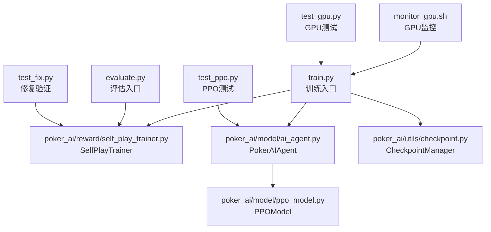
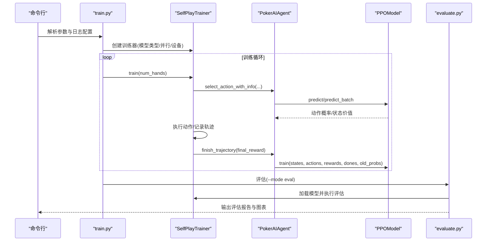
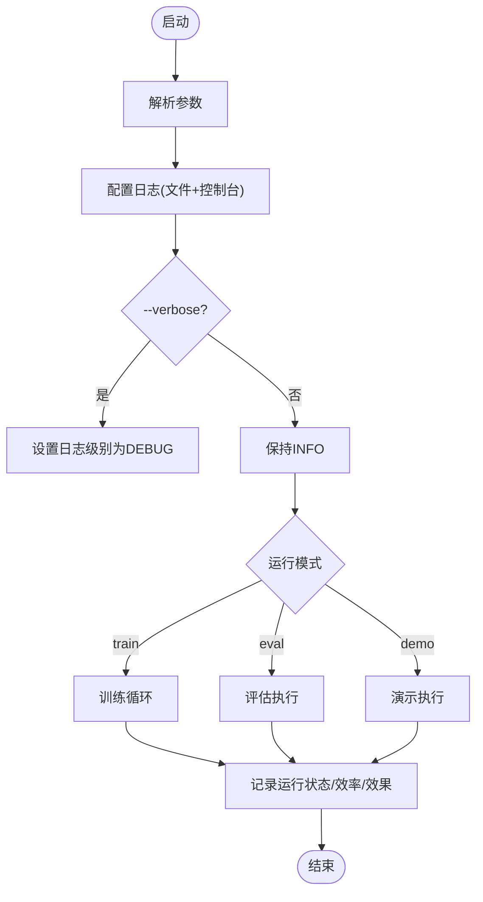
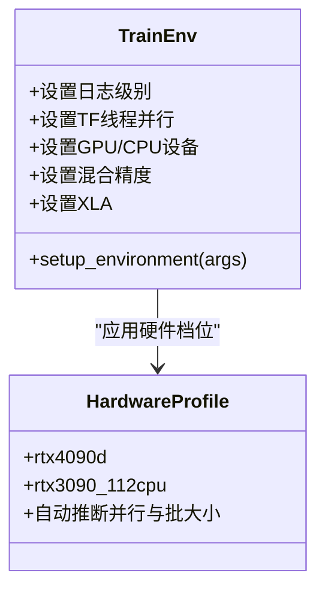
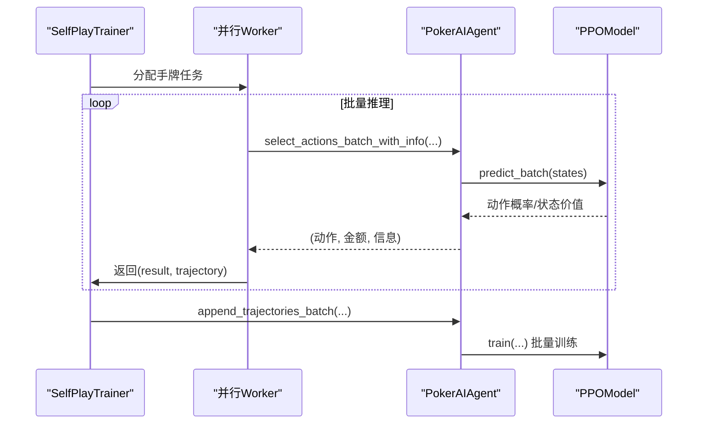
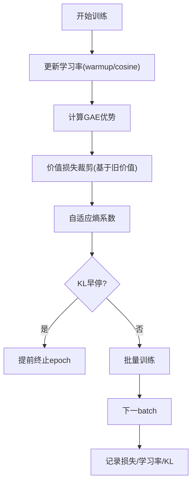
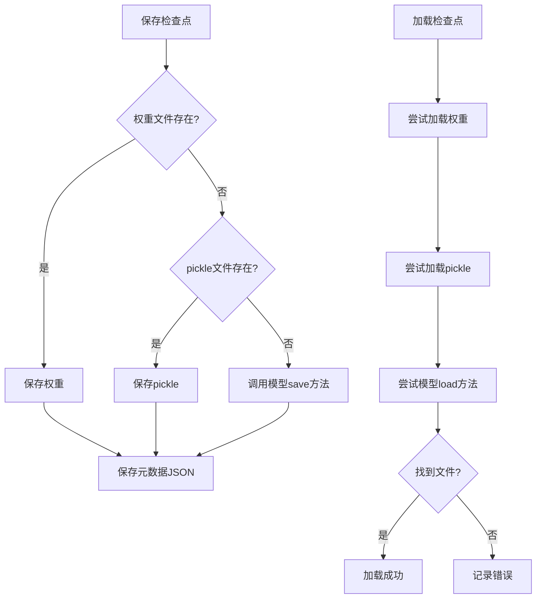
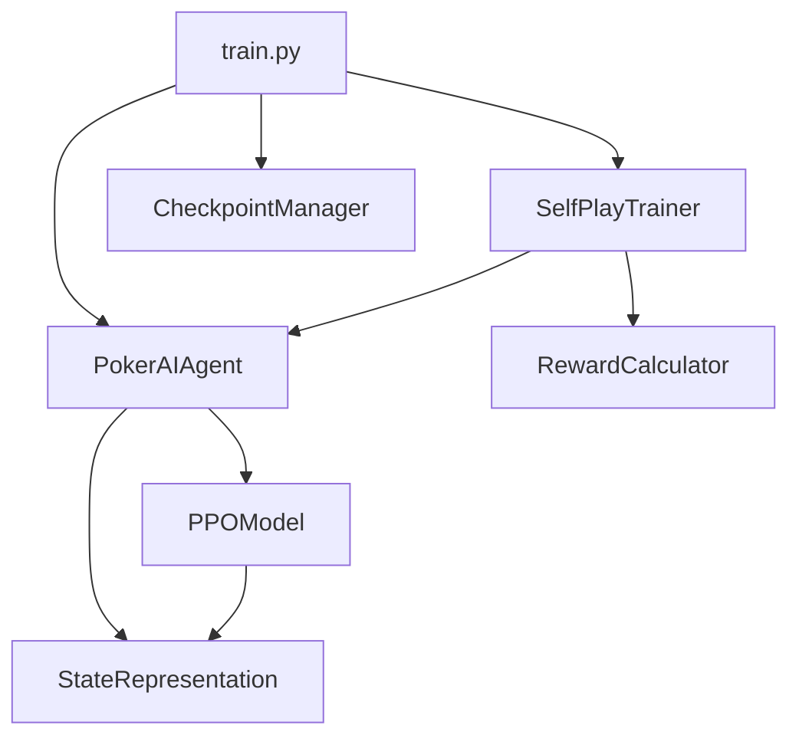
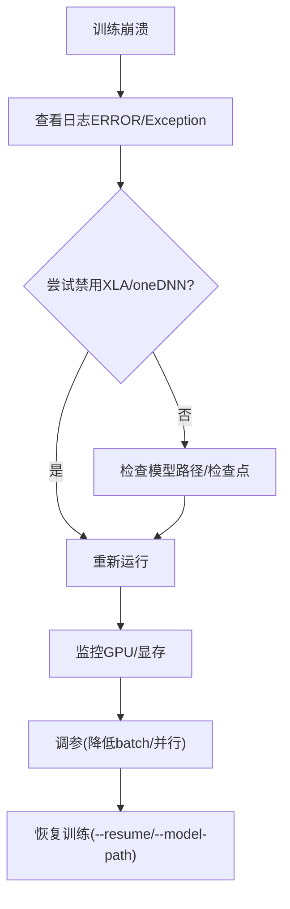

# 调试技巧

<cite>
**本文引用的文件**
- [README.md](file://README.md)
- [train.py](file://train.py)
- [evaluate.py](file://evaluate.py)
- [monitor_gpu.sh](file://monitor_gpu.sh)
- [requirements.txt](file://requirements.txt)
- [poker_ai/reward/self_play_trainer.py](file://poker_ai/reward/self_play_trainer.py)
- [poker_ai/model/ppo_model.py](file://poker_ai/model/ppo_model.py)
- [poker_ai/model/ai_agent.py](file://poker_ai/model/ai_agent.py)
- [poker_ai/utils/checkpoint.py](file://poker_ai/utils/checkpoint.py)
- [test_gpu.py](file://test_gpu.py)
- [test_ppo.py](file://test_ppo.py)
- [test_fix.py](file://test_fix.py)
- [RTX4090D配置指南.md](file://RTX4090D配置指南.md)
- [PPO快速指南.md](file://PPO快速指南.md)
</cite>

## 目录
1. [简介](#简介)
2. [项目结构](#项目结构)
3. [核心组件](#核心组件)
4. [架构总览](#架构总览)
5. [详细组件分析](#详细组件分析)
6. [依赖关系分析](#依赖关系分析)
7. [性能考量](#性能考量)
8. [故障排查指南](#故障排查指南)
9. [结论](#结论)
10. [附录](#附录)

## 简介
本指南面向该项目的调试与排障需求，围绕日志分析、性能分析、工具链配置与常见问题诊断展开。内容涵盖：
- 日志级别与关键信息提取
- GPU与训练监控
- Python性能与内存分析
- PDB与IDE调试实践
- 常见问题（训练异常、内存溢出、性能瓶颈）的诊断流程
- 调试环境与工具链搭建建议

## 项目结构
该项目是一个基于强化学习的德州扑克AI训练与评估系统，主要入口为训练脚本，配套评估脚本、GPU监控脚本、测试脚本与配置文档。核心模块包括：
- 训练入口与环境配置：train.py
- 评估入口与可视化：evaluate.py
- 自我对弈训练器：poker_ai/reward/self_play_trainer.py
- PPO模型与训练：poker_ai/model/ppo_model.py
- AI代理接口与动作选择：poker_ai/model/ai_agent.py
- 检查点管理：poker_ai/utils/checkpoint.py
- GPU监控与测试：monitor_gpu.sh、test_gpu.py、test_ppo.py
- 调试与修复验证：test_fix.py
- 硬件优化配置：RTX4090D配置指南.md、PPO快速指南.md

**图表来源**
- [train.py:1-856](file://train.py#L1-L856)
- [poker_ai/reward/self_play_trainer.py:1-1604](file://poker_ai/reward/self_play_trainer.py#L1-L1604)
- [poker_ai/model/ai_agent.py:1-703](file://poker_ai/model/ai_agent.py#L1-L703)
- [poker_ai/model/ppo_model.py:1-670](file://poker_ai/model/ppo_model.py#L1-L670)
- [poker_ai/utils/checkpoint.py:1-139](file://poker_ai/utils/checkpoint.py#L1-L139)
- [evaluate.py:1-753](file://evaluate.py#L1-L753)
- [monitor_gpu.sh:1-83](file://monitor_gpu.sh#L1-L83)
- [test_gpu.py:1-91](file://test_gpu.py#L1-L91)
- [test_ppo.py:1-41](file://test_ppo.py#L1-L41)
- [test_fix.py:1-283](file://test_fix.py#L1-L283)

**章节来源**
- [README.md:1-227](file://README.md#L1-L227)
- [requirements.txt:1-7](file://requirements.txt#L1-L7)

## 核心组件
- 训练入口与环境配置：负责参数解析、日志配置、设备与并行策略设置、训练流程调度与结果汇总。
- 自我对弈训练器：封装训练循环、并行采样、奖励计算、对手管理、检查点保存与加载。
- AI代理接口：统一对DQN、策略梯度、PPO的接口，提供动作选择、批量推理、轨迹记录与训练。
- PPO模型：包含网络架构、损失函数、学习率调度、价值裁剪、自适应熵系数、KL早停等优化。
- 检查点管理：支持权重、pickle与元数据的保存与加载。
- 评估入口：支持基本评估与详细评估，生成报告与图表。
- GPU监控与测试：提供GPU利用率、显存、温度、功耗监控与快速GPU计算测试。

**章节来源**
- [train.py:1-856](file://train.py#L1-L856)
- [poker_ai/reward/self_play_trainer.py:1-1604](file://poker_ai/reward/self_play_trainer.py#L1-L1604)
- [poker_ai/model/ai_agent.py:1-703](file://poker_ai/model/ai_agent.py#L1-L703)
- [poker_ai/model/ppo_model.py:1-670](file://poker_ai/model/ppo_model.py#L1-L670)
- [poker_ai/utils/checkpoint.py:1-139](file://poker_ai/utils/checkpoint.py#L1-L139)
- [evaluate.py:1-753](file://evaluate.py#L1-L753)
- [monitor_gpu.sh:1-83](file://monitor_gpu.sh#L1-L83)
- [test_gpu.py:1-91](file://test_gpu.py#L1-L91)
- [test_ppo.py:1-41](file://test_ppo.py#L1-L41)
- [test_fix.py:1-283](file://test_fix.py#L1-L283)

## 架构总览
训练与评估的整体流程如下：
- 训练入口解析参数，配置日志与设备，创建训练器，按手牌数循环训练，周期性评估与检查点保存。
- 自我对弈训练器负责并行采样、动作执行、奖励计算与轨迹记录，PPO通过轨迹批量训练。
- 评估入口加载模型，执行评估并生成报告与图表。

**图表来源**
- [train.py:340-531](file://train.py#L340-L531)
- [poker_ai/reward/self_play_trainer.py:419-800](file://poker_ai/reward/self_play_trainer.py#L419-L800)
- [poker_ai/model/ai_agent.py:125-420](file://poker_ai/model/ai_agent.py#L125-L420)
- [poker_ai/model/ppo_model.py:497-638](file://poker_ai/model/ppo_model.py#L497-L638)
- [evaluate.py:706-753](file://evaluate.py#L706-L753)

## 详细组件分析

### 日志系统与调试要点
- 日志配置：训练入口与评估入口分别配置文件与控制台处理器，支持INFO/DEBUG级别。
- 关键信息提取：
  - 运行状态：ERROR/Exception
  - 效率：平均每手耗时
  - 效果：评估完成后的平均利润/胜率/诈唬率/加注率
- 建议：使用--verbose开启DEBUG级别，结合tail -f实时观察日志。

**图表来源**
- [train.py:20-37](file://train.py#L20-L37)
- [train.py:247-251](file://train.py#L247-L251)
- [train.py:532-591](file://train.py#L532-L591)
- [evaluate.py:20-29](file://evaluate.py#L20-L29)
- [evaluate.py:144-157](file://evaluate.py#L144-L157)

**章节来源**
- [train.py:20-37](file://train.py#L20-L37)
- [train.py:247-251](file://train.py#L247-L251)
- [train.py:532-591](file://train.py#L532-L591)
- [evaluate.py:20-29](file://evaluate.py#L20-L29)
- [evaluate.py:144-157](file://evaluate.py#L144-L157)
- [README.md:194-202](file://README.md#L194-L202)

### 设备与并行配置（GPU/CPU/XLA/混合精度）
- 设备选择：支持auto/gpu/cpu，GPU按需增长，混合精度策略。
- 线程并行：TensorFlow intra/inter-op线程数设置，train_workers/eval_workers自动推断。
- XLA：默认启用JIT编译，可禁用以规避某些oneDNN初始化问题。
- 硬件档位：内置RTX4090D/RTX3090_112CPU档位，自动调整并行与批大小。

**图表来源**
- [train.py:240-339](file://train.py#L240-L339)
- [train.py:55-97](file://train.py#L55-L97)

**章节来源**
- [train.py:240-339](file://train.py#L240-L339)
- [train.py:55-97](file://train.py#L55-L97)
- [RTX4090D配置指南.md:14-38](file://RTX4090D配置指南.md#L14-L38)

### 自我对弈训练器（并行采样与轨迹管理）
- 并行采样：支持train_workers/eval_workers，批量推理减少Python/TensorFlow往返开销。
- 轨迹记录：PPO使用append_step/finish_trajectory记录状态、动作与旧概率，累计到阈值后批量训练。
- 奖励与结算：使用奖励计算器，处理all-in不走运补偿、无效下注惩罚等。

**图表来源**
- [poker_ai/reward/self_play_trainer.py:587-800](file://poker_ai/reward/self_play_trainer.py#L587-L800)
- [poker_ai/model/ai_agent.py:157-214](file://poker_ai/model/ai_agent.py#L157-L214)
- [poker_ai/model/ppo_model.py:497-638](file://poker_ai/model/ppo_model.py#L497-L638)

**章节来源**
- [poker_ai/reward/self_play_trainer.py:587-800](file://poker_ai/reward/self_play_trainer.py#L587-L800)
- [poker_ai/model/ai_agent.py:157-214](file://poker_ai/model/ai_agent.py#L157-L214)
- [poker_ai/model/ppo_model.py:497-638](file://poker_ai/model/ppo_model.py#L497-L638)

### PPO模型优化（学习率、价值裁剪、自适应熵）
- 学习率：warmup + cosine衰减，支持动态更新。
- 价值损失：基于旧价值的裁剪，避免过度更新。
- 自适应熵：根据当前熵与目标熵动态调整熵系数。
- 梯度累积与早停：KL散度早停，防止策略塌缩。

**图表来源**
- [poker_ai/model/ppo_model.py:420-448](file://poker_ai/model/ppo_model.py#L420-L448)
- [poker_ai/model/ppo_model.py:528-638](file://poker_ai/model/ppo_model.py#L528-L638)

**章节来源**
- [poker_ai/model/ppo_model.py:420-448](file://poker_ai/model/ppo_model.py#L420-L448)
- [poker_ai/model/ppo_model.py:528-638](file://poker_ai/model/ppo_model.py#L528-L638)

### 检查点管理与恢复
- 保存：支持权重文件、pickle与元数据JSON。
- 加载：按扩展名自动识别加载方式，支持最近检查点查找。
- 恢复：训练入口支持--resume与--model-path恢复。

**图表来源**
- [poker_ai/utils/checkpoint.py:17-56](file://poker_ai/utils/checkpoint.py#L17-L56)
- [poker_ai/utils/checkpoint.py:58-104](file://poker_ai/utils/checkpoint.py#L58-L104)
- [train.py:493-500](file://train.py#L493-L500)

**章节来源**
- [poker_ai/utils/checkpoint.py:17-56](file://poker_ai/utils/checkpoint.py#L17-L56)
- [poker_ai/utils/checkpoint.py:58-104](file://poker_ai/utils/checkpoint.py#L58-L104)
- [train.py:493-500](file://train.py#L493-L500)

### 评估与可视化
- 基本评估：计算平均利润、胜率等指标。
- 详细评估：收集动作分布、阶段利润、手牌强度胜率、位置胜率等统计。
- 可视化：手牌强度分布、动作分布、阶段利润箱线图、按强度胜率、累计利润曲线。

**章节来源**
- [evaluate.py:181-267](file://evaluate.py#L181-L267)
- [evaluate.py:269-482](file://evaluate.py#L269-L482)
- [evaluate.py:586-704](file://evaluate.py#L586-L704)

## 依赖关系分析
- train.py依赖SelfPlayTrainer、PokerAIAgent、CheckpointManager、日志与TensorFlow配置。
- SelfPlayTrainer依赖PokerAIAgent、奖励计算器、检查点工具。
- PokerAIAgent依赖StateRepresentation与具体模型（DQN/PG/PPO）。
- PPOModel依赖StateRepresentation、配置与TensorFlow/Keras。

**图表来源**
- [train.py:350-383](file://train.py#L350-L383)
- [poker_ai/reward/self_play_trainer.py:167-200](file://poker_ai/reward/self_play_trainer.py#L167-L200)
- [poker_ai/model/ai_agent.py:55-116](file://poker_ai/model/ai_agent.py#L55-L116)
- [poker_ai/model/ppo_model.py:20-58](file://poker_ai/model/ppo_model.py#L20-L58)

**章节来源**
- [train.py:350-383](file://train.py#L350-L383)
- [poker_ai/reward/self_play_trainer.py:167-200](file://poker_ai/reward/self_play_trainer.py#L167-L200)
- [poker_ai/model/ai_agent.py:55-116](file://poker_ai/model/ai_agent.py#L55-L116)
- [poker_ai/model/ppo_model.py:20-58](file://poker_ai/model/ppo_model.py#L20-L58)

## 性能考量
- GPU利用率与显存：使用monitor_gpu.sh实时监控，关注GPU利用率、显存使用、温度与功耗。
- 批大小与并行：RTX4090D建议较大batch与较多并行worker，结合--mixed-precision与--enable-xla。
- 训练效率：关注平均每手耗时与hands/s，异常波动提示参数或硬件问题。
- 内存与显存：避免一次性占用全部显存，使用--gpu-memory-growth；必要时降低batch size或并行度。

**章节来源**
- [monitor_gpu.sh:1-83](file://monitor_gpu.sh#L1-L83)
- [RTX4090D配置指南.md:104-156](file://RTX4090D配置指南.md#L104-L156)
- [train.py:312-330](file://train.py#L312-L330)

## 故障排查指南

### 1. 训练异常（崩溃/错误）
- 症状：日志出现ERROR/Exception，训练中断。
- 排查步骤：
  - 查看最新日志文件，定位错误堆栈。
  - 检查设备与并行配置，尝试--disable-xla与--disable-onednn。
  - 检查模型路径与检查点完整性，使用--resume或指定--model-path。
  - 降低batch size或并行度，确认显存是否足够。

**图表来源**
- [train.py:528-531](file://train.py#L528-L531)
- [train.py:285-309](file://train.py#L285-L309)
- [train.py:493-500](file://train.py#L493-L500)

**章节来源**
- [train.py:528-531](file://train.py#L528-L531)
- [train.py:285-309](file://train.py#L285-L309)
- [train.py:493-500](file://train.py#L493-L500)

### 2. 内存溢出（显存不足）
- 症状：GPU OOM、训练报错或性能骤降。
- 处理：
  - 降低--batch-size与--ppo-update-min-steps。
  - 减少--train-workers与--eval-workers。
  - 启用--gpu-memory-growth，避免一次性占用。
  - 检查是否启用了--mixed-precision导致显存占用变化。

**章节来源**
- [RTX4090D配置指南.md:177-204](file://RTX4090D配置指南.md#L177-L204)
- [train.py:290-296](file://train.py#L290-L296)

### 3. 性能瓶颈（速度慢/利用率低）
- 症状：hands/s低、GPU利用率低。
- 处理：
  - 增大--batch-size与--ppo-update-min-steps。
  - 增加--train-workers与--train-rollouts-per-worker。
  - 启用--enable-xla与--mixed-precision。
  - 使用RTX4090D硬件档位自动优化。

**章节来源**
- [RTX4090D配置指南.md:190-204](file://RTX4090D配置指南.md#L190-L204)
- [train.py:64-97](file://train.py#L64-L97)

### 4. 训练不稳定（损失爆炸/策略塌缩/停滞）
- 症状：损失爆炸、总是fold、损失长期不变。
- 处理：
  - 降低学习率至1e-4，增加--ppo-clip至0.3。
  - 增加--ppo-entropy-coef至0.05。
  - 检查学习率调度是否正常（warmup→cosine）。
  - 使用--disable-xla与--disable-onednn验证是否为底层库问题。

**章节来源**
- [PPO快速指南.md:146-159](file://PPO快速指南.md#L146-L159)
- [poker_ai/model/ppo_model.py:420-448](file://poker_ai/model/ppo_model.py#L420-L448)

### 5. 评估失败（模型加载失败/路径错误）
- 症状：评估时报错找不到模型或加载失败。
- 处理：
  - 确认--model-path指向正确的权重文件或base路径。
  - 检查checkpoints目录内容，使用绝对路径。
  - 评估脚本内部有详细文件存在性与权限检查与日志输出。

**章节来源**
- [evaluate.py:199-240](file://evaluate.py#L199-L240)

### 6. 调试工具与实践
- 日志分析：使用--verbose开启DEBUG，tail -f观察日志。
- GPU监控：monitor_gpu.sh实时查看GPU利用率、显存、温度与功耗。
- GPU测试：test_gpu.py验证GPU与混合精度是否正常。
- PPO测试：test_ppo.py验证PPO代理初始化与动作选择。
- 修复验证：test_fix.py模拟多人对局，验证修复后的收益改善。

**章节来源**
- [monitor_gpu.sh:1-83](file://monitor_gpu.sh#L1-L83)
- [test_gpu.py:1-91](file://test_gpu.py#L1-L91)
- [test_ppo.py:1-41](file://test_ppo.py#L1-L41)
- [test_fix.py:1-283](file://test_fix.py#L1-L283)

## 结论
本指南提供了从日志分析、性能监控、工具链配置到常见问题诊断的完整调试路径。通过合理设置日志级别、监控GPU与训练效率、优化并行与批大小、以及使用测试脚本验证关键路径，可以快速定位并解决训练过程中的异常与性能瓶颈。建议在大规模训练前先用小规模验证配置，逐步过渡到RTX4090D优化档位。

## 附录

### A. 常用命令与参数速查
- 训练入口：train.py
  - --mode {train,eval,demo}
  - --model-type {dqn,policy_gradient,ppo}
  - --num-hands
  - --checkpoint-dir
  - --resume
  - --model-path
  - --device {auto,gpu,cpu}
  - --mixed-precision/--no-mixed-precision
  - --enable-xla/--disable-xla
  - --gpu-memory-growth/--no-gpu-memory-growth
  - --train-workers/--eval-workers
  - --batch-size
  - --ppo-clip/--ppo-epochs/--ppo-entropy-coef
  - --eval-interval/--checkpoint-interval/--num-eval-games
  - --hardware-profile {auto,rtx3090_112cpu,rtx4090d}

- 评估入口：evaluate.py
  - --model-path
  - --model-type {dqn,policy_gradient}
  - --num-games
  - --num-opponents
  - --opponent-type {random,fixed,previous}
  - --output-dir
  - --generate-plots
  - --verbose

**章节来源**
- [README.md:149-227](file://README.md#L149-L227)
- [train.py:136-238](file://train.py#L136-L238)
- [evaluate.py:110-142](file://evaluate.py#L110-L142)

### B. 调试环境与工具链
- 依赖：TensorFlow、NumPy、Matplotlib、Seaborn、pickle-mixin、argparse、python-dateutil。
- GPU监控：nvidia-smi + monitor_gpu.sh。
- 测试：test_gpu.py、test_ppo.py、test_fix.py。
- 硬件优化：RTX4090D配置指南.md、PPO快速指南.md。

**章节来源**
- [requirements.txt:1-7](file://requirements.txt#L1-L7)
- [monitor_gpu.sh:1-83](file://monitor_gpu.sh#L1-L83)
- [test_gpu.py:1-91](file://test_gpu.py#L1-L91)
- [test_ppo.py:1-41](file://test_ppo.py#L1-L41)
- [test_fix.py:1-283](file://test_fix.py#L1-L283)
- [RTX4090D配置指南.md:1-366](file://RTX4090D配置指南.md#L1-L366)
- [PPO快速指南.md:1-246](file://PPO快速指南.md#L1-L246)