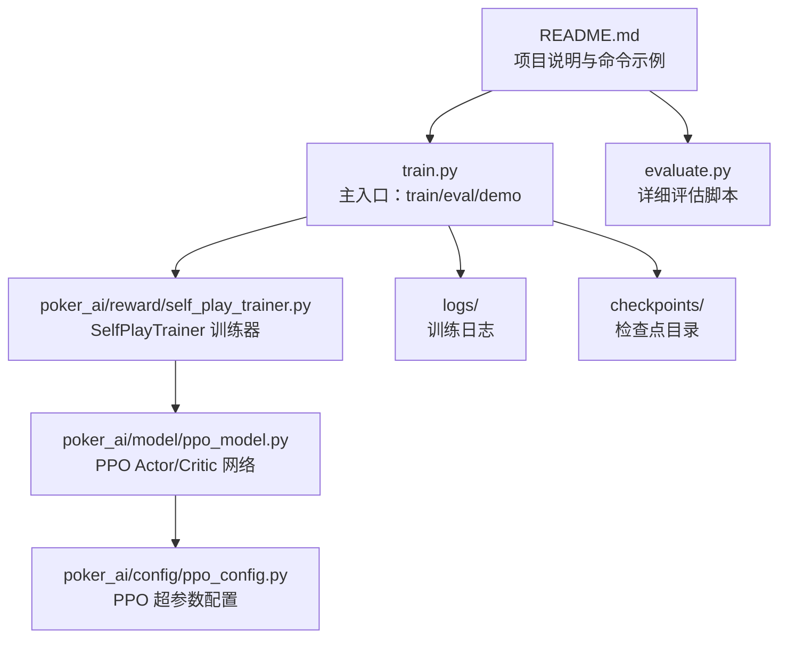
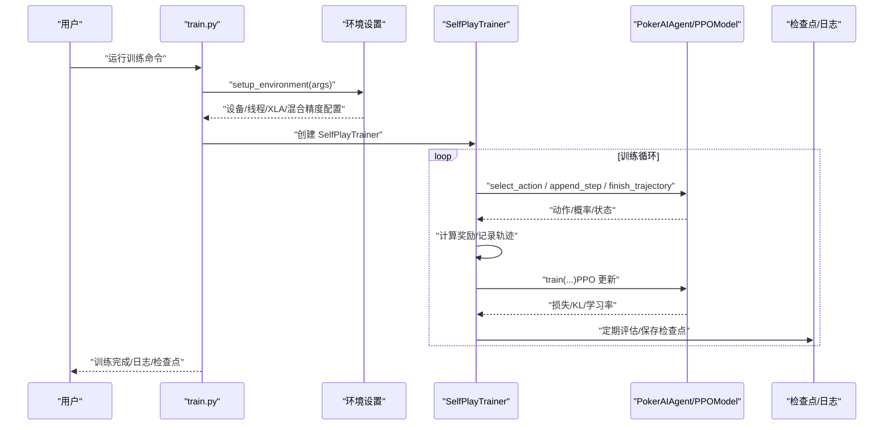
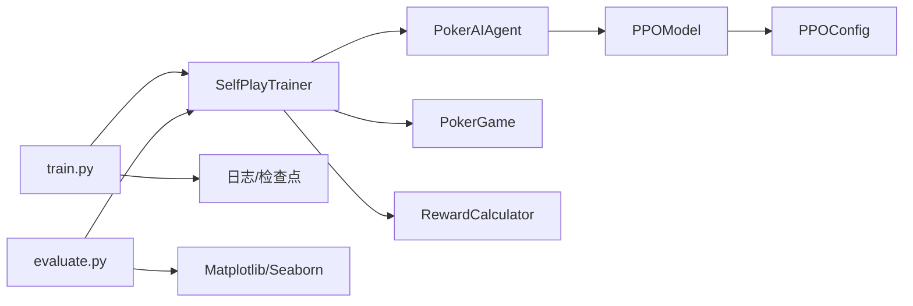

# 快速开始

<cite>
**本文引用的文件**
- [README.md](file://README.md)
- [requirements.txt](file://requirements.txt)
- [train.py](file://train.py)
- [evaluate.py](file://evaluate.py)
- [poker_ai/config/ppo_config.py](file://poker_ai/config/ppo_config.py)
- [poker_ai/model/ppo_model.py](file://poker_ai/model/ppo_model.py)
- [poker_ai/reward/self_play_trainer.py](file://poker_ai/reward/self_play_trainer.py)
- [docs/quickstart.md](file://docs/quickstart.md)
- [docs/如何看训练结果.md](file://docs/如何看训练结果.md)
- [test_gpu.py](file://test_gpu.py)
- [monitor_gpu.sh](file://monitor_gpu.sh)
- [RTX4090D配置指南.md](file://RTX4090D配置指南.md)
</cite>

## 目录
1. [简介](#简介)
2. [项目结构](#项目结构)
3. [核心组件](#核心组件)
4. [架构总览](#架构总览)
5. [详细组件分析](#详细组件分析)
6. [依赖关系分析](#依赖关系分析)
7. [性能注意事项](#性能注意事项)
8. [故障排除指南](#故障排除指南)
9. [结论](#结论)
10. [附录](#附录)

## 简介
本指南面向初学者，帮助你在最短时间内完成环境准备、安装依赖、运行500手牌的验证训练，并理解训练日志与检查点文件的位置与含义。你将学会：
- 安装 Python 3.8+ 与 TensorFlow 2.x
- 安装项目依赖
- 运行最小可行的训练命令
- 查看训练日志与评估结果
- 使用 GPU 监控工具观察训练状态
- 基本的故障排除方法

## 项目结构
该项目围绕“6-max 德州扑克”强化学习训练展开，核心入口为 train.py，评估脚本为 evaluate.py，训练器封装在 poker_ai/reward/self_play_trainer.py 中，PPO 模型位于 poker_ai/model/ppo_model.py，PPO 超参数集中在 poker_ai/config/ppo_config.py。



**图表来源**
- [README.md:12-75](file://README.md#L12-L75)
- [train.py:136-238](file://train.py#L136-L238)
- [evaluate.py:110-142](file://evaluate.py#L110-L142)
- [poker_ai/reward/self_play_trainer.py:48-79](file://poker_ai/reward/self_play_trainer.py#L48-L79)
- [poker_ai/model/ppo_model.py:20-105](file://poker_ai/model/ppo_model.py#L20-L105)
- [poker_ai/config/ppo_config.py:18-96](file://poker_ai/config/ppo_config.py#L18-L96)

**章节来源**
- [README.md:46-75](file://README.md#L46-L75)

## 核心组件
- 训练入口 train.py：提供 --mode train/eval/demo，解析命令行参数，设置环境（设备、线程、XLA、混合精度），创建 SelfPlayTrainer，执行训练/评估/演示。
- 评估脚本 evaluate.py：用于生成详细评估报告与图表，支持对手类型、输出目录、可视化开关等。
- SelfPlayTrainer：封装 6-Max 自我对弈训练流程，负责并行采样、奖励计算、轨迹记录、检查点保存与加载。
- PPOModel：Actor-Critic 网络实现，支持 GAE 优势估计、价值裁剪、自适应熵、KL 早停、混合精度优化等。
- PPOConfig：集中管理 PPO 超参数，便于调参与复现。

**章节来源**
- [train.py:136-238](file://train.py#L136-L238)
- [evaluate.py:110-142](file://evaluate.py#L110-L142)
- [poker_ai/reward/self_play_trainer.py:48-79](file://poker_ai/reward/self_play_trainer.py#L48-L79)
- [poker_ai/model/ppo_model.py:20-105](file://poker_ai/model/ppo_model.py#L20-L105)
- [poker_ai/config/ppo_config.py:18-96](file://poker_ai/config/ppo_config.py#L18-L96)

## 架构总览
训练流程从命令行入口开始，解析参数后进入环境设置，随后创建训练器并执行训练。训练器内部通过 SelfPlayTrainer 并行采样多手牌，记录轨迹，计算奖励，调用 PPOModel 进行策略与价值网络更新。训练期间定期评估与保存检查点，训练结束后生成训练总结。



**图表来源**
- [train.py:240-339](file://train.py#L240-L339)
- [poker_ai/reward/self_play_trainer.py:48-79](file://poker_ai/reward/self_play_trainer.py#L48-L79)
- [poker_ai/model/ppo_model.py:497-638](file://poker_ai/model/ppo_model.py#L497-L638)

## 详细组件分析

### 环境准备与依赖安装
- Python 3.8+：满足项目语法与库兼容性。
- TensorFlow 2.x：项目在 2.9.0 环境下可运行，建议安装与 README 一致的版本以避免兼容问题。
- 依赖清单：requirements.txt 包含 tensorflow、numpy、matplotlib、seaborn、pickle-mixin、argparse、python-dateutil 等。

安装步骤（以 Linux/macOS 为例）：
- 安装 Python 3.8+（系统自带或通过包管理器/conda）
- 创建虚拟环境并激活
- 安装依赖：pip install -r requirements.txt

常见问题与解决方案：
- 安装失败（ImportError/ModuleNotFoundError）：确认 Python 版本与 pip 指向的是同一解释器；升级 pip/setuptools；在虚拟环境中重新安装。
- TensorFlow 安装缓慢：使用国内镜像源或指定版本安装（如 tensorflow==2.13.0）。
- 依赖冲突：使用干净的虚拟环境，避免系统级包污染。

**章节来源**
- [README.md:14-23](file://README.md#L14-L23)
- [requirements.txt:1-7](file://requirements.txt#L1-L7)

### 运行500手牌验证训练
推荐使用 PPO 模型进行快速验证，命令如下（来自 README 与 docs/quickstart.md）：
```bash
python train.py --mode train --model-type ppo \
  --num-hands 500 \
  --eval-interval 250 \
  --num-eval-games 100 \
  --checkpoint-interval 500 \
  --learning-rate 2e-4 \
  --ppo-clip 0.15 \
  --ppo-epochs 8 \
  --ppo-entropy-coef 0.006 \
  --target-update 20 \
  --checkpoint-dir ./checkpoints_run500_fixwinrate \
  --skip-final-eval
```

参数说明（以 train.py 的 argparse 为准）：
- --mode train：运行训练模式
- --model-type ppo：使用 PPO 模型
- --num-hands 500：训练 500 手牌
- --eval-interval 250：每 250 局评估一次
- --num-eval-games 100：每次评估 100 局
- --checkpoint-interval 500：每 500 局保存一次检查点
- --learning-rate 2e-4：学习率
- --ppo-clip 0.15：PPO 裁剪系数
- --ppo-epochs 8：每批轨迹更新轮次
- --ppo-entropy-coef 0.006：熵正则系数
- --target-update 20：DQN 目标网络更新频率（PPO 不使用）
- --checkpoint-dir ./checkpoints_run500_fixwinrate：检查点保存目录
- --skip-final-eval：训练结束后跳过最终评估

训练日志与检查点：
- 训练日志：logs/ 目录下以 poker_ai_ 时间戳命名的日志文件
- 检查点：默认保存在 checkpoints/，也可通过 --checkpoint-dir 指定；PPO 检查点为三件套（actor/critic/状态）

**章节来源**
- [README.md:25-42](file://README.md#L25-L42)
- [docs/quickstart.md:9-24](file://docs/quickstart.md#L9-L24)
- [train.py:136-238](file://train.py#L136-L238)

### 评估与报告生成
- 使用 train.py 的评估模式：对指定检查点进行评估，输出 JSON 报告与文本报告。
- 使用 evaluate.py 的详细评估：生成更多统计与图表，适合深入分析策略健康度。

评估命令示例（来自 README 与 docs/quickstart.md）：
```bash
python train.py --mode eval --model-type ppo \
  --model-path ./checkpoints_run500_fixwinrate/agent_ppo_500 \
  --num-eval-games 500 \
  --eval-output eval_results.json
```

评估结果解读（来自 docs/如何看训练结果.md）：
- 平均利润（avg_profit）：主 AI 每局筹码变化的平均值，>0 通常表示策略有效
- 胜率（win_rate）：主 AI 在评估局数中成为赢家的比例
- 综合得分（current_score = avg_profit × win_rate）
- 策略健康度指标：诈唬率、加注率、无效下注率

**章节来源**
- [README.md:104-121](file://README.md#L104-L121)
- [docs/quickstart.md:26-33](file://docs/quickstart.md#L26-L33)
- [docs/如何看训练结果.md:30-61](file://docs/如何看训练结果.md#L30-L61)

### GPU 与性能监控
- GPU 测试：test_gpu.py 可验证 GPU 是否被识别、显存按需分配、混合精度是否生效。
- 实时监控：monitor_gpu.sh 可持续显示 GPU 利用率、温度、功耗，并实时显示最新训练日志片段。

RTX 4090D 优化建议（来自 RTX4090D配置指南.md）：
- 推荐开启 --mixed-precision、--enable-xla、--gpu-memory-growth
- 合理设置 --batch-size、--train-workers、--eval-workers、--ppo-update-min-steps
- 通过 --hardware-profile auto 或 rtx4090d 自动应用更激进的默认参数

**章节来源**
- [test_gpu.py:14-91](file://test_gpu.py#L14-L91)
- [monitor_gpu.sh:9-82](file://monitor_gpu.sh#L9-L82)
- [RTX4090D配置指南.md:12-38](file://RTX4090D配置指南.md#L12-L38)

## 依赖关系分析
- train.py 依赖 SelfPlayTrainer（自对弈训练器）、PPOModel（策略/价值网络）、日志与检查点工具。
- SelfPlayTrainer 依赖 PokerAIAgent（代理接口）、PokerGame（6-max 游戏）、奖励计算器、状态表示。
- PPOModel 依赖 PPOConfig（超参数）、StateRepresentation（状态编码）。
- evaluate.py 依赖 SelfPlayTrainer、AIAvisor、Matplotlib/Seaborn（可视化）。



**图表来源**
- [train.py:350-383](file://train.py#L350-L383)
- [poker_ai/reward/self_play_trainer.py:167-213](file://poker_ai/reward/self_play_trainer.py#L167-L213)
- [poker_ai/model/ppo_model.py:20-105](file://poker_ai/model/ppo_model.py#L20-L105)
- [evaluate.py:93-98](file://evaluate.py#L93-L98)

**章节来源**
- [train.py:350-383](file://train.py#L350-L383)
- [poker_ai/reward/self_play_trainer.py:167-213](file://poker_ai/reward/self_play_trainer.py#L167-L213)
- [poker_ai/model/ppo_model.py:20-105](file://poker_ai/model/ppo_model.py#L20-L105)
- [evaluate.py:93-98](file://evaluate.py#L93-L98)

## 性能注意事项
- 设备与线程：train.py 会自动设置 intra/inter-op 线程数、GPU 显存增长、XLA、混合精度；可通过 --device、--mixed-precision、--enable-xla、--gpu-memory-growth 控制。
- 并行采样：--train-workers、--eval-workers、--train-rollouts-per-worker、--train-sync-every-batches 控制训练吞吐。
- PPO 批量与更新：--batch-size、--ppo-update-min-steps、--ppo-epochs、--ppo-clip、--ppo-entropy-coef 影响收敛速度与稳定性。
- RTX 4090D：建议使用 --hardware-profile rtx4090d 或 auto，自动提升并行与批量，获得更高吞吐。

**章节来源**
- [train.py:240-339](file://train.py#L240-L339)
- [train.py:55-97](file://train.py#L55-L97)
- [RTX4090D配置指南.md:12-38](file://RTX4090D配置指南.md#L12-L38)

## 故障排除指南
- 无法导入 TensorFlow：确认已安装且版本符合 requirements.txt；在虚拟环境中重新安装。
- 未检测到 GPU：运行 test_gpu.py 进行快速验证；检查驱动版本与 nvidia-smi 输出。
- 训练卡住或 GPU 利用率低：使用 monitor_gpu.sh 观察 GPU 利用率与日志；适当提高 --batch-size、--train-workers、--eval-workers。
- 检查点未保存或评估失败：确认 --checkpoint-dir 可写；评估时 --model-path 指向正确的 base 路径（PPO 三件套）。
- 评估指标异常：增大 --num-eval-games；关注“无效下注率”“诈唬率”等策略健康度指标。

**章节来源**
- [test_gpu.py:14-91](file://test_gpu.py#L14-L91)
- [monitor_gpu.sh:9-82](file://monitor_gpu.sh#L9-L82)
- [README.md:194-202](file://README.md#L194-L202)
- [docs/如何看训练结果.md:30-61](file://docs/如何看训练结果.md#L30-L61)

## 结论
通过本指南，你可以快速完成环境准备、安装依赖、运行500手牌验证训练，并理解训练日志与检查点的存放位置。建议先用小规模训练验证流程，再逐步扩大手数与并行度。遇到问题时，优先使用 GPU 测试与监控脚本定位瓶颈，结合 README 与文档中的参数说明进行调优。

## 附录

### 常用命令速查
- 安装依赖：pip install -r requirements.txt
- 500手牌验证训练：见“运行500手牌验证训练”
- 评估模型：见“评估与报告生成”
- GPU 测试：python test_gpu.py
- 实时监控：./monitor_gpu.sh

### 检查点与日志位置
- 训练日志：logs/ 目录下 poker_ai_ 时间戳.log
- 检查点：默认 checkpoints/，或通过 --checkpoint-dir 指定
- 训练总结：checkpoints/*/training_summary_*.json

**章节来源**
- [docs/quickstart.md:42-47](file://docs/quickstart.md#L42-L47)
- [README.md:42](file://README.md#L42)