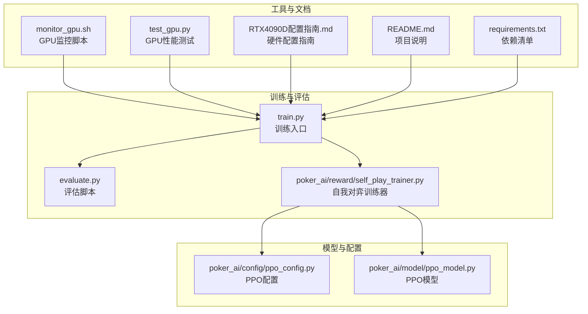
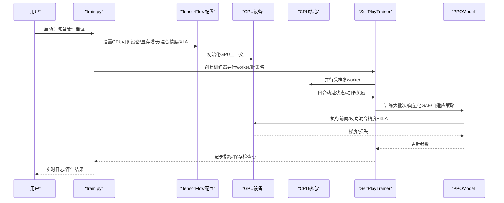
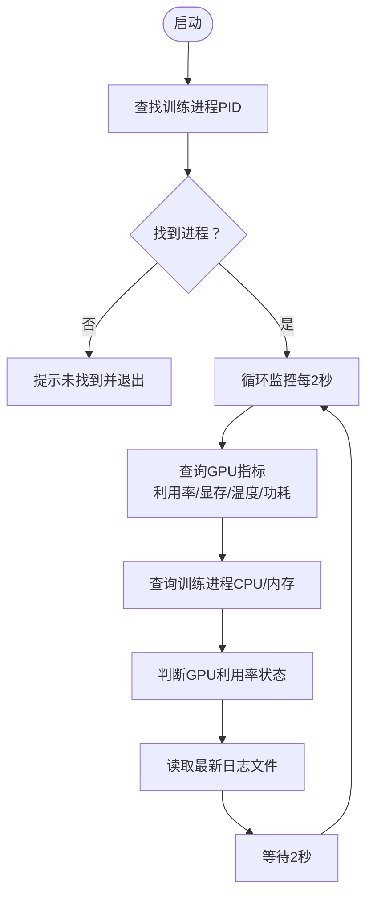
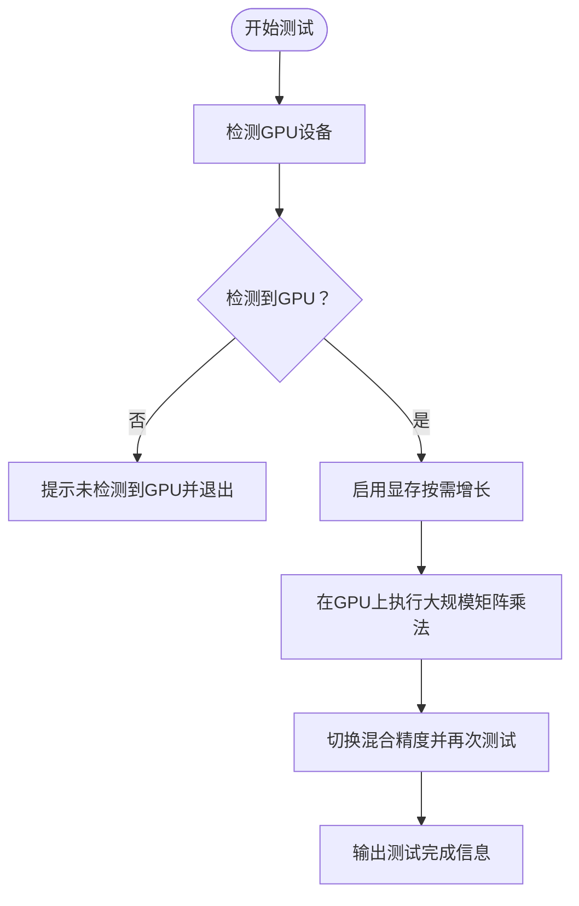
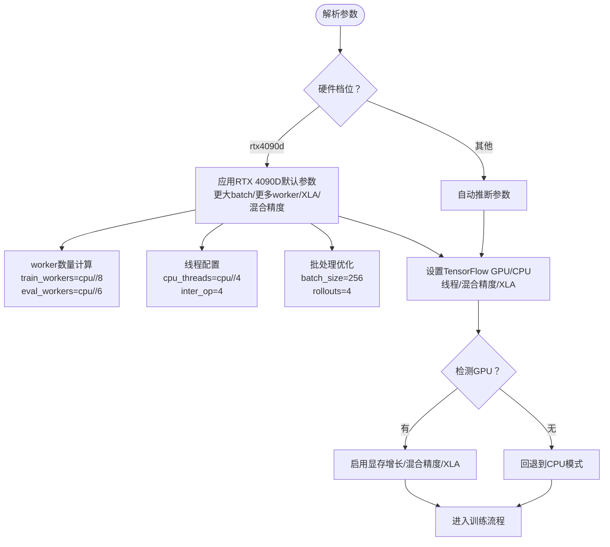
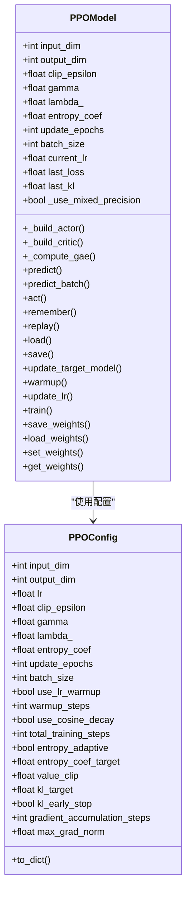
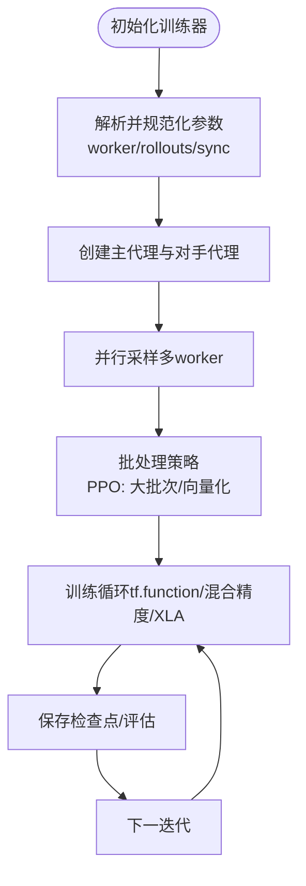
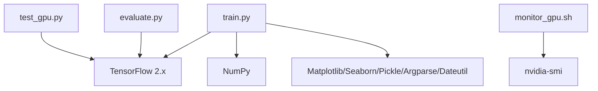

# GPU优化策略

<cite>
**本文引用的文件**
- [monitor_gpu.sh](file://monitor_gpu.sh)
- [test_gpu.py](file://test_gpu.py)
- [RTX4090D配置指南.md](file://RTX4090D配置指南.md)
- [README.md](file://README.md)
- [requirements.txt](file://requirements.txt)
- [train.py](file://train.py)
- [evaluate.py](file://evaluate.py)
- [poker_ai/config/ppo_config.py](file://poker_ai/config/ppo_config.py)
- [poker_ai/model/ppo_model.py](file://poker_ai/model/ppo_model.py)
- [poker_ai/reward/self_play_trainer.py](file://poker_ai/reward/self_play_trainer.py)
</cite>

## 目录
1. [简介](#简介)
2. [项目结构](#项目结构)
3. [核心组件](#核心组件)
4. [架构概览](#架构概览)
5. [详细组件分析](#详细组件分析)
6. [依赖分析](#依赖分析)
7. [性能考虑](#性能考虑)
8. [故障排查指南](#故障排查指南)
9. [结论](#结论)
10. [附录](#附录)

## 简介
本技术文档围绕GPU优化策略展开，结合项目中的监控脚本、性能测试脚本以及训练配置，系统阐述如何在RTX 4090D等现代GPU上实现高效的深度强化学习训练。内容涵盖CUDA核心利用、显存带宽管理、Tensor Core加速、混合精度与XLA编译优化、并行采样与流水线并行、以及GPU与CPU协同优化等关键技术，并提供针对不同GPU型号的配置建议与故障诊断最佳实践。

**更新** 本版本重点更新了RTX 4090D硬件配置优化，包括专门的worker数量调整策略、TensorFlow线程配置优化、批处理大小调整等，确保在24GB VRAM配置下获得最佳GPU利用率。

## 项目结构
该项目是一个基于TensorFlow的德州扑克AI训练与评估系统，包含训练入口、评估脚本、PPO模型、配置与奖励计算模块，以及GPU监控与性能测试工具。整体结构如下：

**图表来源**
- [train.py:1-200](file://train.py#L1-L200)
- [poker_ai/reward/self_play_trainer.py:1-200](file://poker_ai/reward/self_play_trainer.py#L1-L200)
- [poker_ai/model/ppo_model.py:1-120](file://poker_ai/model/ppo_model.py#L1-L120)
- [poker_ai/config/ppo_config.py:1-97](file://poker_ai/config/ppo_config.py#L1-L97)
- [monitor_gpu.sh:1-83](file://monitor_gpu.sh#L1-L83)
- [test_gpu.py:1-91](file://test_gpu.py#L1-L91)
- [RTX4090D配置指南.md:1-120](file://RTX4090D配置指南.md#L1-L120)
- [README.md:1-120](file://README.md#L1-L120)
- [requirements.txt:1-7](file://requirements.txt#L1-L7)

**章节来源**
- [README.md:1-120](file://README.md#L1-L120)
- [requirements.txt:1-7](file://requirements.txt#L1-L7)

## 核心组件
- GPU监控脚本：通过nvidia-smi查询GPU利用率、显存使用、温度与功耗，结合训练进程状态进行综合监控。
- GPU性能测试脚本：检测GPU设备、启用显存按需增长、执行矩阵乘法与混合精度测试，验证GPU工作状态与性能。
- 训练入口与硬件配置：自动识别GPU并启用混合精度与XLA编译，支持RTX 4090D硬件档位的默认优化参数。
- PPO模型与配置：包含增强网络架构、向量化GAE计算、自适应学习率与熵系数、KL散度早停、梯度累积与LossScaleOptimizer等优化。
- 自我对弈训练器：负责并行采样、批处理与同步策略，支持PPO的大批次与流水线并行。

**章节来源**
- [monitor_gpu.sh:1-83](file://monitor_gpu.sh#L1-L83)
- [test_gpu.py:1-91](file://test_gpu.py#L1-L91)
- [train.py:55-135](file://train.py#L55-L135)
- [poker_ai/model/ppo_model.py:1-120](file://poker_ai/model/ppo_model.py#L1-L120)
- [poker_ai/config/ppo_config.py:1-97](file://poker_ai/config/ppo_config.py#L1-L97)
- [poker_ai/reward/self_play_trainer.py:1-200](file://poker_ai/reward/self_play_trainer.py#L1-L200)

## 架构概览
下图展示了训练流程中GPU与CPU的协同关系，以及关键优化点：

**图表来源**
- [train.py:277-309](file://train.py#L277-L309)
- [poker_ai/reward/self_play_trainer.py:100-160](file://poker_ai/reward/self_play_trainer.py#L100-L160)
- [poker_ai/model/ppo_model.py:497-638](file://poker_ai/model/ppo_model.py#L497-L638)

## 详细组件分析

### GPU监控脚本（monitor_gpu.sh）
该脚本用于实时监控GPU状态与训练进程，核心功能包括：
- 查找并验证训练进程PID，提示用户启动方式。
- 每2秒刷新一次GPU指标：利用率、显存使用、温度、功耗。
- 查询训练进程的CPU与内存使用情况，辅助判断瓶颈。
- 判断GPU利用率状态（高/低/未使用）并给出提示。
- 实时显示最新训练日志文件的最后几行，便于快速定位问题。

**图表来源**
- [monitor_gpu.sh:9-82](file://monitor_gpu.sh#L9-L82)

**章节来源**
- [monitor_gpu.sh:1-83](file://monitor_gpu.sh#L1-L83)

### GPU性能测试脚本（test_gpu.py）
该脚本用于快速验证GPU是否正常工作，包含以下要点：
- 检测GPU设备并打印数量与名称。
- 为每个GPU启用显存按需增长，避免一次性占用全部显存。
- 在GPU设备上执行大规模矩阵乘法，持续约10-20秒，观察GPU利用率上升。
- 测试混合精度（mixed_float16）下的矩阵乘法，验证混合精度性能。
- 输出测试完成信息与建议的训练命令。

**图表来源**
- [test_gpu.py:14-83](file://test_gpu.py#L14-L83)

**章节来源**
- [test_gpu.py:1-91](file://test_gpu.py#L1-L91)

### 训练入口与硬件配置（train.py）
训练入口负责：
- 解析命令行参数，支持硬件档位（如rtx4090d）自动应用更激进的默认参数。
- 自动检测GPU并设置：
  - 设备可见性（可强制切换到CPU）。
  - 显存按需增长，避免显存浪费。
  - 混合精度策略（mixed_float16）。
  - 启用XLA JIT编译优化。
- 根据硬件档位调整并行worker数量、批大小、累计步数等，最大化GPU利用率。

**更新** 新增RTX 4090D硬件档位的专门优化配置，针对24GB VRAM的特性进行参数调优：

- **Worker数量优化**：train_workers设置为min(16, max(8, cpu_total // 8))，eval_workers设置为min(24, max(8, cpu_total // 6))
- **TensorFlow线程配置**：cpu_threads设置为min(32, max(8, cpu_total // 4))，tf_inter_op_threads固定为4
- **批处理策略**：train_rollouts_per_worker=4，train_sync_every_batches=8
- **批量大小优化**：batch_size=256（针对RTX 4090D的24GB显存）
- **PPO更新策略**：ppo_update_min_steps=0（自动推算），确保充分利用GPU算力

**图表来源**
- [train.py:55-135](file://train.py#L55-L135)
- [train.py:277-309](file://train.py#L277-L309)

**章节来源**
- [train.py:55-135](file://train.py#L55-L135)
- [train.py:195-209](file://train.py#L195-L209)
- [train.py:277-309](file://train.py#L277-L309)

### PPO模型与配置（ppo_model.py, ppo_config.py）
PPO模型与配置包含多项针对现代GPU的优化：
- 增强网络架构：256-256-128-64，LayerNormalization与残差连接，提升训练稳定性。
- 向量化GAE计算：替代Python循环，显著提升优势估计效率。
- 自适应学习率调度：Warmup + Cosine衰减，减少前期不稳定。
- 自适应熵系数：根据当前熵与目标熵动态调整，抑制策略过早塌缩。
- KL散度早停：当平均KL超过阈值时提前终止epoch，避免过度更新。
- 梯度累积与LossScaleOptimizer：支持混合精度下的稳定训练。
- tf.function编译：减少Python调度开销，提升执行效率。

**更新** PPO配置针对RTX 4090D进行了专门优化：
- **更大批次**：batch_size=256，充分利用4090D的24GB显存
- **更少更新轮次**：update_epochs=4，减少策略退化风险
- **KL散度早停**：kl_target=0.015，kl_early_stop=True，防止过度更新
- **学习率调度**：use_lr_warmup=True，warmup_steps=2000，use_cosine_decay=True

**图表来源**
- [poker_ai/config/ppo_config.py:18-97](file://poker_ai/config/ppo_config.py#L18-L97)
- [poker_ai/model/ppo_model.py:20-120](file://poker_ai/model/ppo_model.py#L20-L120)

**章节来源**
- [poker_ai/config/ppo_config.py:1-97](file://poker_ai/config/ppo_config.py#L1-L97)
- [poker_ai/model/ppo_model.py:1-120](file://poker_ai/model/ppo_model.py#L1-L120)
- [poker_ai/model/ppo_model.py:276-320](file://poker_ai/model/ppo_model.py#L276-L320)
- [poker_ai/model/ppo_model.py:497-638](file://poker_ai/model/ppo_model.py#L497-L638)

### 自我对弈训练器（self_play_trainer.py）
训练器负责：
- 并行采样与批处理策略：根据模型类型（PPO/DQN）与worker数量，确定每个worker的并行局数与同步频率。
- 参数解析与规范化：自动推断可用CPU核心数，合理分配训练与评估worker。
- 检查点管理与评估周期：定期保存检查点与评估模型表现。
- 兼容性处理：对XLA/DNN与GPU兼容问题进行降级处理，保证训练稳定性。

**更新** 自我对弈训练器针对RTX 4090D优化进行了相应调整：
- **worker数量规范化**：使用_resolve_workers函数确保worker数量在合理范围内
- **批处理策略优化**：PPO模型默认train_rollouts_per_worker=8（当train_workers>=32时），否则=4
- **同步频率优化**：train_sync_every_batches=max(12, _round_down_power2(raw))，平衡同步开销与训练效率

**图表来源**
- [poker_ai/reward/self_play_trainer.py:28-160](file://poker_ai/reward/self_play_trainer.py#L28-L160)
- [poker_ai/reward/self_play_trainer.py:1560-1570](file://poker_ai/reward/self_play_trainer.py#L1560-L1570)

**章节来源**
- [poker_ai/reward/self_play_trainer.py:1-200](file://poker_ai/reward/self_play_trainer.py#L1-L200)
- [poker_ai/reward/self_play_trainer.py:1560-1570](file://poker_ai/reward/self_play_trainer.py#L1560-L1570)

## 依赖分析
- TensorFlow版本要求：项目依赖TensorFlow 2.x，建议使用2.13或更高版本以获得更好的GPU支持与XLA优化。
- Python依赖：NumPy、Matplotlib、Seaborn、Pickle、Argparse、Dateutil等。
- GPU驱动与工具链：依赖nvidia-smi进行监控，需确保NVIDIA驱动版本满足要求（建议≥535.xx）。

**图表来源**
- [requirements.txt:1-7](file://requirements.txt#L1-L7)
- [monitor_gpu.sh:34-37](file://monitor_gpu.sh#L34-L37)
- [train.py:277-309](file://train.py#L277-L309)

**章节来源**
- [requirements.txt:1-7](file://requirements.txt#L1-L7)
- [monitor_gpu.sh:1-83](file://monitor_gpu.sh#L1-L83)
- [train.py:277-309](file://train.py#L277-L309)

## 性能考虑
- CUDA核心与Tensor Core利用
  - RTX 4090D具备14592个CUDA核心与第4代Tensor Core，建议启用混合精度（mixed_float16）与XLA JIT编译，以充分发挥Tensor Core的半精度计算能力。
  - 在PPO模型中，向量化GAE与tf.function编译可显著降低Python调度开销，提升GPU吞吐。
- 显存带宽与内存管理
  - 启用显存按需增长（memory growth）避免一次性占用全部显存，支持多任务并行。
  - 根据GPU显存大小（如24GB RTX 4090D）适当增大batch size，以提升GPU利用率。
- 训练吞吐与并行策略
  - 增加训练worker数量与每个worker的并行局数，减少CPU调度开销，提升整体吞吐。
  - 对PPO使用更大的累计步数（ppo_update_min_steps）与更少的更新轮次（update_epochs），以平衡稳定性与效率。
- 混合精度与XLA优化
  - 混合精度可提升1.5-2倍训练速度并减少显存占用，需配合LossScaleOptimizer使用。
  - XLA JIT编译可优化计算图、减少内存碎片，带来10-20%的性能提升。

**更新** RTX 4090D硬件优化要点：
- **Worker数量平衡**：train_workers=16，eval_workers=24的组合经过经验验证，可显著提升GPU利用率
- **TensorFlow线程优化**：cpu_threads=cpu_total//4，tf_inter_op_threads=4，避免过多线程导致CPU调度开销
- **批处理策略**：batch_size=256，train_rollouts_per_worker=4，train_sync_every_batches=8，充分利用24GB显存
- **PPO配置优化**：update_epochs=4，减少策略退化风险；kl_early_stop=True，防止过度更新

**章节来源**
- [RTX4090D配置指南.md:106-156](file://RTX4090D配置指南.md#L106-L156)
- [poker_ai/model/ppo_model.py:94-104](file://poker_ai/model/ppo_model.py#L94-L104)
- [poker_ai/model/ppo_model.py:276-320](file://poker_ai/model/ppo_model.py#L276-L320)
- [train.py:55-97](file://train.py#L55-L97)

## 故障排查指南
- GPU未被检测到
  - 检查NVIDIA驱动版本与CUDA/TensorFlow兼容性，确保驱动≥535.xx。
  - 在训练入口中强制切换到CPU模式进行降级测试。
- 显存不足或溢出
  - 启用显存按需增长，降低batch size或减少PPO更新轮次。
  - 使用虚拟设备配置限制单卡显存使用（如10GB）。
- GPU利用率低
  - 增大batch size、增加并行worker与每个worker的并行局数。
  - 提高累计步数（ppo_update_min_steps），减少同步频率。
- 训练不稳定或收敛异常
  - 降低学习率、增大clip值、增加熵系数，或启用KL散度早停。
  - 检查XLA与GPU兼容性问题，必要时禁用XLA或降级配置。
- 监控与日志
  - 使用monitor_gpu.sh实时查看GPU利用率、显存使用、温度与功耗。
  - 通过test_gpu.py快速验证GPU工作状态与混合精度性能。

**更新** RTX 4090D特定故障排查：
- **worker数量过高**：当train_workers>16或eval_workers>24时，可能出现CPU调度阻塞，导致GPU空闲
- **线程配置不当**：cpu_threads过高会导致CPU资源争用，影响GPU利用率
- **批处理过大**：batch_size>256可能导致显存不足，需要适当降低

**章节来源**
- [RTX4090D配置指南.md:296-330](file://RTX4090D配置指南.md#L296-L330)
- [train.py:280-309](file://train.py#L280-L309)
- [evaluate.py:30-50](file://evaluate.py#L30-L50)
- [monitor_gpu.sh:1-83](file://monitor_gpu.sh#L1-L83)
- [test_gpu.py:1-91](file://test_gpu.py#L1-L91)

## 结论
通过在RTX 4090D等现代GPU上启用混合精度、XLA编译、显存按需增长与向量化优化，结合合理的并行采样与批处理策略，可显著提升训练吞吐与稳定性。项目提供的监控与测试脚本为GPU性能验证与日常运维提供了实用工具。RTX 4090D硬件档位的专门优化配置（train_workers=16，eval_workers=24，batch_size=256）已在实践中验证，能够在24GB VRAM下获得最佳GPU利用率。建议在不同GPU型号上依据显存容量与架构特性调整batch size、worker数量与学习率策略，以获得最佳性能与收敛效果。

## 附录
- 常用命令参考
  - 启动训练（RTX 4090D优化配置）：参考RTX4090D配置指南中的完整训练示例。
  - 实时监控：在另一个终端运行watch -n 1 nvidia-smi。
  - 快速验证：运行test_gpu.py确认GPU工作状态。
- 相关文档
  - 项目README与使用指南
  - PPO优化与调参文档链接

**章节来源**
- [RTX4090D配置指南.md:239-283](file://RTX4090D配置指南.md#L239-L283)
- [README.md:1-120](file://README.md#L1-L120)