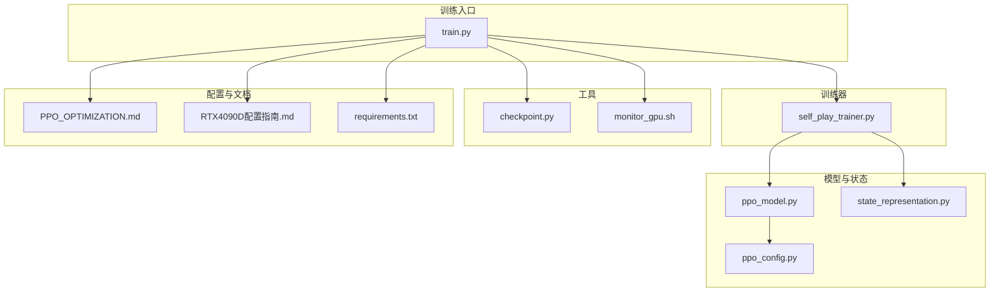
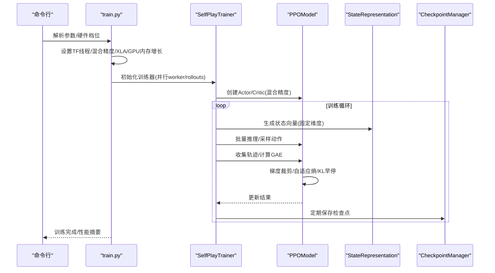
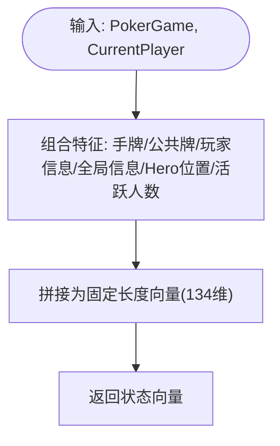
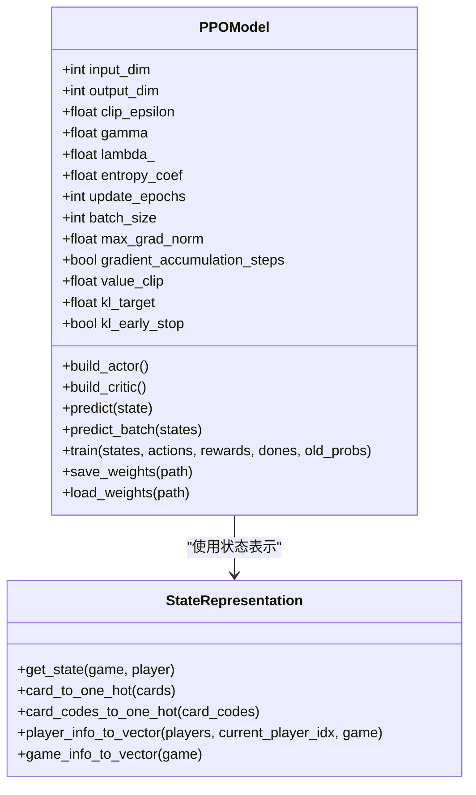
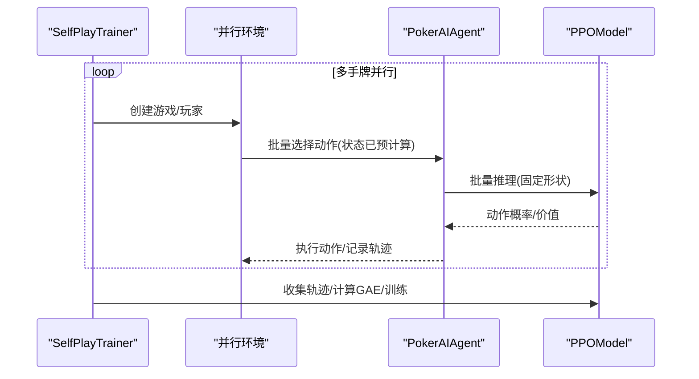
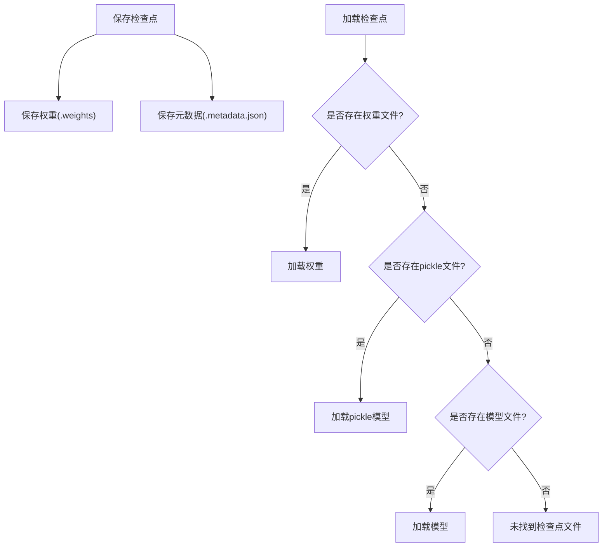
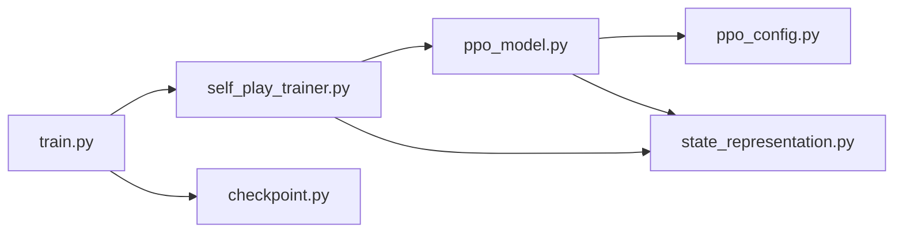

# 内存管理优化

<cite>
**本文引用的文件列表**
- [state_representation.py](file://poker_ai/model/state_representation.py)
- [checkpoint.py](file://poker_ai/utils/checkpoint.py)
- [train.py](file://train.py)
- [ppo_model.py](file://poker_ai/model/ppo_model.py)
- [self_play_trainer.py](file://poker_ai/reward/self_play_trainer.py)
- [ppo_config.py](file://poker_ai/config/ppo_config.py)
- [PPO_OPTIMIZATION.md](file://PPO_OPTIMIZATION.md)
- [RTX4090D配置指南.md](file://RTX4090D配置指南.md)
- [monitor_gpu.sh](file://monitor_gpu.sh)
- [requirements.txt](file://requirements.txt)
</cite>

## 目录
1. [简介](#简介)
2. [项目结构](#项目结构)
3. [核心组件](#核心组件)
4. [架构总览](#架构总览)
5. [详细组件分析](#详细组件分析)
6. [依赖关系分析](#依赖关系分析)
7. [性能考量](#性能考量)
8. [故障排查指南](#故障排查指南)
9. [结论](#结论)
10. [附录](#附录)

## 简介
本技术文档聚焦于深度学习训练中的内存管理优化，结合代码库现状，系统阐述以下主题：
- 模型权重存储与检查点管理的内存优化策略（增量检查点、内存映射、压缩）
- 状态向量内存布局与优化（StateRepresentation）
- 批处理与梯度内存管理（PPO模型、SelfPlayTrainer）
- 内存泄漏检测与预防（监控、峰值分析、碎片化处理）
- 不同硬件配置下的差异化优化（大显存 vs 小显存）
- 内存性能监控工具与调试技巧

## 项目结构
该项目围绕德州扑克AI训练展开，核心模块包括：
- 模型与状态表示：PPO模型、状态向量表示
- 训练与评估：自我对弈训练器、训练入口脚本
- 工具与配置：检查点工具、PPO配置、GPU监控脚本

图表来源
- [train.py:1-856](file://train.py#L1-L856)
- [self_play_trainer.py:1-1604](file://poker_ai/reward/self_play_trainer.py#L1-L1604)
- [ppo_model.py:1-670](file://poker_ai/model/ppo_model.py#L1-L670)
- [state_representation.py:1-247](file://poker_ai/model/state_representation.py#L1-L247)
- [ppo_config.py:1-97](file://poker_ai/config/ppo_config.py#L1-L97)
- [checkpoint.py:1-139](file://poker_ai/utils/checkpoint.py#L1-L139)
- [PPO_OPTIMIZATION.md:1-219](file://PPO_OPTIMIZATION.md#L1-L219)
- [RTX4090D配置指南.md:1-366](file://RTX4090D配置指南.md#L1-L366)
- [monitor_gpu.sh:1-83](file://monitor_gpu.sh#L1-L83)
- [requirements.txt:1-7](file://requirements.txt#L1-L7)

章节来源
- [train.py:1-856](file://train.py#L1-L856)
- [self_play_trainer.py:1-1604](file://poker_ai/reward/self_play_trainer.py#L1-L1604)
- [ppo_model.py:1-670](file://poker_ai/model/ppo_model.py#L1-L670)
- [state_representation.py:1-247](file://poker_ai/model/state_representation.py#L1-L247)
- [ppo_config.py:1-97](file://poker_ai/config/ppo_config.py#L1-L97)
- [checkpoint.py:1-139](file://poker_ai/utils/checkpoint.py#L1-L139)
- [PPO_OPTIMIZATION.md:1-219](file://PPO_OPTIMIZATION.md#L1-L219)
- [RTX4090D配置指南.md:1-366](file://RTX4090D配置指南.md#L1-L366)
- [monitor_gpu.sh:1-83](file://monitor_gpu.sh#L1-L83)
- [requirements.txt:1-7](file://requirements.txt#L1-L7)

## 核心组件
- 状态表示器（StateRepresentation）：负责将德州扑克状态转换为紧凑的向量表示，包含手牌、公共牌、玩家信息、游戏全局信息、Hero绝对位置与活跃人数等特征，维度固定，便于内存复用与批处理。
- PPO模型（PPOModel）：包含Actor/Critic双网络，支持混合精度、XLA、梯度累积、自适应熵系数、KL早停、价值损失裁剪等优化，训练时通过固定batch形状与向量化GAE减少retracing与内存碎片。
- 自我对弈训练器（SelfPlayTrainer）：负责并行采样、轨迹收集、批量推理、检查点保存与加载、评估与监控，支持不同硬件档位的参数自动配置。
- 检查点工具（CheckpointManager）：提供权重/模型/元数据保存与加载，支持TensorFlow权重、pickle模型与通用模型三种加载路径。

章节来源
- [state_representation.py:9-247](file://poker_ai/model/state_representation.py#L9-L247)
- [ppo_model.py:20-670](file://poker_ai/model/ppo_model.py#L20-L670)
- [self_play_trainer.py:48-800](file://poker_ai/reward/self_play_trainer.py#L48-L800)
- [checkpoint.py:17-139](file://poker_ai/utils/checkpoint.py#L17-L139)

## 架构总览
训练流程从train.py入口进入，根据硬件档位自动配置并行与精度策略，随后创建SelfPlayTrainer，内部通过PPOModel进行策略与价值网络的训练，状态向量由StateRepresentation生成，训练过程中的中间结果与轨迹通过CheckpointManager进行持久化。

图表来源
- [train.py:240-531](file://train.py#L240-L531)
- [self_play_trainer.py:48-800](file://poker_ai/reward/self_play_trainer.py#L48-L800)
- [ppo_model.py:106-638](file://poker_ai/model/ppo_model.py#L106-L638)
- [state_representation.py:137-158](file://poker_ai/model/state_representation.py#L137-L158)
- [checkpoint.py:17-104](file://poker_ai/utils/checkpoint.py#L17-L104)

## 详细组件分析

### 状态向量内存布局与优化（StateRepresentation）
- 维度设计：手牌52维、公共牌52维、6人玩家信息18维、游戏全局信息5维、Hero绝对位置6维、活跃人数1维，合计134维，固定长度便于批处理与内存复用。
- One-Hot编码：使用整数编码直接映射到52维向量，避免频繁对象解包与列表索引，显著降低Python层开销。
- 相对位置与归一化：玩家信息按Hero顺时针排列，堆叠时保持固定偏移，便于快速定位自身信息；特征进行归一化，减少数值范围差异带来的内存与数值稳定性问题。
- 预计算映射：花色与点数索引映射表在初始化时建立，避免在高频路径中重复构建字典，降低CPU与内存分配压力。
- 新增特征：Hero绝对位置与活跃人数特征，增强状态表达能力，同时保持维度固定，利于向量化与批处理。

图表来源
- [state_representation.py:137-158](file://poker_ai/model/state_representation.py#L137-L158)
- [state_representation.py:47-64](file://poker_ai/model/state_representation.py#L47-L64)
- [state_representation.py:66-97](file://poker_ai/model/state_representation.py#L66-L97)
- [state_representation.py:99-135](file://poker_ai/model/state_representation.py#L99-L135)

章节来源
- [state_representation.py:9-247](file://poker_ai/model/state_representation.py#L9-L247)

### PPO模型内存优化与梯度管理
- 混合精度与LossScaleOptimizer：在混合精度环境下，使用LossScaleOptimizer适配损失缩放，避免梯度下溢，同时减少显存占用。
- tf.function与retracing规避：通过预热与固定batch形状调用，减少函数重编译警告与图重追踪，降低内存碎片与CPU开销。
- 固定batch形状与padding：在不足一整批时对齐到固定形状，避免可变形状触发retracing，同时减少多次小张量分配。
- 向量化GAE：使用NumPy向量化实现GAE，避免Python循环，显著降低内存分配与CPU调度开销。
- 价值损失裁剪：基于旧价值进行裁剪，避免更新幅度过大导致的内存与数值不稳定。
- 自适应熵系数：根据当前熵动态调整，避免策略过早塌缩，减少无效探索带来的内存浪费。
- 梯度累积：支持梯度累积模拟更大batch，降低显存峰值，适合小显存GPU。
- KL散度早停：当平均KL超过阈值时提前终止epoch，避免无效更新与内存浪费。

图表来源
- [ppo_model.py:20-670](file://poker_ai/model/ppo_model.py#L20-L670)
- [state_representation.py:9-247](file://poker_ai/model/state_representation.py#L9-L247)

章节来源
- [ppo_model.py:20-670](file://poker_ai/model/ppo_model.py#L20-L670)
- [PPO_OPTIMIZATION.md:1-219](file://PPO_OPTIMIZATION.md#L1-L219)

### 自我对弈训练器的内存与批处理优化
- 并行采样与批量推理：支持每个worker产生多手牌（train_rollouts_per_worker），并通过批量推理减少Python与TF往返开销。
- 轨迹收集与状态复用：PPO轨迹（states/actions/old_probs）在内存中连续存储，避免频繁小张量分配。
- 固定形状批处理：在不足一整批时进行padding，保证形状一致，减少retracing与碎片化。
- 检查点策略：定期保存检查点，支持从最近检查点恢复训练，避免长时间训练中断导致的内存与时间损失。
- 硬件档位自动配置：根据RTX4090D/RTX3090等硬件档位自动调整并行worker、batch size、XLA与混合精度等参数，平衡吞吐与显存占用。

图表来源
- [self_play_trainer.py:587-800](file://poker_ai/reward/self_play_trainer.py#L587-L800)
- [ppo_model.py:472-495](file://poker_ai/model/ppo_model.py#L472-L495)

章节来源
- [self_play_trainer.py:48-800](file://poker_ai/reward/self_play_trainer.py#L48-L800)
- [train.py:55-135](file://train.py#L55-L135)

### 检查点管理的内存优化策略
- 多格式兼容：支持TensorFlow权重、通用模型（pickle）与模型保存三种方式，便于在不同框架间迁移。
- 元数据与时间戳：保存训练元数据与时间戳，便于快速定位最新检查点，减少IO与解析开销。
- 增量检查点：通过定期保存与元数据时间戳，形成增量式检查点链，便于快速恢复与回溯。
- 内存映射与压缩：当前实现未直接使用内存映射与压缩，可在未来扩展为大模型权重的延迟加载与压缩存储，进一步降低内存峰值。

图表来源
- [checkpoint.py:17-104](file://poker_ai/utils/checkpoint.py#L17-L104)

章节来源
- [checkpoint.py:17-139](file://poker_ai/utils/checkpoint.py#L17-L139)

## 依赖关系分析
- train.py依赖SelfPlayTrainer与CheckpointManager，负责环境初始化、并行参数与硬件档位配置。
- SelfPlayTrainer依赖PPOModel与StateRepresentation，负责并行采样、轨迹收集与训练。
- PPOModel依赖StateRepresentation与PPOConfig，负责网络构建、训练与权重保存。
- checkpoint.py独立提供检查点保存/加载能力，被训练器与评估器复用。

图表来源
- [train.py:350-531](file://train.py#L350-L531)
- [self_play_trainer.py:167-213](file://poker_ai/reward/self_play_trainer.py#L167-L213)
- [ppo_model.py:20-93](file://poker_ai/model/ppo_model.py#L20-L93)
- [state_representation.py:9-41](file://poker_ai/model/state_representation.py#L9-L41)
- [checkpoint.py:17-56](file://poker_ai/utils/checkpoint.py#L17-L56)

章节来源
- [train.py:350-531](file://train.py#L350-L531)
- [self_play_trainer.py:167-213](file://poker_ai/reward/self_play_trainer.py#L167-L213)
- [ppo_model.py:20-93](file://poker_ai/model/ppo_model.py#L20-L93)
- [state_representation.py:9-41](file://poker_ai/model/state_representation.py#L9-L41)
- [checkpoint.py:17-56](file://poker_ai/utils/checkpoint.py#L17-L56)

## 性能考量
- 混合精度与XLA：在RTX4090D上默认启用混合精度与XLA，显著降低显存占用与提升吞吐，适合大batch训练。
- 批大小与并行：根据硬件能力自动调整train_workers、eval_workers与batch_size，平衡GPU利用率与内存占用。
- GAE向量化：向量化实现GAE，避免Python循环，减少内存分配与CPU调度开销。
- 固定形状批处理：通过padding与固定形状调用，减少retracing与内存碎片。
- 梯度累积：在小显存GPU上通过梯度累积模拟大batch，降低显存峰值。
- 硬件档位配置：RTX4090D提供标准/高性能/快速验证三套配置，覆盖不同规模训练需求。

章节来源
- [RTX4090D配置指南.md:14-366](file://RTX4090D配置指南.md#L14-L366)
- [train.py:55-135](file://train.py#L55-L135)
- [ppo_model.py:276-320](file://poker_ai/model/ppo_model.py#L276-L320)

## 故障排查指南
- 显存不足：降低batch size、减少并行worker、启用梯度累积、关闭不必要的日志与调试输出。
- GPU利用率低：增大batch size、增加并行worker、提升每个worker的并行局数、增加累计步数。
- 训练不稳定：降低学习率、增大clip值、增加价值裁剪、增加熵系数。
- 检查点加载失败：确认权重文件存在、检查元数据时间戳、清理损坏的检查点文件。
- 内存泄漏：使用监控脚本观察显存与内存趋势，定位异常增长阶段；减少不必要的中间变量与大张量常驻内存。

章节来源
- [RTX4090D配置指南.md:177-221](file://RTX4090D配置指南.md#L177-L221)
- [monitor_gpu.sh:1-83](file://monitor_gpu.sh#L1-L83)
- [checkpoint.py:58-104](file://poker_ai/utils/checkpoint.py#L58-L104)

## 结论
本项目在状态表示、PPO模型与训练器层面实现了多项内存优化：固定维度的状态向量、向量化GAE、固定形状批处理、混合精度与XLA、梯度累积与KL早停等，有效降低了显存峰值与内存碎片，提升了训练稳定性与吞吐。配合硬件档位自动配置与检查点管理，能够在不同硬件条件下实现高效训练。未来可进一步引入内存映射与压缩存储，以支持更大模型与更长训练周期。

## 附录
- 内存监控脚本：使用GPU监控脚本实时观察GPU利用率、显存使用、温度与功耗，结合训练日志定位瓶颈。
- 环境要求：确保TensorFlow版本与驱动满足RTX4090D配置指南建议，避免初始化失败与性能退化。

章节来源
- [monitor_gpu.sh:1-83](file://monitor_gpu.sh#L1-L83)
- [RTX4090D配置指南.md:296-346](file://RTX4090D配置指南.md#L296-L346)
- [requirements.txt:1-7](file://requirements.txt#L1-L7)