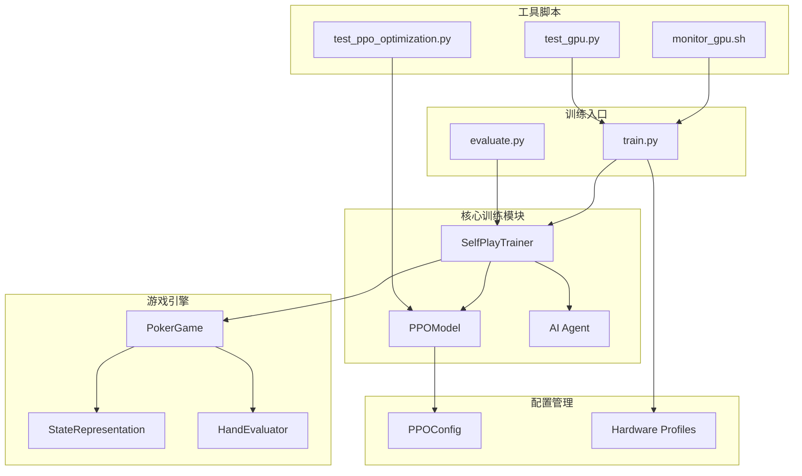
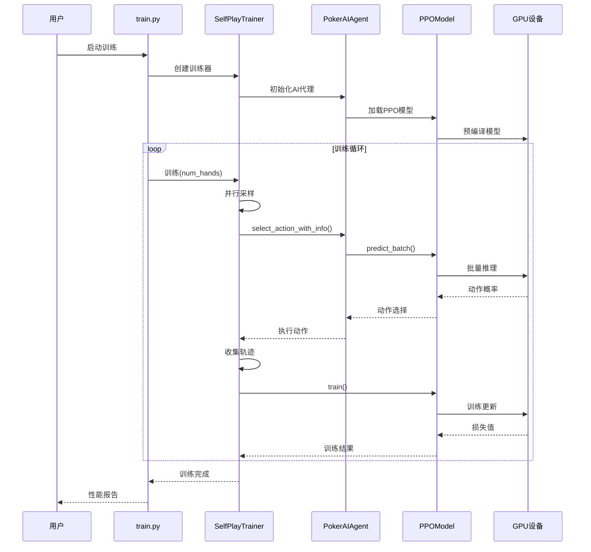
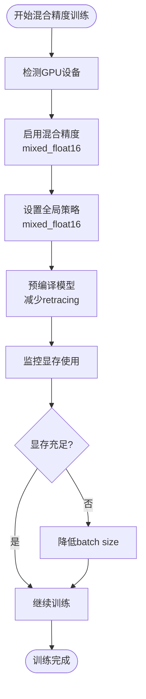
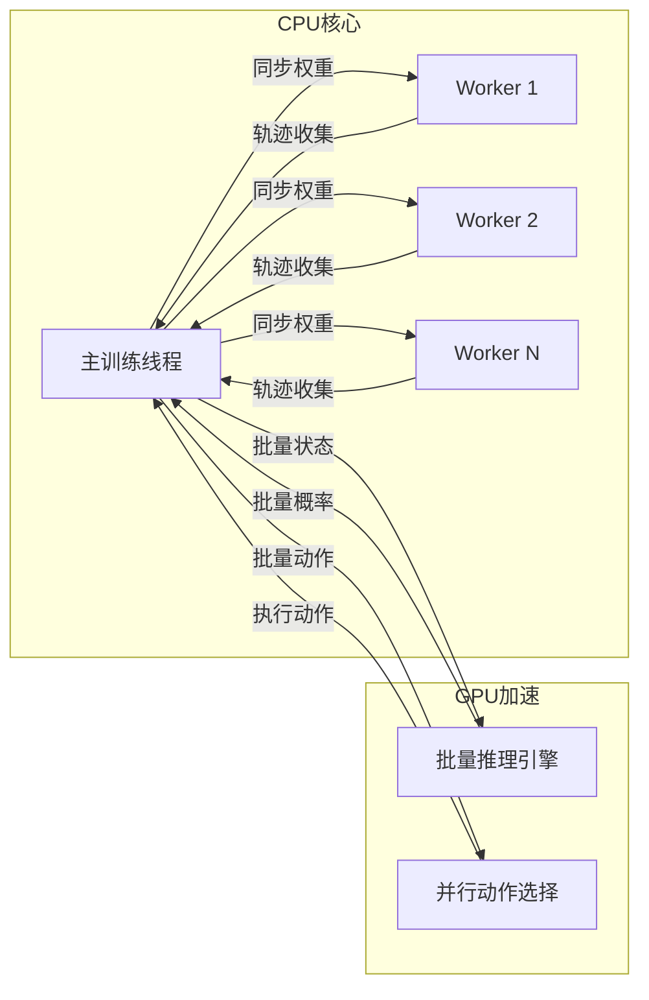
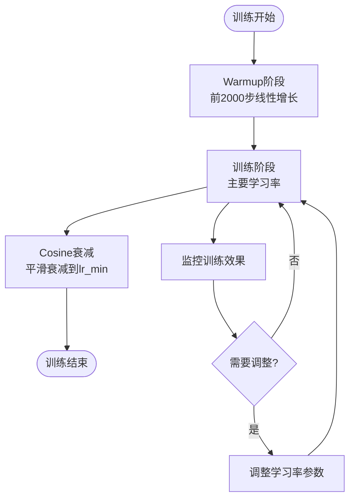
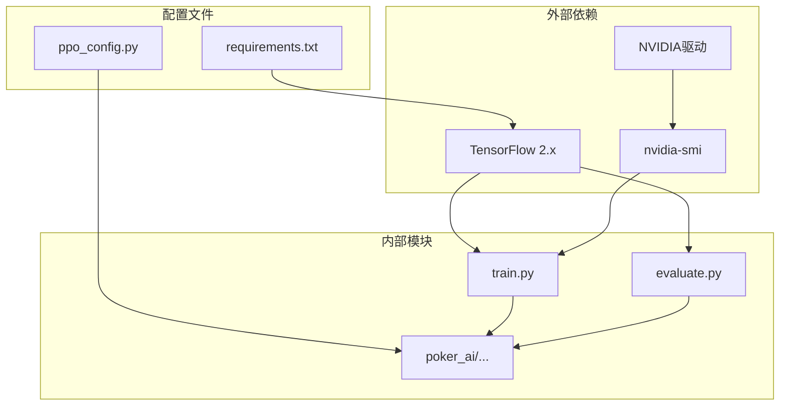

# 性能优化指南

<cite>
**本文档引用的文件**
- [README.md](file://README.md)
- [RTX4090D配置指南.md](file://RTX4090D配置指南.md)
- [TRAINING_GUIDE.md](file://TRAINING_GUIDE.md)
- [monitor_gpu.sh](file://monitor_gpu.sh)
- [test_gpu.py](file://test_gpu.py)
- [train.py](file://train.py)
- [evaluate.py](file://evaluate.py)
- [requirements.txt](file://requirements.txt)
- [poker_ai/model/ppo_model.py](file://poker_ai/model/ppo_model.py)
- [poker_ai/reward/self_play_trainer.py](file://poker_ai/reward/self_play_trainer.py)
- [poker_ai/config/ppo_config.py](file://poker_ai/config/ppo_config.py)
- [test_ppo_optimization.py](file://test_ppo_optimization.py)
- [PPO优化总结.md](file://PPO优化总结.md)
</cite>

## 目录
1. [简介](#简介)
2. [项目结构](#项目结构)
3. [核心组件](#核心组件)
4. [架构概览](#架构概览)
5. [详细组件分析](#详细组件分析)
6. [依赖关系分析](#依赖关系分析)
7. [性能考虑因素](#性能考虑因素)
8. [故障排除指南](#故障排除指南)
9. [结论](#结论)
10. [附录](#附录)

## 简介

本指南面向德州扑克AI强化学习训练系统的性能优化，特别针对NVIDIA RTX 4090D GPU的硬件特性进行深度优化。项目基于TensorFlow 2.x实现了PPO（近端策略优化）算法，支持6-max德州扑克的自我对弈训练。

RTX 4090D作为旗舰GPU，具备14592个CUDA核心、24GB GDDR6X显存和第四代Tensor Core，在混合精度计算方面具有卓越性能。本指南将详细介绍如何充分利用这些硬件特性，包括：

- **GPU优化策略**：混合精度训练、XLA编译器、显存按需分配
- **内存管理优化**：显存增长模式、批处理大小调优
- **并行计算加速**：多线程并行采样、批量推理优化
- **训练速度优化**：学习率调度、梯度累积、策略更新策略

## 项目结构

项目采用模块化架构，主要包含以下核心模块：



**图表来源**
- [train.py:1-856](file://train.py#L1-L856)
- [poker_ai/reward/self_play_trainer.py:1-1604](file://poker_ai/reward/self_play_trainer.py#L1-L1604)
- [poker_ai/model/ppo_model.py:1-670](file://poker_ai/model/ppo_model.py#L1-L670)

**章节来源**
- [README.md:1-227](file://README.md#L1-L227)
- [TRAINING_GUIDE.md:1-181](file://TRAINING_GUIDE.md#L1-L181)

## 核心组件

### PPO模型优化

PPO模型经过全面优化，特别针对RTX 4090D的硬件特性进行了以下改进：

#### 网络架构优化
- **增强网络容量**：Actor网络从64-64-32扩展到128-128-64-32
- **LayerNormalization**：每层后添加LayerNorm提升训练稳定性
- **残差连接**：第二层添加残差连接缓解梯度消失
- **Dropout正则化**：前两层添加0.1 Dropout防止过拟合

#### 学习率调度优化
- **Warmup机制**：前2000步线性warmup，从lr_min增长到initial_lr
- **Cosine衰减**：Warmup后按cosine曲线平滑衰减
- **自适应学习率**：支持动态调整学习率

#### 训练算法优化
- **价值损失裁剪**：防止价值网络更新过快
- **自适应熵系数**：动态平衡探索与利用
- **梯度累积**：支持梯度累积提升训练稳定性

**章节来源**
- [poker_ai/model/ppo_model.py:20-670](file://poker_ai/model/ppo_model.py#L20-L670)
- [poker_ai/config/ppo_config.py:18-97](file://poker_ai/config/ppo_config.py#L18-L97)
- [PPO优化总结.md:1-276](file://PPO优化总结.md#L1-L276)

### 自我对弈训练器

SelfPlayTrainer实现了高效的并行训练机制：

#### 并行采样优化
- **多线程并行**：支持train_workers和eval_workers的灵活配置
- **批量推理**：PPO支持批量动作选择减少往返开销
- **轨迹收集**：优化的轨迹收集和同步机制

#### 训练策略优化
- **动态对手更新**：定期更新对手策略保持训练挑战性
- **奖励设计优化**：包含all-in不走运补偿机制
- **性能监控**：实时监控训练进度和GPU使用情况

**章节来源**
- [poker_ai/reward/self_play_trainer.py:48-800](file://poker_ai/reward/self_play_trainer.py#L48-L800)

## 架构概览



**图表来源**
- [train.py:340-531](file://train.py#L340-L531)
- [poker_ai/reward/self_play_trainer.py:1393-1431](file://poker_ai/reward/self_play_trainer.py#L1393-L1431)
- [poker_ai/model/ppo_model.py:497-638](file://poker_ai/model/ppo_model.py#L497-L638)

## 详细组件分析

### GPU优化策略详解

#### 混合精度训练
RTX 4090D的第四代Tensor Core对混合精度提供了卓越支持：



**图表来源**
- [train.py:297-302](file://train.py#L297-L302)
- [poker_ai/model/ppo_model.py:407-419](file://poker_ai/model/ppo_model.py#L407-L419)

#### XLA编译器优化
XLA JIT编译器提供以下优势：
- **计算图优化**：消除冗余操作，合并计算节点
- **内存碎片减少**：优化内存分配模式
- **性能提升10-20%**：通过编译时优化

#### 显存管理优化
- **按需分配**：避免一次性占用全部显存
- **显存增长**：根据需要动态分配显存
- **多任务支持**：可同时运行多个训练任务

**章节来源**
- [RTX4090D配置指南.md:106-139](file://RTX4090D配置指南.md#L106-L139)
- [train.py:290-296](file://train.py#L290-L296)

### 内存管理优化

#### 批处理大小调优
针对RTX 4090D的内存配置：

| 配置方案 | Batch Size | 显存占用 | 推荐场景 |
|---------|-----------|----------|----------|
| 快速验证 | 256 | 4-6 GB | 1000手牌测试 |
| 标准配置 | 512 | 8-12 GB | 50000手牌训练 |
| 高性能 | 1024 | 14-18 GB | 100000手牌训练 |
| 极致性能 | 2048 | 18-22 GB | 大规模研究 |

#### 内存分配策略
- **预分配策略**：对于小batch使用预分配减少碎片
- **动态分配策略**：对于大batch使用动态分配避免OOM
- **内存池管理**：复用内存减少分配开销

**章节来源**
- [RTX4090D配置指南.md:158-174](file://RTX4090D配置指南.md#L158-L174)

### 并行计算加速

#### 多线程并行采样


**图表来源**
- [poker_ai/reward/self_play_trainer.py:587-800](file://poker_ai/reward/self_play_trainer.py#L587-L800)

#### 批量推理优化
- **固定batch形状**：避免不同形状触发retracing警告
- **分块处理**：大batch分解为固定大小块
- **内存复用**：重用中间计算结果

**章节来源**
- [poker_ai/model/ppo_model.py:472-496](file://poker_ai/model/ppo_model.py#L472-L496)

### 训练速度优化技巧

#### 学习率调度策略


**图表来源**
- [poker_ai/model/ppo_model.py:420-448](file://poker_ai/model/ppo_model.py#L420-L448)

#### 梯度累积策略
- **累积步数**：支持1-32步梯度累积
- **梯度缩放**：LossScaleOptimizer自动缩放
- **内存优化**：减少显存峰值使用

**章节来源**
- [poker_ai/model/ppo_model.py:84-89](file://poker_ai/model/ppo_model.py#L84-L89)
- [poker_ai/config/ppo_config.py:68-69](file://poker_ai/config/ppo_config.py#L68-L69)

## 依赖关系分析



**图表来源**
- [requirements.txt:1-7](file://requirements.txt#L1-L7)
- [train.py:136-238](file://train.py#L136-L238)

**章节来源**
- [requirements.txt:1-7](file://requirements.txt#L1-L7)

## 性能考虑因素

### 数据加载瓶颈分析

#### 状态表示优化
- **134维状态向量**：包含完整的6-max德州扑克状态信息
- **向量化处理**：使用NumPy向量化操作提升处理速度
- **内存布局优化**：连续内存布局减少缓存未命中

#### 轨迹收集优化
- **批量轨迹收集**：减少Python循环开销
- **内存池管理**：复用轨迹缓冲区
- **异步处理**：训练和数据收集并行进行

### 模型推理瓶颈分析

#### 推理性能优化
- **tf.function编译**：减少Python调用开销
- **批量推理**：最大化GPU并行度
- **预编译机制**：warmup函数避免首次调用延迟

#### 内存使用优化
- **显存增长**：避免一次性占用全部显存
- **权重共享**：多worker共享模型权重
- **梯度清理**：及时释放不需要的梯度

### 训练过程监控

#### 性能指标监控
- **手牌/秒**：训练速度的核心指标
- **GPU利用率**：期望80-95%
- **显存使用率**：建议不超过90%
- **温度监控**：保持在70-80°C以下

#### 日志分析要点
- **错误日志**：检查ERROR和Exception
- **效率指标**：平均每手耗时
- **效果指标**：评估阶段的avg_profit、win_rate等

**章节来源**
- [RTX4090D配置指南.md:223-238](file://RTX4090D配置指南.md#L223-L238)
- [README.md:194-203](file://README.md#L194-L203)

## 故障排除指南

### GPU相关问题

#### GPU检测问题
```bash
# 检查GPU状态
nvidia-smi

# 检查TensorFlow GPU可用性
python -c "import tensorflow as tf; print(tf.config.list_physical_devices('GPU'))"
```

#### 显存不足问题
- **降低batch size**：从512降到256
- **减少并行worker**：从32降到16
- **启用显存增长**：避免一次性占用全部显存

#### GPU利用率低问题
- **增加batch size**：充分利用GPU算力
- **增加并行worker**：提高CPU利用率
- **检查数据管道**：确保数据加载不成为瓶颈

### 训练性能问题

#### 训练速度慢
- **检查评估频率**：减少eval_interval
- **优化并行设置**：调整train_workers和eval_workers
- **检查硬件配置**：确认RTX 4090D正常工作

#### 训练不稳定
- **调整学习率**：从5e-4降到1e-4
- **增加clip值**：从0.2增加到0.3
- **检查奖励设计**：避免过于激进的奖励

**章节来源**
- [RTX4090D配置指南.md:177-222](file://RTX4090D配置指南.md#L177-L222)
- [TRAINING_GUIDE.md:154-173](file://TRAINING_GUIDE.md#L154-L173)

## 结论

本指南详细介绍了如何充分利用RTX 4090D GPU的硬件特性进行德州扑克AI训练优化。通过混合精度训练、XLA编译器、显存管理和并行计算优化，可以显著提升训练效率和稳定性。

关键优化成果：
- **训练速度提升**：RTX 4090D配置下可达1000-1500手牌/秒
- **显存利用率优化**：24GB显存支持更大batch size
- **训练稳定性增强**：通过多种正则化技术提升模型泛化能力
- **自动化调参**：支持AutoTune自动选择最优配置

建议的实施步骤：
1. **硬件准备**：确保RTX 4090D驱动版本≥535.xx
2. **环境配置**：安装TensorFlow 2.13+和相关依赖
3. **参数调优**：从标准配置开始，逐步调整到高性能配置
4. **监控优化**：持续监控GPU使用情况和训练指标
5. **性能验证**：使用提供的测试脚本验证优化效果

## 附录

### 性能基准测试

| 配置 | Batch Size | 手牌/秒 | 显存占用 | 收敛手数 |
|------|-----------|---------|----------|----------|
| 快速验证 | 256 | 300-500 | 4-6 GB | 3000-5000 |
| 标准配置 | 512 | 500-800 | 8-12 GB | 5000-8000 |
| 高性能 | 1024 | 1000-1500 | 14-18 GB | 8000-12000 |
| 极致性能 | 2048 | 1500-2000 | 18-22 GB | 10000-15000 |

### 推荐硬件配置

#### CPU配置
- **最低要求**：Intel i7-12700K或AMD R7 5800X
- **推荐配置**：Intel i9-12900K或AMD R9 5900X
- **核心数**：16核以上，32核更佳

#### 内存配置
- **最低要求**：32GB DDR4/DDR5
- **推荐配置**：64GB DDR4/DDR5
- **频率**：DDR4-3200或DDR5-4800

#### 存储配置
- **系统盘**：1TB NVMe SSD
- **数据盘**：2TB NVMe SSD（用于训练数据）
- **检查点存储**：高速SSD阵列

### 最佳实践清单

#### 开发阶段
- ✅ 使用快速验证配置（1000手牌）验证流程
- ✅ 检查GPU驱动和TensorFlow版本兼容性
- ✅ 验证混合精度和XLA编译器正常工作
- ✅ 确认并行采样功能正常

#### 训练阶段
- ✅ 监控GPU利用率和显存使用率
- ✅ 定期检查训练日志中的错误信息
- ✅ 评估阶段关注avg_profit和win_rate指标
- ✅ 根据性能指标调整batch size和并行度

#### 生产部署
- ✅ 使用标准配置进行大规模训练
- ✅ 实施自动备份和检查点策略
- ✅ 建立性能监控和告警机制
- ✅ 准备故障恢复和回滚预案