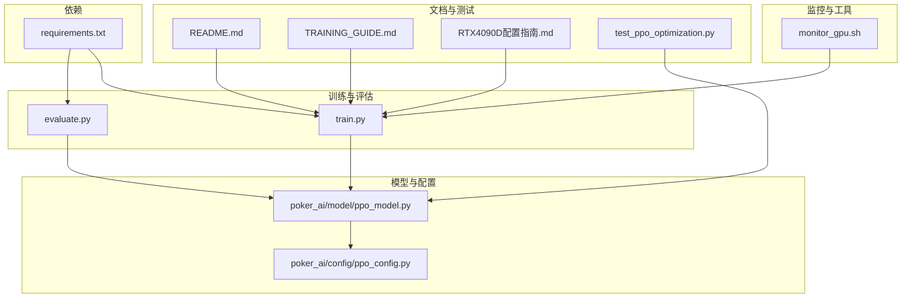
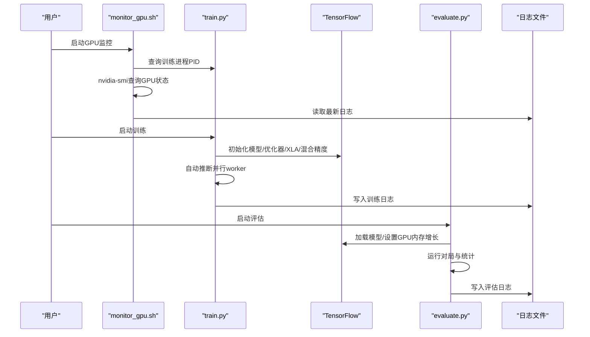
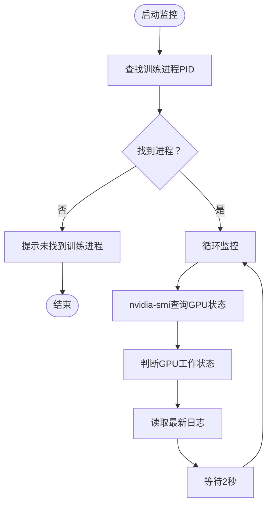
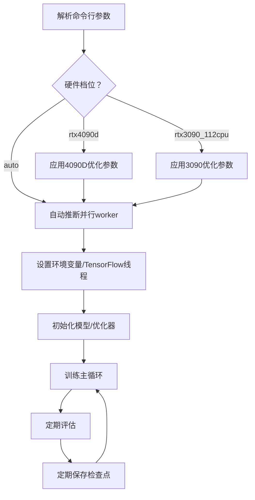
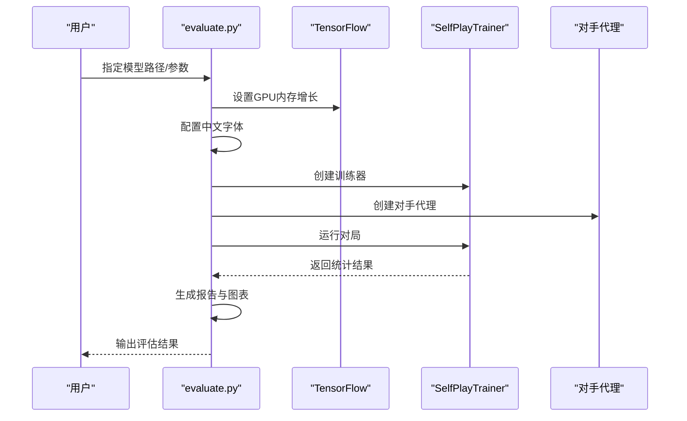
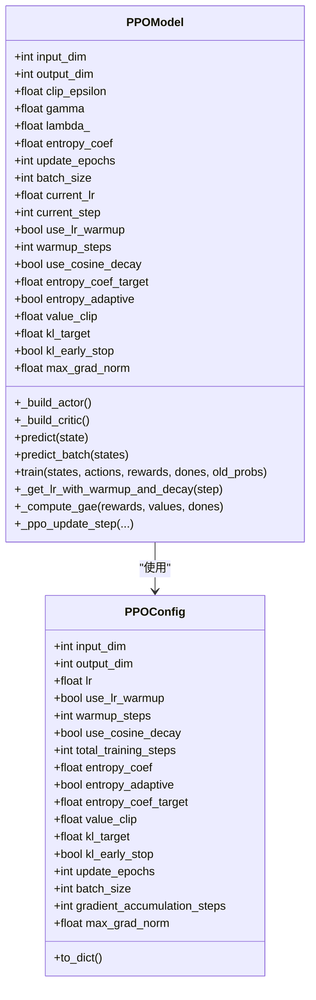
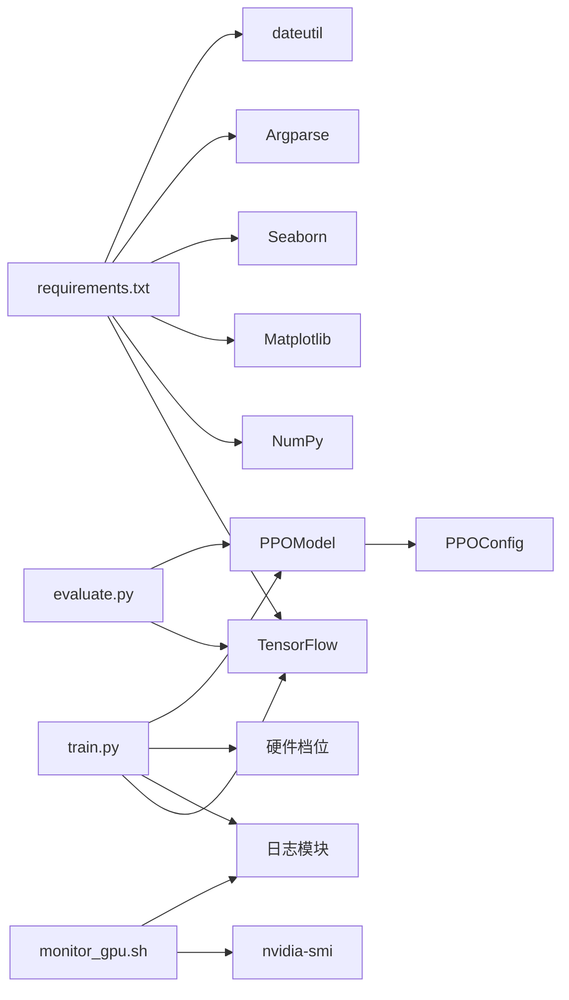

# 性能监控与分析

<cite>
**本文引用的文件列表**
- [monitor_gpu.sh](file://monitor_gpu.sh)
- [README.md](file://README.md)
- [TRAINING_GUIDE.md](file://TRAINING_GUIDE.md)
- [RTX4090D配置指南.md](file://RTX4090D配置指南.md)
- [PPO优化总结.md](file://PPO优化总结.md)
- [train.py](file://train.py)
- [evaluate.py](file://evaluate.py)
- [requirements.txt](file://requirements.txt)
- [poker_ai/model/ppo_model.py](file://poker_ai/model/ppo_model.py)
- [poker_ai/config/ppo_config.py](file://poker_ai/config/ppo_config.py)
- [test_ppo_optimization.py](file://test_ppo_optimization.py)
</cite>

## 更新摘要
**变更内容**
- 新增GPU监控功能章节，详细介绍monitor_gpu.sh脚本的实时监控能力
- 更新GPU利用率阈值判断标准，基于实际监控脚本的判断逻辑
- 增加GPU监控的最佳实践和故障排查指南
- 完善性能监控与分析的整体架构图

## 目录
1. [简介](#简介)
2. [项目结构](#项目结构)
3. [核心组件](#核心组件)
4. [架构总览](#架构总览)
5. [详细组件分析](#详细组件分析)
6. [依赖关系分析](#依赖关系分析)
7. [性能考量](#性能考量)
8. [故障排查指南](#故障排查指南)
9. [结论](#结论)
10. [附录](#附录)

## 简介
本指导文档围绕性能监控与分析展开，重点覆盖以下内容：
- monitor_gpu.sh 脚本的使用方法与监控指标解读（GPU利用率、显存使用、温度、功耗等）
- 训练日志分析方法（loss曲线、训练速度、收敛性评估）
- 性能基准测试设计与实施（标准测试用例、对比实验、统计分析）
- 性能问题诊断流程（瓶颈识别、异常检测、根因分析）
- 不同硬件平台的性能特征与优化差异（CPU/GPU/内存）
- 优化效果量化评估与持续监控机制
- 性能报告生成与可视化展示方案

## 项目结构
该项目是一个基于强化学习的德州扑克AI训练系统，包含训练、评估、监控与配置文档。核心文件与职责如下：
- monitor_gpu.sh：实时监控GPU与训练进程，输出关键指标与最新日志
- train.py：训练入口，负责参数解析、环境设置、日志配置、硬件档位优化
- evaluate.py：评估入口，生成详细报告与可视化图表
- poker_ai/model/ppo_model.py：PPO模型实现，包含学习率调度、GAE改进、价值损失裁剪、自适应熵等优化
- poker_ai/config/ppo_config.py：PPO配置参数，集中管理超参数
- README.md / TRAINING_GUIDE.md / RTX4090D配置指南.md：使用说明、训练指南与硬件优化指南
- test_ppo_optimization.py：PPO优化验证测试脚本
- requirements.txt：依赖清单

**图表来源**
- [monitor_gpu.sh:1-83](file://monitor_gpu.sh#L1-L83)
- [train.py:1-200](file://train.py#L1-L200)
- [evaluate.py:1-200](file://evaluate.py#L1-L200)
- [poker_ai/model/ppo_model.py:1-200](file://poker_ai/model/ppo_model.py#L1-L200)
- [poker_ai/config/ppo_config.py:1-97](file://poker_ai/config/ppo_config.py#L1-L97)
- [README.md:1-227](file://README.md#L1-L227)
- [TRAINING_GUIDE.md:1-181](file://TRAINING_GUIDE.md#L1-L181)
- [RTX4090D配置指南.md:1-366](file://RTX4090D配置指南.md#L1-L366)
- [test_ppo_optimization.py:1-200](file://test_ppo_optimization.py#L1-L200)
- [requirements.txt:1-7](file://requirements.txt#L1-L7)

**章节来源**
- [README.md:1-227](file://README.md#L1-L227)
- [TRAINING_GUIDE.md:1-181](file://TRAINING_GUIDE.md#L1-L181)
- [RTX4090D配置指南.md:1-366](file://RTX4090D配置指南.md#L1-L366)

## 核心组件
- GPU监控脚本：通过nvidia-smi查询GPU利用率、显存、温度、功耗，并结合训练进程状态进行综合判断
- 训练入口：统一的日志配置、硬件档位优化（如RTX 4090D）、并行worker自动推断、XLA混合精度等
- 评估入口：生成详细报告与可视化图表，支持中文字体配置与GPU内存增长设置
- PPO模型与配置：包含学习率调度、GAE改进、价值损失裁剪、自适应熵、KL散度早停等优化
- 测试脚本：验证网络架构、学习率调度、GAE计算、训练步骤、自适应熵等优化项

**章节来源**
- [monitor_gpu.sh:1-83](file://monitor_gpu.sh#L1-L83)
- [train.py:1-200](file://train.py#L1-L200)
- [evaluate.py:1-200](file://evaluate.py#L1-L200)
- [poker_ai/model/ppo_model.py:1-200](file://poker_ai/model/ppo_model.py#L1-L200)
- [poker_ai/config/ppo_config.py:1-97](file://poker_ai/config/ppo_config.py#L1-L97)
- [test_ppo_optimization.py:1-200](file://test_ppo_optimization.py#L1-L200)

## 架构总览
训练与评估的整体流程如下：
- 训练阶段：解析参数 → 设置日志 → 应用硬件档位 → 初始化模型与优化器 → 并行采样与更新 → 定期评估与检查点
- 评估阶段：加载模型 → 创建对手 → 运行对局 → 统计指标 → 生成报告与图表
- 监控阶段：实时查询GPU状态 → 显示训练进程CPU/内存使用 → 展示最新日志

**图表来源**
- [monitor_gpu.sh:1-83](file://monitor_gpu.sh#L1-L83)
- [train.py:1-200](file://train.py#L1-L200)
- [evaluate.py:1-200](file://evaluate.py#L1-L200)

## 详细组件分析

### GPU监控组件分析（monitor_gpu.sh）
**更新** 新增GPU监控功能，提供实时GPU状态监控与训练进程状态跟踪

- 功能概述
  - 检测训练进程是否存在并获取PID
  - 每2秒刷新一次GPU状态（利用率、显存、温度、功耗）
  - 显示训练进程的CPU/内存使用情况
  - 基于GPU利用率自动判断工作状态（高/中/低/未使用）
  - 展示最新训练日志文件的最后5行内容

- 关键指标与阈值判断
  - GPU利用率：>50% 表示GPU正在积极工作；10%-50% 可能处于数据准备阶段；≤10% 可能卡住或在初始化
  - 显存使用：根据配置调整，建议不超过显存总量的90%
  - 温度：建议保持在70-80°C以下
  - 功耗：RTX 4090D典型TDP约450W，瞬时可达500-600W

- 使用方法
  - 在独立终端运行脚本，按Ctrl+C停止
  - 确保已安装nvidia-smi与相关驱动
  - 脚本会自动查找train.py进程并监控其状态

**图表来源**
- [monitor_gpu.sh:1-83](file://monitor_gpu.sh#L1-L83)

**章节来源**
- [monitor_gpu.sh:1-83](file://monitor_gpu.sh#L1-L83)

### 训练入口组件分析（train.py）
- 日志配置
  - 自动生成带时间戳的日志文件，同时输出到控制台
  - 日志文件位于logs/目录，文件名格式为poker_ai_YYYYMMDD_HHMMSS.log

- 硬件档位优化
  - rtx4090d档位：自动提升train_workers/eval_workers、train_rollouts_per_worker、train_sync_every_batches、ppo_update_min_steps、batch_size；默认启用GPU、XLA、混合精度、显存按需增长
  - rtx3090_112cpu档位：针对特定CPU配置的优化

- 并行worker自动推断
  - 根据CPU核心数与预留核心数自动计算可用worker数量，兼顾小机器与大机器的利用率

- 关键参数与用途
  - --mode：train/eval/demo
  - --hardware-profile：auto/rtx3090_112cpu/rtx4090d
  - --auto-tune：短跑多组参数自动选择吞吐最高配置
  - --mixed-precision/--enable-xla：性能优化开关
  - --train-workers/--eval-workers：并行采样与评估worker数量
  - --batch-size/--ppo-epochs：影响GPU利用率与稳定性
  - --eval-interval/--checkpoint-interval：评估与检查点频率

**图表来源**
- [train.py:1-200](file://train.py#L1-L200)
- [RTX4090D配置指南.md:1-366](file://RTX4090D配置指南.md#L1-L366)

**章节来源**
- [train.py:1-200](file://train.py#L1-L200)
- [RTX4090D配置指南.md:1-366](file://RTX4090D配置指南.md#L1-L366)

### 评估入口组件分析（evaluate.py）
- 环境设置
  - GPU内存增长设置，避免一次性占用全部显存
  - 中文字体配置，确保图表中文显示正常
  - 模块导入顺序与异常处理

- 评估流程
  - 创建SelfPlayTrainer与对手代理
  - 运行指定数量的对局
  - 统计指标并生成报告与图表（可选）

- 输出
  - 评估日志文件
  - 报告输出目录（默认eval_reports）
  - 可选的可视化图表

**图表来源**
- [evaluate.py:1-200](file://evaluate.py#L1-L200)

**章节来源**
- [evaluate.py:1-200](file://evaluate.py#L1-L200)

### PPO模型与配置组件分析（ppo_model.py / ppo_config.py）
- PPO模型优化要点
  - 网络架构改进：增加容量、LayerNormalization、残差连接、Dropout正则化
  - 学习率调度：Warmup + Cosine衰减
  - GAE计算：数值稳定性增强、边界条件处理
  - 价值损失裁剪：基于旧价值的裁剪，保守更新
  - 自适应熵正则：动态调整熵系数，平衡探索与利用
  - 梯度裁剪：clip_by_global_norm，提升稳定性
  - 混合精度适配：LossScaleOptimizer

- 配置参数
  - 学习率与调度：lr、lr_min、use_lr_warmup、warmup_steps、use_cosine_decay、total_training_steps
  - PPO核心参数：clip_epsilon、gamma、lambda_
  - 熵正则：entropy_coef、entropy_adaptive、entropy_coef_target
  - 价值损失裁剪：value_clip
  - KL散度早停：kl_target、kl_early_stop
  - 训练策略：update_epochs、batch_size、gradient_accumulation_steps、max_grad_norm

**图表来源**
- [poker_ai/model/ppo_model.py:1-200](file://poker_ai/model/ppo_model.py#L1-L200)
- [poker_ai/config/ppo_config.py:1-97](file://poker_ai/config/ppo_config.py#L1-L97)

**章节来源**
- [poker_ai/model/ppo_model.py:1-200](file://poker_ai/model/ppo_model.py#L1-L200)
- [poker_ai/config/ppo_config.py:1-97](file://poker_ai/config/ppo_config.py#L1-L97)
- [PPO优化总结.md:1-276](file://PPO优化总结.md#L1-L276)

### 训练日志分析方法
- 日志位置与格式
  - 日志文件位于logs/目录，文件名含时间戳
  - 包含时间戳、模块名、日志级别与消息内容

- 关键指标关注点
  - 错误与异常：是否有ERROR/Exception
  - 效率：平均每手耗时（例如0.15s/手）
  - 效果：评估完成后的平均利润、胜率、诈唬率、加注率等

- 分析建议
  - 小样本（500-1000手）验证流程与指标合理性
  - 大规模训练前先做稳定性检查
  - 对比不同参数组合的评估指标一致性

**章节来源**
- [README.md:194-202](file://README.md#L194-L202)
- [TRAINING_GUIDE.md:132-142](file://TRAINING_GUIDE.md#L132-L142)

### 性能基准测试设计与实施
- 标准测试用例
  - 快速验证配置：1000手牌，验证流程与基础指标
  - 标准配置：50000手牌，评估吞吐与收敛
  - 高性能配置：100000手牌，最大化GPU利用率
  - 极致性能配置：2048 batch size，评估极限性能

- 对比实验设计
  - 固定硬件与模型，变化batch size、ppo_epochs、并行worker等
  - 固定参数，变化硬件档位（如RTX 3090 vs RTX 4090D）
  - 引入/关闭XLA、混合精度、显存增长等优化项

- 结果统计分析
  - 手牌/秒、显存占用、收敛手数、胜率、平均利润等
  - 使用表格与趋势图展示不同配置的性能表现

**章节来源**
- [RTX4090D配置指南.md:158-174](file://RTX4090D配置指南.md#L158-L174)
- [RTX4090D配置指南.md:285-294](file://RTX4090D配置指南.md#L285-L294)

### 性能问题诊断流程
- 瓶颈识别
  - GPU利用率低：检查batch size、并行worker、ppo_update_min_steps
  - 显存不足：降低batch size、减少ppo_epochs、启用显存增长
  - 训练不稳定：降低学习率、增大clip值、增加熵系数

- 异常检测
  - 监控GPU温度与功耗，避免过热与过载
  - 检查日志中的ERROR/Exception与NaN/Inf
  - 评估阶段指标更具参考价值，优先关注

- 根因分析
  - 参数组合不匹配：先小样本验证，再扩大规模
  - 硬件限制：根据显存与带宽调整batch size与并行度
  - 环境问题：驱动版本、TensorFlow版本、中文字体配置

**章节来源**
- [RTX4090D配置指南.md:177-221](file://RTX4090D配置指南.md#L177-L221)
- [TRAINING_GUIDE.md:154-173](file://TRAINING_GUIDE.md#L154-L173)

### 不同硬件平台的性能特征与优化差异
- RTX 4090D
  - CUDA核心：14592；显存：24GB；带宽：1008 GB/s；第4代Tensor Core
  - 推荐配置：batch size 512-1024，train_workers 32-48，eval_workers 48-64
  - 性能：手牌/秒 500-1500+，显存占用 8-18GB
  - 优化：混合精度、XLA、显存增长、并行采样

- RTX 3090
  - CUDA核心：10496；显存：24GB；带宽：936 GB/s；第3代Tensor Core
  - 相对4090D：训练速度提升50-80%，推荐batch更大

- CPU与内存
  - CPU：自动推断并行worker，避免过度调度
  - 内存：评估阶段设置GPU内存增长，避免显存浪费

**章节来源**
- [RTX4090D配置指南.md:1-366](file://RTX4090D配置指南.md#L1-L366)

### 性能优化效果量化评估与持续监控
- 量化评估
  - 收敛速度：对比优化前后达到相同指标所需的步数
  - 训练稳定性：KL散度、策略熵、损失曲线波动
  - 策略质量：胜率、平均利润、行为指标（诈唬率、加注率）

- 持续监控
  - 使用monitor_gpu.sh实时监控GPU状态
  - 训练日志中记录关键指标，定期抽样分析
  - 评估阶段生成报告，长期趋势跟踪

**章节来源**
- [PPO优化总结.md:158-173](file://PPO优化总结.md#L158-L173)
- [monitor_gpu.sh:1-83](file://monitor_gpu.sh#L1-L83)

### 性能报告生成与可视化展示
- 评估报告
  - evaluate.py支持生成详细报告与可视化图表
  - 中文字体配置确保图表中文显示正常
  - 可选生成图表，便于直观展示指标变化

- 可视化建议
  - loss曲线、胜率趋势、手牌/秒趋势、显存占用趋势
  - 对比不同配置的性能差异
  - 结合GPU监控数据进行关联分析

**章节来源**
- [evaluate.py:1-200](file://evaluate.py#L1-L200)
- [RTX4090D配置指南.md:285-294](file://RTX4090D配置指南.md#L285-L294)

## 依赖关系分析
- 外部依赖
  - TensorFlow：核心深度学习框架，支持GPU、XLA、混合精度
  - NumPy：数值计算
  - Matplotlib/Seaborn：可视化
  - Pickle/Mixin：序列化与兼容
  - Argparse/Dateutil：命令行与日期处理

- 内部依赖
  - train.py依赖日志配置、硬件档位、模型初始化
  - evaluate.py依赖模型加载、对手代理、SelfPlayTrainer
  - ppo_model.py依赖配置参数与状态表示
  - monitor_gpu.sh依赖nvidia-smi与日志文件

**图表来源**
- [requirements.txt:1-7](file://requirements.txt#L1-L7)
- [train.py:1-200](file://train.py#L1-L200)
- [evaluate.py:1-200](file://evaluate.py#L1-L200)
- [poker_ai/model/ppo_model.py:1-200](file://poker_ai/model/ppo_model.py#L1-L200)
- [poker_ai/config/ppo_config.py:1-97](file://poker_ai/config/ppo_config.py#L1-L97)
- [monitor_gpu.sh:1-83](file://monitor_gpu.sh#L1-L83)

**章节来源**
- [requirements.txt:1-7](file://requirements.txt#L1-L7)
- [train.py:1-200](file://train.py#L1-L200)
- [evaluate.py:1-200](file://evaluate.py#L1-L200)
- [poker_ai/model/ppo_model.py:1-200](file://poker_ai/model/ppo_model.py#L1-L200)
- [poker_ai/config/ppo_config.py:1-97](file://poker_ai/config/ppo_config.py#L1-L97)
- [monitor_gpu.sh:1-83](file://monitor_gpu.sh#L1-L83)

## 性能考量
- 训练效率
  - 批处理大小与并行worker：提升GPU利用率，但需考虑显存与稳定性
  - 学习率调度：Warmup + Cosine衰减，平滑训练过程
  - 混合精度与XLA：显著提升吞吐，降低显存占用
  - 价值损失裁剪与自适应熵：提升稳定性与探索能力

- 收敛性与稳定性
  - KL散度早停：防止策略退化
  - 梯度裁剪：clip_by_global_norm，避免梯度爆炸
  - GAE数值稳定性：避免除零与极端值

- 硬件适配
  - 不同GPU显存与带宽差异，需调整batch size与并行度
  - 驱动与TensorFlow版本兼容性，确保性能与稳定性

**章节来源**
- [PPO优化总结.md:158-173](file://PPO优化总结.md#L158-L173)
- [RTX4090D配置指南.md:175-221](file://RTX4090D配置指南.md#L175-L221)
- [poker_ai/model/ppo_model.py:1-200](file://poker_ai/model/ppo_model.py#L1-L200)
- [poker_ai/config/ppo_config.py:1-97](file://poker_ai/config/ppo_config.py#L1-L97)

## 故障排查指南
- GPU监控异常
  - 未找到训练进程：确认train.py已启动，检查参数与路径
  - GPU利用率低：检查batch size、并行worker、ppo_update_min_steps
  - 温度过高：检查散热与电源，降低负载或优化配置

- 训练日志异常
  - ERROR/Exception：定位异常堆栈，修复代码或参数
  - NaN/Inf：检查学习率、损失函数、梯度裁剪
  - 评估指标异常：先小样本验证，再扩大规模

- 评估阶段问题
  - 缺少TensorFlow：安装相应版本，确保GPU可用
  - 图表中文显示异常：检查中文字体配置与字体文件路径

**章节来源**
- [monitor_gpu.sh:1-83](file://monitor_gpu.sh#L1-L83)
- [README.md:194-202](file://README.md#L194-L202)
- [TRAINING_GUIDE.md:154-173](file://TRAINING_GUIDE.md#L154-L173)
- [evaluate.py:1-200](file://evaluate.py#L1-L200)

## 结论
本项目提供了完善的性能监控与分析体系：通过monitor_gpu.sh实时掌握GPU状态，借助train.py与evaluate.py实现高效的训练与评估，配合PPO模型的多项优化（学习率调度、GAE改进、价值损失裁剪、自适应熵等）显著提升了训练效率与稳定性。结合不同硬件平台的优化策略与基准测试方法，可实现系统化的性能优化与持续监控，为大规模强化学习训练提供可靠支撑。

## 附录
- 快速开始命令示例
  - 训练：python train.py --mode train --model-type ppo --num-hands 10000
  - 评估：python train.py --mode eval --model-type ppo --model-path ./checkpoints/agent_ppo_1000 --num-eval-games 500
  - 监控：bash monitor_gpu.sh

- 依赖安装
  - pip install -r requirements.txt

**章节来源**
- [README.md:21-121](file://README.md#L21-L121)
- [requirements.txt:1-7](file://requirements.txt#L1-L7)