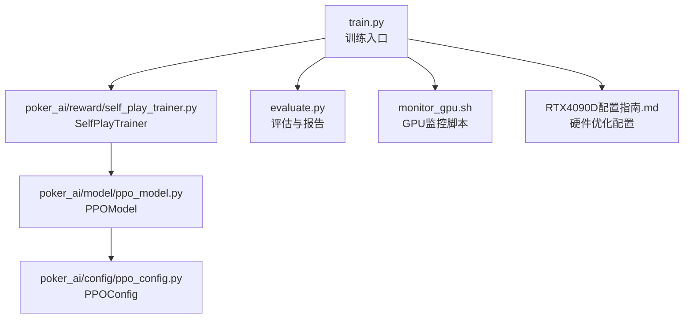
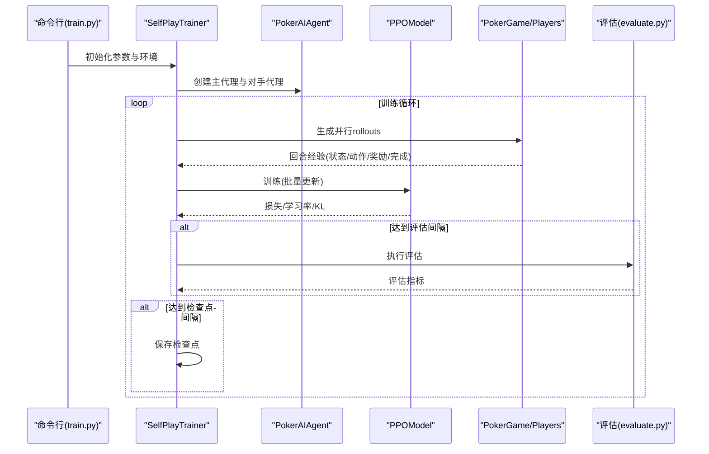
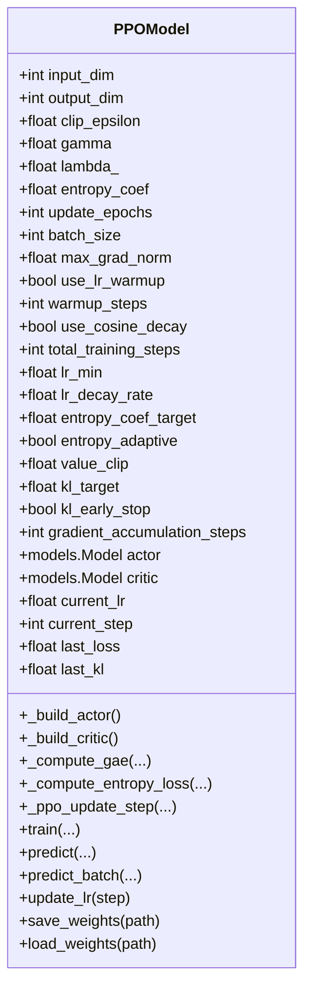
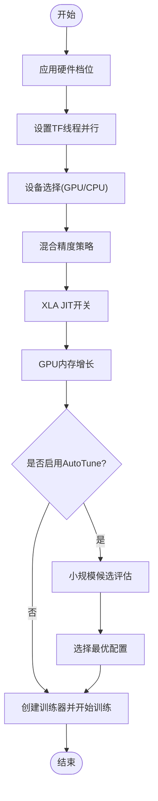
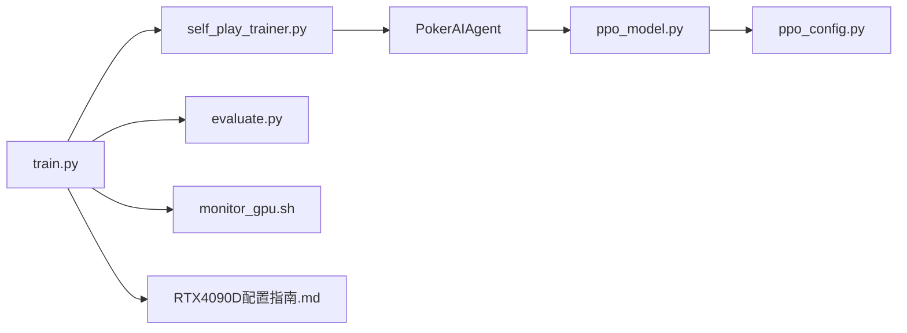

# 训练速度优化

<cite>
**本文引用的文件**
- [test_ppo_optimization.py](file://test_ppo_optimization.py)
- [train.py](file://train.py)
- [evaluate.py](file://evaluate.py)
- [PPO优化总结.md](file://PPO优化总结.md)
- [PPO快速指南.md](file://PPO快速指南.md)
- [ppo_model.py](file://poker_ai/model/ppo_model.py)
- [ppo_config.py](file://poker_ai/config/ppo_config.py)
- [self_play_trainer.py](file://poker_ai/reward/self_play_trainer.py)
- [requirements.txt](file://requirements.txt)
- [README.md](file://README.md)
- [TRAINING_GUIDE.md](file://TRAINING_GUIDE.md)
- [monitor_gpu.sh](file://monitor_gpu.sh)
- [RTX4090D配置指南.md](file://RTX4090D配置指南.md)
</cite>

## 目录
1. [简介](#简介)
2. [项目结构](#项目结构)
3. [核心组件](#核心组件)
4. [架构总览](#架构总览)
5. [详细组件分析](#详细组件分析)
6. [依赖分析](#依赖分析)
7. [性能考量](#性能考量)
8. [故障排查指南](#故障排查指南)
9. [结论](#结论)
10. [附录](#附录)

## 简介
本技术指南围绕训练速度优化展开，聚焦于PPO（近端策略优化）在德州扑克AI训练中的优化实践。内容涵盖批处理大小调整、学习率调度策略、梯度累积、数据加载优化、模型推理优化（混合精度、XLA、算子融合）、性能瓶颈识别与解决方案，以及不同训练场景（小规模、大规模分布式）的最佳实践。同时提供性能基准测试方法与结果分析工具，帮助读者在真实硬件（如RTX 4090D）上获得稳定高效的训练体验。

## 项目结构
该项目采用模块化组织，训练入口位于顶层脚本，核心模型与配置位于 poker_ai 子包，训练器负责并行采样与训练循环，评估脚本提供详细分析与可视化。

**图表来源**
- [train.py:1-856](file://train.py#L1-L856)
- [self_play_trainer.py:1-200](file://poker_ai/reward/self_play_trainer.py#L1-L200)
- [ppo_model.py:1-670](file://poker_ai/model/ppo_model.py#L1-L670)
- [ppo_config.py:1-97](file://poker_ai/config/ppo_config.py#L1-L97)
- [evaluate.py:1-753](file://evaluate.py#L1-L753)
- [monitor_gpu.sh:1-83](file://monitor_gpu.sh#L1-L83)
- [RTX4090D配置指南.md:1-366](file://RTX4090D配置指南.md#L1-L366)

**章节来源**
- [README.md:1-227](file://README.md#L1-L227)
- [TRAINING_GUIDE.md:1-181](file://TRAINING_GUIDE.md#L1-L181)

## 核心组件
- PPOModel：包含Actor/Critic网络、学习率调度、GAE计算、价值损失裁剪、自适应熵系数、梯度累积与混合精度适配等优化。
- PPOConfig：集中管理PPO超参数，支持RTX 4090D优化档位。
- SelfPlayTrainer：封装训练循环、并行采样、检查点管理、评估与对手更新。
- train.py：命令行入口，自动硬件档位应用、线程并行配置、混合精度/XLA开关、自动调参（AutoTune）。
- evaluate.py：详细评估与可视化，生成报告与图表。
- test_ppo_optimization.py：PPO优化验证测试脚本，覆盖网络架构、学习率调度、GAE、训练步骤、自适应熵系数、配置参数等。

**章节来源**
- [ppo_model.py:20-670](file://poker_ai/model/ppo_model.py#L20-L670)
- [ppo_config.py:18-97](file://poker_ai/config/ppo_config.py#L18-L97)
- [self_play_trainer.py:48-200](file://poker_ai/reward/self_play_trainer.py#L48-L200)
- [train.py:136-856](file://train.py#L136-L856)
- [evaluate.py:110-753](file://evaluate.py#L110-L753)
- [test_ppo_optimization.py:1-301](file://test_ppo_optimization.py#L1-L301)

## 架构总览
训练系统以 SelfPlayTrainer 为核心，协调多线程采样与模型训练；PPOModel 负责策略与价值网络的训练与推理；train.py 负责环境初始化、硬件档位与并行参数、自动调参；evaluate.py 提供评估与可视化；test_ppo_optimization.py 验证优化点。

**图表来源**
- [train.py:340-531](file://train.py#L340-L531)
- [self_play_trainer.py:167-200](file://poker_ai/reward/self_play_trainer.py#L167-L200)
- [ppo_model.py:497-638](file://poker_ai/model/ppo_model.py#L497-L638)
- [evaluate.py:706-753](file://evaluate.py#L706-L753)

## 详细组件分析

### PPO模型优化（ppomodel）
- 网络架构改进：Actor/Critic均采用更大容量（256-256-128-64），LayerNormalization、残差连接、策略网络去Dropout、Critic保留轻度Dropout。
- 学习率调度：Warmup线性增长至初始学习率，随后Cosine衰减至最小值；支持配置开关与总步数。
- GAE计算：向量化实现，改进数值稳定性（标准差检查、中心化、裁剪到[-10,10]）。
- 价值损失裁剪：基于旧价值的裁剪损失，保守更新，提升稳定性。
- 自适应熵系数：根据当前熵与目标熵差距动态调整，平衡探索与利用。
- 梯度裁剪：使用全局范数裁剪（clip_by_global_norm），提升稳定性。
- 混合精度适配：LossScaleOptimizer配合mixed_float16，提升吞吐。
- 梯度累积：支持多步累积，模拟更大batch。
- tf.function：更新步骤编译执行，减少Python调度开销。

**图表来源**
- [ppo_model.py:20-670](file://poker_ai/model/ppo_model.py#L20-L670)

**章节来源**
- [ppo_model.py:200-274](file://poker_ai/model/ppo_model.py#L200-L274)
- [ppo_model.py:276-320](file://poker_ai/model/ppo_model.py#L276-L320)
- [ppo_model.py:420-448](file://poker_ai/model/ppo_model.py#L420-L448)
- [ppo_model.py:449-470](file://poker_ai/model/ppo_model.py#L449-L470)
- [ppo_model.py:106-198](file://poker_ai/model/ppo_model.py#L106-L198)
- [ppo_model.py:497-638](file://poker_ai/model/ppo_model.py#L497-L638)

### PPO配置（ppo_config）
- 集中管理PPO超参数，包含输入维度、输出维度、学习率、Clip、Gamma、Lambda、熵系数、更新轮次、Batch Size、KL早停、学习率Warmup/Cosine、价值裁剪、梯度累积、最大梯度范数等。
- 默认配置面向RTX 4090D优化：更大batch、更少更新轮次、KL早停、Warmup/Cosine、自适应熵、价值裁剪、梯度累积。

**章节来源**
- [ppo_config.py:18-97](file://poker_ai/config/ppo_config.py#L18-L97)

### 训练入口与硬件优化（train.py）
- 硬件档位：提供 rtx4090d、rtx3090_112cpu 两种档位，自动设置并行worker、batch、XLA、混合精度、GPU内存增长等。
- 线程并行：自动推断CPU核心，设置TensorFlow intra/inter op线程数。
- 混合精度/XLA：默认启用，可禁用。
- 自动调参（AutoTune）：在小规模训练上多组候选配置，按手牌/秒选择最优，再用于正式训练。
- 环境设置：日志、设备选择（GPU/CPU）、线程并行、XLA、混合精度、GPU内存增长。

**图表来源**
- [train.py:55-135](file://train.py#L55-L135)
- [train.py:240-335](file://train.py#L240-L335)
- [train.py:407-482](file://train.py#L407-L482)

**章节来源**
- [train.py:55-135](file://train.py#L55-L135)
- [train.py:240-335](file://train.py#L240-L335)
- [train.py:407-482](file://train.py#L407-L482)

### 自我对弈训练器（self_play_trainer）
- 6-Max专用，强制 num_players=6。
- 并行采样：train_workers、eval_workers、train_rollouts_per_worker、train_sync_every_batches 等参数控制采样并行度与同步频率。
- 检查点：定期保存，支持从最近或指定检查点恢复。
- 对手更新：opponent_update_interval 控制对手策略更新频率。
- 策略指标统计：聚合训练期指标，避免“训练全0、评估很高”的口径偏差。

**章节来源**
- [self_play_trainer.py:48-200](file://poker_ai/reward/self_play_trainer.py#L48-L200)

### 评估与可视化（evaluate.py）
- 详细评估：收集动作分布、阶段利润、手牌强度胜率、位置胜率等统计。
- 可视化：手牌强度分布、动作分布、各阶段利润箱线图、按手牌强度胜率、累计利润曲线。
- 报告生成：保存JSON结果与TXT报告。

**章节来源**
- [evaluate.py:181-753](file://evaluate.py#L181-L753)

### PPO优化验证测试（test_ppo_optimization.py）
- 覆盖网络架构、学习率调度（Warmup+Cosine）、GAE计算、训练步骤、自适应熵系数、配置参数等。
- 通过日志输出与断言验证各项优化点的正确性与数值稳定性。

**章节来源**
- [test_ppo_optimization.py:22-218](file://test_ppo_optimization.py#L22-L218)

## 依赖分析
- 依赖关系：train.py 依赖 SelfPlayTrainer；SelfPlayTrainer 依赖 PokerAIAgent、RewardCalculator、Checkpoint；PokerAIAgent 依赖 PPOModel；PPOModel 依赖 PPOConfig。
- 外部依赖：TensorFlow（>=2.5）、NumPy、Matplotlib、Seaborn、pickle-mixin、argparse、python-dateutil。

**图表来源**
- [train.py:340-531](file://train.py#L340-L531)
- [self_play_trainer.py:167-200](file://poker_ai/reward/self_play_trainer.py#L167-L200)
- [ppo_model.py:497-638](file://poker_ai/model/ppo_model.py#L497-L638)
- [ppo_config.py:74-97](file://poker_ai/config/ppo_config.py#L74-L97)
- [evaluate.py:706-753](file://evaluate.py#L706-L753)
- [monitor_gpu.sh:1-83](file://monitor_gpu.sh#L1-L83)
- [RTX4090D配置指南.md:1-366](file://RTX4090D配置指南.md#L1-L366)

**章节来源**
- [requirements.txt:1-7](file://requirements.txt#L1-L7)

## 性能考量

### 批处理大小调整
- RTX 4090D默认batch：256（标准配置）；高性能可达1024；极致可达2048（需18-22GB显存）。
- 自动调参（AutoTune）：在小规模训练上评估多组batch大小与并行配置，按手牌/秒选择最优。
- 训练器参数：ppo_update_min_steps 控制累计步数，提升GPU利用率；train_sync_every_batches 控制同步频率。

**章节来源**
- [RTX4090D配置指南.md:18-97](file://RTX4090D配置指南.md#L18-L97)
- [train.py:407-482](file://train.py#L407-L482)
- [self_play_trainer.py:111-130](file://poker_ai/reward/self_play_trainer.py#L111-L130)

### 学习率调度策略
- Warmup：前warmup_steps步线性增长至initial_lr，避免初期不稳定。
- Cosine衰减：warmup后按cosine曲线衰减至lr_min，平滑衰减，利于后期精细调优。
- 动态更新：每步更新学习率并同步到优化器。

**章节来源**
- [ppo_model.py:420-448](file://poker_ai/model/ppo_model.py#L420-L448)
- [ppo_config.py:41-46](file://poker_ai/config/ppo_config.py#L41-L46)

### 梯度累积技术
- 支持 gradient_accumulation_steps > 1，累积多步梯度后再更新，模拟更大batch。
- 训练循环中维护累积梯度与计数器，按步数清零并应用。

**章节来源**
- [ppo_model.py:84-89](file://poker_ai/model/ppo_model.py#L84-L89)
- [ppo_model.py:538-543](file://poker_ai/model/ppo_model.py#L538-L543)

### 数据加载优化策略
- 预取与并行：train_workers、eval_workers 控制采样并行度；train_rollouts_per_worker 控制每个worker的并行局数。
- 固定batch形状：critic固定chunk_size推理，避免不同shape触发retracing。
- 价值预测批处理：_predict_critic_fixed_batch 通过padding与分块避免形状变化。

**章节来源**
- [self_play_trainer.py:111-130](file://poker_ai/reward/self_play_trainer.py#L111-L130)
- [ppo_model.py:472-495](file://poker_ai/model/ppo_model.py#L472-L495)

### 模型推理优化
- 混合精度训练：mixed_float16，显著提升吞吐与降低显存占用。
- XLA JIT：编译优化计算图，减少内存碎片，提升性能。
- 算子融合：tf.function 编译更新步骤，消除Python层开销。
- 损失缩放：LossScaleOptimizer 适配混合精度，避免梯度下溢。

**章节来源**
- [train.py:297-309](file://train.py#L297-L309)
- [ppo_model.py:94-104](file://poker_ai/model/ppo_model.py#L94-L104)
- [ppo_model.py:106-198](file://poker_ai/model/ppo_model.py#L106-L198)

### 性能瓶颈识别与解决方案
- I/O瓶颈：降低评估频率（eval_interval）、减少评估局数（num_eval_games）、减少并行worker。
- 计算瓶颈：启用GPU、混合精度、XLA；增大batch size；减少ppo_epochs；增加ppo_update_min_steps。
- 内存瓶颈：降低batch size；关闭不必要的评估；使用gpu_memory_growth；减少ppo_epochs。

**章节来源**
- [RTX4090D配置指南.md:175-221](file://RTX4090D配置指南.md#L175-L221)
- [train.py:55-98](file://train.py#L55-L98)

### 不同训练场景下的优化策略
- 小规模训练：快速验证配置（batch 256，workers 16-24），先用1000手验证流程。
- 中等规模：1万-3万手调参，标准配置（batch 512，workers 32-48）。
- 大规模分布式：RTX 4090D上可达1000-1500手/秒，建议batch 1024，workers 48，eval_interval 5000+。

**章节来源**
- [RTX4090D配置指南.md:76-103](file://RTX4090D配置指南.md#L76-L103)
- [RTX4090D配置指南.md:158-174](file://RTX4090D配置指南.md#L158-L174)

### 性能基准测试方法与结果分析
- 基准测试：使用RTX 4090D配置指南中的标准/高性能/极致配置，记录手牌/秒、显存占用、收敛手数。
- 结果分析：结合日志中的“平均每手耗时”、“评估指标（avg_profit/win_rate）”与GPU监控脚本输出，评估吞吐与稳定性。
- 可视化：evaluate.py 生成各类图表，辅助分析策略质量与稳定性。

**章节来源**
- [RTX4090D配置指南.md:158-174](file://RTX4090D配置指南.md#L158-L174)
- [evaluate.py:586-704](file://evaluate.py#L586-L704)
- [monitor_gpu.sh:1-83](file://monitor_gpu.sh#L1-L83)

## 故障排查指南
- 训练崩溃：检查学习率是否过高（建议从3e-4起步），适当降低或启用Cosine衰减；检查value_clip（建议0.2-0.3）。
- 策略塌缩：增加熵系数（0.03-0.05），启用自适应熵系数。
- 训练停滞：检查学习率是否过小，适当增大；检查KL早停阈值（0.015）是否过严。
- 显存不足：降低batch size；减少ppo_epochs；关闭评估；使用gpu_memory_growth。
- GPU利用率低：增大batch size；增加train_workers；增加train_rollouts_per_worker；增大ppo_update_min_steps。

**章节来源**
- [PPO快速指南.md:146-178](file://PPO快速指南.md#L146-L178)
- [RTX4090D配置指南.md:175-221](file://RTX4090D配置指南.md#L175-L221)
- [ppo_model.py:76-82](file://poker_ai/model/ppo_model.py#L76-L82)

## 结论
通过网络架构增强、学习率调度优化、GAE数值稳定性、价值损失裁剪、自适应熵系数、梯度累积与混合精度/XLA等综合优化，PPO在德州扑克AI训练中实现了更稳定、更高效的训练体验。结合AutoTune与硬件档位自动配置，可在RTX 4090D等高端GPU上达到1000+手/秒的吞吐。建议从快速验证配置入手，逐步放大到标准/高性能配置，并持续使用评估与可视化工具监控策略质量与稳定性。

## 附录
- 快速开始与默认配置参考：PPO快速指南.md
- 优化总结与参数说明：PPO优化总结.md
- 硬件优化配置：RTX4090D配置指南.md
- 训练入口与参数：train.py
- 评估与可视化：evaluate.py
- 性能监控：monitor_gpu.sh
- 依赖声明：requirements.txt