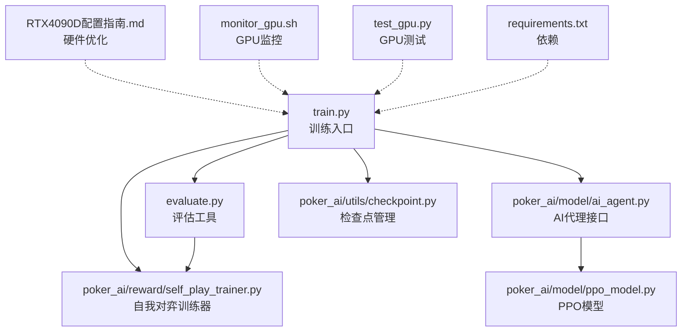
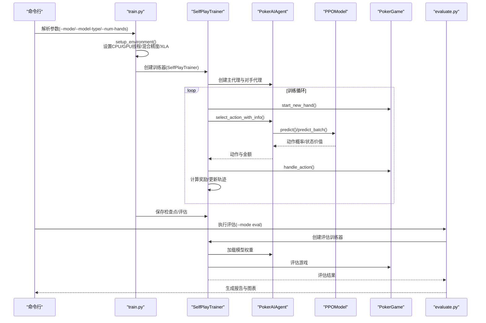
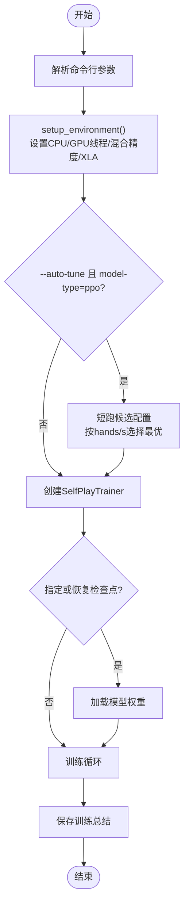
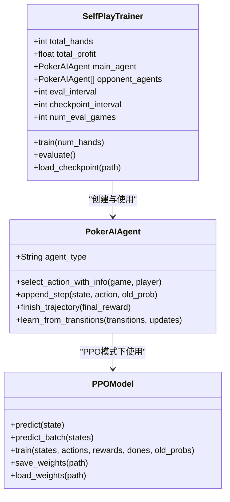
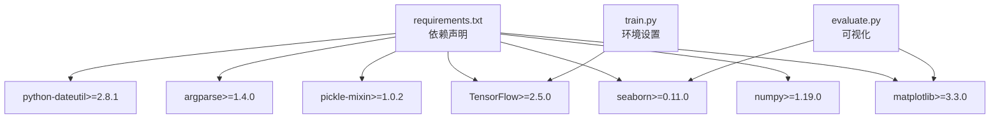

# 故障排除指南

<cite>
**本文引用的文件**
- [README.md](file://README.md)
- [requirements.txt](file://requirements.txt)
- [train.py](file://train.py)
- [evaluate.py](file://evaluate.py)
- [test_gpu.py](file://test_gpu.py)
- [monitor_gpu.sh](file://monitor_gpu.sh)
- [RTX4090D配置指南.md](file://RTX4090D配置指南.md)
- [TRAINING_GUIDE.md](file://TRAINING_GUIDE.md)
- [poker_ai/reward/self_play_trainer.py](file://poker_ai/reward/self_play_trainer.py)
- [poker_ai/model/ppo_model.py](file://poker_ai/model/ppo_model.py)
- [poker_ai/model/ai_agent.py](file://poker_ai/model/ai_agent.py)
- [poker_ai/utils/checkpoint.py](file://poker_ai/utils/checkpoint.py)
- [test_fix.py](file://test_fix.py)
- [test_ppo.py](file://test_ppo.py)
</cite>

## 目录
1. [简介](#简介)
2. [项目结构](#项目结构)
3. [核心组件](#核心组件)
4. [架构概览](#架构概览)
5. [详细组件分析](#详细组件分析)
6. [依赖分析](#依赖分析)
7. [性能考虑](#性能考虑)
8. [故障排除指南](#故障排除指南)
9. [结论](#结论)
10. [附录](#附录)

## 简介
本指南面向德州扑克AI训练项目的故障排除需求，涵盖环境配置问题、依赖冲突、GPU驱动问题、性能问题排查、训练异常处理、硬件相关问题以及系统性问题分类与解决步骤。文档基于项目源码进行深入分析，提供可操作的诊断方法、日志分析技巧、错误码解读和堆栈跟踪分析，帮助快速定位并解决问题。

## 项目结构
项目采用模块化设计，围绕训练、评估、模型与工具模块组织：
- 训练入口：train.py（支持train/eval/demo模式）
- 评估工具：evaluate.py（详细评估与报告生成）
- 核心模块：poker_ai/reward/self_play_trainer.py（自我对弈训练器）、poker_ai/model/ppo_model.py（PPO模型）、poker_ai/model/ai_agent.py（AI代理接口）、poker_ai/utils/checkpoint.py（检查点管理）
- 环境与工具：requirements.txt（依赖）、RTX4090D配置指南.md（硬件优化）、monitor_gpu.sh（GPU监控）、test_gpu.py（GPU快速测试）、test_ppo.py（PPO模型测试）

**图表来源**
- [train.py:1-856](file://train.py#L1-L856)
- [evaluate.py:1-753](file://evaluate.py#L1-L753)
- [poker_ai/reward/self_play_trainer.py:1-1604](file://poker_ai/reward/self_play_trainer.py#L1-L1604)
- [poker_ai/model/ai_agent.py:1-703](file://poker_ai/model/ai_agent.py#L1-L703)
- [poker_ai/model/ppo_model.py:1-670](file://poker_ai/model/ppo_model.py#L1-L670)
- [poker_ai/utils/checkpoint.py:1-139](file://poker_ai/utils/checkpoint.py#L1-L139)
- [RTX4090D配置指南.md:1-366](file://RTX4090D配置指南.md#L1-L366)
- [monitor_gpu.sh:1-83](file://monitor_gpu.sh#L1-L83)
- [test_gpu.py:1-91](file://test_gpu.py#L1-L91)
- [requirements.txt:1-7](file://requirements.txt#L1-L7)

**章节来源**
- [README.md:1-227](file://README.md#L1-L227)
- [requirements.txt:1-7](file://requirements.txt#L1-L7)

## 核心组件
- 训练入口与环境配置：train.py负责参数解析、环境设置（CPU/GPU线程、混合精度、XLA、显存增长）、自动调参（AutoTune）与训练流程控制。
- 自我对弈训练器：self_play_trainer.py实现6-max自我对弈、并行采样、轨迹收集、奖励计算与对手更新。
- AI代理接口：ai_agent.py统一DQN/PPO/PolicyGradient接口，提供动作选择、批量推理、轨迹管理与权重保存。
- PPO模型：ppo_model.py实现策略网络与价值网络、GAE计算、KL早停、自适应学习率与梯度累积。
- 评估工具：evaluate.py提供详细评估、可视化图表与报告生成，支持对手类型与输出目录配置。
- 检查点管理：checkpoint.py提供通用的权重/模型保存与加载、元数据管理与最新检查点查找。
- 环境与硬件：requirements.txt定义依赖，RTX4090D配置指南提供GPU优化建议，monitor_gpu.sh实时监控GPU状态，test_gpu.py快速验证GPU工作。

**章节来源**
- [train.py:136-856](file://train.py#L136-L856)
- [poker_ai/reward/self_play_trainer.py:48-800](file://poker_ai/reward/self_play_trainer.py#L48-L800)
- [poker_ai/model/ai_agent.py:55-703](file://poker_ai/model/ai_agent.py#L55-L703)
- [poker_ai/model/ppo_model.py:20-670](file://poker_ai/model/ppo_model.py#L20-L670)
- [evaluate.py:110-753](file://evaluate.py#L110-L753)
- [poker_ai/utils/checkpoint.py:17-139](file://poker_ai/utils/checkpoint.py#L17-L139)
- [RTX4090D配置指南.md:1-366](file://RTX4090D配置指南.md#L1-L366)
- [monitor_gpu.sh:1-83](file://monitor_gpu.sh#L1-L83)
- [test_gpu.py:1-91](file://test_gpu.py#L1-L91)
- [requirements.txt:1-7](file://requirements.txt#L1-L7)

## 架构概览
训练流程从train.py入口开始，解析参数后设置环境，创建SelfPlayTrainer并启动训练。训练器内部使用PokerAIAgent选择动作，通过状态表示生成状态向量，PPO模型进行策略与价值预测，奖励计算器计算奖励并更新轨迹。评估阶段由evaluate.py或train.py --mode eval执行，生成评估报告与可视化图表。

**图表来源**
- [train.py:240-531](file://train.py#L240-L531)
- [poker_ai/reward/self_play_trainer.py:419-800](file://poker_ai/reward/self_play_trainer.py#L419-L800)
- [poker_ai/model/ai_agent.py:125-214](file://poker_ai/model/ai_agent.py#L125-L214)
- [poker_ai/model/ppo_model.py:322-338](file://poker_ai/model/ppo_model.py#L322-L338)
- [evaluate.py:181-267](file://evaluate.py#L181-L267)

## 详细组件分析

### 训练入口与环境配置（train.py）
- 参数解析：支持模式选择、模型类型、训练参数、评估参数、演示参数、自我对弈参数与探索参数。
- 环境设置：自动解析CPU并行worker数、设置TensorFlow线程并行度、检测GPU、设置显存增长、混合精度与XLA。
- 自动调参：PPO模式下短跑多组候选配置，按hands/s选择最优配置。
- 训练流程：创建SelfPlayTrainer、加载检查点、训练、保存训练总结。

**图表来源**
- [train.py:136-531](file://train.py#L136-L531)

**章节来源**
- [train.py:136-531](file://train.py#L136-L531)

### 自我对弈训练器（SelfPlayTrainer）
- 6-max约束：num_players必须为6，否则抛出异常。
- 并行采样：train_workers/eval_workers自动推断，train_rollouts_per_worker与train_sync_every_batches按模型类型优化。
- 轨迹管理：支持PPO轨迹收集与批量训练，DQN经验回放与Policy Gradient回合学习。
- 奖励计算：使用RewardCalculator计算最终奖励，支持all-in不走运补偿。

**图表来源**
- [poker_ai/reward/self_play_trainer.py:48-213](file://poker_ai/reward/self_play_trainer.py#L48-L213)
- [poker_ai/model/ai_agent.py:55-116](file://poker_ai/model/ai_agent.py#L55-L116)
- [poker_ai/model/ppo_model.py:20-105](file://poker_ai/model/ppo_model.py#L20-L105)

**章节来源**
- [poker_ai/reward/self_play_trainer.py:48-213](file://poker_ai/reward/self_play_trainer.py#L48-L213)

### AI代理接口（PokerAIAgent）
- 统一接口：支持DQN、PolicyGradient、PPO三种代理类型。
- 动作选择：PPO使用策略网络概率分布采样，支持合法性掩码与批量推理。
- 轨迹管理：PPO支持append_step/finish_trajectory与批量轨迹append，支持pending缓冲与阈值触发训练。
- 权重管理：兼容CheckpointManager的save/load接口。

**章节来源**
- [poker_ai/model/ai_agent.py:55-420](file://poker_ai/model/ai_agent.py#L55-L420)

### PPO模型（PPOModel）
- 网络架构：增强的256-256-128-64网络，LayerNormalization与残差连接，策略网络无Dropout，价值网络轻度Dropout。
- 更新策略：tf.function编译更新步骤，修复价值损失裁剪（基于旧价值），KL散度早停，自适应学习率与熵系数。
- GAE计算：向量化实现，优势标准化与极端值裁剪。
- 梯度累积：支持梯度累积以提升吞吐。

**章节来源**
- [poker_ai/model/ppo_model.py:20-670](file://poker_ai/model/ppo_model.py#L20-L670)

### 评估工具（evaluate.py）
- 详细评估：支持对手类型（random/fixed/previous）、输出目录、生成可视化图表。
- 模型加载：支持绝对路径与checkpoints目录查找，详细错误日志与堆栈跟踪。
- 报告生成：生成详细评估报告与可视化图表，支持numpy类型转换序列化。

**章节来源**
- [evaluate.py:110-753](file://evaluate.py#L110-L753)

### 检查点管理（checkpoint.py）
- 通用保存：支持TensorFlow权重、模型save方法、pickle模型保存。
- 加载策略：按权重文件、pickle文件、模型load方法依次尝试，支持元数据加载。
- 最新检查点：按metadata.json时间戳查找最新检查点。

**章节来源**
- [poker_ai/utils/checkpoint.py:17-139](file://poker_ai/utils/checkpoint.py#L17-L139)

## 依赖分析
- 核心依赖：TensorFlow 2.x、numpy、matplotlib、seaborn、pickle-mixin、argparse、python-dateutil。
- 环境要求：Python 3.8+，TensorFlow 2.5.0+，6-max专用训练器。
- 硬件优化：RTX 4090D配置指南提供混合精度、XLA、显存增长、并行采样与大批量训练建议。

**图表来源**
- [requirements.txt:1-7](file://requirements.txt#L1-L7)
- [train.py:240-339](file://train.py#L240-L339)
- [evaluate.py:144-157](file://evaluate.py#L144-L157)

**章节来源**
- [requirements.txt:1-7](file://requirements.txt#L1-L7)
- [README.md:14-23](file://README.md#L14-L23)

## 性能考虑
- GPU利用率：RTX 4090D建议使用混合精度、XLA、显存增长与大批量训练，合理设置train_workers与train_rollouts_per_worker。
- 训练速度：通过AutoTune选择最优配置，减少评估频率与num-eval-games，使用GPU并确认识别到GPU。
- 内存占用：显存增长避免一次性占用，适当降低batch size或ppo_epochs缓解显存不足。
- 并行采样：根据CPU核心数自动推断worker数，PPO场景下增大train_workers与train_rollouts_per_worker。

**章节来源**
- [RTX4090D配置指南.md:14-204](file://RTX4090D配置指南.md#L14-L204)
- [train.py:39-135](file://train.py#L39-L135)
- [TRAINING_GUIDE.md:154-181](file://TRAINING_GUIDE.md#L154-L181)

## 故障排除指南

### 环境配置问题
- 依赖缺失：确保requirements.txt中依赖已安装，特别是TensorFlow 2.x。未安装会导致导入阶段报错。
- Python版本：使用Python 3.8+，避免版本不兼容导致的导入错误。
- 环境变量：确保PATH包含Python与pip路径，虚拟环境正确激活。

**章节来源**
- [requirements.txt:1-7](file://requirements.txt#L1-L7)
- [README.md:14-23](file://README.md#L14-L23)

### 依赖冲突
- 版本冲突：升级/降级TensorFlow至兼容版本（如2.13.0或2.15.0），避免与CUDA/cuDNN版本不匹配。
- 包冲突：使用虚拟环境隔离依赖，避免系统级包影响训练环境。
- 重新安装：清理缓存后重新安装依赖，确保安装日志无错误。

**章节来源**
- [RTX4090D配置指南.md:299-316](file://RTX4090D配置指南.md#L299-L316)

### GPU驱动问题
- 驱动版本：确保NVIDIA驱动版本≥535.xx，使用nvidia-smi检查驱动版本。
- 显存占用：启用gpu-memory-growth避免显存一次性占用，监控显存使用率。
- GPU识别：使用test_gpu.py快速验证GPU是否被TensorFlow识别与计算。

**章节来源**
- [RTX4090D配置指南.md:298-307](file://RTX4090D配置指南.md#L298-L307)
- [test_gpu.py:14-91](file://test_gpu.py#L14-L91)
- [train.py:277-330](file://train.py#L277-L330)

### 性能问题排查
- 训练速度慢：降低eval-interval与num-eval-games，使用GPU并确认识别到GPU，检查CPU线程设置。
- 显存不足：降低batch size或ppo_epochs，减少train_workers，启用显存增长。
- GPU利用率低：增大batch size、train_workers与train_rollouts_per_worker，增加ppo-update-min-steps。

**章节来源**
- [TRAINING_GUIDE.md:154-181](file://TRAINING_GUIDE.md#L154-L181)
- [RTX4090D配置指南.md:177-221](file://RTX4090D配置指南.md#L177-L221)

### 训练异常处理
- 模型崩溃：PPO更新时遇到DNN/Graph错误，可尝试禁用XLA与oneDNN（--disable-xla与--disable-onednn）后重跑。
- 收敛失败：降低学习率、增大clip值、增加价值裁剪与熵系数，调整ppo_epochs与ppo_update_min_steps。
- 过拟合：增加ppo_entropy_coef，减少ppo_epochs，使用更严格的评估间隔与检查点策略。

**章节来源**
- [poker_ai/model/ai_agent.py:324-331](file://poker_ai/model/ai_agent.py#L324-L331)
- [poker_ai/model/ppo_model.py:589-638](file://poker_ai/model/ppo_model.py#L589-L638)
- [RTX4090D配置指南.md:206-221](file://RTX4090D配置指南.md#L206-L221)

### 硬件相关问题
- 显存溢出：启用gpu-memory-growth，降低batch size与ppo_epochs，监控显存使用率。
- 驱动兼容性：更新NVIDIA驱动至推荐版本，确保CUDA/cuDNN与TensorFlow版本匹配。
- 温度控制：监控GPU温度（建议<80°C），改善机箱散热，必要时增加风扇。

**章节来源**
- [RTX4090D配置指南.md:318-330](file://RTX4090D配置指南.md#L318-L330)

### 日志分析与错误诊断
- 日志位置：训练日志写入logs/目录，文件名为poker_ai_YYYYMMDD_HHMMSS.log。
- 关键指标：关注ERROR/Exception、平均每手耗时、评估完成中的avg_profit/win_rate/bluff_rate/raise_rate。
- 堆栈跟踪：评估脚本evaluate.py与训练脚本train.py均捕获异常并打印堆栈，便于定位问题。

**章节来源**
- [README.md:194-202](file://README.md#L194-L202)
- [evaluate.py:230-240](file://evaluate.py#L230-L240)
- [train.py:528-531](file://train.py#L528-L531)

### 系统性问题分类与解决步骤
- 环境类：检查Python版本、依赖安装、驱动版本与显存增长设置。
- 配置类：调整batch size、ppo_epochs、eval-interval、train_workers等参数。
- 模型类：针对PPO更新错误禁用XLA/oneDNN，调整学习率与clip值。
- 硬件类：监控GPU温度与功耗，确保散热良好。

**章节来源**
- [RTX4090D配置指南.md:223-238](file://RTX4090D配置指南.md#L223-L238)

### 预防性维护与最佳实践
- 小样本验证：先用500-1000手验证流程，再逐步放大训练规模。
- 定期评估：设置合理的eval-interval与num-eval-games，关注avg_profit与win_rate。
- 检查点策略：合理设置checkpoint-interval，使用--resume从最近检查点继续训练。
- 环境隔离：使用虚拟环境，避免系统包冲突。

**章节来源**
- [TRAINING_GUIDE.md:11-45](file://TRAINING_GUIDE.md#L11-L45)
- [TRAINING_GUIDE.md:86-112](file://TRAINING_GUIDE.md#L86-L112)

### 紧急情况快速恢复
- 快速GPU测试：使用test_gpu.py验证GPU工作状态，确认显存增长与混合精度。
- 实时监控：使用monitor_gpu.sh监控GPU利用率、显存使用与训练日志。
- 模型恢复：使用--resume或--model-path指定检查点路径，确保检查点文件完整。

**章节来源**
- [test_gpu.py:14-91](file://test_gpu.py#L14-L91)
- [monitor_gpu.sh:9-82](file://monitor_gpu.sh#L9-L82)
- [train.py:492-501](file://train.py#L492-L501)

## 结论
本指南基于项目源码提供了系统性的故障排除方法，涵盖环境配置、依赖冲突、GPU驱动、性能问题、训练异常与硬件问题的诊断与解决。通过日志分析、错误码解读与堆栈跟踪，结合AutoTune与RTX 4090D优化建议，可快速定位并解决训练过程中的各类问题，确保训练稳定高效。

## 附录
- 快速验证：先运行test_gpu.py确认GPU工作，再用小样本（500-1000手）验证流程。
- 评估报告：使用train.py --mode eval或evaluate.py生成详细报告与图表。
- 恢复训练：使用--resume或--model-path加载检查点，继续训练。

**章节来源**
- [test_gpu.py:14-91](file://test_gpu.py#L14-L91)
- [TRAINING_GUIDE.md:115-131](file://TRAINING_GUIDE.md#L115-L131)
- [train.py:492-501](file://train.py#L492-L501)