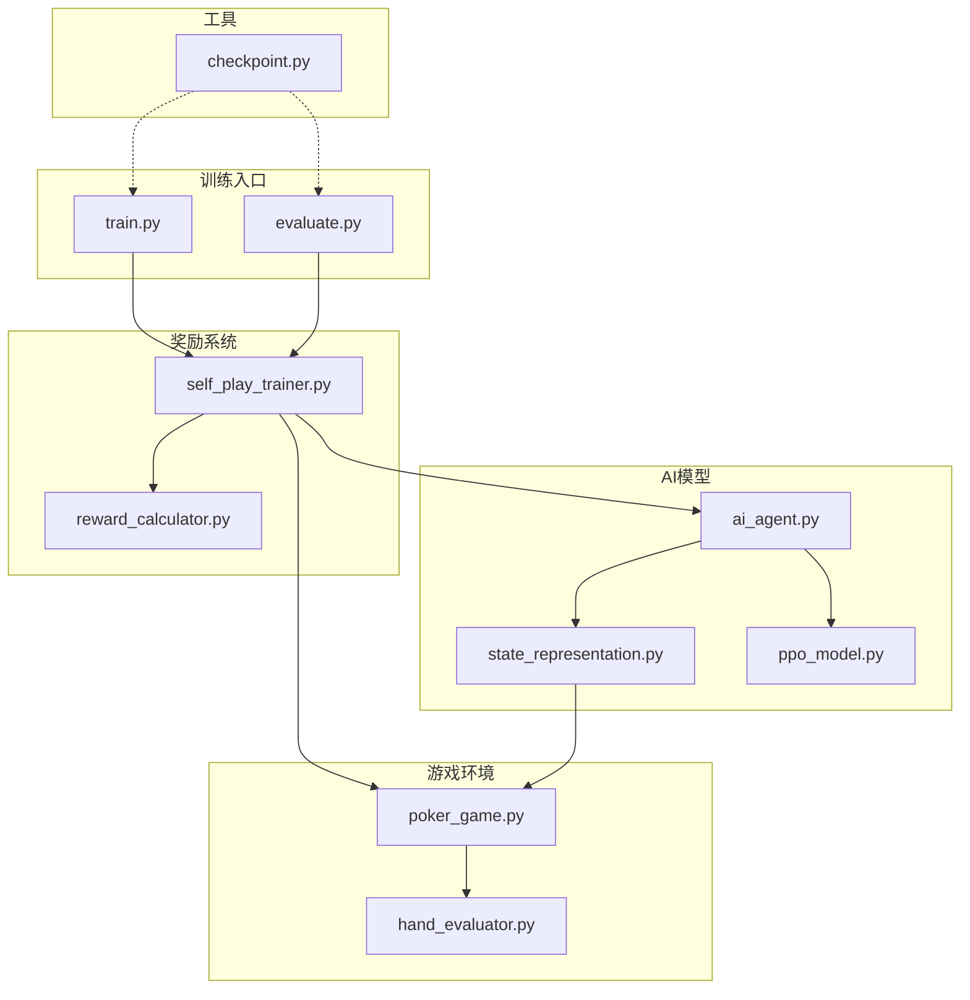
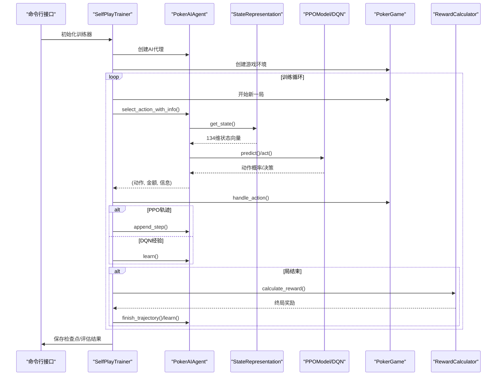
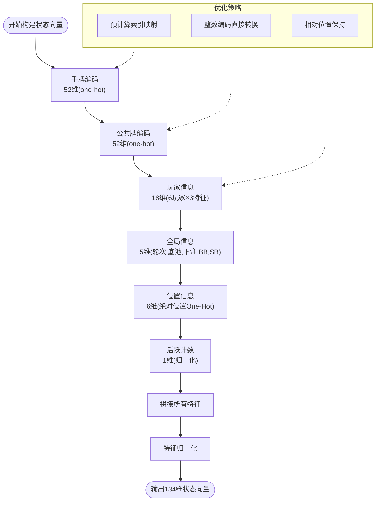
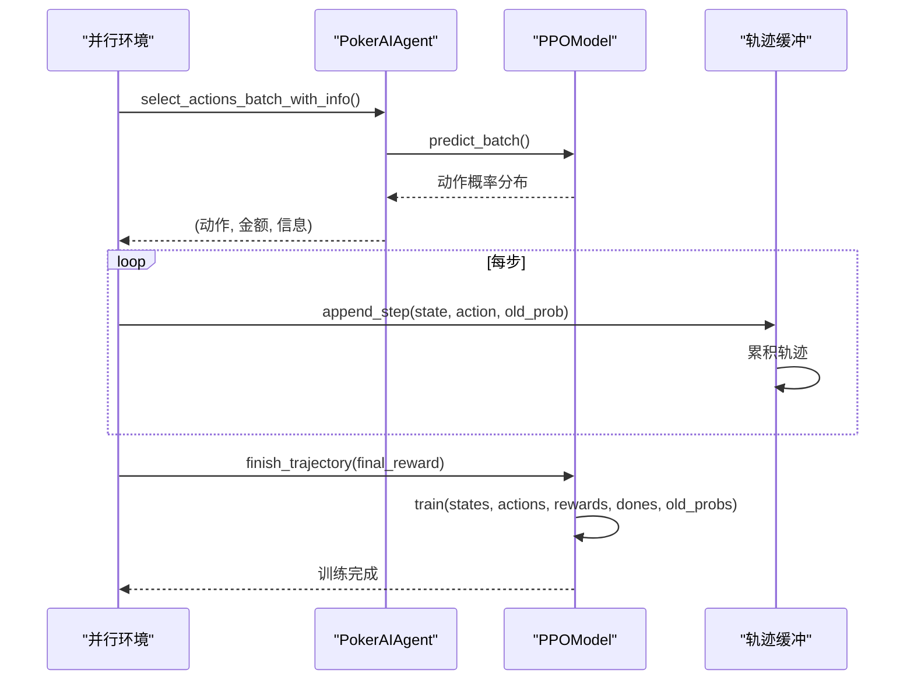
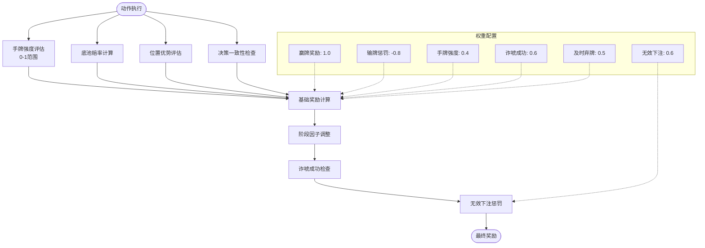
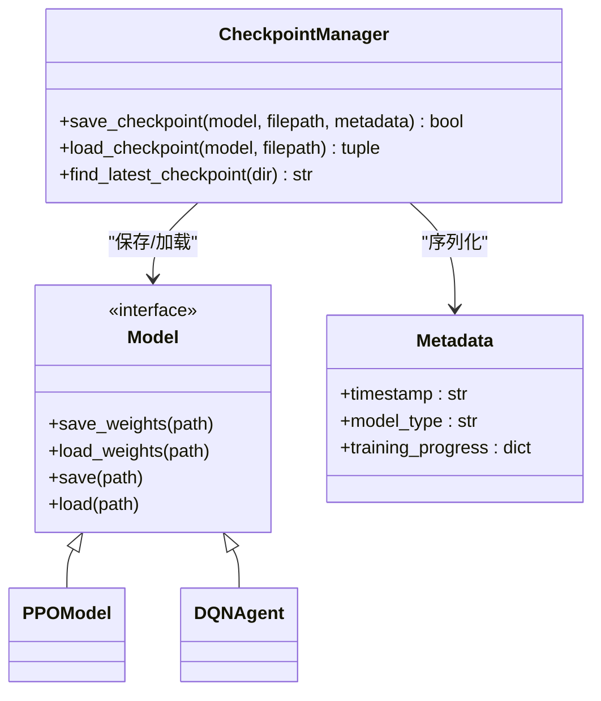
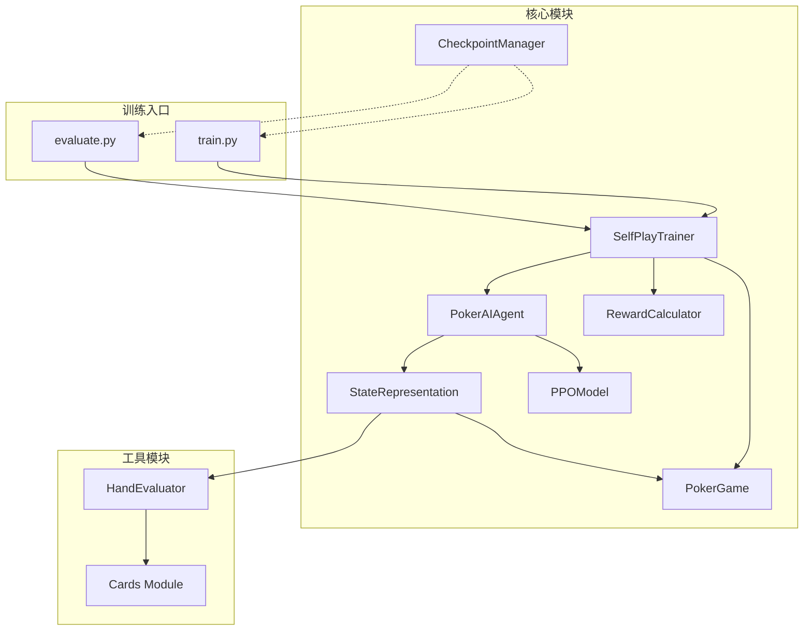

# 数据流分析

<cite>
**本文档引用的文件**
- [train.py](file://train.py)
- [evaluate.py](file://evaluate.py)
- [poker_ai/model/state_representation.py](file://poker_ai/model/state_representation.py)
- [poker_ai/model/ppo_model.py](file://poker_ai/model/ppo_model.py)
- [poker_ai/reward/self_play_trainer.py](file://poker_ai/reward/self_play_trainer.py)
- [poker_ai/model/ai_agent.py](file://poker_ai/model/ai_agent.py)
- [poker_ai/reward/reward_calculator.py](file://poker_ai/reward/reward_calculator.py)
- [poker_ai/utils/checkpoint.py](file://poker_ai/utils/checkpoint.py)
- [poker_ai/game/poker_game.py](file://poker_ai/game/poker_game.py)
- [poker_ai/model/hand_evaluator.py](file://poker_ai/model/hand_evaluator.py)
</cite>

## 目录
1. [简介](#简介)
2. [项目结构](#项目结构)
3. [核心组件](#核心组件)
4. [架构概览](#架构概览)
5. [详细组件分析](#详细组件分析)
6. [依赖分析](#依赖分析)
7. [性能考虑](#性能考虑)
8. [故障排除指南](#故障排除指南)
9. [结论](#结论)

## 简介

本文件为德州扑克AI项目的全面数据流分析文档。通过对训练脚本、评估脚本、状态表示、AI代理、奖励计算、检查点管理等核心模块的深入分析，系统阐述了从游戏状态到状态向量、从状态向量到AI决策、从决策到奖励信号的完整数据流动路径。

重点涵盖：
- 134维状态向量的构建过程与优化策略
- 并行采样到批量训练的数据处理管道
- 奖励信号的计算与传播机制
- 检查点数据、训练轨迹、评估结果的存储格式
- 数据一致性保证、内存管理与性能优化策略

## 项目结构

该项目采用模块化设计，围绕德州扑克游戏环境、AI智能体、奖励系统和训练框架构建：

**图表来源**
- [train.py:1-856](file://train.py#L1-L856)
- [evaluate.py:1-753](file://evaluate.py#L1-L753)
- [poker_ai/model/state_representation.py:1-247](file://poker_ai/model/state_representation.py#L1-L247)
- [poker_ai/model/ai_agent.py:1-703](file://poker_ai/model/ai_agent.py#L1-L703)
- [poker_ai/model/ppo_model.py:1-670](file://poker_ai/model/ppo_model.py#L1-L670)
- [poker_ai/reward/self_play_trainer.py:1-1604](file://poker_ai/reward/self_play_trainer.py#L1-L1604)
- [poker_ai/reward/reward_calculator.py:1-587](file://poker_ai/reward/reward_calculator.py#L1-L587)
- [poker_ai/utils/checkpoint.py:1-139](file://poker_ai/utils/checkpoint.py#L1-L139)
- [poker_ai/game/poker_game.py:1-497](file://poker_ai/game/poker_game.py#L1-L497)
- [poker_ai/model/hand_evaluator.py:1-187](file://poker_ai/model/hand_evaluator.py#L1-L187)

**章节来源**
- [train.py:1-856](file://train.py#L1-L856)
- [evaluate.py:1-753](file://evaluate.py#L1-L753)

## 核心组件

### 状态表示与向量化

状态表示模块负责将游戏状态转换为AI可理解的134维向量。其核心特性包括：

- **手牌编码**：使用one-hot编码表示13种牌面和4种花色的52张牌
- **公共牌编码**：同样使用one-hot编码表示公共牌区域
- **玩家信息**：固定6个玩家的详细状态，包括筹码、下注、活跃状态
- **全局信息**：轮次、底池、当前下注、大盲注、小盲注
- **位置信息**：Hero绝对位置的One-Hot编码（BTN、SB、BB、UTG、MP、CO）
- **活跃计数**：活跃玩家数量的归一化特征

**章节来源**
- [poker_ai/model/state_representation.py:9-46](file://poker_ai/model/state_representation.py#L9-L46)
- [poker_ai/model/state_representation.py:137-169](file://poker_ai/model/state_representation.py#L137-L169)

### AI代理与决策

AI代理模块提供统一的接口，支持DQN、策略梯度和PPO三种模型类型：

- **动作掩码**：根据游戏规则生成合法动作掩码，确保动作合法性
- **批量推理**：PPO模式下支持批量状态前向推理，减少Python/TensorFlow往返开销
- **轨迹管理**：PPO专用的轨迹收集和批量训练机制
- **权重克隆**：为并行采样创建仅推理的模型副本

**章节来源**
- [poker_ai/model/ai_agent.py:15-54](file://poker_ai/model/ai_agent.py#L15-L54)
- [poker_ai/model/ai_agent.py:117-214](file://poker_ai/model/ai_agent.py#L117-L214)
- [poker_ai/model/ai_agent.py:388-420](file://poker_ai/model/ai_agent.py#L388-L420)

### 奖励计算与传播

奖励系统提供精细化的奖励计算机制：

- **多因子奖励**：包含赢牌奖励、输牌惩罚、底池赔率、手牌强度、诈唬成功、及时弃牌等多个维度
- **阶段调整**：不同游戏阶段的奖励权重动态调整
- **自适应调整**：根据AI表现动态调整奖励权重，保持策略平衡
- **位置优势**：考虑玩家相对庄家位置的影响

**章节来源**
- [poker_ai/reward/reward_calculator.py:9-36](file://poker_ai/reward/reward_calculator.py#L9-L36)
- [poker_ai/reward/reward_calculator.py:303-391](file://poker_ai/reward/reward_calculator.py#L303-L391)
- [poker_ai/reward/reward_calculator.py:394-536](file://poker_ai/reward/reward_calculator.py#L394-L536)

### 训练框架与并行采样

自我对弈训练器实现高效的并行采样和训练：

- **并行工作流**：支持训练和评估的并行worker配置
- **批量采样**：PPO模式下的批量环境推进，减少调度开销
- **轨迹聚合**：将多个并行环境的轨迹合并后批量训练
- **对手更新**：定期更新对手策略，保持训练挑战性

**章节来源**
- [poker_ai/reward/self_play_trainer.py:48-166](file://poker_ai/reward/self_play_trainer.py#L48-L166)
- [poker_ai/reward/self_play_trainer.py:587-800](file://poker_ai/reward/self_play_trainer.py#L587-L800)

## 架构概览

系统采用分层架构，从底层游戏环境到顶层训练框架形成清晰的数据流：

**图表来源**
- [train.py:340-531](file://train.py#L340-L531)
- [poker_ai/reward/self_play_trainer.py:260-417](file://poker_ai/reward/self_play_trainer.py#L260-L417)
- [poker_ai/model/ai_agent.py:125-155](file://poker_ai/model/ai_agent.py#L125-L155)
- [poker_ai/model/ppo_model.py:497-638](file://poker_ai/model/ppo_model.py#L497-L638)

## 详细组件分析

### 状态向量构建流程

状态向量的构建遵循严格的维度规划和优化策略：

**图表来源**
- [poker_ai/model/state_representation.py:47-64](file://poker_ai/model/state_representation.py#L47-L64)
- [poker_ai/model/state_representation.py:137-158](file://poker_ai/model/state_representation.py#L137-L158)

**章节来源**
- [poker_ai/model/state_representation.py:47-169](file://poker_ai/model/state_representation.py#L47-L169)

### PPO训练数据管道

PPO模型实现了高效的轨迹收集和批量训练机制：

**图表来源**
- [poker_ai/model/ai_agent.py:157-214](file://poker_ai/model/ai_agent.py#L157-L214)
- [poker_ai/model/ai_agent.py:388-420](file://poker_ai/model/ai_agent.py#L388-L420)
- [poker_ai/model/ppo_model.py:497-638](file://poker_ai/model/ppo_model.py#L497-L638)

**章节来源**
- [poker_ai/model/ai_agent.py:157-420](file://poker_ai/model/ai_agent.py#L157-L420)
- [poker_ai/model/ppo_model.py:497-638](file://poker_ai/model/ppo_model.py#L497-L638)

### 奖励信号计算与传播

奖励计算采用多因子融合机制，确保策略学习的平衡性：

**图表来源**
- [poker_ai/reward/reward_calculator.py:14-27](file://poker_ai/reward/reward_calculator.py#L14-L27)
- [poker_ai/reward/reward_calculator.py:303-391](file://poker_ai/reward/reward_calculator.py#L303-L391)

**章节来源**
- [poker_ai/reward/reward_calculator.py:9-391](file://poker_ai/reward/reward_calculator.py#L9-L391)

### 检查点与数据持久化

检查点系统提供灵活的模型保存和加载机制：

**图表来源**
- [poker_ai/utils/checkpoint.py:17-104](file://poker_ai/utils/checkpoint.py#L17-L104)

**章节来源**
- [poker_ai/utils/checkpoint.py:17-139](file://poker_ai/utils/checkpoint.py#L17-L139)

## 依赖分析

系统采用松耦合设计，主要依赖关系如下：

**图表来源**
- [poker_ai/reward/self_play_trainer.py:21-26](file://poker_ai/reward/self_play_trainer.py#L21-L26)
- [poker_ai/model/ai_agent.py:6-9](file://poker_ai/model/ai_agent.py#L6-L9)
- [poker_ai/model/state_representation.py:5-7](file://poker_ai/model/state_representation.py#L5-L7)

**章节来源**
- [poker_ai/reward/self_play_trainer.py:21-26](file://poker_ai/reward/self_play_trainer.py#L21-L26)
- [poker_ai/model/ai_agent.py:6-9](file://poker_ai/model/ai_agent.py#L6-L9)

## 性能考虑

### 内存管理优化

系统在多个层面实施内存优化策略：

- **状态缓存**：使用LRU缓存存储手牌强度计算结果，避免重复蒙特卡洛模拟
- **批量处理**：PPO模式下使用批量状态前向推理，减少TensorFlow图构建开销
- **整数编码**：支持整数编码的卡牌直接转换，避免频繁的对象创建
- **内存增长**：GPU显存按需分配，避免一次性占用过多资源

### 训练效率优化

- **并行采样**：支持大规模并行worker，充分利用多核CPU资源
- **轨迹聚合**：将多个并行环境的轨迹合并后批量训练，减少训练循环开销
- **自适应学习率**：PPO模型实现学习率的warmup和余弦衰减，提升收敛稳定性
- **梯度累积**：支持梯度累积，扩大有效batch size而不增加内存占用

### 数据压缩技术

- **One-Hot编码**：使用密集的one-hot编码表示卡牌，便于深度学习模型处理
- **归一化特征**：对数值特征进行归一化处理，提升模型训练稳定性
- **整数索引**：使用整数索引代替字符串标识，减少内存占用

## 故障排除指南

### 常见问题诊断

1. **GPU相关错误**
   - 检查CUDA和cuDNN版本兼容性
   - 确认GPU内存充足，考虑调整batch size
   - 尝试禁用XLA或关闭oneDNN以解决初始化问题

2. **训练不稳定**
   - 调整学习率和batch size
   - 检查奖励权重配置，避免过度惩罚或奖励
   - 确认对手策略更新频率适当

3. **内存不足**
   - 减少并行worker数量
   - 降低batch size或启用梯度累积
   - 检查是否有内存泄漏

**章节来源**
- [train.py:240-335](file://train.py#L240-L335)
- [poker_ai/model/ppo_model.py:320-332](file://poker_ai/model/ppo_model.py#L320-L332)

## 结论

本德州扑克AI项目通过精心设计的数据流架构，实现了从游戏状态到AI决策的高效转换。134维状态向量的构建既保证了足够的信息表达能力，又通过多种优化策略确保了计算效率。PPO训练框架的并行采样和批量训练机制显著提升了训练吞吐量。奖励系统的多因子融合和自适应调整确保了策略学习的平衡性和稳定性。

系统的关键优势包括：
- 高效的状态表示和向量化处理
- 灵活的并行训练架构
- 精细化的奖励设计和传播机制
- 完善的检查点管理和数据持久化
- 全面的性能优化和故障排除机制

这些特性共同构成了一个高性能、可扩展的德州扑克AI训练平台，为后续的策略优化和模型改进奠定了坚实基础。