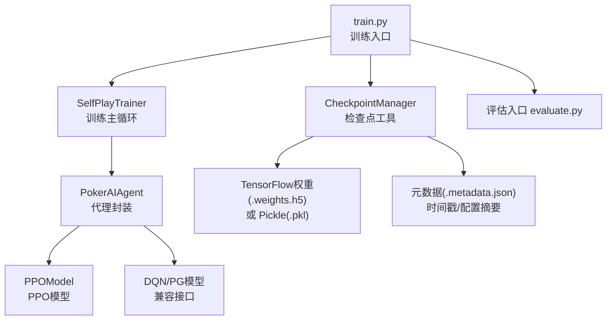
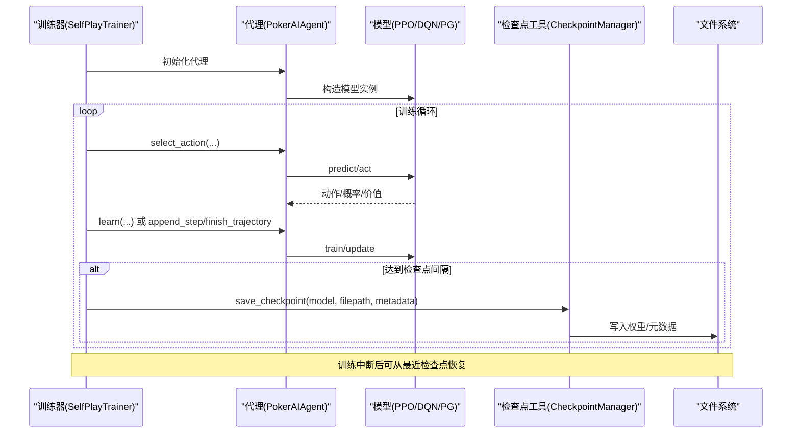
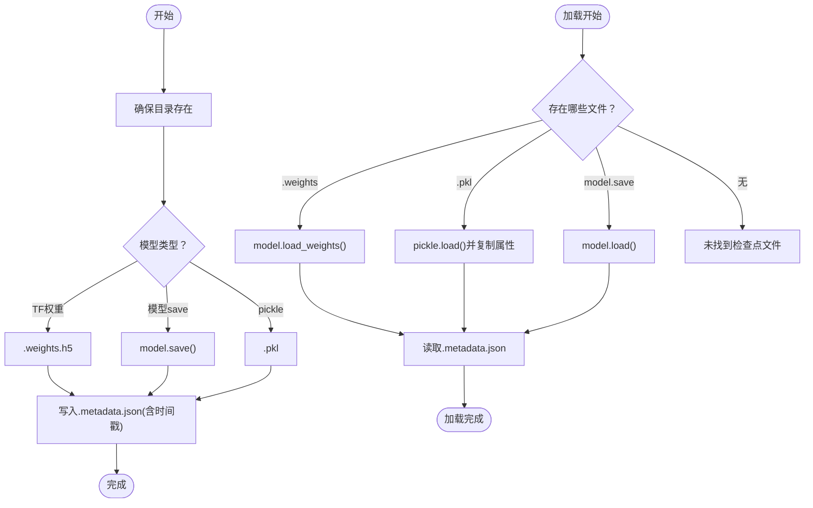
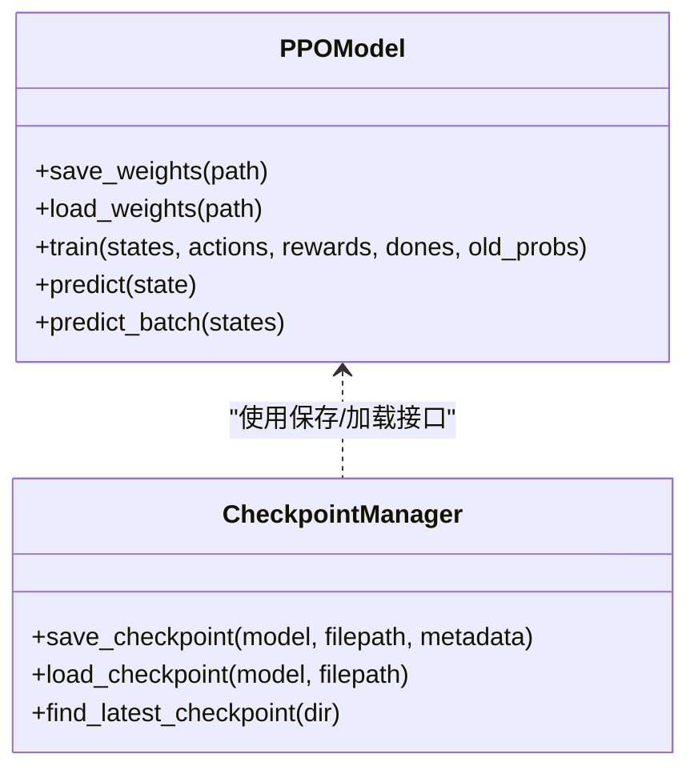
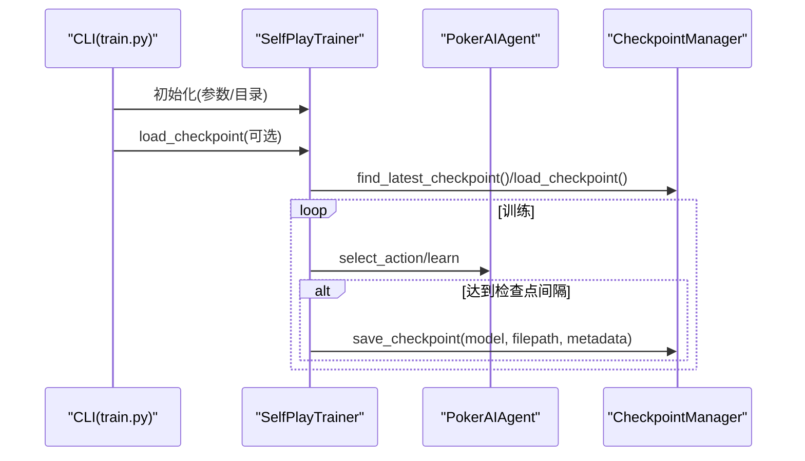
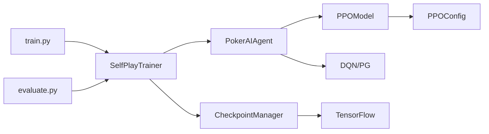
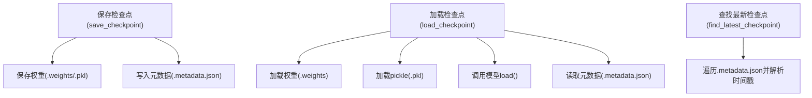

# 检查点数据流

<cite>
**本文引用的文件**
- [poker_ai/utils/checkpoint.py](file://poker_ai/utils/checkpoint.py)
- [poker_ai/model/ppo_model.py](file://poker_ai/model/ppo_model.py)
- [poker_ai/config/ppo_config.py](file://poker_ai/config/ppo_config.py)
- [poker_ai/reward/self_play_trainer.py](file://poker_ai/reward/self_play_trainer.py)
- [poker_ai/model/ai_agent.py](file://poker_ai/model/ai_agent.py)
- [train.py](file://train.py)
- [evaluate.py](file://evaluate.py)
- [README.md](file://README.md)
- [requirements.txt](file://requirements.txt)
- [PPO优化总结.md](file://PPO优化总结.md)
</cite>

## 目录
1. [简介](#简介)
2. [项目结构](#项目结构)
3. [核心组件](#核心组件)
4. [架构总览](#架构总览)
5. [详细组件分析](#详细组件分析)
6. [依赖关系分析](#依赖关系分析)
7. [性能考量](#性能考量)
8. [故障排查指南](#故障排查指南)
9. [结论](#结论)
10. [附录](#附录)

## 简介
本文件围绕模型检查点管理系统，系统性梳理检查点数据的保存、加载与恢复流程，覆盖模型权重、优化器状态、训练配置与元数据的序列化与反序列化。文档还阐述检查点存储格式、版本管理与兼容性策略、在训练中断恢复、模型部署与版本比较中的作用，以及增量更新与空间优化策略，并提供数据流图与操作示例及故障恢复指南。

## 项目结构
该项目围绕强化学习德州扑克AI展开，训练入口为 train.py，评估入口为 evaluate.py，检查点工具位于 poker_ai/utils/checkpoint.py，模型封装在 poker_ai/model/ai_agent.py，PPO模型与配置分别在 poker_ai/model/ppo_model.py 与 poker_ai/config/ppo_config.py，训练主循环在 poker_ai/reward/self_play_trainer.py。

图表来源
- [train.py:1-856](file://train.py#L1-L856)
- [poker_ai/reward/self_play_trainer.py:1-1604](file://poker_ai/reward/self_play_trainer.py#L1-L1604)
- [poker_ai/model/ai_agent.py:1-703](file://poker_ai/model/ai_agent.py#L1-L703)
- [poker_ai/model/ppo_model.py:1-670](file://poker_ai/model/ppo_model.py#L1-L670)
- [poker_ai/utils/checkpoint.py:1-139](file://poker_ai/utils/checkpoint.py#L1-L139)

章节来源
- [README.md:1-227](file://README.md#L1-L227)
- [requirements.txt:1-7](file://requirements.txt#L1-L7)

## 核心组件
- 检查点工具：提供保存与加载检查点的统一接口，支持 TensorFlow 权重、Pickle 模型与通用模型保存，同时写入元数据 JSON。
- 训练器：封装训练主循环，负责周期性保存检查点、加载检查点、评估与统计。
- 代理封装：统一 DQN、策略梯度与 PPO 的接口，内部持有具体模型实例，提供动作选择与学习接口。
- PPO 模型：提供 Actor/Critic 权重保存/加载与训练接口，支持 PPO 特定的权重命名约定。
- 配置：集中管理 PPO 超参数，便于复现与迁移。

章节来源
- [poker_ai/utils/checkpoint.py:17-139](file://poker_ai/utils/checkpoint.py#L17-L139)
- [poker_ai/reward/self_play_trainer.py:48-166](file://poker_ai/reward/self_play_trainer.py#L48-L166)
- [poker_ai/model/ai_agent.py:55-116](file://poker_ai/model/ai_agent.py#L55-L116)
- [poker_ai/model/ppo_model.py:640-670](file://poker_ai/model/ppo_model.py#L640-L670)
- [poker_ai/config/ppo_config.py:18-97](file://poker_ai/config/ppo_config.py#L18-L97)

## 架构总览
检查点数据流贯穿训练、评估与部署三个阶段：
- 训练阶段：训练器按间隔保存检查点，包含模型权重与元数据；支持从指定路径或最近检查点恢复。
- 评估阶段：评估脚本加载检查点，执行评估并生成报告与可视化。
- 部署阶段：加载检查点用于推理或在线服务。

图表来源
- [poker_ai/reward/self_play_trainer.py:48-166](file://poker_ai/reward/self_play_trainer.py#L48-L166)
- [poker_ai/model/ai_agent.py:248-420](file://poker_ai/model/ai_agent.py#L248-L420)
- [poker_ai/utils/checkpoint.py:17-104](file://poker_ai/utils/checkpoint.py#L17-L104)

## 详细组件分析

### 检查点工具：保存与加载
- 保存流程
  - 确保目录存在
  - 根据模型类型选择保存方式：
    - TensorFlow 模型：优先保存 .weights（权重文件）
    - 模型具备 save/load 方法：直接保存模型
    - 否则：使用 pickle 保存整个模型对象
  - 写入元数据 JSON，包含时间戳与自定义字段
- 加载流程
  - 优先尝试权重文件（.weights）
  - 其次尝试 pickle 模型（.pkl）
  - 再次尝试模型的 load 方法
  - 读取并返回元数据
- 最新检查点查找
  - 遍历目录下所有 .metadata.json，解析时间戳，返回最新者

图表来源
- [poker_ai/utils/checkpoint.py:17-139](file://poker_ai/utils/checkpoint.py#L17-L139)

章节来源
- [poker_ai/utils/checkpoint.py:17-139](file://poker_ai/utils/checkpoint.py#L17-L139)

### PPO 模型：权重命名与保存/加载
- 保存：将 Actor 与 Critic 权重分别保存为 actor.critic 后缀的 .weights.h5 文件，同时保存状态对象（如 PPO 状态）为 *_state.pkl
- 加载：根据 base 路径解析 actor/critic 权重文件，要求两者均存在
- 训练：PPO 通过轨迹（states/actions/old_probs/rewards/dones）进行批量更新

图表来源
- [poker_ai/model/ppo_model.py:640-670](file://poker_ai/model/ppo_model.py#L640-L670)
- [poker_ai/utils/checkpoint.py:17-104](file://poker_ai/utils/checkpoint.py#L17-L104)

章节来源
- [poker_ai/model/ppo_model.py:640-670](file://poker_ai/model/ppo_model.py#L640-L670)
- [README.md:125-147](file://README.md#L125-L147)

### 训练器：检查点集成与恢复
- 初始化时创建检查点目录
- 训练前可加载指定路径或最近检查点
- 训练中按间隔保存检查点，元数据包含训练参数摘要
- 评估前可加载检查点进行性能评估

图表来源
- [train.py:492-501](file://train.py#L492-L501)
- [poker_ai/reward/self_play_trainer.py:132-134](file://poker_ai/reward/self_play_trainer.py#L132-L134)
- [poker_ai/utils/checkpoint.py:106-139](file://poker_ai/utils/checkpoint.py#L106-L139)

章节来源
- [train.py:492-501](file://train.py#L492-L501)
- [poker_ai/reward/self_play_trainer.py:132-134](file://poker_ai/reward/self_play_trainer.py#L132-L134)

### 评估脚本：检查点加载与报告生成
- 评估入口可加载指定检查点或最近检查点
- 执行评估并生成结果 JSON 与文本报告
- 评估期间不改变检查点状态，仅读取

章节来源
- [evaluate.py:562-572](file://evaluate.py#L562-L572)
- [evaluate.py:706-753](file://evaluate.py#L706-L753)

## 依赖关系分析
- 检查点工具依赖 Python 标准库与 TensorFlow（用于权重保存/加载）
- 训练器依赖检查点工具与代理封装
- 代理封装依赖具体模型（PPO/DQN/PG）
- PPO 模型依赖配置模块与状态表示
- 训练与评估脚本共同依赖检查点工具与训练器

图表来源
- [train.py:1-856](file://train.py#L1-L856)
- [evaluate.py:1-753](file://evaluate.py#L1-L753)
- [poker_ai/reward/self_play_trainer.py:1-1604](file://poker_ai/reward/self_play_trainer.py#L1-L1604)
- [poker_ai/model/ai_agent.py:1-703](file://poker_ai/model/ai_agent.py#L1-L703)
- [poker_ai/model/ppo_model.py:1-670](file://poker_ai/model/ppo_model.py#L1-L670)
- [poker_ai/config/ppo_config.py:1-97](file://poker_ai/config/ppo_config.py#L1-L97)
- [poker_ai/utils/checkpoint.py:1-139](file://poker_ai/utils/checkpoint.py#L1-L139)

章节来源
- [requirements.txt:1-7](file://requirements.txt#L1-L7)

## 性能考量
- 检查点频率：过高的保存频率会增加磁盘 IO；过低可能导致恢复点过旧。建议结合训练时长与数据量权衡。
- 权重格式：TensorFlow .weights.h5 体积较小且加载速度快；Pickle 可保存完整对象但跨平台/跨版本兼容性有限。
- 元数据：仅记录必要字段（如时间戳、关键参数），避免冗余。
- 并行评估：评估阶段可并行加载多个检查点进行对比，注意磁盘并发访问。

## 故障排查指南
- 无法找到检查点文件
  - 确认路径正确且文件存在
  - 使用 find_latest_checkpoint 查找最近检查点
- 权重文件缺失
  - PPO 需要 actor/critic 两个 .weights.h5 文件；若缺失，加载会失败
- 加载失败或异常
  - 检查 TensorFlow 版本与依赖是否满足
  - 查看日志中的错误堆栈定位问题
- 训练崩溃或显存不足
  - 调整 batch_size、学习率与梯度裁剪参数
  - 参考 PPO 优化文档中的参数建议

章节来源
- [poker_ai/utils/checkpoint.py:106-139](file://poker_ai/utils/checkpoint.py#L106-L139)
- [PPO优化总结.md:174-276](file://PPO优化总结.md#L174-L276)

## 结论
本检查点数据流设计以统一的保存/加载接口为核心，结合训练器的周期性保存与评估脚本的加载能力，实现了训练中断恢复、模型部署与版本比较的闭环。PPO 的三件套权重命名与状态对象保存策略提升了可移植性与可复现性。通过合理的元数据组织与版本管理策略，可在大规模训练中保持良好的可维护性与可追溯性。

## 附录

### 检查点数据流图（代码级）

图表来源
- [poker_ai/utils/checkpoint.py:17-139](file://poker_ai/utils/checkpoint.py#L17-L139)

### 操作示例
- 从最近检查点继续训练
  - 使用 train.py 的 --resume 参数，内部会调用检查点工具查找并加载最近检查点
- 指定检查点继续训练
  - 使用 train.py 的 --model-path 指定 base 路径（PPO），或 .weights.h5/.pkl 路径（DQN/PG）
- 评估模型
  - 使用 train.py --mode eval 或 evaluate.py 加载检查点并生成评估报告
- 查看训练总结
  - 训练完成后会在检查点目录生成 training_summary_*.json

章节来源
- [README.md:87-121](file://README.md#L87-L121)
- [train.py:709-731](file://train.py#L709-L731)