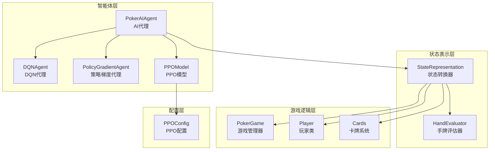
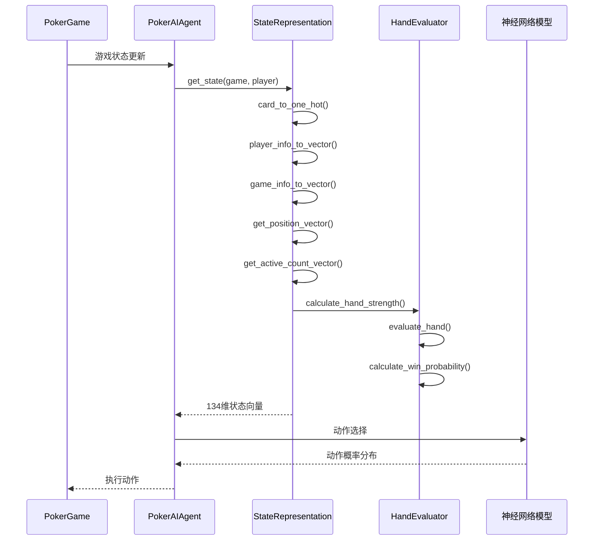
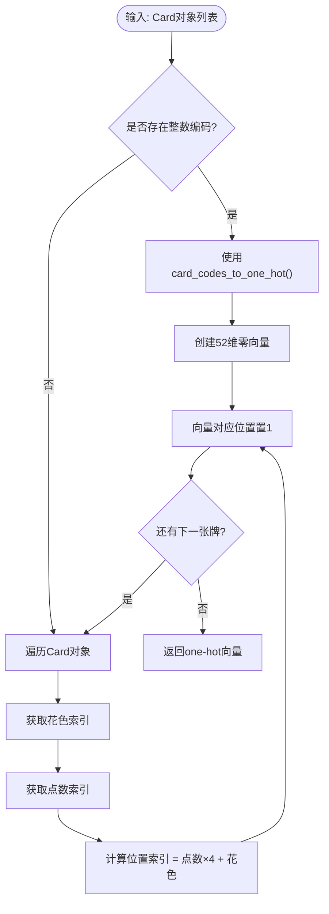
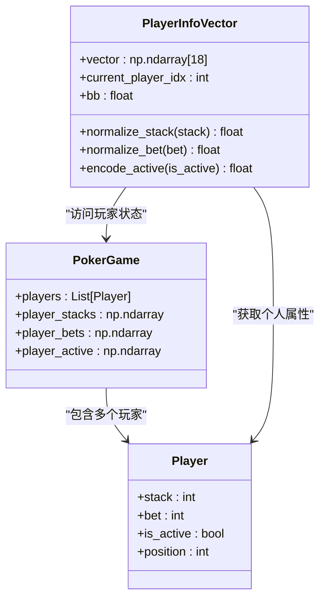
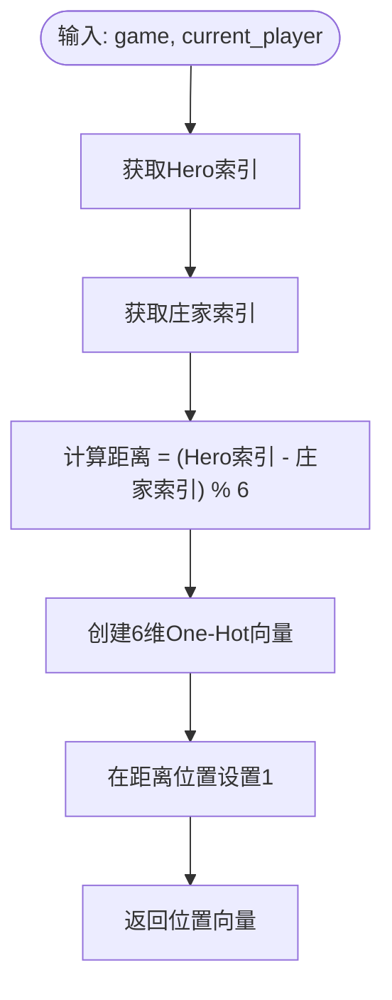
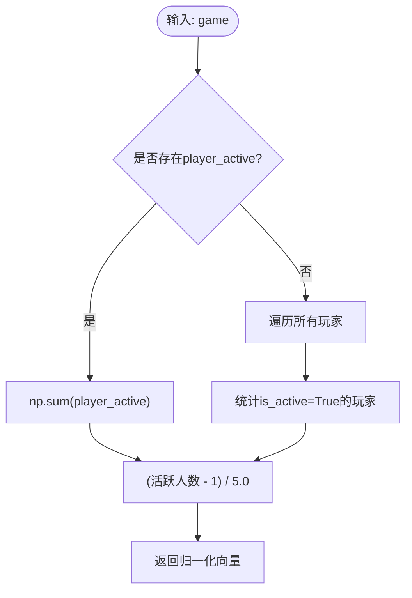
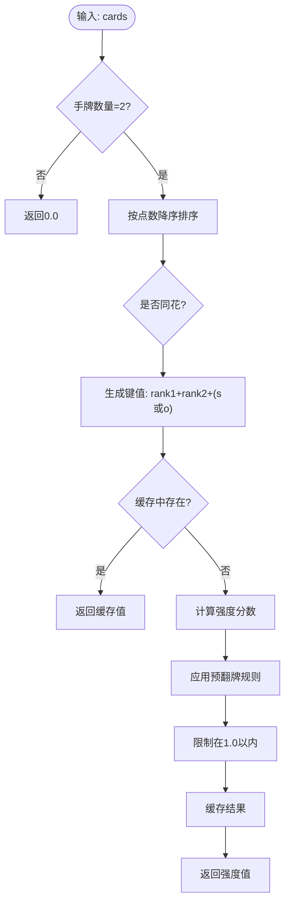
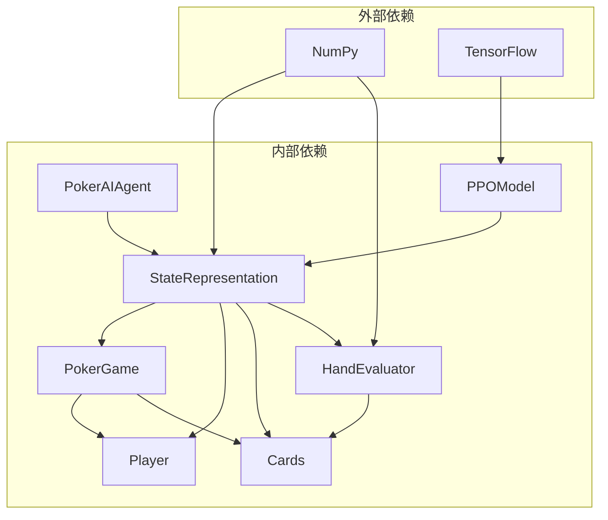

# 状态表示数据流

<cite>
**本文档引用的文件**
- [state_representation.py](file://poker_ai/model/state_representation.py)
- [cards.py](file://poker_ai/game/cards.py)
- [poker_game.py](file://poker_ai/game/poker_game.py)
- [hand_evaluator.py](file://poker_ai/model/hand_evaluator.py)
- [ai_agent.py](file://poker_ai/model/ai_agent.py)
- [ppo_model.py](file://poker_ai/model/ppo_model.py)
- [ppo_config.py](file://poker_ai/config/ppo_config.py)
</cite>

## 目录
1. [简介](#简介)
2. [项目结构](#项目结构)
3. [核心组件](#核心组件)
4. [架构概览](#架构概览)
5. [详细组件分析](#详细组件分析)
6. [依赖关系分析](#依赖关系分析)
7. [性能考量](#性能考量)
8. [故障排除指南](#故障排除指南)
9. [结论](#结论)

## 简介

本文档深入分析德州扑克AI的状态表示系统，重点阐述134维状态向量的构建过程。该系统采用6-Max专用设计，包含手牌one-hot编码、公共牌编码、玩家信息向量化、游戏全局信息处理等多个维度的数据转换。文档详细说明了状态表示的优化策略，包括预计算索引映射、向量化操作、内存缓存等技术，并解释Hero绝对位置编码、活跃玩家数量等新增特性的数据处理流程。

## 项目结构

德州扑克AI项目采用模块化架构，主要包含以下核心模块：

**图表来源**
- [state_representation.py:1-247](file://poker_ai/model/state_representation.py#L1-L247)
- [poker_game.py:155-497](file://poker_ai/game/poker_game.py#L155-L497)
- [ai_agent.py:55-703](file://poker_ai/model/ai_agent.py#L55-L703)

**章节来源**
- [state_representation.py:1-247](file://poker_ai/model/state_representation.py#L1-L247)
- [poker_game.py:1-497](file://poker_ai/game/poker_game.py#L1-L497)

## 核心组件

### 状态表示转换器 (StateRepresentation)

StateRepresentation是整个状态表示系统的核心组件，负责将复杂的德州扑克游戏状态转换为机器学习算法可处理的134维向量。

#### 状态向量维度分解

系统采用6-Max专用设计，总状态维度为134维：

| 维度类别 | 维度数量 | 描述 | 数据来源 |
|---------|---------|------|----------|
| 玩家手牌 | 52 | 13种点数 × 4种花色的one-hot编码 | Player.cards |
| 公共牌 | 52 | 13种点数 × 4种花色的one-hot编码 | PokerGame.board |
| 玩家信息 | 18 | 6个玩家 × 3特征(Stack, Bet, Active) | Player属性 |
| 游戏全局信息 | 5 | Round, Pot, Bet, BigBlind, SmallBlind | PokerGame属性 |
| Hero绝对位置 | 6 | BTN, SB, BB, UTG, MP, CO的One-Hot编码 | PokerGame.dealer_pos |
| 活跃玩家数量 | 1 | 归一化的活跃玩家计数 | PokerGame.player_active |

#### 关键优化策略

1. **预计算索引映射**：避免在高频路径中反复执行list.index操作
2. **向量化操作**：使用NumPy数组进行批量数据处理
3. **内存缓存**：预分配状态向量内存空间
4. **整数编码优化**：支持直接使用整数编码避免对象解包

**章节来源**
- [state_representation.py:12-39](file://poker_ai/model/state_representation.py#L12-L39)
- [state_representation.py:42-46](file://poker_ai/model/state_representation.py#L42-L46)

## 架构概览

状态表示系统采用分层架构设计，确保各组件职责清晰且高度解耦：

**图表来源**
- [ai_agent.py:125-155](file://poker_ai/model/ai_agent.py#L125-L155)
- [state_representation.py:137-158](file://poker_ai/model/state_representation.py#L137-L158)
- [hand_evaluator.py:123-187](file://poker_ai/model/hand_evaluator.py#L123-L187)

## 详细组件分析

### 手牌编码系统

#### One-Hot编码实现

手牌编码采用标准的one-hot向量表示法，将52张扑克牌映射到13×4的二维空间：

**图表来源**
- [state_representation.py:47-64](file://poker_ai/model/state_representation.py#L47-L64)
- [cards.py:38-51](file://poker_ai/game/cards.py#L38-L51)

#### 整数编码优化

系统支持两种编码方式以满足不同性能需求：

1. **对象编码**：适用于调试和开发阶段
2. **整数编码**：适用于生产环境的高性能路径

**章节来源**
- [state_representation.py:47-64](file://poker_ai/model/state_representation.py#L47-L64)
- [cards.py:44-51](file://poker_ai/game/cards.py#L44-L51)

### 玩家信息向量化

#### 相对位置排序机制

玩家信息向量化采用独特的相对位置排序策略，确保AI总能在第一个位置看到自己的信息：

**图表来源**
- [state_representation.py:66-97](file://poker_ai/model/state_representation.py#L66-L97)
- [poker_game.py:9-154](file://poker_ai/game/poker_game.py#L9-L154)

#### 归一化策略

所有数值特征都经过归一化处理，确保数值范围的一致性：

- **筹码归一化**：min(stack/(bb×100), 1.0)
- **下注额归一化**：min(bet/(bb×100), 1.0)
- **活跃状态**：二值化编码(0或1)

**章节来源**
- [state_representation.py:82-96](file://poker_ai/model/state_representation.py#L82-L96)

### Hero绝对位置编码

#### 位置计算逻辑

Hero绝对位置编码是系统的重要创新，通过计算Hero相对于庄家的绝对位置来提供精确的位置信息：

**图表来源**
- [state_representation.py:99-124](file://poker_ai/model/state_representation.py#L99-L124)

#### 6-Max位置定义

系统定义了标准的6-Max位置映射：

- **0**: BTN (Dealer) - 庄家位置
- **1**: SB (Small Blind) - 小盲注位置  
- **2**: BB (Big Blind) - 大盲注位置
- **3**: UTG (Under the Gun) - 第一闲家
- **4**: MP (Middle Position) - 中位位置
- **5**: CO (Cutoff) - 最后闲家

**章节来源**
- [state_representation.py:100-124](file://poker_ai/model/state_representation.py#L100-L124)

### 活跃玩家数量特征

#### 统计计算机制

活跃玩家数量特征提供了游戏动态信息的重要指标：

**图表来源**
- [state_representation.py:126-135](file://poker_ai/model/state_representation.py#L126-L135)

#### 归一化范围

活跃玩家数量经过特殊归一化处理：
- **最小值**: 1 (Head-up对战)
- **最大值**: 6 (6人全在)
- **归一化公式**: (活跃人数 - 1) / 5.0

**章节来源**
- [state_representation.py:127-135](file://poker_ai/model/state_representation.py#L127-L135)

### 手牌强度评估

#### 预翻牌强度计算

系统实现了高效的预翻牌手牌强度评估，使用预计算缓存避免重复计算：

**图表来源**
- [state_representation.py:186-210](file://poker_ai/model/state_representation.py#L186-L210)

#### 蒙特卡洛胜率计算

对于翻牌后的手牌，系统使用蒙特卡洛模拟计算胜率：

**章节来源**
- [state_representation.py:174-184](file://poker_ai/model/state_representation.py#L174-L184)
- [hand_evaluator.py:123-187](file://poker_ai/model/hand_evaluator.py#L123-L187)

## 依赖关系分析

状态表示系统与其他组件的依赖关系如下：

**图表来源**
- [state_representation.py:3-7](file://poker_ai/model/state_representation.py#L3-L7)
- [ppo_model.py:1-10](file://poker_ai/model/ppo_model.py#L1-L10)

### 关键依赖链

1. **StateRepresentation依赖关系**：
   - 游戏状态：PokerGame、Player
   - 卡牌系统：Card、Deck
   - 手牌评估：HandEvaluator

2. **AI代理集成**：
   - PokerAIAgent通过StateRepresentation获取状态
   - 支持多种学习算法：DQN、策略梯度、PPO

**章节来源**
- [state_representation.py:5-7](file://poker_ai/model/state_representation.py#L5-L7)
- [ai_agent.py:6-9](file://poker_ai/model/ai_agent.py#L6-L9)

## 性能考量

### 内存优化策略

系统采用了多项内存优化技术：

1. **预分配内存**：所有状态向量在初始化时预分配固定大小
2. **整数编码优先**：在可能的情况下使用整数编码避免对象创建
3. **缓存机制**：预翻牌强度计算使用字典缓存
4. **向量化操作**：使用NumPy数组进行批量处理

### 计算效率优化

1. **索引映射缓存**：预计算花色和点数的索引映射
2. **条件分支优化**：使用hasattr检查避免异常处理开销
3. **归一化优化**：使用min函数限制范围避免多次计算
4. **循环优化**：固定6次循环确保CPU流水线效率

### 性能瓶颈识别

1. **手牌评估**：HandEvaluator.evaluate_hand是主要计算瓶颈
2. **蒙特卡洛模拟**：calculate_win_probability的simulations参数影响性能
3. **状态向量拼接**：np.concatenate操作在高频路径中需要优化

### 优化建议

1. **手牌评估缓存**：考虑实现更高级的手牌评估缓存机制
2. **并行化处理**：利用多核CPU并行处理多个状态向量
3. **内存池管理**：实现状态向量的内存池复用
4. **SIMD优化**：考虑使用NumPy的向量化操作进一步优化

## 故障排除指南

### 常见问题诊断

1. **状态维度不匹配**
   - 检查StateRepresentation.total_state_dim是否为134
   - 验证各维度计算公式是否正确

2. **位置编码错误**
   - 确认dealer_pos和current_player索引计算
   - 检查模运算的边界条件

3. **玩家信息向量化异常**
   - 验证相对位置排序逻辑
   - 检查归一化参数的合理性

### 调试技巧

1. **逐步验证**：分别测试每个维度的生成过程
2. **边界测试**：测试极端情况如全下注、全弃牌等
3. **性能监控**：使用时间戳监控各函数的执行时间

**章节来源**
- [state_representation.py:137-158](file://poker_ai/model/state_representation.py#L137-L158)

## 结论

德州扑克AI状态表示系统通过精心设计的134维状态向量，成功地将复杂的德州扑克游戏状态转换为机器学习算法可处理的格式。系统的主要优势包括：

1. **完整性**：覆盖了德州扑克的所有重要信息维度
2. **高效性**：通过多项优化技术确保实时性能
3. **可扩展性**：模块化设计便于功能扩展和维护
4. **准确性**：精确的位置编码和玩家信息处理

该系统为德州扑克AI的训练和部署奠定了坚实的基础，其设计理念和优化策略可以为其他复杂游戏AI的开发提供有价值的参考。